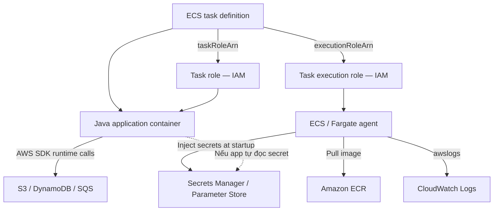
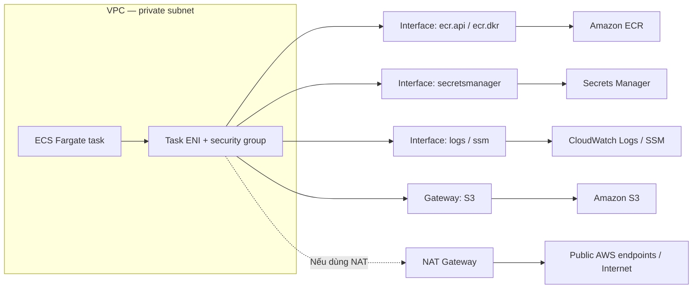
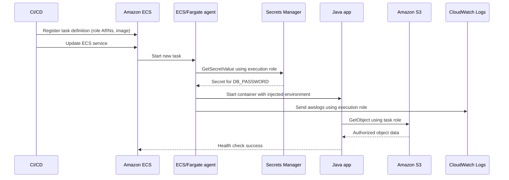

# Task role, execution role và quản lý secret trong Amazon ECS

> **Chương:** Container với ECS  
> **Module:** `CLOUD_PROVIDERS_AWS`  
> **Bối cảnh:** Ứng dụng Java/Spring Boot chạy dưới dạng container trên Amazon Elastic Container Service (ECS), sử dụng Amazon ECR, Amazon S3, Amazon CloudWatch Logs, AWS Secrets Manager hoặc Systems Manager Parameter Store. Mục tiêu là cấp đúng quyền IAM cho **ứng dụng** và **hạ tầng chạy task**, phân phối thông tin bí mật an toàn, vận hành có quan sát, xử lý rotation, phục hồi lỗi triển khai và kiểm soát chi phí.

## Mục tiêu học tập

Sau bài học, người học có thể:

1. Phân biệt **IAM task role** (`taskRoleArn`) và **task execution role** (`executionRoleArn`) với role của EC2 container instance, service-linked role và quyền của người triển khai.
2. Giải thích luồng ECS agent lấy container image, ghi log và inject secret so với luồng code Java gọi dịch vụ AWS bằng AWS SDK.
3. Cấu hình hai role theo nguyên tắc **least privilege**, dùng trust policy `ecs-tasks.amazonaws.com` và các điều kiện hạn chế confused deputy.
4. Lưu secret trong **AWS Secrets Manager** hoặc **SSM Parameter Store SecureString**, tham chiếu qua `containerDefinitions[].secrets[]` và hiểu yêu cầu `GetSecretValue`/`GetParameters`/`kms:Decrypt`.
5. So sánh **startup secret injection** với **runtime secret retrieval** về IAM role, thời điểm cập nhật, nguy cơ lộ và khả năng xoay vòng.
6. Thiết kế ECS Fargate ở private subnet với NAT hoặc VPC endpoints phù hợp để task có thể pull image, lấy secret và ghi CloudWatch Logs.
7. Khắc phục lỗi `ResourceInitializationError`, `CannotPullContainerError`, `AccessDeniedException` và triển khai lại task an toàn sau khi secret được xoay.
8. Kiểm thử bằng AWS CLI, xây checklist phát hành, giám sát và thiết kế phương án rollback.

## 1. Tại sao ECS cần nhiều IAM role?

Một **ECS task** là đơn vị chạy một hoặc nhiều container dựa trên **task definition**. Khi task bắt đầu, có hai nhóm công việc tách biệt:

- **ECS/Fargate agent và hạ tầng điều phối** phải tải image từ registry, cấu hình một số dịch vụ tích hợp, lấy secret mà task definition tham chiếu và đưa log đến nơi đã cấu hình.
- **Application code trong container** phải xử lý nghiệp vụ và có thể gọi trực tiếp S3, DynamoDB, SQS, Secrets Manager hoặc dịch vụ AWS khác.

Nếu cấp một role có quyền rộng cho cả hai, việc bảo mật và kiểm toán trở nên khó khăn. ECS tách các trách nhiệm theo hai thuộc tính:

```json
{
  "taskRoleArn": "arn:aws:iam::111122223333:role/orders-api-task-role",
  "executionRoleArn": "arn:aws:iam::111122223333:role/orders-api-execution-role"
}
```

Các Account ID/role name trong bài **đều là giả định**, không đại diện tài nguyên đang tồn tại.

### 1.1 So sánh nhiệm vụ và nguyên tắc quyền

| Đặc điểm | **Task role** | **Task execution role** |
|---|---|---|
| Thuộc tính task definition | `taskRoleArn` | `executionRoleArn` |
| Ai sử dụng credential? | Ứng dụng/SDK/CLI trong container thuộc task | ECS container agent hoặc Fargate agent thay mặt task |
| Khi nào hoạt động? | **Trong thời gian ứng dụng chạy** để gọi AWS APIs | Chủ yếu lúc khởi tạo task và các hoạt động tích hợp như gửi log |
| Quyền điển hình | `s3:GetObject`, `dynamodb:PutItem`, `sqs:SendMessage`, `secretsmanager:GetSecretValue` nếu app tự gọi | Quyền pull Amazon ECR, `logs:CreateLogStream`, `logs:PutLogEvents`, lấy secret/parameter được tham chiếu trong task definition |
| Có dùng cho secret injection lúc startup? | Không, trừ khi chính app chủ động lấy secret | **Có** |
| Có dùng cho Java gọi Secrets Manager bằng SDK? | **Có** | Không |
| Có dùng để ứng dụng gọi S3? | **Có** | Không nên cấp quyền nghiệp vụ |
| Credential trực tiếp xuất hiện trong container? | ECS cung cấp credential tạm thời của task role cho SDK | Credential của execution role **không trực tiếp cấp cho application container** |

**Quy tắc ngắn gọn:** “Ứng dụng gọi API” → **task role**. “ECS chuẩn bị/chạy task thay mặt ứng dụng” → **execution role**. Đây là khác biệt quan trọng nhất của bài.

### 1.2 Sơ đồ hai luồng quyền



Sơ đồ thể hiện **quyền được dùng theo chức năng**, không mô tả tất cả kết nối điều khiển nội bộ của ECS. Khi app tự gọi Secrets Manager, task role cũng phải có quyền tương ứng; một task có thể sử dụng cả hai phương án secret cùng lúc.

### 1.3 Những role khác dễ nhầm

| Loại IAM role | Ai sử dụng | Không được nhầm với |
|---|---|---|
| **ECS task role** | Containerized application | Role của EC2 host chạy container |
| **ECS task execution role** | ECS/Fargate agent | Role của ứng dụng |
| **EC2 container instance IAM role** | EC2 host chạy ECS agent khi chọn EC2 launch type | Task role; role host có phạm vi quyền riêng |
| **ECS service-linked role** | ECS service quản lý các AWS resources được hỗ trợ | Execution role của từng task |
| **ECS infrastructure IAM role** | Một số tính năng như EBS volume cho task hoặc tích hợp hạ tầng | Task role/execution role |
| **IAM role của CI/CD operator** | Người hoặc pipeline đăng ký task definition, cập nhật ECS service | Quyền thực thi của task runtime |

Với **Fargate**, bạn không tự quản lý EC2 host nên không có EC2 instance profile của host mà application phải dựa vào. Với **ECS on EC2**, EC2 container instance IAM role vẫn phục vụ ECS agent/host; ứng dụng nên dùng task role riêng.

## 2. Task role: quyền AWS cho chính ứng dụng

**Task role** cho phép code trong ECS task gọi các API AWS bằng credential tạm thời do ECS cung cấp. Ví dụ `orders-api` cần đọc chứng từ `s3://orders-documents-example/invoices/...`. Ta cấp quyền **`s3:GetObject` đến prefix cần thiết**, không phải quyền administrator trên tất cả bucket.

### 2.1 Ví dụ IAM permissions cho ứng dụng Java

```json
{
  "Version": "2012-10-17",
  "Statement": [
    {
      "Sid": "ReadApprovedInvoices",
      "Effect": "Allow",
      "Action": [
        "s3:GetObject"
      ],
      "Resource": [
        "arn:aws:s3:::orders-documents-example/invoices/*"
      ]
    }
  ]
}
```

Policy này dùng gắn vào **`orders-api-task-role`**. Nếu ứng dụng cũng cần `s3:ListBucket`, phải thêm statement riêng trên ARN bucket và điều kiện prefix phù hợp; không mặc định mở quyền chỉ vì có `GetObject`. Nếu dùng SSE-KMS, có thể cần thêm quyền KMS tương ứng và key policy.

Một Java service khác chỉ gửi sự kiện SQS nên có **task role khác** cho `sqs:SendMessage` đến đúng queue. Không dùng chung một task role quá rộng giữa các service chỉ để giảm số role IAM cần quản lý.

### 2.2 AWS SDK lấy task role credentials bằng cách nào?

ECS cung cấp **temporary role credentials** qua cơ chế container credential provider. ECS agent đưa biến môi trường `AWS_CONTAINER_CREDENTIALS_RELATIVE_URI` vào container; AWS SDK for Java v2 default credentials provider chain nhận biết cách dùng credential trong container.

Đối với app, cách dùng bình thường chỉ là:

```java
import software.amazon.awssdk.regions.Region;
import software.amazon.awssdk.services.s3.S3Client;
import software.amazon.awssdk.services.s3.model.GetObjectRequest;
import software.amazon.awssdk.core.ResponseBytes;
import software.amazon.awssdk.services.s3.model.GetObjectResponse;

public class InvoiceReader {
    public byte[] loadInvoice(String key) {
        try (S3Client s3 = S3Client.builder()
                .region(Region.AP_SOUTHEAST_1)
                .build()) {
            ResponseBytes<GetObjectResponse> response =
                s3.getObjectAsBytes(GetObjectRequest.builder()
                    .bucket("orders-documents-example")
                    .key(key)
                    .build());
            return response.asByteArray();
        }
    }
}
```

Ví dụ cần dependency `software.amazon.awssdk:s3` và cấu hình S3 Region đúng. Không có access key hardcoded, `AssumeRole` thủ công hoặc mật khẩu IAM trong code. SDK tự xử lý credential được ECS cấp khi environment phù hợp.

**Không in nội dung biến `AWS_CONTAINER_CREDENTIALS_RELATIVE_URI` kèm response credential ra log.** URI là thành phần của cơ chế cung cấp temporary credentials, không phải thứ cần thao tác thủ công từ ứng dụng.

### 2.3 Task role áp dụng ở cấp task, không phải từng container

Một ECS task có thể chứa app container, sidecar và agent container. **Task role cấp cho toàn task**; những container cùng task có thể tiếp cận role credentials theo cơ chế ECS. Nếu hai ứng dụng cần quyền rất khác nhau, hãy cân nhắc tách thành **hai ECS tasks/services** thay vì giả định có một IAM role riêng biệt cho từng container trong cùng task.

**Bảo mật:** Container không phải mặc nhiên là ranh giới cách ly đủ mạnh trên tất cả compute options. Fargate cung cấp ranh giới task riêng; các task chạy trên cùng ECS EC2 host có thể có nguy cơ truy cập thông tin của task khác hoặc credential host nếu cấu hình không an toàn. Không chạy container đặc quyền, host mounts hoặc cho truy cập EC2 instance metadata khi không cần.

## 3. Task execution role: quyền cho hạ tầng khởi chạy task

**Task execution role** được ECS container agent/Fargate agent sử dụng để thực hiện các API “phục vụ việc task chạy”, thường gồm:

- Lấy authorization token và kéo container image từ **Amazon ECR**.
- Tạo log stream và gửi log qua `awslogs` đến **CloudWatch Logs**.
- Đọc secret trong Secrets Manager hoặc parameter trong SSM Parameter Store để inject vào container từ `secrets` của task definition.
- Dùng secret cho **private registry authentication** (`repositoryCredentials`).
- Những tính năng tích hợp ECS khác có thể có yêu cầu quyền bổ sung.

Managed policy AWS thường được dùng làm nền:

```text
arn:aws:iam::aws:policy/service-role/AmazonECSTaskExecutionRolePolicy
```

Policy này phục vụ **ECR và CloudWatch Logs** ở các tình huống phổ biến. Nó **không tự cấp mọi quyền Secrets Manager hoặc SSM cần thiết**; khi task definition tham chiếu secret/parameter, thường phải thêm IAM statement giới hạn tới tài nguyên đó. Kiểm tra policy AWS thực tế trong Account trước khi áp dụng.

### 3.1 Quyền bổ sung để inject secret từ Secrets Manager

Ví dụ execution role được đọc **một secret** có tên `prod/orders/db` và giá trị mã hóa bằng customer managed KMS key:

```json
{
  "Version": "2012-10-17",
  "Statement": [
    {
      "Sid": "ReadOrdersDatabaseSecret",
      "Effect": "Allow",
      "Action": "secretsmanager:GetSecretValue",
      "Resource": "arn:aws:secretsmanager:ap-southeast-1:111122223333:secret:prod/orders/db-*"
    },
    {
      "Sid": "DecryptOrdersDatabaseSecret",
      "Effect": "Allow",
      "Action": "kms:Decrypt",
      "Resource": "arn:aws:kms:ap-southeast-1:111122223333:key/11111111-2222-3333-4444-555555555555"
    }
  ]
}
```

Đây là **identity-based policy bổ sung** của execution role. Trong production cần kiểm tra cả KMS key policy, tài khoản/Region, quyền secret resource policy nếu có và điều kiện `kms:ViaService`/encryption context khi phù hợp. ARN secret thật có suffix sáu ký tự ngẫu nhiên; wildcard trong ví dụ chỉ để khớp suffix của secret được đặt tên, không nên mở rộng thành `secret:*`.

Nếu secret dùng AWS managed key mặc định của Secrets Manager, yêu cầu `kms:Decrypt` explicit trong execution role thường khác trường hợp customer managed key. Không sao chép một policy KMS rộng chỉ vì ứng dụng cần một password.

### 3.2 Execution role không cấp quyền S3 cho Java SDK

Giả sử bạn thêm `s3:GetObject` vào execution role nhưng **không** thêm vào task role. Khi code Java gọi `S3Client.getObject`, ứng dụng vẫn có thể nhận `AccessDenied`. Đó là **hành vi đúng** theo mô hình phân quyền: credential của execution role **không trực tiếp cung cấp cho container code**.

Ngược lại, cho `secretsmanager:GetSecretValue` vào **task role** nhưng task definition dùng `secrets[].valueFrom` có thể khiến việc startup vẫn thất bại: **agent** cần quyền đó ở **execution role**.

### 3.3 Quyền của người tạo/cập nhật task: `iam:PassRole`

Người hoặc CI/CD pipeline đăng ký task definition có `taskRoleArn` và `executionRoleArn` thường cần:

- Quyền ECS phù hợp như `ecs:RegisterTaskDefinition`, `ecs:UpdateService`.
- `iam:PassRole` cho đúng **hai role được ECS sử dụng**.
- Tùy workflow, thêm điều kiện `iam:PassedToService=ecs-tasks.amazonaws.com`.

**`iam:PassRole` là quyền của chủ thể triển khai**, không nên đưa mặc định vào task role hoặc execution role. Thiếu quyền này thường gây lỗi khi deploy/register task definition, khác với lỗi khi ECS đã bắt đầu chạy task.

## 4. Trust policy: ECS có được assume role không?

IAM role cần **trust policy** xác định ai được gọi `sts:AssumeRole`. Cả task role và execution role có thể sử dụng service principal:

```json
{
  "Version": "2012-10-17",
  "Statement": [
    {
      "Sid": "AllowEcsTasks",
      "Effect": "Allow",
      "Principal": {
        "Service": "ecs-tasks.amazonaws.com"
      },
      "Action": "sts:AssumeRole",
      "Condition": {
        "StringEquals": {
          "aws:SourceAccount": "111122223333"
        },
        "ArnLike": {
          "aws:SourceArn": "arn:aws:ecs:ap-southeast-1:111122223333:*"
        }
      }
    }
  ]
}
```

Các giá trị Account/Region là placeholder. Tạo **hai IAM roles khác nhau**, mỗi role gắn permissions riêng, dù trust policy có thể tương tự. Điều kiện `SourceAccount`/`SourceArn` giúp giảm rủi ro **confused deputy**.

Theo tài liệu ECS, hiện không thể dùng `aws:SourceArn` để giới hạn trust policy đến chính xác **một ECS cluster**; ví dụ dùng wildcard sau Account ID như trên. Không tự thay bằng ARN cluster cụ thể rồi mặc định task có thể assume.

### 4.1 Ba lớp IAM cần cùng hợp lệ

Một request thành công phụ thuộc vào nhiều lớp:

1. **Trust policy**: ECS service được phép assume IAM role hay không?
2. **Identity-based policy** của task/execution role: action và resource cụ thể có được phép không?
3. **Resource policy/KMS key policy/permission boundaries/SCP/VPC endpoint policy**: có thêm ràng buộc hoặc explicit deny nào không?

Bổ sung `secretsmanager:GetSecretValue` trong role chưa bảo đảm truy xuất được secret nếu cross-account secret resource policy không cho phép hoặc KMS key policy deny.

## 5. Hai cách quản lý secret chính trong ECS

Không nên ghi password, API token, SSH private key, signing key hoặc database credential vào:

- Dockerfile, container image layer, source code hoặc artifact build.
- Thuộc tính `environment` với `value` plaintext trong task definition.
- Log, trace, crash dump hoặc biến debug được xuất công khai.
- Git repository hoặc CI job command line có thể bị lưu lịch sử.

Đối với các thông tin nhạy cảm, AWS cung cấp hai lựa chọn thông dụng:

| Dịch vụ | Phù hợp với | Quyền đọc | Lưu ý |
|---|---|---|---|
| **AWS Secrets Manager** | Database password, API credentials, secret cần rotation/audit | `secretsmanager:GetSecretValue` | Hỗ trợ rotation, versions/staging labels; có phí lưu trữ secret và API |
| **Systems Manager Parameter Store – SecureString** | Cấu hình được mã hóa, secret đơn giản hoặc tổ chức đang dùng parameter hierarchy | `ssm:GetParameter`/`ssm:GetParameters` + KMS phù hợp | Có Standard/Advanced parameter; không mặc nhiên có managed rotation giống Secrets Manager |

**Parameter Store `String`/`StringList` không phải thay thế cho `SecureString` khi cần lưu secret.** Với `SecureString`, cần hiểu quyền giải mã qua KMS.

### 5.1 Secrets Manager: secret name, ARN và JSON key

Một secret có thể có name:

```text
prod/orders/db
```

Và nội dung JSON (chỉ minh họa cấu trúc; **không chứa credential thật**):

```json
{
  "username": "orders_app",
  "password": "<value-stored-in-secrets-manager>"
}
```

ARN thực tế có hậu tố ngẫu nhiên, ví dụ:

```text
arn:aws:secretsmanager:ap-southeast-1:111122223333:secret:prod/orders/db-AbCdEf
```

Khi tham chiếu **toàn bộ secret**, dùng ARN trên. Khi chỉ inject field `password` vào một biến môi trường, dùng cú pháp suffix:

```text
arn:aws:secretsmanager:ap-southeast-1:111122223333:secret:prod/orders/db-AbCdEf:password::
```

Dấu `::` cuối thể hiện đang bỏ trống `version-stage` và `version-id`, tức sử dụng phiên bản mặc định được gắn nhãn `AWSCURRENT`. Không phải thêm chuỗi này vào tên secret ở Secrets Manager; đây là cú pháp `valueFrom` của ECS.

### 5.2 Version stage khi xoay secret

Secrets Manager hỗ trợ nhiều secret versions và staging labels:

- `AWSCURRENT`: phiên bản đang là current.
- `AWSPENDING`: phiên bản đang chờ hoặc trong quy trình rotation, tùy cách tổ chức.
- `AWSPREVIOUS`: phiên bản trước theo cơ chế rotation/version labeling.

Định dạng tổng quát:

```text
arn:aws:secretsmanager:region:account-id:secret:secret-name:json-key:version-stage:version-id
```

Có thể chỉ định **một trong hai** `version-stage` hoặc `version-id`; không chỉ định cả hai. Trong production, nếu dùng `AWSCURRENT` mặc định, mỗi **task mới** sẽ lấy version current tại thời điểm task start; một task đang chạy không tự được thay giá trị đã inject.

### 5.3 SSM Parameter Store SecureString

Ví dụ parameter:

```text
/prod/orders/db/password
```

Task definition có thể tham chiếu parameter ARN:

```text
arn:aws:ssm:ap-southeast-1:111122223333:parameter/prod/orders/db/password
```

Nếu **ECS agent** inject parameter vào env, execution role cần `ssm:GetParameters` theo tài liệu ECS (và quyền KMS phù hợp). Nếu **ứng dụng Java tự gọi** `GetParameter` với `WithDecryption=true`, task role cần `ssm:GetParameter` và `kms:Decrypt` nếu key policy/cơ chế encryption yêu cầu.

Đừng cấp `ssm:GetParametersByPath` cho toàn bộ `/prod` chỉ vì một service cần một parameter cụ thể. Quyền theo hierarchy có thể vô tình mở rộng phạm vi dữ liệu.

## 6. Startup injection: ECS lấy secret trước khi container chạy

Trường `containerDefinitions[].secrets[]` cho phép ECS lấy secret/parameter và đặt thành **environment variable** trong container khi task khởi động.

Ví dụ:

```json
{
  "name": "orders-api",
  "secrets": [
    {
      "name": "DB_PASSWORD",
      "valueFrom": "arn:aws:secretsmanager:ap-southeast-1:111122223333:secret:prod/orders/db-AbCdEf:password::"
    },
    {
      "name": "INTERNAL_TOKEN",
      "valueFrom": "arn:aws:ssm:ap-southeast-1:111122223333:parameter/prod/orders/token"
    }
  ]
}
```

Luồng:

1. ECS agent/Fargate agent chuẩn bị task.
2. **Execution role** được sử dụng để gọi Secrets Manager/Parameter Store và dịch vụ liên quan.
3. ECS inject giá trị vào environment variable của container khi start.
4. Java application đọc `DB_PASSWORD`/`INTERNAL_TOKEN` qua biến môi trường.
5. Những giá trị đó giữ nguyên trong **container đang chạy**, cho dù secret ở nguồn được thay.

### 6.1 Không tự cập nhật sau rotation

Nếu password của `prod/orders/db` được xoay từ `P1` sang `P2` lúc 10:00:

```text
09:00  Task A start   -> DB_PASSWORD=P1
10:00  Secret rotate  -> AWSCURRENT=P2
10:05  Task A running -> DB_PASSWORD vẫn P1
10:10  Task B start   -> DB_PASSWORD=P2
```

Đối với ECS service, có thể triển khai lại task bằng:

```bash
aws ecs update-service \
  --cluster orders-prod \
  --service orders-api \
  --force-new-deployment \
  --region ap-southeast-1
```

Lệnh này **thay đổi hạ tầng**: ECS service tạo deployment mới và thay task theo deployment configuration. Nó không mặc nhiên thay task definition revision. Trước khi chạy, bảo đảm secret mới đã hoạt động, deployment có capacity, app tương thích và backend có khoảng thời gian chuyển đổi credential phù hợp.

Đối với một task chạy độc lập bằng `RunTask`, cần **dừng và tạo task mới** theo quy trình thay thế tương ứng; không có cơ chế cập nhật environment variable của container đang chạy qua ECS.

### 6.2 Nguy cơ lộ qua environment variables

Giá trị env variable có thể bị đọc bởi process bên trong container, debugging tools hoặc thành phần có quyền cao và có thể xuất hiện trong log nếu app vô tình ghi `printenv`/`System.getenv()`, crash report hoặc diagnostic dump.

Dùng `secrets` an toàn hơn đưa plaintext vào task definition, nhưng **không biến environment variable thành kho bí mật không thể truy xuất**. Cần:

- Không log env vars, JDBC URL chứa mật khẩu, HTTP Authorization header.
- Giảm quyền ECS Exec/container exec và giới hạn ai có thể debug production.
- Không cung cấp quyền `ecs:ExecuteCommand` rộng cho mọi nhân viên.
- Loại bỏ secret khỏi telemetry, error messages và support bundle.
- Chạy container với user không phải root, hạn chế capabilities/mounts khi phù hợp.

Khi có yêu cầu chống rò rỉ qua env, cân nhắc **runtime SDK retrieval**, sidecar ghi secret vào shared ephemeral volume hoặc phương án khác được AWS hỗ trợ, có kiểm soát file permissions.

### 6.3 Điều kiện phiên bản ECS runtime

Một số tính năng inject yêu cầu minimum runtime version:

| Nền tảng | Inject toàn bộ secret | Inject JSON key / secret version |
|---|---|---|
| **AWS Fargate Linux** | Platform `1.3.0` trở lên | Platform `1.4.0` trở lên |
| **AWS Fargate Windows** | Theo phiên bản hỗ trợ | Platform `1.0.0` theo tài liệu |
| **ECS on EC2** | ECS container agent `1.22.0` trở lên | Agent `1.37.0` trở lên |

Nên dùng platform/agent hiện được AWS hỗ trợ và kiểm tra tính tương thích thật, không chỉ dựa vào version tối thiểu. Với Fargate Linux, `LATEST` hiện được AWS mô tả là `1.4.0`; platform version và revision của nó là hai khái niệm khác nhau.

## 7. Runtime retrieval: ứng dụng tự gọi Secrets Manager

Trong mô hình này, Java app chủ động gọi AWS Secrets Manager **trong lúc chạy**:

1. ECS cung cấp temporary task role credentials cho container.
2. AWS SDK for Java dùng **task role** để gọi `GetSecretValue`.
3. Ứng dụng xử lý JSON hoặc SecretString và dùng credential theo vòng đời của mình.
4. Khi rotation xảy ra, ứng dụng có thể fetch lại theo TTL, sự kiện hoặc retry phù hợp.

**Trong mô hình này, execution role không cần quyền lấy secret đó chỉ vì Java tự lấy.** Nhưng nếu task definition cũng inject cùng secret, execution role vẫn phải có quyền cho phần inject.

### 7.1 Ví dụ Java SDK v2 đọc secret lúc runtime

```java
import software.amazon.awssdk.regions.Region;
import software.amazon.awssdk.services.secretsmanager.SecretsManagerClient;
import software.amazon.awssdk.services.secretsmanager.model.GetSecretValueRequest;
import software.amazon.awssdk.services.secretsmanager.model.GetSecretValueResponse;

public final class OrdersSecretReader {
    public String loadDatabaseSecretJson() {
        try (SecretsManagerClient client = SecretsManagerClient.builder()
                .region(Region.AP_SOUTHEAST_1)
                .build()) {
            GetSecretValueResponse response = client.getSecretValue(
                GetSecretValueRequest.builder()
                    .secretId("prod/orders/db")
                    .build()
            );

            // Không ghi response.secretString() vào log.
            // Ứng dụng cần parse JSON và giữ giá trị trong phạm vi cần thiết.
            return response.secretString();
        }
    }
}
```

Cần dependency `software.amazon.awssdk:secretsmanager`, `taskRoleArn` có `secretsmanager:GetSecretValue` tới secret tương ứng, KMS permission/key policy nếu dùng customer managed key và đường mạng tới endpoint. Đoạn code **không có credential hardcoded**; SDK sử dụng default credentials provider chain, vốn nhận task role credentials khi chạy trong ECS.

Đoạn code đọc secret mỗi lần được gọi và tạo client mới. Trong hệ thống production, nên **tái sử dụng SDK client**, cache secret theo TTL an toàn hoặc dùng caching library phù hợp. Không gọi Secrets Manager trên **mỗi HTTP request** nếu không có lý do, vì tăng latency, chi phí API và nguy cơ bị throttling.

### 7.2 Lựa chọn injection hay runtime retrieval?

| Tiêu chí | ECS startup injection | Runtime retrieval bằng SDK |
|---|---|---|
| Role cần `GetSecretValue` | **Execution role** | **Task role** |
| Java cần gọi Secrets Manager API? | Không | Có |
| Giá trị có nằm trong env vars? | Có | Không bắt buộc |
| Secret rotate → giá trị task đổi ngay? | Không | **Có thể** nếu app fetch/caching/reload đúng |
| Ảnh hưởng tới startup khi Secrets Manager unreachable | Task có thể không khởi tạo được | App có thể khởi tạo hoặc thất bại tùy cách xử lý runtime |
| Chi phí/latency của API | Chủ yếu lúc start/refresh task | Phụ thuộc số lần fetch và cache |
| Độ phức tạp ứng dụng | Thấp hơn | Cao hơn: cache, retry, refresh, circuit breaker, fail closed |
| Rủi ro bị lộ qua env | Cao hơn nếu log/debug sai | Giảm rủi ro qua env, nhưng vẫn phải bảo vệ giá trị trong memory/log |

**Gợi ý lựa chọn:** Với secret ít thay đổi, startup injection đơn giản và dễ vận hành nếu ECS service có quy trình redeploy sau rotation. Với secret thay đổi thường xuyên hoặc cần cập nhật không restart, runtime retrieval có kiểm soát cache/retry phù hợp hơn.

### 7.3 Khả năng quay vòng credential thật sự

Dù app tự fetch phiên bản mới, việc rotate password database có thể ảnh hưởng tới các connection đang mở. Quy trình cần phối hợp:

- Secrets Manager rotation strategy và tài khoản database.
- Thời gian chồng lấn/chuyển đổi giữa credential cũ và mới.
- Connection pool của Java: refresh hay tái tạo connection đúng lúc.
- Retry có giới hạn với `AWSCURRENT` khi xác thực thất bại do rotation.
- Giám sát lỗi kết nối DB, latency và khả năng rollback an toàn.

Không mặc định một lần gọi lại `GetSecretValue` giải quyết mọi vấn đề khi password cũ bị hủy hiệu lực tức thời.

## 8. Ví dụ task definition Fargate có hai role và secret

Giả sử triển khai `orders-api` tại Singapore (`ap-southeast-1`), container image nằm trong ECR, log được gửi CloudWatch Logs. App cần S3 `GetObject` qua **task role**; password DB được inject bởi **execution role**.

Task definition JSON minh họa:

```json
{
  "family": "orders-api",
  "networkMode": "awsvpc",
  "requiresCompatibilities": ["FARGATE"],
  "cpu": "512",
  "memory": "1024",
  "taskRoleArn": "arn:aws:iam::111122223333:role/orders-api-task-role",
  "executionRoleArn": "arn:aws:iam::111122223333:role/orders-api-execution-role",
  "containerDefinitions": [
    {
      "name": "orders-api",
      "image": "111122223333.dkr.ecr.ap-southeast-1.amazonaws.com/orders-api:2026-11-20",
      "essential": true,
      "portMappings": [
        {
          "containerPort": 8080,
          "protocol": "tcp"
        }
      ],
      "environment": [
        {"name": "APP_ENV", "value": "prod"},
        {"name": "DB_HOST", "value": "orders-db.internal"}
      ],
      "secrets": [
        {
          "name": "DB_PASSWORD",
          "valueFrom": "arn:aws:secretsmanager:ap-southeast-1:111122223333:secret:prod/orders/db-AbCdEf:password::"
        }
      ],
      "logConfiguration": {
        "logDriver": "awslogs",
        "options": {
          "awslogs-group": "/ecs/orders-api",
          "awslogs-region": "ap-southeast-1",
          "awslogs-stream-prefix": "ecs"
        }
      }
    }
  ]
}
```

Ví dụ cố ý **không** có mật khẩu thật. Các ARN, ECR repository, DNS, log group và Account ID là placeholder: cần tạo tài nguyên, IAM role, KMS key, CloudWatch log group, VPC subnet và security group trước khi chạy thật.

### 8.1 Đọc file này từ góc nhìn hai role

- `image` và `awslogs`: agent dùng execution role, thường cần AWS managed policy `AmazonECSTaskExecutionRolePolicy` và các quyền bổ sung nếu có điều kiện đặc biệt.
- `secrets[].valueFrom`: agent dùng execution role để gọi `secretsmanager:GetSecretValue` và giải mã theo KMS khi cần.
- `environment[]`: chỉ chứa giá trị **không nhạy cảm**.
- Java gọi S3: SDK dùng **task role**, cần S3 permission theo prefix.
- `taskRoleArn` và `executionRoleArn` là **IAM role ARNs**, không phải role session credentials.
- Task definition có revision; khi thay cấu hình, đăng ký revision mới và triển khai service có kiểm soát.

### 8.2 Đăng ký task definition (làm thay đổi tài nguyên)

Sau khi đã đặt JSON trên vào file cục bộ do người triển khai chuẩn bị, ví dụ `orders-task-definition.json`:

```bash
aws sts get-caller-identity

aws ecs register-task-definition \
  --cli-input-json file://orders-task-definition.json \
  --region ap-southeast-1
```

Lệnh thay đổi hạ tầng (đăng ký revision mới) và yêu cầu ECS/IAM permissions, bao gồm `iam:PassRole` cho hai role khi phù hợp. Đừng chạy trên production chỉ để thử cú pháp.

Có thể kiểm tra task definition sau khi đăng ký:

```bash
aws ecs describe-task-definition \
  --task-definition orders-api \
  --region ap-southeast-1 \
  --query 'taskDefinition.{Family:family,Revision:revision,TaskRole:taskRoleArn,ExecutionRole:executionRoleArn,Secrets:containerDefinitions[].secrets}' \
  --output json
```

Lệnh này thường trả về **metadata ARN của secret** (không phải secret value). Tuy nhiên, toàn bộ task definition có thể chứa giá trị `environment.value` plaintext nếu ai đó cấu hình sai; hạn chế chia sẻ output và tuyệt đối không đưa secret trực tiếp vào đó.

## 9. Private subnet: quyền IAM đúng vẫn có thể không đủ

Một lỗi phổ biến: task có execution role đúng nhưng bị dừng khi start vì **không có network path tới ECR, Secrets Manager hoặc CloudWatch Logs**.

Với Fargate Linux platform `1.4.0`, các lưu lượng pull ECR, lấy secret, gửi logs và application traffic đi qua **task ENI** trong VPC, có thể quan sát qua VPC Flow Logs.

### 9.1 Các đường kết nối tối thiểu

| Hoạt động | Endpoint/đường mạng thường dùng | Role |
|---|---|---|
| Lấy ECR auth & image manifest | Interface VPC endpoints `ecr.api`, `ecr.dkr` hoặc kết nối mạng phù hợp | Execution |
| Tải ECR image layers | Thường cần **S3 gateway endpoint** cùng ECR endpoints trong mô hình không NAT | Execution |
| Lấy secret | Interface endpoint `secretsmanager` hoặc NAT/Internet egress phù hợp | Execution lúc injection; task lúc SDK runtime |
| Lấy SSM parameter | Interface endpoint `ssm` hoặc kết nối mạng phù hợp | Execution lúc injection; task lúc runtime |
| Đẩy awslogs | Interface endpoint `logs` hoặc kết nối mạng phù hợp | Execution |
| Code Java đọc S3 | S3 gateway/interface endpoint hoặc NAT theo thiết kế | Task |

Cần kiểm tra đặc thù **private registry khác ECR** và pull-through cache: một số luồng có thể cần Internet egress lần đầu hoặc cấu hình khác, dù đã có ECR endpoints.

### 9.2 NAT Gateway hoặc PrivateLink?

Nếu muốn đặt Fargate task trong private subnet với `assignPublicIp=DISABLED`, có hai phương án thường gặp:

- **NAT Gateway**: outbound ra các public AWS service endpoints/Internet; cấu hình route, security group và phí xử lý dữ liệu theo AZ/Region/loại NAT.
- **VPC endpoints (PrivateLink/gateway)**: dùng endpoint được hỗ trợ để tới ECR, S3, Secrets Manager, logs, SSM... trong VPC, giảm phụ thuộc vào đường Internet công khai. Interface endpoints tính phí theo thời gian và dữ liệu; không mặc định rẻ hơn NAT trong mọi trường hợp.



Sơ đồ chỉ ra **các đường mạng có thể chọn**; không có nghĩa mọi task phải đồng thời có cả NAT và tất cả endpoints. Cần bật **Private DNS** theo loại endpoint khi được hỗ trợ, gắn endpoint vào subnet/route table đúng và cho phép TCP/443 từ task ENI tới endpoint security group (và chiều phản hồi theo mô hình security group/NACL).

### 9.3 KMS có cần endpoint không?

Khi ECS agent gọi Secrets Manager để lấy secret mã hóa, thông thường Secrets Manager xử lý tương tác KMS theo đường service-to-service; không tự suy rằng task bắt buộc có KMS interface endpoint chỉ vì secret dùng customer managed key. Nếu application **trực tiếp gọi KMS** hoặc các bước runtime cần KMS API từ VPC, khi đó phải thiết kế đường mạng và quyền KMS tương ứng.

## 10. Rotation: thay secret mà không làm gián đoạn ứng dụng

Quản lý secret tốt cần đủ **ba vòng đời**:

1. **Tạo/phân phối**: quản lý kho secret, encryption, ownership, IAM/KMS.
2. **Sử dụng**: injection hoặc runtime retrieval.
3. **Rotation/thu hồi**: đổi value, triển khai lại hoặc refresh cache, kiểm tra và giới hạn credential cũ.

### 10.1 Quy trình với ECS startup injection

Giả sử database dùng credential do Secrets Manager tự động rotate:

1. Đội vận hành kiểm tra rotation function/strategy và secret version mới.
2. Kiểm tra `AWSCURRENT` chứa credential hợp lệ.
3. Nếu cơ chế backend yêu cầu, giữ khoảng chuyển tiếp để các task cũ không mất kết nối ngay.
4. Gọi `aws ecs update-service --force-new-deployment` hoặc dùng deployment pipeline tương đương.
5. ECS tạo task mới, execution role fetch version `AWSCURRENT` mới và inject vào app.
6. ALB/service health check đảm bảo task mới healthy trước khi dừng task cũ, theo deployment configuration.
7. Giám sát DB auth errors, HTTP 5xx, task restarts, secret retrieval errors.
8. Thu hồi credential cũ theo chiến lược rotation, đồng bộ runbook rollback.

**Không nên ép đổi mật khẩu DB theo cách làm mọi kết nối cũ vô hiệu ngay lập tức** nếu ứng dụng chưa có retry/connection refresh và ECS chưa kịp rollout task mới.

### 10.2 Quy trình với runtime fetch/caching

Nếu Java tự fetch `GetSecretValue`:

- Chọn TTL cache cân bằng khả năng cập nhật với chi phí API, độ trễ và rate limits.
- Khi TTL hết hoặc có sự kiện xác thực thất bại xác đáng, fetch lại `AWSCURRENT`.
- Không duy trì secret cũ vô hạn; có deadline cập nhật và cảnh báo.
- Ghi metrics của việc refresh **không log giá trị secret**.
- Chọn chính sách fail closed nếu không còn credential hợp lệ; có thể giữ cached credential ngắn hạn khi backend còn chấp nhận và policy cho phép.
- Test việc đổi mật khẩu khi load và task bị restart/AZ có lỗi.

**Luôn tách secret rotation khỏi thay đổi container image**, dù có thể đồng bộ rollout khi cần: rotation không nhất thiết yêu cầu build image mới.

## 11. Các lỗi IAM và secret cần phân biệt

| Triệu chứng | Giai đoạn | Nguyên nhân thường gặp | Hướng kiểm tra |
|---|---|---|---|
| `ResourceInitializationError: unable to pull secrets...` | Startup | Execution role thiếu `GetSecretValue`/`GetParameters`, KMS deny, secret ARN sai hoặc endpoint unreachable | Task stopped reason, execution role, secret policy/KMS, VPC endpoints/DNS |
| `CannotPullContainerError` | Startup | ECR permission hoặc mạng/registry image tag/digest sai | Execution role ECR permissions, endpoint ECR/S3, image URI, task ENI |
| `AccessDeniedException` khi Java gọi S3 | Runtime | Task role thiếu `s3:GetObject` hoặc bucket policy deny | Task role, resource ARN/prefix, SCP, bucket policy, KMS |
| `AccessDeniedException` khi Java gọi Secrets Manager | Runtime | Task role thiếu `GetSecretValue`, KMS deny hoặc secret resource policy | Task role, key policy, secret ARN/Region |
| Task chạy nhưng password cũ | Runtime | Inject từ lần start trước rotation | Secret version và task startedAt; force new deployment |
| Task mới không truy cập database | Startup/runtime | Secret hiện tại không tương thích backend, network SG hoặc DB rotation chưa hoàn tất | Check AWSCURRENT/backend, DB logs, connection policy |
| `iam:PassRole` denied | Deploy/register | Người/pipeline không có quyền pass role | Role của CI/CD và ARN trong task definition |
| Task không gửi CloudWatch Logs | Startup/runtime | Log group chưa tồn tại, execution role thiếu log permission hoặc endpoint logs không tới được | `awslogs` config, execution role, log group, VPC endpoints |
| Chạy Fargate private subnet nhưng pull/pull secret timeout | Startup | Thiếu NAT/endpoints, route, private DNS hoặc SG NACL | Task ENI, route tables, DNS, endpoints, logs |
| Dùng JSON key suffix không hoạt động | Startup | Fargate/agent quá cũ, secret không phải JSON, cú pháp ARN sai | Platform/agent version, suffix `:key::`, SecretString format |

### 11.1 Điều tra theo thứ tự hiệu quả

1. Xác định **Account, Region, ECS cluster, service, task ARN, task definition revision**, compute type và launch platform.
2. Đọc `stopCode`, `stoppedReason`, container `reason` và ECS service events.
3. Nếu task **chưa chạy tới app**, kiểm tra **execution role** và đường mạng ECR/Secrets Manager/logs.
4. Nếu task **đã chạy và SDK báo AccessDenied**, kiểm tra **task role** và resource/KMS policies.
5. Kiểm tra **secret ARN thực tế**, Region, version stage và sự tồn tại của secret. Tránh gọi `get-secret-value` chỉ để debug vì output có thể chứa mật khẩu.
6. Nếu lỗi liên quan thời điểm rotation, xem task startedAt so với thay đổi `AWSCURRENT`.
7. Kiểm tra CloudWatch logs, CloudTrail, VPC Flow Logs và metrics theo từng lớp; không in secret ra log.
8. Sau khi sửa quyền/network, rollout lại task phù hợp và quan sát healthy state.

## 12. AWS CLI: kiểm kê task roles và cấu hình secret (read-only)

Tất cả lệnh dưới đây chỉ đọc metadata. Tên resource và Account ID trong ví dụ là giả định; dùng Account/Region thật được ủy quyền.

### 12.1 Kiểm tra tài khoản và service

```bash
aws sts get-caller-identity

aws ecs describe-services \
  --cluster orders-prod \
  --services orders-api \
  --region ap-southeast-1 \
  --query 'services[].{Service:serviceName,Status:status,Desired:desiredCount,Running:runningCount,TaskDef:taskDefinition}' \
  --output json
```

### 12.2 Xem task definition và hai IAM roles

```bash
aws ecs describe-task-definition \
  --task-definition orders-api \
  --region ap-southeast-1 \
  --query 'taskDefinition.{Family:family,Revision:revision,TaskRole:taskRoleArn,ExecutionRole:executionRoleArn,Secrets:containerDefinitions[].secrets,Image:containerDefinitions[].image}' \
  --output json
```

Chỉ nên chia sẻ metadata cần thiết; một task definition không an toàn có thể chứa plaintext env values trong `environment`. `secrets[].valueFrom` tiết lộ **ARN/tên secret**, không phải password value, nhưng tên secret cũng có thể là metadata nội bộ không nên công khai.

### 12.3 Kiểm tra role và policies

```bash
aws iam get-role \
  --role-name orders-api-task-role \
  --query 'Role.{Arn:Arn,Trust:AssumeRolePolicyDocument}' \
  --output json

aws iam list-attached-role-policies \
  --role-name orders-api-execution-role \
  --output table

aws iam list-role-policies \
  --role-name orders-api-execution-role \
  --output table
```

`list-attached-role-policies` chỉ hiển thị managed policies; `list-role-policies` liệt kê inline policy names, không tự trả nội dung. Muốn đọc policy cụ thể dùng `get-role-policy` hoặc `get-policy-version` theo loại policy. Khi điều tra AccessDenied cần xem toàn bộ quyền đang áp dụng và explicit denies từ SCP/permissions boundary/resource policy.

### 12.4 Kiểm tra secret metadata, không lấy giá trị

```bash
aws secretsmanager describe-secret \
  --secret-id prod/orders/db \
  --region ap-southeast-1 \
  --query '{Arn:ARN,Name:Name,RotationEnabled:RotationEnabled,LastChangedDate:LastChangedDate,VersionIdsToStages:VersionIdsToStages,KmsKeyId:KmsKeyId}' \
  --output json
```

**Không dùng `get-secret-value` khi mục tiêu chỉ là kiểm tra trạng thái.** Lệnh đó trả về secret value ở stdout; nếu thực sự cần thử quyền đọc phải dùng môi trường bảo mật và tránh ghi/log/echo nội dung.

### 12.5 Xem task đã dừng và nguyên nhân

```bash
aws ecs list-tasks \
  --cluster orders-prod \
  --service-name orders-api \
  --desired-status STOPPED \
  --region ap-southeast-1

# Thay ARN bằng ARN thực tế trả về từ list-tasks
aws ecs describe-tasks \
  --cluster orders-prod \
  --tasks arn:aws:ecs:ap-southeast-1:111122223333:task/orders-prod/0123456789abcdef0123456789abcdef \
  --region ap-southeast-1 \
  --query 'tasks[].{Task:taskArn,TaskDef:taskDefinitionArn,StopCode:stopCode,Reason:stoppedReason,Started:startedAt,Stopped:stoppedAt,Containers:containers[].{Name:name,Exit:exitCode,Reason:reason}}' \
  --output json
```

ECS có thể chỉ trả về stopped tasks trong cửa sổ lưu giữ thông tin của dịch vụ; không giả định mọi task đã dừng từ nhiều tháng trước đều còn tìm thấy bằng API. Thiết lập logging/event capture riêng cho điều tra lịch sử.

## 13. Ví dụ chính sách IAM và workflow phát hành

### 13.1 Vai trò và policy trong hệ thống đặt hàng

Giả sử app `orders-api` có những yêu cầu:

| Hành động | Cấp cho ai? | Phạm vi |
|---|---|---|
| Pull ECR image | Execution role | ECR repository/token theo managed policy và ràng buộc bổ sung |
| Gửi logs qua `awslogs` | Execution role | Log group/stream phù hợp |
| Inject DB password từ Secrets Manager | Execution role | ARN `prod/orders/db-*` + KMS key đúng |
| Ứng dụng đọc hóa đơn S3 | Task role | `arn:aws:s3:::orders-documents-example/invoices/*` |
| Ứng dụng tự lấy credential khác lúc chạy | Task role | ARN secret tương ứng + KMS |
| Đăng ký task definition, update service | CI/CD role | ECS permissions + `iam:PassRole` cho hai roles |

Không cần cấp `secretsmanager:GetSecretValue` cho **task role** chỉ để inject `DB_PASSWORD` nếu app không gọi Secrets Manager bằng SDK.

### 13.2 Luồng phát hành an toàn



Triển khai thực tế nên dùng image digest hoặc tag version rõ ràng, test secret và IAM trước rollout, giữ khả năng rollback task definition revision, kiểm tra ALB health check và giám sát metrics. Không để CI/CD ghi secret value vào task definition hoặc console output.

### 13.3 Xoay secret trong tình huống production

Một đêm đội DB xoay password ở Secrets Manager. Task đang chạy vẫn có password cũ do startup injection. Quy trình:

1. Xem secret rotation status, xác minh backend đã sẵn sàng chấp nhận version `AWSCURRENT`.
2. Bảo đảm ECS service có ít nhất đủ healthy capacity để chạy rolling deployment.
3. Gọi `--force-new-deployment` thông qua pipeline có audit.
4. Theo dõi service events, `runningCount`, `desiredCount`, ALB target health và DB auth failures.
5. Chỉ chấm dứt hỗ trợ credential cũ khi đủ task mới healthy hoặc backend rotation strategy đảm bảo không gián đoạn.
6. Nếu thất bại, rollback deployment có kiểm soát và đánh giá trạng thái credential ở backend; rollback ECS image **không tự rollback secret**.

## 14. Bảo mật theo chiều sâu cho ECS credentials

### 14.1 Không dùng long-lived IAM access keys trong container

Khi ECS task có task role phù hợp, AWS SDK dùng temporary credentials được làm mới bởi môi trường ECS. **Không tạo IAM user key rồi đặt vào `AWS_ACCESS_KEY_ID`/`AWS_SECRET_ACCESS_KEY`** chỉ để app truy cập S3/Secrets Manager; cách làm này tạo gánh nặng phân phối, rotation và rủi ro lộ dài hạn.

Nếu app tự cung cấp explicit credentials provider hoặc env credentials từ CI, nó có thể **ghi đè** default credentials chain và bỏ qua task role. Khi runtime báo AccessDenied bất ngờ, kiểm tra liệu có biến credentials không cần thiết đang được inject không, nhưng không dump credential ra log.

### 14.2 Bảo vệ container và ECS Exec

- Hạn chế các container chạy `privileged`, host network/host mounts khi không cần.
- Dùng root filesystem chỉ đọc và Linux user không phải root khi ứng dụng hỗ trợ.
- Chỉ cấp `ecs:ExecuteCommand` cho nhóm vận hành cần thiết, giám sát/audit các phiên shell.
- Không in env variables trong support scripts; khi cần debug, dùng tên biến hoặc trạng thái tồn tại, không xuất giá trị.
- Giới hạn quyền sửa task definition, ECS service, Secrets Manager rotation và KMS key.
- Với ECS on EC2, bảo vệ **EC2 instance metadata service (IMDS)** khỏi container không được phép; kiểm tra cấu hình ECS agent/host firewall theo AWS docs.
- Phân tách dev/staging/prod bằng Account, role, secret và prefix tương ứng khi quy mô và yêu cầu cho phép.

### 14.3 Least privilege thực tế

Least privilege không chỉ là số action ít:

- Giới hạn theo **resource ARN** và prefix S3.
- Tránh dùng `Resource:"*"` cho secret khi có thể.
- Sử dụng **customer managed KMS keys** khi cần phân quyền decrypt khác nhau giữa các app.
- Dùng resource policy và điều kiện cross-account rõ ràng khi secret được chia sẻ.
- Giảm quyền của CI/CD role khi gọi `iam:PassRole` để không cho người deploy chỉ định role mạnh hơn.
- Theo dõi CloudTrail/API history và IAM Access Analyzer để phát hiện quyền không dùng hoặc quá rộng.
- Đừng coi việc chỉ inject một **JSON key** từ secret là giới hạn quyền IAM ở mức field: principal được phép `GetSecretValue` trên secret thường có quyền đọc **toàn bộ SecretString** của tài nguyên đó.

## 15. Khả năng giám sát, phục hồi và kiểm soát chi phí

### 15.1 Những chỉ số và sự kiện nên theo dõi

| Nhóm | Cần quan sát | Cách phản ứng |
|---|---|---|
| **Task start** | Số task STOPPED khi mới chạy, `ResourceInitializationError`, `CannotPullContainerError` | Điều tra execution role, ECR/Secrets endpoint/network |
| **IAM/secret** | AccessDenied, Secrets Manager rotation status, API failures, CloudTrail events | Phân biệt task/execution role, KMS/secret policy |
| **Service deployment** | `desiredCount`, `runningCount`, deployment state, service events | Dừng/rollback rollout khi không đạt healthy capacity |
| **App** | DB auth failures, HTTP 5xx, latency p95/p99, readiness | Xác minh rotation không gây mất kết nối |
| **Networking** | VPC Flow Logs và endpoint/NAT connectivity | Chẩn đoán DNS, route, SG và endpoint policy |
| **Costs** | Fargate vCPU/memory, Secrets Manager API usage/rotation, NAT Gateway, VPC endpoints, CloudWatch Logs, KMS | Điều chỉnh cấu hình/cache và logging retention |

CloudTrail hỗ trợ audit các API calls phù hợp và không đưa plaintext `SecretString` ra trong sự kiện `GetSecretValue`, nhưng metadata như secret ARN/tên, caller và thời điểm vẫn có thể nhạy cảm. Cần áp dụng retention, IAM và tránh ghi thêm dữ liệu bí mật vào request parameters ở nơi không phù hợp.

### 15.2 Chi phí giữa các chiến lược secret

Startup injection thường chỉ yêu cầu truy vấn secret khi task bắt đầu; runtime retrieval có thể gọi nhiều lần nếu thiết kế cache không tốt. Khi có hàng nghìn task, số lần gọi `GetSecretValue`, tải mạng endpoint, latency và các giới hạn của service có thể đáng kể.

**Tối ưu:** tái sử dụng AWS SDK client, cache có TTL, tránh secret API trên mỗi HTTP request, giới hạn số task bị restart cùng lúc khi rotation; đồng thời không cache secret lâu tới mức vượt deadline chuyển credential.

Chọn NAT Gateway hay interface endpoints cũng là bài toán chi phí: endpoint có phí theo giờ/dung lượng, NAT có phí thời gian/xử lý và data transfer theo mạng. Thiết kế theo Region/AZ và lưu lượng thật, không có phương án luôn rẻ hơn.

### 15.3 Phục hồi khi thay secret hoặc role sai

Khi một deployment thất bại vì IAM/KMS/secret:

1. Dừng triển khai tiếp nếu service mất healthy capacity.
2. Xác định task definition revision mới đã đổi role ARN, image, secret reference hay network chưa.
3. Kiểm tra stopped reason, service events và CloudTrail.
4. Sửa IAM/resource policy/KMS hoặc secret reference theo nguyên nhân; hạn chế mở wildcard để “chạy cho được”.
5. Tạo deployment mới có kiểm soát; verify ít nhất một task healthy và nghiệp vụ DB/S3.
6. Nếu rollback task definition, nhớ rằng secret version hiện tại có thể đã rotate; **đổi revision không tự khôi phục mật khẩu cũ**.
7. Ghi nhận sự cố và cập nhật validation trong pipeline.

## 16. Bài tập tự kiểm tra

**Bài 1 — Phân biệt quyền.** Task ECS Fargate dùng ECR image, CloudWatch Logs và một ứng dụng Java đọc object từ S3. Hãy xác định role nào cần quyền ECR/logs và role nào cần `s3:GetObject`.

**Bài 2 — Secret injection.** Task definition dùng `secrets[].valueFrom` để inject `DB_PASSWORD` từ Secrets Manager. Bạn đã cấp `GetSecretValue` cho task role nhưng task không khởi tạo được. Có thể thiếu quyền ở đâu?

**Bài 3 — Secret rotation.** Secret đã đổi `AWSCURRENT` lúc 14:00, service chạy từ 13:00. Vì sao task cũ vẫn dùng password cũ và thao tác nào tạo task mới lấy giá trị mới?

**Bài 4 — IAM trust.** Role có permission policy `s3:GetObject` đúng, nhưng ECS báo không thể assume role. Hãy nêu thành phần IAM còn thiếu hoặc sai, cùng service principal đúng.

**Bài 5 — Cross-account và KMS.** ECS ở Account A muốn đọc secret trong Account B dùng customer managed KMS key. Chỉ thêm `secretsmanager:GetSecretValue` vào execution role có đủ không? Cần xem thêm điều gì?

**Bài 6 — Networking.** Fargate task trong private subnet không có NAT, execution role hợp lệ nhưng bị lỗi không lấy được secret. Cần kiểm tra các VPC endpoints, DNS và security group nào?

**Bài 7 — Task definition JSON.** Giải thích khác biệt giữa:

```json
{"environment":[{"name":"DB_PASSWORD","value":"plaintext"}]}
```

và

```json
{"secrets":[{"name":"DB_PASSWORD","valueFrom":"arn:aws:secretsmanager:ap-southeast-1:111122223333:secret:prod/orders/db-AbCdEf:password::"}]}
```

**Bài 8 — Java SDK.** App gọi `SecretsManagerClient.getSecretValue` ở runtime nhưng execution role đã có quyền GetSecretValue. Vì sao app vẫn có thể AccessDenied? Nếu app chuyển sang startup injection, role nào phải đổi?

**Bài 9 — Sidecar.** Một tổ chức không chấp nhận đặt secret trong environment variables. Hãy đề xuất phương án khác trong ECS và các lưu ý về task role, file permissions và rotation.

**Bài 10 — Deployment role.** Pipeline đăng ký task definition mới nhưng API trả `iam:PassRole` denied. Có nên thêm `iam:PassRole` vào task execution role không? Quyền đó thuộc principal nào?

<details>
<summary>Gợi ý trả lời</summary>

1. ECR/logs: execution role; S3 do app gọi: task role.
2. Execution role thiếu `GetSecretValue` hoặc KMS/key policy; cũng phải kiểm tra secret ARN, endpoint và quyền khác.
3. ECS inject env khi task bắt đầu, không tự đổi trong task đang chạy. Dùng force new deployment hoặc task replacement có kiểm soát.
4. Trust policy của role phải cho `ecs-tasks.amazonaws.com` gọi `sts:AssumeRole` và điều kiện SourceAccount/Arn phải khớp.
5. Chưa đủ. Cần secret resource policy của Account B, KMS key policy/permissions, ARN đúng và networking.
6. Secrets Manager interface endpoint trong VPC, Private DNS, endpoint security group TCP/443, route/NACL/endpoint policy; đồng thời kiểm tra ECR endpoints/S3/logs nếu task cũng bị lỗi ở các bước đó.
7. `environment.value` là plaintext trong task definition; `secrets.valueFrom` chỉ tham chiếu ARN, agent sẽ lấy secret theo execution role lúc task start. Secret vẫn xuất hiện trong env của process sau injection.
8. Runtime SDK dùng task role, không dùng execution role. Startup injection yêu cầu execution role có quyền lấy secret.
9. Sidecar truy xuất secret và ghi shared task-scoped volume với quyền file tối thiểu; app đọc file, không log giá trị. Sidecar có cùng task role nếu dùng SDK, cần thiết kế reload khi rotation và giới hạn quyền truy cập volume.
10. Không. `iam:PassRole` thuộc người hoặc CI/CD role đang đăng ký/cập nhật task để cho phép pass task/execution roles cho ECS.

</details>

## 17. Checklist trước khi triển khai production

- [ ] Đã phân biệt `taskRoleArn` và `executionRoleArn` theo API caller thật, không dùng chung role tùy tiện.
- [ ] Task role chỉ có quyền nghiệp vụ mà code container thực sự cần.
- [ ] Execution role có policy ECR/logs thích hợp và chỉ quyền secret/parameter bắt buộc cho startup.
- [ ] Cả hai role có trust policy `ecs-tasks.amazonaws.com` và điều kiện SourceAccount/SourceArn phù hợp.
- [ ] CI/CD role có quyền `iam:PassRole` giới hạn hai role được phê duyệt.
- [ ] Không có secret plaintext trong Dockerfile, task definition `environment`, image layers hoặc log.
- [ ] Secret được lưu trong Secrets Manager hoặc SecureString với KMS/secret resource policy đúng.
- [ ] Đã xác nhận JSON key suffix, `AWSCURRENT` và platform/agent version cho secret injection.
- [ ] Đã chọn startup injection hay runtime SDK retrieval dựa vào nhu cầu rotation và cache.
- [ ] Có cơ chế force new deployment hoặc refresh runtime secret sau rotation.
- [ ] Đã kiểm tra Fargate private subnet: ECR, S3 layer, Secrets Manager/SSM, logs endpoints/NAT, DNS và TCP/443.
- [ ] Không cấp IAM key dài hạn cho container; không dump temporary credentials/secret ra log.
- [ ] Đã giới hạn ECS Exec, privileged containers, EC2 IMDS và task-level secret exposure.
- [ ] Đã test cả lỗi IAM startup, lỗi runtime SDK, KMS deny, missing secret, endpoint failure và rollback.
- [ ] Đã bật cảnh báo task start failures, deployment health, DB auth failures và CloudTrail audit phù hợp.
- [ ] Đã tính chi phí Secrets Manager requests, KMS, Fargate, logging, NAT/PrivateLink và rotation.

## Tài liệu AWS chính thức

- [Amazon ECS — Best practices for IAM roles](https://docs.aws.amazon.com/AmazonECS/latest/developerguide/security-iam-roles.html)
- [Amazon ECS — Task IAM role](https://docs.aws.amazon.com/AmazonECS/latest/developerguide/task-iam-roles.html)
- [Amazon ECS — Task execution IAM role](https://docs.aws.amazon.com/AmazonECS/latest/developerguide/task_execution_IAM_role.html)
- [Amazon ECS — IAM roles overview](https://docs.aws.amazon.com/AmazonECS/latest/developerguide/ecs-iam-role-overview.html)
- [Amazon ECS — Pass Secrets Manager secrets through environment variables](https://docs.aws.amazon.com/AmazonECS/latest/developerguide/secrets-envvar-secrets-manager.html)
- [Amazon ECS — Pass Parameter Store values through environment variables](https://docs.aws.amazon.com/AmazonECS/latest/developerguide/secrets-envvar-ssm-paramstore.html)
- [Amazon ECS — Pass sensitive data to containers](https://docs.aws.amazon.com/AmazonECS/latest/developerguide/specifying-sensitive-data.html)
- [Amazon ECS — Fargate task networking](https://docs.aws.amazon.com/AmazonECS/latest/developerguide/fargate-task-networking.html)
- [Amazon ECS — Migrate to Fargate Linux platform 1.4.0](https://docs.aws.amazon.com/AmazonECS/latest/developerguide/platform-version-migration.html)
- [Amazon ECS — Fargate platform versions](https://docs.aws.amazon.com/AmazonECS/latest/developerguide/platform-fargate.html)
- [Amazon ECS — Rolling deployment](https://docs.aws.amazon.com/AmazonECS/latest/developerguide/deployment-type-ecs.html)
- [AWS Secrets Manager — Use AWS Secrets Manager secrets](https://docs.aws.amazon.com/secretsmanager/latest/userguide/retrieving-secrets.html)
- [AWS Secrets Manager — Rotate AWS Secrets Manager secrets](https://docs.aws.amazon.com/secretsmanager/latest/userguide/rotating-secrets.html)
- [AWS Systems Manager — Parameter Store access control](https://docs.aws.amazon.com/systems-manager/latest/userguide/parameter-store-setting-up.html)
- [AWS SDK for Java 2.x — Credentials chain](https://docs.aws.amazon.com/sdk-for-java/latest/developer-guide/credentials-chain.html)

**Điểm cần ghi nhớ:** **Task role** trao quyền AWS cho **mã ứng dụng** trong ECS task; **execution role** trao quyền cho **ECS/Fargate agent** để pull image, ghi log và inject secret lúc khởi tạo. **Startup injection không tự nhận secret sau rotation**, còn **runtime retrieval bằng SDK** cần task role, cache và error handling phù hợp. Cả hai phương án chỉ an toàn khi IAM, KMS, network, logging, deployment và thử nghiệm phục hồi được thiết kế cùng nhau.

