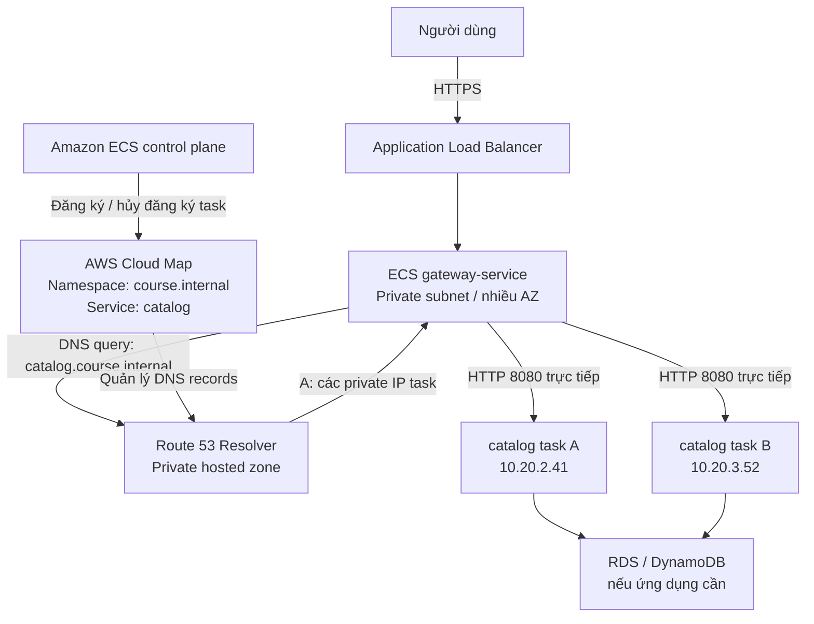
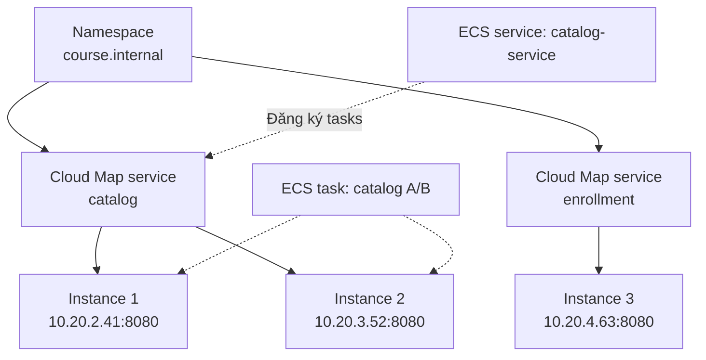
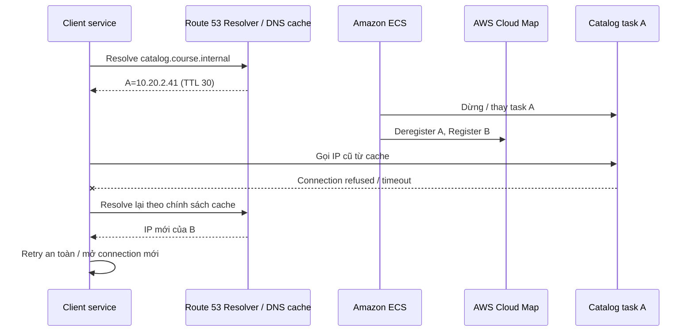
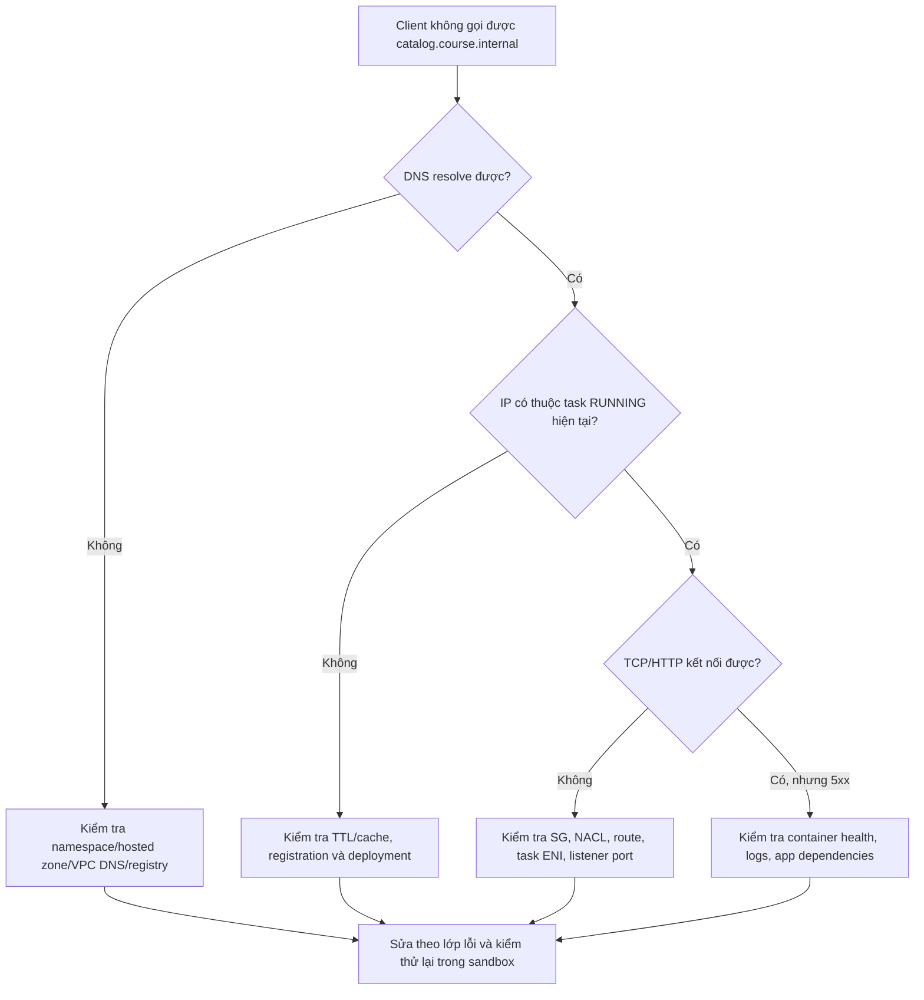

# Service discovery với AWS Cloud Map

> **Học phần:** CLOUD_PROVIDERS_AWS  
> **Chương:** Container với ECS  
> **Bài học:** Service discovery với AWS Cloud Map  
> **Phạm vi:** Amazon ECS trên AWS Fargate hoặc EC2, AWS Cloud Map, Amazon Route 53 private DNS, VPC, IAM, health checks và ứng dụng Java/Spring Boot giao tiếp nội bộ.

## 1. Bối cảnh: địa chỉ của ECS task luôn thay đổi

Giả sử một nền tảng học trực tuyến triển khai ba thành phần:

- **gateway-service** tiếp nhận request từ Application Load Balancer (ALB).
- **catalog-service** cung cấp danh mục khóa học qua HTTP trên cổng `8080`.
- **enrollment-service** xử lý đăng ký khóa học và gọi `catalog-service` để xác minh khóa học.

Các service chạy dưới dạng **Amazon ECS tasks** trong những private subnets thuộc nhiều Availability Zones. ECS có thể thay task khi deploy bản mới, task không khỏe, scale-out/scale-in hoặc khi cần phục hồi hạ tầng. Với network mode `awsvpc`, mỗi task được cấp network interface và địa chỉ IP riêng; IP này **không phải địa chỉ cố định của service**.

Nếu ứng dụng lưu địa chỉ như `http://10.20.2.41:8080` vào cấu hình:

1. Task bị thay, IP cũ không còn phục vụ.
2. Một task mới có IP khác nhưng cấu hình ứng dụng chưa cập nhật.
3. Những request tiếp theo thất bại cho dù ECS đã khởi chạy đủ số task mong muốn.

**Service discovery** giải quyết vấn đề *tìm các endpoint hiện có theo một tên logic*. Với **AWS Cloud Map**, ECS có thể tự đăng ký và hủy đăng ký các task trong danh bạ dịch vụ. Client gọi tên như:

```text
http://catalog.course.internal:8080/api/courses
```

thay vì hard-code IP từng task.

**Mục tiêu học tập:**

1. Giải thích Cloud Map **namespace → service → service instance** và quan hệ với ECS cluster, ECS service, ECS task.
2. Phân biệt **private DNS namespace**, **public DNS namespace** và **HTTP namespace**.
3. Hiểu bản ghi DNS `A`, `AAAA` và `SRV`; chọn đúng với network mode ECS.
4. Cấu hình ECS/Fargate service tự đăng ký task vào Cloud Map.
5. Kiểm tra bằng `dig`, `getent`, Cloud Map API và lệnh AWS CLI.
6. Hiểu **TTL**, DNS caching, cập nhật health và trường hợp fail-open; xây dựng retry an toàn.
7. Phân biệt **Cloud Map service discovery trực tiếp**, **ECS Service Connect** và **internal ALB**.
8. Thiết kế IAM, security groups, khả năng giám sát, phục hồi và kiểm soát chi phí cho hệ thống microservices.

## 2. Kiến trúc tham khảo



Trong sơ đồ:

- ECS quản lý desired count, deployment và lifecycle của tasks.
- AWS Cloud Map quản lý **tên dịch vụ cùng tập service instances**.
- Route 53 private hosted zone cung cấp DNS records trong VPC được liên kết.
- Client phân giải tên dịch vụ rồi **kết nối trực tiếp** đến IP/port của task; request **không tự đi qua ALB** chỉ vì service cũng được gắn ALB.
- Security group, route, subnet và ứng dụng thực tế vẫn quyết định liệu kết nối có thành công hay không.

**Điểm quan trọng:** Cloud Map giải quyết bài toán **định vị endpoint**, không phải một load balancer HTTP thực hiện health probing liên tục trên từng request, TLS termination, WAF, path routing hoặc connection draining giống ALB. Nếu client giữ IP quá lâu, nó vẫn có thể kết nối đến task đã bị dừng.

## 3. Ba lớp khái niệm của AWS Cloud Map

| Khái niệm | Ý nghĩa | Ví dụ |
|---|---|---|
| **Namespace** | Phạm vi logic để nhóm các Cloud Map services và xác định cách khám phá chúng. | `course.internal` |
| **Cloud Map service** | Danh bạ cho một loại endpoint; có tên, cấu hình DNS/TTL/routing và health. | `catalog` |
| **Service instance** | Một endpoint cụ thể được đăng ký với thuộc tính IP, port và metadata. | Task A `10.20.2.41:8080` |
| **ECS service** | Đối tượng ECS duy trì số lượng tasks và điều phối deployment. | `catalog-service` |
| **ECS task** | Một phiên chạy task definition, có container, mạng, trạng thái. | Task ARN chứa container Spring Boot |

**Không nhầm Cloud Map service với ECS service.** Chúng là hai tài nguyên khác nhau. ECS service sử dụng ARN của một **Cloud Map service registry**; ECS tasks được phản ánh thành **Cloud Map service instances**.

### 3.1. Quan hệ một-nhiều



Khi ECS thay task A:

1. Task cũ rời service, ECS hủy đăng ký endpoint cũ.
2. Task mới có ENI/private IP mới và được đăng ký vào Cloud Map.
3. DNS hoặc API discovery dần trả về endpoint mới.
4. Client phải xử lý **giai đoạn chuyển tiếp** khi có cache, request đang chạy hoặc task cũ vừa ngừng.

Không mặc định mọi thay đổi instance đều xuất hiện tức thì ở mọi client: registry cập nhật, propagation và DNS caching là các bước khác nhau.

### 3.2. Các metadata AWS ECS có thể đăng ký

Khi ECS tích hợp với AWS Cloud Map, service instances có thể đi kèm những attributes:

| Attribute | Ý nghĩa |
|---|---|
| `AWS_INSTANCE_IPV4` | Private IPv4 của task, khi có bản ghi `A`. |
| `AWS_INSTANCE_IPV6` | IPv6 của task khi cấu hình IPv6 tương thích. |
| `AWS_INSTANCE_PORT` | Port được công bố cho service discovery. |
| `AVAILABILITY_ZONE` | AZ nơi task chạy. |
| `REGION` | Region của task. |
| `ECS_SERVICE_NAME` | Tên ECS service. |
| `ECS_CLUSTER_NAME` | Tên ECS cluster. |
| `ECS_TASK_DEFINITION_FAMILY` | Family của task definition. |
| `EC2_INSTANCE_ID` | EC2 container instance ID khi dùng ECS EC2 capacity; không có trong Fargate. |

Những thuộc tính này hữu ích khi truy vấn bằng **AWS Cloud Map DiscoverInstances API**. Địa chỉ và port là dữ liệu để kết nối; metadata khác hỗ trợ lọc/quan sát. Không coi metadata Cloud Map là nơi lưu secret hoặc thông tin cá nhân.

## 4. Chọn namespace cho đúng

AWS Cloud Map hỗ trợ các kiểu namespace sau:

| Kiểu namespace | Cách khám phá | Khi nên dùng |
|---|---|---|
| **Private DNS namespace** | DNS trong VPC được liên kết **và** Cloud Map API. | ECS microservices nội bộ, client dùng hostname. |
| **Public DNS namespace** | DNS public **và** Cloud Map API. | Những endpoint thực sự được thiết kế để phân giải DNS public. |
| **HTTP namespace** | **Chỉ Cloud Map API** như `DiscoverInstances`; không có DNS records. | Ứng dụng có client SDK/API discovery, cần metadata hoặc logic tìm kiếm riêng. |

Với **ECS service discovery qua giao diện tạo ECS service**, luồng Console hỗ trợ **private DNS namespaces**. AWS Cloud Map bản thân hỗ trợ thêm các kiểu khác, nhưng **không thể chọn HTTP namespace rồi kỳ vọng `dig catalog.course.internal` hoạt động**.

### 4.1. Private DNS và Route 53

Tạo private DNS namespace `course.internal` sẽ dẫn đến một **Amazon Route 53 private hosted zone** tương ứng. Khi ECS đăng ký các task của Cloud Map service `catalog`, các DNS records được quản lý để client trong VPC truy vấn:

```text
catalog.course.internal
```

Các điều kiện thông thường:

- VPC phải bật `enableDnsSupport` để dùng Amazon-provided DNS resolution.
- VPC nên bật `enableDnsHostnames` theo yêu cầu của kiến trúc và hướng dẫn service discovery.
- Client chạy trong VPC đã liên kết với private hosted zone, hoặc có thiết kế DNS forwarding/association phù hợp.
- Nếu dùng DNS resolver riêng, resolver đó phải chuyển các yêu cầu thích hợp tới Route 53 Resolver.
- Private DNS **không làm mạng tự động thông nhau** giữa các VPC; vẫn cần route, peering/Transit Gateway và security controls nếu giao tiếp liên VPC được thiết kế.
- Namespace private không có nghĩa tên/port được bảo vệ bằng xác thực; client vẫn cần TLS và kiểm soát dịch vụ khi dữ liệu yêu cầu.

**Lưu ý tên miền:** `course.internal` là tên minh họa cho mạng riêng. Để tránh xung đột với DNS nội bộ hoặc namespace khác, tổ chức cần quy hoạch đặt tên và association trước khi tạo.

### 4.2. Cảnh báo khi dùng public namespace

Ngay cả khi ECS service discovery sử dụng public DNS namespace trong những cách cấu hình được hỗ trợ, **DNS records do ECS đăng ký vẫn dùng private IP của task**, không phải public IP. Vì vậy, tạo public namespace **không làm task tự có thể truy cập từ Internet**.

Đối với API người dùng bên ngoài, thường nên dùng **ALB/API Gateway**, TLS, WAF và authorization phù hợp thay vì trông chờ vào public Cloud Map records để công bố trực tiếp các task nội bộ.

## 5. Bản ghi DNS A, AAAA và SRV

### 5.1. A/AAAA trong network mode awsvpc

Với `awsvpc`, mỗi ECS task có địa chỉ mạng riêng, phù hợp với record `A` (IPv4) hoặc `AAAA` (IPv6 nếu cấu hình VPC/subnet tương thích).

Ví dụ truy vấn trong một client task:

```bash
dig +short A catalog.course.internal
```

Kết quả giả lập:

```text
10.20.2.41
10.20.3.52
```

Client thường dùng port của ứng dụng, ví dụ `http://catalog.course.internal:8080`. **A record không mang port**. Khi ứng dụng chạy ở cổng khác với cổng client đang gọi, DNS A có đúng IP cũng không đủ để kết nối thành công.

### 5.2. SRV mang cả port

`SRV` record có thể trả về **service hostname và port** cho từng instance:

```bash
dig +short SRV catalog.course.internal
```

Output dạng minh họa:

```text
1 1 8080 task-a.catalog.course.internal.
1 1 8080 task-b.catalog.course.internal.
```

Cú pháp SRV có các phần `priority weight port target-hostname`. Một ứng dụng muốn dùng SRV phải có resolver/client biết **tra SRV, đọc port, tra tiếp địa chỉ của target host**. Phần lớn HTTP client khi nhận URI `http://catalog.course.internal` sẽ **không tự tra SRV** và thường dùng cổng mặc định `80`.

Vì thế, `SRV` không phải lựa chọn thay thế trong suốt cho mọi REST client hiện có. Đối với ECS Fargate/`awsvpc` và HTTP port cố định, `A` thường đơn giản hơn.

### 5.3. Tương thích với network mode ECS

| Network mode | Bản ghi ECS service discovery hỗ trợ | Lý do |
|---|---|---|
| `awsvpc` | `A` hoặc `SRV`; có thể kết hợp `AAAA` trong cấu hình dual-stack phù hợp | Task có ENI và địa chỉ riêng; SRV yêu cầu cấu hình port. |
| `bridge` | **SRV** | Port mapping có thể động, nhiều containers chia sẻ địa chỉ host. |
| `host` | **SRV** | Cần mô tả endpoint ở host/port theo cơ chế ECS. |
| `none` | Không hỗ trợ ECS service discovery | Task không có mạng theo mô hình phù hợp. |

Với `bridge`/`host`, `serviceRegistries` phải xác định **container name + container port** theo task definition. Với `awsvpc` và `SRV`, cấu hình có thể dùng `port` hoặc cặp container name/port theo điều kiện API; không chỉ đưa ARN rồi mong ECS đoán cổng.

Với IPv6-only subnets, không tạo `A` record khi không có IPv4. Luôn kiểm tra hỗ trợ dual-stack, network mode và AWS platform version trước khi chọn loại DNS record.

### 5.4. Cloud Map routing policy

Cloud Map DNS services có thể dùng các Route 53 routing policies phù hợp:

| Policy | Hành vi khái quát |
|---|---|
| `MULTIVALUE` | Trả về **tối đa 8** records phù hợp trong một DNS answer, ưu tiên endpoint healthy khi có health check. |
| `WEIGHTED` | Trả về lựa chọn từ các service instances theo mô hình weighted; khi dùng Cloud Map, các instance cùng trọng số. |

Với nhiều task healthy, một câu trả lời `A` **không nhất thiết chứa toàn bộ task của service**, đặc biệt với `MULTIVALUE` có giới hạn 8 records mỗi DNS answer. DNS resolver/client cũng có thể thay đổi thứ tự hoặc chỉ chọn một IP. **Đừng dùng số IP trong một kết quả `dig` làm số lượng ECS tasks tuyệt đối.**

## 6. DNS TTL, cache và ý nghĩa khi scale/deploy

**TTL** (*Time to Live*) của DNS record xác định thời gian cache mà authoritative DNS công bố, tính bằng giây.

Ví dụ cấu hình Cloud Map service:

```text
Service: catalog
Namespace: course.internal
DNS: A
RoutingPolicy: MULTIVALUE
TTL: 30 seconds
```

Khi task A bị dừng và task B thay thế:



TTL **không bảo đảm** tất cả ứng dụng đổi IP sau đúng 30 giây:

- Recursive resolver có thể cache theo TTL.
- JVM/application DNS cache có thể có hành vi riêng.
- HTTP connection pool có thể **giữ kết nối đến IP cũ** ngay cả khi DNS đã đổi.
- ECS đăng ký/hủy đăng ký, health propagation và DNS updates cũng có độ trễ.
- Một số môi trường có negative caching khi chưa tìm thấy hostname.
- Request đang chạy không được tự động chuyển sang task mới khi task cũ biến mất.

### 6.1. Chọn TTL bao nhiêu?

TTL thấp giúp client có **cơ hội** tìm endpoint mới sớm hơn, nhưng có thể làm tăng tần suất truy vấn DNS và chi phí/áp lực hệ thống. TTL cao giảm truy vấn nhưng có thể khiến client giữ IP cũ lâu hơn.

Với lab, có thể chọn **30 giây** để quan sát thay đổi tương đối nhanh. Trong Production, hãy đo đặc tính restart/deploy, resolver caching, tần suất lookup, số clients và tỷ lệ request lỗi trước khi chọn.

Không có công thức "TTL = 0 sẽ không bao giờ lỗi". Ngay khi địa chỉ mới được phát hiện, connection đang dùng hoặc request đang xử lý vẫn có thể thất bại.

### 6.2. Hành vi ứng dụng khi DNS trả nhiều IP

DNS trả về một tập IP **không đồng nghĩa có load balancing ở Layer 7**. Một số client chọn IP đầu tiên, một số duyệt nhiều IP, một số giữ keep-alive connections lâu. Để phân tải và phục hồi tốt, client phải có chính sách kết nối phù hợp.

Các lựa chọn:

1. **Dùng DNS trực tiếp:** Client thực hiện resolve, timeout, retry, refresh/reconnect khi lỗi; phù hợp hệ thống đơn giản.
2. **Dùng ECS Service Connect:** Proxy được ECS quản lý hỗ trợ khám phá/định tuyến và cung cấp observability tốt hơn.
3. **Dùng internal ALB/NLB:** Cân bằng tải tập trung, health checks, behavior ở tầng HTTP/TCP theo loại LB.

## 7. Health checks: healthy trong ECS không phải health check của ALB

ECS service discovery tích hợp **AWS Cloud Map custom health checks**: Amazon ECS cập nhật trạng thái health cho instances dựa trên **trạng thái task và container-level health checks**.

Khi tạo Cloud Map service cho ECS, thường dùng:

```json
{
  "HealthCheckCustomConfig": {
    "FailureThreshold": 1
  }
}
```

ECS quản lý health thay vì Cloud Map tự gửi HTTP request từ Route 53 health checkers vào private ECS tasks. **Không cấu hình Route 53 HTTP health checks cho service trong private DNS namespace**, vì cơ chế Route 53 public health check không hỗ trợ private DNS service theo cách đó.

### 7.1. Container health check trong task definition

Ví dụ một container Spring Boot có Actuator readiness:

```json
{
  "healthCheck": {
    "command": [
      "CMD-SHELL",
      "curl -fsS http://127.0.0.1:8080/actuator/health/readiness > /dev/null || exit 1"
    ],
    "interval": 15,
    "timeout": 5,
    "retries": 3,
    "startPeriod": 30
  }
}
```

Lưu ý:

- Docker image **phải có `curl`** hoặc thay lệnh bằng công cụ health check khác có thật trong image.
- Ứng dụng phải expose readiness endpoint và trả kết quả phản ánh khả năng phục vụ.
- Health checks được ECS dùng để theo dõi task, nhưng cập nhật Cloud Map/DNS **không xảy ra ngay lập tức**.
- Các containers thiết yếu (*essential*) trong cùng task ảnh hưởng đến đánh giá health.
- ALB health check (nếu có ALB) là **một hệ thống health check khác**, có path/threshold/routing riêng.

### 7.2. Khi không còn healthy instance

AWS Cloud Map/Route 53 có hành vi **fail-open** trong một số điều kiện. Ví dụ, khi **tất cả records đều unhealthy**, Route 53 có thể trả về tối đa một số records unhealthy thay vì luôn trả rỗng. Điều này giúp tránh một số tình huống mất toàn bộ DNS, nhưng không có nghĩa backend sẽ xử lý request thành công.

**Không được thiết kế dựa trên giả định “DNS chắc chắn không trả task unhealthy”.** Ứng dụng vẫn phải timeout, retry có giới hạn và ghi nhận lỗi. Nếu cần tránh đưa lưu lượng tới backend chưa sẵn sàng, hãy dùng thêm cơ chế health-aware routing phù hợp.

## 8. Thực hành trên AWS Console: ECS + Cloud Map private DNS

Bài thực hành giả định đã có:

- AWS account sandbox có quyền thao tác ECS, Cloud Map, VPC và IAM.
- Một VPC, ví dụ `vpc-0123456789abcdef0`, với các private subnets ở **hai AZ**.
- Security group cho caller service và catalog service; DNS resolution trong VPC hoạt động.
- ECS cluster, Docker image `catalog:1.0.0` đã được push lên ECR, task definition Fargate/`awsvpc` có port `8080`.
- Đường mạng để task pull image, gửi log hoặc lấy secrets qua NAT/VPC endpoints phù hợp.

Không chạy nguyên những ID minh họa trong tài khoản thực. Thực hành có thể phát sinh phí Fargate, Cloud Map, Route 53 và các tài nguyên mạng.

### 8.1. Tạo private DNS namespace

1. Vào **AWS Cloud Map Console → Namespaces → Create namespace**.
2. Đặt tên `course.internal`.
3. Chọn **API calls and DNS queries in VPCs** (private DNS).
4. Chọn đúng VPC, thêm mô tả và tags.
5. Tạo namespace; chờ operation hoàn tất rồi xác nhận namespace tồn tại.
6. Kiểm tra Cloud Map đã tạo Route 53 private hosted zone tương ứng.

Có thể tạo namespace trực tiếp từ luồng **Create ECS service** trong Console nếu tùy chọn Service discovery hiện diện. Tuy nhiên, tách bước Cloud Map giúp dễ học mối quan hệ các tài nguyên và kiểm soát naming.

### 8.2. Tạo Cloud Map service

Trong namespace `course.internal`:

1. Chọn **Create service**, đặt tên `catalog`.
2. Chọn cấu hình DNS records **A** với TTL **30 giây** cho network mode `awsvpc` IPv4.
3. Chọn routing policy phù hợp, ví dụ **Multivalue answer**.
4. Chọn **custom health check** nếu dùng ECS health propagation.
5. Tạo Cloud Map service và ghi lại ARN của nó.

**Chỉ khi tạo ECS service có service registry trỏ tới ARN này**, ECS mới tự quản lý đăng ký task cho service. Tự tạo Cloud Map service chưa làm hostname trả về IP của một task chưa được đăng ký.

### 8.3. Tạo ECS service và gắn service registry

Trong **Amazon ECS Console**:

1. Vào **Clusters → chọn cluster → Services → Create**.
2. Chọn task definition có `networkMode=awsvpc`, container phục vụ HTTP trên `8080`.
3. Chọn launch type Fargate hoặc cấu hình compute được hỗ trợ; đặt desired tasks, ví dụ **2**.
4. Chọn private subnets nhiều AZ, security group cho catalog, và đường ra cần thiết để kéo image.
5. Mở mục **Service discovery**, chọn namespace `course.internal` và Cloud Map service `catalog` hoặc tạo tài nguyên theo luồng Console hiện hành.
6. Bật **ECS task health propagation** nếu có và cấu hình container health check.
7. Tạo ECS service, quan sát tasks chuyển sang `RUNNING` và health đạt yêu cầu.
8. Mở Cloud Map service, kiểm tra **service instances** đã xuất hiện; xác nhận địa chỉ/port metadata.
9. Từ một workload trong cùng VPC, phân giải `catalog.course.internal` và gọi HTTP tới service.

**Không nhầm:** Tên ECS service có thể là `catalog-service` trong khi Cloud Map service tên `catalog`. DNS trả hostname theo **tên Cloud Map service**, không nhất thiết theo tên ECS service.

## 9. Triển khai bằng AWS CLI: namespace → registry → ECS service

Các lệnh bên dưới là **mẫu cho Linux/macOS shell**. Thay Region, account ID, VPC ID, subnet IDs, security group, task definition ARN, IAM role ARN và image bằng tài nguyên do bạn sở hữu.

### 9.1. Xác minh account và mạng

```bash
aws sts get-caller-identity

aws ec2 describe-vpc-attribute \
  --vpc-id vpc-0123456789abcdef0 \
  --attribute enableDnsSupport \
  --region ap-southeast-1

aws ec2 describe-vpc-attribute \
  --vpc-id vpc-0123456789abcdef0 \
  --attribute enableDnsHostnames \
  --region ap-southeast-1
```

Nếu DNS support không đúng, phải được người quản trị VPC điều chỉnh trước. Không tùy tiện thay thuộc tính VPC Production khi chưa đánh giá các hosted zones/ứng dụng liên quan.

### 9.2. Tạo private DNS namespace

```bash
aws servicediscovery create-private-dns-namespace \
  --name course.internal \
  --description "Internal ECS service discovery lab" \
  --vpc vpc-0123456789abcdef0 \
  --region ap-southeast-1
```

Output trả về **`OperationId`**, vì quá trình tạo namespace là bất đồng bộ.

Kiểm tra operation (thay ID thật từ output):

```bash
aws servicediscovery get-operation \
  --operation-id operation-id-from-create-response \
  --region ap-southeast-1
```

Chỉ tiếp tục khi `Status=SUCCESS`. Lấy `NAMESPACE` ID từ `Operation.Targets`, ví dụ `ns-abc123example`. ID chỉ là minh họa, không tạo ra từ lệnh nếu chưa chạy.

### 9.3. Tạo Cloud Map service cho record A

Ví dụ lưu JSON sau thành `cloud-map-service.json` trong thư mục làm việc của người triển khai:

```json
{
  "Name": "catalog",
  "Description": "Catalog HTTP endpoints in ECS",
  "DnsConfig": {
    "NamespaceId": "ns-abc123example",
    "RoutingPolicy": "MULTIVALUE",
    "DnsRecords": [
      {
        "Type": "A",
        "TTL": 30
      }
    ]
  },
  "HealthCheckCustomConfig": {
    "FailureThreshold": 1
  }
}
```

Tạo service:

```bash
aws servicediscovery create-service \
  --cli-input-json file://cloud-map-service.json \
  --region ap-southeast-1
```

Ghi lại `Service.Id` và `Service.Arn`. Mẫu ARN:

```text
arn:aws:servicediscovery:ap-southeast-1:123456789012:service/srv-abc123example
```

Kiểm tra read-only:

```bash
aws servicediscovery list-services --region ap-southeast-1

aws servicediscovery get-service \
  --id srv-abc123example \
  --region ap-southeast-1
```

Nếu service chưa có instances, DNS có thể chưa trả về địa chỉ task; đây là trạng thái bình thường trước khi ECS chạy task được liên kết với registry.

### 9.4. Ví dụ task definition Fargate/awsvpc

File `catalog-task.json` minh họa:

```json
{
  "family": "catalog-task",
  "networkMode": "awsvpc",
  "requiresCompatibilities": ["FARGATE"],
  "cpu": "256",
  "memory": "512",
  "executionRoleArn": "arn:aws:iam::123456789012:role/ecsTaskExecutionRole",
  "containerDefinitions": [
    {
      "name": "catalog",
      "image": "123456789012.dkr.ecr.ap-southeast-1.amazonaws.com/catalog:1.0.0",
      "essential": true,
      "portMappings": [
        {
          "containerPort": 8080,
          "hostPort": 8080,
          "protocol": "tcp"
        }
      ],
      "healthCheck": {
        "command": [
          "CMD-SHELL",
          "curl -fsS http://127.0.0.1:8080/actuator/health/readiness > /dev/null || exit 1"
        ],
        "interval": 15,
        "timeout": 5,
        "retries": 3,
        "startPeriod": 30
      },
      "logConfiguration": {
        "logDriver": "awslogs",
        "options": {
          "awslogs-group": "/ecs/catalog",
          "awslogs-region": "ap-southeast-1",
          "awslogs-stream-prefix": "ecs"
        }
      }
    }
  ]
}
```

**Điều kiện trước khi chạy mẫu:** Image ECR phải có thật, chứa Spring Boot lắng nghe `0.0.0.0:8080`, Actuator readiness hoạt động và có `curl`. Log group `/ecs/catalog` đã tồn tại. Execution role có quyền pull image và ghi logs. Kích cỡ CPU/memory ở đây chỉ để giải thích API, **có thể không đủ cho JVM Production**.

Register task definition:

```bash
aws ecs register-task-definition \
  --cli-input-json file://catalog-task.json \
  --region ap-southeast-1
```

Một task definition tự nó chưa tạo task; cần ECS service hoặc chạy task theo cơ chế tương ứng. Service discovery tự động trong bài này được điều khiển qua **ECS service**, không phải gọi `RunTask` độc lập rồi mặc định có DNS registration.

### 9.5. Tạo ECS service trỏ đến Cloud Map registry

Ví dụ file `catalog-ecs-service.json`:

```json
{
  "cluster": "course-cluster",
  "serviceName": "catalog-service",
  "taskDefinition": "catalog-task",
  "launchType": "FARGATE",
  "platformVersion": "LATEST",
  "desiredCount": 2,
  "serviceRegistries": [
    {
      "registryArn": "arn:aws:servicediscovery:ap-southeast-1:123456789012:service/srv-abc123example"
    }
  ],
  "networkConfiguration": {
    "awsvpcConfiguration": {
      "subnets": [
        "subnet-11111111",
        "subnet-22222222"
      ],
      "securityGroups": [
        "sg-0123456789abcdef0"
      ],
      "assignPublicIp": "DISABLED"
    }
  }
}
```

Thực thi (sau khi kiểm tra VPC/network, IAM và image):

```bash
aws ecs create-service \
  --cli-input-json file://catalog-ecs-service.json \
  --region ap-southeast-1
```

Đọc lại:

```bash
aws ecs describe-services \
  --cluster course-cluster \
  --services catalog-service \
  --region ap-southeast-1 \
  --query 'services[].{name:serviceName,desired:desiredCount,running:runningCount,registries:serviceRegistries,events:events[0:3]}'
```

Sự kiện service (*service events*) thường cho biết task không khởi chạy, health check sai, không pull được image hoặc service discovery không đăng ký thành công. **Không kết luận DNS lỗi nếu service còn không có task ở trạng thái RUNNING.**

### 9.6. Kiểm tra Cloud Map instances

```bash
aws servicediscovery list-instances \
  --service-id srv-abc123example \
  --region ap-southeast-1

aws servicediscovery discover-instances \
  --namespace-name course.internal \
  --service-name catalog \
  --region ap-southeast-1
```

Khi thành công, dữ liệu instance có thể có:

```json
{
  "InstanceId": "example-task-registration-id",
  "Attributes": {
    "AWS_INSTANCE_IPV4": "10.20.2.41",
    "AWS_INSTANCE_PORT": "8080",
    "ECS_SERVICE_NAME": "catalog-service",
    "ECS_CLUSTER_NAME": "course-cluster",
    "REGION": "ap-southeast-1"
  }
}
```

Đây là **mẫu rút gọn** của một phần instance entry, không phải toàn bộ JSON response của AWS. Tên field/giá trị hiển thị thực tế tùy lệnh và loại instance.

### 9.7. Thay đổi hoặc gỡ service registry

Theo AWS ECS API hiện hành, cấu hình `serviceRegistries` có thể **được cập nhật đối với service sử dụng rolling deployment** và việc thêm/thay/gỡ registry kích hoạt deployment mới. Thao tác cập nhật cần service-linked role và quyền phù hợp; **không nên gỡ registry khi client vẫn đang phụ thuộc hostname**.

Khi đổi config:

1. Chuẩn bị Cloud Map service mới và kiểm tra tên/TTL.
2. Cập nhật ECS service theo quy trình deploy được hỗ trợ.
3. Kiểm tra task mới được đăng ký, task cũ được hủy đăng ký.
4. Đo DNS/connection errors trong khoảng chuyển tiếp.
5. Chỉ dọn Cloud Map service/namespace cũ sau khi toàn bộ client đã chuyển.

Cloud Map namespace/services và private hosted zone có thể **không được dọn hoàn toàn chỉ bằng cách xóa ECS service**. Cần kiểm tra phần cleanup riêng và tránh xóa shared namespace đang được nhiều service sử dụng.

## 10. Test DNS và HTTP từ đúng vị trí

**Private DNS chỉ có ý nghĩa khi truy vấn từ nơi có khả năng phân giải private hosted zone.** Không kiểm tra bằng máy cá nhân ngoài VPC rồi suy ra lỗi ECS nếu máy đó không có VPN/resolver hợp lệ.

Dùng một EC2 test hoặc một ECS client task trong cùng VPC, đã được cấp quyền và có tiện ích DNS:

```bash
# Thông tin bản ghi A trả về.
dig +short A catalog.course.internal

# Xem đầy đủ TTL và thông tin DNS.
dig catalog.course.internal A

# Nếu image không có dig, thử resolver hệ điều hành:
getent ahostsv4 catalog.course.internal

# Thử HTTP tới đúng cổng ứng dụng.
curl -sS --connect-timeout 3 --max-time 10 \
  http://catalog.course.internal:8080/actuator/health/readiness
```

**Phân biệt:** `dig` thành công chỉ chứng minh DNS biết endpoint. `curl` thành công cần thêm security groups, network path, container đang listen, application route đúng và readiness hợp lệ.

### 10.1. Kiểm tra khi tăng/giảm desired count

1. Ghi nhận `desiredCount=2`, danh sách ECS tasks và DNS answers.
2. Trong sandbox, tăng desired count thành **3**.
3. Đợi task mới `RUNNING` và health đáp ứng; kiểm tra Cloud Map đã đăng ký endpoint mới.
4. Query DNS nhiều lần, lưu ý `MULTIVALUE` không nhất thiết trả tất cả instances nếu số lượng lớn.
5. Giảm desired count về **2**, kiểm tra task cũ được deregister.
6. Theo dõi application retries và lỗi kết nối trong khoảng DNS caching.
7. Kết thúc lab, đưa desired count về mức đã thống nhất và dọn resources tạm nếu có.

Lệnh chỉnh desired count (có tác động tài nguyên và chi phí):

```bash
aws ecs update-service \
  --cluster course-cluster \
  --service catalog-service \
  --desired-count 3 \
  --region ap-southeast-1
```

Không scale down dữ liệu quan trọng mà không kiểm tra active requests, graceful shutdown, queue/worker state và khả năng xử lý của những tasks còn lại.

## 11. Java/Spring Boot gọi service qua Cloud Map DNS

Khi một service đã có tên DNS trong VPC, ứng dụng Java có thể dùng URI thông thường. Không cần gọi Cloud Map API nếu chọn **DNS discovery**:

```yaml
app:
  catalog:
    base-url: http://catalog.course.internal:8080
```

Đây chỉ là **YAML cấu hình ứng dụng**; Spring Boot không tự hiểu thuộc tính `app.catalog.base-url` nếu người phát triển chưa đọc giá trị này qua `@ConfigurationProperties`, `@Value` hoặc cách khác.

### 11.1. Ví dụ Java HttpClient

Mẫu Java 17 có connect timeout, response timeout và retry có giới hạn **chỉ cho GET an toàn về mặt nghiệp vụ**:

```java
import java.io.IOException;
import java.net.URI;
import java.net.http.HttpClient;
import java.net.http.HttpRequest;
import java.net.http.HttpResponse;
import java.time.Duration;

public final class CatalogClientExample {
    private static final URI CATALOG_URI = URI.create(
        "http://catalog.course.internal:8080/api/courses");

    public static void main(String[] args) throws Exception {
        HttpClient client = HttpClient.newBuilder()
                .connectTimeout(Duration.ofSeconds(3))
                .build();

            IOException lastNetworkError = null;

            for (int attempt = 1; attempt <= 3; attempt++) {
                HttpRequest request = HttpRequest.newBuilder(CATALOG_URI)
                    .timeout(Duration.ofSeconds(10))
                    .GET()
                    .build();

                try {
                    HttpResponse<String> response =
                        client.send(request, HttpResponse.BodyHandlers.ofString());

                    if (response.statusCode() == 200) {
                        System.out.println(response.body());
                        return;
                    }

                    // 4xx thường không nên retry nếu không rõ nguyên nhân.
                    if (response.statusCode() != 502 &&
                        response.statusCode() != 503 &&
                        response.statusCode() != 504) {
                        throw new IllegalStateException(
                            "Unexpected HTTP status: " + response.statusCode());
                    }
                } catch (IOException ex) {
                    lastNetworkError = ex;
                    if (attempt == 3) {
                        throw ex;
                    }
                }

                if (attempt < 3) {
                    Thread.sleep(200L * attempt);
                }
            }

            throw new IllegalStateException(
                "Catalog unavailable after bounded retries", lastNetworkError);
    }
}
```

**Lưu ý Java:** Với **Java 17**, `HttpClient` không triển khai `AutoCloseable` nên ví dụ cố ý không dùng `try-with-resources` cho client. Nên tái sử dụng `HttpClient` thay vì tạo mới cho mỗi request; với JDK mới hơn có hỗ trợ đóng client, chọn cơ chế quản lý vòng đời phù hợp. Timeout, retry/backoff và exception handling phải được kiểm thử theo phiên bản Java thực tế.

Trong Spring Boot Production, thường sử dụng client được quản lý (ví dụ `RestClient` hoặc `WebClient`), cấu hình connection pool và observability theo nhu cầu. **DNS cache có thể khác với thời điểm socket được tái sử dụng**: cần đánh giá lifecycle của connection pool, idle timeout và refresh DNS khi rollout.

### 11.2. Retry phải có giới hạn và idempotency

**Không retry mù quáng mọi HTTP POST** chỉ vì task IP vừa đổi. Một request tạo đơn hàng có thể đã ghi dữ liệu thành công nhưng response bị mất; retry có thể tạo đơn thứ hai.

Đối với hành động có side effects:

- Dùng **idempotency key** hoặc transaction/unique constraint phù hợp.
- Giới hạn số lần retry và dùng exponential backoff có jitter.
- Chỉ retry những lỗi **transient** có thể phục hồi.
- Đặt deadline tổng của request; tránh retry vô hạn khiến backend bị bão tải.
- Ghi metrics timeout, 5xx, số lần retry và tên upstream service.
- Xây circuit breaker hoặc phương án graceful degradation khi service downstream không sẵn sàng.

### 11.3. Khi cần discover bằng Cloud Map API

AWS Cloud Map cũng hỗ trợ `DiscoverInstances`, phù hợp khi client cần metadata hoặc logic lọc đặc biệt thay vì chỉ tra hostname:

```bash
aws servicediscovery discover-instances \
  --namespace-name course.internal \
  --service-name catalog \
  --query-parameters ECS_CLUSTER_NAME=course-cluster \
  --region ap-southeast-1
```

Khác với DNS query thông thường, gọi Cloud Map API bằng AWS SDK/CLI **cần IAM permission như `servicediscovery:DiscoverInstances`** và tạo API requests có thể tính phí. Với một ứng dụng chỉ muốn HTTP qua tên DNS, không cần xây thêm client API discovery nếu không có yêu cầu rõ ràng.

## 12. Bảo mật: DNS không thay thế IAM hay security group

### 12.1. Security group cho giao tiếp nội bộ

Giả sử có hai security groups:

- `sg-gateway` cho task gọi.
- `sg-catalog` cho task catalog.

Thiết kế tối thiểu:

| Tại đâu | Rule | Mục đích |
|---|---|---|
| `sg-catalog` inbound | TCP `8080` từ **security group `sg-gateway`** | Chỉ caller được chấp thuận gọi catalog. |
| `sg-gateway` outbound | TCP `8080` tới `sg-catalog`, khi áp chính sách egress giới hạn | Cho phép gọi backend. |
| Network ACL và route | Cho phép traffic hai chiều theo thiết kế | Đảm bảo đường truyền; NACL là stateless. |
| ECS task container | Listen trên địa chỉ phù hợp, ví dụ `0.0.0.0:8080` | Truy cập qua ENI được, không chỉ localhost. |

**Chỉ biết IP từ DNS không có nghĩa kết nối sẽ được chấp nhận.** Cloud Map không tự thêm ingress rule cho target; network policy vẫn do VPC/IAM/ứng dụng quản trị.

### 12.2. Quyền IAM trong từng hoạt động

| Hoạt động | Ai cần quyền? | Gợi ý |
|---|---|---|
| Tạo namespace/Cloud Map service | Người/automation triển khai | Các API quản lý `servicediscovery:*` được thu hẹp theo nghiệp vụ và phạm vi hỗ trợ. |
| Tạo ECS service hoặc chỉnh registry | Người/CI-CD triển khai | Quyền `ecs:CreateService`/`ecs:UpdateService` cùng IAM PassRole/service-linked role liên quan. |
| Tự đăng ký/hủy đăng ký ECS tasks | **ECS control plane / service-linked role** | Không đặt access keys của Cloud Map trong application container để làm thay ECS. |
| Pull image ECR và gửi CloudWatch Logs | ECS **task execution role** | Quyền pull/logs tối thiểu. |
| Gọi Cloud Map `DiscoverInstances` từ app | ECS **task role** | `servicediscovery:DiscoverInstances` theo phạm vi được phép. |
| Truy vấn private DNS như `catalog.course.internal` | DNS client trong VPC | **Không yêu cầu IAM API credentials** để hỏi Route 53 Resolver nội bộ; vẫn cần network/DNS hoạt động. |
| Gọi HTTP catalog | Application client | Security groups, TLS/app authentication, authorization, network. |

**Đừng nhầm ECS task execution role với task role.** Execution role giúp ECS kéo image và xuất log; **task role** cấp quyền AWS API cho mã ứng dụng. Truy vấn DNS bình thường **không phải một lời gọi API Cloud Map có chữ ký IAM**.

### 12.3. Kênh mã hóa và phân quyền ứng dụng

Private hostname không tự bật HTTPS hay xác thực nội bộ. Với dữ liệu nhạy cảm, cân nhắc:

1. TLS hoặc mTLS theo thiết kế, quản lý chứng chỉ/rotation.
2. Service-to-service authentication, token hoặc policy ở application layer.
3. Network segmentation, SG least privilege.
4. Audit các thay đổi Cloud Map/ECS/IAM bằng CloudTrail.
5. Không công khai Cloud Map namespace như một hệ thống DNS chứa cấu trúc nội bộ nếu không có lý do.
6. Không gán IAM admin chỉ vì có lỗi `Connection refused`; đó thường là lỗi socket/network/readiness chứ không phải AWS API permission.

## 13. Cloud Map DNS trực tiếp, Service Connect hay internal ALB?

**ECS Service Connect** sử dụng Cloud Map làm một phần nền tảng dịch vụ nhưng có **proxy được ECS quản lý**, service endpoints, khả năng định tuyến và telemetry. Nó **khác** với kiểu dùng Cloud Map DNS trực tiếp trong bài này.

| Tiêu chí | ECS + Cloud Map DNS trực tiếp | ECS Service Connect | Internal ALB |
|---|---|---|---|
| Khám phá service | DNS `service.namespace` trả task IP | Tên logic qua Service Connect proxy và Cloud Map registry | Một hostname của load balancer |
| Kết nối mạng | Client kết nối trực tiếp tới task IP | Qua sidecar/proxy được quản lý trong task | Client → ALB → healthy targets |
| Cần client tự xử lý stale IP | Có, TTL/cache và retry quan trọng | Proxy quản lý một phần discovery/routing/retries theo cấu hình | ALB xử lý lựa chọn target ở phía server |
| Health-aware routing | Custom health/DNS, có độ trễ và trường hợp fail-open | Proxy và health/routing được quản lý theo cơ chế Service Connect | ALB target health checks |
| TLS/HTTP layer | Ứng dụng tự triển khai | Có các lựa chọn TLS/telemetry tùy cấu hình | ALB hỗ trợ TLS termination, routing theo path/host |
| Chi phí | Cloud Map + Route 53/DNS + task/network | Task resources cho proxy và các dịch vụ liên quan | ALB/LCU + task/network |
| Khi phù hợp | Ít services, kiến trúc đơn giản, chấp nhận tự quản lý retry | Nhiều ECS services muốn naming, routing và observability thống nhất | Cần cân bằng tải/health tập trung và tính năng L7 |

AWS khuyến nghị **Service Connect** cho nhiều tình huống kết nối ECS services trong VPC, nhưng Cloud Map DNS trực tiếp vẫn có giá trị khi muốn đơn giản, giao tiếp trực tiếp và ứng dụng tự xử lý resilience.

**Khác biệt về shared namespace:** ECS **service discovery trực tiếp** không hỗ trợ đăng ký service vào **AWS Cloud Map namespace được share** theo giới hạn của chức năng đó; **Service Connect** hỗ trợ một số mô hình shared namespace/cross-account theo hướng dẫn riêng. Đừng suy luận rằng mọi tính năng chia sẻ namespace của Service Connect đều áp dụng cho ECS DNS service discovery truyền thống.

### 13.1. Lựa chọn qua tình huống

- Hai ECS services trong cùng VPC và đội ngũ kiểm soát Java HTTP client: **Cloud Map private DNS** có thể đủ.
- Hàng chục ECS services cần proxy-based routing, retries/metrics và tên truy cập đơn giản xuyên cluster: đánh giá **Service Connect**.
- Một API cần WAF/TLS termination, host/path routing, sticky sessions hoặc health checks HTTP tập trung: chọn **ALB** phù hợp.
- Các service nằm ở nhiều VPC/accounts và yêu cầu access control trên mạng dịch vụ: cân nhắc **VPC Lattice** hoặc kiến trúc network thích hợp.
- Client không thể xử lý `SRV` nhưng task chạy `bridge` với dynamic host port: cân nhắc đổi mô hình networking hoặc dùng ALB/Service Connect hỗ trợ, thay vì giả định URI HTTP tự đọc SRV.

## 14. Giám sát và xử lý sự cố

### 14.1. Thứ tự kiểm tra khi không gọi được service



Chỉ sửa đúng lớp lỗi: **DNS NXDOMAIN**, **Connection refused**, **timeout** và **HTTP 503** có ý nghĩa khác nhau.

### 14.2. Bảng troubleshooting

| Hiện tượng | Khả năng thường gặp | Hướng kiểm tra |
|---|---|---|
| `NXDOMAIN` cho `catalog.course.internal` | Sai namespace/service name, chưa có bản ghi, private hosted zone không được VPC hiện tại phân giải. | `get-namespace`, `get-service`, list instances, VPC association/DNS resolver. |
| `dig` trả IP nhưng `curl` timeout | SG/NACL/route không cho đi đến task hoặc ứng dụng chưa lắng nghe. | Task ENI, port `8080`, container logs, SG source/destination. |
| DNS trả IP task đã dừng | ECS deregistration/Route 53 propagation hoặc DNS/JVM cache chưa hết hạn. | So ECS tasks với Cloud Map instances, TTL, connection pool. |
| ECS task RUNNING nhưng Cloud Map không thấy | Service chưa có `serviceRegistries`, đăng ký lỗi, đang chờ health/operation. | ECS describe-services events, Cloud Map list-instances, task health. |
| Cloud Map có instances nhưng discovery trả trống/ít | Health status, routing policy, filters, tối đa 8 DNS records/answer. | `DiscoverInstances`, `list-instances`, `get-service`, health, DNS query. |
| Service discovery còn trả unhealthy endpoints | Health fail-open khi không có healthy records; health lag. | Container checks, ECS events, client retries, readiness. |
| `AccessDenied` khi gọi Cloud Map API | Task role hoặc deploy principal thiếu IAM permission. | STS identity, `servicediscovery:DiscoverInstances`/API cụ thể, policy denies. |
| DNS hoạt động nhưng ứng dụng Java vẫn gọi IP cũ | JVM DNS cache hoặc HTTP connection pool giữ endpoint cũ. | JDK settings, HTTP client connection TTL/retry, đo lỗi khi deploy. |
| Fargate task không pull được image | Không có NAT/ECR VPC endpoints, execution role sai, SG/route hạn chế. | ECS stopped reason, execution role, ECR endpoints, logs. |
| ECS service ổn nhưng client ở VPC khác không truy vấn được | Private hosted zone chưa liên kết/forward phù hợp, network không kết nối. | VPC association, route, peering/Transit Gateway, resolver rules. |
| DNS A record tồn tại nhưng client gọi sai port | A record không mang port; task dùng port khác. | task definition portMappings, app listening port, client URL. |
| Xóa ECS service rồi vẫn bị tính phí/namespace còn | Cloud Map namespace/services/Route 53 resources còn tồn tại. | Kiểm tra tài nguyên Cloud Map và hosted zone trước khi cleanup. |

### 14.3. Các câu lệnh điều tra read-only

```bash
aws ecs describe-services \
  --cluster course-cluster \
  --services catalog-service \
  --region ap-southeast-1

aws ecs list-tasks \
  --cluster course-cluster \
  --service-name catalog-service \
  --region ap-southeast-1

aws servicediscovery get-namespace \
  --id ns-abc123example \
  --region ap-southeast-1

aws servicediscovery get-service \
  --id srv-abc123example \
  --region ap-southeast-1

aws servicediscovery list-instances \
  --service-id srv-abc123example \
  --region ap-southeast-1
```

Nếu cần xem ENI/IP thật của task, lấy task ARNs từ `list-tasks` rồi gọi `aws ecs describe-tasks --tasks ...`. Kiểm tra thông tin attachment/ENI của task thay vì đoán IP từ DNS một lần.

### 14.4. Dữ liệu quan sát hữu ích

- **ECS service events**, desired/running/pending tasks, stopped reasons, container health.
- **CloudWatch Logs** của Java/Spring Boot: DNS failures, connection refused, timeouts, upstream 5xx, retries.
- **CloudWatch ECS metrics / Container Insights** khi bật: CPU, memory và service/task health/telemetry phù hợp.
- **AWS Cloud Map**: registered service instances và health status.
- **Route 53 DNS metrics/query logs** nếu tổ chức cấu hình; không mặc định mọi truy vấn private DNS đều được ghi log.
- **VPC Flow Logs**: dấu vết IP/port ở ENI; không có payload HTTP.
- **CloudTrail**: ai sửa ECS service, registry, namespace, IAM và các cấu hình liên quan.
- **Cost Explorer/Budgets**: chi phí ECS/Fargate, Route 53, Cloud Map API, logs/network.

Cần đối chiếu **thời điểm deploy/scale** với biểu đồ lỗi. Một dashboard chỉ hiển thị số tasks đang RUNNING không chứng minh Java client đã refresh DNS hoặc sử dụng đúng healthy endpoint.

## 15. Hạn chế, quota và chi phí

### 15.1. Một số giới hạn quan trọng

Theo tài liệu ECS service discovery:

- ECS service discovery có giới hạn **1.000 tasks trên một service** liên quan đến quota Route 53; kiểm tra quota và kiến trúc trước khi mở rộng.
- Private DNS được hỗ trợ trong VPC với cấu hình DNS đúng; ECS Console tạo service discovery có giới hạn loại namespace mà nó hỗ trợ.
- ECS service discovery **không hỗ trợ shared Cloud Map namespaces** theo cơ chế này.
- Khi dùng `awsvpc`, record `A`/`AAAA`/`SRV` phụ thuộc IPv4/IPv6 và cấu hình subnet.
- Khi dùng `bridge`/`host`, phải hỗ trợ `SRV` và port mapping tương ứng.
- ECS service discovery không hỗ trợ kiểu load balancer Classic ELB trong cấu hình liên quan theo tài liệu AWS.
- DNS chỉ ghi **private IP** của ECS task trong tích hợp, kể cả nếu Cloud Map namespace là public.
- Route 53 DNS responses và Cloud Map API discovery chịu giới hạn số records/response; không coi một DNS answer là ảnh chụp toàn bộ registry.
- Sau khi xóa ECS service, không mặc định toàn bộ namespace và Cloud Map service đã được xóa theo.

Giới hạn và hỗ trợ Region/platform có thể thay đổi; đối chiếu AWS documentation/quota tại thời điểm triển khai.

### 15.2. Các nhóm chi phí

| Thành phần | Có thể phát sinh phí gì? |
|---|---|
| **AWS Cloud Map** | API discovery/service instance registration theo biểu phí và mô hình sử dụng. |
| **Amazon Route 53** | Private hosted zone và DNS queries theo biểu phí áp dụng. |
| **Amazon ECS / AWS Fargate** | vCPU, memory, thời gian task và các thành phần đi kèm. |
| **Amazon EC2 launch type** | EC2 instances, EBS và chi phí hạ tầng host. |
| **VPC/NAT/VPC endpoints** | Chi phí data transfer, NAT gateway và một số endpoint tùy kiến trúc. |
| **CloudWatch / Container Insights** | Logs ingestion, retention, metrics và query. |
| **ALB / Service Connect** | Nếu kết hợp, có phí load balancer hoặc tài nguyên proxy/observability tương ứng. |

Không khẳng định "Cloud Map miễn phí vì chỉ là DNS". Hãy xem chi phí **hosted zone, truy vấn DNS/API, đăng ký instances và tài nguyên mạng** theo giá Region/cách sử dụng thực tế.

### 15.3. Ví dụ tính tải để chọn giải pháp

Giả sử:

- 4 ECS services, mỗi service có **3 tasks**.
- 50 client tasks truy vấn DNS tên catalog nhiều lần.
- Mỗi client có DNS cache và connection pool khác nhau.
- Khi deploy, khoảng 3 tasks catalog được thay dần.

Để chọn TTL và cơ chế retry, cần đo **số lần resolve, thời gian DNS cache thực tế, số kết nối tới IP cũ, p95/p99 latency, error rate**. Giảm TTL một nửa không mặc nhiên giảm một nửa lỗi kết nối nếu client đang giữ socket hoặc không có retry.

Khi thêm Cloud Map vào thiết kế chi phí, so sánh với internal ALB và Service Connect ở **tổng chi phí vận hành**, không chỉ một dòng giá DNS.

## 16. Bài thực hành tổng hợp: microservices catalogue và enrollment

**Bối cảnh:** Một ứng dụng học Java/Spring Boot có `enrollment-service` gọi `catalog-service` để kiểm tra mã khóa học. Hai services chạy bằng ECS Fargate trong private subnets ở hai AZ thuộc Region `ap-southeast-1`. Nhóm yêu cầu scale độc lập, hạn chế kết nối trực tiếp từ Internet và muốn cập nhật endpoint tự động khi task thay thế.

### 16.1. Nhiệm vụ

1. Vẽ sơ đồ **ECS cluster → ECS services/tasks → AWS Cloud Map namespace/service/instances → Route 53 private hosted zone**.
2. Chọn private DNS namespace `course.internal`, Cloud Map service `catalog`, record `A` TTL 30 giây, giải thích tại sao không chọn HTTP namespace nếu client dùng URL DNS.
3. Thiết kế hai security groups, chỉ cho `enrollment-service` được vào port `8080` của catalog.
4. Viết task definition Fargate/`awsvpc` và container health check phù hợp Spring Boot.
5. Viết ECS `serviceRegistries` trỏ đến ARN của Cloud Map service. Chỉ rõ sự khác nhau giữa ECS service name và Cloud Map service name.
6. Dùng AWS CLI tạo private namespace, **đợi operation SUCCESS**, tạo Cloud Map service rồi ECS service.
7. Từ client task, chạy `dig catalog.course.internal A` và `curl http://catalog.course.internal:8080/actuator/health/readiness`.
8. Scale catalog từ 2 lên 3 tasks trong sandbox; theo dõi Cloud Map instances và DNS answers.
9. Dừng/replace một task thử nghiệm qua cơ chế ECS deployment, quan sát **TTL/cache/connection errors**; giải thích vì sao client phải retry.
10. Viết hoặc mô tả Java/Spring Boot HTTP client có timeout, bounded retry, idempotency đối với các API có side effects.
11. Mô tả khi nào nên đổi sang **Service Connect** hoặc **internal ALB**.
12. Chọn ít nhất ba nguồn giám sát và bốn thành phần chi phí cần theo dõi.
13. Lập kế hoạch cleanup để không xóa nhầm namespace dùng chung và không để tài nguyên bị tính phí vô thời hạn.

### 16.2. Tiêu chí tự đánh giá

Bài làm tốt nếu:

- Không hard-code private IP của ECS task.
- Phân biệt rõ Cloud Map **namespace, service, instance** và ECS **cluster, service, task**.
- Biết record `A` không chứa port, `SRV` chứa port và yêu cầu client hỗ trợ.
- Phân biệt DNS discovery và Cloud Map API cần IAM.
- Không nhầm service discovery với ALB hay ECS Service Connect.
- Hiểu TTL không làm mọi client tự đổi IP ngay lập tức.
- Có health checks, retry, security groups, khả năng phục hồi khi task chết và cách quan sát lỗi.
- Có bước bảo vệ sandbox, kiểm soát chi phí và dọn tài nguyên còn lại.

### 16.3. Câu hỏi kiểm tra nhanh

**1. ECS task thay IP thì client phải sửa URL ứng dụng bằng tay không?**  
Không nếu đã dùng Cloud Map service discovery và client phân giải tên qua DNS/API phù hợp. Tuy nhiên, client vẫn phải xử lý kết nối cũ bị hỏng.

**2. Private DNS namespace có tạo Route 53 private hosted zone không?**  
Có. Cloud Map tạo hosted zone tương ứng; ứng dụng trong VPC được liên kết có thể phân giải tên.

**3. Cloud Map service và ECS service có phải cùng một tài nguyên không?**  
Không. ECS service quản lý tasks, Cloud Map service là registry chứa các endpoint của service.

**4. DNS record `A` có giúp HTTP client tự biết backend chạy cổng `8080` không?**  
Không. Client vẫn phải có cổng từ cấu hình hoặc cơ chế khác. SRV chứa port nhưng client phải biết tra và sử dụng SRV.

**5. Trong ECS Fargate `awsvpc` nên bắt đầu với A hay SRV cho REST service cổng cố định?**  
Record A thường đơn giản hơn, vì mỗi task có IP riêng và URI HTTP có thể cấu hình port cố định.

**6. ECS đã ghi health trạng thái unhealthy thì DNS chắc chắn trả danh sách rỗng?**  
Không. Có trường hợp Route 53 trả unhealthy endpoints khi không còn healthy records (*fail-open*).

**7. Cloud Map private DNS có tự mở Security Group port catalog cho enrollment không?**  
Không. SG/NACL/route vẫn cần được cấu hình đúng.

**8. Client Java chỉ dùng `HttpClient` với tên DNS có cần `servicediscovery:DiscoverInstances` không?**  
Không. IAM permission này cần cho Cloud Map API discovery; DNS resolution trực tiếp không tương đương một lời gọi Cloud Map API.

**9. Xóa ECS service có chắc xóa cả Cloud Map namespace?**  
Không. Phải kiểm tra và dọn Cloud Map/Route 53 resources phù hợp sau khi xác định không còn service nào phụ thuộc.

**10. Vì sao Service Connect khác Cloud Map DNS trực tiếp?**  
Service Connect bổ sung proxy được ECS quản lý, naming/routing và telemetry; Cloud Map DNS trực tiếp chủ yếu cung cấp records để ứng dụng tự kết nối và tự xử lý retry.

## 17. Tổng kết và tài liệu tham khảo AWS

**AWS Cloud Map giúp ECS services gọi nhau bằng tên logic**, tránh hard-code IP luôn thay đổi khi task deploy, scale hoặc phục hồi. Với private DNS namespace, ECS đăng ký các tasks vào Cloud Map và Route 53 private hosted zone giúp client tra tên `service.namespace`. Tuy nhiên, **discovery không phải transport, bảo mật hay load balancing tầng ứng dụng**: cần phối hợp với VPC networking, SG least privilege, container health checks, TTL/cache behavior, timeout, retry/idempotency và telemetry.

Tài liệu AWS chính thức để kiểm chứng cấu hình và giới hạn hiện hành:

- [Amazon ECS — Use service discovery to connect ECS services with DNS names](https://docs.aws.amazon.com/AmazonECS/latest/developerguide/service-discovery.html)
- [Amazon ECS — Creating a service that uses Service Discovery](https://docs.aws.amazon.com/AmazonECS/latest/developerguide/create-service-discovery.html)
- [Amazon ECS — Best practices for connecting services in a VPC](https://docs.aws.amazon.com/AmazonECS/latest/developerguide/networking-connecting-services.html)
- [Amazon ECS — Service Registry API structure](https://docs.aws.amazon.com/AmazonECS/latest/APIReference/API_ServiceRegistry.html)
- [Amazon ECS — Update Service and serviceRegistries behavior](https://docs.aws.amazon.com/AmazonECS/latest/APIReference/API_UpdateService.html)
- [Amazon ECS — Service Connect concepts](https://docs.aws.amazon.com/AmazonECS/latest/developerguide/service-connect.html)
- [Amazon ECS — ECS task definition health checks](https://docs.aws.amazon.com/AmazonECS/latest/developerguide/healthcheck.html)
- [AWS Cloud Map — Creating namespaces](https://docs.aws.amazon.com/cloud-map/latest/dg/creating-namespaces.html)
- [AWS Cloud Map — Service DNS configuration](https://docs.aws.amazon.com/cloud-map/latest/dg/services-route53.html)
- [AWS Cloud Map — Service health checks](https://docs.aws.amazon.com/cloud-map/latest/dg/services-health-checks.html)
- [AWS Cloud Map — DiscoverInstances API](https://docs.aws.amazon.com/cloud-map/latest/api/API_DiscoverInstances.html)
- [Amazon VPC — DNS attributes for VPC](https://docs.aws.amazon.com/vpc/latest/userguide/vpc-dns.html)
- [AWS Cloud Map — Pricing](https://aws.amazon.com/cloud-map/pricing/)
- [Amazon Route 53 — Pricing](https://aws.amazon.com/route53/pricing/)

> **Lưu ý:** Account IDs, ARNs, VPC/subnet/SG IDs, IP addresses, namespace và tên image trong bài đều là giả lập. Mã/lệnh minh họa cần được điều chỉnh theo AWS account, Region, Java runtime, mạng và Docker image thực tế. Chỉ chạy các thao tác tạo/sửa/xóa ECS hoặc Cloud Map trong sandbox đã được cấp phép, vì có thể thay đổi lưu lượng ứng dụng và phát sinh chi phí.
