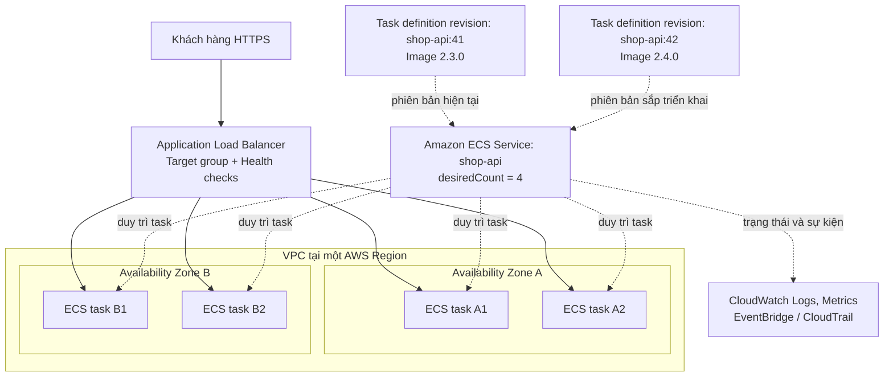
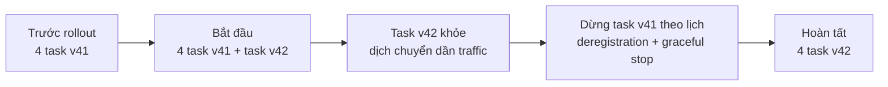
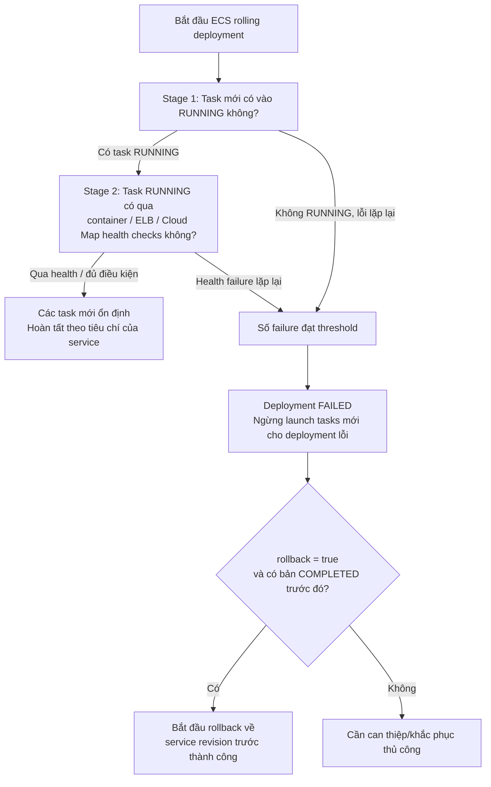
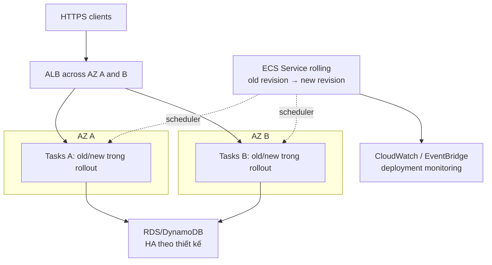

# Rolling deployment, deployment circuit breaker và rollback trên Amazon ECS

> **Chương:** Container với ECS  
> **Module:** CLOUD_PROVIDERS_AWS  
> **Mục tiêu:** triển khai phiên bản container mới trên Amazon Elastic Container Service (Amazon ECS) theo từng đợt, phát hiện deployment không thể ổn định, tự động hoặc chủ động rollback, đồng thời giám sát độ sẵn sàng, bảo mật và chi phí.

## 1. Bài toán thực tế: cập nhật API mà không làm gián đoạn khách hàng

Một cửa hàng trực tuyến vận hành dịch vụ `shop-api` bằng Amazon ECS:

- Các container chạy qua **AWS Fargate** hoặc trên các EC2 container instances.
- ECS service giữ **desired count = 4 tasks**, phân bố trên nhiều **Availability Zone (AZ)** trong một VPC.
- **Application Load Balancer (ALB)** nhận HTTPS rồi chuyển request đến những ECS tasks khỏe.
- Amazon ECR lưu image phiên bản `shop-api:2.3.0`; phiên bản mới `2.4.0` chuẩn bị phát hành.
- Amazon RDS hoặc DynamoDB lưu dữ liệu, CloudWatch thu thập log và metrics.
- Nhóm phát triển muốn giữ API sẵn sàng khi cập nhật, đồng thời tự động quay về phiên bản cũ nếu container mới liên tục crash hoặc không qua health check.

Ba khái niệm giúp xử lý yêu cầu này:

1. **Rolling deployment:** ECS thay dần tasks chạy phiên bản cũ bằng tasks chạy phiên bản mới, dựa trên giới hạn về số tasks khỏe và tổng số tasks được phép chạy.
2. **Deployment circuit breaker:** ECS phát hiện deployment không thể tiến tới trạng thái ổn định, đánh dấu deployment thất bại và dừng cố gắng tạo tasks mới cho deployment lỗi.
3. **Rollback:** nếu được bật và có deployment cũ đã hoàn thành thành công, ECS quay service về **service revision/deployment thành công gần nhất**.

**Chú ý:** “rollback thành công” thường có nghĩa quay lại workload configuration/container version phù hợp. Nó **không tự hoàn tác database migration, dữ liệu đã ghi, sự kiện đã gửi ra ngoài, secrets hay các thay đổi IAM/VPC**.

### 1.1. Sau bài học, người học có thể

- Phân biệt **task definition**, **task**, **service**, **service revision** và **service deployment**.
- Tính tác động của `minimumHealthyPercent` và `maximumPercent` lên quá trình rolling.
- Thiết lập health check giúp phát hiện container không sẵn sàng.
- Hiểu hai giai đoạn đánh giá của deployment circuit breaker và các ngưỡng lỗi **có thể cấu hình**.
- Phân biệt circuit breaker với CloudWatch alarm-based deployment failure detection.
- Quan sát deployment qua ECS Console, AWS CLI, CloudWatch, EventBridge và ALB target health.
- Thiết kế rollback có giới hạn ảnh hưởng, tương thích dữ liệu và chi phí bổ sung có thể dự toán.

## 2. Kiến thức nền: các đối tượng ECS tham gia deployment

### 2.1. Cấu trúc hệ thống



| Khái niệm | Vai trò |
|---|---|
| **Cluster** | Không gian logic quản lý services và tasks; có thể sử dụng Fargate hoặc EC2 capacity |
| **Task definition** | Bản khai bất biến theo revision về containers, image, CPU/memory, ports, environment, roles, health checks, logs... |
| **Task** | Một lần chạy thực tế của task definition |
| **Service** | Bộ điều phối duy trì desired task count, tích hợp load balancer, discovery, Auto Scaling |
| **Deployment controller/strategy** | Quyết định ECS thay phiên bản theo cách nào: rolling và các chiến lược khác tùy hỗ trợ |
| **Service revision** | Ảnh chụp cấu hình service ở một thời điểm triển khai, phục vụ theo dõi lịch sử |
| **Service deployment** | Một lần đưa service revision mới vào hệ thống, có trạng thái và lịch sử riêng |
| **Target group** | Tập những IP/instance targets mà load balancer đưa traffic đến |
| **Capacity provider** | Cơ chế ECS lấy năng lực tính toán từ Fargate hoặc EC2 Auto Scaling group |

**Task definition revision** (ví dụ `shop-api:42`) chỉ là một thành phần của service revision. Một lần update có thể thay đổi cả cấu hình service, networking hay parameters; vì vậy khi chẩn đoán rollback không được chỉ nhìn image tag.

### 2.2. Khi nào tạo deployment mới?

Với ECS service dùng rolling update, các thay đổi như chỉ định **task definition revision mới** thường tạo một service deployment. Lệnh update service với **`forceNewDeployment`** có thể tạo deployment mới ngay cả khi task definition không đổi, hữu ích trong một số trường hợp cần rollout tasks, ví dụ sử dụng image tag đã thay đổi; tuy nhiên **dùng image digest hoặc tag bất biến** vẫn đáng tin cậy hơn cho tính tái lập.

Không phải mọi thao tác như tăng giảm `desiredCount` đều được coi là một lần phát hành phiên bản ứng dụng giống nhau. Tham số nào tạo service deployment và ảnh hưởng rollback phụ thuộc API và chiến lược hiện hành; cần kiểm tra **UpdateService** và lịch sử service deployment.

### 2.3. Fargate và EC2 có gì khác?

- **Fargate:** AWS quản lý host; bạn khai báo CPU/memory, networking và image. Trong rolling deployment vẫn cần capacity/quota Fargate, địa chỉ IP ở subnet, quyền pull image và đường tới ECR/CloudWatch/Secrets.
- **EC2 launch type/capacity provider:** bạn còn phải bảo đảm container instances có đủ CPU, RAM, ports, ENI, disk và khả năng scale out. `maximumPercent=200` không tự tạo EC2 đủ chỗ nếu capacity provider/ASG không mở rộng được.

**ECS service scheduler** tạo/thay task; **ELB** chọn target xử lý traffic; **Auto Scaling** có thể mở rộng capacity hoặc desired count. Đây là ba chức năng tách biệt.

## 3. Rolling deployment là gì?

**Rolling deployment** đưa bản phát hành mới vào sử dụng **theo từng đợt** thay vì dừng đồng loạt mọi task cũ rồi khởi động bản mới.

Một tiến trình điển hình:

1. `shop-api:41` đang phục vụ traffic và đạt steady state.
2. Đội phát triển đăng ký `shop-api:42` đã qua kiểm thử.
3. ECS tạo deployment mới và khởi chạy một hoặc nhiều tasks từ revision mới.
4. Các task mới đi qua khởi tạo, kiểm tra container và health check của load balancer/service discovery.
5. Khi đủ khỏe, ECS thay dần tasks cũ theo giới hạn trong `deploymentConfiguration`.
6. Sau khi hoàn thành tiêu chí triển khai, ECS công bố kết quả; nếu thất bại thì áp dụng cơ chế phát hiện lỗi/rollback đã cấu hình.



Đây là mô hình **rolling**; nó không tự động đảm bảo một tỷ lệ chính xác traffic như **canary 10%** hay blue/green có tập target độc lập. ECS hiện có các chiến lược triển khai khác như `BLUE_GREEN`, `LINEAR`, `CANARY` ở các tính năng/dịch vụ được hỗ trợ; chọn chúng nếu cần kiểm soát **traffic shifting** ở cấp độ release.

## 4. Hai thông số cốt lõi: minimumHealthyPercent và maximumPercent

Trong rolling deployment của ECS service, bộ điều phối sử dụng:

- **`minimumHealthyPercent`:** mức thấp nhất các tasks cần duy trì ở trạng thái chạy và khỏe trong quá trình thay đổi, tính theo **phần trăm desiredCount và làm tròn lên**.
- **`maximumPercent`:** mức cao nhất của tổng tasks ở trạng thái `RUNNING` hoặc `PENDING` trong deployment, tính theo **phần trăm desiredCount và làm tròn xuống**.

Ví dụ service có `desiredCount = 4`, cấu hình:

```json
{
  "deploymentConfiguration": {
    "strategy": "ROLLING",
    "minimumHealthyPercent": 100,
    "maximumPercent": 200
  }
}
```

Suy ra:

\[
\text{Số task khỏe tối thiểu}=\left\lceil4\times1.00\right\rceil=4
\]

\[
\text{Tổng số task RUNNING/PENDING tối đa}=\left\lfloor4\times2.00\right\rfloor=8
\]

ECS có thể **khởi chạy task mới trước khi dừng task cũ**, về nguyên tắc dùng tối đa tám slots trong quá trình chuyển tiếp. Thứ tự/batch thực tế còn phụ thuộc capacity, health checks và scheduler.

### 4.1. So sánh một vài cấu hình

| Desired tasks | Min healthy | Max total | Healthy tối thiểu | RUNNING/PENDING tối đa | Hệ quả chính |
|---:|---:|---:|---:|---:|---|
| 4 | 100% | 200% | 4 | 8 | Ưu tiên start trước stop, cần capacity tăng tạm thời |
| 4 | 50% | 100% | 2 | 4 | Có thể stop bớt task cũ trước, giảm capacity phục vụ trong rollout |
| 4 | 75% | 150% | 3 | 6 | Cân bằng availability và headroom |
| 3 | 100% | 200% | 3 | 6 | Tăng tổng task tạm thời để giữ ba task khỏe |
| 1 | 100% | 200% | 1 | 2 | Cần chỗ cho task thay thế nếu không muốn dừng task cũ trước |
| 1 | 100% | 100% | 1 | 1 | Có thể **kẹt deployment** vì không được start thêm cũng không được stop task cũ |

**Chú ý:** `minimumHealthyPercent` không tạo ra task dự phòng nếu backend không được scale, và cũng không đảm bảo ứng dụng không có request lỗi. Nó là ràng buộc của scheduler dựa trên trạng thái task và health checks, không phải SLA hoàn chỉnh.

### 4.2. Tại sao 100/200 không luôn tốt nhất?

Ưu điểm:

- Duy trì số task khỏe gần desired count trong thời gian rollout.
- Có khoảng trống để kiểm tra bản mới trước khi rút bản cũ.
- Phù hợp với nhiều dịch vụ web có tải tương đối ổn định.

Đổi lại:

- **Fargate:** có thể chạy nhiều vCPU/GiB tasks song song trong lúc update và trả phí tương ứng.
- **EC2:** có thể không còn chỗ trên cluster; cần capacity provider/ASG tăng EC2, hoặc rollout chậm.
- **VPC:** số IP cấp cho task `awsvpc` tăng, có thể hết địa chỉ subnet.
- **ALB:** target health registration và startup cần thời gian; task mới chưa khỏe không giúp phục vụ traffic.

Một rollout giữ số task khỏe cao nhưng không có tài nguyên mở rộng sẽ dễ **đứng ở trạng thái IN_PROGRESS** hoặc gặp lỗi đặt task.

### 4.3. Tại sao 50/100 có rủi ro?

Với desired count 4, cấu hình 50/100 cho phép giảm số task khỏe xuống 2 trong thời gian chuyển tiếp. Nếu lưu lượng đang sát khả năng chịu tải của 4 tasks, việc giảm về 2 có thể:

- Tăng latency hoặc tỷ lệ lỗi.
- Làm thay đổi hành vi Auto Scaling.
- Gây quá tải database khi tasks còn lại nhận nhiều traffic.
- Khiến bản mới có vẻ lỗi trong khi bản thân backend đã quá tải do thiếu capacity.

Cấu hình như vậy chỉ phù hợp khi có maintenance window, tải thấp hoặc ứng dụng chấp nhận giảm mức phục vụ.

### 4.4. Kiểm tra rounding và khả năng tiến triển

Bộ điều phối cần có khả năng **start ít nhất một task mới hoặc stop ít nhất một task cũ** theo các giới hạn. Nếu không thể thực hiện bước nào, service event có thể báo deployment configuration không cho phép start/stop tasks.

Khi cần sửa, hãy tính rõ số nguyên cho **desiredCount thực tế**, đặc biệt service quy mô nhỏ. Đừng tự suy `minimumHealthyPercent=75` sẽ cho phép stop 25% khi desired count chỉ 2; \(\lceil2\times0.75\rceil=2\), nên không thể stop trước nếu vẫn cần hai healthy tasks.

## 5. Thế nào là một task “healthy” để ECS thay phiên bản?

### 5.1. Nhiều lớp kiểm tra sức khỏe

Một task có thể đi qua các trạng thái `PROVISIONING`, `PENDING`, `ACTIVATING`, `RUNNING` và cuối cùng `STOPPED` tùy vòng đời. Nhưng **RUNNING không đồng nghĩa ứng dụng sẵn sàng**.

ECS xét những tín hiệu tương ứng cấu hình:

| Lớp | Kiểm tra | Ví dụ lỗi |
|---|---|---|
| **ECS task lifecycle** | Task có thể provision/start đến `RUNNING` không? | Không pull image ECR, thiếu IAM execution role, container crash |
| **Container health check** | Lệnh health check bên trong container có trả exit code 0 không? | `curl localhost` thất bại, app chưa listen port |
| **ALB/NLB target health** | Target có nhận request/probe thành công theo cấu hình? | SG chặn, sai port, HTTP 503, startup quá lâu |
| **Cloud Map service health** | Health status qua service discovery khi cấu hình | Instance của service discovery bị unhealthy |
| **Application monitoring** | KPI/error ratio/latency ngoài health endpoint | Business API trả lỗi dù `/health` vẫn 200 |

**Circuit breaker** chủ yếu phát hiện vấn đề khởi động tasks và các health checks mà ECS tích hợp. Lỗi business logic chỉ bộc lộ qua tỷ lệ HTTP 500 hoặc doanh thu giảm có thể **không đủ** để circuit breaker tự kích hoạt. Khi đó cần **CloudWatch alarm-based failure detection** và kiểm tra trong pipeline.

### 5.2. Container health check trong task definition

Ví dụ nội dung rút gọn của một container:

```json
{
  "name": "api",
  "image": "111122223333.dkr.ecr.ap-southeast-1.amazonaws.com/shop-api:2.4.0",
  "essential": true,
  "portMappings": [
    {
      "containerPort": 8080,
      "protocol": "tcp"
    }
  ],
  "healthCheck": {
    "command": [
      "CMD-SHELL",
      "curl --fail --silent http://localhost:8080/health/ready || exit 1"
    ],
    "interval": 15,
    "timeout": 5,
    "retries": 3,
    "startPeriod": 60
  }
}
```

Giải thích:

- `CMD-SHELL`: chạy command qua shell trong container; image phải có shell và `curl` hoặc công cụ tương đương. Image distroless thường không có những công cụ này, cần cách health check khác.
- `interval`: khoảng thời gian giữa các lần kiểm tra.
- `timeout`: thời gian tối đa cho một lần check.
- `retries`: số lần thất bại liên tiếp trước khi container bị coi là unhealthy.
- `startPeriod`: khoảng thời gian khởi động không tính những thất bại theo cách AWS mô tả; **một lần check thành công sớm có thể kết thúc thời gian miễn trừ**.

Health check không nên làm việc nặng, truy vấn database tốn tài nguyên hoặc phụ thuộc một hệ thống không cần thiết cho khả năng phục vụ API. Nếu quá chặt, sự cố phụ trợ thoáng qua có thể làm hàng loạt containers unhealthy.

### 5.3. ALB target group health check

Với API port 8080:

- Protocol thường HTTP đến `/health/ready`.
- Matcher HTTP status phù hợp, ví dụ 200.
- Timeout/interval/healthy threshold/unhealthy threshold phù hợp thời gian startup.
- Security group của task cho phép traffic từ SG của ALB vào port 8080.
- Task ENI/subnet/route và target group `ip` phù hợp với networking mode `awsvpc`.

Tình huống `curl localhost` từ trong container thành công, nhưng ALB target vẫn unhealthy: **container health** ổn, trong khi **đường kết nối ALB → task** có thể lỗi do SG, port, VPC networking hoặc đường dẫn probe không đúng.

### 5.4. healthCheckGracePeriodSeconds

Một service gắn load balancer hoặc dùng các health checks tích hợp có thể đặt **`healthCheckGracePeriodSeconds`** để ECS **bỏ qua một số kết quả unhealthy ban đầu** sau khi task start, giúp ứng dụng có thời gian khởi tạo.

Ví dụ app cần 90 giây chạy migration cache và tải config; grace period 120 giây có thể tránh ECS thay task vì probe quá sớm. Nhưng:

- Grace period **không biến một task lỗi thành healthy**.
- Nó không kéo dài vô hạn và không ngăn crash/exit của essential container.
- Nếu đặt quá dài, việc phát hiện bản release thực sự hỏng sẽ chậm.
- Grace period của **ECS service** khác `startPeriod` trong **container health check** và khác thresholds trong **ALB target group**.

Nên đo phân phối startup thực tế (p95/p99) và đặt các thông số có lý do thay vì đoán.

## 6. Deployment circuit breaker giải quyết vấn đề nào?

Giả sử bản `2.4.0` có lỗi cấu hình:

- Image không pull được từ ECR; task không tiến đến `RUNNING`; hoặc
- Task chạy được nhưng endpoint `/health/ready` luôn trả 500; ALB/ECS liên tục loại task mới.

Nếu không có cơ chế phát hiện lỗi phù hợp, ECS có thể **tiếp tục thử thay task** hoặc deployment không đạt steady state. **Deployment circuit breaker** định nghĩa điều kiện thất bại để chặn tiếp tục tạo task cho deployment lỗi và, nếu bật rollback, quay về bản đã hoàn tất thành công.

### 6.1. Circuit breaker không phải ALB circuit breaker

Đây không phải mẫu circuit breaker của ứng dụng (mở/đóng để tạm ngừng gọi dependency), cũng không phải một thiết lập của ALB. Nó là **cơ chế phát hiện lỗi khi triển khai ECS service**.

Trong ngữ cảnh bài học, tính năng được cấu hình qua `deploymentConfiguration.deploymentCircuitBreaker` của ECS service dùng **rolling update với ECS deployment controller**; không dùng cấu hình này để suy ra mọi chiến lược deployment khác đều hoạt động giống nhau. AWS còn có các chiến lược blue/green, linear, canary và phương pháp failure detection theo tính năng cụ thể.

### 6.2. Hai giai đoạn kiểm tra failure



**Stage 1:** ECS theo dõi các tasks của deployment mới có tiến tới `RUNNING` không. Nếu task thất bại trước `RUNNING` nhiều lần, failure counter tăng theo cấu hình.

**Stage 2:** khi ít nhất một task trong deployment tới `RUNNING`, ECS theo dõi **container health**, **Elastic Load Balancing health** và **Cloud Map health checks** theo những loại đã cấu hình. Nếu các tasks bị thay thế vì unhealthy liên tiếp hoặc tích lũy đến ngưỡng, deployment thất bại.

**Điểm phân biệt:** circuit breaker kiểm soát **quá trình rollout**, không chứng minh một API đã hoàn toàn đúng nghiệp vụ trong nhiều giờ hay nhiều ngày sau deploy.

## 7. Failure threshold: từ ngưỡng mặc định đến khả năng tùy chỉnh năm 2026

### 7.1. Cơ chế mặc định

Theo tài liệu Amazon ECS cập nhật năm **2026**, mặc định circuit breaker dùng `thresholdConfiguration.type = BOUNDED_PERCENT`, với `value = 50`.

Số lỗi đủ kích hoạt:

\[
T=\min\left(200,\max\left(3,\left\lceil 0.5\times\text{desiredCount}\right\rceil\right)\right)
\]

| Desired task count | 50% desired | Threshold mặc định |
|---:|---:|---:|
| 1 | 0,5 | **3** |
| 4 | 2 | **3** |
| 6 | 3 | **3** |
| 25 | 12,5 | **13** |
| 100 | 50 | **50** |
| 400 | 200 | **200** |
| 800 | 400 | **200** |

**Lưu ý:** số lỗi cần đạt *không phải* số lượng task healthy tối thiểu của `minimumHealthyPercent`. Chúng là hai loại ràng buộc khác nhau.

### 7.2. Chế độ đếm lỗi: resetOnHealthyTask

Từ bản cập nhật năm 2026, circuit breaker cho phép chọn cách đếm:

| Cấu hình | Cách đếm | Mục đích |
|---|---|---|
| `resetOnHealthyTask=true` (**mặc định**) | Bộ đếm trở về 0 khi một task đạt trạng thái healthy; chủ yếu phản ánh các failure **liên tiếp** | Giảm rollback vì lỗi khởi động rời rạc |
| `resetOnHealthyTask=false` | Tích lũy các failure trong toàn deployment, **không reset** khi có task khỏe xen giữa | Phát hiện sớm release có pattern lỗi tái diễn |

**Ví dụ:** failure threshold = 3, chuỗi quan sát: lỗi → task khỏe → lỗi → lỗi.

- Với reset khi healthy, bộ đếm sau chuỗi sẽ là **2**, chưa tới ngưỡng 3.
- Với cumulative counting, đã có **3** lỗi, có thể kích hoạt circuit breaker.

Đây là ví dụ tư duy về bộ đếm trong một deployment; tình trạng thực tế phụ thuộc cách ECS ghi nhận task failure và health transition.

### 7.3. Ba kiểu thresholdConfiguration

| Type | Diễn giải | Dùng khi |
|---|---|---|
| **`BOUNDED_PERCENT`** | `value% × desiredCount`, làm tròn lên, giới hạn tối thiểu **3** và tối đa **200** | Phù hợp mặc định, biến động theo quy mô trong khoảng có giới hạn |
| **`UNBOUNDED_PERCENT`** | `value% × desiredCount`, làm tròn lên, **không chặn về 3–200** | Dịch vụ quy mô lớn muốn ngưỡng thật sự tỉ lệ với số tasks |
| **`COUNT`** | Dùng số lỗi cố định trong `value` | Môi trường nhỏ hoặc tiêu chí độ nhạy rollback cụ thể |

Với `BOUNDED_PERCENT` và `UNBOUNDED_PERCENT`, phần trăm `value` được AWS giới hạn trong khoảng **1–100** theo tài liệu. `desiredCount` được xét theo giá trị hiện hành khi triển khai; **autoscaling trong deployment có thể tác động ngưỡng nếu chọn percent-based**.

**Ví dụ:** desiredCount = 800:

- Mặc định 50% dạng `BOUNDED_PERCENT` → threshold **200**.
- Dạng `UNBOUNDED_PERCENT` 50% → threshold **400**.
- Dạng `COUNT` 5 → threshold **5**, dù service có 800 tasks.

**Không dùng ngưỡng quá thấp không qua thử nghiệm.** Một vài tasks khởi động chậm trong môi trường capacity bị giới hạn có thể gây rollback không cần thiết.

### 7.4. Cấu hình ví dụ

Đây là **đoạn JSON minh họa cấu hình deployment của ECS service**; không phải tệp task definition:

```json
{
  "deploymentConfiguration": {
    "strategy": "ROLLING",
    "minimumHealthyPercent": 100,
    "maximumPercent": 200,
    "deploymentCircuitBreaker": {
      "enable": true,
      "rollback": true,
      "resetOnHealthyTask": false,
      "thresholdConfiguration": {
        "type": "COUNT",
        "value": 5
      }
    }
  }
}
```

Ý nghĩa:

- ECS dùng rolling replacement.
- Không được hạ số task khỏe xuống dưới 100% desired theo giới hạn scheduler.
- Có thể tạm chạy tới 200% tổng số task khi đủ capacity.
- Circuit breaker được bật, cho phép rollback.
- Chỉ cần 5 task failures tính tích lũy trong deployment là đạt ngưỡng kích hoạt theo cấu hình này.

Không phải mọi phiên bản CLI/SDK/IaC đã cài trong dự án đều nhận ngay field mới; với chức năng ra mắt năm 2026, cần cập nhật tooling và kiểm tra schema trước khi áp dụng.

### 7.5. Nếu không bật rollback thì sao?

Với `enable=true, rollback=false`, circuit breaker vẫn có thể **đánh dấu deployment FAILED** và ngừng launch tasks mới cho deployment hỏng, nhưng **không tự đưa service về bản thành công trước đó**. Nhóm vận hành phải xem trạng thái và khắc phục hoặc chủ động triển khai revision phù hợp.

Đừng nghĩ bật circuit breaker đồng nghĩa đã bật rollback; **hai flag này tách biệt**.

## 8. Rollback: cơ chế và giới hạn

### 8.1. Rollback về bản nào?

Khi deployment mới thất bại, ECS tìm **deployment đã hoàn thành thành công** gần nhất (trạng thái **`COMPLETED`** trong mô hình rollout state). Nếu bật rollback và tìm thấy bản phù hợp, ECS khởi động lại quá trình đưa service về cấu hình đã hoàn tất đó.

Ví dụ:

| Thời điểm | Revision | Kết quả |
|---|---|---|
| 09:00 | `shop-api:41` | Hoàn tất, được xác nhận là bản tốt |
| 09:15 | `shop-api:42` | Task mới crash lặp lại |
| 09:18 | `shop-api:42` | Circuit breaker đạt failure threshold → FAILED |
| 09:18+ | `shop-api:41` | ECS bắt đầu rollback; tasks theo bản cũ được phục hồi/duy trì |
| Sau ổn định | `shop-api:41` | Bản rollback hoàn tất nếu capacity và health cho phép |

**Rollback cũng là một quá trình cần thời gian** và có thể lỗi. Nếu thiếu subnet IP, hết Fargate quota, ECR không truy cập được hoặc database không còn tương thích, bản cũ vẫn có thể không phục hồi hoàn chỉnh.

### 8.2. Vì sao cần một deployment COMPLETED trước đó?

Nếu đây là **lần triển khai đầu tiên của service** và chưa có bản nào thành công, circuit breaker có thể xác định release thất bại nhưng **không có bản tốt để rollback**. Deployment có thể kẹt, dừng tạo task mới và cần xử lý thủ công.

**Bài học:** lần triển khai đầu tiên nên thiết lập health checks đúng và kiểm tra service đạt trạng thái ổn định. Đừng coi bật `rollback=true` là có sẵn “phiên bản cũ an toàn” khi service chưa từng chạy thành công.

### 8.3. Rollback không tự đảo mọi thứ ngoài ECS

| Thay đổi đi cùng release | Tự rollback khi ECS quay về task definition cũ? | Việc nên làm |
|---|---|---|
| Image và task configuration nằm trong service revision | **Có thể** được phục hồi theo rollback của ECS | Dùng image digest/tag bất biến, xem trạng thái service revision |
| Database schema migration | **Không** | Dùng migration tương thích hai chiều hoặc expand/contract |
| Dữ liệu đã ghi vào RDS/DynamoDB | **Không** | Backup, idempotency, quy trình data repair khi cần |
| Message đã publish tới SQS/EventBridge | **Không** | Thiết kế consumer tương thích, deduplication/retry |
| Secrets đã rotate trong Secrets Manager | **Không mặc nhiên** | Tương thích thông tin xác thực qua giai đoạn chuyển đổi |
| IAM policy, SG/VPC route ngoài service | **Không** | IaC/rollback riêng, kiểm soát thay đổi |
| ALB listener rules thay ngoài deployment | **Không mặc nhiên** | Dùng release process có version hóa hạ tầng |
| Trạng thái session trong memory của container | **Không** | Dùng session store hoặc thiết kế stateless |

Để rollback đáng tin cậy, phải xây hệ thống **backward compatibility** từ đầu. Ví dụ migration database nên theo hướng **expand → triển khai cả hai phiên bản → chuyển traffic → contract sau** thay vì xóa cột ngay trước rollout.

### 8.4. Image tag có thể khiến rollback không tái lập

Nếu task definition dùng image tag `latest` rồi pipeline push image khác vào cùng tag, việc quay về một task definition revision cũ có thể không đồng nghĩa kéo đúng **binary cũ** trong mọi trường hợp. ECS thường resolve tag thành digest khi deployment, nhưng bạn vẫn nên:

- Dùng **tag bất biến theo build** và ưu tiên ghi nhận **image digest**.
- Giữ artifact cũ trong ECR đủ lâu theo chính sách retention.
- Ghi lại SHA/commit, task definition revision và service deployment ID.
- Không xóa image cũ khi vẫn có khả năng rollback.

## 9. CloudWatch alarms: bắt lỗi nghiệp vụ sau khi task đã healthy

### 9.1. Tại sao circuit breaker chưa đủ?

Giả sử `shop-api:42`:

- Container chạy ổn.
- `/health/ready` trả 200.
- ALB target healthy.
- Nhưng endpoint `POST /checkout` trả 500 cho 25% requests do bug xử lý giỏ hàng.

Một circuit breaker chỉ dựa vào task startup và health checks có thể **không phát hiện** vấn đề này. ECS hỗ trợ dùng **CloudWatch alarms** làm tiêu chí deployment failure để theo dõi những tín hiệu ứng dụng.

Ví dụ alarm:

| Metric | Điều kiện gợi ý | Cần lưu ý |
|---|---|---|
| ALB `HTTPCode_Target_5XX_Count` | Số lỗi backend tăng bất thường | Cần xem traffic và sample size |
| ALB `TargetResponseTime` | p95 latency vượt SLO | Định nghĩa period, statistic, ngưỡng hợp lý |
| Custom metric `CheckoutFailureRate` | Tỷ lệ checkout fail vượt ngưỡng | Instrumentation phải chính xác, có dữ liệu |
| Queue backlog / xử lý đơn | Message age hoặc queue depth quá cao | Có thể do nguyên nhân ngoài release |
| ECS task failures | Task `STOPPED` bất thường | Cần phân biệt sự cố task với scale-in bình thường |

Alarm được chọn để làm deployment failure detection cần được thiết kế tránh **false positive**, nhất là trong traffic thấp hoặc khi service có lỗi tồn tại từ trước. Kiểm tra CloudWatch `ALARM`, `OK`, `INSUFFICIENT_DATA`, evaluation periods và cách ECS sử dụng alarm.

### 9.2. Circuit breaker và alarm có thể phối hợp

| Cơ chế | Chủ yếu phát hiện | Ví dụ |
|---|---|---|
| **Deployment circuit breaker** | Task không đạt `RUNNING`, health checks thất bại lặp lại | Image crash, target unhealthy |
| **CloudWatch alarm-based detection** | Metrics ứng dụng/vận hành vượt ngưỡng trong thời gian deployment | HTTP 5xx, p95 latency, lỗi checkout |

Khi cả hai được bật, **một trong hai** có thể khiến deployment thất bại và kích hoạt rollback theo cấu hình phù hợp. Do đó cần thiết kế metrics và cửa sổ quan sát hợp lý.

**Phạm vi bảo vệ:** ECS deployment failure detection/automatic rollback được sử dụng **trong quá trình deployment**. Khi deployment đã được đánh dấu hoàn thành, các cơ chế này không phải giám sát rollback vĩnh viễn. Sau đó CloudWatch alarm vẫn cần alert, nhưng rollback hậu triển khai phải được tổ chức thiết kế riêng.

### 9.3. Bake time và rolling deployment

Với cơ chế alarm-based rollback, một số cấu hình cho phép **bake time** để chờ quan sát metrics trước khi công bố deployment thành công. Cần cân bằng:

- Bake time quá ngắn: chưa có traffic đủ để lộ lỗi.
- Bake time quá dài: release kéo dài, giữ capacity cũ/mới lâu hơn.
- Thời gian quan sát có thể khác nhau giữa low-traffic API và dịch vụ có lưu lượng lớn.

**Không dùng bake time thay cho canary traffic shifting.** Rolling deployment vẫn có cách thay task theo scheduler; nếu yêu cầu áp chính xác một tỷ lệ khách hàng vào bản mới để canary, hãy chọn strategy/công cụ có hỗ trợ mô hình đó.

## 10. Tính năng early success criteria và giới hạn rollback

### 10.1. Vì sao ECS có early success criteria?

AWS hiện hỗ trợ **early success criteria** cho rolling deployments. Thay vì luôn đợi bản mới đạt đủ 100% desired tasks khỏe và dọn sạch bản cũ, có thể cho ECS công bố deployment hoàn thành **sớm hơn** khi đạt tỷ lệ healthy do người vận hành chọn.

Ví dụ: service có desiredCount 10, cấu hình minHealthyPercent 75% và early healthyPercent 80%. Khi **8 tasks phiên bản mới** đạt health, đáp ứng các điều kiện còn lại, ECS có thể đánh dấu deployment hoàn thành trước khi mọi task mới đã vào RUNNING.

**Không cấu hình early healthyPercent thấp hơn minimumHealthyPercent**. Cần chọn giá trị phù hợp từ phạm vi được AWS hỗ trợ.

### 10.2. Source revision cleanup: BLOCKING và DEFERRED

| Giá trị | Cách hoạt động |
|---|---|
| **`BLOCKING`** | Chờ dọn các tasks thuộc source revision trước khi công bố deployment hoàn thành theo tiêu chí đã chọn |
| **`DEFERRED`** | Có thể công bố deployment hoàn thành trước, rồi dọn source tasks ở ngoài quá trình deployment; hữu ích khi có kết nối dài hoặc scale-in protection |

Khi `DEFERRED`, người vận hành phải theo dõi **các task cũ còn sống** và capacity trong giai đoạn cleanup. Không giả định báo `SUCCESSFUL` là không còn task từ revision cũ.

### 10.3. Cảnh báo đặc biệt với rollback

**Sau khi ECS công bố deployment đã hoàn thành theo early success criteria, circuit breaker/CloudWatch alarm rollout protection không còn tự rollback deployment đó.** Những tasks mới còn lại có thể tiếp tục được tạo dưới hoạt động scaling thông thường, nên release vẫn có nguy cơ bộc lộ lỗi muộn.

Chỉ bật early completion khi đội ngũ có bằng chứng rằng phần trăm healthy và thời gian quan sát đã đủ tin cậy, đồng thời có:

- Alarm và giám sát sau triển khai.
- Quy trình rollback thủ công/roll-forward được kiểm thử.
- Cơ chế tương thích dữ liệu.
- Capacity/timeout phù hợp với long-lived connections.

Với ứng dụng mới triển khai và chưa có quan sát đầy đủ, hoàn tất deployment theo điều kiện chuẩn có thể an toàn hơn.

## 11. Từng bước thiết kế một rolling deployment an toàn

### 11.1. Ví dụ cấu hình nghiệp vụ

Ứng dụng:

- ECS service `shop-api`, desired count 4, trải hai AZ.
- ALB listener HTTPS 443, target group trỏ đến container port 8080.
- Task role chỉ có quyền gọi DynamoDB/S3 cần thiết; execution role dùng để pull ECR, gửi logs và đọc secrets theo cấu hình.
- Task definition revision cũ đã hoàn thành ổn định.
- Image release mới được kiểm thử và lưu với tag bất biến/digest.
- CloudWatch cung cấp logs, metrics, deployment alerts.

### 11.2. Preflight checklist

Trước khi deploy:

1. **Task definition:** xác nhận image URI/digest, task CPU/memory, container ports, log driver, execution role, task role.
2. **VPC:** Fargate tasks có subnet đủ private IP, SG đúng, route tới ECR/CloudWatch/Secrets qua NAT hoặc VPC endpoints phù hợp.
3. **ECS capacity:** kiểm tra Fargate quotas hoặc EC2 capacity provider/ASG headroom cho `maximumPercent`.
4. **ALB target group:** health check path, thresholds, target type `ip` với `awsvpc`, port và deregistration delay.
5. **Container readiness:** biết thời gian startup, probe trong task definition, grace period.
6. **Rollback target:** có service deployment cũ đã `COMPLETED`, image cũ còn truy xuất được.
7. **Database:** migration backward compatible, không xóa ngay schema mà bản cũ còn cần.
8. **Monitoring:** biết dashboard `HealthyHostCount`, 5xx, latency, stopped task reasons và alerts.
9. **Change control:** có maintenance plan, người trực xử lý rollback, test case và cách xác nhận release.
10. **Cost:** dự trù tasks tăng tạm trong quá trình rollout và metrics/logging bổ sung.

### 11.3. Cấu hình triển khai minh họa

Trong ECS Console, khi tạo hoặc sửa service:

- Chọn deployment strategy **ROLLING** với ECS controller.
- Chọn `minimumHealthyPercent=100`, `maximumPercent=200` nếu đủ headroom.
- Bật **Deployment circuit breaker** và **Rollback on failures**.
- Chọn ngưỡng lỗi mặc định hoặc điều chỉnh ngưỡng/cách đếm theo nhu cầu đã đo.
- Cân nhắc bật CloudWatch alarms để theo dõi metrics nghiệp vụ.
- Không bật early success criteria chỉ vì muốn pipeline báo xong nhanh hơn.

**Ví dụ lệnh có thay đổi tài nguyên — không chạy trên production khi chưa được phê duyệt:**

```bash
# Ví dụ minh họa, sẽ tạo một deployment mới của ECS service.
# Đòi hỏi cluster, service và task definition revision đã tồn tại.
aws ecs update-service \
  --region ap-southeast-1 \
  --cluster shop-prod \
  --service shop-api \
  --task-definition shop-api:42 \
  --deployment-configuration '{
    "strategy": "ROLLING",
    "minimumHealthyPercent": 100,
    "maximumPercent": 200,
    "deploymentCircuitBreaker": {
      "enable": true,
      "rollback": true
    }
  }'
```

Lệnh trên chỉ minh họa cấu hình circuit breaker cơ bản; một triển khai thực có thể còn yêu cầu network configuration, capacity provider, target group và các settings khác. Với schema CLI mới như `thresholdConfiguration`, kiểm tra phiên bản AWS CLI và thông số được hỗ trợ.

### 11.4. Theo dõi quá trình

Khi rollout bắt đầu, quan sát đồng thời:

- ECS service deployments và từng revision (desired/running/pending).
- ECS service events, nhất là lỗi placement, image pull, container exits.
- Target group ALB health: target mới chuyển từ initial sang healthy chưa?
- CloudWatch application metrics: p95 latency, HTTP 5xx, checkout errors.
- EventBridge deployment state change và CloudTrail khi có thao tác quản trị.
- Tình trạng hạ tầng phụ thuộc: RDS connections, DynamoDB throttling, SQS backlog.

Chỉ đánh giá một rollout **thành công về nghiệp vụ** khi metrics xác nhận khách hàng có thể dùng app bình thường, không chỉ khi màn hình ECS hiển thị completed/successful.

### 11.5. Giai đoạn sau rollout

Sau khi hoàn tất:

1. Kiểm tra task definitions/revisions và số tasks hiện chạy.
2. Kiểm tra còn task cũ hay không (đặc biệt nếu dùng `DEFERRED` cleanup).
3. Theo dõi lỗi chậm xuất hiện ngoài cửa sổ deployment.
4. Đảm bảo log retention, artifact retention và KMS/secrets hợp lệ.
5. Ghi release ID, metrics trước/sau và kết quả kiểm tra.
6. Cập nhật phương án rollback thủ công nếu dữ liệu/DB schema đã tiếp tục thay đổi.

## 12. Trạng thái deployment: hai cách nhìn không được trộn lẫn

AWS ECS có **trường rolloutState** trong kết quả `DescribeServices` và **service deployment history** có vòng đời chi tiết hơn. Hai cách nhìn có những giá trị trạng thái **không hoàn toàn giống nhau**.

### 12.1. rolloutState trong DescribeServices

Thông thường với rolling ECS deployments:

| Giá trị | Ý nghĩa |
|---|---|
| **`IN_PROGRESS`** | Revision đang được rollout hoặc rollback để đạt steady state |
| **`COMPLETED`** | Revision đã hoàn tất theo điều kiện scheduler/deployment |
| **`FAILED`** | Circuit breaker xác định deployment không thể ổn định |

Có thể đọc `rolloutStateReason` để biết lý do. Khi rollback khởi động, revision cũ đã completed có thể trở lại trạng thái **`IN_PROGRESS`** trong quá trình phục hồi.

### 12.2. Service deployment history

Các API quản lý lịch sử service deployment có trạng thái chi tiết hơn, chẳng hạn:

- `PENDING`, `IN_PROGRESS`.
- `ROLLBACK_REQUESTED`, `ROLLBACK_IN_PROGRESS`.
- `SUCCESSFUL`, `ROLLBACK_SUCCESSFUL`, `ROLLBACK_FAILED`.
- `STOP_REQUESTED`, `STOPPED`.

**Ví dụ:** `rolloutState=FAILED` của một deployment không phải lúc nào hiển thị nguyên văn `FAILED` trong trường `status` của service deployment history. Khi điều tra, phải xác định **API và field** đang đọc, không so sánh hai danh sách trạng thái như một.

Lịch sử service deployment có thể cung cấp thông tin revision, failure detection, lý do rollback và các mốc thời gian; có giới hạn thời gian lưu lịch sử theo tài liệu AWS.

## 13. AWS CLI: quan sát deployment mà không thay đổi hạ tầng

Các lệnh sau là **read-only**. Thay `shop-prod`, `shop-api` và ARN mẫu bằng tài nguyên thử nghiệm đã được cấp quyền. Cần AWS CLI phiên bản hỗ trợ các API service deployments hiện hành.

### 13.1. Xem cấu hình service và tình trạng deployments

```bash
aws ecs describe-services \
  --region ap-southeast-1 \
  --cluster shop-prod \
  --services shop-api \
  --query 'services[0].{
    Name:serviceName,
    Status:status,
    Desired:desiredCount,
    Running:runningCount,
    Pending:pendingCount,
    Controller:deploymentController.type,
    Config:deploymentConfiguration,
    Deployments:deployments
  }' \
  --output json
```

Cần chú ý:

- `deploymentConfiguration` có strategy, min/max percentages, circuit breaker, alarms và settings tương ứng.
- `deployments[].taskDefinition` cho biết những revision đang tồn tại trong đợt rollout.
- `deployments[].rolloutState`/`rolloutStateReason` cho biết trạng thái rolling và lý do.
- `runningCount` đạt desired chưa đủ; cần xét target health và application metrics.

### 13.2. Xem ECS service events

```bash
aws ecs describe-services \
  --region ap-southeast-1 \
  --cluster shop-prod \
  --services shop-api \
  --query 'services[0].events[0:15].[createdAt,message]' \
  --output table
```

Thông báo thường giúp phát hiện:

- Không đặt được task vì không đủ CPU/memory hoặc ENI/IP.
- Không kéo được image, thiếu quyền hoặc lỗi network tới registry.
- Container bị dừng, health check của target group thất bại.
- Deployment đã hoàn tất, rollback bắt đầu hoặc deployment không thể tiếp tục.

### 13.3. Xem lịch sử service deployments

```bash
aws ecs list-service-deployments \
  --region ap-southeast-1 \
  --cluster shop-prod \
  --service shop-api \
  --output json
```

API lịch sử trả ARN/metadata các service deployments (tùy phiên bản/fields). Với ARN lấy được, có thể dùng `describe-service-deployments` để xem rollback/status và failure information chi tiết hơn:

```bash
aws ecs describe-service-deployments \
  --region ap-southeast-1 \
  --service-deployment-arns arn:aws:ecs:ap-southeast-1:111122223333:service-deployment/shop-prod/shop-api/EXAMPLE \
  --output json
```

Dữ liệu có thể không có đối với deployments quá cũ hoặc tài khoản/phiên bản API chưa hỗ trợ khả năng này. Không dùng ARN giả để khẳng định đã kiểm tra môi trường thật.

### 13.4. Xem tasks đang chạy và tasks đã dừng

```bash
# Các task của service đang chạy
aws ecs list-tasks \
  --region ap-southeast-1 \
  --cluster shop-prod \
  --service-name shop-api \
  --desired-status RUNNING \
  --output json

# Các task đã dừng mà ECS còn lưu metadata gần đây
aws ecs list-tasks \
  --region ap-southeast-1 \
  --cluster shop-prod \
  --service-name shop-api \
  --desired-status STOPPED \
  --output json
```

Lấy task ARN thực tế rồi truy vấn:

```bash
aws ecs describe-tasks \
  --region ap-southeast-1 \
  --cluster shop-prod \
  --tasks arn:aws:ecs:ap-southeast-1:111122223333:task/shop-prod/EXAMPLE \
  --query 'tasks[0].{
    LastStatus:lastStatus,
    DesiredStatus:desiredStatus,
    StoppedReason:stoppedReason,
    StopCode:stopCode,
    Containers:containers,
    TaskDefinitionArn:taskDefinitionArn
  }' \
  --output json
```

Đặc biệt xem `stoppedReason`, `stopCode`, `containers[].exitCode` và `containers[].reason`. Ví dụ `CannotPullContainerError` khác với lỗi app khởi động rồi thoát exit code 1.

### 13.5. Kiểm tra task definition

```bash
aws ecs describe-task-definition \
  --region ap-southeast-1 \
  --task-definition shop-api:42 \
  --query 'taskDefinition.{
    Family:family,
    Revision:revision,
    Roles:[executionRoleArn,taskRoleArn],
    NetworkMode:networkMode,
    Containers:containerDefinitions
  }' \
  --output json
```

Phần `Roles` trong query chỉ có tính minh họa: nếu cách viết JMESPath của CLI không nhận array expression với các field như trên, dùng `--output json` không có `--query` để xem đầy đủ. Cần kiểm tra image, `healthCheck`, `essential`, port, logging và secrets **không làm lộ giá trị bí mật** khi chia sẻ kết quả.

### 13.6. Kiểm tra ALB target health

```bash
aws elbv2 describe-target-health \
  --region ap-southeast-1 \
  --target-group-arn arn:aws:elasticloadbalancing:ap-southeast-1:111122223333:targetgroup/shop-api/EXAMPLE \
  --query 'TargetHealthDescriptions[].[Target.Id,Target.Port,TargetHealth.State,TargetHealth.Reason,TargetHealth.Description]' \
  --output table
```

`healthy` là tín hiệu có ích; `unhealthy`, `initial` hay `draining` cần đối chiếu task lifecycle và deregistration delay. Không kết luận toàn bộ app ổn chỉ bằng health check HTTP.

### 13.7. CloudWatch Logs

Nếu task definition dùng `awslogs`:

```bash
aws logs describe-log-streams \
  --region ap-southeast-1 \
  --log-group-name /ecs/shop-api \
  --order-by LastEventTime \
  --descending \
  --max-items 10
```

Sau khi có stream name:

```bash
aws logs get-log-events \
  --region ap-southeast-1 \
  --log-group-name /ecs/shop-api \
  --log-stream-name ecs/api/EXAMPLE-TASK-ID \
  --limit 50 \
  --output json
```

Không assume tên stream nào cũng có prefix `ecs/api/...`; nó phụ thuộc `awslogs-stream-prefix`, container name và task ID. Log group/stream có thể chưa tồn tại nếu task chưa bao giờ start đủ để gửi log hoặc execution role/network chưa đúng.

## 14. EventBridge và cảnh báo deployment thất bại

ECS gửi **service deployment state change events** tới Amazon EventBridge. Có thể tạo rule theo sự kiện **`SERVICE_DEPLOYMENT_FAILED`** và chuyển tới SNS, Lambda hoặc hệ cảnh báo nội bộ.

Ví dụ event pattern khái niệm:

```json
{
  "source": ["aws.ecs"],
  "detail-type": ["ECS Deployment State Change"],
  "detail": {
    "eventName": ["SERVICE_DEPLOYMENT_FAILED"]
  }
}
```

Tùy mô hình EventBridge event, thông tin lỗi có thể gồm service/cluster ARN, deployment ID và lý do. Hãy kiểm tra schema event thực tế trước khi tự động hóa một action.

**Phân biệt giám sát và hành động:**

- EventBridge phát sự kiện; **không tự sửa lỗi**.
- SNS/ChatOps gửi cảnh báo cho người trực.
- Automation có thể tạo incident, thu thập diagnostics hoặc áp quy trình rollback được phê duyệt.
- Khi bật ECS automatic rollback, tránh xây thêm automation **đồng thời redeploy revision khác** khiến rollback va chạm với deployment đang `IN_PROGRESS`.

Không tự động “cứ FAILED là deploy latest” — có thể lặp lại chính bản lỗi.

## 15. Xử lý sự cố theo triệu chứng

| Triệu chứng | Nguyên nhân thường gặp | Hướng kiểm tra |
|---|---|---|
| Task mới không qua `PENDING`/không vào `RUNNING` | Không có capacity, subnet hết IP, thiếu ENI, ECR pull lỗi | ECS service events, STOPPED tasks, Fargate quota/EC2 capacity |
| `CannotPullContainerError` | Image không tồn tại, IAM execution role, NAT/VPC endpoint/DNS lỗi | ECR repository/tag/digest, task execution role, VPC routes |
| `ResourceInitializationError` | Không lấy secrets/logs, network không thông | Secrets Manager/SSM/KMS, endpoints, execution role, CloudWatch |
| Container vào `RUNNING` rồi exit code 1 | App cấu hình sai, thiếu env/secret, crash | Container logs, stopped reason, startup command |
| Container healthy, ALB unhealthy | SG/port/path, timeout, app listen `127.0.0.1` | Target health reason, ENI/SG, probe path |
| Circuit breaker kích hoạt quá nhanh | Threshold thấp, counting cumulative, startup/health chưa chỉnh | `thresholdConfiguration`, `resetOnHealthyTask`, startPeriod/grace |
| Circuit breaker lâu không kích hoạt | Chưa chạm ngưỡng, có task khỏe reset counter, không có health signal đủ nhạy | Deployment config, metrics, failure count |
| Rollback không bắt đầu | `rollback=false` hoặc không có previous COMPLETED deployment | ECS deployments, rolloutState, events |
| Rollback bắt đầu nhưng cũng thất bại | Bản cũ không còn image, thiếu capacity, DB không tương thích | ECR retention, task logs, DB schema, service deployment history |
| Rolling kẹt, không thay task | Min/max percent khiến không thể stop/start; thiếu capacity | Tính số tasks thực tế, ECS events, ASG capacity |
| HTTP 500 tăng nhưng circuit breaker không chạy | Container và target vẫn healthy; lỗi nghiệp vụ ngoài health check | CloudWatch alarms/custom KPI, app logs |
| Deployment báo hoàn tất sớm nhưng còn task cũ | Early success criteria + `DEFERRED` cleanup | Service revision history, task counts |
| Phát hành xong vài giờ mới lỗi | Circuit breaker không bảo vệ mãi sau `COMPLETED` | Post-deploy monitoring, rollback thủ công |
| Deploy khiến database quá tải | Tasks cũ/mới cùng truy cập DB, connection pool tăng | DB connections, RDS metrics, scaling/capacity |
| Client WebSocket bị ngắt khi scale-in | Target bị deregister, connection kết thúc | Graceful shutdown, draining delay, reconnect logic |

### 15.1. Quy trình phân tích khi circuit breaker báo FAILED

1. Xác định **deployment ID và task definition revision** bị lỗi.
2. Kiểm tra đang **stage 1** (không vào RUNNING) hay **stage 2** (health failure).
3. Đọc `rolloutStateReason`, service events và stopped task reasons.
4. Đọc app logs, kiểm tra health checks và target group.
5. Kiểm tra khả năng truy cập ECR/Secrets/KMS/CloudWatch từ task subnet.
6. So sánh image digest, task roles, env và cấu hình với bản COMPLETED gần nhất.
7. Kiểm tra ECS đã tự rollback chưa, tiến trình rollback có healthy không.
8. Nếu không có rollback tự động, thực hiện quy trình khắc phục **được phê duyệt** (rollback thủ công hoặc roll-forward).
9. Viết postmortem: nguyên nhân, monitoring gap, cách phòng lỗi tương tự.

**Không mở SG `0.0.0.0/0`, cấp IAM `*` hoặc đổi image sang `latest` để “làm cho service chạy”** khi chưa xác định tầng lỗi. Những thay đổi đó tăng rủi ro bảo mật và làm giảm khả năng tái lập release.

## 16. Thiết kế độ sẵn sàng qua Region và AZ

### 16.1. Multi-AZ trong rolling deployment

Một service trải AZ A/B giúp hạn chế ảnh hưởng khi một AZ lỗi, nhưng chỉ khi:

- VPC subnets/ENI có đủ capacity tại mỗi AZ.
- ALB/NLB target groups có healthy targets tại AZ còn hoạt động.
- ECS placement/capacity provider duy trì tác vụ cân đối khi có thể.
- Database/storage có HA hoặc replication phù hợp (RDS Multi-AZ, EFS Regional...).
- DNS, KMS/Secrets, CloudWatch và external dependencies không trở thành điểm lỗi duy nhất.



Circuit breaker không phát hiện được mọi lỗi hạ tầng chung. Ví dụ nếu security group bị sửa khiến **cả bản cũ và mới** đều mất kết nối DB, quay về task definition cũ không giải quyết vấn đề gốc.

### 16.2. Một rollout không thể rollback xuyên Region bằng một flag

ECS deployment là hoạt động trên service ở một **Region**. Nếu Region Singapore không khả dụng hoàn toàn, setting `rollback=true` **không tự triển khai** ứng dụng tại Tokyo. Multi-Region recovery cần:

- IaC/deployment pipeline tại Region dự phòng.
- Image artifacts và secrets/keys sẵn sàng theo kế hoạch.
- DNS/Global Accelerator/Route 53 failover nếu phù hợp.
- Replication dữ liệu, RPO/RTO và kiểm thử định kỳ.
- Quản lý IAM, quotas và capacity cho Region đích.

## 17. Bảo mật trong quy trình phát hành

### 17.1. Task role và task execution role

| Role | Chủ thể sử dụng | Quyền cần xem xét |
|---|---|---|
| **Task execution role** | ECS/Fargate agent thay mặt task làm tác vụ hạ tầng | Pull image từ ECR, ghi `awslogs`, đọc secrets dùng khi khởi tạo theo cấu hình |
| **Task role** | Ứng dụng bên trong container | Chỉ quyền DynamoDB/S3/SQS/KMS... đúng nghiệp vụ |
| **CI/CD deployment role** | Pipeline hoặc người được cấp quyền release | Đăng ký task definition, cập nhật service, xem trạng thái deployment, PassRole có giới hạn |
| **Operations/audit role** | Người giám sát/khôi phục | Read-only ECS/ELB/CloudWatch/CloudTrail và thao tác rollback theo thẩm quyền |

Không cấp quyền `ecs:*` hoặc `iam:PassRole` không giới hạn cho mọi developer. Deploy có thể tác động đến dữ liệu khách hàng và chi phí, nên cần audit trail và approval phù hợp.

### 17.2. Image và secrets

- Quét image trong ECR hoặc pipeline theo chính sách.
- Ký/kiểm tra provenance nếu tổ chức yêu cầu; giữ image digest để tái lập.
- Không đưa secret plaintext vào image hoặc log.
- Dùng Secrets Manager/SSM Parameter Store, quyền KMS phù hợp.
- Đừng giả định rollback sẽ xoay secret về giá trị cũ hoặc tự vô hiệu hóa credential đã lộ.
- Ghi lại image digest, commit, cấu hình task definition, IAM role và thời điểm triển khai.

### 17.3. Tránh race giữa nhiều pipeline

Nếu pipeline A đang deploy revision 42, pipeline B cập nhật revision 43 ngay trước khi A hoàn tất, lịch sử và rollback có thể phức tạp hơn dự kiến. Nên:

1. Có **deployment concurrency control** hoặc lock theo service/environment.
2. Kiểm tra trạng thái deployment trước khi deploy tiếp.
3. Ghi lại release ID và trách nhiệm rollback.
4. Không chạy đồng thời automation “tự rollback” và “tự deploy mới” trên cùng service khi chưa có điều phối.

## 18. Chi phí của rolling deployment và rollback

### 18.1. Chi phí trong giai đoạn overlap

Rolling update với `minimumHealthyPercent=100`, `maximumPercent=200` có thể chạy tạm **nhiều tasks hơn desired count**.

Ví dụ:

- Service có **4 Fargate tasks**.
- Mỗi task dùng **0,5 vCPU** và **1 GiB RAM**.
- Trong 10 phút rollout, tổng task count tạm đạt **8**.
- Sau rollout, quay lại 4 tasks.

Lượng tài nguyên bổ sung so với baseline **nếu đủ 4 tasks tăng thêm chạy trọn 10 phút**:

\[
4\times 0.5\text{ vCPU}\times\frac{10}{60}\text{ giờ}
=\frac{1}{3}\text{ vCPU-giờ}
\]

\[
4\times 1\text{ GiB}\times\frac{10}{60}\text{ giờ}
=\frac{2}{3}\text{ GiB-giờ}
\]

Đây chỉ là **ước tính headroom tăng thêm**. Chi phí thực tế Fargate phụ thuộc thời gian chạy từng task, Region, OS/architecture, CPU/RAM, ephemeral storage bổ sung và giá hiện hành. Với EC2, chi phí tăng thêm có thể đến từ ASG khởi tạo instance mới để chứa tasks.

### 18.2. Các khoản khác cần tính

- **ALB/NLB:** số request/bytes và load balancer usage; deregistration delay có thể làm rollout kéo dài.
- **ECR:** lưu trữ image versions phục vụ rollback, data transfer theo mô hình truy cập.
- **CloudWatch Logs:** log ingestion/retention, metrics tùy chỉnh, alarm.
- **VPC:** NAT Gateway, PrivateLink/VPC endpoints, public IPv4 nếu có, cross-AZ traffic.
- **Rollback:** thêm một vòng tạo/dừng tasks, có thể kéo dài overlap và phát sinh capacity cost.
- **Database:** connection count tăng khi old/new tasks chạy đồng thời; đôi khi phải provision headroom.

Không tối ưu chi phí bằng cách đặt min/max làm service mất khả năng phục vụ trong giờ cao điểm. Quyết định đúng cần cân bằng **availability, thời gian deploy và ngân sách**.

## 19. Bài tập và đáp án

### Bài 1 — Tính giới hạn rolling

Service có `desiredCount=6`, `minimumHealthyPercent=50`, `maximumPercent=150`. Số task khỏe tối thiểu và tổng RUNNING/PENDING tối đa là bao nhiêu?

**Đáp án:** Healthy tối thiểu \(\lceil6\times0.5\rceil=3\); tổng tối đa \(\lfloor6\times1.5\rfloor=9\).

### Bài 2 — Deployment bị kẹt

Service có đúng 1 task, `minimumHealthyPercent=100`, `maximumPercent=100`. Scheduler không thể start task mới hay stop task cũ.

**Đáp án:** Cấu hình không có khoảng trống tiến triển. Có thể tăng `maximumPercent` đủ để start replacement trước hoặc giảm `minimumHealthyPercent` nếu nghiệp vụ chấp nhận downtime; đồng thời kiểm tra capacity.

### Bài 3 — Task không pull được image

Deployment mới liên tục thất bại trước `RUNNING` vì `CannotPullContainerError`.

**Đáp án:** Thuộc giai đoạn đầu của circuit breaker. Kiểm tra image URI/digest, execution role, kết nối ECR/NAT/VPC endpoint, task events và logs; khi đạt ngưỡng có thể rollback nếu cấu hình.

### Bài 4 — RUNNING nhưng health check fail

Task mới `RUNNING` nhưng ALB target group luôn `unhealthy` do sai health path.

**Đáp án:** Circuit breaker có thể đếm lỗi health ở stage 2. Sửa path/matcher/SG hoặc ứng dụng trong revision tiếp theo; không chỉ tăng threshold để che lỗi.

### Bài 5 — Ngưỡng mặc định

Service có `desiredCount=25` và dùng circuit breaker mặc định.

**Đáp án:** Threshold mặc định = \(\lceil25\times50\%\rceil=13\), nằm giữa min 3 và max 200.

### Bài 6 — Ngưỡng mới COUNT

Service có desiredCount 200, cấu hình `thresholdConfiguration.type=COUNT`, `value=4`, `resetOnHealthyTask=false`.

**Đáp án:** Bốn task failures tích lũy có thể đạt ngưỡng; không dùng 50% × 200. Cấu hình này rất nhạy với một service lớn, nên phải đo pattern lỗi trước khi dùng.

### Bài 7 — Khác biệt consecutive và cumulative

Threshold = 3. Trình tự task failure, healthy, failure, failure, healthy, failure.

**Đáp án:** `resetOnHealthyTask=true` reset khi healthy, nên chuỗi trên chưa có ba lỗi liên tiếp; `false` tích lũy ít nhất ba lỗi và có thể kích hoạt rollback sớm hơn.

### Bài 8 — Rollback thiếu bản tốt

ECS service lần đầu deploy revision 1 và liên tục crash. `rollback=true` đã bật.

**Đáp án:** Không có deployment `COMPLETED` trước đó, nên circuit breaker không có bản rollback. Cần khắc phục hoặc triển khai revision khỏe thủ công.

### Bài 9 — Database migration phá tương thích

Bản mới xóa cột mà bản cũ cần; circuit breaker rollback image về bản cũ.

**Đáp án:** Ứng dụng cũ vẫn có thể lỗi vì schema không được rollback. Phải thiết kế migration backward compatible/expand-contract và có kế hoạch xử lý dữ liệu.

### Bài 10 — HTTP 500 nhưng không auto rollback

Container mới qua container/ALB health checks, nhưng `/checkout` trả 500 hàng loạt.

**Đáp án:** Circuit breaker có thể không thấy lỗi nếu health endpoint không phản ánh nghiệp vụ. Cần CloudWatch alarm dựa trên 5xx/custom KPI, thời gian quan sát phù hợp và rollback process.

### Bài 11 — Early success criteria

Service desiredCount 10, minimumHealthyPercent 75, early healthyPercent 80, cleanup DEFERRED. ECS báo deployment successful khi 8 task mới healthy.

**Đáp án:** Đây có thể là hành vi theo cấu hình early completion; các task còn lại và task cũ có thể được xử lý ở ngoài deployment. Circuit breaker không tiếp tục tự rollback sau khi deployment đã completed, nên cần monitoring sau release.

### Bài 12 — Số AZ và tính sẵn sàng

Một ECS service phân bố tasks ở hai AZ nhưng database chỉ đặt một instance EC2 tại AZ A.

**Đáp án:** Multi-AZ compute không đủ để đảm bảo dịch vụ khi AZ A lỗi. Cần dự phòng dữ liệu/database và kiểm thử failover toàn tuyến.

### Bài 13 — Cost overlap

Service có 4 tasks, rollout cho phép tối đa 8 tasks, mỗi task 1 GiB RAM. Nếu chạy thêm 4 tasks trong 15 phút, tài nguyên RAM tăng thêm tương đương bao nhiêu?

**Đáp án:** \(4\times1\times15/60=1\) GiB-giờ tăng thêm, chưa nhân giá Fargate/EC2 và các khoản phụ.

### Bài 14 — Phân biệt rolloutState và service deployment status

`describe-services` cho thấy một revision `rolloutState=FAILED` nhưng API service deployment history hiển thị trạng thái rollback riêng.

**Đáp án:** Hai API/field có mô hình trạng thái khác nhau. Cần xem cả `rolloutStateReason` và lịch sử service deployment, không coi status strings phải khớp hoàn toàn.

### Bài 15 — Vấn đề sau khi deploy đã hoàn tất

Một giờ sau khi ECS báo COMPLETED, metric checkout error mới tăng mạnh.

**Đáp án:** Circuit breaker của deployment đã hoàn tất không tự rollback từ sự cố phát hiện muộn. Cần alert, incident response và thao tác rollback thủ công/roll-forward dựa trên version artifacts và tính tương thích dữ liệu.

## 20. Checklist cho production

1. **Release artifact:** task definition revision, image digest bất biến, ECR retention cho rollback.
2. **Chiến lược:** chọn ROLLING hay chiến lược khác theo yêu cầu traffic shifting; không gọi mọi rollout là canary.
3. **Mức phục vụ:** tính số nguyên từ `minimumHealthyPercent` và `maximumPercent`, kiểm tra khả năng tiến triển.
4. **Capacity:** Fargate quotas, EC2 capacity provider, subnet IP/ENI, NAT/endpoints và ALB targets.
5. **Readiness:** container health, ALB/Cloud Map checks, grace period và startup time có đo đạc.
6. **Failure detection:** bật circuit breaker, chọn reset mode và threshold phù hợp, cân nhắc CloudWatch alarms.
7. **Rollback:** bật rollback nếu cần, xác nhận có bản COMPLETED trước đó và artifact vẫn truy xuất được.
8. **Data safety:** schema migration, secrets, queue events và external state có phương án tương thích.
9. **Early completion:** nếu bật, hiểu chính xác thời điểm hết bảo vệ automatic rollback và source cleanup.
10. **Quan sát:** service deployment history, ECS events, task STOPPED reasons, ALB metrics, EventBridge alerts và CloudTrail.
11. **Multi-AZ:** cân đối tasks, target groups, dependency và database/storage failover.
12. **CI/CD:** kiểm soát concurrency, phê duyệt thay đổi, ghi release ID và triển khai thử ở staging.
13. **Chi phí:** provision headroom tạm thời và theo dõi Fargate/EC2, ALB, ECR, CloudWatch, network.
14. **Diễn tập:** cố ý deploy image lỗi, health check fail và rollback trong môi trường thử nghiệm để đo RTO.
15. **Sau deployment:** tiếp tục monitor; tự động rollback của một deployment không phải công cụ tự khắc phục mọi lỗi dài hạn.

**Ghi nhớ:** rolling deployment quyết định **ECS thay từng nhóm task ra sao**; deployment circuit breaker quyết định **khi nào một rollout không ổn định phải được coi là thất bại**; rollback quyết định **có phục hồi bản ECS thành công trước hay không**. Một release đáng tin cậy cần cả **health checks, alarms, versioned artifacts, dữ liệu tương thích, capacity dự phòng và quan sát sau triển khai**.

## Tài liệu AWS tham khảo

- [Deploy Amazon ECS services by replacing tasks — Rolling deployments](https://docs.aws.amazon.com/AmazonECS/latest/developerguide/deployment-type-ecs.html)
- [How the Amazon ECS deployment circuit breaker detects failures](https://docs.aws.amazon.com/AmazonECS/latest/developerguide/deployment-circuit-breaker.html)
- [Amazon ECS deployment failure detection](https://docs.aws.amazon.com/AmazonECS/latest/developerguide/deployment-failure-detection.html)
- [AWS What's New: configurable ECS deployment circuit breaker settings (2026)](https://aws.amazon.com/about-aws/whats-new/2026/07/amazon-ecs-circuit-breaker-settings/)
- [Complete Amazon ECS rolling deployments early with early success criteria](https://docs.aws.amazon.com/AmazonECS/latest/developerguide/early-success-criteria.html)
- [DeploymentConfiguration API reference](https://docs.aws.amazon.com/AmazonECS/latest/APIReference/API_DeploymentConfiguration.html)
- [DeploymentCircuitBreaker API reference](https://docs.aws.amazon.com/AmazonECS/latest/APIReference/API_DeploymentCircuitBreaker.html)
- [View service history with ECS service deployments](https://docs.aws.amazon.com/AmazonECS/latest/developerguide/service-deployment.html)
- [How to use Amazon ECS task definition health check](https://docs.aws.amazon.com/AmazonECS/latest/developerguide/healthcheck.html)
- [Determining Amazon ECS task health](https://docs.aws.amazon.com/AmazonECS/latest/developerguide/health-check.html)
- [Amazon ECS service event messages](https://docs.aws.amazon.com/AmazonECS/latest/developerguide/service-event-messages-list.html)
- [Amazon ECS service deployment state change events](https://docs.aws.amazon.com/AmazonECS/latest/developerguide/ecs_service_deployment_events.html)
- [Use load balancing to distribute Amazon ECS service traffic](https://docs.aws.amazon.com/AmazonECS/latest/developerguide/service-load-balancing.html)
- [Amazon ECS service Auto Scaling](https://docs.aws.amazon.com/AmazonECS/latest/developerguide/service-auto-scaling.html)
- [AWS Fargate pricing](https://aws.amazon.com/fargate/pricing/)
