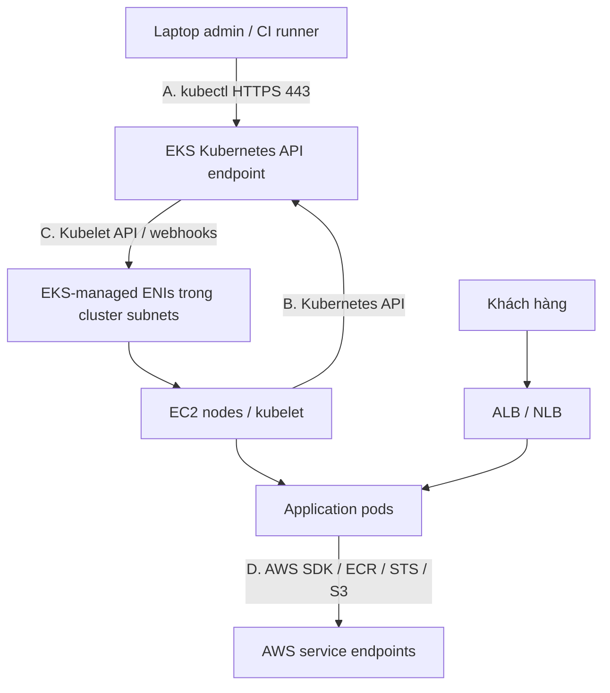
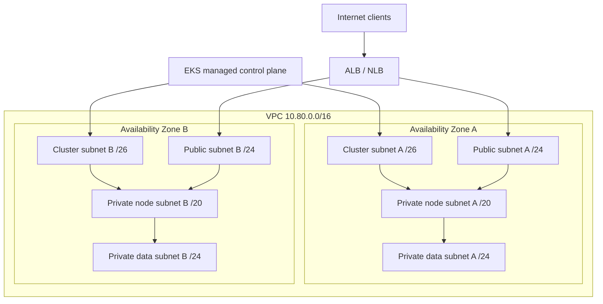
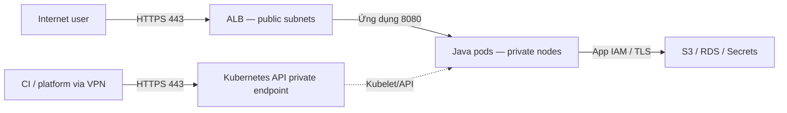

# Thiết kế subnet, endpoint và quyền truy cập cluster Amazon EKS

Một đội phát triển triển khai ứng dụng Java trên **Amazon Elastic Kubernetes Service (Amazon EKS)**. Họ đã có VPC và hai subnet, nhưng node không tham gia cluster; ở môi trường khác, `kubectl` chạy từ laptop bị timeout mặc dù IAM role đã có quyền; còn một cluster chạy trong private subnet lại không tải được container image từ Amazon ECR.

Ba sự cố này minh họa ba thiết kế **khác nhau nhưng phụ thuộc nhau**:

1. **Subnet và IP** quyết định EKS control plane kết nối được với node/pod, khả năng tăng số node và chống lỗi theo Availability Zone (AZ).
2. **Kubernetes API endpoint và các AWS service endpoints** quyết định đường kết nối của quản trị viên, node và pod.
3. **IAM, EKS access entries và Kubernetes RBAC** quyết định ai được xác thực, ai được đọc hoặc sửa tài nguyên trong cluster.

Bài học thuộc chương **Kubernetes với EKS** của module **CLOUD_PROVIDERS_AWS**. Từ nền tảng Region/AZ, IAM, VPC, compute, storage, database và serverless, người học sẽ thiết kế EKS phục vụ ứng dụng thật với **least privilege, quan sát được, phục hồi được và chi phí hợp lý**.

> **Phạm vi:** kiến trúc EKS chạy trong một AWS Region với node trên EC2/EKS Auto Mode và các biến thể phù hợp. Các đặc tính về version, cluster endpoint, EKS Auto Mode và IP family có thể thay đổi theo thời điểm/Region. Không sử dụng một sơ đồ mẫu mà bỏ qua tình trạng cụ thể của cluster.

## 1. Mục tiêu học tập

Sau bài, bạn có thể:

1. Phân biệt **EKS managed control plane**, **cluster subnets**, **worker node subnets** và các giao diện mạng EKS tạo trong VPC.
2. Chọn CIDR và thiết kế subnet **ít nhất hai AZ**, lập kế hoạch IP cho node, pod, endpoint và load balancer.
3. Mô tả ba cấu hình Kubernetes API endpoint: **public-only, public + private, private-only** và điểm mạnh/yếu của từng cách.
4. Phân biệt **Kubernetes API server endpoint**, **Amazon EKS service API endpoint** và các **VPC interface/gateway endpoints** dùng khi không có Internet.
5. Thiết kế truy cập cluster theo chuỗi **đường mạng → AWS IAM authentication → EKS access entries/Kubernetes RBAC authorization**.
6. Hiểu tác động của cluster security group, node security group, network ACL, DNS và CIDR allowlist.
7. Xây dựng checklist kiểm chứng, giám sát, vận hành, xử lý lỗi và lựa chọn về chi phí.

## 2. Kiến trúc EKS nhìn từ góc độ mạng

Amazon EKS quản lý **Kubernetes control plane** giúp doanh nghiệp không phải tự vận hành các thành phần như Kubernetes API server và etcd ở mức hạ tầng cơ sở. Doanh nghiệp vẫn cần quản lý VPC, subnet, IAM, workload và mức độ vận hành worker nodes theo mô hình được chọn.

### 2.1. Thành phần quan trọng

| Thành phần | Chạy ở đâu / ai quản lý? | Vai trò trong thiết kế |
|---|---|---|
| **EKS control plane** | Hạ tầng do AWS quản lý | Kubernetes API, scheduling/control components, quản lý trạng thái cluster |
| **Kubernetes API server endpoint** | Endpoint do EKS cung cấp | Nơi `kubectl`, kubelet và controller gọi Kubernetes API qua HTTPS |
| **EKS-created network interfaces (X-ENIs)** | EKS tạo trong **cluster subnets** thuộc VPC khách hàng | Kết nối giữa control plane và tài nguyên trong VPC; hỗ trợ API kubelet, exec, logs… |
| **Managed node group** | EC2 nodes trong subnet do người dùng chỉ định; EKS quản lý một phần vòng đời | Chạy pods ứng dụng, kubelet, container runtime |
| **EKS Auto Mode nodes** | Node capacity do EKS Auto Mode điều phối | Giảm công việc quản lý node/networking nhưng vẫn cần chính sách subnet, quyền, chi phí |
| **AWS VPC CNI / CNI của mô hình hỗ trợ** | Thành phần networking trên data plane | Cấp IP/định tuyến cho pods theo cấu hình network |
| **CoreDNS** | Pods trong cluster | Phân giải tên Kubernetes services và các tên được cấu hình |
| **ALB/NLB** | Load balancer trong VPC, gắn subnet/AZ | Nhận traffic người dùng tới ứng dụng; khác Kubernetes API endpoint |
| **Amazon ECR, STS, CloudWatch, S3...** | Các AWS services riêng | Registry, credentials, observability, dữ liệu… cần đường truy cập riêng |

**Không nhầm:** một **Kubernetes API endpoint public** không tự biến pods hoặc applications thành public. Ngược lại, một Kubernetes API endpoint private **không tự khóa** Service type `LoadBalancer` do đội ứng dụng triển khai.

### 2.2. Bốn luồng cần vẽ riêng



- **A:** kết nối công cụ quản trị tới API server. Phụ thuộc DNS, public/private endpoint, đường mạng và danh tính.
- **B:** kết nối của kubelet/node tới API server. Phụ thuộc endpoint mode, DNS, SG và đường egress.
- **C:** kết nối control plane vào VPC, phục vụ các Kubernetes features như `kubectl exec`, `logs`, `port-forward` hoặc admission webhook.
- **D:** kết nối của pod/node tới **AWS API services** (ECR, STS, EC2, CloudWatch…). **Không phải** Kubernetes API server endpoint.

## 3. Thiết kế VPC và cluster subnets

Khi tạo EKS cluster, bạn chỉ định một **VPC và ít nhất hai subnets thuộc hai AZ khác nhau**. EKS dùng những subnet này để tạo các requester-managed network interfaces phục vụ kết nối control plane và VPC.

### 3.1. Các yêu cầu đáng nhớ

Theo AWS EKS networking requirements hiện hành:

- **Cluster subnets phải thuộc ít nhất hai AZ.**
- Mỗi cluster subnet cần **ít nhất sáu IPv4 addresses còn khả dụng cho EKS**; AWS khuyến nghị **tối thiểu 16 địa chỉ còn khả dụng** để hỗ trợ hoạt động dài hạn/nâng cấp.
- Cluster subnets có thể là public hoặc private, nhưng AWS khuyến nghị **private** khi phù hợp.
- EKS thường tạo **2–4 network interfaces** trong những subnets chỉ định khi tạo cluster.
- Khi nâng cấp Kubernetes version, EKS có thể **xóa và tạo lại ENIs** trong cluster subnets; subnet thiếu IP sẽ tạo rủi ro cho quá trình update.
- Khi cập nhật danh sách cluster subnets, các subnet mới phải ở **cùng tập AZ** như những AZ đã chỉ định lúc tạo; không xem việc đổi cluster subnets như khả năng thêm AZ bất kỳ cho control plane.
- VPC phải bật **DNS resolution** và **DNS hostnames**.
- Các AZ bị giới hạn theo Region/loại triển khai phải đối chiếu với tài liệu EKS, không mặc định AZ nào cũng hỗ trợ.

**Chú ý phép tính:** một subnet IPv4 `/28` có 16 địa chỉ tổng, chỉ **11 địa chỉ có thể gán thông thường** do AWS dự trữ 5 địa chỉ. Vì vậy `/28` **không thể có 16 địa chỉ còn khả dụng**, dù trên lý thuyết có 16 IP. Nếu thiết kế subnet chuyên cho EKS control-plane ENIs, nên chọn kích thước và khoảng trống thực tế như `/27` hoặc `/26` theo nhu cầu; không áp dụng cứng kích thước đó cho mọi môi trường.

Nguồn: [AWS — View EKS networking requirements for VPC and subnets](https://docs.aws.amazon.com/eks/latest/userguide/network-reqs.html).

### 3.2. Cluster subnets khác node subnets

**Cluster subnets** là các subnets bạn khai báo trong cấu hình VPC của EKS cluster. EKS tạo control-plane-related ENIs ở đây.

**Node subnets** là các subnets bạn dùng khi tạo managed node group, self-managed nodes hoặc cấu hình NodeClass/Auto Mode. Chúng **có thể khác cluster subnets**, miễn là thiết kế VPC/routing/policy và tính năng được dùng hỗ trợ.

Lợi ích của việc tách các nhóm subnet:

- Dành trước địa chỉ cho EKS network interfaces, tránh pods dùng hết IP làm cluster update lỗi.
- Cho phép nodes/pods có các CIDR rộng hơn, giảm rủi ro cạn IP lúc autoscaling.
- Có quy trình route/security group khác nhau cho control-plane-related network và workload.
- Đơn giản hóa giám sát IP capacity và ownership của platform team.

**Không bắt buộc** tạo subnet chỉ cho control plane đối với mọi cluster. Đây là **lựa chọn kiến trúc**; AWS chỉ yêu cầu cluster subnets đủ IP, đúng VPC/AZ và các điều kiện mạng.

### 3.3. Sơ đồ subnet hai AZ

Giả sử VPC `10.80.0.0/16` trong một Region.



*Sơ đồ rút gọn thể hiện phân tầng mạng, không phải toàn bộ lưu lượng luôn đi qua các mũi tên. Đường đi thực tế phụ thuộc target mode, VPC CNI, SG, route table và ứng dụng.*

### 3.4. Bảng CIDR minh họa

| Vai trò | AZ A | AZ B | Lưu ý |
|---|---|---|---|
| **Cluster ENI subnets** | `10.80.0.0/26` | `10.80.0.64/26` | Mỗi `/26` có 59 địa chỉ IPv4 có thể gán thông thường; giữ IP dự phòng cho ENIs/upgrade |
| **Public ingress subnets** | `10.80.8.0/24` | `10.80.9.0/24` | Dành cho internet-facing ALB/NLB/NAT theo thiết kế |
| **Private node/pod subnets** | `10.80.16.0/20` | `10.80.32.0/20` | `/20` có 4.091 IP có thể gán; dung lượng thực tùy CNI/ENI/pods |
| **Private data subnets** | `10.80.48.0/24` | `10.80.49.0/24` | RDS hoặc dữ liệu cần cách ly |
| **Dải để dành** | Chọn từ các khoảng chưa cấp của `10.80.0.0/16` | — | Có sổ đăng ký IP/IPAM và kế hoạch mở rộng |

Các CIDR không trùng nhau. Tuy nhiên đây chỉ là **ví dụ quy hoạch**, không sử dụng nếu doanh nghiệp đã có mạng on-premises hoặc VPC dùng dải `10.80.0.0/16`. Kiểm tra CIDR của **Kubernetes Service** cũng không chồng với mạng cần kết nối.

## 4. Lập kế hoạch IP cho node, pod và services

**Kubernetes cluster CIDR**, **VPC CIDR** và **Kubernetes Service CIDR** có vai trò khác nhau:

| Loại địa chỉ | Thuộc về | Câu hỏi cần hỏi |
|---|---|---|
| VPC CIDR | Amazon VPC | Tổng IP cấp cho ENI/node/pod và tài nguyên AWS ở VPC là bao nhiêu? |
| Node primary IP | ENI chính của EC2 node | Mỗi node chiếm những địa chỉ nào? |
| Pod IP | Mô hình CNI/networking | Pod được cấp địa chỉ từ đâu, có thể liên lạc với gì? |
| Service ClusterIP CIDR | Virtual IPs của Kubernetes Services | Có chồng với mạng/VPC kết nối khác không? |
| DNS của cluster | CoreDNS, AmazonProvidedDNS, rule tùy chỉnh | Pod giải tên Service và tên AWS ra sao? |

### 4.1. Vì sao pod có thể làm subnet hết IP?

Với mô hình **Amazon VPC CNI trên EC2 thường gặp**, pods dùng địa chỉ IP từ VPC thông qua ENIs/prefix delegation theo cấu hình. Vì vậy **khả năng tạo pod có thể bị giới hạn bởi IP subnet** trước cả CPU/RAM.

Ví dụ giả định tại AZ A:

- 20 nodes, mỗi node có 1 primary private IP: tối thiểu 20 IP.
- 500 pods cần địa chỉ VPC: có thể cần khoảng 500 IP cho pods, trước khi tính các địa chỉ dự phòng, warm ENI/prefix và endpoints.
- IP cho load balancer, interface VPC endpoints, kiểm thử và rollout chưa được cộng.

Một subnet `/24` chỉ có 251 IP có thể gán thông thường; **không đủ** cho giả định trên. Subnet `/22` có 1.019 IP có thể gán, nhưng vẫn cần kiểm tra kiểu instance, ENI limits, VPC CNI version, prefix delegation, node density, quota và bối cảnh thực tế.

Đối với **EKS Auto Mode**, networking được AWS quản lý và có thể có khả năng phân tách pod subnets bằng NodeClass theo phiên bản; **không áp dụng máy móc các biến `WARM_IP_TARGET`/`ENIConfig` của VPC CNI tự quản lên Auto Mode**.

### 4.2. IP family IPv4/IPv6

EKS có lựa chọn `ipFamily=ipv4` hoặc `ipv6` khi tạo cluster. Chọn IP family là **quyết định khó đổi**: AWS hiện yêu cầu tạo cluster khác nếu muốn chuyển `ipFamily`.

Với IPv6 cluster, VPC/subnet vẫn có ràng buộc IPv4 cho một số thành phần; nodes/control-plane ENIs có địa chỉ phù hợp, pods và Kubernetes Services có cách cấp IPv6 riêng. Không suy ra mọi AWS service/ingress/backend dùng IPv6 hoàn toàn.

Khi thiết kế:

- Kiểm tra support của VPC CNI hoặc networking Auto Mode, ALB/NLB, DNS, AWS services và monitoring.
- Dự báo địa chỉ theo cách network implementation thực sự cấp IP/prefix.
- Tránh trùng Service CIDR với on-premises, VPC peering hoặc Transit Gateway.
- Xác định đường outbound IPv4/IPv6, NAT, egress-only internet gateway và endpoint support.

Nguồn: [EKS VPC and subnet considerations](https://docs.aws.amazon.com/eks/latest/best-practices/subnets.html) và [Network requirements](https://docs.aws.amazon.com/eks/latest/userguide/network-reqs.html).

## 5. Public/private subnets và route table

**Public subnet** trong ngữ cảnh VPC có route ra **internet gateway (IGW)** cho lưu lượng thích hợp; không có nghĩa mọi resource tự nhận public IP. **Private subnet** không có tuyến trực tiếp từ subnet ra IGW, nhưng có thể ra các AWS APIs hoặc Internet qua NAT, VPC endpoints hoặc kết nối mạng doanh nghiệp.

### 5.1. Mô hình thường dùng

- **Internet-facing ALB/NLB** đặt trong public subnets ở nhiều AZ theo loại load balancer.
- **Worker nodes và pods** ở private subnets, không cần public IPv4.
- **RDS/cache/data** ở private data subnets, chỉ cho phép kết nối từ workloads hợp lệ.
- **EKS cluster ENIs** có thể được EKS tạo trong private cluster subnets.
- **Private-only Kubernetes API endpoint** nếu chính sách quản trị yêu cầu không có đường truy cập công cộng.

### 5.2. Route table ví dụ

| Subnet | Route nội bộ | Default egress (nếu có) | Ghi chú |
|---|---|---|---|
| Public ingress A/B | `10.80.0.0/16 → local` | `0.0.0.0/0 → IGW` | ALB internet-facing, NAT gateway tùy yêu cầu |
| Private nodes A | `10.80.0.0/16 → local` | `0.0.0.0/0 → NAT A` hoặc endpoints | Thường muốn tránh phụ thuộc NAT khác AZ |
| Private nodes B | `10.80.0.0/16 → local` | `0.0.0.0/0 → NAT B` hoặc endpoints | NAT không phải điều kiện duy nhất nếu đã có VPC endpoints |
| Private data A/B | `10.80.0.0/16 → local` | Chỉ routes thực sự cần | Tránh egress không cần thiết |

**Không có NAT** là một phương án hợp lệ cho cluster riêng tư nếu thiết kế **đầy đủ VPC endpoints/đường ra phù hợp** với tất cả AWS services và registry mà nodes/pods sử dụng.

**NAT gateway không phải load balancer**. Nó hỗ trợ outbound IPv4 của private subnet; việc cài NAT không tự cho phép inbound `kubectl` từ laptop vào private-only API.

## 6. Kubernetes API endpoint: public hay private?

EKS cung cấp **Kubernetes API server endpoint** cho cluster, được dùng bởi `kubectl`, kubelet và controllers. Đây là **cluster endpoint** nằm trong trường `cluster.endpoint` khi chạy `aws eks describe-cluster`.

Ba chế độ đáng nhớ:

| Public | Private | Hành vi chính | Tình huống |
|---|---|---|---|
| Bật | Tắt | **Public-only**: API có DNS public, request từ trong VPC cũng sử dụng public endpoint theo đường AWS tương ứng | Thử nghiệm hoặc môi trường có quy trình kiểm soát public CIDR rõ |
| Bật | Bật | **Public + private**: requests từ trong cluster VPC sử dụng private endpoint; người ngoài dùng public endpoint nếu IP được cho phép | Thực tế phổ biến: node private, quản trị viên từ IP công ty |
| Tắt | Bật | **Private-only**: API chỉ truy cập được từ VPC hoặc mạng kết nối hợp lệ | Môi trường cần kiểm soát network path chặt, CI chạy trong VPC |
| Tắt | Tắt | **Không hợp lệ** | Kubernetes API cần ít nhất một đường truy cập |

### 6.1. Public-only: dễ truy cập nhưng phải hiểu đường node → API

Khi public endpoint bật và private tắt, API server có thể tiếp cận từ Internet; vẫn yêu cầu xác thực/ủy quyền để gọi Kubernetes APIs.

Nếu đặt **`publicAccessCidrs`** để chỉ cho phép IP văn phòng, hãy nhớ **worker nodes vẫn phải đến được endpoint**. Với private node subnet có NAT, egress public IP của NAT có thể cần có trong allowlist, hoặc phương án tốt hơn là **bật private endpoint** để node trao đổi trong VPC.

**Không dùng `0.0.0.0/0` theo quán tính** khi tổ chức có IP egress ổn định và yêu cầu hạn chế bề mặt public. Nhưng đừng đổi CIDR allowlist mà chưa xác minh node và CI runner còn đường truy cập.

### 6.2. Public + private: tách đường node và admin

Khi bật cả hai:

- Node và client trong VPC dùng **private endpoint** theo phân giải DNS của EKS.
- Quản trị viên ở ngoài VPC có thể dùng **public endpoint**, được giới hạn bởi `publicAccessCidrs`.
- **Cluster security group** kiểm soát traffic tới private endpoint; **publicAccessCidrs** chỉ kiểm soát public endpoint.
- IAM/access entries/Kubernetes RBAC vẫn cần thiết dù IP nằm trong allowlist.

Ví dụ một doanh nghiệp có VPN và laptop truy cập Internet qua gateway văn phòng:

```text
Client ở văn phòng qua Internet → Public Kubernetes API endpoint
                                  (allow CIDR public egress doanh nghiệp)

Private EC2 node trong VPC    → Private Kubernetes API endpoint
                                  (DNS private, control plane ENIs)
```

Với yêu cầu hybrid nodes **ngoài VPC**, AWS khuyến nghị **không bật đồng thời public và private endpoint** theo mô hình thông thường vì các hybrid nodes có thể phân giải cluster endpoint thành public IP; cần tuân theo hướng dẫn riêng của EKS hybrid nodes.

### 6.3. Private-only: khóa network exposure

Khi tắt public:

- Không thể chạy `kubectl` từ laptop Internet công cộng nếu không có kết nối mạng hợp lệ tới VPC.
- Quản trị có thể qua **VPN, Direct Connect**, môi trường quản trị trong VPC, hệ thống jump/SSM hoặc CI runner trong kết nối private.
- DNS của API server có thể phân giải thành **private IP ngay cả từ public DNS**; việc phân giải được private IP **không chứng minh Internet có route tới private IP**.
- **`publicAccessCidrs` không điều khiển private endpoint**.
- VPC cần `enableDnsHostnames=true` và `enableDnsSupport=true`, cùng cấu hình DNS của VPC phù hợp với `AmazonProvidedDNS`.

**Không tưởng tượng private endpoint là interface endpoint hiện trong VPC Console.** EKS tạo cơ chế riêng cho Kubernetes API, khác AWS PrivateLink `com.amazonaws.region.eks`.

Nguồn: [Cluster API server endpoint](https://docs.aws.amazon.com/eks/latest/userguide/cluster-endpoint.html).

## 7. Phân biệt ba “endpoint” dễ gây nhầm

Một trong những lỗi vận hành phổ biến là thấy tên **EKS endpoint** rồi cho rằng tất cả dùng cùng VPC endpoint.

| Endpoint | Mục đích | Ai gọi? | Có thay private Kubernetes endpoint được không? |
|---|---|---|---|
| **Kubernetes API endpoint** (`cluster.endpoint`) | Kubernetes objects, pods, deployments, namespaces, `kubectl` | kubelet, kubectl, controllers | **Đây chính là cluster API**, có public/private access mode riêng |
| **Amazon EKS service API** (`eks.<region>.amazonaws.com` hoặc dạng dual-stack hỗ trợ) | `DescribeCluster`, `CreateCluster`, `ListClusters` và quản lý EKS ở cấp AWS | AWS CLI/SDK, IaC, admin scripts | **Không** |
| **EKS Auth API** (`eks-auth`) | Cung cấp credentials cho **EKS Pod Identity** | Pod Identity Agent / components hỗ trợ | **Không** |

**VPC interface endpoint `com.amazonaws.<region>.eks`** hỗ trợ các AWS EKS management APIs thông qua PrivateLink. Nó **không tạo ra đường private cho Kubernetes API server của cluster**.

**VPC endpoint `com.amazonaws.<region>.eks-auth`** phục vụ **EKS Pod Identity** khi cần gọi EKS Auth API riêng tư; nó không phải Kubernetes API endpoint và không thay IAM/access entries.

### 7.1. Vì sao phân biệt này quan trọng?

Giả sử `aws eks describe-cluster` chạy thành công từ CI runner trong private subnet nhưng `kubectl get pods` timeout. Lệnh đầu gọi **AWS EKS management API**; lệnh sau kết nối **Kubernetes API endpoint**. Một đường hoạt động không chứng minh đường kia hoạt động.

Ngược lại, `kubectl get pods` hoạt động nhưng việc cấp IAM credentials cho pod qua EKS Pod Identity thất bại có thể do agent/role/`eks-auth` hoặc network đến EKS Auth API, không phải Kubernetes API.

## 8. Cần những VPC endpoints nào khi node không có Internet?

Một EKS cluster ở private subnets có thể hoạt động với **NAT gateway** hoặc **VPC endpoints** tùy dịch vụ đang sử dụng. Khi tổ chức yêu cầu **không có Internet egress**, bạn cần kiểm kê mọi đường API của node, pods và controllers.

### 8.1. Các endpoint phổ biến

| AWS service | Endpoint thường gặp | Khi nào cần |
|---|---|---|
| **Amazon ECR API** | `com.amazonaws.<region>.ecr.api` | Truy xuất thông tin registry, token/image metadata theo luồng tương ứng |
| **Amazon ECR Docker registry** | `com.amazonaws.<region>.ecr.dkr` | Pull images từ ECR |
| **Amazon S3** | `com.amazonaws.<region>.s3` (gateway hoặc loại hỗ trợ) | Tải image layers của ECR hoặc dữ liệu S3 |
| **AWS STS** | `com.amazonaws.<region>.sts` | IRSA sử dụng `AssumeRoleWithWebIdentity`; IAM SDK flows phù hợp |
| **Amazon EC2** | `com.amazonaws.<region>.ec2` | VPC CNI/EC2 API, quản lý ENI và các chức năng cần EC2 APIs |
| **Elastic Load Balancing** | `com.amazonaws.<region>.elasticloadbalancing` | AWS Load Balancer Controller hoặc thành phần gọi ELB APIs |
| **CloudWatch Logs** | `com.amazonaws.<region>.logs` | Log agents/collectors gửi log |
| **AWS Systems Manager** | `com.amazonaws.<region>.ssm` và các endpoints hỗ trợ | Quản trị EC2 nodes qua SSM khi phù hợp |
| **Amazon EKS API** | `com.amazonaws.<region>.eks` | Cluster introspection hoặc AWS EKS management API từ VPC |
| **EKS Auth** | `com.amazonaws.<region>.eks-auth` | Pod Identity Agent trong mô hình không có Internet egress |
| **EKS cluster OIDC discovery** | `com.amazonaws.<region>.oidc-eks` khi tính năng hỗ trợ | IRSA setup / OIDC/JWKS discovery từ mạng private |
| **Dịch vụ nghiệp vụ** | Secrets Manager, KMS, SQS, DynamoDB, S3, ... | Theo dependency thực tế của ứng dụng |

**Không tạo tất cả endpoints chỉ vì có EKS**: interface endpoints có phí theo giờ, AZ và data processing; Gateway endpoints có đặc tính giá/routing khác. Chọn theo workload, danh sách API thực tế, Region và yêu cầu không có Internet.

### 8.2. Thiết kế DNS của VPC endpoint

Đối với interface endpoint, thường nên bật **Private DNS** để AWS SDK gọi hostname dịch vụ quen thuộc nhưng DNS trỏ về private endpoint IP trong VPC. Điều này yêu cầu VPC DNS được cấu hình phù hợp.

Một số dịch vụ hoặc URL OIDC/OAuth có quy tắc riêng. Nếu bạn dùng DNS doanh nghiệp/custom resolvers, phải bảo đảm conditional forwarding phù hợp để không đi vòng sang endpoint public hoặc bị `NXDOMAIN`.

### 8.3. Lưu ý IRSA và EKS Pod Identity

- **IRSA (IAM Roles for Service Accounts)**: pod dùng service account token để gọi **STS `AssumeRoleWithWebIdentity`**; trong private cluster cần STS endpoint nếu không có Internet, đồng thời SDK thường phải dùng **regional STS endpoint** theo hỗ trợ hiện hành. Quá trình thiết lập OIDC provider/discovery cũng cần đường tới issuer/JWKS khi thực hiện từ private VPC.
- **EKS Pod Identity**: pod lấy credentials qua **Pod Identity Agent / EKS Auth API**; trong private cluster cần `eks-auth` VPC endpoint. Cấp quyền AWS cho pod theo association IAM role, **khác quyền con người dùng `kubectl`**.
- EKS Auto Mode có cơ chế quản lý Pod Identity Agent riêng và không yêu cầu cài thủ công agent như một số mô hình nodes thông thường; vẫn cần xem xét kết nối IAM/AWS APIs.

**Cảnh báo:** tạo `eks-auth` endpoint không sửa được lỗi `kubectl get nodes` timeout. Mỗi lỗi phải được truy ngược theo đúng endpoint.

Nguồn: [Deploy private clusters with limited internet access](https://docs.aws.amazon.com/eks/latest/userguide/private-clusters.html).

## 9. Cluster security group và các đường kết nối

Khi tạo cluster, EKS tạo một **cluster security group**, thường có tên dạng `eks-cluster-sg-<cluster>-<id>`.

Theo hướng dẫn AWS, mặc định security group này cho phép:

- **Inbound: tất cả traffic từ chính security group (self-reference)**.
- **Outbound: tất cả traffic tới `0.0.0.0/0`** (và IPv6 trong môi trường hỗ trợ), cùng các rule liên quan tới self/EFA khi được áp dụng.
- EKS gắn group này với ENIs do EKS tạo và các managed node group ENIs theo cấu hình dịch vụ.

**Đừng hiểu “mặc định tất cả traffic” là internet luôn truy cập node được**. SG chỉ là một lớp; Internet ingress còn phụ thuộc public IP, route, NACL, listeners và target.

### 9.1. Giới hạn rule theo nhu cầu

Với môi trường kiểm soát chặt, AWS nêu các kết nối tối thiểu cần cân nhắc ở phía control plane, như:

| Hướng | Protocol/port | Mục đích |
|---|---|---|
| Outbound tới cluster SG | **TCP 443** | Kubernetes API/đường điều khiển cần thiết |
| Outbound tới cluster SG | **TCP 10250** | Kubelet API, `exec`, `logs`, `port-forward` |
| Outbound tới cluster SG | **TCP/UDP 53** | DNS theo đường được cấu hình |
| Node ↔ node | Theo workload/CNI | Inter-node, pod network, CNI overlays nếu có |
| Nodes → AWS endpoints | TCP 443 và những port được dùng | ECR/STS/EC2/EKS Auth/CloudWatch… |
| ALB/NLB → pods/nodes | Cổng ứng dụng/health check | Ingress của workload, không phải cluster API |

**Không copy một bảng SG tối thiểu vào production** nếu chưa biết CNI, admission webhooks, metrics-server, kubelet, kube-dns và các dịch vụ dùng traffic gì. Một số rule `self` được EKS tạo lại khi cluster update; quản lý IaC phải tính đến hành vi dịch vụ.

### 9.2. Security group không phải Kubernetes RBAC

- **SG**: cho phép/chặn lưu lượng mạng ở cấp ENI, port/protocol/source.
- **IAM + access entry**: xác thực AWS principal nào có thể đăng nhập Kubernetes API.
- **Kubernetes RBAC / EKS access policy**: principal có thể thực hiện Kubernetes operations nào.
- **NetworkPolicy (nếu CNI hỗ trợ/enforcement bật)**: điều khiển traffic giữa pods theo cấu hình.

SG mở TCP 443 đến private endpoint **không tự cấp quyền** `kubectl delete namespace`. Ngược lại, cluster admin trong IAM không thể `kubectl` được nếu SG/route không cho kết nối.

Nguồn: [View EKS security group requirements](https://docs.aws.amazon.com/eks/latest/userguide/sec-group-reqs.html).

## 10. Quyền truy cập cluster gồm hai giai đoạn độc lập

Để chạy:

```bash
kubectl get deployments --namespace payments
```

principal phải vượt qua **hai vòng**:

1. **Authentication:** Kubernetes API nhận diện người gọi. Trên EKS, khi dùng IAM authentication, `kubectl` có thể dùng token do `aws eks get-token` tạo từ AWS credentials/role tạm thời.
2. **Authorization:** EKS/Kubernetes kiểm tra principal được phép `get/list deployments` trong namespace `payments` hay không.

**Quyền chạy AWS CLI `eks:DescribeCluster`** chỉ giúp xem metadata cluster để xây kubeconfig; nó **không đồng nghĩa** principal có quyền đọc `deployments` trong Kubernetes.

### 10.1. Ba authentication modes EKS

| Mode | Cách ánh xạ IAM principal vào Kubernetes | Ghi chú |
|---|---|---|
| `CONFIG_MAP` | Legacy `aws-auth` ConfigMap | Phương án cũ; không dùng access entries |
| `API_AND_CONFIG_MAP` | EKS access entries **và** `aws-auth` | Hữu ích cho giai đoạn migration |
| `API` | Chỉ EKS access entries | Khuyến nghị khi muốn quản lý access qua AWS APIs/IaC |

Các sự thật cần nhớ:

- **Access entries cần mode chứa EKS API**, tức `API` hoặc `API_AND_CONFIG_MAP`.
- Khi đã bật access entries, **không thể chuyển về mode loại bỏ EKS API**.
- Nếu cluster được tạo không bật `aws-auth` method, không thể bật lại phương pháp ConfigMap tùy tiện về sau.
- Trong `API_AND_CONFIG_MAP`, access entry và ConfigMap là **hai kho riêng**, không phải một bản sao được tự đồng bộ.
- EKS Auto Mode cần **access entries**.

Nguồn: [Grant IAM users and roles access to Kubernetes APIs](https://docs.aws.amazon.com/eks/latest/userguide/grant-k8s-access.html) và [Change authentication mode](https://docs.aws.amazon.com/eks/latest/userguide/setting-up-access-entries.html).

## 11. EKS access entries và Kubernetes RBAC

Một **EKS access entry** gắn **một IAM principal ARN** với cluster; đối với entry loại `STANDARD`, có thể cấp quyền theo hai hướng:

- **Gắn EKS access policy** như `AmazonEKSViewPolicy`, `AmazonEKSEditPolicy`, `AmazonEKSClusterAdminPolicy` kèm **access scope** cấp cluster hoặc namespace.
- **Ánh xạ vào Kubernetes groups**, sau đó tạo `Role`/`ClusterRole` và `RoleBinding`/`ClusterRoleBinding` trong Kubernetes để cấp phép tùy biến.

Đây là hai cách ủy quyền **có thể dùng độc lập hoặc kết hợp** theo nhu cầu, không bắt buộc cả hai cùng tồn tại. EKS access policies được EKS authorization layer đánh giá, không phải các `ClusterRole` nhìn thấy trong `kubectl get clusterroles`.

### 11.1. Ví dụ phân quyền ba nhóm

| Nhóm / IAM role | Quyền mong muốn | Mô hình đề xuất |
|---|---|---|
| `PlatformAdminRole` | Quản trị cluster có kiểm soát, xử lý vận hành | Access entry + cluster-scoped admin policy; hạn chế người assume role |
| `PaymentsDeployerRole` | Triển khai application trong namespace `payments` | Access entry + `AmazonEKSEditPolicy` scope namespace, hoặc RBAC tùy chỉnh |
| `PaymentsReadOnlyRole` | Chỉ quan sát deployments/pods/services ở `payments` | `AmazonEKSViewPolicy` scope namespace hoặc `RoleBinding` đọc tối thiểu |
| `AuditRole` | Tra cứu tài nguyên cần thiết nhưng không sửa | View theo phạm vi, kết hợp AWS audit/CloudTrail |
| `Node IAM role` | Node tham gia cluster | Cơ chế node identity theo loại node, không cấp human admin |
| **Pod workload identity** | Pod gọi S3, DynamoDB, Secrets Manager… | **Pod Identity/IRSA**, không dùng vai trò admin Kubernetes |

**Đừng dùng cùng một IAM role vừa làm cluster-admin của con người vừa là node instance role hoặc pod workload role.** Ranh giới trách nhiệm và ảnh hưởng sự cố sẽ không rõ.

### 11.2. Access scope namespace không phải quyền AWS IAM chung

Ví dụ gán `AmazonEKSViewPolicy` cho role và scope `payments` chỉ điều khiển **các Kubernetes resources thuộc phạm vi namespace** theo chính sách EKS. Nó không cho role quyền `s3:GetObject`, `ec2:TerminateInstances` hay `eks:DeleteCluster`.

Một số Kubernetes resources là **cluster-scoped** (ví dụ namespaces, nodes, CRDs). Quyền quản lý chúng cần được thiết kế riêng; không suy ra từ một namespace-scoped access policy.

**Cẩn trọng với wildcard namespaces:** có thể phù hợp cho quy ước nhóm, nhưng nếu người tạo thêm namespace khớp pattern thì phạm vi quyền có thể mở rộng ngoài dự kiến. Ưu tiên namespace cụ thể hoặc quy trình kiểm soát đặt tên.

### 11.3. Ví dụ RBAC chỉ đọc một namespace

```yaml
apiVersion: rbac.authorization.k8s.io/v1
kind: Role
metadata:
  name: deployment-reader
  namespace: payments
rules:
  - apiGroups: ["apps"]
    resources: ["deployments"]
    verbs: ["get", "list", "watch"]
---
apiVersion: rbac.authorization.k8s.io/v1
kind: RoleBinding
metadata:
  name: bind-deployment-reader
  namespace: payments
subjects:
  - kind: Group
    name: payments-readers
    apiGroup: rbac.authorization.k8s.io
roleRef:
  kind: Role
  name: deployment-reader
  apiGroup: rbac.authorization.k8s.io
```

**Ý nghĩa:** một access entry loại `STANDARD` có thể được gán `kubernetesGroups=["payments-readers"]`, để RoleBinding cấp quyền xem deployments trong namespace `payments`.

Mẫu này **không cấp quyền đọc pods/logs/secrets**. Muốn xem đúng resource nào, thêm `apiGroups/resources/verbs` tương ứng sau khi phân tích quyền. Đặc biệt tránh `resources: ["*"]` hoặc `verbs: ["*"]` cho người chỉ cần xem thông tin.

## 12. Truy cập cluster từ máy quản trị hoặc CI/CD

### 12.1. Kubeconfig và danh tính thực tế

Lệnh thường dùng:

```bash
# Chỉ đọc cluster metadata và cập nhật kubeconfig trên máy cục bộ.
# Thay tên cluster/Region bằng giá trị của tổ chức.
aws eks update-kubeconfig \
  --region ap-southeast-1 \
  --name example-eks \
  --profile learning

# Kiểm tra context cục bộ trước khi thao tác Kubernetes.
kubectl config current-context

# Đọc danh sách namespaces, chỉ chạy khi được cấp Kubernetes access.
kubectl get namespaces
```

`update-kubeconfig` **ghi hoặc cập nhật tệp kubeconfig cục bộ** (thường `~/.kube/config`); nó **không tạo/sửa EKS cluster**. Nếu cần tránh thay kubeconfig đang dùng, truyền tham số `--kubeconfig <đường-dẫn-riêng>` rồi kiểm tra context.

Khi dùng `aws eks get-token` và role được assume, **danh tính AWS thực sự của phiên CLI** có thể không phải IAM role mà bạn tưởng. Hãy xác minh trước:

```bash
aws sts get-caller-identity --profile learning
aws eks describe-cluster \
  --region ap-southeast-1 \
  --name example-eks \
  --profile learning \
  --query 'cluster.{Name:name,Status:status,Endpoint:endpoint,Auth:accessConfig.authenticationMode}'
```

**Phân biệt lỗi:**

- `aws eks describe-cluster` bị `AccessDenied` → vấn đề quyền **AWS EKS management API**.
- `update-kubeconfig` thành công nhưng `kubectl` timeout → vấn đề **route/DNS/endpoint/SG**.
- `kubectl` nhận `Unauthorized` hoặc “You must be logged in to the server” → xem credentials, token, access entry/authentication.
- `kubectl` nhận `Forbidden` → thường đã xác thực nhưng thiếu quyền **Kubernetes/EKS access policy** cho hành động.

### 12.2. Khi cluster private-only

Đường truy cập hợp lệ có thể là:

- Laptop công ty → **Client VPN/Site-to-Site VPN/Direct Connect** → VPC private endpoint.
- CI runner trong VPC hoặc VPC kết nối hợp lệ.
- Máy quản trị/bastion có đường tới private endpoint; ưu tiên **SSM Session Manager** hơn SSH public khi mô hình cho phép.
- Hệ thống GitOps controller trong cluster tiếp nhận cấu hình từ repository được bảo vệ, giảm nhu cầu inbound `kubectl` từ Internet.

**Không bật lại public endpoint chỉ để xử lý một lần lỗi kubeconfig** trước khi phân tích DNS, VPN, security group và quyền. Nếu cần exception tạm thời, phải có hạn, CIDR rõ, đánh giá rủi ro và rollback.

### 12.3. CI/CD phải là danh tính riêng

Pipeline triển khai nên dùng **IAM role tạm thời** qua federation/OIDC theo nền tảng CI phù hợp, thay vì access keys dài hạn. Tạo access entry riêng với namespace-scoped permissions khi có thể.

Đồng thời bảo đảm:

- Runner có đường network tới Kubernetes API theo endpoint mode.
- Role có quyền AWS metadata tối thiểu để thực hiện quy trình đã định.
- Role có Kubernetes authorization để apply resources tương ứng.
- Không cho pipeline phát hành ứng dụng quyền sửa cluster-wide RBAC/CRDs nếu không cần.
- Changes được audit; secrets không bị ghi vào CI logs.

## 13. Node, Pod Identity và quyền “vào cluster” không phải một

**Có ba lớp danh tính thường bị trộn lẫn:**

| Danh tính | Dùng cho | Kiểu quyền |
|---|---|---|
| **EKS cluster IAM role** | EKS service quản lý hạ tầng cluster theo trách nhiệm dịch vụ | AWS IAM permissions của control plane/service |
| **Node IAM role** | EC2 kubelet, image pulls/CNI/add-on flows theo kiến trúc | AWS IAM permissions của node; cơ chế authentication của nodes |
| **Pod IAM role** qua IRSA/Pod Identity | Ứng dụng trong pod gọi S3/SQS/DynamoDB/Secrets Manager | AWS IAM permissions cấp riêng cho workload |
| **Human/CI IAM role** | Gọi `kubectl`/manage cluster | Kubernetes access qua EKS access entry/RBAC + AWS permissions cần thiết |

Ví dụ một Java service chạy trên EKS cần đọc `s3://invoices-prod/*`:

- Dùng **IRSA** hoặc **EKS Pod Identity** để cấp `s3:GetObject` cho pod.
- Không gắn `s3:*` vào mọi node IAM role chỉ để một pod đọc S3.
- Không gán `cluster-admin` cho ứng dụng để “đảm bảo chạy được”.
- Kiểm soát dữ liệu S3 bằng bucket policy, Block Public Access, KMS nếu có, và VPC endpoint policy theo thiết kế.

**Authentication của node** phụ thuộc node type và EKS authentication mode (managed groups, Fargate, Auto Mode, self-managed). Không tạo access entry `STANDARD` thủ công cho mọi node mà không theo tài liệu node identity của loại triển khai đang dùng.

## 14. Ví dụ kiến trúc hoàn chỉnh: Java API trên EKS

**Bối cảnh:** công ty triển khai Java Spring Boot API gồm hai thành phần: `orders-api` và `payments-api`. Yêu cầu:

- Phục vụ khách hàng qua HTTPS/ALB.
- Nodes chạy private và có khả năng chịu lỗi một AZ.
- Chỉ CI team payments được phép cập nhật deployments thuộc namespace `payments`.
- Hạn chế đường quản trị Kubernetes API từ Internet.
- Pods đọc dữ liệu từ S3/RDS qua quyền tối thiểu.
- Có logging, scale-out, backup và theo dõi chi phí.

### 14.1. Thiết kế đề xuất

| Thành phần | Lựa chọn | Cơ sở |
|---|---|---|
| VPC | `10.80.0.0/16`, hai AZ, tách cluster/private/public/data subnets | Tránh cluster update bị IP pressure từ pods |
| Cluster subnets | Hai private `/26`, mỗi AZ một subnet | Dành IP/ENIs control plane, có headroom |
| Worker nodes | Managed node groups hoặc Auto Mode trong private `/20` subnets | Tách capacity pods/nodes và Auto Scaling |
| Kubernetes API | **Public + private**, public CIDRs giới hạn IP CI/văn phòng; hoặc **private-only** nếu có VPN/runner VPC | Cân đối access vận hành và network exposure |
| Ingress | Public ALB trên public subnets A/B, ACM HTTPS | Traffic ứng dụng tách khỏi API management |
| Application | `orders` và `payments` namespaces | Ranh giới triển khai và RBAC; không tự là security boundary tuyệt đối |
| Kubernetes auth | `API` mode, access entries cho platform/audit/CI | IAM role riêng và quyền theo namespace |
| Workload IAM | Pod Identity hoặc IRSA | S3/Secrets Manager theo pod |
| AWS egress | NAT mỗi AZ hoặc VPC endpoints theo danh sách dịch vụ | Tránh kéo images/credentials thất bại |
| Quan sát | EKS control plane logs, container logs, VPC Flow Logs, ALB metrics | Chẩn đoán kết nối, authorization và SLO |
| DR/chi phí | Multi-AZ, backup data riêng, EKS/EC2/ELB/endpoints costs | Multi-AZ không đồng nghĩa backup |

### 14.2. Deployment Java ví dụ

```yaml
apiVersion: apps/v1
kind: Deployment
metadata:
  name: payments-api
  namespace: payments
spec:
  replicas: 3
  selector:
    matchLabels:
      app: payments-api
  template:
    metadata:
      labels:
        app: payments-api
    spec:
      serviceAccountName: payments-api
      containers:
        - name: api
          image: 111122223333.dkr.ecr.ap-southeast-1.amazonaws.com/payments-api:1.0.0
          ports:
            - containerPort: 8080
          resources:
            requests:
              cpu: 250m
              memory: 512Mi
            limits:
              memory: 1Gi
          readinessProbe:
            httpGet:
              path: /actuator/health/readiness
              port: 8080
            initialDelaySeconds: 10
            periodSeconds: 10
```

**Đây là snippet minh họa, chưa phải manifest production hoàn chỉnh.** Namespace, service account, ECR repository, node capacity, image trust, securityContext, liveness/startup probes, PodDisruptionBudget, autoscaling và secrets phải cấu hình theo ứng dụng thật.

Chỉ định `serviceAccountName` chưa tự cấp quyền AWS. Cần tạo đúng service account và Pod Identity/IRSA association, IAM role/policy tương ứng. Đảm bảo node kéo ECR image được qua NAT hoặc ECR/S3 endpoints, và image có kiến trúc phù hợp (amd64/arm64).

### 14.3. Network path của người dùng khác network path của quản trị



Đường **USER → ALB → Pod** có thể hoạt động ngay cả khi Kubernetes API private-only. Ngược lại, quyền CI triển khai pods **không cho phép CI đọc S3 business data** nếu không được IAM cấp.

## 15. Những khác biệt cần lưu ý với EKS Auto Mode (2026)

EKS Auto Mode tự động hóa nhiều công việc về node compute, networking và load balancers, nhưng **không xóa trách nhiệm lựa chọn VPC, subnet, access mode và quyền**.

### 15.1. NodeClass và subnet selectors

Với Auto Mode, bạn có thể chỉ định **NodeClass** và subnet selectors theo tag/IDs thích hợp. Cần bảo đảm:

- Các subnets được chọn thực sự là private/public theo route, không chỉ theo tên.
- Subnet đủ IP khi scale node/pod.
- Có đủ AZ theo kiến trúc và vùng hỗ trợ.
- Tag selectors không quá rộng: tài nguyên được gắn tag giống nhau về sau có thể tự được chọn.
- Permission, SG và egress path cho ECR/STS/EKS Auth/CloudWatch phù hợp.

Không áp dụng mọi tuning của **Amazon VPC CNI add-on tự quản** sang EKS Auto Mode; Auto Mode có các thành phần networking được AWS quản lý với giới hạn/cách cấu hình riêng.

### 15.2. Subnet tags cho load balancing

Đối với **EKS Auto Mode**, subnet cần có các tags phù hợp để bộ điều khiển load balancing nhận biết công dụng:

| Loại subnet | Tag chính |
|---|---|
| Public dùng cho internet-facing ELB | `kubernetes.io/role/elb = 1` (hoặc giá trị trống theo hỗ trợ) |
| Private dùng cho internal ELB | `kubernetes.io/role/internal-elb = 1` (hoặc giá trị trống) |

Đừng gắn `role/elb` cho subnet private chỉ để “cho controller nhìn thấy”, vì nó có thể chọn sai subnet và tạo đường ingress không mong đợi. **Kiểm tra route table/IPv4/IPv6 và security group**, không coi tag là tường lửa.

AWS Load Balancer Controller cài riêng và EKS Auto Mode có **cơ chế/annotations khác nhau** trong một số tình huống; phải dùng hướng dẫn đúng controller bạn đang sử dụng.

Nguồn: [EKS Auto Mode networking](https://docs.aws.amazon.com/eks/latest/userguide/auto-networking.html) và [Subnet tags for EKS Auto Mode](https://docs.aws.amazon.com/eks/latest/userguide/tag-subnets-auto.html).

## 16. Quy trình triển khai hoặc thay đổi an toàn

### Giai đoạn A — Chốt kiến trúc

1. Xác định Region, VPC CIDR, Service CIDR, số AZ và mô hình EKS (managed node groups, Fargate, Auto Mode…).
2. Phân biệt subnets cho cluster ENIs, nodes/pods, ingress và data; tính IP headroom theo từng AZ.
3. Chọn **API endpoint mode** và đường network cho laptop, CI, nodes và controllers.
4. Liệt kê AWS services mà node/pods sẽ gọi để chọn NAT/endpoints.
5. Định nghĩa người quản trị, CI roles, access entries, Kubernetes namespaces/RBAC và workload IAM.
6. Dựng sơ đồ SG, routes, DNS, encryption, logging và kế hoạch rollback.

### Giai đoạn B — Dựng mạng

1. Tạo VPC/subnets/route tables theo IaC và được network team phê duyệt.
2. Bật `enableDnsHostnames` và `enableDnsSupport`; kiểm tra DHCP DNS options.
3. Tạo NAT hoặc VPC endpoints theo egress policy; chọn private DNS khi phù hợp.
4. Tạo SG cho cluster/nodes/ingress và áp dụng least privilege có kiểm thử.
5. Tag subnets cho controller/Auto Mode như thiết kế, không tag đại trà.

### Giai đoạn C — Tạo cluster và quyền

1. Tạo cluster với **cluster subnets ít nhất hai AZ**, authentication mode và API endpoint options đã chọn.
2. Kiểm tra cluster `ACTIVE`, X-ENIs, SG và cluster endpoint.
3. Thiết lập **access entries** cho platform/admin/audit/CI; thử principal thực tế.
4. Cấp quyền namespace-scope hoặc custom RBAC thay vì mặc định cluster-admin cho cả đội.
5. Tạo node group/NodeClass ở private subnets; kiểm tra nodes `Ready`.
6. Kiểm tra CoreDNS, CNI, CSI, metrics/logging và identity add-ons theo loại triển khai.

### Giai đoạn D — Kiểm chứng từng đường

- Test `aws eks describe-cluster` qua AWS management API.
- Test DNS và TLS 443 tới **Kubernetes API endpoint** từ đúng network vantage point.
- Test `kubectl get nodes` bằng role có quyền.
- Test `kubectl auth can-i` cho từng role/namespace.
- Test node pull ECR image, pod gọi STS/EKS Auth/S3/Secrets Manager.
- Test ứng dụng qua ALB/NLB và không có bypass backend ngoài ý muốn.
- Test scale-out, node rotation và khả năng phục hồi khi một AZ không đủ capacity.

### Giai đoạn E — Đưa vào vận hành

- Giữ **IaC** cho cluster endpoint mode, subnets, SG, access entries và VPC endpoints.
- Theo dõi subnet free IP, node Ready, API errors và quyền truy cập sai.
- Định kỳ review roles, access scope, public CIDRs, SG và chi phí NAT/VPC endpoints.
- Lập kế hoạch nâng cấp Kubernetes/EKS add-ons, chuẩn bị đủ IP cho control-plane ENI recreate.
- Ghi lại runbook “mất quyền admin”, “API timeout”, “pod ImagePullBackOff” và “node NotReady”.

## 17. Kiểm tra cấu hình bằng AWS CLI và kubectl (read-only)

Các lệnh ví dụ dùng **cluster/Region/profile giả định**. Chỉ thực hiện trong tài khoản được cấp phép; không copy vào production mà bỏ kiểm tra ngữ cảnh.

### 17.1. Xem subnet, endpoint và SG của cluster

```bash
# AWS identity thực sự của CLI
aws sts get-caller-identity --profile learning

# Thông số cluster và endpoint modes
aws eks describe-cluster \
  --region ap-southeast-1 \
  --name example-eks \
  --profile learning \
  --query 'cluster.{Name:name,Status:status,Endpoint:endpoint,VPC:resourcesVpcConfig.vpcId,Subnets:resourcesVpcConfig.subnetIds,SecurityGroup:resourcesVpcConfig.clusterSecurityGroupId,Public:resourcesVpcConfig.endpointPublicAccess,Private:resourcesVpcConfig.endpointPrivateAccess,PublicCIDRs:resourcesVpcConfig.publicAccessCidrs,Auth:accessConfig.authenticationMode}'

# Xem subnet capacity và AZ
aws ec2 describe-subnets \
  --region ap-southeast-1 \
  --profile learning \
  --query 'Subnets[].{Id:SubnetId,VPC:VpcId,AZ:AvailabilityZone,CIDR:CidrBlock,Available:AvailableIpAddressCount}' \
  --output table

# Xem rule của một security group (ID thực tế lấy từ describe-cluster)
aws ec2 describe-security-groups \
  --region ap-southeast-1 \
  --group-ids sg-0123456789abcdef0 \
  --profile learning
```

**Chú ý:** lệnh `describe-subnets` không lọc tự động theo VPC trong ví dụ; trên tài khoản nhiều VPC, nên bổ sung `--filters Name=vpc-id,Values=<your-vpc-id>` khi dùng thật.

### 17.2. Xem access entries và gán quyền

```bash
# Access entries (cần auth mode có API)
aws eks list-access-entries \
  --region ap-southeast-1 \
  --cluster-name example-eks \
  --profile learning

# Một role cụ thể đang có quyền gì qua EKS access policies?
aws eks list-associated-access-policies \
  --region ap-southeast-1 \
  --cluster-name example-eks \
  --principal-arn arn:aws:iam::111122223333:role/PaymentsReadOnlyRole \
  --profile learning

# Xem authentication mode qua metadata cluster
aws eks describe-cluster \
  --region ap-southeast-1 \
  --name example-eks \
  --profile learning \
  --query 'cluster.accessConfig'
```

Lệnh `list-access-entries` không thể dùng thay cho việc kiểm kê `aws-auth` nếu cluster còn ở `API_AND_CONFIG_MAP`; và access policies không bao quát toàn bộ Kubernetes RBAC bindings.

### 17.3. Kiểm tra Kubernetes authorization

```bash
# Sau khi đã có kubeconfig, endpoint reachable và quyền phù hợp
kubectl get nodes -o wide

# Quyền của principal hiện tại ở namespace payments
kubectl auth can-i get deployments --namespace payments
kubectl auth can-i create deployments --namespace payments
kubectl auth can-i delete namespaces

# Xem pods theo AZ/node, hoặc xác định lỗi scheduling
kubectl get pods -A -o wide
kubectl get events -A --sort-by='.lastTimestamp'
```

`kubectl auth can-i` **không sửa cluster**. Tuy nhiên, `kubectl get events -A` có thể bao gồm dữ liệu nhạy cảm về workload; chỉ dùng ở phạm vi có quyền và tránh chia sẻ raw output công khai.

**Không thử** `kubectl delete` chỉ để xác nhận access policy trong bài học; dùng các truy vấn `can-i` hoặc test ở namespace sandbox được phép.

### 17.4. Đọc trạng thái DNS/network từ nơi quản trị

```bash
# Lấy URL endpoint từ describe-cluster trước, thay ví dụ sau.
nslookup EXAMPLE_CLUSTER_ENDPOINT

# Kiểm tra cổng 443 bằng client phù hợp; endpoint yêu cầu authentication riêng.
curl -I --connect-timeout 5 https://EXAMPLE_CLUSTER_ENDPOINT

# Đọc trạng thái một Kubernetes service trong cluster
kubectl get svc -A
```

**Giải thích:** `curl -I` không mang AWS IAM token hoặc Kubernetes client credentials nên nhận `401`/`403` từ API server **vẫn có thể cho thấy network/TLS đã hoạt động**. Đừng kết luận “cluster hỏng” chỉ từ mã HTTP này; ngược lại, timeout DNS/connection có thể là lỗi route/SG/endpoint mode.

## 18. Bảng xử lý sự cố

| Dấu hiệu | Lớp có thể lỗi | Cách điều tra |
|---|---|---|
| `aws eks describe-cluster` trả `AccessDenied` | AWS IAM permission, Organizations policy | Xác định caller, `eks:DescribeCluster`, SCP và resource scope |
| `aws eks describe-cluster` được nhưng `kubectl` timeout | Kubernetes API endpoint network | DNS, public/private mode, VPN, route, SG, ACL, public CIDR |
| `kubectl` trả `Unauthorized` | IAM authentication / token / access entry | AWS principal, token signer, mode, access entry, kubeconfig |
| `kubectl` trả `Forbidden` | Kubernetes authorization | Access policy, scope, Role/RoleBinding, namespace và verb |
| Node không join cluster | Endpoint, node role, bootstrap, egress hoặc CNI | Kubelet logs, cluster SG, DNS, NAT/VPCE, node IAM, EC2 quota |
| `ImagePullBackOff` | Registry network, ECR auth, image tag/architecture | ECR API/DKR, S3 endpoint, node role, image URI và logs |
| Pod không lấy được AWS credentials | IRSA/Pod Identity/STS/EKS Auth | Service account/association, role trust, endpoint, SDK regional STS |
| `kubectl logs/exec` timeout nhưng `get pods` được | Control-plane → kubelet/ENI path | Cluster SG, TCP 10250, routes/NACL, node CIDR mới |
| Pod `Pending` dù nodes có CPU | Pod IP, node selectors, taints, quotas, volumes | IP capacity, CNI, events, PV/CSI, scheduling |
| ALB ingress không provision | Subnet tags, controller IAM, ELB API/endpoint | Controller logs, `role/elb`, IAM, SG, VPC endpoints |
| Tăng nodes không đều giữa AZ | IP/capacity/ASG/Auto Mode selectors | Free IP theo AZ, instance availability, topology constraints |
| DNS private endpoint trả IP private ở laptop ngoài VPC | Network/routing chứ không nhất thiết DNS | Kiểm tra VPN/Direct Connect và route tới private IP |

### 18.1. Thứ tự điều tra hợp lý

1. **Vị trí gọi**: laptop, CI runner hay node; trong/ngoài VPC?
2. **Endpoint nào**: Kubernetes API, EKS AWS management API hay EKS Auth/STS?
3. **DNS**: hostname đang phân giải ra public/private IP gì, có VPC DNS/forwarder phù hợp?
4. **Đường mạng**: route, subnet, SG, NACL, VPN, NAT hoặc VPC endpoints?
5. **Danh tính**: AWS role thực tế và thời hạn credentials?
6. **EKS authentication mode và access entry**: principal được nhận diện?
7. **Authorization**: EKS access policy hoặc RBAC cho verb/resource/namespace?
8. **Capacity/observability**: available IP, ENI quota, pods/events/logging?

Làm theo thứ tự giúp tránh thay IAM policy khi lỗi thực tế là private endpoint không có route; hoặc mở public endpoint khi lỗi thực tế là RBAC.

## 19. Bảo mật, quan sát, chi phí và phục hồi

### 19.1. Những thứ phải bảo vệ

- **Cluster endpoint**: giới hạn public access CIDRs hoặc private-only theo thiết kế; hạn chế SG private endpoint.
- **IAM và access entries**: federation/temporary roles, MFA ở hệ thống danh tính phù hợp, quyền theo vai trò và namespace.
- **Node IAM role**: không cấp quyền S3/database quá rộng cho toàn bộ node.
- **Workload identity**: IRSA/Pod Identity với IAM role tối thiểu.
- **Secrets**: Kubernetes Secret có cơ chế encryption at rest/KMS được cấu hình phù hợp, kiểm soát RBAC và quyền truy cập.
- **Network**: SG, NACL, NetworkPolicy theo CNI support, ALB ingress bảo vệ TLS/WAF nếu cần.
- **Supply chain**: private ECR, image scanning/signatures/digests, admission policies.
- **Audit**: EKS control plane audit/authenticator logs, CloudTrail, Kubernetes events, VPC Flow Logs, CloudWatch/application logs.

### 19.2. Observability cần phân biệt lớp

| Nguồn | Phát hiện vấn đề |
|---|---|
| EKS control plane `api` logs | Lỗi/hoạt động Kubernetes API theo log được bật |
| EKS `audit` logs | Hoạt động Kubernetes resource API và actor |
| EKS `authenticator` logs | Quá trình xác thực IAM vào Kubernetes |
| CloudTrail EKS management events | Ai đổi access entries, endpoint mode, cluster configuration |
| VPC Flow Logs | Đường mạng đến ENIs/endpoints bị accept/reject trong phạm vi log |
| CloudWatch `Container Insights` | Nodes/pods/resource metrics theo cấu hình |
| ALB/NLB logs/metrics | Traffic ứng dụng qua load balancer |
| AWS Cost Explorer/Budgets | Chi phí cluster, nodes, storage, data transfer và mạng |

Bật control plane logging có thể phát sinh phí lưu/đọc log ở CloudWatch. Mỗi loại log chỉ cho thấy một phần; **CloudTrail management logs không thay Kubernetes audit logs**.

### 19.3. Cost trade-offs

Các thành phần có thể tạo chi phí:

- **EKS cluster fee** theo cluster/version support tier.
- **EC2 managed/self-managed nodes, EKS Auto Mode** hoặc Fargate theo mô hình chạy.
- **NAT gateways** (theo giờ, dữ liệu), data transfer khác AZ/Region.
- **Interface VPC endpoints** (giờ/ENI, data processing) hoặc Gateway endpoints theo dịch vụ.
- **ALB/NLB**, EBS/EFS, logs, storage, backup, metrics.
- Private hybrid connectivity (VPN/Direct Connect/TGW), IPAM, bảo mật bổ sung.

Chọn **NAT** khi cần Internet egress đa dạng và chấp nhận chi phí/đường đi; chọn **VPC endpoints** khi muốn kết nối AWS APIs private, bớt public egress và workload chủ yếu dùng các AWS services được hỗ trợ. Cần tính tổng cost theo AZ/số endpoints/truy vấn và các yêu cầu egress khác; **không mặc định “private luôn rẻ hơn”**.

### 19.4. Khả năng phục hồi

- Subnets ở ít nhất hai AZ **không tự động** bảo đảm pods chạy cân bằng; cần replicas, topology spread constraints, PodDisruptionBudget và node capacity phù hợp.
- EKS managed control plane được AWS vận hành có HA phù hợp, nhưng workloads/data vẫn cần thiết kế dự phòng.
- Database backup/snapshot, EBS/EFS/RDS recovery và **RPO/RTO** là việc độc lập với subnet design.
- CI/admin access private-only cần kịch bản dự phòng VPN/SSM và “break-glass” principal được kiểm soát.
- Thử lỗi một NAT/VPC endpoint IP/AZ, node rotation, cluster upgrades và subnet free IP.
- Với EKS upgrade, EKS có thể tạo lại X-ENIs; giữ available IP trong cluster subnets.

## 20. Bài thực hành thiết kế

### Bài A — Chọn subnet cho cluster

Một đội đề xuất:

- VPC: `10.90.0.0/16`.
- Cluster subnet A: `10.90.0.0/28`.
- Cluster subnet B: `10.90.0.16/28`.
- Node/pod subnets A/B: `10.90.16.0/24` và `10.90.17.0/24`.
- Dự kiến nhiều pods và tăng node gấp bốn trong một năm.

**Câu hỏi:** có thể tạo cluster với hai `/28` không? Vì sao chưa phải thiết kế tốt cho production?

**Gợi ý:** `/28` có 11 địa chỉ IPv4 có thể gán AWS, có thể đáp ứng **6 địa chỉ còn khả dụng** lúc tạo nếu không bị dùng, nhưng **không đạt khuyến nghị 16 địa chỉ còn khả dụng** cho cluster subnet. Cần dự phòng cho X-ENIs và nâng cấp; `/27` hoặc `/26` chuyên dụng giúp có headroom hơn. Node/pod `/24` cũng phải được tính tải CNI và pod capacity thực tế.

### Bài B — Public endpoint CIDR bị giới hạn

Cluster có:

```text
Public endpoint = true
Private endpoint = false
publicAccessCidrs = ["203.0.113.10/32"]
Worker nodes private subnet → NAT gateway public egress = 198.51.100.20
```

**Câu hỏi:** vì sao nodes có thể không giao tiếp được với Kubernetes API?

**Gợi ý:** với public-only, node đi tới public endpoint từ NAT egress IP `198.51.100.20`, nhưng `publicAccessCidrs` chỉ cho `203.0.113.10`. Nên xem xét **bật private endpoint** hoặc cho phép chính xác node egress IP khi có lý do và kiểm soát thay đổi.

### Bài C — “Đã tạo EKS VPC endpoint mà kubectl vẫn timeout”

Một team tạo interface endpoint `com.amazonaws.ap-southeast-1.eks`, tắt public API của cluster và dùng laptop ở nhà.

**Câu hỏi:** vì sao vẫn timeout? Cách sửa đúng?

**Gợi ý:** `eks` PrivateLink endpoint là cho **AWS EKS management APIs**, không phải Kubernetes API endpoint. Laptop cần đường tới private Kubernetes API qua VPN/Direct Connect hoặc một môi trường quản trị được kết nối với VPC, kèm DNS/SG và access entry/RBAC.

### Bài D — Có IAM quyền nhưng không có Kubernetes quyền

IAM role `Developer` có `eks:DescribeCluster` và truy cập cluster endpoint bình thường. `kubectl get pods -n payments` trả `Forbidden`.

**Câu hỏi:** cấu hình ở đâu?

**Gợi ý:** AWS IAM `DescribeCluster` không cấp quyền Kubernetes pod; kiểm tra access entry, scope hoặc RoleBinding/ClusterRoleBinding. Với chỉ quyền xem, ưu tiên `AmazonEKSViewPolicy` namespace `payments` hoặc RBAC `get/list` tương đương, không cấp cluster-admin.

### Bài E — Pod không lấy được credential trong private cluster

Pod dùng **EKS Pod Identity**, cluster private-only, nodes không có Internet, Pod Identity Agent logs báo không gọi được EKS Auth API.

**Câu hỏi:** endpoint nào cần kiểm tra?

**Gợi ý:** **`com.amazonaws.<region>.eks-auth`**, cùng SG/Private DNS/route tới interface endpoint, agent/node IAM permissions và Pod Identity association. Tạo `sts` endpoint không tự giải quyết mọi Pod Identity failure.

### Bài F — ImagePullBackOff và chi phí

Nodes private không có NAT, image ở ECR. Đội platform muốn giải quyết bằng cách gắn public IP cho toàn bộ nodes.

**Gợi ý:** đánh giá **ECR API, ECR DKR và S3 endpoints**, cùng IAM node, SG/DNS, ECR image URI và khả năng image layers. Đặt public IP cho toàn bộ nodes không phải lựa chọn mặc định nếu doanh nghiệp muốn private workload. So sánh chi phí endpoint với NAT và phụ thuộc Internet của ứng dụng.

### Bài G — EKS Auto Mode chọn sai subnet

Hai subnet data private bị gắn tag `kubernetes.io/role/elb=1`. Auto Mode tạo internet-facing load balancer không đúng ý định.

**Gợi ý:** phân biệt tag discovery với route table và subnet loại đúng. Public subnet dùng `role/elb`; private subnet cho internal LB dùng `role/internal-elb`. Hạn chế NodeClass selectors theo phạm vi được phê duyệt và rà soát security groups.

### Câu hỏi ôn tập

1. EKS cluster subnets tối thiểu phải trải mấy AZ?
2. AWS yêu cầu tối thiểu bao nhiêu IPv4 addresses còn khả dụng trong mỗi cluster subnet và khuyến nghị bao nhiêu?
3. Cluster subnets có bắt buộc là nơi chạy worker nodes không?
4. Vì sao pod IP capacity có thể làm pod Pending khi node còn RAM?
5. Public-only Kubernetes API endpoint có cần inbound Internet vào EC2 nodes không?
6. Khi bật cả public và private endpoints, nodes trong VPC thường dùng đường nào?
7. VPC endpoint `com.amazonaws.<region>.eks` có phải Kubernetes API endpoint không?
8. Khi private-only, laptop ngoài VPC cần gì ngoài IAM role?
9. `publicAccessCidrs` có giới hạn private Kubernetes endpoint không?
10. `aws eks update-kubeconfig` thành công có bảo đảm `kubectl` được phép list pods không?
11. Các authentication modes nào hỗ trợ access entries?
12. `AmazonEKSViewPolicy` namespace-scoped có cho phép gọi `s3:GetObject` không?
13. Pod Identity khác EKS access entry của người quản trị ở điểm nào?
14. IRSA dùng AWS service nào để đổi web identity token thành credentials?
15. EKS cluster SG và Kubernetes RBAC giải quyết hai việc gì khác nhau?
16. Vì sao nên giữ IP dư trong cluster subnets khi nâng cấp EKS?
17. EKS Auto Mode dùng subnet tags nào để phát hiện internal/public load balancer?
18. Multi-AZ subnet có tự tạo backup database và cân bằng pod replicas không?

**Đáp án gợi ý:** (1) 2; (2) tối thiểu 6, khuyến nghị 16; (3) không; (4) ENI/CNI/IP hoặc quota khác giới hạn scheduling; (5) không; (6) private; (7) không; (8) VPN/đường private, DNS/route/SG và authorization; (9) không; (10) không; (11) API và API_AND_CONFIG_MAP; (12) không; (13) quyền AWS của pod vs quyền Kubernetes API của con người/CI; (14) STS; (15) network traffic vs Kubernetes verbs/resources; (16) X-ENI có thể được tạo lại; (17) `role/elb` và `role/internal-elb`; (18) không.

## 21. Checklist trước khi đưa EKS vào production

- [ ] Đã xác định Region, số AZ, IP family và đối tượng chịu trách nhiệm VPC.
- [ ] Cluster subnets ở ít nhất hai AZ, có **≥6 IP còn khả dụng**, hướng tới **≥16 IP trống** mỗi subnet theo khuyến nghị.
- [ ] Có headroom riêng cho nodes/pods, ENIs, endpoints, ALB/NLB và EKS upgrades.
- [ ] VPC CIDR và Kubernetes Service CIDR không xung đột các mạng cần kết nối.
- [ ] DNS hostnames/resolution và DHCP AmazonProvidedDNS được cấu hình phù hợp.
- [ ] Public/private Kubernetes API endpoint mode được chọn có lý do; public CIDRs hạn chế nếu bật.
- [ ] Đã vẽ network path riêng cho admin, CI, worker nodes và control plane → kubelet.
- [ ] Phân biệt rõ Kubernetes API, AWS EKS API và EKS Auth API/VPC endpoints.
- [ ] Nodes private có NAT hoặc đầy đủ VPC endpoints theo AWS services thực tế.
- [ ] SG/NACL/route cho control plane, kubelet, ingress và applications đã được kiểm thử.
- [ ] Access entries và authentication mode có kế hoạch quản lý; không phụ thuộc `aws-auth` không kiểm soát.
- [ ] Mọi human/CI principal có least privilege qua access policies hoặc RBAC, không cấp admin đại trà.
- [ ] Node IAM role và pod workload roles tách biệt quyền quản trị Kubernetes.
- [ ] Subnet tags/Auto Mode NodeClass selectors đúng phạm vi và loại LB.
- [ ] Kubernetes audit/authenticator logs, network logs, app metrics và cảnh báo chi phí sẵn sàng.
- [ ] Đã test `kubectl` từ đúng network, nodes `Ready`, image pull, Pod Identity/IRSA và ingress.
- [ ] Đã thử scale-out, mất AZ, điều kiện thiếu IP và kịch bản upgrade/rollback.
- [ ] Có chiến lược backup/restore/RTO/RPO cho dữ liệu ứng dụng, độc lập với HA của control plane.
- [ ] Có quyền khẩn cấp/break-glass được kiểm soát, runbook và review IAM/network định kỳ.

## 22. Tổng kết

Thiết kế EKS an toàn cần **đúng subnet, đúng endpoint và đúng quyền**:

- **Subnet**: đủ AZ, đủ IP và phân biệt cluster X-ENIs với worker/pod capacity.
- **Endpoint**: Kubernetes API public/private được chọn theo nguồn truy cập; AWS EKS management API và EKS Auth API là những endpoints khác, không thay nhau được.
- **Truy cập**: network reachability không đồng nghĩa permission. Danh tính AWS cần được xác thực và gắn **EKS access policy hoặc Kubernetes RBAC** theo hành động/namespace được phép.
- **Workload**: nodes/pods cần IAM và egress phù hợp để gọi ECR, STS, S3, Secrets Manager và các dịch vụ AWS khác, đồng thời phải có khả năng mở rộng và theo dõi.
- **Vận hành**: giữ IP dự phòng cho upgrade, kiểm thử HA/DR, quản lý SG/DNS/IaC và đo chi phí NAT, VPC endpoints, ELB, node compute cùng EKS.

Từ nền tảng này, đội phát triển có thể triển khai ứng dụng Java/container, lưu trữ, cơ sở dữ liệu và tích hợp AWS trong Kubernetes mà không phải đánh đổi vô thức giữa tính sẵn sàng, bảo mật và chi phí.

### Tài liệu AWS và Kubernetes chính thức

1. [EKS VPC and subnet requirements](https://docs.aws.amazon.com/eks/latest/userguide/network-reqs.html)
2. [Cluster API server endpoint access](https://docs.aws.amazon.com/eks/latest/userguide/cluster-endpoint.html)
3. [Configure Kubernetes API endpoint access](https://docs.aws.amazon.com/eks/latest/userguide/config-cluster-endpoint.html)
4. [View Amazon EKS security group requirements](https://docs.aws.amazon.com/eks/latest/userguide/sec-group-reqs.html)
5. [VPC and subnet considerations — EKS Best Practices](https://docs.aws.amazon.com/eks/latest/best-practices/subnets.html)
6. [Deploy private clusters with limited internet access](https://docs.aws.amazon.com/eks/latest/userguide/private-clusters.html)
7. [Grant IAM users and roles access to Kubernetes APIs](https://docs.aws.amazon.com/eks/latest/userguide/grant-k8s-access.html)
8. [Create EKS access entries](https://docs.aws.amazon.com/eks/latest/userguide/creating-access-entries.html)
9. [Change authentication mode to use access entries](https://docs.aws.amazon.com/eks/latest/userguide/setting-up-access-entries.html)
10. [Assign access policies to access entries](https://docs.aws.amazon.com/eks/latest/userguide/creating-access-entries.html)
11. [Use EKS Pod Identities](https://docs.aws.amazon.com/eks/latest/userguide/pod-identities.html)
12. [IAM roles for service accounts (IRSA)](https://docs.aws.amazon.com/eks/latest/userguide/iam-roles-for-service-accounts.html)
13. [EKS Auto Mode networking](https://docs.aws.amazon.com/eks/latest/userguide/auto-networking.html)
14. [Tag subnets for EKS Auto Mode](https://docs.aws.amazon.com/eks/latest/userguide/tag-subnets-auto.html)
15. [Kubernetes — Using RBAC Authorization](https://kubernetes.io/docs/reference/access-authn-authz/rbac/)
16. [Amazon EKS pricing](https://aws.amazon.com/eks/pricing/)
