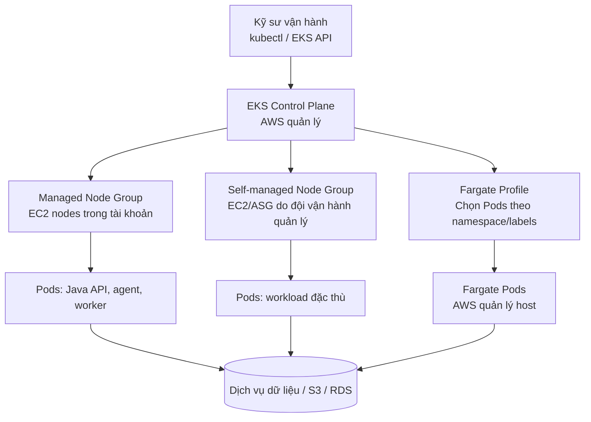
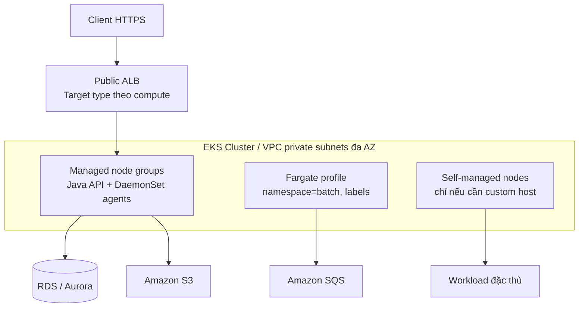

# Managed node group, self-managed node và Fargate profile

Một **Amazon EKS cluster** có Kubernetes control plane do AWS vận hành, nhưng ứng dụng vẫn cần nơi để chạy **Pod**. Ba lựa chọn phổ biến là **Amazon EKS managed node group**, **self-managed EC2 nodes** và **AWS Fargate thông qua Fargate profile**. Cả ba có thể tham gia cùng một cluster EKS, nhưng khác nhau đáng kể về ai quản lý máy chủ, cách Pod được xếp lịch, cập nhật hệ điều hành, IAM, giới hạn lưu trữ và chi phí.

Bài thuộc chương **Kubernetes với EKS** của mô-đun **CLOUD_PROVIDERS_AWS**, nối kiến thức Region/Availability Zone, IAM, VPC, EC2, EBS/EFS, ALB, giám sát CloudWatch, cơ sở dữ liệu và tích hợp serverless. Mục tiêu cuối cùng không phải chọn một loại node cho mọi tình huống, mà là thiết kế nền tảng chạy ứng dụng **an toàn, có thể mở rộng, phục hồi và kiểm soát chi phí**.

> **Phạm vi:** Bài tập trung vào ba lựa chọn trong tiêu đề. **EKS Auto Mode** và **Karpenter** được giới thiệu ở mức so sánh vì chúng là lựa chọn quan trọng trong EKS hiện đại, nhưng không thay thế phần thực hành managed node group, self-managed node và Fargate profile.

## 1. Mục tiêu học tập

Sau bài học, bạn có thể:

1. Phân biệt EKS **control plane** và **data plane**, EC2 worker node với Fargate Pod.
2. Giải thích trách nhiệm AWS và trách nhiệm người dùng ở ba phương án triển khai.
3. Tạo hoặc đọc cấu hình **managed node group**: node IAM role, subnet, instance type, capacity type, scaling, labels, taints và update strategy.
4. Nêu công việc vận hành **self-managed node**: EC2/Auto Scaling, AMI/bootstrap, cluster access, vá lỗi, rolling replacement, giám sát và dọn dẹp.
5. Giải thích **Fargate profile selector**, Pod execution role, private subnet và cách EKS quyết định Pod chạy trên Fargate.
6. Dùng labels, nodeSelector, taints/tolerations và Kubernetes manifests để chỉ định workload phù hợp, tránh xếp lịch sai.
7. Phân biệt **HPA** (tăng/giảm Pod) với **node provisioning/scaling** và hành vi mở rộng capacity Fargate.
8. Chọn storage, IAM và network phù hợp cho Java API, job, controller, database và các Pod hệ thống.
9. Chẩn đoán các lỗi **Pending**, **NotReady**, **ImagePullBackOff**, thiếu quyền AWS và lỗi cập nhật node.
10. Đề xuất kiến trúc chạy ứng dụng trên nhiều AZ có backup, theo dõi và kế hoạch chi phí.

## 2. EKS control plane không phải worker nodes

Trong một EKS cluster:

- **Control plane**: AWS quản lý Kubernetes API server, thành phần điều phối control plane và độ sẵn sàng của control plane theo dịch vụ EKS.
- **Data plane**: nơi chạy Pods thực tế. Có thể gồm managed EC2 nodes, self-managed EC2 nodes, Fargate Pods hoặc các loại compute được dịch vụ hỗ trợ.
- **Kubernetes API**: nơi bạn dùng `kubectl` để khai báo Deployments, Services, Jobs, Namespaces, RBAC và nhiều tài nguyên khác.
- **Scheduler/các cơ chế EKS Fargate**: xét yêu cầu Pod và điều kiện xếp lịch, gồm node labels/taints hoặc Fargate profile selectors tùy loại capacity.
- **VPC**: cung cấp subnet, địa chỉ IP, security group và tuyến mạng cần thiết để node/Pod giao tiếp với cluster và ứng dụng.



**Đừng nhầm “EKS là managed Kubernetes” với “AWS tự quản lý mọi máy EC2 trong cluster”.** Trách nhiệm đối với worker nodes khác nhau theo phương án.

### 2.1. Pod, node và node group

| Khái niệm | Vai trò | Ví dụ |
| --- | --- | --- |
| **Pod** | Đơn vị triển khai Kubernetes; có một hoặc nhiều container chia sẻ network namespace | Pod chạy Spring Boot API |
| **Node** | Capacity thực thi Pod; trên EC2 là một worker machine | EC2 `m7i.large` |
| **Node group** | Tập các EC2 nodes có cấu hình, vòng đời và capacity quản lý theo nhóm | `api-managed-ng` |
| **Managed node group** | Node group có một phần vận hành do EKS tự động hóa | AWS cập nhật AMI/rolling nodes khi được yêu cầu |
| **Self-managed node group** | Node group/ASG do bạn vận hành và quản lý | Custom AMI, bootstrap, drain |
| **Fargate profile** | Quy tắc chọn Pods chạy trên Fargate theo namespace/labels | `namespace=java-fargate` |
| **Fargate Pod** | Pod chạy trên compute do Fargate cung cấp, không quản trị EC2 host | Một Java job ngắn hạn |

Fargate profile **không giống node group**: tạo profile không đồng nghĩa khởi chạy một nhóm EC2 có số node cố định. Pods chỉ được provision Fargate capacity khi chúng phù hợp profile và được tạo/xếp lịch.

## 3. So sánh ba lựa chọn

| Tiêu chí | Managed node group | Self-managed EC2 nodes | Fargate profile |
| --- | --- | --- | --- |
| Ai quản lý EC2 worker host? | AWS hỗ trợ lifecycle qua EKS, EC2 vẫn trong account của bạn | Nhóm vận hành tự chịu trách nhiệm | AWS vận hành hạ tầng Fargate |
| Có thấy EC2/ASG? | Có, trong account | Có, trong account | Không quản lý EC2 host |
| Cập nhật AMI/Kubernetes node | EKS hỗ trợ rolling update khi bạn yêu cầu/cấu hình | Tự xây quy trình thay thế/vá lỗi | AWS vận hành runtime Fargate |
| Chọn EC2 instance type | Có | Có | Không chọn EC2 host; khai báo Pod CPU/memory |
| On-Demand/Spot | Có theo cấu hình node group | Có tùy ASG/kiến trúc | Không có Fargate Spot cho EKS |
| DaemonSet/privileged/host access | Có theo điều kiện hệ điều hành và policy | Có, nhiều tùy chỉnh hơn | Nhiều tính năng node-level **không hỗ trợ** |
| Persistent block EBS | Có qua EBS CSI driver trong giới hạn | Có qua EBS CSI driver trong giới hạn | **Không mount EBS cho Pod** |
| EFS | Có qua CSI phù hợp | Có qua CSI phù hợp | Có, dùng static provisioning theo hỗ trợ |
| Quyền IAM của ứng dụng | EKS Pod Identity/IRSA theo trường hợp | EKS Pod Identity/IRSA theo trường hợp | **IRSA**; EKS Pod Identity không hỗ trợ Fargate |
| Chi phí capacity | EC2/EBS và tài nguyên khác | EC2/EBS và tài nguyên khác | Fargate vCPU/memory/storage theo Pod |
| Phù hợp | Hầu hết workload Kubernetes thông dụng | Cần hệ điều hành, AMI hoặc runtime đặc biệt | Pod độc lập, đơn giản, không cần daemon/host access |

**Khuyến nghị xuất phát:** Với phần lớn ứng dụng Kubernetes cần DaemonSet, EBS, control node và khả năng chọn Spot, **managed node group** là điểm khởi đầu hợp lý. **Self-managed** dành cho yêu cầu cụ thể mà managed group không đáp ứng. **Fargate** phù hợp khi muốn giảm vận hành host và chấp nhận các giới hạn Kubernetes của nền tảng đó.

## 4. Managed node group: EC2 có lifecycle được EKS hỗ trợ

**Managed node group (MNG)** là nhóm EC2 worker nodes mà EKS hỗ trợ việc tạo, thay thế, cấu hình Auto Scaling group và cập nhật phiên bản/AMI theo quy trình dịch vụ. Nodes và ASG vẫn tồn tại trong **AWS account** của bạn, sử dụng VPC/subnets, EBS volumes, IAM roles và security groups của bạn.

### 4.1. Các thành phần khi tạo node group

Một managed node group cơ bản có:

| Thuộc tính | Ví dụ minh họa | Quyết định thiết kế |
| --- | --- | --- |
| Cluster | `java-prod-eks` | Đúng account/Region |
| Node group name | `api-managed-ng` | Dễ nhận diện owner/workload |
| Node IAM role | `arn:aws:iam::123456789012:role/EKSNodeRole` | Cho kubelet/ECR và thành phần node cần thiết |
| Subnets | Hai private subnets ở hai AZ | Tăng khả năng phục hồi và giảm public exposure |
| Instance types | `m7i.large`, `m7a.large` theo giới hạn | CPU/memory/phần cứng đáp ứng workload |
| Capacity type | `ON_DEMAND` hoặc `SPOT` | Giá và mức chấp nhận bị gián đoạn |
| Scaling | min=2, desired=2, max=6 | Ranh giới capacity |
| AMI type | AL2023, Bottlerocket, Windows hoặc loại được hỗ trợ | Tương thích runtime và security |
| Labels/Taints | `workload=api`, `dedicated=api:NoSchedule` | Điều khiển scheduler |
| Update configuration | max unavailable/percentage, strategy | Rủi ro gián đoạn khi đổi AMI/version |

**Managed node group không tự quyết định số node theo số Pod đang Pending** nếu bạn chưa triển khai giải pháp node autoscaling phù hợp. Bản thân việc chọn min/max/desired là cấu hình capacity, còn **Cluster Autoscaler**, **Karpenter** hoặc EKS Auto Mode giải quyết bài toán thêm/bớt node tự động theo thiết kế.

### 4.2. MNG quản lý được gì, không quản lý được gì?

EKS hỗ trợ:

- Provisioning một ASG và các EC2 nodes theo group specification.
- Cấp nhãn Kubernetes do EKS quản lý cho nodes.
- Thay thế node unhealthy qua cơ chế được hỗ trợ, có thể kết hợp **node auto repair** khi bật.
- Cập nhật AMI/launch template version và nâng phiên bản node theo quy trình managed update.
- Điều chỉnh min/max/desired, labels, taints và những cấu hình node group hỗ trợ.

Bạn vẫn chịu trách nhiệm:

- Chọn cấu hình **EC2, EBS, subnet, security group, IAM**, đảm bảo network và quota.
- Cấu hình **addons** tương thích như VPC CNI, CoreDNS, kube-proxy, CSI controllers.
- Chọn thời điểm update, kiểm thử version và chuẩn bị rollback.
- Bảo đảm Pods có **resources requests/limits**, replicas, readiness/liveness probes và PodDisruptionBudget (PDB) phù hợp.
- Quản trị applications, data, secrets, RBAC, IAM, network policies và chi phí.

### 4.3. MNG update và PodDisruptionBudget

Khi thực hiện **managed node group version update**, EKS có **rolling update** thường tôn trọng PodDisruptionBudget (PDB). Nếu Pod không thể evict do PDB quá chặt, update có thể thất bại với lỗi `PodEvictionFailure`. Tùy lựa chọn, **force update** có thể bỏ qua PDB và gây gián đoạn; chỉ dùng khi đã đánh giá ảnh hưởng.

**Khác biệt rất quan trọng:** Việc **giảm `desiredSize` trong scaling configuration** của managed node group có thể khiến ASG terminate nodes **không tôn trọng PDB như luồng rolling update**. Vì thế không dùng lệnh giảm desired đột ngột như một thay thế cho quy trình drain/rolling replacement an toàn.

### 4.4. Dùng Spot với managed node group

MNG hỗ trợ `SPOT` nếu cluster/instance types đáp ứng yêu cầu. Spot có thể giảm chi phí cho workload chịu được interruption nhưng:

- Không có bảo đảm Spot capacity luôn sẵn sàng.
- Cần replicas, đa AZ/instance types phù hợp và cơ chế graceful termination.
- Không nên đặt toàn bộ thành phần không thể gián đoạn chỉ trên Spot.
- Với workload cần trạng thái ổn định, cân nhắc kết hợp group On-Demand và Spot, thêm scheduling constraints.

### 4.5. Launch template và AMI tùy chỉnh

Launch template cho phép cấu hình sâu hơn (AMI, storage, userdata, instance settings...) khi MNG hỗ trợ. Có một số ràng buộc:

- Khi node group đã tạo **không** sử dụng custom launch template, không thể đơn giản gắn một custom launch template khác bằng update; thường cần tạo node group mới.
- Khi có launch template, update sang **version mới của cùng template** theo quy trình hỗ trợ.
- Nếu dùng **custom AMI**, bạn phải duy trì AMI đã được kiểm thử và bảo đảm bootstrap đúng phiên bản EKS/Kubernetes.
- Với **Amazon Linux 2023**, bootstrap sử dụng **nodeadm** và NodeConfig thay cho thói quen dùng mọi trường hợp với script `bootstrap.sh` của AMI cũ; custom AMI hoặc self-managed setup cần cung cấp cluster metadata phù hợp.

## 5. Self-managed nodes: kiểm soát cao và trách nhiệm cao

**Self-managed nodes** là các EC2 worker nodes do đội vận hành tự provision và quản lý: AMI, user data/bootstrap, Auto Scaling Group, EC2 instance lifecycle, OS updates, node joining và upgrades. Đây vẫn là worker node của **EKS cluster**, nhưng không do EKS Managed Node Group API quản lý theo cách MNG.

### 5.1. Các bước tối thiểu của một self-managed group

1. Có **EKS cluster** ở trạng thái `ACTIVE` và thông tin endpoint, certificate authority, cluster networking.
2. Tạo EC2 instance IAM role và instance profile với quyền phù hợp.
3. Chuẩn bị VPC/subnets, security group, outbound routes/đường tới EKS API/ECR và capacity.
4. Chọn **EKS optimized AMI**, Bottlerocket, Windows hoặc custom AMI phù hợp.
5. Chuẩn bị **launch template** và EC2 Auto Scaling Group/nhóm nodes.
6. Bootstrap kubelet và cấu hình **node admission/authentication**: **EKS access entries** (nếu cluster dùng authentication mode hỗ trợ) hoặc `aws-auth` ConfigMap trong legacy/ConfigMap mode theo đúng quy trình.
7. Xác nhận nodes xuất hiện ở Kubernetes trạng thái **Ready**.
8. Gán labels/taints, triển khai workload tương thích.
9. Thiết lập quy trình patch, rollout, drain, auto scaling, log/metrics, backup và terminate an toàn.

**Không giả định chỉnh `aws-auth` luôn là bước bắt buộc hoặc là cách chuẩn mới nhất.** EKS có **access entries**; hành vi phụ thuộc authentication mode của cluster. Đừng sửa authentication mode của cluster sản xuất để thử một manifest.

### 5.2. Khi nào self-managed là cần thiết?

- Phải dùng custom AMI/OS đặc thù hoặc agent/runtime yêu cầu quyền host mà MNG không cung cấp như mong muốn.
- Tổ chức có pipeline quản lý EC2/AMI và quy trình rollout riêng phức tạp.
- Có đặc điểm bootstrap, phần cứng, vùng triển khai hoặc tích hợp nội bộ yêu cầu điều khiển thấp.
- Có yêu cầu quản trị node vượt khả năng cấu hình MNG trong phiên bản/dịch vụ đang dùng.

Với self-managed, **bạn chịu trách nhiệm drain Pod, thay thế và bảo vệ node trong quá trình update**. Nếu chạy ASG scale-in không có quy trình Kubernetes-aware, một node có thể bị terminate khi vẫn đang phục vụ request hoặc giữ công việc dài.

### 5.3. Kế hoạch tự vá và thay node

Một quy trình vận hành phù hợp:

1. Build/pull AMI mới từ nguồn đáng tin, scan và ký/kiểm soát artifact.
2. Tạo launch template version mới và triển khai thử ở **staging**.
3. Kiểm tra tương thích Kubernetes/kubelet, CNI, CSI, GPU drivers và ứng dụng.
4. Scale-out để có capacity thay thế nếu cần.
5. `kubectl cordon` node cũ → `kubectl drain` tôn trọng các điều kiện phù hợp.
6. Chờ Pods chuyển và trở thành **Ready** trên node mới, theo dõi endpoint/traffic.
7. Terminate EC2 cũ qua ASG theo quy trình; xác nhận capacity/labels/taints.
8. Review lỗi, chi phí và xử lý rollback nếu cập nhật gây lỗi.

Ví dụ lệnh phục vụ quy trình khi đã được phê duyệt:

```bash
# ĐỌC: xem node và workload đang chạy ở đâu.
kubectl get nodes -o wide
kubectl get pods -A -o wide

# CÓ THAY ĐỔI: ngăn xếp Pod mới lên node được chỉ định.
kubectl cordon ip-10-0-10-12.ec2.internal

# CÓ THAY ĐỔI: evict các Pod có thể evict để bảo trì.
# Thay đúng node và hiểu PDB, DaemonSet, dữ liệu local trước khi chạy.
kubectl drain ip-10-0-10-12.ec2.internal \
  --ignore-daemonsets --delete-emptydir-data

# CÓ THAY ĐỔI: chỉ sau khi node được thay thế an toàn.
kubectl uncordon ip-10-0-10-12.ec2.internal
```

`--delete-emptydir-data` có thể làm mất dữ liệu tạm trong `emptyDir`. Không chạy `drain` trên node production đang có stateful workload hoặc job quan trọng khi chưa có biện pháp bảo vệ.

## 6. Fargate profile: chọn Pod thay vì quản trị EC2 nodes

**AWS Fargate for Amazon EKS** chạy các Kubernetes Pods trên capacity được AWS quản lý. Người dùng không SSH vào host, không vá kernel/AMI host và không chọn EC2 instance type. Mỗi Pod chạy trong một môi trường compute riêng được cấp phát tài nguyên phù hợp với **CPU/memory requests** và giới hạn dịch vụ.

Để EKS biết **Pod nào dùng Fargate**, bạn tạo một hoặc nhiều **Fargate profiles** trong cluster.

### 6.1. Fargate profile chứa những gì?

| Trường | Ví dụ | Ý nghĩa |
| --- | --- | --- |
| Profile name | `java-api-fargate` | Định danh profile |
| Pod execution role | `arn:aws:iam::123456789012:role/EKSFargatePodExecutionRole` | IAM cho hạ tầng Fargate/kubelet |
| Subnets | `subnet-private-a`, `subnet-private-b` | Địa chỉ mạng Pod trong private subnet |
| Selectors | `namespace=java-fargate`, `labels={workload=api}` | Quy tắc chọn Pod |
| Tags | `Environment=training` | Tag AWS quản trị profile, không tự thêm lên Pod |

Một profile cho phép tối đa **5 selectors**. Mỗi selector bắt buộc có **namespace**; labels là tùy chọn. Nếu selector chỉ có namespace mà không có labels, EKS có thể chọn **mọi Pod** trong namespace đó để chạy Fargate.

Ví dụ chỉ muốn Java API lên Fargate, còn monitoring agents chạy EC2: đừng tạo profile chỉ có `namespace=default` nếu namespace mặc định chứa nhiều loại workload. Ưu tiên namespace riêng cộng nhãn rõ ràng.

### 6.2. Quy tắc chọn Pod

Giả sử profile:

```yaml
fargateProfile: java-api-fargate
selectors:
  - namespace: java-fargate
    labels:
      workload: api
```

Bảng ví dụ:

| Namespace của Pod | Pod label | Có khớp profile? |
| --- | --- | --- |
| `java-fargate` | `workload=api` | **Có** |
| `java-fargate` | `workload=worker` | Không |
| `default` | `workload=api` | Không |
| `java-fargate` | Không có label `workload` | Không |

Đoạn YAML này là **mô tả cấu hình logic**, không phải một Kubernetes resource manifest có thể `kubectl apply`. Fargate profile là **EKS API resource**, tạo qua AWS Console, AWS CLI, `eksctl` hoặc IaC.

### 6.3. Nhiều profile cùng khớp một Pod

Nếu Pod khớp nhiều profile, EKS chọn theo **thứ tự tên profile dạng alphanumeric**; một Pod có thể chỉ định profile cần dùng bằng label:

```yaml
metadata:
  labels:
    eks.amazonaws.com/fargate-profile: java-api-fargate
```

Nhãn này chỉ hiệu lực khi Pod **thực sự khớp selector** của profile được chỉ định. Đừng dùng label override để bỏ qua quy tắc namespace hoặc đưa Pod vào subnet không được cấu hình.

**Profile không chỉnh sửa in-place.** Khi muốn thay selectors, subnets hoặc execution role, tạo profile mới, sắp xếp migration/recreate Pods rồi xóa profile cũ theo kế hoạch. Xóa profile đang dùng có thể làm các Pods bị dừng và chuyển sang Pending/reschedule.

### 6.4. Private subnets và địa chỉ IP

Fargate Pods cho EKS chạy trong **private subnets**, **không có public IP**, và profile không chấp nhận subnet có route trực tiếp tới **Internet Gateway**.

Pods cần giao tiếp với control plane/ECR/STS/CloudWatch và các dịch vụ khác theo ứng dụng. Tùy cấu hình, dùng **NAT Gateway** hoặc các **VPC endpoints** cần thiết, private DNS, route/security group phù hợp.

- Nếu subnet thiếu IP khả dụng, Fargate Pod có thể không được cấp network interface.
- Nếu route/DNS không tới ECR, Pod có thể bị lỗi pull image.
- Nếu security group chặn EKS API hoặc dependency nội bộ, Pod có thể không Ready.
- Fargate Pods trong EKS không được đặt trên Outposts/Wavelength/Local Zones theo giới hạn dịch vụ.

### 6.5. Giới hạn Fargate phải nhớ

| Nhu cầu | Fargate cho EKS |
| --- | --- |
| **DaemonSet** | Không hỗ trợ chạy DaemonSet trên Fargate |
| **Privileged container** | Không hỗ trợ |
| **hostNetwork/hostPort** | Không hỗ trợ |
| **GPU/EC2 hardware đặc biệt** | Không cung cấp kiểu tùy chọn EC2/GPU như node group |
| **Spot** | Không hỗ trợ Fargate Spot trong EKS |
| **EBS PersistentVolume** | **Không** mount EBS volume lên Fargate Pod |
| **EFS** | Có, qua **static provisioning**, không dùng dynamic provisioning kiểu EC2 |
| **Custom CNI** | Không hỗ trợ thay thế Amazon VPC CNI trên Fargate |
| **SSH vào host / custom AMI** | Không |
| **TopologySpreadConstraints** | Không hỗ trợ trong Fargate scheduler hiện hành |
| **EKS Pod Identity** | Không hỗ trợ trên Fargate; xem IRSA |
| **Workload chạy lâu và ổn định** | Có thể, nhưng phải dự toán vCPU/memory và tính hạn chế addon |
| **Liveness/readiness probes** | Có thể cấu hình như Pod Kubernetes bình thường |

Fargate platform được AWS vá/cập nhật. Trong một số đợt patch, Pods có thể bị evict/restart; vẫn cần **replicas, readiness checks, PDB khi phù hợp, graceful shutdown** và cơ chế phục hồi ứng dụng.

### 6.6. CPU, memory và ephemeral storage

Fargate chọn capacity dựa vào **resources requests** của Pod và cấu hình được hỗ trợ, cộng phần tài nguyên overhead dùng cho runtime. Capacity được làm tròn theo các tổ hợp vCPU/memory mà Fargate cung cấp; chi phí có thể cao hơn phép nhân trực tiếp từ request nhỏ nhất của container.

Ví dụ hai containers trong một Pod:

```yaml
resources:
  requests:
    cpu: "250m"
    memory: "512Mi"
  limits:
    cpu: "500m"
    memory: "768Mi"
```

Đây chỉ là ví dụ **resources của một container**, không phải bảng tính billing cuối cùng. Fargate tính theo **tổng Pod requirements, overhead và cấu hình được provision**; cần tra bảng kết hợp CPU/memory và giá Region khi dự toán.

Fargate cung cấp **ephemeral storage mặc định khoảng 20 GiB** cho Pod, phần dùng được thực tế thấp hơn vì các thành phần hệ thống chiếm dung lượng. Có thể cấu hình thêm trong giới hạn dịch vụ (hiện tối đa 175 GiB tổng ephemeral storage cho EKS Fargate), nhưng ephemeral storage **không phải backup bền vững**: khi Pod kết thúc, dữ liệu tạm mất. Đối với tệp chung/bền vững, cân nhắc **EFS** hoặc S3/RDS tùy loại dữ liệu.

## 7. Pod execution role khác IAM role của ứng dụng

Một lỗi bảo mật rất thường gặp là nghĩ rằng **Fargate Pod execution role** cung cấp quyền AWS SDK cho code Java bên trong container.

**Không đúng.**

| Vai trò | Ai sử dụng? | Mục đích |
| --- | --- | --- |
| **EC2 node IAM role** | EC2 node/kubelet và thành phần node được phép | Join cluster, pull image hoặc tương tác AWS theo policy |
| **Fargate Pod execution role** | Thành phần hạ tầng Fargate/kubelet | Kéo image từ ECR, đăng ký node và hoạt động hạ tầng được hỗ trợ |
| **Application IAM role qua IRSA** | Pod application dùng AWS SDK | Đọc S3, Secrets Manager, DynamoDB, SQS... theo least privilege |
| **EKS Pod Identity association** | Pod trên Linux EC2 nodes được hỗ trợ | Cấp temporary AWS credentials cho ứng dụng qua EKS Pod Identity Agent |
| **Kubernetes RBAC** | Danh tính dùng Kubernetes API | Quyền đọc/sửa Pods, Deployments, Secrets trong cluster |

**Fargate Pod execution role không tự được kế thừa bởi ứng dụng container.** Nếu ứng dụng Java cần `s3:GetObject`, hãy cấu hình IAM role riêng cho Kubernetes service account thông qua **IAM Roles for Service Accounts (IRSA)** với OIDC trust và policy phù hợp.

**EKS Pod Identity hiện chỉ hỗ trợ Pods chạy trên Linux EC2 nodes được hỗ trợ, không hỗ trợ Fargate Pods.** IRSA vẫn là phương án phù hợp cho Fargate, đồng thời cũng có thể dùng trên EC2 nodes khi cần.

### 7.1. Vì sao không đưa AWS access keys vào Kubernetes Secret?

Kubernetes Secret có thể được bảo vệ thêm bằng encryption at rest và RBAC, nhưng đặt AWS access key dài hạn vào Secret vẫn tạo rủi ro rò rỉ, quay vòng khóa và quyền vượt mức.

Ưu tiên:

1. Dùng **service account** riêng theo ứng dụng/workload.
2. Gắn **IAM role** thông qua IRSA hoặc EKS Pod Identity tùy compute hỗ trợ.
3. Chỉ cho phép actions/resource ARNs cần thiết (least privilege).
4. Không đưa token, keys hoặc mật khẩu vào container image/ConfigMap, logs hay Git.
5. Dùng AWS Secrets Manager/Parameter Store cho bí mật nghiệp vụ khi phù hợp, kiểm soát IAM và rotation.

## 8. Kubernetes scheduling: label, taint và Fargate selector

### 8.1. Định hướng workload lên managed node group

Khi MNG tạo nodes, EKS đặt một số labels như `eks.amazonaws.com/nodegroup`. Bạn cũng có thể cấu hình custom labels của group.

Ví dụ Deployment chỉ chạy trên node group `api-managed-ng`:

```yaml
apiVersion: apps/v1
kind: Deployment
metadata:
  name: java-api-ec2
  namespace: apps
spec:
  replicas: 2
  selector:
    matchLabels:
      app: java-api-ec2
  template:
    metadata:
      labels:
        app: java-api-ec2
    spec:
      nodeSelector:
        eks.amazonaws.com/nodegroup: api-managed-ng
      containers:
        - name: java-api
          image: 123456789012.dkr.ecr.ap-southeast-1.amazonaws.com/java-api:v1
          ports:
            - containerPort: 8080
          resources:
            requests:
              cpu: "250m"
              memory: "512Mi"
            limits:
              cpu: "1000m"
              memory: "1Gi"
          readinessProbe:
            httpGet:
              path: /actuator/health/readiness
              port: 8080
            initialDelaySeconds: 15
            periodSeconds: 10
```

**Lưu ý:** tên image, cluster, namespace và node group chỉ là ví dụ. Trước khi áp dụng thật, phải có namespace, image hợp lệ, AWS identity cho ECR, cấu hình Spring Boot readiness endpoint và đủ node capacity.

**`nodeSelector` là điều kiện cứng.** Nếu không có node nào có label đó (hoặc nodes đều hết tài nguyên/tainted), Pod sẽ ở `Pending`.

### 8.2. Taints và tolerations

Taints ngăn Pod không có toleration phù hợp được schedule vào node. Ví dụ node group chạy workload nhạy cảm có taint `dedicated=payments:NoSchedule`. Pod được phép có cấu hình:

```yaml
spec:
  tolerations:
    - key: "dedicated"
      operator: "Equal"
      value: "payments"
      effect: "NoSchedule"
  nodeSelector:
    workload: payments
```

**Toleration không có nghĩa “ép Pod phải chạy vào node này”.** Nó chỉ cho phép Pod vượt rào taint; dùng thêm nodeSelector/node affinity để chọn đúng nhóm.

Các node-level features như privileged pods, DaemonSets hoặc host networking cần EC2 nodes phù hợp; không cố thêm toleration để “bật” những tính năng Fargate không hỗ trợ.

### 8.3. Định hướng Pod tới Fargate bằng selector

Giả sử đã tạo profile:

- Tên: `java-api-fargate`.
- Selector: `namespace=java-fargate`, `labels={workload=api}`.
- Subnets: hai private subnets ở hai AZ.

Ví dụ Deployment:

```yaml
apiVersion: v1
kind: Namespace
metadata:
  name: java-fargate
---
apiVersion: apps/v1
kind: Deployment
metadata:
  name: java-api-fargate
  namespace: java-fargate
spec:
  replicas: 2
  selector:
    matchLabels:
      app: java-api-fargate
  template:
    metadata:
      labels:
        app: java-api-fargate
        workload: api
    spec:
      serviceAccountName: java-api-sa
      containers:
        - name: api
          image: 123456789012.dkr.ecr.ap-southeast-1.amazonaws.com/java-api:v1
          ports:
            - containerPort: 8080
          resources:
            requests:
              cpu: "500m"
              memory: "1Gi"
            limits:
              cpu: "500m"
              memory: "1Gi"
          readinessProbe:
            httpGet:
              path: /actuator/health/readiness
              port: 8080
            periodSeconds: 10
```

Trước khi `kubectl apply`, tạo **Kubernetes service account `java-api-sa`** và IRSA nếu code Java cần AWS APIs, đồng thời xác nhận image có thật. Đoạn trên cố tình không tạo role/policy IAM tự động vì IAM là quyết định bảo mật riêng.

**Không thêm `nodeSelector` buộc vào EC2 node group** trên Pod đang được Fargate profile chọn; yêu cầu trái ngược có thể khiến Pod không schedule được.

### 8.4. Ưu tiên Fargate selector không thay mọi quy tắc Kubernetes

Trong EKS hỗn hợp EC2/Fargate, Fargate profile selector quyết định Pods phù hợp được chạy trên Fargate theo cơ chế dịch vụ. Tuy nhiên:

- Pod không khớp profile không tự động “biến thành Fargate”; Kubernetes cần EC2 capacity phù hợp hoặc một cơ chế compute khác.
- Profile có selectors rộng có thể kéo nhiều Pods hệ thống/ứng dụng sang Fargate ngoài ý muốn.
- Pod có yêu cầu không hỗ trợ trên Fargate có thể **Pending** hoặc không chạy được dù namespace/labels khớp.
- Lựa chọn Fargate profile và nodeSelector/affinity nên được kiểm thử cùng các policies thực tế.

## 9. Networking và Load Balancing cho hai kiểu compute

### 9.1. EKS Pods, VPC CNI và IP capacity

Với EKS trên VPC, Amazon VPC CNI thường cấp IP từ VPC cho Pods theo cơ chế mạng của EKS. EC2 nodes có giới hạn về ENIs/IP addresses, CIDR, instance type và cấu hình prefix delegation.

Khi Pod bị `Pending` hoặc lỗi network:

- Xem subnet còn IP khả dụng không.
- Xem instance/network interface limits và VPC CNI đã sẵn sàng chưa.
- Kiểm tra route từ private subnet tới EKS API, ECR, STS, CloudWatch hoặc hệ thống dịch vụ cần dùng.
- Xem security group, NACL, DNS resolution và VPC endpoints/NAT.
- Đừng giả định chỉ tăng số node là giải quyết được thiếu địa chỉ IP trong subnet.

### 9.2. Fargate profile chỉ chọn private subnet

Mỗi Fargate Pod có giao diện mạng được dịch vụ cấp trong private subnet của profile. Để triển khai một Java API:

1. Chọn ít nhất hai private subnets ở các AZ được hỗ trợ và đủ IP.
2. Bảo đảm đường tới EKS API, ECR (và S3 dependencies cho pull image khi cần), STS nếu dùng IRSA, logging và backend services.
3. Cấu hình security group/network access theo kiến trúc được hỗ trợ.
4. Dùng Service hoặc Ingress với **AWS Load Balancer Controller** phù hợp nếu cần client truy cập.
5. Với ALB/NLB controller target registration cho Fargate, thường dùng **target type `ip`**, vì không có EC2 node instance để đăng ký theo instance target.
6. Kiểm tra readiness, endpoint health, TLS và DNS trước khi cho traffic thật.

Không mở public IP cho Fargate Pod để giải quyết lỗi truy cập: EKS Fargate Pods **không được gán public IP**.

### 9.3. EC2 worker nodes và ALB

Trên EC2 managed/self-managed, AWS Load Balancer Controller có thể dùng target type `instance` hoặc `ip` tùy service/ingress và CNI. Lựa chọn cần đồng nhất với cách Pod nhận IP và đường truyền từ ALB.

ALB **không tự mở rộng số Pod**. Kubernetes Deployment/HPA điều chỉnh replicas; node autoscaler hoặc Fargate cung cấp capacity. Cần kiểm tra đồng thời target health và số Pods Ready.

## 10. HPA, node autoscaling, Karpenter và Fargate

Dễ nhầm ba lớp:

| Cơ chế | Quyết định điều gì? | Ví dụ |
| --- | --- | --- |
| **Horizontal Pod Autoscaler (HPA)** | Số lượng **Pods/replicas** | 2 → 6 Java API Pods khi CPU cao |
| **Cluster Autoscaler** | Tăng/giảm **EC2 node capacity** của các ASG/node groups được hỗ trợ | 2 → 3 EC2 nodes khi Pods pending |
| **Karpenter** | Tự chọn/provision EC2 nodes theo nhu cầu Pods qua NodePools/NodeClasses | Chọn loại EC2 hợp lý hơn cho Pods |
| **Fargate scheduling** | Cấp **compute theo Pod** phù hợp profile | Tạo thêm Fargate Pods khi HPA tăng replicas |
| **EKS Auto Mode** | AWS quản lý nhiều thành phần hạ tầng EKS, gồm node provisioning kiểu Karpenter | Dùng NodePools/NodeClasses do Auto Mode quản lý |

**HPA không thêm EC2 nodes.** Nếu HPA tăng replicas lên 8 nhưng MNG chỉ có hai node đã đầy, các Pod mới **Pending** cho tới khi EC2 capacity tăng. Với Fargate, mỗi Pod phù hợp profile có thể được provision capacity riêng; không cần ASG cho Pods đó, nhưng vẫn phụ thuộc quotas, subnet IP và tài nguyên được hỗ trợ.

### 10.1. EKS Auto Mode có thay ba phương án cũ không?

EKS Auto Mode là lựa chọn mới hơn khi AWS quản lý nhiều phần data plane và add-ons. Nó có thể chạy **cùng một cluster** với managed node groups trong một số kế hoạch migration. AWS hiện khuyến nghị đánh giá EKS Auto Mode khi muốn giảm quản trị hạ tầng, thay vì mặc định chọn Fargate cho mọi workload cần “serverless-like”.

Tuy nhiên, Auto Mode **không phải tên mới của Fargate profile** và không sử dụng cùng API selectors. Auto Mode dùng mô hình managed EC2 nodes/NodePools/Karpenter-inspired, hỗ trợ nhiều khả năng Kubernetes/EC2 mà Fargate không có. Cần so sánh giới hạn, chi phí và chính sách của tổ chức trước khi chuyển dịch.

### 10.2. Vì sao dùng HPA cần metrics server?

Một HPA sử dụng CPU/memory yêu cầu nguồn metric thích hợp như Kubernetes **Metrics Server** hoặc pipeline custom/external metrics tương ứng. Nếu chưa có metrics hoặc Pod không có resources requests phù hợp, HPA có thể báo `unknown` hoặc không scale theo kỳ vọng.

Một HPA mẫu cho Java API:

```yaml
apiVersion: autoscaling/v2
kind: HorizontalPodAutoscaler
metadata:
  name: java-api-hpa
  namespace: java-fargate
spec:
  scaleTargetRef:
    apiVersion: apps/v1
    kind: Deployment
    name: java-api-fargate
  minReplicas: 2
  maxReplicas: 6
  metrics:
    - type: Resource
      resource:
        name: cpu
        target:
          type: Utilization
          averageUtilization: 60
```

Tăng HPA maxReplicas đồng nghĩa **cho phép tăng số Pods**, không đảm bảo các Pods mới chạy ngay và không phải giới hạn hóa đơn cứng. Trên Fargate, mỗi Pod thêm có thể làm tăng chi phí Fargate.

## 11. Storage, stateful workloads và ứng dụng Java

### 11.1. EC2 nodes: EBS/EFS theo nhu cầu

Trên managed/self-managed EC2 nodes, ứng dụng có thể dùng:

- **EBS CSI driver** cho PersistentVolume block trong một AZ và ràng buộc lịch scheduling/volume topology.
- **EFS CSI driver** cho file storage chia sẻ NFS qua các AZ theo kiến trúc.
- **S3** để lưu object qua API, không coi S3 là ổ POSIX truyền thống.
- **RDS/Aurora/DynamoDB** cho dữ liệu database theo nhu cầu.

Một EBS volume nằm trong **một AZ**: nếu một Pod có PVC EBS và bị reschedule sang node ở AZ khác, scheduling/volume attachment có thể thất bại. Dùng StorageClass, topology constraints, StatefulSet và backup/phương án recovery phù hợp.

### 11.2. Fargate: không mount EBS

Fargate hỗ trợ ephemeral storage và **EFS persistent volume thông qua static provisioning** trong phạm vi AWS hỗ trợ; **không mount EBS** và không chạy EBS CSI node DaemonSet.

Vì vậy, với hệ thống cần EBS volumes và database local tự quản, nên đánh giá EC2 nodes hoặc dịch vụ database quản lý. Nếu Java API chạy Fargate, có thể lưu upload vào **S3**, lưu relational data ở **RDS**, lưu file dùng chung ở EFS và dùng ephemeral storage cho cache/tệp tạm có thể tạo lại.

### 11.3. Đặt dữ liệu ngoài vòng đời Pod

Khi node bị update hoặc Fargate Pod bị restart, tệp trong container filesystem/ephemeral storage có thể mất. Ứng dụng production cần:

- Không giữ **phiên duy nhất** trong RAM một Pod.
- Cất dữ liệu quan trọng vào dịch vụ bền vững phù hợp.
- Có **readiness/liveness probes**, graceful shutdown và retry idempotent.
- Giữ secrets bằng IAM và dịch vụ quản lý secrets phù hợp.
- Có backup, kiểm tra restore và chiến lược RPO/RTO theo yêu cầu.

## 12. Bảo mật: cluster access, node role và workload role

### 12.1. Cluster authentication khác quyền AWS API trong Pod

| Nhu cầu | Cơ chế phù hợp |
| --- | --- |
| Người vận hành chạy `kubectl` | EKS cluster access entries/legacy auth mode + Kubernetes RBAC |
| EC2 node gia nhập cluster | Node IAM role, EKS access/bootstrap cấu hình đúng |
| Fargate infrastructure/kubelet hoạt động | **Pod execution role** của Fargate profile |
| Pod trên EC2 cần S3/DynamoDB | EKS Pod Identity hoặc IRSA theo compute hỗ trợ |
| Pod trên Fargate cần S3/DynamoDB | **IRSA** |
| Mã hóa secrets, logs, EBS/EFS | KMS/IAM/service policy phù hợp |
| Network access giữa Pods/dịch vụ | Security groups, Kubernetes NetworkPolicy nếu dataplane/plugin hỗ trợ |

Không dùng `cluster-admin` cho tất cả service accounts hoặc gắn `AdministratorAccess` vào EC2 node role chỉ để chữa lỗi ứng dụng không gọi được AWS API.

### 12.2. Vận hành an toàn trên EC2 nodes

- Sử dụng **IMDSv2**, cân nhắc chặn Pod access tới IMDS/node role nếu ứng dụng không cần.
- Cập nhật EKS optimized AMI và các add-ons.
- Cho nodes chạy trong private subnet nếu có thể; kiểm tra outbound qua NAT/VPC endpoints.
- Không để SSH mở rộng ra Internet; xem xét Systems Manager Session Manager.
- Cấu hình runtime security, image scanning, Kubernetes RBAC, NetworkPolicy/SG phù hợp.
- Lưu audit logs/CloudTrail và phân quyền người được sửa MNG, ASG, launch template, fargate profiles và IAM roles.

### 12.3. Fargate không miễn trừ bảo mật ứng dụng

Fargate giảm công việc bảo trì host nhưng **không tự bảo đảm container image an toàn**. Vẫn phải:

- Quét image bằng ECR scanning hoặc công cụ phù hợp.
- Đặt resources requests/limits có chủ đích.
- Dùng IAM least privilege cho service accounts.
- Bảo vệ secret và TLS kết nối API/database.
- Cấu hình logging/observability theo mô hình Fargate (không dựa vào DaemonSet agent).
- Đặt replicas, health checks và khả năng phục hồi khi Pod bị thay thế.

## 13. Cập nhật và thay thế capacity không gián đoạn

### 13.1. Managed node group

Quy trình nâng phiên bản thông thường:

1. Xác định cluster version hiện tại và phiên bản node/kubelet.
2. Kiểm tra **version skew** và add-on compatibility.
3. Tạo snapshot/backup phù hợp cho ứng dụng stateful.
4. Rà PDB, replicas, topology, resource capacity và kế hoạch rolling update.
5. Khởi chạy **managed node group version update** (AMI/Kubernetes hoặc launch template version).
6. Theo dõi node-group update status, node conditions, Pending Pods, ALB target health.
7. Xác minh ứng dụng và rollback bằng node group mới/AMI cũ theo phương án đã chuẩn bị khi có sự cố.

Nếu MNG dùng custom AMI, AWS không tự biết patch mới của AMI của bạn. Hãy phát hành AMI mới và launch template version mới, rồi update theo quy trình hỗ trợ.

### 13.2. Self-managed nodes

Bạn tự thiết kế:

- AMI build/patch và kiểm thử.
- Tăng capacity mới trước khi loại bỏ node cũ.
- Cordon/drain phù hợp với PDB, job, stateful volumes và các Pod hệ thống.
- Xem node registration và labels/taints sau khi tạo node mới.
- Tự quản lý rollback, lỗi instance provisioning và ASG termination hooks.

### 13.3. Fargate profile/Pod

AWS quản lý host Fargate. Bạn cập nhật **container images/Deployments** bằng Kubernetes rolling update, không “SSH vào Fargate node để patch”. Khi cần thay profile:

1. Tạo profile mới với selectors/subnets/role mong muốn.
2. Xem các Pod nào sẽ khớp profile và chiến lược phân phối trên AZ.
3. Test Pods mới, service readiness và IAM trước khi cutover.
4. Tạo lại/rolling update Pods theo kế hoạch; EKS chọn profile theo selectors/priority.
5. Sau khi xác minh, xóa profile cũ; kiểm tra Pods không Pending hoặc bị xóa đột ngột.

Đặc biệt, EKS Fargate **không hỗ trợ topologySpreadConstraints**, nên không thể giả định `replicas: 2` tự phân bổ chính xác mỗi AZ một Pod. Nếu cần cân bằng AZ có kiểm soát, dùng thiết kế **hai Fargate profiles, mỗi profile một subnet** và nhãn/Deployment phù hợp theo hướng dẫn AWS.

## 14. Giám sát và xử lý sự cố node/Pod

### 14.1. Bộ lệnh quan sát Kubernetes

```bash
# Kiểm tra context trước: tránh vận hành nhầm cluster production.
kubectl config current-context

# Nodes, label và readiness.
kubectl get nodes -o wide --show-labels
kubectl describe node NODE_NAME

# Pods kèm namespace, node nơi chạy và trạng thái.
kubectl get pods -A -o wide

# Kiểm tra Pod đang Pending / CrashLoop / ImagePullBackOff.
kubectl describe pod POD_NAME -n NAMESPACE
kubectl get events -n NAMESPACE --sort-by=.lastTimestamp

# Xem logs ứng dụng khi được cấp quyền.
kubectl logs -n NAMESPACE deployment/java-api-fargate --tail=100

# Kiểm tra rollout và HPA.
kubectl rollout status deployment/java-api-fargate -n java-fargate
kubectl get hpa -A
```

`kubectl describe` và `kubectl get events` thường chỉ rõ lỗi scheduler, insufficient CPU/memory, affinity, taints hoặc image pull. Đừng sửa hạ tầng dựa vào duy nhất trạng thái `Pending`.

### 14.2. Tình huống lỗi phổ biến

| Triệu chứng | Nguyên nhân có thể | Kiểm tra |
| --- | --- | --- |
| Managed nodes `NotReady` | VPC CNI, kubelet, auth, DNS, EKS API hoặc EC2 health | `kubectl describe node`, node logs và EKS node group health |
| Node group creation failed | Sai node IAM role, subnet/IP, quota, launch template/AMI, bootstrap | EKS health issues, EC2/ASG activities, CloudTrail |
| Self-managed EC2 chạy nhưng không join | Thiếu access entry/`aws-auth`, bootstrap NodeConfig, SG/route | Cluster auth mode, kubelet logs, API connectivity |
| Pod Pending trên EC2 | Thiếu resource capacity, nodeSelector, taint, PVC AZ | `kubectl describe pod` và node labels/taints |
| Fargate Pod Pending | Selector không khớp, profile chưa Active, quota hoặc subnet IP | `describe-fargate-profile`, Pod events, subnets |
| Fargate image pull lỗi | Thiếu ECR reachability, NAT/endpoints hoặc Pod execution role | ECR, DNS, IAM và events |
| App Fargate `AccessDenied` khi gọi S3 | Nhầm Pod execution role với workload IAM, IRSA sai | Service account, OIDC trust, IAM policy/KMS |
| Fargate Pod cần EBS hoặc DaemonSet | Tính năng không được Fargate hỗ trợ | Chọn EC2 node group/thiết kế storage khác |
| Update MNG `PodEvictionFailure` | PDB quá chặt, Pod không thể evict hoặc thiếu capacity | PDB, replicas, node update history |
| HPA tăng Pods nhưng EC2 Pods Pending | Chỉ scale Pod, chưa tăng node capacity | ASG/MNG scaling, CA/Karpenter, quotas |
| App thiếu IP | Subnet thiếu IP, CNI limits hoặc Fargate network allocation | VPC subnet available IPs, VPC CNI metrics |
| Load balancer trả 503 | Không có healthy/ready targets, sai target type/port | ALB/NLB target health, Service/Ingress, SG |
| Tăng hóa đơn không rõ lý do | EC2 nodes idle, Fargate Pod quá to, NAT/ALB/EBS/logs | Cost Explorer, Budgets, requests, replicas |

### 14.3. Thứ tự kiểm tra khi Pod không chạy

1. **Đúng account/cluster/context?** `aws sts get-caller-identity`, `kubectl config current-context`.
2. **Pod khớp compute nào?** Namespace/labels, Fargate selectors hoặc nodeSelector/taints.
3. **Compute có sẵn?** MNG/EC2 nodes Ready và đủ CPU/RAM; hoặc Fargate profile Active, đủ quotas.
4. **Networking?** Private subnets, IP còn trống, SG/NACL/routes, DNS, EKS API/ECR endpoints.
5. **IAM?** Node role, Fargate Pod execution role, application IRSA/EKS Pod Identity.
6. **Storage?** EBS AZ/PVC pending, EFS mount/reachability, ephemeral storage.
7. **Application?** Image, configuration, probes, logs, external dependencies.
8. **Scale/HA/cost?** HPA, node autoscaler, PDB, khả năng chịu lỗi AZ, ngân sách.

## 15. Chi phí: trả theo cluster, EC2 nodes hoặc Pod compute

### 15.1. Những loại chi phí cần tính

| Lớp | Managed node group | Self-managed node | Fargate |
| --- | --- | --- | --- |
| **EKS cluster fee** | Có | Có | Có |
| **EC2 instances** | Có, theo instances provisioned | Có | Không trực tiếp quản trị EC2 nodes |
| **EBS/worker storage** | Root/data volumes, snapshots | Root/data volumes, snapshots | Fargate ephemeral storage, EFS/S3 theo nhu cầu |
| **Fargate CPU/memory** | Không | Không | **Có, theo tài nguyên Fargate Pod được provision** |
| **Networking** | NAT/ALB/transfer/IP và endpoints | Tương tự | NAT/endpoints/ALB/transfer và IP sử dụng |
| **Logging/metrics** | CloudWatch, Prometheus... | Tương tự | CloudWatch/observability theo tích hợp phù hợp |
| **Node maintenance** | Một phần AWS tự động hóa | Tổ chức tự vận hành | AWS quản lý hạ tầng host |

EKS **managed node groups không có phụ phí riêng cho chức năng node group** so với tài nguyên AWS liên quan; nhưng cluster EKS và EC2/EBS/network vẫn bị tính phí theo bảng giá. Với **Fargate**, chi phí chính là compute cho từng Pod dựa trên vCPU/memory được provision, có thể có phí extra ephemeral storage và dịch vụ phụ thuộc.

### 15.2. Ví dụ ước lượng capacity

Giả sử Java API cần **2 replicas ổn định** mỗi replica sử dụng khoảng `0.5 vCPU` và `1 GiB RAM`:

- **MNG:** Có thể dùng 2 EC2 nodes ở hai AZ cho HA, nhưng trả phí node ngay cả khi CPU chưa đầy. Khi nhiều Pods vừa vặn trên cùng nodes, mức tận dụng/giá có thể tốt.
- **Self-managed:** Cùng chi phí EC2 cơ bản nhưng thêm công sức tự quản node; chỉ hợp lý khi có lý do kỹ thuật/chiến lược rõ.
- **Fargate:** Không giữ idle EC2 nodes cho những Pod phù hợp; trả phí các tổ hợp vCPU/memory mà Fargate provision, có thể kém kinh tế nếu workload lớn chạy 24/7 hoặc cấu hình Pod requests quá dư.

Không thể khẳng định mô hình nào luôn rẻ hơn chỉ từ số replicas. Cần tính **Region, instance types/Spot/Savings Plans, utilization, startup, EBS/EFS, NAT, logging, EKS cluster fee và overhead vận hành**.

### 15.3. Bài toán hiệu quả tài nguyên

Một EC2 node 4 vCPU/16 GiB không nhất thiết cho Kubernetes Pods sử dụng đủ 4 vCPU/16 GiB: hệ điều hành, kubelet, DaemonSets và reserved resources chiếm một phần. Ngược lại, Fargate Pod cũng có overhead và cấu hình vCPU/memory làm tròn lên tổ hợp hợp lệ.

**Tối ưu hợp lý:**

- Đo CPU/memory thực tế rồi đặt Pod `requests/limits` phù hợp.
- Giữ HPA/replicas với mức dự phòng theo SLO.
- Nếu dùng EC2, theo dõi bin-packing, đa AZ và số nodes không phục vụ tải.
- Nếu dùng Fargate, tránh phân nhỏ workload thành rất nhiều Pod quá nhỏ hoặc provision memory quá cao mà không cần.
- Lập ngân sách CloudWatch/Cost Explorer, kiểm tra chi phí NAT Gateway, EFS, ALB và lưu trữ logs.
- Dọn cluster/node group/Fargate profiles được tạo cho lab theo lịch được phê duyệt.

## 16. Tình huống thiết kế: Java API, batch worker và monitoring

Một doanh nghiệp xây dựng ứng dụng đặt hàng:

- Java Spring Boot API cần 4–12 Pods tùy lưu lượng.
- Worker đọc SQS, xử lý theo đợt vào ban đêm.
- Hệ thống giám sát cần DaemonSet agent.
- Ứng dụng dùng RDS, EFS cho file dùng chung và S3 cho attachments.
- Yêu cầu phục hồi khi mất một AZ, bảo mật IAM và kiểm soát chi phí.

### Ma trận đề xuất

| Workload | Phương án gợi ý | Lý do |
| --- | --- | --- |
| Java API chính, traffic đều và cần ALB | **Managed node group** đa AZ | Chia sẻ node capacity, dễ vận hành, hỗ trợ add-ons và autoscaling |
| Batch worker ngắn, workload độc lập, không cần host access | **Fargate profile** nếu hợp lý về chi phí | Provision Pod theo yêu cầu, không quản trị host |
| Monitoring/security agent dạng DaemonSet | **EC2 nodes** | Fargate không chạy DaemonSet |
| GPU/custom OS/security kernel đặc biệt | **Self-managed** hoặc MNG custom image khi hỗ trợ | Cần kiểm soát node/driver; đánh giá phương án mới phù hợp |
| Database quan trọng | **Amazon RDS/Aurora** nếu phù hợp, hoặc EC2 StatefulSet có thiết kế bền vững | Không dựa vào ephemeral Pod storage |
| API cần S3 | **EKS Pod Identity/IRSA trên EC2**, **IRSA trên Fargate** | IAM least privilege cho workload |

### 16.1. Phân tầng hạ tầng



Đây là kiến trúc logic; load balancer, subnets, SG, EKS cluster endpoint và các endpoint thực tế phải cấu hình theo AWS Load Balancer Controller/compute phù hợp. Bảo vệ dữ liệu và phục hồi không tự hình thành chỉ vì có hai AZ.

### 16.2. Quyết định hỗn hợp cần lưu ý

- Có thể dùng **MNG và Fargate trong cùng cluster**, nhưng phải quản lý namespace/labels để Pod đến đúng compute.
- Các controllers cần DaemonSet hoặc host/network privileges nên được đặt trên EC2 nodes.
- Tạo Fargate profile quá rộng cho `kube-system` có thể khiến một số thành phần hệ thống không thể chạy như mong muốn.
- Nếu muốn **CoreDNS chạy trên Fargate-only cluster**, cần đáp ứng cấu hình Fargate profile cho namespace tương ứng và những yêu cầu EKS riêng, ví dụ xử lý annotation chọn compute EC2 khi áp dụng.
- Quản lý node/Pod access, logging, backup và chi phí theo **workload**, không chỉ theo cluster.

## 17. AWS Console: quy trình cấu hình theo từng kiểu

> **Chi phí và tác động:** Tạo EKS cluster, node group hoặc Fargate Pods có thể phát sinh chi phí; việc update/delete ảnh hưởng workload đang chạy. Các bước là hướng dẫn để hiểu hệ thống; chỉ thực hiện trên account và cluster được phép.

### 17.1. Managed node group

1. Mở [Amazon EKS Console](https://console.aws.amazon.com/eks/), chọn Region và cluster `ACTIVE`.
2. Vào **Compute → Node groups → Add node group**.
3. Đặt tên như `api-managed-ng`, chọn **Node IAM role** phù hợp.
4. Chọn AMI type, capacity type (`ON_DEMAND` hoặc `SPOT`), instance types và disk size/launch template khi phù hợp.
5. Chọn private subnets ít nhất hai AZ nếu kiến trúc cần HA.
6. Chọn min=2, desired=2, max=6, update settings, labels/taints.
7. Review IAM, subnet/IPs, SG, quota và giá, rồi tạo node group.
8. Đợi `ACTIVE`, xem node group health và `kubectl get nodes`.
9. Kiểm tra Pods, networking, CoreDNS, VPC CNI và workload readiness.

**Không để `MinSize=0` cho mọi node group** nếu cluster vẫn cần DaemonSets/controllers chạy thường trực trên EC2.

### 17.2. Self-managed nodes

1. Chuẩn bị EC2 node role và những policy phù hợp.
2. Chuẩn bị AMI/launch template và ASG/CloudFormation/`eksctl` theo quy trình tổ chức.
3. Bảo đảm cluster endpoint, DNS, private routes, CNI và access entries/legacy auth mapping.
4. Khởi chạy instances, theo dõi bootstrap và xác minh nodes `Ready`.
5. Tự thiết lập rolling update, graceful drain, autoscaler, monitoring và dọn lifecycle.
6. Document AMI build/version, launch template/ASG ownership và rollback.

Self-managed nodes không hiện trong **EKS managed node groups list** theo cùng cách MNG; quan sát qua EC2/ASG/CloudFormation và `kubectl get nodes`.

### 17.3. Fargate profile

1. Vào EKS cluster → **Compute → Fargate profiles → Add Fargate profile**.
2. Chọn tên `java-api-fargate`.
3. Chọn đúng **Pod execution IAM role** cho Fargate infrastructure (không dùng node role của EC2).
4. Chọn **private subnets** trong các AZ cần hỗ trợ.
5. Tạo selector `namespace=java-fargate` và label `workload=api`.
6. Review và tạo profile, đợi trạng thái **ACTIVE**.
7. Tạo namespace/service account/Deployment có Pod template labels khớp selector.
8. Kiểm tra `kubectl get pods -n java-fargate -o wide` và events.
9. Cấu hình IAM ứng dụng bằng IRSA, ingress target type IP, logs và health nếu cần.
10. Khi muốn đổi profile, tạo **profile mới** rồi migrate Pods; không tìm nút sửa selector in-place.

## 18. AWS CLI và kubectl: quan sát, cấu hình minh họa

Dùng **AWS CLI v2**, `kubectl` tương thích cluster và profile IAM Identity Center có quyền. Mọi ID/ARN/cluster name dưới đây là **placeholder**, không dùng trực tiếp trên production.

### 18.1. Chỉ đọc: EKS và node groups

```bash
# Xác nhận AWS account.
aws sts get-caller-identity --profile training

# Kiểm tra cluster status và các cấu hình cần thiết.
aws eks describe-cluster \
  --name demo-eks \
  --region ap-southeast-1 \
  --profile training

# Danh sách EKS managed node groups.
aws eks list-nodegroups \
  --cluster-name demo-eks \
  --region ap-southeast-1 \
  --profile training

# Xem managed node group.
aws eks describe-nodegroup \
  --cluster-name demo-eks \
  --nodegroup-name api-managed-ng \
  --region ap-southeast-1 \
  --profile training

# Danh sách Fargate profiles.
aws eks list-fargate-profiles \
  --cluster-name demo-eks \
  --region ap-southeast-1 \
  --profile training

# Xem selector, subnet, IAM role và trạng thái một profile.
aws eks describe-fargate-profile \
  --cluster-name demo-eks \
  --fargate-profile-name java-api-fargate \
  --region ap-southeast-1 \
  --profile training
```

Nếu kết quả từ `list-nodegroups` rỗng nhưng `kubectl get nodes` vẫn thấy EC2 nodes, có thể các nodes là **self-managed** hoặc loại compute khác; đừng kết luận cluster không có data plane.

### 18.2. Kết nối kubectl đến EKS

```bash
# CÓ THAY ĐỔI kubeconfig cục bộ, KHÔNG tạo tài nguyên AWS.
aws eks update-kubeconfig \
  --name demo-eks \
  --region ap-southeast-1 \
  --profile training

kubectl config current-context
kubectl get nodes -o wide
kubectl get pods -A -o wide
```

`update-kubeconfig` **không cấp Kubernetes RBAC**. Nếu gặp `Unauthorized`, cần kiểm tra cluster authentication mode, access entry/legacy mapping và Kubernetes RBAC của người dùng.

### 18.3. Tạo managed node group bằng AWS CLI (có tác động/chi phí)

```bash
# CHỈ CHẠY trong cluster sandbox được cấp quyền.
aws eks create-nodegroup \
  --cluster-name demo-eks \
  --nodegroup-name api-managed-ng \
  --node-role arn:aws:iam::123456789012:role/EKSNodeRole \
  --subnets subnet-aaaaaaaaaaaaaaaaa subnet-bbbbbbbbbbbbbbbbb \
  --instance-types m7i.large \
  --capacity-type ON_DEMAND \
  --scaling-config minSize=2,maxSize=6,desiredSize=2 \
  --region ap-southeast-1 \
  --profile training
```

Các subnet phải thuộc VPC của cluster và phù hợp network/availability zone. Node IAM role cần quyền thích hợp; node group tạo xong sẽ có **EC2/EBS bills**. Kiểm tra lựa chọn AMI/launch template, security group, quotas và addons trước khi chạy.

### 18.4. Tạo self-managed nodes bằng eksctl (có tác động/chi phí)

`eksctl` cung cấp cách minh họa nhóm EC2 tự quản:

```bash
# Ví dụ theo cú pháp eksctl; tạo EC2/ASG có phí.
# Yêu cầu AWS CLI credentials, eksctl, cluster và IAM đã sẵn sàng.
eksctl create nodegroup \
  --cluster demo-eks \
  --name ops-self-managed \
  --node-type m7i.large \
  --nodes 2 \
  --nodes-min 1 \
  --nodes-max 4 \
  --managed=false \
  --region ap-southeast-1
```

Trước khi sử dụng, đối chiếu phiên bản `eksctl` và [AWS docs self-managed nodes](https://docs.aws.amazon.com/eks/latest/userguide/launch-workers.html), vì bootstrap, mặc định AMI, role, access entries và câu lệnh CLI có thể thay đổi. Ví dụ trên không thay thế review bảo mật/chi phí.

### 18.5. Tạo Fargate profile bằng AWS CLI (có tác động/chi phí khi Pods chạy)

```bash
# CÓ TÁC ĐỘNG: tạo EKS Fargate profile.
# Selector namespace/label phải phù hợp manifest Pod.
aws eks create-fargate-profile \
  --cluster-name demo-eks \
  --fargate-profile-name java-api-fargate \
  --pod-execution-role-arn arn:aws:iam::123456789012:role/EKSFargatePodExecutionRole \
  --subnets subnet-aaaaaaaaaaaaaaaaa subnet-bbbbbbbbbbbbbbbbb \
  --selectors 'namespace=java-fargate,labels={workload=api}' \
  --region ap-southeast-1 \
  --profile training
```

Cần đảm bảo role trust principal cho **`eks-fargate-pods.amazonaws.com`** và chính sách pod execution phù hợp, có private subnet/IP/đường đến AWS services. Với PowerShell, cú pháp quote JSON/shorthand khác Bash; có thể dùng `--cli-input-json` đúng schema nếu muốn tránh lỗi escaping.

### 18.6. Gỡ tài nguyên lab: không thao tác nhầm production

Tạo node group/Fargate profile là thay đổi hạ tầng. Khi dọn:

1. Xác minh namespace, Deployments/Services, PVC, load balancer và IAM roles nào thuộc **riêng** lab.
2. Backup dữ liệu cần giữ; xóa/scale workload theo quy trình.
3. Với Fargate profile, migrate các Pods trước khi xóa profile.
4. Với EC2 node groups, drain và kiểm tra PDB/replicas/state trước khi xóa group.
5. Chỉ xóa cluster/lab tài nguyên được phê duyệt; sau đó kiểm tra EC2/EBS, EFS, ALB, NAT, CloudWatch logs và chi phí mồ côi.

**Không đưa các lệnh delete tự động vào một script dùng chung nếu chưa có kiểm tra account/Region/owner/approval.**

## 19. Bài thực hành: chọn compute và sửa lỗi scheduling

Bài này **không cần tạo EKS cluster có phí**. Có thể thực hiện với bảng giả lập và các lệnh chỉ đọc nếu đã có cluster sandbox.

### 19.1. Bối cảnh

Cluster `demo-eks` có hai managed nodes ở hai AZ, một nhóm EC2 self-managed dành cho workload đặc thù và một Fargate profile:

```text
Managed node group:
  Name = api-managed-ng
  Node label = eks.amazonaws.com/nodegroup: api-managed-ng
  Node count = 2
  AZs = A, B

Self-managed nodes:
  Node label = workload: security-agent
  Taint = dedicated=security:NoSchedule

Fargate profile:
  Name = java-api-fargate
  Namespace = java-fargate
  Label selector = workload=api
  Subnets = private-a, private-b
```

### 19.2. Bài A — Chọn nơi chạy

| Workload | Yêu cầu | Nơi đề xuất |
| --- | --- | --- |
| `java-api` Deployment | 4 replicas, stateless, có image ECR, không cần host access | Managed nodes hoặc Fargate, tùy chi phí và profile |
| `cluster-log-agent` DaemonSet | Thu log từng host, cần DaemonSet | EC2 managed/self-managed |
| `payment-batch` Job | Chạy 30 phút ban đêm, không dùng EBS/host | Fargate nếu selector phù hợp |
| `db-writer` StatefulSet | Dùng EBS PVC, yêu cầu đảm bảo AZ | EC2 nodes và EBS CSI |
| `nvidia-worker` | GPU/device plugin | EC2 nodes phù hợp; không dùng Fargate |
| `s3-reader` | Đọc S3 với AWS SDK | EKS Pod Identity/IRSA trên EC2; **IRSA trên Fargate** |

Hãy giải thích vai trò của **namespace + labels** và vì sao không chỉ dựa vào tên Deployment để phân lịch Fargate.

### 19.3. Bài B — Phân tích Pod Pending

Một Pod có:

```yaml
metadata:
  namespace: java-fargate
  labels:
    workload: worker
spec:
  containers:
    - name: worker
      image: 123456789012.dkr.ecr.ap-southeast-1.amazonaws.com/worker:v1
```

Fargate profile chỉ match `workload=api`. Nếu không có EC2 node nào schedule được Pod, kết quả có thể là `Pending`.

Trả lời:

1. Vì sao profile `java-api-fargate` **không chọn** Pod này?
2. Chỉnh label sang `workload=api` có thể giúp được gì, và rủi ro đặt sai nhãn nghiệp vụ?
3. Một cách đúng hơn để chạy worker trên Fargate là tạo profile selector riêng như thế nào?
4. Nếu Pod match profile nhưng vẫn Pending, cần kiểm tra những yếu tố nào ngoài selectors?

### 19.4. Bài C — Tìm lỗi IAM

Một Java API chạy trên Fargate đã pull được image ECR và `Ready` nhưng AWS SDK báo `AccessDenied` khi đọc S3.

Hãy giải thích:

- Vai trò **Pod execution role** đã hoàn thành nhiệm vụ nào?
- Vì sao ứng dụng vẫn có thể không có `s3:GetObject`?
- Dùng IRSA/service account IAM role thế nào để cấp quyền ít nhất?
- Cần xem S3 bucket policy, KMS key policy và AWS SDK credential provider chain ra sao?

### 19.5. Bài D — Thiết kế nâng cấp không gián đoạn

Một Deployment có `replicas=2` và PDB `minAvailable=2`; cả hai Pods đang chạy trên hai EC2 nodes. Nhóm muốn update managed node group.

Hãy giải thích:

1. Vì sao rolling update có thể gặp `PodEvictionFailure`?
2. Có thể tăng replicas, thêm capacity hoặc điều chỉnh PDB có kiểm soát thế nào?
3. Vì sao dùng force update không phải phương án mặc định an toàn?
4. Khi giảm node group `desiredSize`, có thể giả định PDB luôn ngăn node bị terminate không?

### 19.6. Bài E — Mẫu báo cáo

```text
AWS Account / Region: ...
EKS Cluster: ...
Kubernetes version / platform: ...
Node group managed / status / scaling: ...
Self-managed nodes and owner: ...
Fargate profile selectors / status: ...
Fargate private subnets and AZs: ...
Pod name / namespace / labels: ...
Expected compute type: ...
Pod scheduling result / events: ...
Node IAM role / Fargate execution role: ...
Application IAM via IRSA or Pod Identity: ...
Storage: EBS / EFS / S3 / RDS / None
HPA / node autoscaler configured: ...
Availability/backup plan: ...
Estimated cost and owner: ...
Reviewer / Date: ...
```

**Tiêu chí hoàn thành:** phân biệt chính xác ba mô hình compute, xác định được Pod hợp lệ cho profile, giải thích được IAM roles, storage constraints và sự khác nhau giữa tăng Pods với tăng EC2 nodes. Bài đọc-only và mô phỏng **không yêu cầu tạo EC2, EKS cluster hoặc Fargate Pods có phí**.

## 20. Câu hỏi tự kiểm tra

1. EKS control plane do AWS quản lý có nghĩa AWS tự vá tất cả self-managed EC2 nodes không?
2. Managed node group khác self-managed ở vòng đời ASG, AMI và cập nhật node ra sao?
3. Một Pod được HPA tăng replicas nhưng cluster không còn EC2 capacity. Những thành phần nào có thể cấp node mới?
4. Giảm `desiredSize` của managed node group có chắc tôn trọng PodDisruptionBudget như rolling version update không?
5. Vì sao dùng Spot node group cần chiến lược tránh interruption và có đa dạng capacity?
6. Fargate profile chọn Pods dựa trên những trường nào? Namespace có bắt buộc không?
7. Nếu hai Fargate profiles cùng match Pod, EKS chọn profile nào nếu Pod không override?
8. Fargate Pod được gán public IP không? Có thể chọn public subnet có route tới IGW cho profile không?
9. Vì sao Fargate Pod execution role không đồng nghĩa ứng dụng Java có quyền đọc S3?
10. EKS Pod Identity có dùng được cho Fargate không? Phương án workload IAM phù hợp là gì?
11. Những loại workload nào buộc phải dùng EC2 vì cần DaemonSet, hostNetwork hoặc EBS?
12. Vì sao Fargate profile `namespace=default` không label có thể gây xếp lịch ngoài ý muốn?
13. Với `replicas=2` chạy Fargate ở hai AZ, có được đảm bảo mỗi AZ một Pod không? Cần thiết kế gì khi phải tách AZ chặt?
14. AWS CLI `list-nodegroups` trả rỗng nhưng `kubectl get nodes` thấy EC2 nodes; có thể giải thích vì sao?
15. Với EC2 managed group, EBS PersistentVolume sẽ gặp rủi ro gì nếu Pod được dời sang AZ khác?
16. Vì sao chi phí Fargate khó so sánh chính xác với EC2 chỉ dựa trên số Pod?
17. Karpenter/EKS Auto Mode giải quyết vấn đề nào mà HPA không giải quyết?
18. Một Java API trên Fargate bị `ImagePullBackOff` cần kiểm tra những lớp nào?
19. Khi Fargate profile selectors cần thay đổi, có thể chỉnh trực tiếp profile đang có không?
20. Vì sao ứng dụng vẫn cần backup/RPO/RTO dù chạy EKS nhiều AZ và có hai replicas?

## 21. Tài liệu AWS chính thức

1. [Amazon EKS compute options](https://docs.aws.amazon.com/eks/latest/userguide/eks-compute.html).
2. [Managed node groups — overview](https://docs.aws.amazon.com/eks/latest/userguide/managed-node-groups.html).
3. [Create a managed node group](https://docs.aws.amazon.com/eks/latest/userguide/create-managed-node-group.html).
4. [Update a managed node group](https://docs.aws.amazon.com/eks/latest/userguide/update-managed-node-group.html).
5. [Managed node group update behavior and PodDisruptionBudget](https://docs.aws.amazon.com/eks/latest/userguide/managed-node-update-behavior.html).
6. [Maintain nodes yourself with self-managed nodes](https://docs.aws.amazon.com/eks/latest/userguide/worker.html).
7. [Create self-managed Amazon Linux nodes](https://docs.aws.amazon.com/eks/latest/userguide/launch-workers.html).
8. [Customize managed nodes with launch templates / AL2023 nodeadm](https://docs.aws.amazon.com/eks/latest/userguide/launch-templates.html).
9. [Simplify compute management with AWS Fargate](https://docs.aws.amazon.com/eks/latest/userguide/fargate.html).
10. [Define Pods using a Fargate profile](https://docs.aws.amazon.com/eks/latest/userguide/fargate-profile.html).
11. [Amazon EKS Pod execution IAM role](https://docs.aws.amazon.com/eks/latest/userguide/pod-execution-role.html).
12. [Understand Fargate Pod configuration and ephemeral storage](https://docs.aws.amazon.com/eks/latest/userguide/fargate-pod-configuration.html).
13. [Learn about EKS Pod Identity](https://docs.aws.amazon.com/eks/latest/userguide/pod-identities.html).
14. [IAM roles for service accounts (IRSA)](https://docs.aws.amazon.com/eks/latest/userguide/iam-roles-for-service-accounts.html).
15. [Grant IAM users and roles access to Kubernetes APIs](https://docs.aws.amazon.com/eks/latest/userguide/access-entries.html).
16. [EKS Auto Mode and node management](https://docs.aws.amazon.com/eks/latest/userguide/automode.html).
17. [EKS Auto Mode compared with Fargate](https://docs.aws.amazon.com/eks/latest/userguide/auto-migrate-fargate.html).
18. [Amazon EKS pricing](https://aws.amazon.com/eks/pricing/).
19. [AWS Fargate pricing](https://aws.amazon.com/fargate/pricing/).
20. [Amazon EC2 pricing](https://aws.amazon.com/ec2/pricing/).

> **Ghi nhớ:** **Managed node group** giảm công việc vận hành EC2 nhưng không bỏ trách nhiệm triển khai ứng dụng. **Self-managed** cho quyền kiểm soát node lớn nhất và cũng đòi hỏi quản lý cao nhất. **Fargate profile** chọn Pods để chạy trên compute AWS-managed, phù hợp khi không cần host features như DaemonSet/EBS. Hãy quyết định từ **workload constraints, IAM, VPC, autoscaling, khả năng phục hồi và tổng chi phí**, không chỉ từ tiêu chí “ít quản trị máy chủ”.
