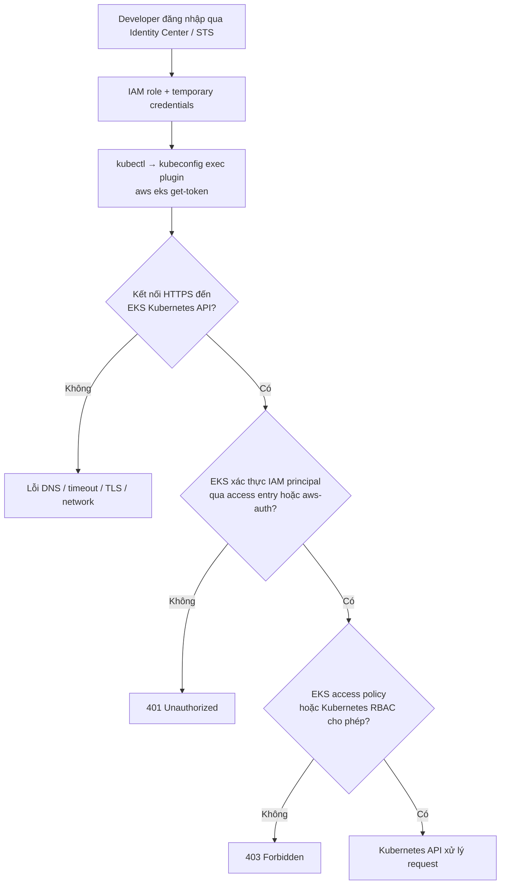
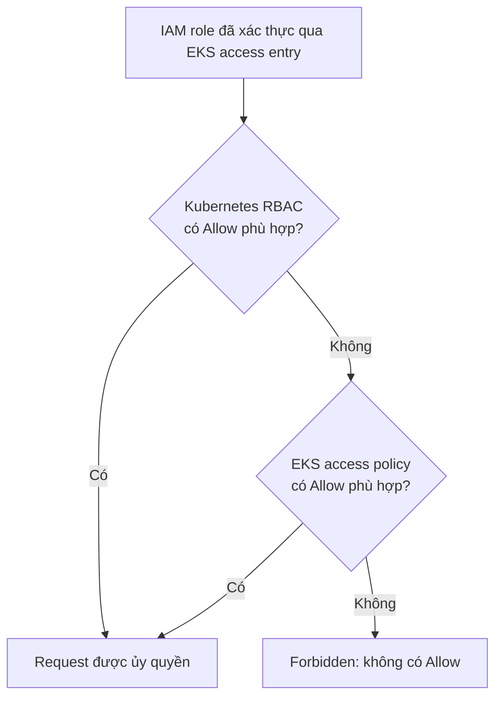
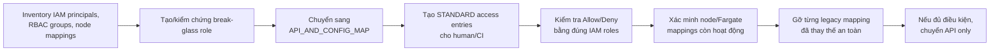
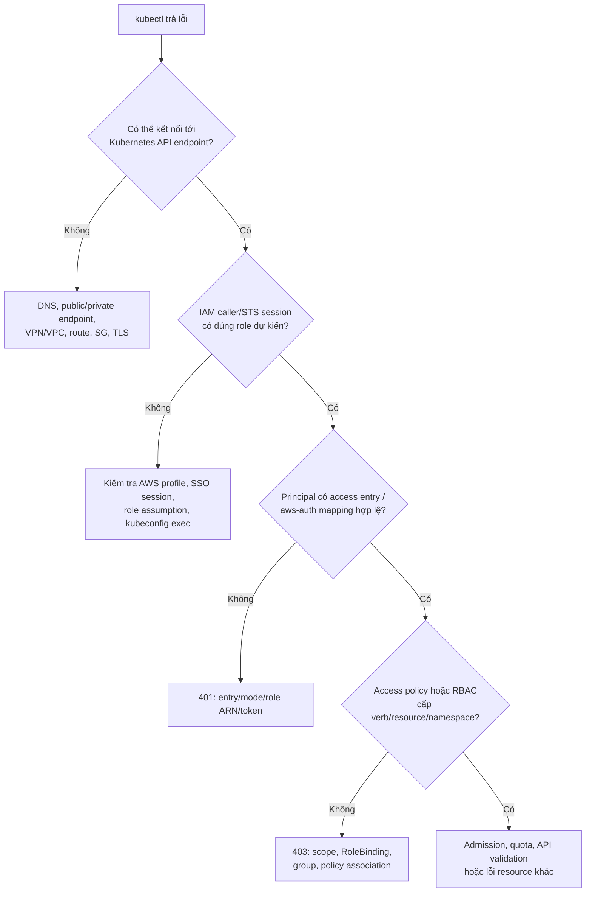
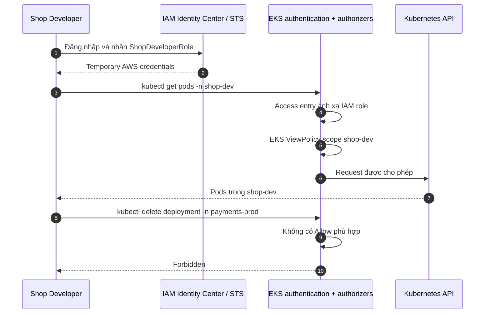

# EKS access entry và phân quyền Kubernetes RBAC trên AWS

Khi triển khai Kubernetes bằng **Amazon Elastic Kubernetes Service (Amazon EKS)**, việc tạo được một cluster chưa có nghĩa mọi IAM role trong AWS account đều có thể chạy `kubectl` lên cluster đó. Hệ thống phải trả lời hai câu hỏi độc lập: **ai đang yêu cầu truy cập Kubernetes API?** và **danh tính ấy được phép thao tác tài nguyên Kubernetes nào?**. Amazon EKS cung cấp **access entries** để gắn danh tính IAM với khả năng truy cập Kubernetes; quyền chi tiết có thể được cấp bằng **EKS access policies**, **Kubernetes Role-Based Access Control (RBAC)** hoặc kết hợp cả hai.

Bài học thuộc chương **Kubernetes với EKS**, module **CLOUD_PROVIDERS_AWS**. Trong phạm vi học AWS từ Region/AZ, IAM, VPC, tính toán, lưu trữ, cơ sở dữ liệu đến tích hợp, serverless, giám sát, phục hồi và kiểm soát chi phí, việc phân quyền cluster là nền tảng để nhiều đội phát triển có thể vận hành ứng dụng trên EKS **an toàn, có trách nhiệm và kiểm toán được**.

Trọng tâm trực tiếp của bài là **EKS access entry và phân quyền Kubernetes RBAC**: phân biệt xác thực với ủy quyền, hiểu EKS API authentication modes, cấp quyền theo namespace, tạo Role/RoleBinding thực tế, di chuyển từ `aws-auth`, phát hiện quyền quá rộng và chẩn đoán lỗi `Unauthorized/Forbidden`.

## 1. Kết quả học tập và tình huống xuyên suốt

Sau bài này, người học có thể:

1. Phân biệt AWS IAM, EKS access entry, EKS access policy và Kubernetes RBAC theo **đúng lớp trách nhiệm**.
2. Giải thích luồng từ IAM role/STS credential đến Kubernetes API và quyết định authorization.
3. Chọn và quản trị ba authentication modes: `CONFIG_MAP`, `API_AND_CONFIG_MAP` và `API`.
4. Tạo access entry loại `STANDARD`, cấp EKS access policy theo namespace và xác minh bằng danh tính IAM tương ứng.
5. Cấp quyền tùy biến bằng `kubernetesGroups`, `Role`, `ClusterRole`, `RoleBinding` và `ClusterRoleBinding`.
6. Kết hợp và kiểm toán quyền từ nhiều nguồn mà không nhầm AWS IAM policies với Kubernetes API permissions.
7. Thực hiện chuyển đổi từ `aws-auth` an toàn, bảo vệ quyền production và giải quyết lỗi truy cập.

**Tình huống chính:** công ty có một EKS cluster `shop-eks` với namespace `shop-dev`, `shop-staging`, `payments-prod` và `platform-system`. Developer đội Shop cần xem Pod, log và Deployment trong `shop-dev`; đội QA cần quyền đọc ở staging; CI/CD chỉ được triển khai trong namespace phù hợp. Chỉ một số vai trò Platform/SRE mới được quản trị phạm vi toàn cluster.

Các ví dụ lệnh dùng Region `ap-southeast-1` và AWS account ID `111122223333` **mang tính minh họa**; không chạy lệnh thay đổi quyền trong cluster production nếu chưa có phê duyệt, kế hoạch kiểm thử và đường khôi phục.

## 2. Mô hình tinh thần: xác thực và ủy quyền là hai bước

| Thành phần | Câu hỏi nó xử lý | Ví dụ |
|---|---|---|
| **AWS IAM / STS** | AWS principal nào đang dùng credentials và ai được phép gọi AWS APIs? | Role `ShopDeveloperRole`, STS session |
| **EKS access entry** | Principal IAM nào được ánh xạ để truy cập Kubernetes API của cluster? | ARN IAM role → entry loại `STANDARD` |
| **EKS access policy** | Principal thông qua entry được AWS EKS authorizer cho phép những Kubernetes operations gì? | `AmazonEKSViewPolicy` scoped `shop-dev` |
| **Kubernetes RBAC** | Kubernetes user/group/service account nào có quyền với resource, verb và namespace nào? | Group `shop-developers` → `RoleBinding` → `Role` |
| **Cluster networking** | Client có thể gửi HTTPS đến Kubernetes API endpoint không? | Public/private endpoint, SG, route, DNS |
| **IAM workload identity** | Pod muốn gọi S3/SQS/Secrets Manager bằng IAM role nào? | EKS Pod Identity hoặc IRSA — bài toán khác |

**Chú ý:** AWS IAM policy có `eks:DescribeCluster` giúp công cụ như AWS CLI lấy thông tin cluster, nhưng **không tự cấp `get pods` hoặc `delete deployments` trong Kubernetes**. Tương tự, việc có quyền `iam:AssumeRole` vào một IAM role không tự cấp quyền Kubernetes nếu role đó chưa được ánh xạ và ủy quyền phù hợp.

### 2.1. Luồng một lệnh kubectl



Trình tự:

1. User/pipeline có **temporary credentials** của IAM principal được tin cậy.
2. `kubectl` gọi cơ chế `exec` trong kubeconfig, thường là `aws eks get-token`, để tạo token cho cluster.
3. API endpoint của EKS phải **reach được** từ máy chạy `kubectl`.
4. EKS nhận diện IAM principal và tìm mapping qua **access entry**, hoặc `aws-auth ConfigMap` nếu chế độ cluster vẫn cho phép.
5. Một hoặc cả hai **EKS authorizer** và **Kubernetes RBAC authorizer** đánh giá quyền request.
6. Chỉ khi được phép, API server mới trả data hoặc chấp nhận thay đổi.

Đây là sơ đồ logic: Kubernetes API còn có các cơ chế admission, resource quota, policy và validation. Một thao tác được authorization cho phép vẫn có thể bị admission từ chối hoặc lỗi do trạng thái tài nguyên.

### 2.2. 401, 403 và lỗi mạng khác nhau

| Kết quả | Cần điều tra trước | Ví dụ |
|---|---|---|
| **Không kết nối được** | DNS, endpoint public/private, firewall, VPC route, TLS | `i/o timeout`, `no such host` |
| **401 Unauthorized** | Token IAM/session, principal ARN, mapping access entry, cluster authentication mode | Client chưa được EKS xác thực |
| **403 Forbidden** | Identity đã xác thực nhưng không đủ verb/resource/namespace theo access policy hoặc RBAC | `User ... cannot list resource "pods"` |
| **Lỗi admission/validation** | Namespace, quota, webhook, policy, manifest | `exceeded quota` hoặc admission webhook denied |

Không sửa lỗi 403 bằng cách vô điều kiện cấp `cluster-admin`. Phải xác định **verb**, **resource**, **namespace** và principal thật.

## 3. Ba authentication modes của EKS

Trước khi cấp access entry, cluster phải sử dụng chế độ xác thực hỗ trợ EKS access API.

| `authenticationMode` | Cơ chế mapping principal | Điểm phù hợp |
|---|---|---|
| `CONFIG_MAP` | Chỉ `aws-auth` ConfigMap (legacy) | Cluster cũ chưa chuyển đổi |
| `API_AND_CONFIG_MAP` | EKS access entries **và** `aws-auth` | Giai đoạn chuyển đổi có kiểm soát |
| `API` | Chỉ EKS access entries | Hướng quản trị tập trung bằng EKS API/IaC |

**EKS access entries yêu cầu `API_AND_CONFIG_MAP` hoặc `API`.** Trước khi đổi mode, phải kiểm tra phiên bản/platform hỗ trợ và vai trò đang dùng để quản trị cluster. Với EKS Auto Mode, access entries là yêu cầu của mô hình.

### 3.1. Vì sao API_AND_CONFIG_MAP hữu ích trong migration?

Ở chế độ kết hợp, mapping cùng IAM principal có thể xuất hiện trong cả hai nguồn. Khi đó **access entry được ưu tiên hơn mapping `aws-auth`** đối với principal đó. Tuy nhiên, các principal chỉ có trong ConfigMap vẫn có thể hoạt động cho tới khi chúng được chuyển đổi hoặc chế độ `API` được bật.

AWS không tự chuyển toàn bộ mappings tùy biến trong `aws-auth` thành access entries khi bạn bật tính năng. Vì vậy hãy:

1. Kiểm kê từng IAM role/user, username/group và quyền Kubernetes hiện tại.
2. Tạo entry/phương án cấp quyền tương đương trước khi xóa mapping cũ.
3. Dùng đúng IAM principal để kiểm tra hành động được phép và bị từ chối.
4. Giữ một đường khôi phục/break-glass đã kiểm thử.
5. Chỉ chuyển sang `API` khi không còn phụ thuộc chưa được giải quyết vào `aws-auth`.

### 3.2. Đổi mode là quyết định một chiều

Khi đã bật chế độ có EKS access API, **không thể quay về mode loại bỏ access API**. Có thể di chuyển theo hướng `CONFIG_MAP → API_AND_CONFIG_MAP → API`, nhưng không coi đây là toggle có thể khôi phục tùy ý trong ngày vận hành.

Ví dụ CLI (chỉ chạy sau khi đã duyệt kế hoạch migration):

```bash
aws eks describe-cluster \
  --name shop-eks \
  --region ap-southeast-1 \
  --query "cluster.accessConfig"

# Bước chuyển đổi cần phê duyệt. Không chạy mù trên production.
aws eks update-cluster-config \
  --name shop-eks \
  --access-config authenticationMode=API_AND_CONFIG_MAP \
  --region ap-southeast-1
```

Cluster có thể chuyển sang trạng thái `UPDATING`; chờ về `ACTIVE` và kiểm tra mode trước khi dùng access entry. Không tạo một loạt quyền mới giữa lúc update chưa hoàn tất, vì việc cập nhật access entries có tính **eventual consistency**.

### 3.3. Người tạo cluster và quyền ban đầu

Cluster cũ có thể có quyền quản trị đặc biệt cho principal **đã tạo cluster**. Một số cluster mới có cấu hình cấp hoặc không cấp quyền admin bootstrap cho creator. Đây là ngữ cảnh quan trọng khi migration, nhưng **không nên dựa vào creator quyền ngầm** làm đường quản trị duy nhất: cần các roles Platform được cấp access entries tường minh, có audit và break-glass.

## 4. Access entry gồm những thông tin nào?

Một **EKS access entry** là một resource quản lý qua EKS API, gắn một IAM principal cụ thể với quyền truy cập Kubernetes cluster. Các thành phần quan trọng:

| Trường | Vai trò | Ví dụ |
|---|---|---|
| `clusterName` | Cluster nhận access entry | `shop-eks` |
| `principalArn` | ARN của IAM user/role có thật | `arn:aws:iam::111122223333:role/ShopDeveloperRole` |
| `type` | Loại principal/đối tượng sử dụng entry | `STANDARD` |
| `username` | Kubernetes username ánh xạ, mặc định có quy tắc AWS | Tên được EKS sinh từ assumed-role session |
| `kubernetesGroups` | Danh sách tên nhóm Kubernetes để RBAC đánh giá | `shop-developers` |
| **Associated access policies** | Policy EKS có phạm vi cluster/namespace | `AmazonEKSViewPolicy` ở `shop-dev` |
| `tags` | Metadata quản trị entry | `Owner=platform` |

**Access entry không phải IAM role**, không chứa AWS secret key và không tự tạo Kubernetes `RoleBinding`. Nó liên kết IAM identity với cách xác thực/ủy quyền Kubernetes.

### 4.1. Các loại access entry phổ biến

| `type` | Dùng cho | Lưu ý |
|---|---|---|
| `STANDARD` | IAM role/user của developer, SRE, CI/CD | Có thể dùng Kubernetes groups và/hoặc associate EKS access policies |
| `EC2_LINUX` | IAM role của self-managed Linux/Bottlerocket worker nodes theo mô hình tương ứng | Không associate EKS access policy/khai báo groups tùy ý như STANDARD |
| `EC2_WINDOWS` | IAM role self-managed Windows workers | Dành cho node, không dành cho human admin |
| `FARGATE_LINUX` | Role dùng với EKS Fargate infrastructure khi trường hợp này cần | EKS thường tự quản mapping cho Fargate profiles |
| `HYBRID_LINUX` | Hybrid nodes theo mô hình AWS hỗ trợ | Dành cho node identity |
| `EC2` | Node sử dụng cách đặt tên instance ID hoặc EKS Auto Mode custom node classes theo tính năng | Không dùng cho developer login |

Danh sách có thể thay đổi khi EKS bổ sung loại node/access entry mới; khi triển khai hãy đọc tài liệu AWS hiện hành. **Default là `STANDARD`**, nhưng không nên áp nó cho node role chỉ vì muốn đơn giản hóa CLI.

### 4.2. Ràng buộc principal cần nhớ

- Mỗi access entry trỏ tới **đúng một IAM principal ARN**; trong một cluster, cùng một principal không được tạo nhiều entry khác nhau.
- Với `STANDARD`, IAM principal có thể nằm **cùng hoặc khác AWS account** so với cluster. Các entry type dành cho node không có cùng sự linh hoạt xuyên account.
- Nên dùng **IAM roles với temporary credentials**, chẳng hạn roles được cấp qua IAM Identity Center, thay vì IAM user access keys dài hạn.
- Không dùng **STS assumed-role session ARN** làm `principalArn` cho entry; dùng **IAM role ARN** ổn định.
- **Xóa rồi tạo lại IAM role cùng tên/ARN** không làm access entry cũ tự hoạt động trở lại: EKS còn lưu role ID/user ID nội bộ. Cần xóa/tạo lại entry tương ứng.
- Không thể thay đổi `principalArn` hoặc `type` trên entry đã tạo; phải tạo entry thích hợp sau khi đánh giá tác động.
- Access entries không dùng IAM **service-linked roles** làm principal.

### 4.3. Username và group

Với `STANDARD`, EKS có thể tự sinh username từ IAM role/session, kèm session name phục vụ truy vết. Bạn có thể cấu hình username tùy biến nhưng nên giữ danh tính có thể audit và tránh trùng, đặc biệt nếu nhiều principal dùng cùng group.

**Group name không cần tạo thành một object Kubernetes độc lập.** Kubernetes RBAC đọc group name như chuỗi trong subject. Nếu entry có `kubernetesGroups=["shop-developers"]` nhưng cluster chưa có `RoleBinding`/`ClusterRoleBinding` nào liên kết group này, **entry vẫn được EKS chấp nhận**, nhưng quyền từ RBAC chưa được cấp.

## 5. Hai cách cấp Kubernetes permissions cho access entry

Với entry `STANDARD`, có hai con đường phổ biến:

### Cách A — Associate EKS access policy

AWS quản lý một tập **predefined EKS access policies** tương ứng các mẫu quyền Kubernetes. Bạn chọn policy và scope:

- **cluster**: áp quyền trong phạm vi cluster theo permission của policy.
- **namespace**: áp quyền trong một hoặc nhiều namespace xác định.

Không cần tự tạo Kubernetes Role/RoleBinding khi chỉ dùng EKS access policy.

### Cách B — Kubernetes RBAC groups

Entry khai báo group, ví dụ `shop-developers`. Người quản trị Kubernetes tạo:

- `Role` hoặc `ClusterRole` quy định verbs/resources.
- `RoleBinding` hoặc `ClusterRoleBinding` kết nối group với quyền.

Cách này cần nhiều cấu hình hơn nhưng cho phép quyền tùy biến chính xác hơn, ví dụ **chỉ xem Pods và Pods/log ở namespace dev**, không được đọc Secrets hoặc sửa Deployment.

### 5.1. So sánh khi thiết kế

| Tiêu chí | EKS access policy | Kubernetes RBAC qua groups |
|---|---|---|
| Nơi quản lý | EKS API, Console, CLI, SDK/IaC | Kubernetes API, GitOps/Helm/YAML |
| Bộ quyền | Policy do AWS định nghĩa, không tự sửa nội dung policy | Tự khai verbs, apiGroups, resources, resourceNames |
| Scope | Cluster hoặc các namespace được khai báo cho association | Cluster-wide hoặc namespace qua binding |
| Độ chi tiết | Thích hợp mẫu admin/edit/view phổ biến | Phù hợp custom read-only, giới hạn subresource, custom CRDs |
| Quan sát bằng `kubectl get rolebindings` | **Không nhìn thấy** EKS access policy | Nhìn thấy Role/RoleBinding |
| Có thể phối hợp? | Có | Có |
| Chi phí cấu hình | Đơn giản hơn cho use case phổ biến | Cần review RBAC YAML và lifecycle |

**Đối với phần lớn nhu cầu chuẩn**, EKS access policy dễ quản lý hơn. Khi yêu cầu chính xác đến từng resource/subresource, hãy dùng Kubernetes RBAC. Không nên tự động cấp cả hai nếu không cần, vì **quyền có thể cộng dồn**.

## 6. Hiểu EKS access policies

EKS cung cấp các policies như:

| EKS access policy | Ý nghĩa khái quát | Cách dùng thận trọng |
|---|---|---|
| `AmazonEKSViewPolicy` | Quyền đọc Kubernetes resources theo định nghĩa của AWS | Developer/QA chỉ cần quan sát theo namespace |
| `AmazonEKSEditPolicy` | Quyền chỉnh sửa nhiều workload resources | Cần review tác động triển khai/sửa ứng dụng |
| `AmazonEKSAdminPolicy` | Quyền quản trị phổ biến, có thể scope namespace | Không coi là read-only |
| `AmazonEKSClusterAdminPolicy` | Quyền quản trị rất rộng ở cluster | Chỉ vai trò break-glass/Platform được phê duyệt |
| `AmazonEKSAdminViewPolicy` | Quyền xem quản trị rộng hơn theo định nghĩa policy | Kiểm tra nội dung quyền thực tế trước khi cấp |

EKS còn nhiều access policies chuyên cho tính năng AWS khác; **không đoán quyền từ tên**. Dùng:

```bash
aws eks list-access-policies \
  --region ap-southeast-1 \
  --output table
```

Tham khảo trang **Review access policy permissions** để đọc resource/verbs cụ thể. EKS access policies chứa **Kubernetes permissions**, **không phải IAM policies**. Bạn không thể tự tạo access policy mới hoặc thay đổi nội dung của AWS managed policy này; nếu không đáp ứng yêu cầu, dùng Kubernetes RBAC.

### 6.1. Scope là ranh giới cần kiểm tra nghiêm ngặt

Ví dụ nhóm Shop chỉ được xem namespace `shop-dev`:

```text
principalArn: arn:aws:iam::111122223333:role/ShopDeveloperRole
accessPolicy: AmazonEKSViewPolicy
accessScope:
  type: namespace
  namespaces: [shop-dev]
```

Nếu đổi scope sang `cluster`, cùng policy có thể cho quyền đọc rộng hơn trong toàn cluster. Nếu dùng pattern namespace như `dev-*`, các namespace mới có tên khớp pattern cũng có thể được bao gồm. **Không dùng wildcard pattern khi chưa đánh giá hậu quả mở rộng về sau**.

EKS **không xác minh namespace đã tồn tại hoặc tên namespace đã được viết đúng** khi associate policy. Một association tên `shop-deev` có thể được tạo thành công nhưng không cho quyền nơi `shop-dev` đang chạy.

### 6.2. Nhiều policy trên cùng entry

Một entry có thể associate nhiều EKS access policies; quyền là **tổng các quyền được cấp** từ các associations. Mỗi policy chỉ associate một lần với cùng entry, nhưng scope của association có thể được chỉnh sửa theo API.

Ví dụ:

- `ViewPolicy` cluster-wide để quan sát.
- `EditPolicy` chỉ trong `shop-dev`.

Khi đó principal có thể đọc nhiều namespace nhưng chỉ edit ở scope dev (giả sử không có grants khác). Cần kiểm tra permission list và resource types, không suy luận chỉ từ tên “Edit”.

## 7. Kubernetes RBAC: Role, ClusterRole và Binding

RBAC là cơ chế Kubernetes chuẩn, quy định **ai** được thực hiện các **verb** trên **API resource** nào trong phạm vi nào.

| Object | Chức năng | Scope |
|---|---|---|
| `Role` | Tập permission rules trong một namespace | Namespaced |
| `ClusterRole` | Tập permission rules có thể dùng ở cấp cluster hoặc tái sử dụng ở namespace | Cluster-scoped object |
| `RoleBinding` | Gắn User/Group/ServiceAccount với Role hoặc ClusterRole **trong namespace của binding** | Namespaced |
| `ClusterRoleBinding` | Gắn User/Group/ServiceAccount với ClusterRole trên toàn cluster | Cluster-wide |

Các verb phổ biến: `get`, `list`, `watch`, `create`, `update`, `patch`, `delete`. Kubernetes không có khái niệm **Deny rule** trong RBAC theo cách IAM có explicit deny; RBAC tổng hợp các Allow rules, và nếu không có quyền phù hợp thì request bị từ chối.

### 7.1. Role chỉ xem Pod và log

Ví dụ developer Shop cần xem danh sách Pod, mô tả Pod và đọc log trong namespace `shop-dev`, nhưng không đọc Secrets hoặc thực thi shell vào Pod:

```yaml
apiVersion: rbac.authorization.k8s.io/v1
kind: Role
metadata:
  name: shop-pod-observer
  namespace: shop-dev
rules:
  - apiGroups: [""]
    resources: ["pods"]
    verbs: ["get", "list", "watch"]
  - apiGroups: [""]
    resources: ["pods/log"]
    verbs: ["get"]
  - apiGroups: ["apps"]
    resources: ["deployments"]
    verbs: ["get", "list", "watch"]
---
apiVersion: rbac.authorization.k8s.io/v1
kind: RoleBinding
metadata:
  name: shop-developers-observe
  namespace: shop-dev
subjects:
  - kind: Group
    name: shop-developers
    apiGroup: rbac.authorization.k8s.io
roleRef:
  kind: Role
  name: shop-pod-observer
  apiGroup: rbac.authorization.k8s.io
```

Giải thích:

- `Role` tồn tại **trong namespace `shop-dev`**, chỉ áp cho resources ở scope đó.
- `resources: ["pods/log"]` là subresource để xem log; quyền `get pods` không tự bảo đảm `get pods/log`.
- Không cấp `pods/exec`, `create pods` hoặc quyền đọc Secrets vì đây là tác vụ nhạy cảm hơn nhiều.
- `RoleBinding` đặt group `shop-developers` làm subject. Cùng tên group phải được gắn vào **EKS access entry** tương ứng.
- Nếu YAML được áp bởi principal admin có quyền quản trị RBAC, developer thuộc group này có thể xem Pod/log/Deployment ở `shop-dev`.

Ví dụ trên chưa cấp quyền đọc `events`; nếu cần `kubectl get events`, phải thêm quyền tối thiểu tương ứng. Nguyên tắc là **thêm đúng nhu cầu**, không dùng wildcard chỉ vì một lệnh phụ chưa chạy được.

### 7.2. ClusterRole tái sử dụng trong namespace

Một `ClusterRole` có thể chứa rule dùng chung cho nhiều đội, nhưng nếu gắn bằng **RoleBinding tại một namespace** thì quyền chỉ được áp dụng cho resources namespaced trong namespace đó.

```yaml
apiVersion: rbac.authorization.k8s.io/v1
kind: ClusterRole
metadata:
  name: reusable-workload-view
rules:
  - apiGroups: [""]
    resources: ["pods", "services"]
    verbs: ["get", "list", "watch"]
  - apiGroups: ["apps"]
    resources: ["deployments"]
    verbs: ["get", "list", "watch"]
---
apiVersion: rbac.authorization.k8s.io/v1
kind: RoleBinding
metadata:
  name: qa-view
  namespace: shop-staging
subjects:
  - kind: Group
    name: shop-qa
    apiGroup: rbac.authorization.k8s.io
roleRef:
  kind: ClusterRole
  name: reusable-workload-view
  apiGroup: rbac.authorization.k8s.io
```

**Cần phân biệt:** `ClusterRole` là nơi định nghĩa tập quyền **không tự tạo quyền cluster-wide**. Điều quyết định scope áp dụng là **RoleBinding** hay **ClusterRoleBinding**. Nếu bạn dùng `ClusterRoleBinding` cho nhóm QA, quyền có thể mở rộng toàn cluster — đây là lỗi cấu hình rất thường gặp.

### 7.3. RBAC cho tài nguyên không thuộc namespace

Một số Kubernetes resources như `nodes`, `persistentvolumes`, `namespaces` và `clusterroles` là cluster-scoped. RoleBinding trong `shop-dev` **không biến các resource này thành namespaced**. Khi cần đọc cluster-scoped resources, thiết kế ClusterRole/ClusterRoleBinding đúng phạm vi và kiểm soát kỹ vì không còn bị giới hạn theo namespace.

## 8. EKS authorizer và Kubernetes RBAC được kết hợp như thế nào?

EKS sử dụng cơ chế authorization kết hợp giữa **Kubernetes RBAC authorizer** và **EKS authorizer** cho access policies. Về mặt hành vi, cả hai có thể **allow** hoặc không đưa ra quyết định cho request; chúng không cung cấp explicit Deny theo cách IAM policy cho AWS API.



Hệ quả:

1. Nếu **RBAC cho phép** hành động, quyền có hiệu lực ngay cả khi EKS access policy không cấp hành động đó.
2. Nếu **EKS access policy cho phép** hành động, request có thể được cho phép dù RoleBinding không cấp quyền.
3. Nếu cả hai đều không cấp quyền, request bị từ chối.
4. **Không thể dùng một RoleBinding hẹp để “thu hồi” quyền quá rộng từ EKS access policy**. Cách sửa là điều chỉnh/disassociate access policy hoặc đổi scope, đồng thời review các grants khác.

### 8.1. Ma trận kết quả

| Kubernetes RBAC | EKS access policy | Kết quả authorization | Ý nghĩa |
|---|---|---|---|
| Cho phép `get pods` | Không có Allow | Allow | Group RBAC đủ để đọc Pods |
| Không có Allow | Cho phép `get pods` | Allow | Policy EKS đủ để đọc Pods |
| Cho phép `get secrets` | Policy chỉ view Pods | Allow cho get secrets | EKS policy hẹp không chặn grant của RBAC |
| Không có Allow | Không có Allow | Forbidden | Chưa cấp quyền tương ứng |

**Khi kết hợp hai hệ thống**, cần kiểm kê cả policy association **và** bindings trong cluster. Chỉ nhìn một trong hai nguồn có thể đánh giá thiếu quyền thực tế.

### 8.2. Giới hạn của kubectl auth can-i

`kubectl auth can-i` giúp kiểm tra quyền Kubernetes theo request, nhưng có một điểm dễ gây nhầm:

- `kubectl auth can-i --list` **không liệt kê những quyền được cấp chỉ qua EKS access policies**. Nó hiển thị các permissions theo Kubernetes RBAC được đánh giá trong ngữ cảnh đó.
- Khi dùng user/group impersonation qua `--as` hoặc `--as-group`, việc đánh giá dựa trên **Kubernetes RBAC**, không mang theo các quyền EKS access policy của IAM principal gốc.
- Với kiểm thử quyền thực tế, sử dụng **đúng IAM role/STS session, không impersonate**, thử các hành động được cho phép và bị từ chối, đối chiếu EKS policy associations.

Vì vậy kết quả trống từ `kubectl auth can-i --list` **không chứng minh** principal không có quyền qua EKS access policy. Đồng thời, kết quả “yes” đối với một verb cụ thể không có nghĩa principal không có thêm quyền khác.

## 9. Chuẩn bị lab an toàn

Ví dụ hai đường thực hành tiếp theo chạy trên cluster thử nghiệm:

| Thành phần | Giá trị minh họa |
|---|---|
| AWS Region | `ap-southeast-1` |
| EKS cluster | `shop-eks` |
| Account chứa cluster | `111122223333` |
| Role developer đọc namespace | `arn:aws:iam::111122223333:role/ShopDeveloperRole` |
| Role QA sử dụng RBAC custom | `arn:aws:iam::111122223333:role/ShopQaRole` |
| Kubernetes namespace dev | `shop-dev` |
| Kubernetes namespace staging | `shop-staging` |
| Kubernetes RBAC group | `shop-qa` |

### 9.1. Công cụ cần có

- AWS CLI phiên bản hỗ trợ EKS access entry APIs.
- `kubectl` tương thích với phiên bản Kubernetes của cluster.
- IAM principal quản trị được phê duyệt để tạo/sửa access entries, associate policies và tạo Kubernetes RBAC objects.
- Một IAM role **thử nghiệm** không có quyền cluster rộng, để xác minh deny.
- Đường mạng đến Kubernetes API endpoint, theo cấu hình public/private endpoint của cluster.

**Không dùng production cluster cho lab** nếu không có quy trình thay đổi. Các câu lệnh quản trị dưới đây giả định user/pipeline đã có thẩm quyền và được phê duyệt. Bài viết không tự tạo tài nguyên AWS hay file manifests ngoài bài Markdown.

### 9.2. Xác nhận đúng AWS principal trước khi làm gì

```bash
aws sts get-caller-identity

aws eks describe-cluster \
  --name shop-eks \
  --region ap-southeast-1 \
  --query "cluster.{status:status,endpoint:endpoint,access:accessConfig}"
```

**Lưu ý:** `aws sts get-caller-identity` thường trả về **STS assumed-role ARN** khi bạn đăng nhập qua IAM Identity Center. Access entry cần **IAM role ARN**, không phải ARN của session cụ thể. Nếu role có path (ví dụ Identity Center permission set role), hãy lấy ARN thực tế từ IAM/Identity Center hoặc hạ tầng quản trị được tin cậy; không đoán bằng cách cắt ghép sai chuỗi ARN.

### 9.3. Cần hai danh tính để kiểm thử

- **Admin/provisioner**: tạo entry và RBAC manifests.
- **Developer/QA role**: phiên đăng nhập riêng để kiểm tra quyền đã cấp, bao gồm các trường hợp bị từ chối.

Đừng kiểm thử bằng principal tạo cluster có quyền admin trong khi đang tưởng rằng đang thử policy developer. Dùng AWS profiles/Identity Center sessions riêng và xác minh `get-caller-identity` trước từng bộ test.

## 10. Thực hành A — Cấp quyền bằng EKS access policy

**Mục tiêu:** `ShopDeveloperRole` chỉ được xem Kubernetes resources trong namespace `shop-dev` theo phạm vi của `AmazonEKSViewPolicy`, không được chỉnh sửa workload.

### Bước 1 — Xác nhận authentication mode

```bash
aws eks describe-cluster \
  --name shop-eks \
  --region ap-southeast-1 \
  --query "cluster.accessConfig.authenticationMode" \
  --output text
```

Chỉ tiếp tục khi cluster ở mode `API` hoặc `API_AND_CONFIG_MAP`. Nếu cluster vẫn ở `CONFIG_MAP`, cần chuẩn bị migration ở phần 14; không nâng mode production chỉ để thử lệnh.

### Bước 2 — Tạo entry STANDARD cho role

```bash
aws eks create-access-entry \
  --cluster-name shop-eks \
  --principal-arn arn:aws:iam::111122223333:role/ShopDeveloperRole \
  --type STANDARD \
  --region ap-southeast-1
```

Role cần tồn tại, caller có quyền EKS API thích hợp, và không có entry trùng principal trên cluster. Lệnh chỉ **tạo ánh xạ**, chưa tự động cho phép đọc Pod nếu không có EKS policy hoặc Kubernetes RBAC grants.

### Bước 3 — Associate view policy vào một namespace

```bash
aws eks associate-access-policy \
  --cluster-name shop-eks \
  --principal-arn arn:aws:iam::111122223333:role/ShopDeveloperRole \
  --policy-arn arn:aws:eks::aws:cluster-access-policy/AmazonEKSViewPolicy \
  --access-scope type=namespace,namespaces=shop-dev \
  --region ap-southeast-1
```

Tập quyền của policy do AWS quản lý. Nếu cần tuyệt đối **chỉ đọc Pods, không đọc resources khác**, dùng RBAC riêng ở phần 11 thay vì giả định ViewPolicy chỉ gồm `pods`.

### Bước 4 — Kiểm tra entry và association

```bash
aws eks describe-access-entry \
  --cluster-name shop-eks \
  --principal-arn arn:aws:iam::111122223333:role/ShopDeveloperRole \
  --region ap-southeast-1

aws eks list-associated-access-policies \
  --cluster-name shop-eks \
  --principal-arn arn:aws:iam::111122223333:role/ShopDeveloperRole \
  --region ap-southeast-1
```

Kiểm tra chính xác `policyArn`, `accessScope.type` và `accessScope.namespaces`. Nếu scope là `cluster` trong khi yêu cầu chỉ `shop-dev`, phải điều chỉnh trước khi bàn giao.

### Bước 5 — Kiểm thử bằng developer role thật

Sau khi đã chuyển sang phiên IAM role `ShopDeveloperRole`:

```bash
aws sts get-caller-identity

aws eks update-kubeconfig \
  --name shop-eks \
  --region ap-southeast-1 \
  --alias shop-eks-developer

kubectl --context shop-eks-developer get pods -n shop-dev
kubectl --context shop-eks-developer get deployments -n shop-dev
kubectl --context shop-eks-developer get pods -n payments-prod
```

Kỳ vọng: các truy vấn phù hợp ViewPolicy ở `shop-dev` có thể thành công; truy vấn namespace `payments-prod` sẽ **bị từ chối theo riêng association này**. Nhưng nếu IAM principal đồng thời có RBAC grants hoặc EKS policy associations khác, quyền thực tế có thể rộng hơn; phải kiểm tra toàn bộ.

**Yêu cầu phụ:** IAM role chạy `aws eks update-kubeconfig` có thể cần `eks:DescribeCluster`. Nếu kubeconfig đã có sẵn, các điều kiện IAM AWS API và Kubernetes API có sự khác biệt; không giải quyết lỗi quyền `kubectl` bằng cách gán bừa `eks:*`.

### Bước 6 — Cấp quyền read-only cho nhiều namespace (khi được duyệt)

Có thể thay đổi scope của **cùng association**:

```bash
aws eks associate-access-policy \
  --cluster-name shop-eks \
  --principal-arn arn:aws:iam::111122223333:role/ShopDeveloperRole \
  --policy-arn arn:aws:eks::aws:cluster-access-policy/AmazonEKSViewPolicy \
  --access-scope type=namespace,namespaces=shop-dev,shop-staging \
  --region ap-southeast-1
```

Đây là thao tác **thay đổi scope**; phải review trước vì nó mở rộng quyền từ một sang hai namespace.

## 11. Thực hành B — Cấp quyền chi tiết bằng Kubernetes RBAC group

**Mục tiêu:** `ShopQaRole` chỉ được xem Pod/log/Deployment ở `shop-staging` theo Role tùy biến, không đọc Secrets và không sửa workload.

### Bước 1 — Admin tạo access entry với Kubernetes group

```bash
aws eks create-access-entry \
  --cluster-name shop-eks \
  --principal-arn arn:aws:iam::111122223333:role/ShopQaRole \
  --type STANDARD \
  --kubernetes-groups shop-qa \
  --region ap-southeast-1
```

Ở ví dụ này, **không associate EKS access policy** cho ShopQaRole. Ta muốn quyền hoàn toàn xuất phát từ Role/RoleBinding được review.

### Bước 2 — Admin chuẩn bị namespace và RBAC

Admin xác nhận namespace đã tồn tại (lệnh chỉ xem):

```bash
kubectl get namespace shop-staging
```

Nếu chưa có, admin tạo namespace theo quy trình riêng có phê duyệt và ownership. Sau đó áp manifest dưới đây bằng GitOps/manifest management của tổ chức:

```yaml
apiVersion: rbac.authorization.k8s.io/v1
kind: Role
metadata:
  name: qa-observer
  namespace: shop-staging
rules:
  - apiGroups: [""]
    resources: ["pods", "pods/log", "services"]
    verbs: ["get", "list", "watch"]
  - apiGroups: ["apps"]
    resources: ["deployments", "replicasets"]
    verbs: ["get", "list", "watch"]
---
apiVersion: rbac.authorization.k8s.io/v1
kind: RoleBinding
metadata:
  name: qa-observer-binding
  namespace: shop-staging
subjects:
  - kind: Group
    name: shop-qa
    apiGroup: rbac.authorization.k8s.io
roleRef:
  kind: Role
  name: qa-observer
  apiGroup: rbac.authorization.k8s.io
```

Trong pipeline/IaC của người thực hành, lưu manifest được duyệt thành một tệp riêng rồi áp dụng từ tệp đó. Worker STEP_4 này **chỉ viết tài liệu**, không tự tạo file YAML bài lab hoặc thay đổi cluster.

### Bước 3 — Xác minh RBAC và group

Admin:

```bash
kubectl get role qa-observer -n shop-staging -o yaml
kubectl get rolebinding qa-observer-binding -n shop-staging -o yaml

aws eks describe-access-entry \
  --cluster-name shop-eks \
  --principal-arn arn:aws:iam::111122223333:role/ShopQaRole \
  --region ap-southeast-1
```

Kiểm tra group name ở entry trùng **chính xác** với subject `name: shop-qa` trong RoleBinding.

### Bước 4 — Kiểm thử bằng QA role

Sau khi đăng nhập thật bằng `ShopQaRole` và cấu hình kubeconfig tương ứng:

```bash
aws sts get-caller-identity
kubectl get pods -n shop-staging
kubectl logs -n shop-staging "<POD_NAME>"

kubectl auth can-i get pods -n shop-staging
kubectl auth can-i get secrets -n shop-staging
kubectl auth can-i update deployments -n shop-staging
kubectl auth can-i list pods -n shop-dev
```

Kết quả mong muốn theo **chỉ riêng role/binding này**:

| Hành động | Namespace | Kết quả |
|---|---|---|
| `get/list/watch pods` | `shop-staging` | Cho phép |
| `get pods/log` | `shop-staging` | Cho phép |
| `get/list deployments` | `shop-staging` | Cho phép |
| `get secrets` | `shop-staging` | Từ chối |
| `update deployments` | `shop-staging` | Từ chối |
| `list pods` | `shop-dev` | Từ chối |

**Cảnh báo:** nếu role này có thêm EKS access policy (hoặc được cấp RBAC từ các binding khác), kết quả sẽ khác. Luôn kiểm tra **tổng quyền thực tế** trước khi kết luận.

### Bước 5 — Thay đổi group trên entry đã tồn tại

Nếu access entry đã có, có thể cập nhật `kubernetesGroups` theo API được hỗ trợ thay vì tạo entry mới:

```bash
aws eks update-access-entry \
  --cluster-name shop-eks \
  --principal-arn arn:aws:iam::111122223333:role/ShopQaRole \
  --kubernetes-groups shop-qa \
  --region ap-southeast-1
```

**Không chạy lệnh update từ trí nhớ**: cập nhật danh sách group có thể thay thế nội dung trước đó; phải đọc entry hiện tại, review những group cần giữ và kiểm thử sau thay đổi.

## 12. Thiết kế Role/RoleBinding đúng nguyên tắc ít đặc quyền

### 12.1. Quyền get, list, watch khác nhau

| Verb | Tác dụng điển hình | Lưu ý |
|---|---|---|
| `get` | Xem một resource có tên xác định | Có thể kết hợp `resourceNames` trong các tình huống hỗ trợ |
| `list` | Xem danh sách resources | Có thể để lộ metadata của nhiều objects trong namespace |
| `watch` | Theo dõi thay đổi liên tục | Phù hợp controller/monitor nhưng có luồng dữ liệu dài |
| `create` | Tạo resource mới | Có thể tạo Pod chạy code tùy ý trong namespace |
| `update` / `patch` | Sửa object | Sửa Deployment có thể thay image và chạy code khác |
| `delete` | Xóa object | Ảnh hưởng availability, dữ liệu và vận hành |

**Đọc Secrets không giống đọc Pods.** Kubernetes Secret có thể chứa credentials/service tokens hoặc dữ liệu nhạy cảm ở dạng encode, không phải mã hóa giúp client không đọc được. Quyền `get/list/watch secrets` thường phải hạn chế hơn nhiều quyền xem trạng thái ứng dụng.

### 12.2. Kubernetes subresources làm quyền thay đổi đáng kể

Ví dụ:

- `pods/log`: xem log container.
- `pods/exec`: thực thi command vào container, có thể đọc file/secret hoặc gọi network từ trong Pod.
- `pods/portforward`: mở kết nối đến port trong Pod, có thể vượt ranh giới mạng mà người thiết kế dự định nếu không kiểm soát.
- `deployments/scale`: thay số replicas; tác động chi phí và độ sẵn sàng.
- `pods/eviction`: có thể ảnh hưởng availability.

Không cấp tất cả bằng `resources: ["pods", "pods/*"]` hoặc wildcard `"*"` nếu người dùng chỉ cần xem log. Kiểm tra đúng verb của subresource (ví dụ `create` đối với lệnh exec trong nhiều API interactions).

### 12.3. Vai trò edit không đồng nghĩa vô hại

Trong Kubernetes, người có thể tạo Pod, sửa Deployment hoặc tạo workload thường có thể:

- Chạy image do họ chọn trong namespace.
- Đọc dữ liệu/secret được mount vào workload hoặc khai thác quyền của service account gắn với Pod.
- Kết nối đến dịch vụ nội bộ từ vị trí mạng của Pod.
- Sử dụng CPU/RAM/ephemeral storage và tác động quota/cost.

Vì vậy **namespace-scoped edit** vẫn có thể là quyền nhạy cảm. Cần kết hợp RBAC với **Pod Security Admission**, admission policies, namespace quotas, network policies, workload IAM least privilege và kiểm soát container image.

### 12.4. Tránh escalation qua RBAC management

Các quyền như `create/update rolebindings`, `clusterrolebindings`, `roles`, `clusterroles` hoặc các verbs đặc biệt `bind`/`escalate` rất nhạy cảm. Kubernetes có cơ chế ngăn người dùng tự tạo Role quyền cao hơn mình ở một số thao tác, nhưng không nên dựa hoàn toàn vào đó thay cho least privilege và review.

Người chỉ triển khai ứng dụng không cần quyền `create clusterrolebindings` hoặc thay `system:masters` group. Tách:

- **Platform admin:** quản lý cluster-scoped RBAC và hệ thống.
- **Namespace operator:** quản lý nguồn lực của namespace, có guardrails.
- **Developer/QA:** xem/thao tác tài nguyên đã được duyệt.
- **CI/CD:** áp manifest từ pipeline trong scope được cấp, log đầy đủ.

### 12.5. RoleBinding không giới hạn mọi hành vi trong namespace

Kubernetes namespace không phải ranh giới bảo mật hoàn chỉnh như AWS account. Với workload có thể tạo Pod, vẫn cần kiểm soát CNI/network, IAM role cho Pod, permissions của service accounts, host mounts, privileged settings và access đến dữ liệu ngoài namespace. **EKS access entry là kiểm soát truy cập Kubernetes API của human/pipeline, không tự làm sandbox cho các container đã chạy.**

## 13. Truy cập của CI/CD, IAM Identity Center và nhóm vận hành

### 13.1. Đăng nhập của con người qua IAM Identity Center

Một mô hình thực tế:

1. Người dùng đăng nhập qua **AWS IAM Identity Center** và identity provider của doanh nghiệp.
2. Permission set cho phép người dùng nhận một **IAM role trong AWS account chứa EKS**.
3. EKS access entry dùng **IAM role ARN thực** của permission set đó.
4. EKS access policy hoặc Kubernetes RBAC group xác định quyền Kubernetes theo team/môi trường.
5. Đội Platform kiểm tra user lifecycle, quyền tạm thời và audit sự thay đổi.

Không dùng IAM username/email viết tay thành Kubernetes RBAC group rồi giả định EKS tự biết membership của identity provider. Việc mapping IAM role → Kubernetes group là cấu hình trong **access entry**, và nhóm đó vẫn phải được binding bằng RBAC nếu sử dụng con đường RBAC.

**Lưu ý vòng đời role do Identity Center tạo:** role có path dạng `aws-reserved/sso.amazonaws.com/...` và tên gắn với permission set. Nếu một permission set được bỏ gán hoàn toàn rồi role bị xóa/tạo lại, ARN hoặc role ID có thể thay đổi; access entry cũ có thể không còn hiệu lực. Cần quy trình kiểm kê/đồng bộ vai trò và giữ role cứu hộ độc lập được quản trị an toàn.

### 13.2. Pipeline CI/CD nên có IAM role riêng

Giả sử GitHub Actions hoặc hệ thống CI bên trong công ty muốn triển khai Deployment đến `shop-dev`:

- CI dùng **OIDC federation/STS** hoặc cơ chế short-lived credentials tương ứng, không hardcode AWS access keys.
- CI assume **role triển khai riêng** như `ShopDeployDevRole`; role này có EKS access entry `STANDARD`.
- Role được ánh xạ tới group `shop-deployers` và Kubernetes Role chỉ cho phép thao tác workload cần thiết trong `shop-dev`.
- Khóa phạm vi IAM trust policy tới đúng repository, branch/environment, workflow identity và điều kiện provider được hỗ trợ.
- Production dùng role/policy/approval riêng, không tái sử dụng credentials dev.

### 13.3. Ví dụ quyền CI sửa Deployment ở namespace

```yaml
apiVersion: rbac.authorization.k8s.io/v1
kind: Role
metadata:
  name: shop-deployment-operator
  namespace: shop-dev
rules:
  - apiGroups: ["apps"]
    resources: ["deployments"]
    verbs: ["get", "list", "watch", "patch", "update"]
  - apiGroups: [""]
    resources: ["pods"]
    verbs: ["get", "list", "watch"]
  - apiGroups: ["apps"]
    resources: ["replicasets"]
    verbs: ["get", "list", "watch"]
---
apiVersion: rbac.authorization.k8s.io/v1
kind: RoleBinding
metadata:
  name: shop-deployment-ci-binding
  namespace: shop-dev
subjects:
  - kind: Group
    name: shop-deployers
    apiGroup: rbac.authorization.k8s.io
roleRef:
  kind: Role
  name: shop-deployment-operator
  apiGroup: rbac.authorization.k8s.io
```

Role này cho phép patch/update Deployment đã có, phù hợp pipeline chỉ thay image digest/replicas theo policy; nó không cho tạo Deployment mới hoặc sửa Secret. **Tuy nhiên, ai sửa Deployment template có thể chạy container code tùy ý trong namespace**, nên cần policy về image, admission, service account IAM, network và approval để ngăn tác động ngoài scope.

Nếu CI cần tạo Deployment mới, thêm `create` có chủ đích sau khi review. Tránh cấp `create clusterroles`, `delete namespaces` hoặc `impersonate serviceaccounts` cho pipeline ứng dụng.

### 13.4. Phân tách vai trò theo môi trường

| Nhân sự/role | Dev | Staging | Production |
|---|---|---|---|
| Shop Developer | Quan sát + quyền thay workload theo chính sách | Thường read-only | Không ghi trực tiếp |
| QA | Đọc Pod/Deployment/log; tạo resource test được duyệt | Đọc/kiểm thử trong namespace liên quan | Read-only nếu thật sự cần |
| CI Dev | Deploy image/artifact đã kiểm tra | Theo pipeline promotion | Không có role production |
| CI Prod | Không dùng để phát triển hằng ngày | Xác minh artifact | Deploy có approval, quyền namespace cụ thể |
| SRE/Platform | Quản trị khi cần | Quản trị khi cần | Privileged access có thời hạn và audit |
| Security Auditor | Đọc cấu hình/log | Đọc cấu hình/log | Read-only theo yêu cầu; không tự sửa workload |

Một cluster có nhiều namespace có thể tiết kiệm chi phí, nhưng **RBAC theo namespace không thay thế cách ly account/cluster** khi tenant, dữ liệu hoặc mức rủi ro đòi hỏi boundary mạnh hơn.

## 14. Migration từ aws-auth ConfigMap sang access entries

Các EKS cluster đời cũ thường cấu hình IAM-to-Kubernetes mapping trong ConfigMap:

```text
kube-system/aws-auth
  ├─ mapRoles
  └─ mapUsers
```

EKS access entries được thiết kế để quản lý các mappings bằng EKS APIs. **Không xóa ConfigMap hoặc bật API-only ngay lập tức** trên cluster đang hoạt động, vì node và role quản trị có thể mất quyền.

### 14.1. Kế hoạch chuyển đổi theo giai đoạn



Các bước cụ thể:

**Bước 1 — Kiểm kê:** nếu còn quyền quản trị Kubernetes, đọc ConfigMap:

```bash
kubectl -n kube-system get configmap aws-auth -o yaml

aws eks describe-cluster \
  --name shop-eks \
  --region ap-southeast-1 \
  --query "cluster.accessConfig"
```

Ghi lại tất cả IAM role/user mappings, Kubernetes groups, người sở hữu, mục đích sử dụng, node roles và service roles. **Không đưa toàn bộ ConfigMap chứa thông tin nội bộ vào log hoặc tài liệu công khai.**

**Bước 2 — Đảm bảo đường quản trị:** kiểm tra ít nhất một hoặc hai IAM roles Platform có thể quản trị EKS qua access entries sau migration và có khả năng được assume khi hệ thống SSO gặp sự cố. Quyền AWS EKS API để phục hồi access entries cần được quản lý độc lập với Kubernetes RBAC.

**Bước 3 — Bật access API:** chuyển sang `API_AND_CONFIG_MAP`, chờ cluster Active và kiểm tra cấu hình. Bước này không thể “undo” bằng cách quay về `CONFIG_MAP`.

**Bước 4 — Chuyển từng role human/CI:** tạo `STANDARD` entry, ánh xạ groups theo RBAC đã có hoặc gắn EKS access policy với scope phù hợp.

**Bước 5 — Test cả quyền cho phép và bị từ chối:** giả sử role chỉ được xem `shop-dev`, phải thử `get/list pods` thành công trong dev và `get secrets`/`delete deployments` thất bại; thử cả namespace production.

**Bước 6 — Xử lý node mappings:** kiểm tra worker nodes vẫn gia nhập và ở trạng thái Ready; xem entries do EKS quản lý dành cho managed node groups/Fargate profiles. Đừng xóa mapping mà node còn phụ thuộc.

**Bước 7 — Dọn dẹp:** chỉ loại từng mapping cũ sau khi có mapping mới và đã được kiểm chứng. Sau cùng mới cân nhắc mode `API`.

### 14.2. Access entries được ưu tiên trong chế độ kết hợp

Nếu cùng role xuất hiện trong cả `aws-auth` và EKS access entry, **mapping của access entry được ưu tiên**. Ví dụ role vốn thuộc group `shop-readers` qua ConfigMap nhưng entry mới dùng `shop-deployers`, quyền Kubernetes có thể thay đổi **ngay trước khi bạn xóa mapping ConfigMap**.

Vì vậy migration **không phải thao tác thêm entry không ảnh hưởng gì**. Phải xác định điểm chuyển quyền và kiểm thử từng role.

### 14.3. Những loại node khác cần chú ý

| Đối tượng | Cách quản lý điển hình | Rủi ro khi migration |
|---|---|---|
| Managed node group | EKS tạo/quản lý mapping/entry theo cluster mode | Xóa nhầm mapping trước khi entry tự động hiện hữu |
| Fargate profile | EKS quản lý mapping hạ tầng Fargate | Tạo sai entry hoặc xóa mapping khiến scheduling lỗi |
| Self-managed EC2 nodes | Có thể cần entry loại `EC2_LINUX`/`EC2_WINDOWS` hoặc loại node chuyên biệt | Dùng nhầm `STANDARD` và nhóm RBAC human |
| EKS Auto Mode nodes | Access entries là một phần của thiết kế Auto Mode | Không thể chuyển về legacy-only mode |
| Hybrid nodes | Entry type và cơ chế chứng thực node chuyên biệt | Không dùng chung cấu hình quyền human |

Với managed node groups và Fargate profiles, **thường không cần tạo thủ công access entry** vì EKS quản lý; nhưng cluster cũ đã có nguồn legacy thì cần kiểm tra trạng thái thực tế trước khi dọn. Với self-managed nodes, quy trình tạo entry/node credentials phải được thử trên một nhóm node trước khi chuyển toàn bộ.

**Không gắn `AmazonEKSClusterAdminPolicy` vào node roles** để “cho node join cluster”. Node identity có mô hình entry type và quyền riêng, không phải cluster admin của con người.

### 14.4. Kết thúc migration cần bằng chứng

Chỉ coi migration thành công khi:

- Entry cho tất cả IAM roles cần thiết đã tồn tại và không có mapping sai ARN.
- Human/CI roles đăng nhập được bằng đúng identity, không còn cần aws-auth cho access của họ.
- Permissions tests cho phép và từ chối đều đạt.
- Nodes vẫn Ready, Fargate Pods hoạt động, EKS add-ons/controller không mất quyền.
- Có audit về ai cấp/đổi quyền, sơ đồ break-glass và runbook khôi phục.
- Đội vận hành hiểu không thể lùi `API` về `CONFIG_MAP` khi đã bật EKS API.

## 15. Bảo vệ quyền quản trị access entries trong AWS IAM

Quản trị Kubernetes RBAC là quyền nhạy cảm, nhưng **quản trị EKS access entries qua AWS API cũng nhạy cảm không kém**. Một principal có thể tạo entry cho một IAM role do mình kiểm soát rồi associate `AmazonEKSClusterAdminPolicy` sẽ có cơ hội tiếp cận cluster ở mức quản trị rất rộng.

### 15.1. Các EKS APIs cần kiểm soát

| AWS API / IAM action | Tác động |
|---|---|
| `eks:CreateAccessEntry` | Đưa IAM principal mới vào cơ chế ánh xạ của cluster |
| `eks:UpdateAccessEntry` | Thay username/Kubernetes groups trong phạm vi API cho phép |
| `eks:DeleteAccessEntry` | Thu hồi mapping, có thể làm mất quyền hoặc lỗi node |
| `eks:AssociateAccessPolicy` | Cấp quyền Kubernetes từ managed policy |
| `eks:DisassociateAccessPolicy` | Gỡ association nhưng không xóa RBAC grants khác |
| `eks:ListAccessEntries` / `eks:DescribeAccessEntry` | Kiểm kê principal mappings |
| `eks:ListAssociatedAccessPolicies` / `eks:ListAccessPolicies` | Kiểm kê grants và danh sách managed policies |
| `eks:UpdateClusterConfig` | Có thể thay cluster authentication mode và các thuộc tính cluster khác |

Thiết kế IAM least privilege nên kiểm tra **điều kiện IAM được Service Authorization Reference hỗ trợ** cho EKS access entry type, access policies và clusters; tránh `eks:*` trên mọi cluster chỉ để triển khai ứng dụng.

### 15.2. Role được phép sửa access entries là một quyền cấp phát quyền

| Vai trò | Khả năng đề xuất | Guardrail |
|---|---|---|
| Platform provisioning | Tạo entry/association từ IaC | PR approval, giới hạn clusters/policies/role ARNs được phép |
| Security reviewer | Xem access entries, policies, audit logs | Không cần cấp quyền ghi mặc định |
| CI ứng dụng | Dùng quyền Kubernetes đã được cấp để triển khai | Không cần `eks:AssociateAccessPolicy` |
| Break-glass admin | Phục hồi mappings khi có sự cố | MFA, privilege-on-demand, logging, review sau sự kiện |

Không cho người dùng tự chuyển role dev thành cluster-admin chỉ bằng việc chỉnh file IaC rồi merge không review. **Terraform/CloudFormation access entry** cũng là một thay đổi cấp quyền và cần owner phê duyệt.

### 15.3. Tại sao không để human role ở system:masters?

Kubernetes group `system:masters` mang đặc quyền rất cao theo cơ chế cluster. Ánh xạ tùy tiện developer/CI vào nhóm này hoặc cấp `AmazonEKSClusterAdminPolicy` cluster-wide làm mất ý nghĩa namespace isolation.

Nên dùng:

- Access policy namespace-scoped cho quyền chuẩn.
- Custom RBAC Role/RoleBinding cho quyền nhỏ.
- Dedicated cluster-admin roles có audit và phân tách trách nhiệm.
- Cơ chế khôi phục độc lập và được thử, không phải “để tất cả đều admin cho an toàn”.

## 16. EKS access entry không thay thế IAM của Pod

Đây là nhầm lẫn quan trọng ở EKS:

- **EKS access entry:** cho **IAM principal của người/pipeline/node** truy cập Kubernetes API hoặc node auth theo loại entry.
- **EKS Pod Identity / IAM Roles for Service Accounts (IRSA):** cấp **temporary AWS credentials cho workload chạy trong Pod** khi Pod gọi S3, SQS, Secrets Manager, DynamoDB hoặc các AWS APIs khác.
- **Kubernetes ServiceAccount:** danh tính bên trong Kubernetes; có thể bị Kubernetes RBAC giới hạn khi gọi Kubernetes API.
- **IAM node role:** dành cho node OS/kubelet và thành phần node tương ứng, không nên dùng thay role ứng dụng.

### 16.1. Ví dụ ứng dụng Shop API đọc một secret

Một Pod `shop-api` trong namespace `shop-dev` muốn gọi `secretsmanager:GetSecretValue`:

1. Pod dùng ServiceAccount `shop-api` và cơ chế IAM workload identity được hỗ trợ.
2. IAM role của ứng dụng chỉ cho phép đọc **ARN secret** cần thiết.
3. Role/node/network có đường đến Secrets Manager/KMS và policy phù hợp.
4. Secret không được đặt trong image hoặc plaintext log.

Việc gắn **ShopDeveloperRole access entry** vào EKS không cấp `secretsmanager:GetSecretValue` cho Pod. Ngược lại, một Pod có IAM role đọc S3 không tự được phép gọi `kubectl delete pods` hoặc quản trị Kubernetes API.

### 16.2. Những trường hợp khác nhau

| Nhu cầu | Cơ chế chính |
|---|---|
| Developer chạy `kubectl get pods` | EKS access entry + EKS access policy hoặc Kubernetes RBAC |
| CI chạy `kubectl apply` deployment | IAM role CI + EKS access entry + RBAC/policy theo namespace |
| Pod gọi AWS S3 | EKS Pod Identity/IRSA + IAM policy + bucket/KMS policy |
| Pod gọi Kubernetes API để đọc ConfigMap | Kubernetes ServiceAccount + Kubernetes RBAC |
| Self-managed EC2 node gia nhập cluster | Node IAM role + đúng entry type/mapping node |
| Người dùng truy cập EKS dashboard/Console | Kết hợp quyền Console/AWS APIs và quyền Kubernetes phù hợp |

Với EKS Fargate Pods, **EKS Pod Identity không hỗ trợ Fargate** theo giới hạn hiện hành của tính năng; IRSA là lựa chọn cần xem xét. Không trộn Fargate pod execution role (quyền hạ tầng) với quyền ứng dụng.

## 17. Namespace, network và bảo mật ngoài RBAC

RBAC kiểm soát request **đến Kubernetes API**, không tự bảo vệ mọi đường truy cập runtime:

| Lớp | Rủi ro nếu chỉ dựa vào RBAC | Biện pháp bổ sung |
|---|---|---|
| **VPC/CNI** | Pod được quyền chạy có thể kết nối IP của dịch vụ khác | Security groups for Pods khi hỗ trợ, network policies, phân đoạn subnet |
| **Pod security** | Pod đặc quyền có thể tiếp cận host/container runtime | Pod Security Admission, admission controllers, securityContext |
| **IAM workload** | Pod có quyền S3/KMS rộng vượt namespace | IRSA/Pod Identity tách theo service account/workload |
| **Secrets** | Container đọc secret qua mount/env/runtime | Chỉ mount secret cần thiết, kiểm soát rotation/audit |
| **Quotas** | Developer tạo nhiều Pods, tăng phí hoặc làm cạn capacity | ResourceQuota, LimitRange, node capacity policies |
| **Supply chain** | Deploy image chưa được quét/được duyệt | ECR scans, image signing/admission, GitOps approvals |
| **Persistence** | Xóa PVC hoặc sửa StatefulSet gây mất dữ liệu | CSI permissions, EBS/EFS backup, RPO/RTO, restore drills |

**Kubernetes NetworkPolicy chỉ được thực thi khi CNI/network policy engine hỗ trợ và đã cấu hình**; việc có YAML NetworkPolicy trong cluster không tự bảo đảm policy hoạt động. Cũng cần kiểm soát admission và Pod-level IAM để một developer có quyền edit workload không thể dùng Pod làm đường truy cập tài nguyên ngoài phạm vi.

## 18. Chẩn đoán lỗi xác thực và phân quyền EKS

Một request thất bại thường có ít nhất bốn nhóm nguyên nhân: **không reach được Kubernetes API**, **token/identity sai**, **access entry sai**, hoặc **đã xác thực nhưng không đủ authorization**.

### 18.1. Cây chẩn đoán



### 18.2. Bảng lỗi và nguyên nhân

| Triệu chứng | Nguyên nhân có khả năng | Kiểm tra đầu tiên |
|---|---|---|
| `i/o timeout` hoặc `no route to host` | EKS API endpoint private, thiếu VPN/bastion, SG/route sai | VPC/network endpoint configuration và DNS từ máy client |
| TLS handshake hoặc DNS error | Proxy, DNS resolver, certificate chain hoặc kubeconfig endpoint sai | `kubectl config view --minify` (không chia sẻ dữ liệu nhạy cảm) |
| `You must be logged in to the server` | Không có token hợp lệ, IAM principal không được xác thực/mapping | `aws sts get-caller-identity`, access entry, auth mode |
| `the server has asked for the client to provide credentials` | Token AWS CLI/kubeconfig exec lỗi hoặc phiên SSO hết hạn | AWS profile, `aws sso login` khi cần, token plugin |
| `Forbidden: cannot list pods` | Principal đã xác thực nhưng thiếu verb/list trong namespace | Policy association scope, Role/RoleBinding/group |
| `kubectl auth can-i --list` không hiện EKS grants | Tính năng chỉ phản ánh Kubernetes RBAC permissions | Xem `list-associated-access-policies` và thử hành động thật |
| Admin đã tạo access entry nhưng quyền chưa có hiệu lực | Eventual consistency, role sai, mode chưa phù hợp | Đợi propagation hợp lý, kiểm tra entry và current principal |
| Access entry có group nhưng user vẫn 403 | Chưa có RoleBinding hoặc group name không khớp | `describe-access-entry` và `kubectl get rolebindings` |
| Policy namespace có nhưng khác tên hiện tại | Sai spelling hoặc namespace chưa tồn tại | So namespace thực tế, access scope |
| Role bị xóa/tạo lại, cùng ARN nhưng không vào được | Internal role ID/user ID thay đổi | Tạo lại access entry theo principal mới |
| Role có quyền read-only nhưng lại sửa được resources | Có EKS policy hoặc Kubernetes binding khác cấp rộng hơn | Inventory tất cả grants cùng principal/groups |
| Node mới không join EKS sau migration | Sai node entry type, xóa mapping cũ, trust/policy/network node sai | Node identity, mapping/entry, kubelet logs và network |
| EKS API cập nhật association báo AccessDenied | IAM caller không có quyền quản trị EKS access APIs | IAM policy/SCP/permissions boundary của provisioner |

### 18.3. Quy trình điều tra bằng CLI

**Ở máy quản trị có quyền AWS thích hợp:**

```bash
# 1. Xác nhận IAM identity thật
aws sts get-caller-identity

# 2. Xem authentication mode
aws eks describe-cluster \
  --name shop-eks \
  --region ap-southeast-1 \
  --query "cluster.accessConfig"

# 3. Liệt kê principals được ánh xạ bằng EKS API
aws eks list-access-entries \
  --cluster-name shop-eks \
  --region ap-southeast-1

# 4. Xem entry và EKS policy association cụ thể
aws eks describe-access-entry \
  --cluster-name shop-eks \
  --principal-arn arn:aws:iam::111122223333:role/ShopQaRole \
  --region ap-southeast-1

aws eks list-associated-access-policies \
  --cluster-name shop-eks \
  --principal-arn arn:aws:iam::111122223333:role/ShopQaRole \
  --region ap-southeast-1
```

**Ở máy có kubeconfig và quyền Kubernetes phù hợp:**

```bash
kubectl config current-context
kubectl cluster-info
kubectl auth can-i list pods --namespace shop-staging
kubectl auth can-i get secrets --namespace shop-staging
kubectl auth can-i update deployments --namespace shop-staging

# Chỉ quản trị viên RBAC phù hợp mới có quyền xem toàn bộ:
kubectl get rolebindings -A
kubectl get clusterrolebindings
```

**Không dán token của `aws eks get-token` vào log công khai** hoặc issue tracker. Token truy cập được tạo cho session hiện tại; chỉ xem metadata không nhạy cảm và dùng hệ thống secret handling phù hợp. Khi cần xác định context, sử dụng `aws sts get-caller-identity` và kubeconfig không chứa nội dung bí mật trong phần chia sẻ.

### 18.4. Xử lý kubeconfig trong trường hợp đa account

`aws eks update-kubeconfig` dùng AWS APIs để tìm endpoint/CA cluster và cấu hình client. Nếu cần truy cập cluster ở account khác, AWS CLI có tùy chọn:

- `--assume-role-arn`: role dùng để lấy thông tin cluster (ví dụ DescribeCluster) xuyên account khi phù hợp.
- `--role-arn`: role được dùng khi `kubectl` tạo authentication token cho cluster.

Hai role có thể khác nhau, với trust policies/IAM permissions riêng. Không mặc định rằng có thể `AssumeRole` một role chỉ vì access entry của role đó tồn tại trong cluster. Cần chuẩn bị AWS credentials và trust relationship đúng trước khi dùng CLI.

### 18.5. Dùng impersonation để test có giới hạn

Kubernetes cho phép một số principal có quyền thích hợp sử dụng `--as`/`--as-group` để mô phỏng user/group. Tuy nhiên, **impersonation không giữ quyền EKS access policy của IAM principal gốc**. Vì vậy:

- Dùng impersonation để kiểm tra **RBAC thuần**, nếu được cấp quyền impersonate.
- Dùng **STS session/role thật** để kiểm chứng quyền cuối cùng của EKS access policy và các groups.
- Không coi một kết quả denied dưới `--as` là bằng chứng EKS policy của role thật không hoạt động.

## 19. Giám sát, kiểm toán và vòng đời quyền

### 19.1. CloudTrail khác Kubernetes API audit logs

| Nguồn log | Thể hiện | Không thay thế |
|---|---|---|
| **AWS CloudTrail** | Ai gọi AWS EKS APIs như CreateAccessEntry, AssociateAccessPolicy, UpdateClusterConfig | Không phải toàn bộ nội dung Kubernetes API CRUD |
| **EKS control plane audit logs** | Hoạt động Kubernetes API theo cấu hình logging cluster | Không phải IAM change audit toàn AWS |
| **Kubernetes events** | Scheduling/Pod/Deployment events để điều tra hành vi cluster | Không phải audit đầy đủ quyền người dùng |
| **CloudWatch application logs** | Logs ứng dụng/Pod được xuất theo agent/pipeline | Không tự ghi mọi thay đổi access entry |
| **IaC/GitOps PR history** | Ai đề xuất/review/merge thay đổi role và RBAC YAML | Không thay runtime evidence nếu có thay đổi ngoài pipeline |

EKS control plane logging có thể cần **bật riêng** các loại log như `audit`, `api`, `authenticator` theo tính năng/phiên bản hỗ trợ và có **phí CloudWatch Logs** tương ứng. CloudTrail cho EKS management APIs không đồng nghĩa các lệnh `kubectl delete pod` đã được ghi chi tiết nếu audit logging chưa bật.

### 19.2. Điều cần giám sát

1. **Access entry creation/deletion/update** và thay đổi policy associations, đặc biệt cấp cluster-admin.
2. **Cluster authentication mode changes**, bao gồm chuyển sang API-only.
3. RoleBinding/ClusterRoleBinding thay đổi, nhất là grants có `system:masters`, `cluster-admin` hoặc wildcard.
4. IAM role trust policy, IAM Identity Center permission set assignment và lifecycle của IAM principal.
5. Yêu cầu Kubernetes API bất thường, 401/403 tăng, exec vào Pods nhạy cảm hoặc đọc Secrets ngoài giờ.
6. Node access entries bị thay đổi, gây node NotReady hoặc Pod scheduling thất bại.
7. Các quyền vượt scope khi namespace/pattern mới được thêm vào cluster.

Những cảnh báo quan trọng phải có **owner, ngưỡng, on-call, thời hạn xử lý và runbook**, không chỉ là dashboard.

### 19.3. Rà soát định kỳ quyền

Một báo cáo định kỳ nên chứa:

| Trường | Mục đích |
|---|---|
| Cluster / Account / Region | Xác định phạm vi |
| Principal ARN / role owner | Ai có thể sử dụng entry |
| Entry type / Kubernetes groups | Cách ánh xạ xác thực |
| Associated policies và access scope | Các quyền EKS managed |
| RoleBindings/ClusterRoleBindings liên quan | Các quyền RBAC bổ sung |
| Môi trường, namespace owner | Chứng minh nhu cầu nghiệp vụ |
| Ngày tạo/cập nhật, PR/change ID | Truy vết thay đổi |
| Kết quả test denied/allowed | Bằng chứng least privilege |
| Ngày hết hạn/thu hồi | Loại bỏ quyền không còn cần |

**Không chỉ kiểm kê access entries và kết luận đã biết toàn bộ quyền.** Các RBAC bindings có thể mở rộng quyền từ groups. Ngược lại, kiểm kê `kubectl get clusterrolebindings` không cho biết những permissions từ EKS access policies.

### 19.4. Thu hồi quyền đúng cách

Khi một nhân viên rời đội hoặc ứng dụng ngừng hoạt động:

1. Thu hồi assignment/quyền assume IAM role ở Identity Center/IdP theo quy trình.
2. Đánh giá access entry và associated policies còn dùng cho các principal khác hay không.
3. Disassociate chính sách hoặc xóa entry nếu role không còn dùng, giữ nguyên quyền của các nodes/đối tượng cần thiết.
4. Rà soát Kubernetes bindings/groups, IaC definitions và CI/CD pipelines liên quan.
5. Chờ propagation theo đặc tính hệ thống, kiểm tra **deny thực tế** bằng principal/luồng phù hợp.
6. Kiểm tra STS session hiện hành và các rủi ro revoke session/credential; không giả định thay đổi ở một nơi lập tức vô hiệu hóa mọi phiên đang sống.

Không xóa access entry dùng chung bởi managed node group hoặc Fargate profile chỉ vì tên role giống một human role. Luôn xác định **entry type/owner** trước thao tác.

## 20. Chi phí và khả năng phục hồi khi thiết kế quyền

Tạo access entry/RBAC không phải lý do chính của chi phí EKS, nhưng **mô hình phân quyền ảnh hưởng kiến trúc cluster, logging và vận hành**:

- Tách **dev/staging/prod thành clusters hoặc accounts riêng** tăng chi phí cluster/control plane và hạ tầng, nhưng giảm phạm vi ảnh hưởng khi lộ quyền.
- Một cluster dùng nhiều namespace có thể tối ưu chi phí hơn nhưng cần RBAC, resource quotas, network policies và governance mạnh.
- Bật EKS audit logging, CloudTrail logs, lưu trữ log và các công cụ bảo mật tạo chi phí theo cách sử dụng.
- CI/CD, automation, node groups, Fargate hoặc EKS Auto Mode có chi phí compute/network khác nhau; không thể so từ EKS access entry đơn lẻ.
- Quy trình **break-glass**, IaC access management và khôi phục access không chỉ bảo mật mà còn giảm downtime nếu nhóm quản trị mất quyền.

### 20.1. Mất quyền cluster có thể là một sự cố vận hành nghiêm trọng

Giả sử một cấu hình RBAC sai khiến tất cả developer bị Forbidden, trong khi cluster vẫn có Pods đang chạy. Người vận hành cần:

1. Không restart hoặc tái tạo cluster chỉ vì mất access.
2. Xác định còn IAM role quản trị AWS EKS APIs hay không.
3. Dùng role break-glass được phê duyệt để tạo/cập nhật access entry và associate quyền cứu hộ khi có thể.
4. Xác minh namespace scope, EKS mode và trạng thái eventual consistency.
5. Khôi phục access tối thiểu, sửa IaC/RBAC và ghi incident report.

Nếu cả đường IAM quản trị EKS APIs cũng bị khóa, cần escalation theo runbook AWS account/organization của doanh nghiệp. Vì vậy không nên phụ thuộc duy nhất vào một IAM role của nhân viên hoặc một permission set dễ bị xóa.

### 20.2. RTO và quy trình diễn tập

Mục tiêu vận hành hợp lý là có thể **khôi phục khả năng truy cập quản trị trong thời gian giới hạn** mà không cấp cluster-admin vĩnh viễn cho mọi người. Hãy định nghĩa:

- Ai có quyền thực hiện thao tác cứu hộ và cách xác minh danh tính/MFA.
- Ai phê duyệt cấp quyền khẩn cấp.
- Lệnh/đường IaC nào tạo entry tạm, thời hạn thu hồi và log evidence.
- Cách kiểm tra sau khôi phục rằng deployment, logging và Pod/node health bình thường.
- Kế hoạch thu hồi đặc quyền sau khi incident kết thúc.

Việc phân quyền đúng phải hỗ trợ cả **least privilege trong ngày thường** và **khả năng khôi phục được kiểm chứng** khi có sự cố.

## 21. Tình huống tổng hợp: đội Shop, Payments, QA và Platform

Một công ty vận hành hệ thống bán hàng trên Amazon EKS. Ứng dụng gồm:

- API Shop chạy trong `shop-dev` và `shop-staging`.
- Payment API chạy trong `payments-prod`, có secret liên quan thanh toán.
- SQS workers và các thành phần logging/observability chạy trong những namespaces tương ứng.
- Đội Platform quản trị cluster, IAM/VPC, EKS add-ons, CI/CD và monitoring.

Mục tiêu: developer Shop **không được** đọc Secrets của Payments; CI Shop **chỉ được** deploy namespace được cấp; người dùng QA có quyền quan sát staging; SRE có đường quản trị khẩn cấp với audit.

### 21.1. Thiết kế các principal và scopes

| Principal/role | Entry type | Kiểu cấp quyền | Scope mong muốn |
|---|---|---|---|
| `ShopDeveloperRole` | `STANDARD` | EKS ViewPolicy | `shop-dev` |
| `ShopQaRole` | `STANDARD` | Kubernetes group `shop-qa` → RoleBinding | `shop-staging`, chỉ Pod/log/Deployment |
| `ShopDeployDevRole` | `STANDARD` | Kubernetes group `shop-deployers` → RoleBinding | `shop-dev`, patch/update Deployment được duyệt |
| `PaymentsAuditorRole` | `STANDARD` | Custom RBAC group hoặc policy view được kiểm tra | `payments-prod`, chỉ quyền đọc cần thiết |
| `PlatformSreRole` | `STANDARD` | EKS admin policy/RBAC riêng theo nhiệm vụ | Admin có kiểm soát, audit và thời hạn |
| `EKSBreakGlassRole` | `STANDARD` | Access policy đặc quyền khi emergency | Cluster, chỉ cấp trong incident được phê duyệt |
| Managed node roles | Loại entry được EKS quản lý thích hợp | Node authentication | Không cấp như human cluster admin |

**Ranh giới production:** dùng chung một EKS cluster cho dev và production có thể tạo blast radius lớn hơn. Nếu Payments chứa dữ liệu nhạy cảm hoặc yêu cầu tuân thủ cao, nên đánh giá **tách cluster và AWS account production** thay vì chỉ dựa vào RBAC namespace.

### 21.2. Luồng yêu cầu từ developer đến API



**Điều kiện:** kịch bản giả định role không được cấp thêm policy/binding khác. Nếu `ShopDeveloperRole` đang thuộc RBAC group cluster-admin hoặc có một EKS association cluster-wide khác, yêu cầu cuối có thể cho kết quả khác. Khi kiểm thử, phải kiểm kê toàn bộ đường quyền.

### 21.3. CI/CD triển khai ứng dụng mà không có quyền cluster-admin

Pipeline nhận short-lived AWS credentials cho `ShopDeployDevRole`, xây image từ Git commit, push vào Amazon ECR và cập nhật Deployment trong `shop-dev` qua Kubernetes API. Role chỉ có:

1. AWS APIs cần thiết cho luồng build/push image và xác định cluster.
2. EKS access entry và Kubernetes RBAC groups đúng cho CI.
3. Quyền patch/update workload đã được duyệt, không có clusterrolebindings admin.
4. Policy về image digest, admission, resource quota và service account của Pod.
5. Audit trail của PR, deployment change và kết quả smoke test.

Kubernetes RBAC không tự kiểm soát **ai được merge Git commit** hoặc **một image có an toàn không**. Các kiểm soát đó nằm trong SCM/CI, signing/admission và quy trình release.

### 21.4. Kết hợp với IAM workload và dữ liệu

Sau khi CI triển khai, Pod Shop API cần lấy secret kết nối database hoặc gửi SQS. Pod sử dụng IAM workload identity riêng, ví dụ IAM role có quyền `sqs:SendMessage` đến queue Shop. Quyền của Pod **không được kế thừa** từ IAM role mà developer dùng để chạy `kubectl`.

Như vậy có ít nhất ba ranh giới tách biệt:

- **Ai có quyền thay Kubernetes resources** — EKS access entry/RBAC.
- **Workload nào được gọi AWS services** — Pod Identity/IRSA và IAM/resource policies.
- **Ai được phép truy cập dữ liệu nghiệp vụ** — authentication/authorization của ứng dụng, database permissions, KMS và network segmentation.

### 21.5. Một checklist kiểm thử theo vai trò

| Kịch bản | Developer Shop | QA Shop | CI Shop Dev | Platform SRE |
|---|---|---|---|---|
| `get pods -n shop-dev` | Allow | Theo thiết kế | Có thể Allow để verify rollout | Allow khi role admin được dùng |
| `get pods/log -n shop-staging` | Theo policy được cấp | Allow | Không nhất thiết cần | Allow khi được cấp |
| `patch deployment -n shop-dev` | Theo thiết kế, thường Deny | Deny | Allow | Allow khi được cấp |
| `get secrets -n payments-prod` | Deny | Deny | Deny | Chỉ khi có lý do, không mặc định |
| `create clusterrolebinding` | Deny | Deny | Deny | Chỉ role quản trị đã được duyệt |
| `eks:AssociateAccessPolicy` trên cluster | Deny | Deny | Deny | Chỉ role provisioning/security được phép |

Bảng là **yêu cầu thiết kế**, không phải bằng chứng các policy mẫu đã tự thực thi đúng tất cả dòng. Phải test với IAM sessions thực tế và RBAC/EKS associations trong cluster.

## 22. Bài tập thực hành và câu hỏi tự kiểm tra

### Bài tập A — Phân biệt IAM, access entry và RBAC

Xác định cơ chế cần dùng cho các yêu cầu:

| Yêu cầu | Cơ chế chính |
|---|---|
| Developer muốn `kubectl get pods` trong `shop-dev` | EKS access entry + EKS policy hoặc group/RBAC |
| Pod ứng dụng muốn `s3:GetObject` | Pod Identity/IRSA + IAM/bucket policy |
| Người vận hành muốn `aws eks describe-cluster` | AWS IAM permission cho EKS API |
| CI muốn sửa Deployment nhưng không sửa Secret | Kubernetes RBAC tùy biến hoặc policy đã review phù hợp |
| Cluster admin muốn thêm role mới có quyền Kubernetes | IAM EKS access API permissions + access entry/policy |
| Node EC2 tự quản muốn gia nhập EKS | Node IAM role + entry type/mapping node đúng |

**Điểm cần nắm:** cùng một AWS role có thể tham gia nhiều workflow nhưng cách đánh giá quyền của Kubernetes API khác cách đánh giá một request đến S3 hoặc EKS management API.

### Bài tập B — Dự đoán kết quả của hai authorizers

Giả sử IAM role `ShopDeveloperRole`:

- Có EKS `AmazonEKSViewPolicy` ở namespace `shop-dev`.
- Đồng thời được gắn Kubernetes group `shop-deployers` có RoleBinding cho quyền `patch deployments` ở `shop-dev`.

Hãy dự đoán:

1. `get pods` trong `shop-dev` → **có thể Allow** qua EKS ViewPolicy.
2. `patch deployments` trong `shop-dev` → **Allow** nhờ RBAC group.
3. `patch deployments` trong `payments-prod` → **Deny** nếu không có grant khác.
4. Xóa RoleBinding của `shop-deployers` có thu hồi quyền `get pods` trong dev không? → **Không**, vì EKS ViewPolicy vẫn còn.
5. Dùng `kubectl auth can-i --list` có chắc thấy toàn bộ quyền EKS ViewPolicy không? → **Không**.

**Giải thích:** các grants EKS policy và RBAC cộng dồn; không dùng binding hẹp để chặn policy rộng.

### Bài tập C — Viết Role chỉ cho xem log

Yêu cầu: group `support-l1` chỉ được **get/list Pods và get Pod logs** ở namespace `support`, không đọc Secrets, không exec vào Pods. Hãy viết `Role` và `RoleBinding`.

Một đáp án:

```yaml
apiVersion: rbac.authorization.k8s.io/v1
kind: Role
metadata:
  name: support-pod-log-reader
  namespace: support
rules:
  - apiGroups: [""]
    resources: ["pods"]
    verbs: ["get", "list"]
  - apiGroups: [""]
    resources: ["pods/log"]
    verbs: ["get"]
---
apiVersion: rbac.authorization.k8s.io/v1
kind: RoleBinding
metadata:
  name: support-pod-log-binding
  namespace: support
subjects:
  - kind: Group
    name: support-l1
    apiGroup: rbac.authorization.k8s.io
roleRef:
  kind: Role
  name: support-pod-log-reader
  apiGroup: rbac.authorization.k8s.io
```

**Kiểm tra:** ai được cấp group `support-l1` qua EKS access entry? Role có vô tình cấp `pods/exec`, `secrets` hoặc quyền cluster-wide không? Nếu user còn một EKS access policy rộng, cần thu hẹp đường quyền bổ sung đó.

### Bài tập D — Điều tra lỗi 403 Forbidden

QA chạy:

```text
Error from server (Forbidden):
pods is forbidden:
User "arn:aws:sts::111122223333:assumed-role/ShopQaRole/session-123"
cannot list resource "pods" in API group "" in namespace "shop-staging"
```

Một người vận hành kiểm tra thấy access entry có `kubernetesGroups=["shop_qa"]`, trong khi RoleBinding subject có `name: shop-qa`.

**Hướng giải:** group names khác nhau (dấu gạch dưới so với gạch ngang); sửa entry hoặc binding theo danh mục chuẩn, đợi propagation hợp lý rồi thử lại với QA role. Không cần gắn `cluster-admin`. Đồng thời kiểm tra namespace và quyền `list` của Role.

### Bài tập E — Migration aws-auth có rủi ro gì?

Cluster ở mode `CONFIG_MAP` có 4 nhóm access mappings:

- Cluster creator có quyền admin lịch sử.
- Một role CI cho phép deploy production.
- Một role developer thuộc group view-only.
- Một role self-managed EC2 node.

Đội vận hành muốn đổi ngay sang `API` và xóa `aws-auth`.

**Yêu cầu:** nêu ít nhất năm rủi ro và đề xuất trình tự:

1. Chưa có access entries cho CI/developer: họ có thể mất Kubernetes access.
2. Node role tự quản có thể không join được nếu mapping bị xóa.
3. Cluster creator quyền ngầm không phải con đường cứu hộ đủ tin cậy cho về sau.
4. Mode bật access API là **chuyển đổi một chiều**; khó hoàn tác.
5. Khi cùng role có hai mappings, access entry ưu tiên và có thể đổi nhóm/quyền ngay.
6. Cần thử bằng đúng IAM roles và check Pods/Nodes sau mỗi bước.

**Đề xuất:** kiểm kê → chuẩn bị break-glass → `API_AND_CONFIG_MAP` → tạo/test từng entry → xác minh node/controller → dọn mappings cũ → cân nhắc `API` sau khi có bằng chứng.

### Bài tập F — Phát hiện quyền quá rộng

Một developer chỉ cần xem log ở `shop-dev`, nhưng có:

- `AmazonEKSClusterAdminPolicy` scope `cluster`.
- Kubernetes `RoleBinding` vào Role chỉ có `get pods/log`.

**Câu hỏi:** RoleBinding này có giới hạn lại quyền cluster-admin không?

**Đáp án:** **Không**. EKS access policy cluster-admin là một grant riêng và rất rộng. Cần gỡ/chuyển association đó, giữ Role/RoleBinding hẹp; sau đó kiểm chứng bằng đúng session. RBAC không có explicit Deny để chặn một EKS policy rộng.

### Bài tập G — Thiết kế cấp quyền cho ba môi trường

Bạn có namespace `app-dev`, `app-staging` và `app-prod`, cùng đội developer/QA/SRE/CI. Yêu cầu:

1. Developer chỉ cần xem trạng thái dev, không sửa production.
2. QA được xem Pods/log ở staging nhưng không đọc Secrets.
3. CI dev được patch Deployment dev; CI production cần approval và vai trò riêng.
4. SRE có break-glass, audit và trách nhiệm thu hồi sau sự cố.

**Bài làm cần trình bày:**

- IAM roles và nguồn temporary credentials.
- Access entries, entry type và EKS policies/groups.
- RBAC YAML hoặc danh mục EKS policies cùng namespace scopes.
- Ma trận Allow/Deny cụ thể theo verb/resource/namespace.
- Quy trình tạo, review, migration, rollback quyền và kiểm toán.
- Lý do cần account/cluster boundary mạnh hơn nếu production nhạy cảm.

**Tiêu chí chấm:** không nhầm IAM role của Pod với role dùng `kubectl`; không cấp cluster-admin bừa bãi; phân biệt nguồn quyền EKS access policy/RBAC; có kế hoạch kiểm thử với đúng principal và khôi phục.

## 23. Checklist áp dụng EKS access entry và RBAC cho production

### Xác thực và access entries

- [ ] Đã xác minh EKS cluster/platform hỗ trợ access entries.
- [ ] Authentication mode là `API_AND_CONFIG_MAP` hoặc `API` theo kế hoạch được phê duyệt.
- [ ] Nếu migration, đã kiểm kê `aws-auth` và hiểu tính một chiều khi bật access API.
- [ ] Mỗi entry dùng IAM role ARN đúng, không dùng STS session ARN nhầm.
- [ ] Human và CI dùng IAM roles/temporary credentials thay cho access keys dài hạn.
- [ ] Entry types của node/self-managed/Fargate/hybrid khác `STANDARD` được xử lý đúng.
- [ ] Không có entry trùng, role bị xóa/tạo lại làm hỏng mapping hoặc principal không còn owner.

### Quyền Kubernetes

- [ ] Đã chọn EKS access policy hoặc Kubernetes RBAC theo mức chi tiết thực sự cần.
- [ ] Associated policies có **scope đúng namespace/cluster** và được review.
- [ ] Không dùng wildcard namespace pattern nếu chưa đánh giá quyền của namespaces tương lai.
- [ ] Kubernetes group names trùng chính xác RoleBinding/ClusterRoleBinding subjects.
- [ ] RBAC giới hạn `apiGroups`, `resources`, `verbs` và namespace cần thiết.
- [ ] `pods/log`, `pods/exec`, `secrets`, RBAC management, `deployments/scale` được review riêng.
- [ ] Đã kiểm kê **tổng quyền từ cả EKS access policies và Kubernetes RBAC**.
- [ ] Không dùng `kubectl auth can-i --list` làm bằng chứng duy nhất về EKS policy grants.
- [ ] Có tests hành động được Allow và phải bị Deny bằng đúng IAM role/session.

### Bảo mật và vận hành

- [ ] IAM APIs cấp access entries/associations được hạn chế chỉ cho role provisioning được duyệt.
- [ ] Cluster-admin/break-glass không cấp thường trực rộng rãi cho developer/CI.
- [ ] IAM Identity Center role lifecycle và offboarding được quản lý.
- [ ] AWS CloudTrail, EKS audit logs và Kubernetes RBAC/IaC changes có quy tắc thu thập/retention phù hợp.
- [ ] Network/API endpoint chỉ cho phép nguồn quản trị được phê duyệt.
- [ ] Workload IAM (Pod Identity/IRSA) tách biệt với quyền human/CI và có least privilege.
- [ ] Kubernetes namespace đi kèm Pod security, resource quotas và network policies khi cần.
- [ ] Node roles, Fargate profiles, EKS add-ons không mất quyền khi migration hoặc cleanup.
- [ ] Có đường khôi phục quyền, người phê duyệt, lịch diễn tập và quy trình thu hồi đặc quyền sau incident.
- [ ] Có owner cho từng access entry, review định kỳ và lưu change evidence.

## 24. Tổng kết

**Amazon EKS access entry là cầu nối từ IAM principal đến khả năng truy cập Kubernetes API; Kubernetes RBAC và EKS access policies là hai cơ chế quyết định quyền được phép.** Cần nhớ:

```text
IAM role / STS session
   -> EKS authentication qua access entry (hoặc aws-auth legacy)
   -> EKS access policy và/hoặc Kubernetes RBAC
   -> Role/ClusterRole + RoleBinding/ClusterRoleBinding
   -> Kubernetes API operation trên đúng resource/namespace
```

- **IAM xác thực AWS principal**; IAM policy `eks:DescribeCluster` không tự cấp quyền Kubernetes.
- **Entry `STANDARD`** phù hợp human/CI; **node entry types** có cơ chế riêng.
- **EKS access policies** nhanh cho quyền chuẩn có scope; **Kubernetes RBAC** chính xác cho custom verbs/resources.
- **Các quyền cộng dồn**; RBAC hẹp không hủy EKS policy rộng.
- **Mode migration một chiều**; chuyển từ `aws-auth` từng bước, kiểm chứng node và giữ break-glass.
- **Least privilege phải được thử bằng đúng principal và cả các trường hợp Deny**, không chỉ dựa vào YAML hoặc `can-i --list`.
- **Quyền của Pod gọi AWS services** dùng Pod Identity/IRSA và IAM riêng, không kế thừa access entry của developer.

Trong module **CLOUD_PROVIDERS_AWS**, kỹ năng này giúp người học quản trị Kubernetes/EKS trên nhiều đội, namespace, account và môi trường, đồng thời kết hợp IAM, VPC, observability, quy trình khôi phục và kiểm soát chi phí để xây dựng hệ thống AWS **an toàn, đo được và có thể vận hành lâu dài**.

### Tài liệu AWS và Kubernetes tham khảo

- [Amazon EKS — Grant IAM users access to Kubernetes with EKS access entries](https://docs.aws.amazon.com/eks/latest/userguide/access-entries.html)
- [Amazon EKS — Grant IAM users and roles access to Kubernetes APIs](https://docs.aws.amazon.com/eks/latest/userguide/grant-k8s-access.html)
- [Amazon EKS — Change authentication mode to use access entries](https://docs.aws.amazon.com/eks/latest/userguide/setting-up-access-entries.html)
- [Amazon EKS — Create access entries](https://docs.aws.amazon.com/eks/latest/userguide/creating-access-entries.html)
- [Amazon EKS — Associate access policies with access entries](https://docs.aws.amazon.com/eks/latest/userguide/access-policies.html)
- [Amazon EKS — Review access policy permissions](https://docs.aws.amazon.com/eks/latest/userguide/access-policy-permissions.html)
- [Amazon EKS — Access entry using Kubernetes groups](https://docs.aws.amazon.com/eks/latest/userguide/create-k8s-group-access-entry.html)
- [Amazon EKS — Migrate from aws-auth ConfigMap to access entries](https://docs.aws.amazon.com/eks/latest/userguide/migrating-access-entries.html)
- [Amazon EKS — Access management best practices](https://docs.aws.amazon.com/eks/latest/best-practices/cluster-access-management.html)
- [Amazon EKS — Configure control plane logging](https://docs.aws.amazon.com/eks/latest/userguide/control-plane-logs.html)
- [Amazon EKS — IAM Roles for Service Accounts (IRSA)](https://docs.aws.amazon.com/eks/latest/userguide/iam-roles-for-service-accounts.html)
- [Amazon EKS — EKS Pod Identity](https://docs.aws.amazon.com/eks/latest/userguide/pod-identities.html)
- [Kubernetes — Using RBAC Authorization](https://kubernetes.io/docs/reference/access-authn-authz/rbac/)
- [Kubernetes — Authorization overview](https://kubernetes.io/docs/reference/access-authn-authz/authorization/)
- [Kubernetes — User impersonation](https://kubernetes.io/docs/reference/access-authn-authz/authentication/#user-impersonation)
