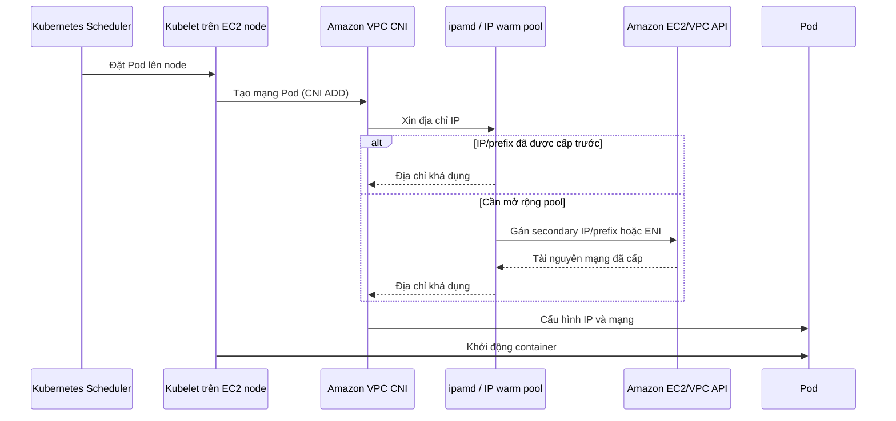
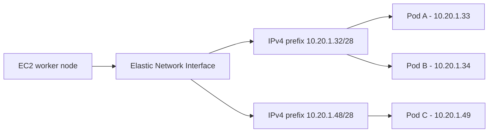
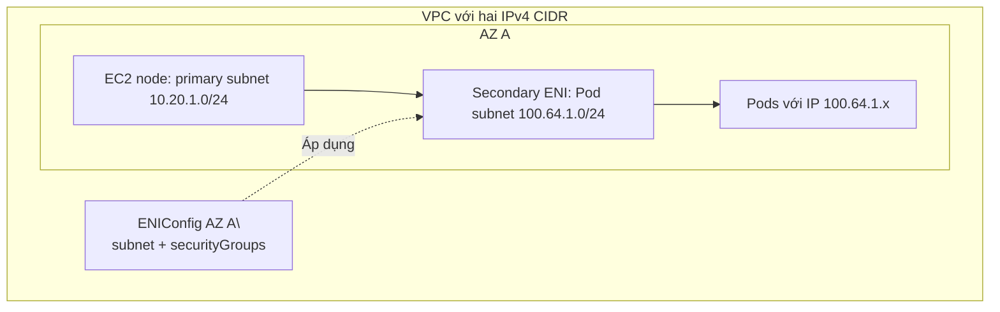
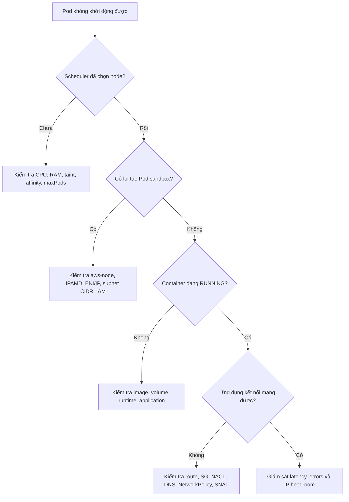

# Amazon VPC CNI và quản lý địa chỉ IP cho Pod

## 1. Bối cảnh: tại sao Pod trên EKS lại thiếu địa chỉ IP?

Một doanh nghiệp triển khai dịch vụ đặt hàng bằng Kubernetes trên **Amazon Elastic Kubernetes Service (Amazon EKS)**. Các node EC2 có CPU và RAM còn trống, nhưng khi tăng số bản sao Deployment từ 20 lên 100, một số Pod không khởi động được. Event hiển thị lỗi tương tự `FailedCreatePodSandBox` hoặc `failed to assign an IP address to container`. Nhóm vận hành tăng số lượng replicas, thậm chí tăng kích thước EC2, nhưng vấn đề chưa được xử lý triệt để.

Trong EKS sử dụng **Amazon VPC Container Network Interface (Amazon VPC CNI)** trên các EC2 worker nodes, mỗi Pod thông thường được cấp **địa chỉ IP từ không gian mạng Amazon VPC**. Để cấp IP, plugin phải quản lý **Elastic Network Interfaces (ENI)**, địa chỉ IP phụ hoặc **IP prefixes**, đồng thời tuân thủ giới hạn ENI/IP của EC2 instance type và số IP còn khả dụng trong subnet. Vì thế, **CPU còn trống không đồng nghĩa node có thể chạy thêm Pod**.

Bài này thuộc chương **Kubernetes với EKS** trong lộ trình **CLOUD_PROVIDERS_AWS**. Kiến thức về Region/AZ, IAM, VPC, compute, storage, database, tích hợp và serverless được sử dụng để thiết kế ứng dụng an toàn, có khả năng giám sát, phục hồi và kiểm soát chi phí. Nội dung tập trung vào **Amazon VPC CNI và quản lý địa chỉ IP cho Pod**, thay vì triển khai một hệ thống Kubernetes tổng quát.

Sau bài học, bạn có thể:

- Mô tả vai trò của `aws-node`, plugin CNI và tiến trình `ipamd` khi Pod được tạo.
- Phân biệt **secondary IPv4 mode**, **prefix delegation**, **custom networking** và **IPv6 mode**.
- Giải thích các biến `WARM_ENI_TARGET`, `WARM_IP_TARGET`, `MINIMUM_IP_TARGET`, `WARM_PREFIX_TARGET` và giới hạn `maxPods`.
- Tính toán sơ bộ nhu cầu IP theo node, Pod, AZ và subnet; phát hiện cạn IPv4 hoặc phân mảnh khối `/28`.
- Kiểm tra trạng thái CNI, subnet, ENI, Pod events và quyền IAM bằng `kubectl`/AWS CLI.
- Lựa chọn cấu hình phù hợp với khả năng mở rộng, phân đoạn mạng, hiệu năng và ngân sách.

## 2. VPC CNI nằm ở đâu trong kiến trúc Kubernetes?

**CNI (Container Network Interface)** là giao diện/plugin thiết lập mạng cho container. Kubernetes scheduler quyết định Pod nên chạy trên node nào; kubelet cùng container runtime và CNI chuẩn bị môi trường chạy thực tế, trong đó có giao diện mạng và IP.

**Amazon VPC CNI** là giải pháp mạng VPC-native do AWS cung cấp cho EKS EC2 worker nodes. Add-on thường có tên `vpc-cni` trong EKS API, được triển khai bằng **DaemonSet `aws-node`** trên những node phù hợp. Thành phần quan trọng là **IP Address Management daemon (`ipamd`)** và CNI binary:

1. `ipamd` duy trì một nhóm ENI/IP hoặc prefix đã được cấp trước (*warm pool*), gọi EC2 API khi cần cấp thêm hoặc giải phóng tài nguyên.
2. Kubelet yêu cầu tạo môi trường mạng cho Pod; CNI binary trao đổi với `ipamd` để nhận IP có thể dùng.
3. CNI cấu hình giao diện/route phía node và namespace mạng của Pod để Pod có thể giao tiếp.
4. Pod bắt đầu chạy, kết nối theo VPC routing, security groups và các kiểm soát khác.



**Phạm vi áp dụng:** những thao tác với DaemonSet `aws-node` trong bài dành chủ yếu cho **EKS EC2 Linux worker nodes** (bao gồm managed/self-managed nodes khi được hỗ trợ). **EKS Fargate** có cơ chế networking do dịch vụ quản lý; bạn không quản lý DaemonSet `aws-node` trên Fargate tasks theo cách trên. **EKS Auto Mode** cũng quản lý mạng node theo kiến trúc riêng và không yêu cầu cài add-on VPC CNI thủ công. Không áp dụng nguyên các bước chỉnh DaemonSet cho mọi loại compute trong EKS.

### 2.1. Phân biệt bốn loại địa chỉ Kubernetes và AWS

| Địa chỉ / DNS | Ai sử dụng? | Điểm cần nhớ |
| --- | --- | --- |
| **Node primary private IP** | EC2 node, primary ENI | Nằm trong subnet của node |
| **Pod IP** | Pod chạy trên node | Theo VPC CNI IPv4 mặc định thường là secondary IP hoặc IP từ delegated prefix trên ENI |
| **Kubernetes Service ClusterIP** | Địa chỉ logic ổn định để client gọi Service | Không phải một ENI/IP VPC riêng được cấp cho mỗi Service; kube-proxy hoặc data plane thích hợp xử lý routing |
| **Load Balancer IP/DNS** | Client bên ngoài/khác VPC truy cập Service | AWS Load Balancer Controller hoặc cơ chế service integration tạo ALB/NLB khi cấu hình |

Với VPC CNI, Pod thường có địa chỉ **có thể định tuyến trong VPC** thay vì bắt buộc có mạng overlay do plugin độc lập tạo ra. Tuy nhiên, **Pod IP không đồng nghĩa public IP**, và pod vẫn cần subnet routing, security group, NACL, NetworkPolicy và đường đi Internet hoặc VPC endpoint phù hợp.

## 3. Secondary IPv4 mode: mô hình mặc định

Trong cụm EKS IPv4 chạy trên EC2, **secondary IP mode** thường là mô hình mặc định: VPC CNI gán các địa chỉ IPv4 phụ lên ENI của node rồi phân phối chúng cho các Pod. Một EC2 node có **primary ENI** khi khởi chạy và có thể gắn thêm **secondary ENIs** theo giới hạn instance type.

```text
VPC: 10.20.0.0/16
Subnet AZ A: 10.20.1.0/24
       |
       +-- EC2 node (primary ENI)
       |     primary IP: 10.20.1.10
       |     secondary IP: 10.20.1.11  -> Pod orders-api
       |     secondary IP: 10.20.1.12  -> Pod cart-api
       |
       +-- secondary ENI (nếu được cấp)
             primary IP: 10.20.1.20
             secondary IP: 10.20.1.21 -> Pod report-worker
```

Địa chỉ trong sơ đồ là minh họa. ENI có địa chỉ primary của nó và các địa chỉ phụ; **không được lấy mọi địa chỉ đã gắn với ENI để tính đều là Pod IP khả dụng**.

### 3.1. Giới hạn theo EC2 instance type

Mỗi EC2 instance type có giới hạn:

- Số lượng **ENIs có thể gắn**.
- Số lượng **private IPv4 addresses/slots trên một ENI**.
- Năng lực CPU, RAM, mạng và tính năng Nitro/platform tương ứng.

Ví dụ giả định để luyện tính toán: một loại EC2 hỗ trợ tối đa **3 ENI**, mỗi ENI có **4 địa chỉ IPv4** (bao gồm địa chỉ primary). Số vị trí secondary IPv4 tối đa theo phép tính đơn giản là:

```text
3 ENI × (4 IPv4/ENI - 1 primary IPv4/ENI) = 9 secondary IPv4 slots
```

Con số trên chỉ minh họa **giới hạn số vị trí IP lý thuyết trong cấu hình cơ bản**. Số Pod được phép chạy thực tế còn phụ thuộc những IP dự trữ, Pod dùng hostNetwork, giới hạn kubelet `maxPods`, cấu hình custom networking/Pod security groups, ENI/IP còn trống, CPU, RAM và yêu cầu scheduling. Đừng lấy phép nhân này thay cho lệnh tra instance type và cấu hình node thực tế.

**Một điểm thường bị bỏ qua:** `AvailableIpAddressCount` của subnet giảm không chỉ khi Pod được chạy, mà còn khi VPC CNI **dự trữ địa chỉ/IP prefix trong warm pool**. Vì vậy Pod ít nhưng subnet sắp hết IP vẫn là tình huống có thể xảy ra.

### 3.2. Warm pool và độ trễ khởi tạo Pod

Nếu mỗi lần tạo Pod đều phải gọi EC2 API để xin IP hoặc gắn ENI, thời gian khởi tạo có thể tăng, đặc biệt khi workload tăng đột ngột. `ipamd` cấp trước một số IP/ENI chưa dùng để Pod có thể khởi động nhanh hơn.

Đánh đổi:

| Dự trữ nhiều | Dự trữ ít |
| --- | --- |
| Pod mới thường lấy IP nhanh hơn | Ít giữ IPv4 chưa được Pod sử dụng |
| Tiêu thụ nhiều IP trong subnet | Có thể phải gọi EC2 API thường xuyên hơn |
| Có thể làm cạn IP trong subnet nhỏ | Dễ chịu độ trễ cấp phát/throttling khi tăng tải mạnh |

Mục tiêu đúng không phải “dự trữ bằng 0”, mà là **giữ đủ địa chỉ cho tốc độ mở rộng mong muốn, không lãng phí subnet capacity**.

## 4. Các biến IPAMD: điều chỉnh warm pool

Những biến môi trường quan trọng của VPC CNI `aws-node`:

| Biến | Ý nghĩa | Khi nên quan tâm |
| --- | --- | --- |
| `WARM_ENI_TARGET` | Số ENI dư hướng tới trong mô hình dùng IP riêng lẻ, thường mặc định 1 | Cluster nhỏ; ảnh hưởng nhiều địa chỉ dự trữ khi instance có nhiều IP/ENI |
| `WARM_IP_TARGET` | Số địa chỉ IP chưa gán cho Pod mà `ipamd` cố gắng giữ sẵn | Muốn tiết kiệm IPv4 nhưng vẫn hỗ trợ burst |
| `MINIMUM_IP_TARGET` | Số IP tối thiểu cố gắng cấp trước để sẵn sàng cho nhu cầu nền | Có số Pod/nút dự kiến và muốn tránh cấp phát chậm |
| `ENABLE_PREFIX_DELEGATION` | Bật cơ chế gán IP prefix cho ENI khi được hỗ trợ | Muốn tăng Pod density và giảm thao tác cấp IP riêng lẻ |
| `WARM_PREFIX_TARGET` | Số prefix dư cần giữ trong **prefix mode** | Đánh đổi tốc độ tăng tải với lượng IPv4 đã giữ |

Trong **secondary IP mode**, khi cấu hình `WARM_IP_TARGET` hoặc `MINIMUM_IP_TARGET` có giá trị hợp lệ, hành vi cấp phát sẽ theo các mục tiêu IP đó thay vì chỉ giữ nguyên cơ chế warm ENI mặc định. Trong **prefix mode**, `WARM_IP_TARGET`/`MINIMUM_IP_TARGET` được thiết lập sẽ **ưu tiên hơn `WARM_PREFIX_TARGET`**; cần hiểu cả nhóm biến trước khi chỉnh.

### 4.1. Ví dụ tư duy cho một node

Giả sử trung bình một node chạy 15 Pod và giờ cao điểm có thể tăng lên 22 Pod trong thời gian ngắn. Đội vận hành muốn giữ khoảng 3 IP rảnh, không dự trữ cả một ENI có nhiều địa chỉ:

```text
MINIMUM_IP_TARGET = 15
WARM_IP_TARGET    = 3

Ý tưởng: cấp trước mức nền và giữ một đệm IP nhỏ cho Pod phát sinh.
```

Đây là **mô hình tư duy**, không phải công thức bảo đảm đúng 18 IP ở mọi thời điểm hoặc cấu hình cho mọi loại instance. IP được gán theo slot ENI/prefix, còn ảnh hưởng của cấu hình tùy CNI version và trạng thái node. Chỉ chọn giá trị sau khi kiểm tra **pod density thực tế, mức tăng tải, số IP subnet còn lại và EC2 API latency/throttling**.

### 4.2. Không chỉnh DaemonSet tùy tiện ở production

Với **EKS managed add-on**, nên quản lý các tham số qua **EKS add-on configuration** bằng Infrastructure as Code hoặc EKS API để tránh mất cấu hình khi add-on được nâng cấp. Thay đổi trực tiếp bằng `kubectl set env daemonset/aws-node` có thể hữu ích trong môi trường học tập hoặc self-managed add-on, nhưng cần hiểu cơ chế ownership và drift với EKS add-on manager.

Trước thay đổi, xem cấu hình đang áp dụng, phiên bản add-on và kế hoạch rollback. Không đổi đồng thời quá nhiều tham số, nếu không sẽ khó xác định nguyên nhân số Pod khởi tạo chậm hoặc IP consumption tăng.

## 5. Prefix delegation: tăng mật độ Pod bằng CIDR prefixes

**Prefix delegation** (prefix mode) cho phép VPC CNI cấp **một khối địa chỉ IP liên tiếp** vào slot của ENI thay vì cấp từng secondary IPv4 address độc lập. Với IPv4, AWS cấp **prefix /28 gồm 16 địa chỉ IPv4**. Với cụm IPv6, cơ chế prefix có đặc điểm khác, được trình bày ở phần IPv6.



Địa chỉ minh họa không thể dùng để suy ra địa chỉ thực tế VPC CNI chọn trong một cluster. CNI vẫn phải cấp **một Pod IP duy nhất cho mỗi Pod**; prefix chỉ tối ưu cách AWS cấp phát địa chỉ lên ENI và cách `ipamd` quản lý warm pool.

### 5.1. Lợi ích

- **Tăng Pod density** cho nhiều loại EC2 instance phù hợp nhờ mỗi slot ENI có thể đại diện cho một prefix thay vì một IP riêng lẻ.
- **Giảm số lần gọi EC2 API** khi cần cấp nhiều IP; gắn prefix trên ENI hiện có thường nhanh hơn tạo/gắn thêm ENI.
- Hữu ích khi tải Kubernetes có nhiều Pod nhỏ và thay đổi nhanh, hoặc khi kết hợp custom networking.

**Không phải tăng vô hạn:** giới hạn ENI và slot/ENI vẫn tồn tại, kubelet vẫn có `maxPods`, instance vẫn có giới hạn CPU/RAM/network và subnet phải có đủ prefix **liên tiếp**. Với node group gồm nhiều instance types, cấu hình `maxPods` phải tính đến instance có khả năng thấp nhất theo cơ chế node group.

### 5.2. Điều kiện tiên quyết

Đối với **Linux EC2 IPv4** theo hướng dẫn EKS, cần:

1. Phiên bản VPC CNI hỗ trợ prefix delegation; AWS đã hỗ trợ từ các phiên bản 1.9.x theo điều kiện tài liệu, nhưng nên chọn **add-on version được AWS hỗ trợ cho Kubernetes version hiện tại**.
2. **Instance type dựa trên Nitro** khi tính năng yêu cầu; kiểm tra instance platform trước khi chọn.
3. Subnet có **khối /28 liên tiếp** còn trống, không chỉ tổng số IP rảnh cao.
4. Cấu hình `ENABLE_PREFIX_DELEGATION=true`, điều chỉnh warm pool nếu cần và tính lại giới hạn `maxPods` khi muốn tăng mật độ thực sự.
5. Phương án chuyển đổi node group, quan sát sau thay đổi và rollback.

**Bẫy lớn:** Subnet có 80 địa chỉ IPv4 rảnh nhưng bị chia thành các đoạn nhỏ do ENIs/endpoint/instance dùng rải rác; không còn bất kỳ **khối 16 địa chỉ liên tiếp**. EC2 có thể trả về `InsufficientCidrBlocks` khi CNI xin prefix mặc dù bảng `AvailableIpAddressCount` vẫn thể hiện có nhiều địa chỉ. Cách khắc phục không phải chỉ tăng ENI target; cần **subnet mới sạch**, **Subnet CIDR reservation** cho prefix hoặc kế hoạch giải phóng/tổ chức địa chỉ.

### 5.3. Warm pool trong prefix mode

Khi `WARM_PREFIX_TARGET=1`, `ipamd` cố gắng duy trì **một prefix dư** ngoài nhu cầu Pod hiện tại. Điều này giúp khởi tạo Pod nhanh, nhưng một prefix dư có thể giữ **16 địa chỉ IPv4** trong subnet mà chưa có Pod nào sử dụng.

Nếu mục tiêu tiết kiệm IPv4, có thể đánh giá `WARM_IP_TARGET` cùng `MINIMUM_IP_TARGET` để kiểm soát theo số IP gần nhu cầu, vì chúng **override** `WARM_PREFIX_TARGET` khi được thiết lập. Prefix vẫn được cấp phát theo khối /28, nên số IP thực tế được giữ có thể lớn hơn mục tiêu chính xác.

Không cấu hình những tổ hợp **zero target không được hỗ trợ trong prefix mode** với kỳ vọng loại bỏ mọi IP dự phòng. Giá trị quá thấp có thể làm Pod startup chậm và tạo nhiều EC2 API calls. Thử nghiệm với tải thực rồi mới tối ưu.

### 5.4. Kubelet `maxPods` là một giới hạn độc lập

`maxPods` là giới hạn số Pod Kubernetes được phép chạy trên một node, không phải số địa chỉ subnet còn lại. Khi bật prefix mode, CNI có thể cung cấp nhiều Pod IP hơn trước nhưng **kubelet vẫn từ chối Pod vượt `maxPods`**.

Một số managed node group áp dụng giới hạn `maxPods` tối đa theo vCPU và cơ chế quản lý node. Tài liệu EKS nêu các giới hạn phổ biến như **110 Pod đối với instance dưới 30 vCPU và 250 Pod đối với các instance khác** trong ngữ cảnh managed node groups; không nên dùng các số này cho mọi loại node hoặc xem là lời khuyên chạy tối đa. Số Pod hợp lý thực tế còn phụ thuộc CPU/RAM, số Pod hệ thống, ENI/IP, plugin, nhu cầu ứng dụng và network performance.

Khi chuyển từ secondary IP mode sang prefix delegation, AWS khuyến nghị **tạo node group mới rồi drain node cũ** thay vì sửa hàng loạt node đang chạy với trạng thái IP/prefix hỗn hợp. Thay đổi `maxPods` cũng cần phối hợp bootstrap/user data hoặc cấu hình node theo phương pháp của loại AMI và node provisioning hiện hành.

## 6. Quy hoạch IPv4 cho subnet, node và Pod

### 6.1. Phân tách nhu cầu theo AZ

Mỗi **ENI gắn vào subnet thuộc một Availability Zone**. Bạn không thể dùng IP rảnh ở AZ B để bù trực tiếp cho Pod đang chờ IP trên node thuộc AZ A. Vì vậy phải lập kế hoạch theo **từng subnet/AZ**, không chỉ tổng CIDR của VPC.

Ví dụ một cluster chạy tại hai AZ:

| Thành phần | AZ A | AZ B |
| --- | ---: | ---: |
| Số EC2 worker nodes dự kiến | 12 | 12 |
| Số Pod ứng dụng trung bình/node | 18 | 18 |
| Pod hệ thống và phần headroom | Tính riêng | Tính riêng |
| Nguồn IPv4 | Subnet A | Subnet B |

Tổng Pod ứng dụng ước lượng = `24 × 18 = 432`, nhưng **không đồng nghĩa chỉ cần đúng 432 IPv4**. Còn phải tính ENI primary IPs, warm pool, IPs của EC2, ALB/NLB, NAT/PrivateLink endpoints, các resources khác và **5 địa chỉ IPv4 AWS dự trữ trong mỗi IPv4 subnet**. Nếu dùng prefix mode, còn phải dự phòng khối /28 liên tiếp và mật độ cấp phát theo prefix.

### 6.2. Các loại giới hạn cần kiểm tra

| Giới hạn | Tầng | Biểu hiện |
| --- | --- | --- |
| Subnet hết IPv4 | VPC | IPAMD không cấp được IP, node/ENI/endpoint mới thiếu địa chỉ |
| Subnet không có khối /28 liên tiếp | Prefix delegation | `InsufficientCidrBlocks` dù còn IP rải rác |
| Tối đa ENI hoặc IP slots/ENI | EC2 instance type | Không thể tăng số Pod IP trên node bằng cách gắn thêm ENI/prefix |
| Kubelet `maxPods` | Kubernetes node | Scheduler báo giới hạn Pod capacity/`Too many pods` |
| CPU/RAM không đủ | EC2/Kubernetes | Pod `Pending` vì `Insufficient cpu/memory`, không phải lỗi IP |
| EC2 API throttle/IAM deny | AWS API/IAM | IPAMD không gắn được IP/ENI/prefix; log có lỗi API |
| Không có subnet/EC2 capacity tại AZ | AWS compute | Node group/Autoscaling không tạo được node phù hợp |

### 6.3. Các cách giảm áp lực IPv4

1. **Tối ưu warm pool** với giá trị dựa trên tải, tránh giữ IP không cần thiết.
2. **Prefix delegation** khi muốn tăng Pod density và có subnet đủ khối /28.
3. **Bổ sung subnet/CIDR IPv4** và mở rộng nhóm node theo quy hoạch IP; tránh tạo các CIDR chồng lấn với on-premises và VPC khác.
4. **Custom networking** để Pod dùng subnet từ secondary VPC CIDR khi thiết kế phù hợp.
5. **IPv6 cluster** cho kiến trúc mới khi yêu cầu ứng dụng, mạng và các dịch vụ hỗ trợ.
6. **Right sizing và autoscaling** số node/Pod; không giữ quá nhiều Pod không có tải nghiệp vụ.

**Không dùng NAT Gateway như giải pháp tạo thêm Pod IP trong subnet.** NAT giúp kiểm soát/chia sẻ địa chỉ nguồn khi đi ra ngoài, nhưng không xóa yêu cầu phải có IP cho từng Pod ở mạng bên trong.

## 7. Custom networking và ENIConfig

Theo mặc định, IP của Pod thường được cấp từ subnet liên quan đến primary ENI của node. Với **custom networking**, bạn có thể cấu hình Amazon VPC CNI sử dụng **subnet khác** và **security groups khác** cho các ENI phụ được dùng để cấp IP cho Pods, ví dụ từ secondary IPv4 CIDR của VPC.



Lợi ích: tách nguồn địa chỉ của host và Pod, tránh sử dụng hết RFC1918 CIDR vốn dành cho node/các tài nguyên khác. AWS gợi ý xem xét không gian **`100.64.0.0/10`** (shared address space, RFC 6598) khi phù hợp và tuân thủ giới hạn liên kết VPC CIDR. Không dùng dải này tùy tiện nếu mạng doanh nghiệp/ISP/VPN đã dùng trùng.

**Đánh đổi:** custom networking **không sử dụng primary ENI để cấp Pod IP thông thường**, nên số Pod khả dụng trên node có thể giảm khi không dùng prefix delegation; `hostNetwork` Pods tiếp tục dùng mạng host. Bạn cần khai báo **ENIConfig đúng subnet/AZ**, routing, security groups và khả năng cấp thêm ENI. Custom networking là mô hình của **IPv4**, không áp dụng với EKS IPv6 networking theo cách tương tự.

### 7.1. Ví dụ ENIConfig

Giả sử subnet `subnet-0123456789abcdef0` thuộc AZ `ap-southeast-1a` và có địa chỉ thuộc secondary IPv4 CIDR của VPC. Custom resource mẫu:

```yaml
apiVersion: crd.k8s.amazonaws.com/v1alpha1
kind: ENIConfig
metadata:
  name: ap-southeast-1a
spec:
  subnet: subnet-0123456789abcdef0
  securityGroups:
    - sg-0123456789abcdef0
```

Đây là cấu hình **minh họa**, không phải một resource có sẵn trong cluster. Cần tạo ENIConfig cho những AZ/subnet sẽ dùng. Khi bật `AWS_VPC_K8S_CNI_CUSTOM_NETWORK_CFG=true`, node phải chọn đúng ENIConfig qua annotation/label hoặc cơ chế tự chọn theo AZ được cấu hình:

```bash
# Chỉ xem các ENIConfig hiện có
kubectl get eniconfigs.crd.k8s.amazonaws.com

# Kiểm tra nhãn và annotation của node để đối chiếu ENIConfig
kubectl get nodes --show-labels
```

**Thay đổi custom networking không áp dụng ngay cho mọi Pod đang chạy.** Cần một kế hoạch **node group replacement, cordon/drain**, tránh thay đổi network nền trên hệ thống đang vận hành mà chưa kiểm thử. Với managed add-on, lưu các biến môi trường trong cấu hình EKS add-on thay vì để bị ghi đè bởi việc nâng cấp.

### 7.2. Phân biệt ENIConfig security groups và Security Groups for Pods

- **ENIConfig** cấu hình security group cho **secondary ENIs** dùng khi cấp IP Pod trong custom networking; nhiều Pods có thể chia sẻ phạm vi chính sách của ENI đó.
- **Security Groups for Pods** là khả năng gắn security group **theo Pod** trên những node/instance được hỗ trợ, dựa vào **trunk/branch ENI** và `SecurityGroupPolicy`. Không phải chỉ thêm trường `securityGroups` vào ENIConfig là mỗi Pod có SG riêng độc lập.

Hai tính năng giải quyết vấn đề khác nhau. Đặc biệt, branch ENI có giới hạn riêng và không sử dụng cơ chế gán Pod IP bằng /28 prefix như các Pod gắn ENI tiêu chuẩn; muốn kết hợp tính năng cần đối chiếu khả năng hỗ trợ và giới hạn thực tế.

## 8. IPv6 cho EKS Pods

Một lựa chọn giảm áp lực IPv4 là tạo **EKS cluster hỗ trợ IPv6** khi hệ sinh thái ứng dụng, load balancer, mạng nội bộ, firewall và các dependency đủ điều kiện. Trong mô hình EKS IPv6 trên EC2, VPC CNI sử dụng **prefix mode** với **IPv6 /80 prefix** trên ENI để cấp nhiều Pod IPv6 addresses.

| Đặc tính | EKS IPv4 mặc định | EKS IPv6 trong cấu hình được hỗ trợ |
| --- | --- | --- |
| Pod address chính | IPv4 từ subnet/ENI | IPv6 được cấp từ prefix trên ENI |
| Kiểu cấp IP | Secondary IP hoặc /28 prefix | IPv6 /80 prefix theo cơ chế được quản lý |
| Hạn chế cạn IPv4 Pod IP | Có thể xảy ra nhanh nếu subnet nhỏ | Không còn phụ thuộc nhiều địa chỉ IPv4 VPC cho từng Pod theo cùng cách |
| Pod network planning | CIDR, ENI/IP slots, warm pool, maxPods | IPv6 CIDR/prefix, networking egress, maxPods và khả năng hỗ trợ ứng dụng |
| Custom networking `ENIConfig` | Có trên IPv4 khi hỗ trợ | Không áp dụng cùng cơ chế cho IPv6 |

**IPv6 không tự làm hệ thống “dual-stack ở mọi lớp”.** Trong EKS IPv6 cluster, Pod có IPv6 được biết đến bởi Kubernetes và có thể có **host-local IPv4 address** phục vụ một số nhu cầu tương thích thông qua plugin đi kèm; địa chỉ host-local đó không được quản lý/advertise như một Pod IPv4 VPC theo cơ chế IPv4 cluster.

Trước khi chọn IPv6, kiểm tra hỗ trợ của **EC2 instance/AMI, AWS CNI version, EKS compute type, ingress/egress, AWS load balancers, CoreDNS, Service, on-premises VPN, NAT64/IPv4 egress khi cần và thư viện ứng dụng**. Đừng tự áp dụng các biến `WARM_IP_TARGET` của mô hình IPv4 cho IPv6 mà chưa kiểm tra tài liệu; prefix IPv6 được cấp theo cơ chế khác.

**Quan trọng:** lựa chọn IP family là quyết định kiến trúc khi tạo EKS cluster. Không nên lên kế hoạch “đổi một biến CNI là chuyển cluster IPv4 đang chạy thành IPv6” mà không đánh giá migration toàn bộ cluster/workload.

## 9. Networking, định tuyến và bảo mật Pod

### 9.1. VPC-native không có nghĩa Pod truy cập Internet tự động

Với Pod IPv4 dùng Amazon VPC CNI, giao tiếp trong VPC được định tuyến theo mạng VPC; lưu lượng đi **ra ngoài VPC** có thể chịu **source network address translation (SNAT)** tại node theo cấu hình CNI. Những môi trường dùng `AWS_VPC_K8S_CNI_EXTERNALSNAT=true` chuyển trách nhiệm SNAT phù hợp ra mạng ngoài node; yêu cầu route/NAT/firewall phải được thiết kế đồng bộ.

Nếu node ở **private subnet** cần kéo image ECR, truy cập AWS API hoặc Internet, thiết kế **NAT Gateway hoặc VPC endpoints** tùy dịch vụ, đúng route table, NACL và security groups. Một Pod có IP `10.x.x.x` hợp lệ nhưng không có route NAT/endpoint vẫn có thể lỗi `ImagePullBackOff` hoặc timeout kết nối.

### 9.2. Security groups và NetworkPolicy không phải một

Theo mặc định trên nhiều cấu hình EC2 EKS, Pod nhận chính sách mạng theo **security group của node/ENI** phù hợp. Nếu cần phân tách quyền truy cập RDS giữa hai nhóm ứng dụng trên cùng node, cân nhắc:

- **Security Groups for Pods:** cấp SG riêng cho Pod thuộc phạm vi hỗ trợ; cần loại EC2, CNI/version, `SecurityGroupPolicy`, trunk/branch ENI và cấu hình enforcing mode đúng.
- **Kubernetes NetworkPolicy:** mô tả luật L3/L4 giữa Pods/namespaces; Amazon VPC CNI có tính năng enforcement với **điều kiện version/kernel và cấu hình bổ sung**. **Chỉ cài VPC CNI không có nghĩa mọi NetworkPolicy tự được enforce ngay**.
- **VPC security groups, NACL, AWS Network Firewall** và phân đoạn route/subnets vẫn cần được đánh giá.

NetworkPolicy của Amazon VPC CNI có các giới hạn theo platform: tính năng áp dụng cho **EC2 Linux nodes** trong phạm vi được hỗ trợ, không suy luận áp dụng nguyên cho **EKS Fargate hoặc Windows nodes**. Một số Pod không được quản lý bởi controller có thể nhận enforcement khác; nên xem tài liệu hiện hành và triển khai thử bằng Deployment/ReplicaSet trước.

### 9.3. IAM cho CNI khác IAM cho ứng dụng

VPC CNI cần gọi EC2 APIs để quản lý network interfaces và IPs, chẳng hạn thao tác mô tả/gắn ENI hoặc gán địa chỉ. **IAM role cho `aws-node`** được khuyến nghị tách khỏi **node IAM role** để giảm quyền không cần thiết của host. Với EKS hỗ trợ tương ứng, có thể cấp quyền cho add-on thông qua **EKS Pod Identity** hoặc **IAM Roles for Service Accounts (IRSA)**. Cấu hình quản lý add-on cần phù hợp hình thức định danh đang dùng.

Policy `AmazonEKS_CNI_Policy` phục vụ nhiều cấu hình **IPv4**; với cụm **IPv6** cần một policy có quyền IPv6 phù hợp theo tài liệu AWS. **Task/app Pods** nên có IAM role riêng theo service account và quyền nghiệp vụ; không dùng IAM role của CNI để cấp quyền đọc S3 hoặc quản trị RDS cho mọi ứng dụng.

**Không mở IAM thành `ec2:*` hoặc `AdministratorAccess` để giải quyết lỗi cấp Pod IP.** Hãy xem EC2 API action bị từ chối, CloudTrail, role thực sự của `aws-node` và ràng buộc SCP trước khi sửa policy.

## 10. Quy trình quan sát và kiểm tra nhanh bằng CLI

Các lệnh sau chủ yếu **chỉ đọc**, dành cho môi trường EKS EC2 và cần `kubectl`/AWS CLI đã xác thực, có kubeconfig và quyền Kubernetes/AWS phù hợp. Thay `shop-eks`, tên node, VPC/subnet và Region bằng giá trị thật.

### 10.1. Xem add-on và DaemonSet

```bash
# Kiểm tra tài khoản AWS đang sử dụng
aws sts get-caller-identity

# Xem trạng thái và phiên bản EKS managed add-on
aws eks describe-addon \
  --cluster-name shop-eks \
  --addon-name vpc-cni \
  --region ap-southeast-1

# Xem DaemonSet aws-node trên EC2 Linux worker nodes
kubectl -n kube-system get daemonset aws-node
kubectl -n kube-system get pods -l k8s-app=aws-node -o wide

# Xem biến môi trường đã triển khai
kubectl -n kube-system describe daemonset aws-node
```

Trong cluster sử dụng **self-managed CNI**, thông tin `describe-addon` có thể không phản ánh cách triển khai. Với **EKS Auto Mode** hoặc Fargate, đừng lấy thiếu `aws-node` DaemonSet trên compute đó làm lỗi khi kiến trúc không dùng nó theo cách này.

### 10.2. Xem Pod, node và events

```bash
kubectl get nodes -o wide
kubectl get pods -A -o wide

# Thay tên Pod/namespace thật
kubectl -n production describe pod orders-api-example

# Xem sức chứa Pod trên node; đối chiếu Allocatable và non-terminated Pods
kubectl describe node ip-10-20-1-10.ap-southeast-1.compute.internal

# Các event gần đây trong namespace
kubectl -n production get events --sort-by=.lastTimestamp
```

Nếu Pod **Pending** vì scheduler báo `Too many pods`, `Insufficient cpu` hoặc `Insufficient memory`, xử lý tầng scheduling/compute. Nếu Pod đã được đặt lên node nhưng báo `FailedCreatePodSandBox` và không cấp được IP, ưu tiên kiểm tra CNI/IPAMD, subnet, ENI và IAM.

### 10.3. Kiểm tra IPv4 còn lại trong subnet

```bash
aws ec2 describe-subnets \
  --subnet-ids subnet-0123456789abcdef0 subnet-0abcdef0123456789 \
  --region ap-southeast-1 \
  --query 'Subnets[*].[SubnetId,AvailabilityZone,CidrBlock,AvailableIpAddressCount]' \
  --output table

# Xem giới hạn ENI và IPv4 trên instance type minh họa
aws ec2 describe-instance-types \
  --instance-types m5.large \
  --region ap-southeast-1 \
  --query 'InstanceTypes[*].[InstanceType,NetworkInfo.MaximumNetworkInterfaces,NetworkInfo.Ipv4AddressesPerInterface]' \
  --output table
```

`AvailableIpAddressCount` cho biết số IP AWS đang coi là chưa dùng tại subnet, **không phản ánh có /28 contiguous hay không**, cũng không nói node nào được phép nhận thêm ENI. Xem đồng thời subnet IP count, loại instance, mức Pod density và IPAMD warm pool.

### 10.4. Xem CNI logs

```bash
# Chọn một aws-node Pod cụ thể sau khi xem danh sách
kubectl -n kube-system logs aws-node-EXAMPLE -c aws-node --tail=200

# Nếu kiểm tra trên EC2 node và có quyền quản trị host:
#   /var/log/aws-routed-eni/ipamd.log
#   /var/log/aws-routed-eni/plugin.log
```

Lỗi cần tìm gồm: `failed to assign an IP address`, `InsufficientCidrBlocks`, EC2 API `AccessDenied`/`UnauthorizedOperation`, EC2 API throttling và việc gắn ENI thất bại. Tên container/đường dẫn/định dạng log có thể thay đổi theo phiên bản add-on; kiểm tra `kubectl describe pod` và tài liệu version đang dùng.

## 11. Ví dụ cấu hình prefix delegation có kiểm soát

Giả định bạn có EKS cluster `shop-eks` với **EC2 Linux nodes**, add-on `vpc-cni` được EKS quản lý, subnet đã được chuẩn bị /28 contiguous và node group mới sẽ được đưa vào hoạt động theo kế hoạch. Đội vận hành muốn thử prefix delegation với một warm prefix.

### 11.1. Đọc trước khi ghi

```bash
aws eks describe-addon \
  --cluster-name shop-eks \
  --addon-name vpc-cni \
  --region ap-southeast-1 \
  --query 'addon.[addonVersion,status,configurationValues]'

# Xác minh cấu hình đang chạy tại các node thích hợp
kubectl -n kube-system describe daemonset aws-node
```

**Quan trọng:** mỗi add-on version có JSON schema của configuration values. Có thể dùng `aws eks describe-addon-configuration` để xem **schema tương ứng với addonVersion thực tế**. Nếu có configuration values khác đang dùng (logging, probes, resources, network policy), phải **hợp nhất**, không thay thế mất chúng.

### 11.2. Ví dụ JSON configuration values

Nội dung mẫu `vpc-cni-prefix-config.json`:

```json
{
  "env": {
    "ENABLE_PREFIX_DELEGATION": "true",
    "WARM_PREFIX_TARGET": "1"
  }
}
```

Trong managed add-on tương thích, cấu trúc `env` này là ví dụ cho configuration values. **Cần xác nhận schema hỗ trợ đúng các trường và kiểu dữ liệu** của phiên bản cài đặt. Không sao chép một cấu hình trống để xóa các tùy chọn hiện hữu.

Lệnh cập nhật (**có tác động thật**, chỉ chạy sau khi review, backup cấu hình và có kế hoạch rollback):

```bash
aws eks update-addon \
  --cluster-name shop-eks \
  --addon-name vpc-cni \
  --configuration-values file://vpc-cni-prefix-config.json \
  --resolve-conflicts PRESERVE \
  --region ap-southeast-1

# Theo dõi trạng thái add-on sau update
aws eks describe-addon \
  --cluster-name shop-eks \
  --addon-name vpc-cni \
  --region ap-southeast-1
```

**Đừng triển khai trong production chỉ bằng lệnh trên.** Cần tạo node group mới với bootstrap/`maxPods` tương thích prefix mode, cấp subnet/prefix sẵn, kiểm tra rollout DaemonSet và drain dần node cũ. CNI là thành phần cốt lõi; cập nhật sai có thể làm Pod mới không có mạng.

### 11.3. Tiêu chí thành công

1. EKS add-on báo trạng thái hoạt động và `aws-node` pods đều healthy trên EC2 nodes.
2. Node mới khởi chạy Pod bình thường, nhận IP phù hợp với subnet hoặc ENIConfig.
3. Số Pod tối đa khả dụng tăng theo mục tiêu đã thiết kế, **không chỉ vì `maxPods` được đặt cao**.
4. `AvailableIpAddressCount` còn headroom; không xuất hiện lỗi `InsufficientCidrBlocks`.
5. Độ trễ khởi tạo Pod, EC2 API throttling và số IP warm ở mức chấp nhận được.
6. Dịch vụ web, database, network policies, SG, DNS và egress vẫn hoạt động sau khi chuyển node.

## 12. Giám sát và vận hành IP capacity

### 12.1. Những tín hiệu cần theo dõi

| Tín hiệu | Nguồn | Mục đích |
| --- | --- | --- |
| Subnet `AvailableIpAddressCount` theo AZ | EC2 API, dashboard/automation | Cảnh báo nguy cơ cạn IPv4 từng AZ |
| Mức IP/prefix và ENI được cấp cho nodes | VPC CNI IPAMD metrics/logs, EC2 ENI inventory | Tìm warm pool quá lớn hoặc thiếu slot |
| Pod `Pending` và scheduler events | Kubernetes API/events | Phân biệt thiếu CPU/RAM/maxPods với lỗi IP |
| `FailedCreatePodSandBox` và `aws-node` logs | Kubernetes events, node logs | Phát hiện lỗi CNI/EC2 API |
| EC2 API errors/throttling | IPAMD logs, CloudTrail/metrics phù hợp | Kiểm tra IAM/API quota và tốc độ cấp phát |
| Node scale-out latency | Cluster Autoscaler/Karpenter, EKS, EC2 | Đánh giá cần node mới hay IP pool lớn hơn |
| Lỗi request/latency ứng dụng | ALB, service telemetry, CloudWatch | Đảm bảo tối ưu IP không làm ảnh hưởng SLO |

Một dashboard tốt nên nhóm metrics theo **cluster → node group → AZ/subnet → node → workload**. Tổng số IPv4 toàn VPC có thể còn cao nhưng một AZ cụ thể đã cạn; nhìn số tổng có thể bỏ sót nguyên nhân.

### 12.2. IPAMD và startup latency

**Cấp phát quá ít IP sẵn:** khi workload đột ngột tạo nhiều Pod, IPAMD phải xin prefix/ENI mới, chờ AWS API và đồng bộ trạng thái; startup bị chậm.

**Cấp phát quá nhiều IP sẵn:** các subnets giữ nhiều IPv4 chưa sử dụng; việc scale thêm EC2 nodes hoặc tạo ALB/VPC endpoints có thể thất bại dù số Pod chưa tăng.

**Thay đổi hợp lý:** đo đỉnh Pod/node, chọn warm target phù hợp, kiểm thử trong một node group mới và theo dõi trước/sau. Không thay mọi node group cùng lúc hoặc đặt cấu hình có giá trị bằng 0 tùy tiện trong prefix mode.

### 12.3. Thay đổi và nâng cấp add-on

- Ghi lại cluster version, VPC CNI version, instance types, subnet CIDRs, IAM role, ENIConfig và toàn bộ configuration values.
- Đánh giá release notes và compatibility của add-on trước khi update; một tính năng mới như NetworkPolicy hoặc prefix mode có thể yêu cầu minimum version/kernel/platform.
- Thử trên môi trường giống production hoặc node group mới, có **rollback path** rõ ràng.
- Theo dõi EKS add-on status, DaemonSet rollout, network logs, Pod startup và lưu lượng nghiệp vụ.
- Hạn chế cấp quyền thay VPC CNI, EC2 networking và EKS add-on chỉ cho đội có trách nhiệm.

## 13. Bảng lỗi thường gặp và cách khắc phục

| Triệu chứng | Nguyên nhân có thể | Cách xử lý |
| --- | --- | --- |
| `FailedCreatePodSandBox: failed to assign IP` | IPAMD không có IP/prefix, thiếu IAM hoặc EC2 API lỗi | Kiểm tra `aws-node` logs, subnet IP, EC2 ENI limits và quyền |
| `InsufficientCidrBlocks` | Subnet bị phân mảnh, thiếu /28 contiguous trong prefix mode | Dùng subnet CIDR reservation/new subnet, tổ chức lại địa chỉ |
| Nhiều Pod `Pending` và `Too many pods` | Chạm kubelet `maxPods` | Đọc node allocatable/maxPods, tính lại pod density, thêm nodes |
| Pod `Pending` với `Insufficient cpu` | Không còn CPU schedulable | Scale/resize nodes, chỉnh requests; thay warm IP không giúp |
| `UnauthorizedOperation`/`AccessDenied` khi gắn ENI | IAM role CNI thiếu EC2 permissions, SCP/condition hạn chế | Xem IAM role của `aws-node`, policy, CloudTrail và explicit denies |
| Node còn IP nhưng Pod tạo chậm | Warm target thấp, EC2 API throttle, prefix/ENI assignment chậm | Quan sát IPAMD latency và chỉnh warm targets có kiểm soát |
| Custom networking chỉ một số nodes có Pod IP đúng | ENIConfig không khớp AZ/label, node cũ chưa được thay | Xem ENIConfig, annotations/labels, rollout node group |
| Pod có IP nhưng không tới RDS | Security group, NACL, routing, SG for Pods enforcing mode | Trace traffic, kiểm tra VPC Flow Logs/network policies |
| Pod không truy cập Internet | Private subnet thiếu NAT/endpoints, SNAT mode không phù hợp | Kiểm tra route table, NAT, VPC endpoints, CNI settings |
| Sau update CNI, networking bất ổn | Cấu hình/schema/version không tương thích hoặc node IP/prefix hỗn hợp | Xem add-on status, logs, rollback, tạo node group mới |

### 13.1. Sơ đồ tìm nguyên nhân



**Nguyên tắc xử lý:** xác định lỗi do scheduler, IP allocation hay lưu lượng ứng dụng. Đừng mở toàn bộ security groups hoặc tăng node IAM quyền `ec2:*` như biện pháp xử lý mặc định.

## 14. Tình huống thực tế: thương mại điện tử cần scale 10 lần

Giả sử hệ thống bán hàng chạy EKS tại Singapore với hai AZ, node groups EC2 và hàng chục Deployments. Khi mở chương trình khuyến mãi, số Pod tăng gấp 10. Nhóm vận hành thấy:

- Một số node đã gần mức `maxPods` mặc dù CPU còn trống.
- `AvailableIpAddressCount` của subnet AZ A rất thấp nhưng AZ B còn dư.
- Một số Pod được schedule rồi lỗi `FailedCreatePodSandBox`.
- Log CNI đôi lúc có cảnh báo cấp IP chậm.

**Phân tích và hướng triển khai:**

1. **Phân tách lỗi:** các Pod bị `Too many pods` cần điều chỉnh Pod density/node count; các Pod lỗi sandbox cần kiểm tra subnet, ENI/IPAMD và IAM. Không trộn cả hai thành một lỗi “Kubernetes scale chậm”.
2. **Kiểm toán subnet/AZ:** thu thập `AvailableIpAddressCount`, số ENI, CIDR phân mảnh và tăng trưởng cần thiết theo từng AZ. Bổ sung subnet/CIDR hoặc chuyển workload có kiểm soát khi một AZ thiếu IP.
3. **Prefix delegation:** với Nitro EC2 Linux hỗ trợ, chuẩn bị subnet có /28 contiguous và node group mới, kích hoạt mode trong cấu hình add-on tương thích.
4. **Warm pool:** thử `WARM_PREFIX_TARGET=1` hoặc tinh chỉnh `WARM_IP_TARGET/MINIMUM_IP_TARGET` dựa trên thời gian khởi tạo Pod và lượng IPv4 dự trữ, không cố “dự trữ càng nhiều càng tốt”.
5. **Pod density và scaling:** thiết lập `maxPods` phù hợp, Kubernetes requests/limits, Cluster Autoscaler hoặc Karpenter và headroom để tăng tải.
6. **Bảo mật:** giữ CNI IAM role riêng, không nới SG cho toàn node nếu chỉ một ứng dụng cần RDS; xem xét SG for Pods/NetworkPolicy được hỗ trợ.
7. **Giám sát và kiểm thử:** thực hiện load test, giả lập một AZ cạn IP, đo Pod startup, tỉ lệ request lỗi và thời gian thêm node; kiểm tra rollback trước production.

### 14.1. Mô hình lựa chọn giải pháp

| Bài toán | Giải pháp ưu tiên đánh giá | Lý do |
| --- | --- | --- |
| Node hết vị trí Pod/IP, subnet vẫn rộng | Prefix delegation, tăng node size/node count có tính toán | Tăng số IP cấp cho node và giải quyết giới hạn mật độ |
| Node còn capacity, subnet IPv4 rất ít | Tối ưu warm pool, thêm CIDR/subnet, IPv6 hoặc custom networking | Cần thêm nguồn IP, không chỉ nâng CPU |
| Subnet nhiều IP rảnh nhưng prefix /28 lỗi | Chống phân mảnh, subnet CIDR reservation, subnet mới | Prefix đòi hỏi block liên tiếp |
| Pod ở nhiều AZ nhưng một AZ hết IP | Quy hoạch subnet/IP per AZ, scaling và placement | IP trong ENI không chuyển chéo AZ |
| Cần giới hạn truy cập RDS cho nhóm Pod | SG for Pods hoặc NetworkPolicy trong phạm vi được hỗ trợ | Giải quyết security, không phải tăng capacity |
| Ứng dụng mới muốn giảm áp lực IPv4 dài hạn | Đánh giá EKS IPv6 khi các dependency hỗ trợ | Pod sử dụng IPv6 prefix space, nhưng cần thiết kế hệ sinh thái |

## 15. Chi phí, tính sẵn sàng và trách nhiệm vận hành

**VPC CNI không nên được đánh giá chỉ bằng “mất bao nhiêu IP”.** Những quyết định networking ảnh hưởng chi phí và độ sẵn sàng:

- **EC2 instances:** nếu một node chỉ chạy ít Pod vì thiếu IP dù CPU/RAM còn dư, doanh nghiệp phải thêm node và trả phí compute.
- **IPv4 scarcity:** subnet quá nhỏ có thể buộc mở thêm CIDR/subnets, thay đổi mạng lai/VPN, triển khai NAT/VPC endpoints hoặc tăng số cluster.
- **Prefix delegation:** có thể giảm số node cần cho các Pod nhỏ nhưng warm prefixes tiêu thụ khối IPv4 và đòi hỏi quy hoạch subnet tránh phân mảnh.
- **Network egress:** NAT Gateway, data transfer qua AZ hoặc Internet, VPC endpoints và load balancers có phí tùy topology; CNI không tự miễn các khoản đó.
- **Quan sát:** CloudWatch Logs/metrics, VPC Flow Logs và các công cụ kiểm toán phát sinh chi phí; retention/logging nên được kiểm soát.
- **Sẵn sàng:** phải đảm bảo IP headroom trong **nhiều AZ**, đa dạng hóa compute và không để một subnet cạn địa chỉ kéo sập toàn bộ Deployment.

Khi tính tổng chi phí, có thể dùng các KPI: **Pod khởi tạo thành công/phút, thời gian từ Pending đến Ready, số IP dự trữ/node, subnet headroom per AZ, số node cần cho 1.000 Pod và chi phí/request thành công**. Nếu một cấu hình tiết kiệm 20% IPv4 nhưng làm thời gian scale-out vượt SLO, nó chưa phải tối ưu cuối cùng.

## 16. Checklist triển khai production

1. **Kiểm tra phạm vi compute:** EKS EC2 Linux, Windows, Fargate hay Auto Mode; không áp dụng lệnh `aws-node` cho mô hình không có DaemonSet tương ứng.
2. **Xác định IP family:** IPv4 hoặc IPv6 ngay từ kiến trúc cluster; kiểm tra mọi dependency.
3. **Chọn subnet per AZ:** đo số IP rảnh, subnet fragmentation và headroom cho node/Pod/network endpoints.
4. **Kiểm tra giới hạn instance:** ENI count, addresses/ENI, Nitro support, CPU/RAM và kubelet `maxPods`.
5. **Chọn IP allocation mode:** secondary IPv4, IPv4 prefix delegation hoặc IPv6 prefix mode trong phạm vi hỗ trợ.
6. **Đặt warm targets theo nhu cầu:** `WARM_ENI_TARGET`/`WARM_IP_TARGET`/`MINIMUM_IP_TARGET`/`WARM_PREFIX_TARGET`, có số liệu trước/sau.
7. **Nếu custom networking:** kiểm tra ENIConfig per AZ, CIDR không chồng lấn, SGs, node replacement và giới hạn primary ENI.
8. **Nếu SG for Pods/NetworkPolicy:** xác nhận instance type, CNI/version, kernel và network enforcement mode; kiểm thử quyền kết nối thật.
9. **Tách IAM role CNI khỏi application roles:** quyền EC2 API đủ dùng, không cấp quản trị rộng.
10. **Quản lý add-on bằng IaC/EKS API:** xác minh schema và bảo toàn các tùy chọn add-on đã có.
11. **Thử khôi phục:** tạo Pod load test, drain node, giảm IP của một AZ trong môi trường kiểm soát, đo thời gian/ứng dụng và rollback.
12. **Giám sát:** IP/ENI/prefix metrics, subnet headroom, Pod events, EC2 API errors, CloudWatch và SLO ứng dụng.

## 17. Câu hỏi tự kiểm tra

**Câu 1.** EC2 node còn 50% CPU và RAM nhưng Pod mới báo `FailedCreatePodSandBox: failed to assign an IP address`. Có nên tăng replicas hoặc tăng CPU requests không?

**Gợi ý:** Chưa. Kiểm tra VPC CNI/IPAMD, IP subnet, ENI/IP slot, IAM và logs. CPU còn trống không bảo đảm còn Pod IP.

**Câu 2.** Prefix delegation IPv4 cấp loại khối nào? Vì sao `AvailableIpAddressCount=60` vẫn có thể không cấp được prefix?

**Gợi ý:** Prefix `/28` cần 16 địa chỉ **liên tiếp**. Subnet bị phân mảnh có thể không còn khối liên tiếp dù tổng số IP rảnh cao.

**Câu 3.** Bật `ENABLE_PREFIX_DELEGATION=true` đã bảo đảm node chạy gấp nhiều lần số Pod chưa?

**Gợi ý:** Không. Kubelet `maxPods`, CPU/RAM, node group limits, EC2 networking và subnet vẫn là những rào cản độc lập.

**Câu 4.** `WARM_PREFIX_TARGET=1` nghĩa là gì? Tác động với subnet IPv4 nhỏ?

**Gợi ý:** CNI cố duy trì một prefix dự phòng, tương ứng một khối /28; điều này giúp khởi động Pod nhanh nhưng giữ IPv4 chưa dùng. Có thể xem `WARM_IP_TARGET/MINIMUM_IP_TARGET` khi cần tối ưu.

**Câu 5.** Custom networking có đơn giản là bật thêm một SG riêng cho mỗi Pod không?

**Gợi ý:** Không. Custom networking dùng `ENIConfig` với subnet/SG cho secondary ENIs; Security Groups for Pods dùng cơ chế branch/trunk ENI và `SecurityGroupPolicy` khác.

**Câu 6.** Một node ở AZ A có thể mượn IP rảnh từ subnet AZ B để cấp cho Pod không?

**Gợi ý:** ENI gắn với subnet/AZ, vì vậy cần headroom trong subnet AZ của node hoặc kiến trúc khác được hỗ trợ. Không cộng tất cả IP còn trống toàn VPC rồi xem chúng hoán đổi cho nhau.

**Câu 7.** EKS Fargate task thiếu mạng; bạn có nên vào sửa DaemonSet `aws-node` trên Fargate node?

**Gợi ý:** Không. Fargate networking được quản lý khác EC2 worker nodes; chẩn đoán task networking, subnet/IP, IAM và VPC theo tài liệu Fargate.

**Câu 8.** Pod có địa chỉ IPv4 hợp lệ, kết nối Pod-to-Pod được nhưng gọi S3 qua Internet thất bại. Có chắc CNI không cấp IP?

**Gợi ý:** Chưa. Kiểm tra subnet route, NAT/VPC endpoint, SG/NACL, DNS, IAM role và SNAT config trước khi thay IP allocation.

## 18. Ghi nhớ

**Amazon VPC CNI** cấp mạng VPC-native cho Pods trên EKS EC2 nodes thông qua `aws-node`, `ipamd`, **ENI** và các cơ chế cấp IP. Mô hình **secondary IPv4** dùng địa chỉ phụ của ENI; **prefix delegation** cấp **/28 IPv4 blocks** để cải thiện mật độ/khởi tạo Pod khi được hỗ trợ. **Warm pool** tăng tốc Pod startup nhưng giữ trước IPv4, còn **maxPods**, ENI slots, CPU/RAM và subnet capacity là những giới hạn phải được xem xét riêng.

Khi cạn IPv4, cần phân tích theo **AZ/subnet/node** để chọn tối ưu warm targets, prefix mode, mở rộng CIDR/subnet, **custom networking** hoặc **IPv6**. **Security Groups for Pods** và NetworkPolicy giải quyết phân đoạn truy cập, không tự giải quyết cạn IP. Với production, hãy quản lý add-on bằng cấu hình có kiểm soát, tách IAM role cho CNI, giám sát số IP/prefix và kiểm thử scale-out/failover. Quyết định tốt nhất là quyết định bảo đảm **Pod sẵn sàng đúng lúc, mạng an toàn, ứng dụng đạt SLO và chi phí hợp lý**.

### Tài liệu AWS tham khảo

- [Amazon EKS — Amazon VPC CNI best practices](https://docs.aws.amazon.com/eks/latest/best-practices/vpc-cni.html)
- [Amazon EKS — Best practices for networking](https://docs.aws.amazon.com/eks/latest/best-practices/networking.html)
- [Amazon EKS — Optimizing IPv4 address utilization](https://docs.aws.amazon.com/eks/latest/best-practices/ip-opt.html)
- [Amazon EKS — Prefix Mode for Linux](https://docs.aws.amazon.com/eks/latest/best-practices/prefix-mode-linux.html)
- [Amazon EKS — Assign more IP addresses with prefixes](https://docs.aws.amazon.com/eks/latest/userguide/cni-increase-ip-addresses.html)
- [Amazon EKS — Increase available IPs for a node](https://docs.aws.amazon.com/eks/latest/userguide/cni-increase-ip-addresses-procedure.html)
- [Amazon EKS — Custom networking](https://docs.aws.amazon.com/eks/latest/best-practices/custom-networking.html)
- [Amazon EKS — IPv6 best practices](https://docs.aws.amazon.com/eks/latest/best-practices/ipv6.html)
- [Amazon EKS — Configure IAM role for VPC CNI](https://docs.aws.amazon.com/eks/latest/userguide/cni-iam-role.html)
- [Amazon EKS — Configure IAM roles for add-ons](https://docs.aws.amazon.com/eks/latest/userguide/add-ons-iam.html)
- [Amazon EKS — VPC CNI add-on](https://docs.aws.amazon.com/eks/latest/userguide/managing-vpc-cni.html)
- [Amazon EKS — Security groups for Pods](https://docs.aws.amazon.com/eks/latest/userguide/security-groups-for-pods.html)
- [Amazon EKS — Network policies with VPC CNI](https://docs.aws.amazon.com/eks/latest/userguide/cni-network-policy.html)
- [Amazon EKS — Troubleshooting VPC CNI network policies](https://docs.aws.amazon.com/eks/latest/userguide/network-policies-troubleshooting.html)
- [Amazon VPC CNI — IP/prefix warm pool configuration](https://github.com/aws/amazon-vpc-cni-k8s/blob/master/docs/prefix-and-ip-target.md)
