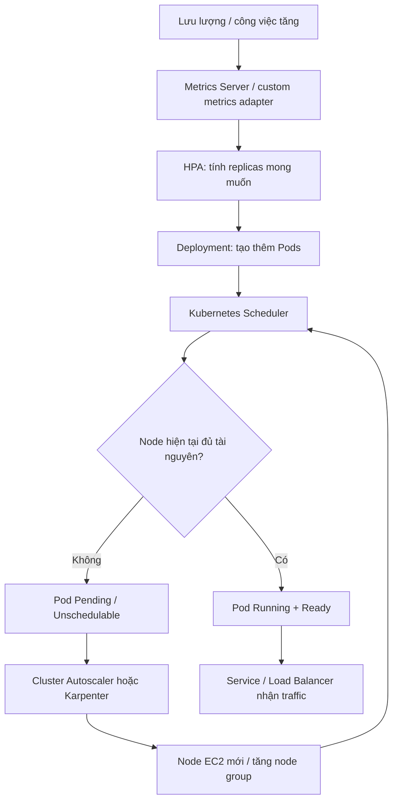
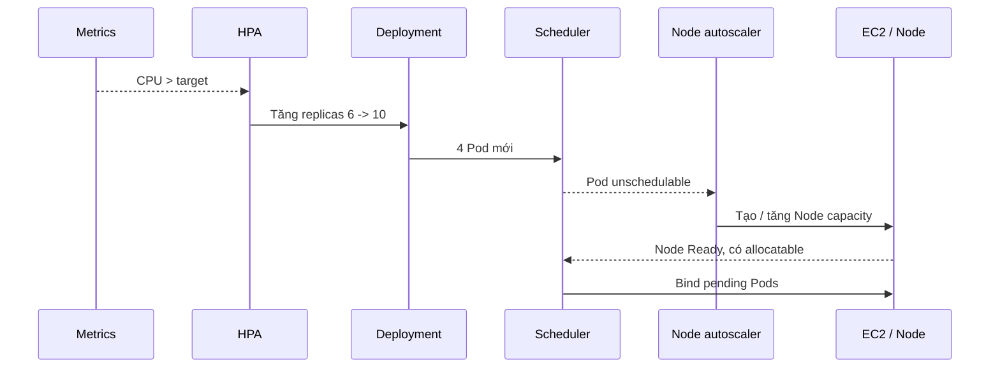
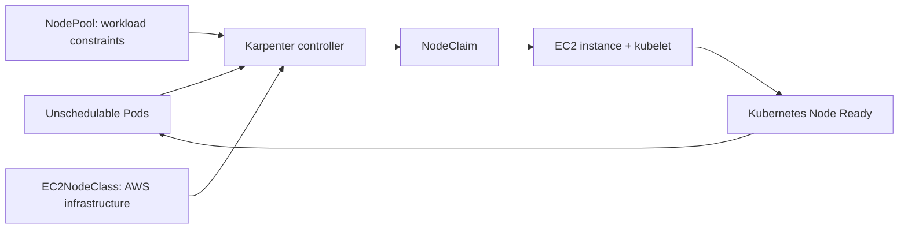

# Horizontal Pod Autoscaler, Cluster Autoscaler và Karpenter trên Amazon EKS

> **Chương:** Kubernetes với EKS  
> **Module:** `CLOUD_PROVIDERS_AWS`  
> **Phạm vi:** Thiết kế cơ chế mở rộng ứng dụng Kubernetes và năng lực EC2 trên Amazon EKS; kết hợp HPA, Cluster Autoscaler (CA), Karpenter và EKS Auto Mode để đáp ứng tải, phục hồi sự cố, quản lý tài nguyên và kiểm soát chi phí một cách an toàn.

## Mục tiêu học tập

Sau khi hoàn thành bài này, người học có thể:

1. Giải thích sự khác nhau giữa **mở rộng số Pod** và **mở rộng số Node**; phân biệt HPA, Cluster Autoscaler, Karpenter, EKS Auto Mode và EC2 Auto Scaling Group.
2. Cấu hình **Horizontal Pod Autoscaler** bằng `autoscaling/v2` dựa trên CPU hoặc metric khác, hiểu vai trò của `resources.requests` và Metrics Server.
3. Mô tả cách **Cluster Autoscaler** phát hiện Pod `Pending` không thể lên lịch, mô phỏng node group và thay đổi desired capacity của ASG/EKS Managed Node Group.
4. Mô tả cách **Karpenter** lựa chọn EC2 instance phù hợp trực tiếp từ nhu cầu của Pod, với các API `NodePool`, `EC2NodeClass` và `NodeClaim`.
5. Thiết kế điều kiện **scale-in/disruption** an toàn bằng PodDisruptionBudget, readiness probe, graceful termination, topology spread, consolidation, drift và thời hạn sống của Node.
6. Phân tích một luồng tăng tải từ Java service qua HPA đến yêu cầu cấp phát Node, sau đó giảm tải và thu hồi năng lực.
7. Chọn giữa Cluster Autoscaler, Karpenter tự quản lý và **EKS Auto Mode** dựa trên độ linh hoạt, chi phí, vận hành, bảo mật và khả năng khôi phục.
8. Sử dụng `kubectl` và AWS CLI để kiểm tra nguyên nhân Pod không được schedule, Node chưa xuất hiện, HPA không thay replica hoặc cluster không scale xuống.

## 1. Hai vòng điều khiển của autoscaling trong Kubernetes

Trong EKS, một ứng dụng chạy trên **Pod**; các Pod cần được Kubernetes Scheduler gán lên **Node** có đủ CPU, memory, mạng, volumes và điều kiện scheduling. Khi lượng request tăng, cần giải quyết hai bài toán khác nhau:

- **Tầng ứng dụng:** thêm Pod để xử lý thêm request.
- **Tầng hạ tầng:** thêm Node khi các Pod chưa có chỗ chạy.

Kubernetes không thể tạo thêm CPU vật lý trên một Node chỉ bằng việc tăng `replicas`. Ngược lại, tạo thêm EC2 instance không tự động làm Deployment tạo thêm Pod nếu không có tín hiệu scale ứng dụng.

### 1.1 Sơ đồ HPA phối hợp Node autoscaler



HPA **không gọi EC2 API để tăng Node**. Cluster Autoscaler/Karpenter **không tự tăng replicas của Deployment** vì CPU ứng dụng cao; chúng đáp ứng nhu cầu scheduling hoặc cơ chế capacity riêng.

### 1.2 So sánh nhanh

| Cơ chế | Đối tượng thay đổi | Tín hiệu chính | Phạm vi và giới hạn |
|---|---|---|---|
| **Horizontal Pod Autoscaler (HPA)** | Số replica của Deployment/StatefulSet hoặc resource có `scale` subresource | CPU, memory, custom/object/external metrics | Tăng Pod; vẫn cần Node đủ chỗ |
| **Cluster Autoscaler (CA)** | Desired capacity của EC2 Auto Scaling Groups / node groups | Pod unschedulable và đánh giá tài nguyên node group | Phụ thuộc node groups/min/max/instance template |
| **Karpenter (tự quản lý)** | EC2 Node thông qua `NodePool` / `EC2NodeClass` / `NodeClaim` | Nhu cầu Pod unschedulable, constraints và consolidation | Tự chọn EC2 offerings; cần cài/duy trì controller và quyền AWS |
| **EKS Auto Mode** | Managed compute/NodePool do AWS quản lý | Pod demand và policy NodePool | Dùng cơ chế dựa trên Karpenter, nhưng AWS vận hành nhiều thành phần |
| **EC2 Auto Scaling policy** | EC2 capacity trong ASG | AWS metrics/policies ở tầng EC2 | Không trực tiếp hiểu mọi Pod request/taint/PVC như scheduler |

**Lưu ý:** HPA và node autoscaler thường chạy **cùng nhau**. Cluster Autoscaler và Karpenter có thể cùng tồn tại trong một cluster cho **các tập Node khác nhau**, nhưng không được cùng điều khiển một tập hạ tầng trùng nhau. Với EKS Auto Mode, AWS quản lý autoscaling cho NodePools thuộc Auto Mode; không cài thêm Karpenter tự quản lý để “quản lý lại” những NodePools đó.

## 2. Những khái niệm Kubernetes quyết định việc scale

### 2.1 Pod requests, limits và allocatable

Kubernetes Scheduler dùng **`resources.requests`** của containers (cộng các thành phần overhead liên quan) để quyết định Pod có được đặt vào Node hay không. Scheduler **không đợi đến khi CPU thực tế đạt 100%** mới đánh giá capacity.

Ví dụ:

```yaml
resources:
  requests:
    cpu: "250m"
    memory: "512Mi"
  limits:
    cpu: "1000m"
    memory: "1024Mi"
```

Giải thích:

- `250m` CPU = 0,25 vCPU được Pod **yêu cầu cho scheduling**.
- `512Mi` memory = 512 mebibyte request.
- `limits.cpu` giới hạn CPU throttling khi áp dụng; `limits.memory` quá thấp có thể gây OOMKilled.
- Node có CPU/memory **allocatable** nhỏ hơn capacity danh nghĩa vì kubelet, OS, DaemonSets và reserved resources.

Nếu requests quá thấp so với sử dụng thật, Pod có thể bị tranh chấp tài nguyên, throttling/OOM. Nếu requests quá cao, Scheduler thấy Node hết chỗ sớm dù CPU thực tế còn rảnh, tạo thêm Node và tăng chi phí.

### 2.2 Scheduling constraints

Ngay cả khi tổng CPU cluster còn nhiều, một Pod có thể không schedule được vì:

- `nodeSelector` hoặc node affinity chỉ chấp nhận một tập Node cụ thể.
- `taints` yêu cầu Pod có `tolerations` tương ứng.
- `topologySpreadConstraints`/pod anti-affinity giới hạn vị trí.
- PersistentVolume đã gắn với một Availability Zone khác.
- GPU hoặc tài nguyên mở rộng khác chưa sẵn sàng.
- ENI/Pod IP, giới hạn số Pod trên Node hoặc giới hạn mạng đã chạm ngưỡng.
- Namespace `ResourceQuota`, admission policy hoặc PodSecurity policy từ chối Pod **trước khi** tới bước scheduling.

**Không phải mọi Pod ở trạng thái Pending đều tạo ra Node mới.** Node autoscaler chỉ giúp khi Pod thực sự unschedulable vì capacity/scheduling và có cấu hình Node hợp lệ để xử lý.

### 2.3 Pod `Running` khác `Ready`

Node được tạo, Pod có thể `Running` nhưng app Spring Boot chưa đạt readiness, database chưa truy cập được hoặc cache chưa ấm. Khi đó service/ALB chưa nên gửi traffic vào Pod.

Một hệ thống mở rộng hiệu quả cần đồng thời:

1. Pod được schedule.
2. Container khởi động.
3. Readiness probe pass.
4. Endpoint/target được đưa vào phục vụ.
5. Metrics phản ánh sức khỏe **nghiệp vụ**, không chỉ số container đang chạy.

## 3. Horizontal Pod Autoscaler (HPA) hoạt động ra sao?

**HPA** là một Kubernetes API resource, được bộ điều khiển HPA trong control plane sử dụng để điều chỉnh `spec.replicas` của workload có `scale` subresource, chẳng hạn `Deployment`.

HPA hoạt động theo vòng lặp, thường với chu kỳ mặc định khoảng **15 giây** (phụ thuộc tham số controller manager). Đây không phải cơ chế xử lý từng request theo thời gian thực.

### 3.1 Công thức scale cơ bản

Với một metric:

```text
desiredReplicas = ceil(
  currentReplicas * currentMetricValue / desiredMetricValue
)
```

Ví dụ:

- Đang có **4 Pod**.
- CPU trung bình bằng **80% của requested CPU**.
- HPA target CPU = **50% của requested CPU**.

Tính:

```text
ceil(4 * 80 / 50)
= ceil(6.4)
= 7 Pod
```

HPA có thể đề xuất tăng lên 7 Pod, nhưng kết quả còn phụ thuộc:

- `minReplicas` / `maxReplicas`.
- Tolerance mặc định của HPA, thường khoảng 10%.
- Metric missing, Pod chưa Ready và các quy tắc tính toán thận trọng.
- `behavior.scaleUp` và `behavior.scaleDown`.
- Các metric khác khi HPA được cấu hình nhiều metric.

**CPU utilization của HPA tính theo CPU request, không phải % CPU của Node.** Nếu Pod request 250m và đang dùng 200m thì tỷ lệ 80%. Không thể diễn giải 80% này thành “Node đang dùng 80% CPU”.

### 3.2 Metrics Server và các loại metric

Để dùng resource metrics CPU/memory, HPA thường dựa vào API `metrics.k8s.io` do **Kubernetes Metrics Server** cung cấp. Metrics Server phải tồn tại và hoạt động; EKS không đảm bảo mọi cluster đã có Metrics Server nếu người vận hành chưa cài add-on phù hợp.

Các nguồn metric:

| Loại | Ví dụ | Yêu cầu |
|---|---|---|
| **Resource** | CPU/memory của Pod | Metrics Server, container requests phù hợp |
| **Pods custom metric** | Requests/second trung bình theo Pod | Custom metrics adapter |
| **Object metric** | Một metric gắn Kubernetes object | Adapter cung cấp `custom.metrics.k8s.io` |
| **External metric** | SQS queue depth, Kafka lag, CloudWatch metric | External metrics adapter / hệ thống như KEDA theo kiến trúc |

HPA dùng **`autoscaling/v2`** để cấu hình đa metric và behavior. Với nhiều metric, HPA tính số replica đề xuất cho từng metric rồi chọn mức **lớn nhất**; nếu metric lỗi và chỉ các metric còn lại yêu cầu scale-down, HPA có thể giữ nguyên để tránh giảm sai.

**Không dùng metric CPU một cách máy móc** khi throughput bị giới hạn bởi I/O, thread pool, kết nối database, queue backlog hoặc API bên ngoài. Đối với worker đọc SQS, metric queue depth/oldest message age có thể phản ánh tải hơn CPU.

## 4. Ví dụ Deployment Java và HPA bằng `autoscaling/v2`

### 4.1 Deployment có resource requests và readiness

Ví dụ tối giản cho `orders-api` trong namespace `orders`:

```yaml
apiVersion: apps/v1
kind: Deployment
metadata:
  name: orders-api
  namespace: orders
spec:
  replicas: 3
  selector:
    matchLabels:
      app: orders-api
  template:
    metadata:
      labels:
        app: orders-api
    spec:
      terminationGracePeriodSeconds: 45
      topologySpreadConstraints:
        - maxSkew: 1
          topologyKey: topology.kubernetes.io/zone
          whenUnsatisfiable: ScheduleAnyway
          labelSelector:
            matchLabels:
              app: orders-api
      containers:
        - name: orders-api
          image: 111122223333.dkr.ecr.ap-southeast-1.amazonaws.com/orders-api:1.0.0
          ports:
            - containerPort: 8080
          resources:
            requests:
              cpu: "250m"
              memory: "512Mi"
            limits:
              cpu: "1000m"
              memory: "1024Mi"
          readinessProbe:
            httpGet:
              path: /actuator/health/readiness
              port: 8080
            initialDelaySeconds: 10
            periodSeconds: 5
          livenessProbe:
            httpGet:
              path: /actuator/health/liveness
              port: 8080
            initialDelaySeconds: 30
            periodSeconds: 10
```

Đây là manifest **học tập**, không đầy đủ service account/IAM, imagePullSecrets nếu khác ECR, Service/Ingress, securityContext hoặc policy của môi trường thực tế. Image URI là giả định.

**Lưu ý về `replicas`:** khi HPA quản lý Deployment, không liên tục áp lại giá trị `spec.replicas=3` từ GitOps hoặc lệnh deploy như một nguồn chân lý cạnh tranh. Nên cấu hình cách quản lý field này phù hợp để HPA không bị workflow triển khai ghi đè.

### 4.2 HPA target CPU 60% với scaling behavior

```yaml
apiVersion: autoscaling/v2
kind: HorizontalPodAutoscaler
metadata:
  name: orders-api-hpa
  namespace: orders
spec:
  scaleTargetRef:
    apiVersion: apps/v1
    kind: Deployment
    name: orders-api
  minReplicas: 3
  maxReplicas: 30
  metrics:
    - type: Resource
      resource:
        name: cpu
        target:
          type: Utilization
          averageUtilization: 60
  behavior:
    scaleUp:
      stabilizationWindowSeconds: 0
      selectPolicy: Max
      policies:
        - type: Pods
          value: 4
          periodSeconds: 60
        - type: Percent
          value: 100
          periodSeconds: 60
    scaleDown:
      stabilizationWindowSeconds: 300
      selectPolicy: Min
      policies:
        - type: Percent
          value: 25
          periodSeconds: 60
```

Ý nghĩa:

- Giữ từ **3 đến 30 replicas**.
- Mục tiêu CPU trung bình **60% so với CPU request**.
- Scale-up nhanh hơn khi tải tăng, nhưng giới hạn bước tăng theo `policies`.
- Scale-down thận trọng, giữ cửa sổ ổn định **300 giây** và giới hạn tốc độ giảm.
- HPA **không tự kiểm tra tính hợp lệ của khả năng phục vụ nghiệp vụ**. Readiness, graceful shutdown và chỉ số business vẫn rất quan trọng.

Khi có nhiều Pod vừa khởi động hoặc metric chưa sẵn sàng, HPA áp dụng quy tắc riêng cho missing metrics và initialization. Không mong đợi công thức đơn giản luôn cho đúng kết quả trong từng vòng lặp.

### 4.3 Các lệnh xác minh HPA

```bash
# Read-only: kiểm tra Metrics Server/resource metrics
kubectl top pods -n orders
kubectl get --raw /apis/metrics.k8s.io/v1beta1/pods

# Read-only: xem HPA và target Deployment
kubectl get hpa -n orders
kubectl describe hpa orders-api-hpa -n orders
kubectl get deployment orders-api -n orders
kubectl get pods -n orders -o wide
```

`kubectl top` có thể báo `Metrics API not available` nếu Metrics Server chưa cài hoặc có lỗi TLS/network/permissions. HPA `TARGETS: <unknown>` cho thấy metric cần kiểm tra, không phải bằng chứng HPA đã scaling đúng.

## 5. Vì sao HPA tăng replicas nhưng vẫn thấy Pod `Pending`?

Giả sử Node hiện tại đủ tài nguyên để chạy **6 Pod**. Khi tải tăng, HPA tăng desired replicas lên **10**.

- Deployment tạo 4 Pod mới.
- Scheduler không tìm thấy Node có đủ CPU/memory request hoặc scheduling constraints phù hợp.
- Pod mới ở trạng thái `Pending` với event như `0/3 nodes are available: Insufficient cpu`.
- Node autoscaler cần tạo thêm Node để chúng chạy.



HPA hoạt động bình thường nhưng ứng dụng vẫn có thể chậm mở rộng nếu:

- Tạo EC2 mới mất thời gian.
- EC2 capacity hoặc subnet IP hết.
- AMI/user data/CNI/DaemonSet kéo dài Node startup.
- Node phù hợp không thể tạo vì node group max size, NodePool requirement hoặc quota.
- Readiness của app mất nhiều thời gian sau khi Pod được schedule.

**Bài học:** Autoscaling phải đo **thời gian từ khi tải tăng đến khi Pod mới thật sự Ready và xử lý request**, không chỉ đo số replica HPA đã đề xuất.

## 6. Cluster Autoscaler (CA) trên Amazon EKS

**Cluster Autoscaler** là Kubernetes autoscaler chạy trong cluster. Khi phát hiện Pod không thể schedule trên Node hiện tại, CA đánh giá các **node groups** đã được cấu hình, mô phỏng liệu Node mới từ group có giúp Pod schedule được không, rồi yêu cầu tăng kích thước **EC2 Auto Scaling Group** tương ứng.

Trên EKS, các node group có thể là **EKS Managed Node Groups** hoặc self-managed EC2 node groups. EKS Managed Node Group đứng trên một hoặc nhiều EC2 ASG do dịch vụ quản lý.

### 6.1 Luồng scale-out qua CA

```text
Pod Pending / Unschedulable
      ↓
Cluster Autoscaler quét cluster state
      ↓
Mô phỏng scheduling trên Node template của từng group
      ↓
Chọn group thỏa yêu cầu và chưa chạm MaxSize
      ↓
Đổi desired capacity của underlying EC2 ASG
      ↓
EC2 mới boot, kubelet join EKS
      ↓
Scheduler gán Pod lên Node Ready
```

Khi tải giảm, CA có thể cân nhắc một Node là **unneeded** và thực hiện scale-down nếu Pod có thể chuyển an toàn sang Node khác hoặc phù hợp điều kiện. Việc thu hồi chịu tác động của PDB, DaemonSets, các Pod không thể di dời và cấu hình CA.

### 6.2 CA phụ thuộc node group đã định nghĩa

Giả sử nhóm vận hành tạo:

| Node group | Instance type(s) | AZ | Min/Max | Mục đích |
|---|---|---|---|---|
| `general-ondemand` | Các loại M/C phù hợp cùng khả năng scheduling | Hai hoặc ba AZ | 2/12 | API thông thường |
| `batch-spot` | Các loại có shape tương đối đồng nhất | Nhiều AZ | 0/20 | Batch/worker chịu gián đoạn |
| `gpu-on-demand` | GPU phù hợp | AZ có EC2 offering | 0/3 | Job tăng tốc chuyên dụng |

CA **không tự tạo một node group mới bất kỳ** chỉ vì xuất hiện Pod có yêu cầu khác. Một Pod yêu cầu `arm64` sẽ tiếp tục Pending nếu không có node group hỗ trợ `arm64` hoặc node group đó không đáp ứng các constraints.

Với **Mixed Instances Policy**, AWS khuyên các instance types trong một group nên có khả năng scheduling tương đồng (CPU/memory/GPU). CA có thể mô phỏng dựa trên instance type **đầu tiên** của policy; nếu các loại sau nhỏ hơn, Pod có thể không vừa; nếu lớn hơn, có thể lãng phí.

### 6.3 Cài đặt, quyền IAM và auto-discovery

Cluster Autoscaler thường chạy như **Deployment** trong cluster, dùng Kubernetes leader election. Có thể có nhiều replica để tăng HA nhưng **chỉ một leader thực hiện autoscaling tại một thời điểm**. Đây không phải dịch vụ EKS managed control plane tự động bật cho mọi cluster.

Các điểm vận hành:

- **Version của CA tương thích với Kubernetes cluster version**; AWS khuyến nghị khớp phiên bản tương ứng, không dựa vào tương thích chéo chưa được kiểm thử.
- IAM cho CA thường cấp qua **EKS Pod Identity** hoặc **IAM Roles for Service Accounts (IRSA)** theo mô hình được hỗ trợ.
- Auto-discovery dùng tags trên ASG, ví dụ `k8s.io/cluster-autoscaler/enabled` và `k8s.io/cluster-autoscaler/<cluster-name>`.
- Quyền IAM nên giới hạn `autoscaling:SetDesiredCapacity` và `autoscaling:TerminateInstanceInAutoScalingGroup` **chỉ** tới ASG của cluster, không mở mọi ASG trong Account.
- CA cần quyền đọc các API mô tả ASG/EC2/EKS phù hợp và Kubernetes RBAC cho Node/Pod/events.
- CA quét nhiều node groups làm tăng chi phí CPU/memory controller và API calls, cần đo khi cluster lớn.

### 6.4 Scale từ 0 và simulation

CA có thể scale một node group từ `0`, nhưng phải biết scheduling properties của Node tương lai. Những labels/taints, GPU/extended resources, node selector hoặc topology constraints không được thể hiện đúng qua node group template có thể khiến CA **không chọn đúng group**.

Có thể khai báo template metadata qua ASG tags dạng:

```text
k8s.io/cluster-autoscaler/node-template/label/<label-key>
k8s.io/cluster-autoscaler/node-template/taint/<taint-key>
k8s.io/cluster-autoscaler/node-template/resources/<resource-name>
```

Đây là các mẫu key để cấu hình ASG tags, không phải các lệnh shell. Taints/tolerations và IAM không nên được mở rộng chỉ để “ép” mọi Pod có thể schedule.

### 6.5 CA có giúp giảm chi phí không?

CA có thể giảm số Node không cần thiết, nhưng:

- Node vẫn chạy theo lựa chọn instance type/group, có thể còn CPU chưa sử dụng.
- CA không tái đóng gói toàn bộ Pod tối ưu ngay lập tức trong mọi trường hợp.
- Node group MinSize giới hạn mức thấp nhất.
- PDB, local storage và các ràng buộc eviction có thể chặn scale-down.
- EC2 node group với nhiều AZ có thể không thỏa constraints của PVC EBS khi volume cố định AZ.
- Nhiều node groups nhỏ làm tăng chi phí vận hành và tính toán mô phỏng.

Nên đo **Node allocatable vs requests, cost per business request, time-to-ready và số Pod pending**, không chỉ số Node giảm.

## 7. Karpenter: cấp phát EC2 theo nhu cầu Pod

**Karpenter** là một Kubernetes node lifecycle/provisioning controller. Thay vì chỉ chọn trong các node groups cố định, Karpenter xét tổng hợp các Pod chưa schedule và **chọn EC2 instance type/capacity/AZ** phù hợp với yêu cầu được định nghĩa.

Với EKS ở mô hình **self-managed Karpenter**, nó có thể sử dụng EC2 Fleet API và các API EC2 cần thiết để tạo/thu hồi Node. Những điểm mạnh thường gặp:

- Chọn từ nhiều EC2 instance types để cải thiện bin packing/cost.
- Tận dụng kết hợp **On-Demand/Spot** và nhiều AZ khi workload cho phép.
- Mở rộng năng lực cho CPU/memory/GPU/arm64 theo yêu cầu Pod.
- Giảm phụ thuộc vào việc tạo rất nhiều ASG/MNG riêng.
- **Consolidation** để thu hồi Node rỗng hoặc thiếu sử dụng, khi disruption rules cho phép.
- **Drift** khi Node configuration không còn phù hợp với NodePool/EC2NodeClass.

**Karpenter không tự điều chỉnh số replica của Deployment**: vẫn kết hợp HPA/KEDA hoặc cơ chế workload scale riêng.

### 7.1 Ba tài nguyên quan trọng

| Resource | API group/kind (self-managed Karpenter v1) | Chức năng |
|---|---|---|
| **NodePool** | `karpenter.sh/v1`, `NodePool` | Định nghĩa constraints, capacity types, labels/taints, resource limits và disruption |
| **EC2NodeClass** | `karpenter.k8s.aws/v1`, `EC2NodeClass` | Định nghĩa hạ tầng AWS: AMI, IAM node role, subnet, security group, disks, tags |
| **NodeClaim** | `karpenter.sh/v1`, `NodeClaim` | Đại diện yêu cầu Node cụ thể được tạo từ NodePool và NodeClass; gắn với vòng đời Node/EC2 |

Hình dung:



**NodeClaim không phải một Pod và không phải EC2 ASG.** Với self-managed Karpenter, thông thường không cần EC2 ASG cho từng NodePool mà Karpenter tạo.

### 7.2 NodePool ví dụ cho ứng dụng Java

Ví dụ sau sử dụng tài nguyên **self-managed Karpenter v1** (không phải EKS Auto Mode), ưu tiên khả năng đa dạng EC2 On-Demand/Spot, chỉ chạy trên `amd64` và các instance families thông dụng:

```yaml
apiVersion: karpenter.sh/v1
kind: NodePool
metadata:
  name: orders-general
spec:
  template:
    metadata:
      labels:
        workload: orders
    spec:
      nodeClassRef:
        group: karpenter.k8s.aws
        kind: EC2NodeClass
        name: orders-ec2
      requirements:
        - key: kubernetes.io/arch
          operator: In
          values: ["amd64"]
        - key: karpenter.k8s.aws/instance-category
          operator: In
          values: ["c", "m", "r"]
        - key: karpenter.sh/capacity-type
          operator: In
          values: ["on-demand", "spot"]
      expireAfter: 720h
      terminationGracePeriod: 1h
  limits:
    cpu: "1000"
  disruption:
    consolidationPolicy: WhenEmptyOrUnderutilized
    consolidateAfter: 5m
    budgets:
      - nodes: "10%"
```

Giải thích:

- `nodeClassRef` trỏ đúng **EC2NodeClass**.
- `requirements` giới hạn architecture, instance category và capacity type; Karpenter có thể chọn nhiều instance types phù hợp.
- `limits.cpu` giới hạn năng lực CPU do NodePool cấp, **không** phải HPA max replicas. Khi chạm limit, NodePool có thể không cấp thêm Node.
- `expireAfter` đặt thời hạn sống NodeClaim theo API này, mặc định tài liệu Karpenter self-managed thường mô tả là **720 giờ**; Node có thể bị thay sớm hơn do consolidation/drift.
- `disruption` kiểm soát các hành động tự nguyện. `budgets` không chặn mọi trường hợp gián đoạn bắt buộc như expiration hoặc Spot interruption.

**Không dùng thẳng manifest trên production:** chọn limits theo quota/budget, xác nhận Region/instance offerings, IAM node role, Pod requests, giá, yêu cầu Spot tolerance và khả năng tăng/giảm Pod an toàn.

### 7.3 EC2NodeClass ví dụ

```yaml
apiVersion: karpenter.k8s.aws/v1
kind: EC2NodeClass
metadata:
  name: orders-ec2
spec:
  role: "KarpenterNodeRole-orders-eks"
  amiSelectorTerms:
    - alias: al2023@latest
  subnetSelectorTerms:
    - tags:
        karpenter.sh/discovery: "orders-eks"
  securityGroupSelectorTerms:
    - tags:
        karpenter.sh/discovery: "orders-eks"
  tags:
    Environment: "staging"
    Application: "orders"
```

Đây là ví dụ về **shape** của resource. Trước khi áp dụng cần:

1. Tạo EKS cluster và **node IAM role** hợp lệ.
2. Tag chính xác subnet/security groups được phép dùng trong đúng VPC/cluster.
3. Cài Karpenter controller và cấp IAM permissions qua IRSA/Pod Identity theo phiên bản/tài liệu tương ứng.
4. Xác định **AMI alias** tương thích Kubernetes/OS. `al2023@latest` rất tiện cho thử nghiệm, nhưng production nên cân nhắc **pin một AMI release** phù hợp và kiểm soát drift/rollout.
5. Đảm bảo networking/VPC CNI/Pod IP, NAT hoặc endpoints đến ECR, STS, EC2, SQS và những API cần thiết.
6. Xem xét yêu cầu disruption, PDB và mức sẵn sàng nhiều AZ.

Khi sử dụng Spot, hãy để Karpenter có **đủ nhiều instance types và AZ** để tăng cơ hội cấp phát. Nếu giới hạn quá chặt instance type/AZ/capacity type, Pod sẽ tiếp tục Pending dù Account còn quota EC2 ở các loại máy khác.

### 7.4 Disruption, consolidation và drift

| Thuật ngữ | Ý nghĩa | Rủi ro phải kiểm soát |
|---|---|---|
| **Consolidation** | Thu hồi/ghép lại Node rỗng hoặc underutilized khi Pod có thể được đặt hiệu quả hơn | Ảnh hưởng connection, cache, batch job, local state |
| **Drift** | NodeClaim không còn khớp cấu hình NodePool/EC2NodeClass như AMI hoặc fields đã cập nhật | Thay Node cần drain Pod và rolling rollout |
| **Expiration** | Thu hồi Node khi vượt tuổi cấu hình của NodeClaim | Có thể diễn ra ngay khi tới hạn, không bị NodePool disruption budget ngăn |
| **NodePool disruption budgets** | Giới hạn số Node bị disruption tự nguyện đồng thời | Không ngăn Spot interruption hoặc expiration bắt buộc |
| **PodDisruptionBudget (PDB)** | Hạn chế voluntary evictions để giữ số Pod healthy | Không ngăn mọi failure/forced termination, không thay readiness |
| **Termination grace period** | Cho Pod thời gian kết thúc request/commit trước khi kill | Quá ngắn làm mất dữ liệu hoặc request; quá dài cản trở scale-down |

Tự bật `WhenEmptyOrUnderutilized` với `consolidateAfter` quá ngắn có thể gây **node churn** khi traffic lên xuống thường xuyên. Cần kết hợp HPA scaleDown stabilization, các NodePool budgets và quan sát thời gian app start.

## 8. Karpenter và Cluster Autoscaler: chọn cái nào?

### 8.1 Khác nhau về mô hình cấp phát

| Tiêu chí | Cluster Autoscaler | Self-managed Karpenter |
|---|---|---|
| Đối tượng điều khiển | ASG/EKS node groups đã tạo | Node trực tiếp qua NodePool/NodeClass/NodeClaim |
| Node shape | Xác định trước trong group/template | Linh hoạt chọn instance type/capacity khi provision |
| Phản ứng với Pod Pending | Mô phỏng node groups, tăng desired capacity | Tổng hợp nhu cầu Pod, chọn EC2 offerings phù hợp |
| Scale từ 0 | Có, phụ thuộc group/template/labels | Có thể tạo capacity động từ NodePool đủ điều kiện |
| Bin packing | Theo khả năng/constraints node group | Linh hoạt chọn Node kích thước phù hợp |
| Giảm Node | Scale-down theo simulation/eviction | Consolidation/drift/expiration với disruption controls |
| IAM | Quyền Auto Scaling + EC2/EKS describe | Quyền EC2/EC2 Fleet, IAM/SQS/EKS/API theo triển khai |
| Vận hành | Cài CA controller, giữ version khớp cluster và quản lý node groups | Cài controller, cập nhật CRDs, điều phối node lifecycle |
| Thích hợp | Fleet ổn định, node groups rõ ràng | Workload biến động, instance diversity, Spot/cost optimization |
| Chi phí | EC2, EKS và các dịch vụ liên quan | EC2, EKS, controller và dịch vụ liên quan; không coi việc dùng Karpenter là miễn phí hạ tầng |

**Không có lựa chọn duy nhất luôn rẻ hơn.** Karpenter có thể giảm lãng phí EC2 nhờ bin packing và chọn nhiều loại máy, nhưng cấu hình consolidation/Spot/PDB sai có thể làm tăng gián đoạn, thời gian khởi động và chi phí vận hành.

### 8.2 Có thể dùng đồng thời CA và Karpenter không?

Có thể dùng CA cho **một tập managed node groups** và Karpenter cho **tập Node do Karpenter sở hữu**, với phân tách rõ ràng workload và ownership. Thực tế có thể duy trì node group nhỏ, ổn định cho system/controller và Karpenter cấp phát Node cho ứng dụng.

Nhưng:

- Không để cả hai controller cố gắng thay cùng nhóm Node.
- Phân biệt labels, taints, affinity và capacity pools.
- Kiểm tra chi phí bị scale-out trùng, Pod scheduling và controller startup.
- Karpenter controller cần **một nền tảng chạy đáng tin cậy** khi cluster chưa có Node động; có thể dùng managed node group nhỏ hoặc Fargate profile hỗ trợ tùy mô hình.

## 9. EKS Auto Mode: Karpenter-based nhưng do AWS quản lý

**EKS Auto Mode** là lựa chọn compute mà AWS quản lý nhiều thành phần liên quan Node: provisioning, OS/AMI, patching, CNI/storage integration và xử lý một số event gián đoạn. Nó sử dụng mô hình dựa trên Karpenter nhưng **không giống** tự cài Karpenter vào EKS cluster.

### 9.1 Khác biệt API cần nhớ

| Hạng mục | Self-managed Karpenter | EKS Auto Mode |
|---|---|---|
| NodePool | `karpenter.sh/v1` | `karpenter.sh/v1` với tập tính năng được Auto Mode hỗ trợ |
| NodeClass | `EC2NodeClass`, `karpenter.k8s.aws/v1` | `NodeClass`, `eks.amazonaws.com/v1` |
| Node OS | AL2023, Bottlerocket hoặc các AMI được phép tùy thiết kế | AWS-managed Bottlerocket theo giới hạn Auto Mode |
| Controller | Bạn cài, vận hành và nâng cấp | AWS vận hành |
| Node lifecycle | Bạn cấu hình NodePool/NodeClass và cập nhật controller/infra | AWS quản lý provisioning/patching theo chính sách |
| Các thành phần mạng/storage | Cần triển khai/quản lý phù hợp | Nhiều thành phần được Auto Mode tích hợp |
| Tùy biến host | Linh hoạt hơn | Bị giới hạn để duy trì mô hình managed |
| Chi phí | EC2/EKS và hạ tầng tích hợp | EC2/EKS cộng **phí quản lý Auto Mode** theo biểu giá và các dịch vụ liên quan |

**Không áp dụng trực tiếp `EC2NodeClass` self-managed ở mục 7 vào EKS Auto Mode.** Cũng không được coi EKS Auto Mode là “Cluster Autoscaler được AWS cài hộ”; mô hình provisioning khác.

### 9.2 Built-in NodePools và custom NodePool

EKS Auto Mode cung cấp các built-in NodePools thường có tên:

- `system`: dành cho workload hệ thống phù hợp, với taint bảo vệ critical add-ons.
- `general-purpose`: hướng đến workload phổ thông.

Bạn có thể enable/disable chúng theo tài liệu AWS. Không sửa trực tiếp các built-in NodePools như custom NodePool. Khi cần workload riêng (Spot, GPU, phân tách team/cost), tạo **custom NodePool** và NodeClass với những labels/tính năng được Auto Mode hỗ trợ.

Nếu cluster không bật built-in NodePools, cần chú ý việc tạo NodeClass/access entries và quyền theo quy trình AWS; đừng mặc định default NodeClass luôn tồn tại.

### 9.3 Khi nào chọn Auto Mode?

Phù hợp khi đội ngũ muốn giảm gánh nặng tự vận hành controller/node image/CNI/storage, chấp nhận mô hình managed và các hạn chế tùy biến.

Cân nhắc self-managed Karpenter khi cần kiểm soát sâu hơn AMI/OS, Node lifecycle, network/storage hoặc tính năng controller mà Auto Mode chưa hỗ trợ. Cân nhắc CA khi đang dùng EKS Managed Node Groups có shape ổn định và muốn thay đổi ít trong vận hành hiện tại.

## 10. Scale-in: khó hơn scale-out

Tăng 5 Pod thường đơn giản hơn **giảm 5 Pod** mà không làm lỗi nghiệp vụ. Trong hệ thống Java, Pod bị terminate có thể đang:

- Xử lý HTTP request dài.
- Đang commit transaction.
- Đang consume message từ SQS/Kafka.
- Giữ WebSocket/session.
- Đang upload file hoặc ghi state vào volume.

### 10.1 PodDisruptionBudget (PDB)

Ví dụ một ứng dụng luôn muốn giữ ít nhất **2 Pod healthy** trong voluntary disruptions:

```yaml
apiVersion: policy/v1
kind: PodDisruptionBudget
metadata:
  name: orders-api-pdb
  namespace: orders
spec:
  minAvailable: 2
  selector:
    matchLabels:
      app: orders-api
```

PDB **không bảo đảm** số Pod Running sẽ không bao giờ giảm dưới 2 nếu Node crash, AZ failure hoặc Spot bị thu hồi. Nó kiểm soát eviction theo API và voluntary disruptions có tôn trọng PDB.

Nếu HPA đặt `minReplicas: 2` và PDB `minAvailable: 2`, có thể gây khó khăn cho việc drain Node khi cả hai Pod phải được di dời. Nên chọn replica baseline, topology và PDB sau khi kiểm thử khả năng rollout/drain thực tế.

### 10.2 Readiness, graceful termination và `preStop`

Quy trình shutdown tốt cho Spring Boot:

1. Kubelet nhận yêu cầu dừng Pod.
2. Pod bị đưa vào trạng thái terminating; endpoint/target được loại khỏi traffic qua cơ chế liên quan.
3. Ứng dụng ngừng nhận request mới và xử lý request đang chạy theo grace period.
4. Message consumer commit/nack an toàn, đóng connection và flush telemetry.
5. Container kết thúc trước `terminationGracePeriodSeconds`; nếu vượt quá, kubelet có thể gửi SIGKILL.

Ứng dụng nên hỗ trợ **graceful shutdown** và readiness phù hợp. Nếu dùng AWS Load Balancer Controller/ALB, cân nhắc target deregistration delay và sự đồng bộ endpoint/target, nhất là với request dài.

Không dùng `preStop: sleep 60` để “chữa” mọi lỗi. Nó tốn thời gian drain và có thể khiến consolidation/upgrade kéo dài, thậm chí khi Node bị force termination.

### 10.3 Topology spread và nhiều AZ

Một Deployment có 3 replicas nhưng cả 3 nằm trong một AZ vẫn có rủi ro khi AZ đó gặp lỗi. Có thể dùng:

- `topologySpreadConstraints` theo `topology.kubernetes.io/zone`.
- Pod anti-affinity cho những workload quan trọng.
- NodePool/NodeGroup có khả năng provision nhiều AZ.
- PodDisruptionBudget, readiness và load balancer health.
- Dữ liệu bền trên RDS/S3/DynamoDB/EFS/EBS CSI với đặc tính AZ phù hợp.

Với PVC dùng **EBS**, volume nằm trong một AZ; lập lịch Pod tại AZ khác không thể dùng trực tiếp EBS volume ở AZ cũ. Thường dùng StorageClass với `volumeBindingMode: WaitForFirstConsumer` để phối hợp provisioning/scheduling và node autoscaler. Không tự mở rộng capacity ở AZ khác rồi mong PVC bị gắn chéo AZ.

## 11. Spot, On-Demand và cách tránh gián đoạn bất ngờ

Karpenter thường dùng đa dạng instance types và capacity types để tối ưu chi phí:

- **On-Demand:** năng lực ổn định hơn theo mô hình mua, vẫn có thể xảy ra sự cố EC2/Node.
- **Spot:** thường rẻ hơn, nhưng có thể bị **interruption** khi EC2 cần lấy lại capacity; ứng dụng phải chịu được thu hồi.
- **Capacity reservations** và các lựa chọn khác: phù hợp những trường hợp yêu cầu capacity đặc thù theo AWS/EKS hỗ trợ.

### 11.1 Kỹ thuật chọn Spot an toàn

1. Cho phép nhiều instance categories/sizes/AZ, tránh chỉ chọn một EC2 type rẻ nhất.
2. Phân loại workload: stateless API có nhiều replicas và worker idempotent thường thích ứng tốt hơn database stateful không có cơ chế phục hồi.
3. Tách workload quan trọng bằng NodePool labels/taints/affinity hoặc cấu hình ưu tiên phù hợp.
4. Đặt PDB và graceful termination; hiểu rằng **Spot termination** có thể bỏ qua giới hạn voluntary disruption.
5. Quản lý SQS/Kafka message visibility/acknowledgement, không mất dữ liệu khi Pod bị kill.
6. Đánh giá có cần On-Demand baseline để ứng dụng giữ mức tối thiểu khi Spot capacity khan hiếm.
7. Theo dõi EC2 Spot interruption events, Node readiness, pending Pod và API latency.

### 11.2 Tại sao cần cân nhắc tỷ lệ Spot?

Nếu toàn bộ workload đều yêu cầu `karpenter.sh/capacity-type=spot` nhưng vùng AZ/instance đó hết Spot capacity, **Karpenter không thể tự chọn On-Demand** khi policy cấm. Pod sẽ Pending dù On-Demand còn khả dụng.

Dùng NodePool/requirements hỗ trợ cả hai hoặc các node pools ưu tiên theo kiến trúc khi cần phương án fallback. Đồng thời phải cân bằng giữa chi phí, yêu cầu phân vùng workload và hạn chế loại instance.

## 12. IAM, mạng và chi phí trên Amazon EKS

### 12.1 IAM của node autoscaler

**HPA** hoạt động qua Kubernetes API và metrics, thường không cần trực tiếp gọi EC2 API để tạo Node.

**Cluster Autoscaler** và **self-managed Karpenter** phải có **AWS IAM permissions** để thay đổi compute; tốt nhất cấp theo **EKS Pod Identity** hoặc **IRSA** với trust phù hợp và giới hạn resource/actions. Controller cũng cần Kubernetes RBAC đúng.

Ví dụ ranh giới:

| Thành phần | Quyền cần cân nhắc | Không nên làm |
|---|---|---|
| HPA | Kubernetes RBAC/controller access tới scale/metrics APIs | Cấp IAM admin cho ứng dụng chỉ để tăng Pod |
| Cluster Autoscaler | Describe node groups, SetDesiredCapacity/TerminateInstance theo ASG được phép | Cho quyền thay mọi ASG trong Account không ràng buộc |
| Karpenter controller | EC2 Fleet/RunInstances, Describe, IAM node role, event/SQS… theo bộ policy phiên bản tương ứng | Cấp `ec2:*` / `iam:*` không giới hạn |
| Karpenter-launched node | Node IAM role để join EKS, pull images và những quyền nút cần | Dùng node role thay cho Pod Identity/IRSA của ứng dụng |
| Java application Pod | S3, SQS, DynamoDB… qua Pod Identity/IRSA theo workload | Lưu long-lived access keys trong image/manifest |

EKS **control plane** có trách nhiệm riêng; không nhầm IAM role của cluster, node, controller và application ServiceAccount.

### 12.2 Mạng VPC và Pod IP

Node mới chỉ hữu ích nếu networking hoạt động:

- Có private/public subnet phù hợp và route tới EKS endpoint, ECR, S3, EC2/STS/SSM hoặc VPC endpoints/NAT theo thiết kế.
- Security groups/NACL không chặn control plane, DNS và application flows.
- **Amazon VPC CNI** có cấu hình IP allocation phù hợp; thiếu private IP trong subnet có thể làm Pod `ContainerCreating` hoặc CNI error.
- NodeSecurityGroup/PodSecurityGroup tương thích với phương án networking; không mở mọi port cho Internet chỉ để autoscaling hoạt động.
- Các controller cần DNS/identity/network ổn định; Karpenter phải **khởi động được ngay cả khi đang thiếu Node ứng dụng**.

### 12.3 Các nhóm chi phí

| Chi phí | Tác nhân |
|---|---|
| EKS cluster control plane | EKS pricing theo phiên bản/hỗ trợ |
| EC2 instances | Node do CA/Karpenter/Auto Mode cấp phát |
| EKS Auto Mode fee | Mô hình managed compute bổ sung, theo biểu giá hiện hành |
| EBS / EFS / dữ liệu | PV, root EBS, storage của ứng dụng |
| IPv4 public / NAT / VPC endpoints | Networking và đường gọi AWS services |
| CloudWatch logs/metrics | Observability autoscalers và workload |
| Image pull/data transfer | ECR, S3, cross-AZ/cross-Region traffic |
| Spot interruption/restart overhead | Khởi động lại app, cache và thời gian không sẵn sàng |

**Autoscaling tiết kiệm tiền khi nó thu hồi được capacity thực sự không cần thiết**, không phải chỉ vì HPA giảm replica. Nếu Node autoscaler không được cấu hình hoặc PDB chặn drain, số EC2 vẫn có thể giữ nguyên sau khi Pod giảm.

## 13. Quan sát đúng các tầng bằng `kubectl`

Trước khi điều tra, xác định đã chọn đúng **AWS Account, EKS cluster, namespace và kubeconfig context**. Những lệnh dưới đây là read-only.

### 13.1 Kiểm tra context và workload

```bash
kubectl config current-context
kubectl get nodes -o wide
kubectl get deployments,hpa -n orders
kubectl get pods -n orders -o wide
kubectl get events -n orders --sort-by=.metadata.creationTimestamp
```

Nếu có Pod Pending, kiểm tra scheduling events:

```bash
kubectl describe pod <POD_NAME> -n orders
```

Thông báo như `Insufficient cpu`/`Insufficient memory` gợi ý thiếu allocatable; thông báo `node(s) didn't match Pod's node affinity` hoặc `untolerated taint` gợi ý vấn đề ràng buộc.

### 13.2 Xem resource requests/usage

```bash
kubectl top nodes
kubectl top pods -n orders
kubectl describe nodes
kubectl describe hpa orders-api-hpa -n orders
```

**Chú ý:** `kubectl top nodes` biểu diễn usage thực tế theo resource metrics; Scheduler và CA/Karpenter chủ yếu dựa trên **requests/constraints** để quyết định khả năng schedule. CPU usage thấp vẫn có thể không còn tài nguyên “trống” cho Pod mới do requests đã cấp hết.

### 13.3 Lệnh đọc cho Cluster Autoscaler

Nếu CA được cài ở `kube-system` và Deployment có tên `cluster-autoscaler`:

```bash
kubectl -n kube-system get deploy cluster-autoscaler
kubectl -n kube-system logs deploy/cluster-autoscaler --tail=150

aws autoscaling describe-auto-scaling-groups \
  --region ap-southeast-1 \
  --query 'AutoScalingGroups[].{Name:AutoScalingGroupName,Min:MinSize,Max:MaxSize,Desired:DesiredCapacity}' \
  --output table
```

Không mặc định CA được cài đúng tên/namespace này; đối chiếu chart/manifest trong cluster thật. Nếu CA không tăng desired capacity, kiểm tra tag auto-discovery, quyền IAM, group max size và scheduling simulation.

### 13.4 Lệnh đọc cho self-managed Karpenter

```bash
kubectl get nodepools
kubectl get ec2nodeclasses
kubectl get nodeclaims
kubectl describe nodepool orders-general
kubectl get nodeclaims -o wide

# Tùy namespace và deployment thực tế
kubectl -n kube-system logs deploy/karpenter --tail=150
```

Không suy rằng `nodeclaims`/`ec2nodeclasses` luôn tồn tại trong cluster EKS **Auto Mode** theo cùng CRD và quyền truy cập như self-managed Karpenter; phải dùng API resources được Auto Mode hỗ trợ. Nếu Pod Pending nhưng không có NodeClaim, kiểm tra NodePool/NodeClass readiness, selectors/taints, IAM/quota, EC2 offerings và subnet discovery.

### 13.5 Kiểm tra EKS cluster và managed node groups

```bash
aws eks describe-cluster \
  --name orders-eks \
  --region ap-southeast-1 \
  --query 'cluster.{Name:name,Version:version,Status:status,Endpoint:endpoint}' \
  --output json

aws eks list-nodegroups \
  --cluster-name orders-eks \
  --region ap-southeast-1

# Thay NODEGROUP_NAME bằng tên thật
aws eks describe-nodegroup \
  --cluster-name orders-eks \
  --nodegroup-name NODEGROUP_NAME \
  --region ap-southeast-1 \
  --query 'nodegroup.{Status:status,Scaling:scalingConfig,Instances:resources.autoScalingGroups}' \
  --output json
```

Các lệnh chỉ đọc metadata. Địa chỉ endpoint cluster có thể là thông tin vận hành nội bộ; hạn chế chia sẻ output bên ngoài team.

## 14. Quy trình triển khai HPA + CA trên EKS Managed Node Groups

### Bước 1 — Chuẩn bị nền tảng

- EKS cluster đang chạy phiên bản Kubernetes được AWS hỗ trợ.
- EKS Managed Node Groups ở nhiều AZ, có min/max/desired capacity và Node labels/taints phù hợp.
- Metrics Server hoạt động và `kubectl top` trả dữ liệu.
- App Deployment có CPU/memory requests, readiness/liveness probes và ít nhất vài replicas.

### Bước 2 — Cài Cluster Autoscaler theo phiên bản cluster

- Chọn CA image/chart version tương thích với EKS Kubernetes version.
- Tạo ServiceAccount và IAM Pod Identity/IRSA với quyền Auto Scaling giới hạn đúng node groups.
- Cấu hình auto-discovery tags cho ASGs cần quản lý.
- Kiểm tra CA có thể đọc API cluster và node groups, log không có AccessDenied/throttling.

### Bước 3 — Áp dụng HPA

Dùng HPA `autoscaling/v2`; chọn target từ phép đo ứng dụng, đặt min/max replicas và scaleDown stabilization để tránh dao động.

### Bước 4 — Thử scale-out

Tạo tải thử tại staging để HPA tăng replicas đến mức cần thêm Node; quan sát:

```text
HPA desiredReplicas ↑
     → New Pods Pending
     → CA computes scale-up
     → ASG DesiredCapacity ↑
     → EC2 Node joins EKS
     → Pods Running & Ready
```

### Bước 5 — Thử scale-in và kiểm soát disruption

Giảm tải, xác nhận HPA scale xuống rồi CA đánh giá node unneeded. Kiểm tra PDB, non-evictable Pods, Pod termination và thời gian Node thực sự được thu hồi.

**Không ép ASG DesiredCapacity thủ công** khi CA đang điều khiển autoscaling mà chưa có kế hoạch, vì bạn có thể tạo hai nguồn điều khiển capacity cạnh tranh.

## 15. Quy trình triển khai HPA + Karpenter tự quản lý

### Bước 1 — Chuẩn bị quyền và hạ tầng

- EKS cluster, IAM OIDC hoặc Pod Identity association theo phương án cài Karpenter.
- Node IAM role, instance profile/permissions tương ứng và controller role.
- Private subnets, security groups, tags discovery, route/VPC endpoints phù hợp.
- Cơ chế xử lý Spot events qua SQS/EventBridge khi cấu hình hỗ trợ.
- Nơi chạy controller đủ ổn định khi capacity ứng dụng bị thu hồi.

### Bước 2 — Cài controller và CRDs tương thích

Dùng hướng dẫn cài đặt Karpenter **đúng phiên bản** với EKS Kubernetes version/CRDs. Không sao chép manifest của Karpenter `Provisioner`/`AWSNodeTemplate` đời cũ cho Karpenter v1; chúng đã được thay bằng mô hình `NodePool`/`EC2NodeClass`.

### Bước 3 — Tạo EC2NodeClass và NodePool

Áp dụng cấu hình đã review như mục 7.2–7.3. NodePool phải ở trạng thái Ready trước khi mong Karpenter tạo Node.

### Bước 4 — Cho HPA tăng Pod và quan sát NodeClaim

Đặt Pod requests hợp lý; tăng traffic. Khi không đủ Node, Karpenter tạo NodeClaim/EC2 phù hợp. Đo `Pending → Running → Ready`, không chỉ quan sát EC2 xuất hiện.

### Bước 5 — Giảm tải và kiểm soát consolidation

Giảm replicas, xác nhận Karpenter consolidation khi Node rỗng/underutilized, đánh giá disruption budgets và PDB. Không cho phép churn vượt mức ứng dụng chịu được.

### Bước 6 — Kiểm thử Spot interruption và AZ failure

Thử mô phỏng sự cố trong staging hoặc chạy fault injection có kiểm soát, theo dõi workload có di chuyển sang Node/AZ còn lại, restore state/queue được hay không và đạt RTO mong muốn.

## 16. Tình huống thực tế: Spring Boot xử lý đơn hàng

Giả sử một hệ thống gồm:

- `orders-api`: API Java/Spring Boot qua ALB, các Pod stateless.
- `orders-worker`: consumer đọc SQS, xử lý message idempotent.
- PostgreSQL/RDS và S3 dùng cho dữ liệu bền.
- EKS ở hai hoặc ba AZ, có monitoring và deployment pipeline.

### 16.1 Chọn HPA metric theo workload

| Workload | Metric mở rộng Pod phù hợp | Vì sao |
|---|---|---|
| `orders-api` | CPU hoặc request rate/latency có kiểm soát | Tăng khả năng xử lý HTTP khi tải lên |
| `orders-worker` | SQS queue length, age hoặc backlog per replica | CPU có thể thấp trong lúc hàng đợi tăng |
| Batch job theo lịch | KEDA/Job scaling hoặc cơ chế batch phù hợp | Không nhất thiết dùng HPA cho mọi Job |
| CSDL PostgreSQL | Dùng cơ chế scaling của database / managed service | HPA của app không thay khả năng DB |

### 16.2 Cấu hình hạ tầng

Có hai hướng:

**Phương án A — Cluster Autoscaler:** EKS Managed Node Groups `general-on-demand` chạy API và `batch-spot` chạy worker. CA tăng kích thước group khi Pod Pending. Dễ vận hành nếu node shapes và scheduling constraints đã ổn định.

**Phương án B — Karpenter:** NodePools cho general/worker với đa dạng instance families/AZ/capacity, node class chứa subnet/SG/AMI. Karpenter cấp phát Node phù hợp từ pending Pod demand; consolidation giảm chi phí khi tải thấp.

**Phương án C — EKS Auto Mode:** AWS quản lý Node provisioning dựa trên managed NodePools, giảm gánh nặng bảo trì controller/node nhưng cần xem yêu cầu OS/AMI và pricing.

### 16.3 Ưu tiên độ sẵn sàng

- `orders-api` có HPA `minReplicas=3`, topology spread across AZ, readiness và PDB.
- Worker dùng idempotency key, SQS visibility timeout và dead-letter queue để chịu được Pod bị terminate.
- Bảo vệ controller, DNS, CNI và hệ thống logging để cluster có thể scale khi ứng dụng tăng tải.
- Sử dụng On-Demand baseline hoặc capacity phù hợp cho dịch vụ then chốt; Spot cho phần có thể gián đoạn.
- Giám sát HPA target, unschedulable Pod, NodeClaims/ASGs, request errors và chi phí EC2.
- Định kỳ kiểm thử AZ failover, rate limit/backpressure và thời gian khởi động Node/app.

**Điểm mấu chốt:** Tăng replica API không sửa được database bottleneck. Nếu RDS đã chạm connection limit hoặc storage IOPS, HPA có thể vô tình tăng số connection và làm sự cố nặng hơn. Cần theo dõi dependency và áp dụng giới hạn/safety rails.

## 17. Chẩn đoán sự cố autoscaling

| Hiện tượng | Nguyên nhân có thể | Cách kiểm tra |
|---|---|---|
| HPA không tăng replicas dù traffic cao | Metric không phản ánh tải, thiếu CPU requests, Metrics Server lỗi, target cấu hình sai | `kubectl describe hpa`, `kubectl top`, Deployment requests |
| HPA `TARGETS: <unknown>` | Không có resource/custom/external metric, API adapter lỗi | Metrics API và HPA events |
| Replica tăng nhưng Pod Pending | Node hết allocatable hoặc scheduling constraints | `kubectl describe pod`, Pod requests, taints/affinity/PVC |
| CA không scale Node | ASG max size, tag discovery, IAM deny, CA không tương thích K8s version, NodeGroup template không phù hợp | CA logs, ASG Desired/Max, Pod scheduling events |
| CA tạo Node nhưng Pod không chạy | Node join lỗi, CNI thiếu IP, wrong label/taint, AZ/PV không phù hợp | Node events, CNI logs, subnet IP, Pod events |
| Karpenter không tạo NodeClaim | NodePool/NodeClass NotReady, requirement quá chặt, IAM/EC2 quota/capacity | `kubectl describe nodepool`, EC2NodeClass, controller logs |
| Karpenter tạo NodeClaim nhưng Node chưa Ready | EC2 boot, AMI/user data, IAM/node role, EKS endpoint/network/CNI | NodeClaim conditions, EC2 status, bootstrap logs |
| Nhiều Node nhưng CPU thực tế thấp | Requests cao, bin packing kém, PDB/consolidation bị chặn, DaemonSets overhead | Pod requests vs usage, NodePool disruption, cost |
| Scale-in gây request 5xx | Thiếu readiness/graceful shutdown, PDB chưa phù hợp, ALB deregistration | App logs, Pod events, PDB, target health |
| Spot bị thu hồi làm mất job | Không có idempotency/checkpoint/DLQ hoặc baseline capacity | Event, worker ack strategy, node interruption |
| EKS Auto Mode không nhận `EC2NodeClass` | Dùng sai NodeClass API group | Dùng `eks.amazonaws.com/v1 NodeClass` và docs Auto Mode |
| CA và Karpenter cùng tăng capacity | Ownership/scheduling pools không tách, Pod Pending bị nhiều controller xử lý không phù hợp | Kiểm tra Node groups, NodePools, tags, controller logs |
| Node không xóa dù Pod giảm | DaemonSets/Pod cuối, PDB, min capacity, NodePool budget, local state | CA/Karpenter scale-down logs và Node taints/Pod list |
| Hóa đơn tăng sau autoscaling | HPA maxReplicas quá cao, requests lớn, API bottleneck, node churn, cross-AZ traffic | Cost Explorer/Budgets, EC2 utilization, request metrics |

### 17.1 Tư duy điều tra theo thứ tự

1. **Workload có thực sự cần scale?** Xem RPS/queue, saturation, HPA targets.
2. **HPA đã quyết định số replicas nào?** Xem `currentReplicas`, `desiredReplicas`, events.
3. **Deployment đã tạo đủ Pod chưa?** Kiểm tra rollout, ReplicaSet và namespace quota.
4. **Pod có Pending không?** Xem chính xác `FailedScheduling` reason.
5. **Node autoscaler có đề xuất capacity không?** CA logs hoặc Karpenter NodeClaims.
6. **Cloud/AWS có cấp được Node không?** EC2 quota/offerings, ASG max, VPC networking, IAM.
7. **Node và Pod đã Ready chưa?** Kubelet/CNI/DaemonSets, app startup, ALB target health.
8. **Có scale-in an toàn không?** PDB, eviction, graceful shutdown, disruption budget.
9. **Kết quả kinh doanh và chi phí thế nào?** Latency, error rate, queue age, EC2/Fargate/EKS cost.

## 18. Câu hỏi và bài tập tự kiểm tra

**Bài 1 — Hai tầng autoscaling.** Một Deployment Java chạy 4 Pod; CPU trung bình 80% request, HPA target 50%. Tính replica đề xuất theo công thức cơ bản. Nếu Node không còn chỗ, thành phần nào cấp thêm máy?

**Bài 2 — Pending Pod.** Một Pod `orders-api` Pending dù các Node đang chỉ dùng 30% CPU thực tế. Hãy nêu ít nhất bốn lý do Kubernetes Scheduler vẫn không đặt Pod được.

**Bài 3 — Cluster Autoscaler.** Một Managed Node Group có `MaxSize=5` và đang có 5 Node. HPA tạo thêm Pod Pending vì Insufficient CPU. Tại sao CA không thêm Node? Những lựa chọn sửa nào an toàn?

**Bài 4 — CA và instance shapes.** Một ASG Mixed Instances Policy có instance đầu tiên 8 vCPU/32 GiB nhưng các loại còn lại chỉ 4 vCPU/8 GiB. Vì sao CA simulation có thể dự đoán sai? Cách cấu hình lại?

**Bài 5 — Karpenter tài nguyên.** Hãy giải thích nhiệm vụ của `NodePool`, `EC2NodeClass` và `NodeClaim`. Resource nào quyết định các subnet/SG/AMI cho Node trên EKS với self-managed Karpenter?

**Bài 6 — Karpenter disruption.** Một NodePool có `budgets: nodes: "0"` để chặn consolidation trong giờ giao dịch. Khi Spot instance bị thu hồi hoặc Node hết hạn theo `expireAfter`, budget này có luôn ngăn Node bị xóa không?

**Bài 7 — EKS Auto Mode.** Một team sao chép manifest `kind: EC2NodeClass` từ self-managed Karpenter và áp dụng vào EKS Auto Mode. Vấn đề là gì và cần dùng API nào?

**Bài 8 — Stateful Pod.** Pod có PVC EBS tại AZ-A, nhưng Karpenter chọn Node ở AZ-B. Vì sao Pod không thể dùng volume như dự kiến? Có thể thiết kế provisioning/scheduling thế nào?

**Bài 9 — HPA scale-in.** `minReplicas=2`, PDB `minAvailable=2` và Node autoscaler muốn drain Node chứa một Pod. Vì sao scale-in có thể bị chặn? Nên chọn baseline và PDB ra sao?

**Bài 10 — Spot và chi phí.** Một NodePool chỉ chấp nhận Spot loại `c7i.large` tại một AZ; Pod Pending nhiều giờ vì hết Spot capacity. Hãy đề xuất thay đổi requirements và cách giữ mức availability tối thiểu.

**Bài 11 — Bài toán kinh doanh.** Sau khi bật HPA, HTTP 5xx tăng khi tạo thêm 20 Pod. Database báo vượt số connection cho phép. Vì sao chỉ tăng maxReplicas không giải quyết được? Đề xuất hai biện pháp ứng dụng/hạ tầng.

<details>
<summary>Gợi ý trả lời</summary>

1. `ceil(4 * 80/50)=7`. Scheduler đánh giá chỗ; CA/Karpenter/Auto Mode node provisioning cần tạo thêm capacity nếu Pod unschedulable.
2. Resource requests đã lấp allocatable, taint không toleration, nodeSelector/affinity, topology spread, EBS PVC AZ, GPU/ENI/IP limitations.
3. CA bị chặn bởi node group max size; đánh giá tăng max sau khi kiểm tra quota/budget, thêm node groups phù hợp hoặc tối ưu requests.
4. CA mô phỏng theo instance type đầu tiên nên Pod có thể không vừa Node nhỏ hơn. Nên dùng instance types có scheduling shape tương đồng.
5. NodePool chọn scheduling/capacity constraints; EC2NodeClass quy định AWS hạ tầng; NodeClaim đại diện Node cụ thể. EC2NodeClass quản lý subnet/SG/AMI.
6. Không. Budgets giới hạn disruption tự nguyện; các tình huống bắt buộc có quy tắc riêng. PDB cũng không ngăn mọi trường hợp forced termination.
7. EKS Auto Mode dùng `eks.amazonaws.com/v1 NodeClass`, không dùng trực tiếp self-managed `karpenter.k8s.aws/v1 EC2NodeClass`.
8. EBS volume chỉ nằm tại một AZ; dùng StorageClass `WaitForFirstConsumer`, topology constraints và NodePool AZ phù hợp.
9. PDB có thể ngăn voluntary eviction khi chỉ đủ hai Pod; kiểm thử thiết kế ít nhất ba replicas/nhiều AZ và cấu hình PDB phù hợp.
10. Đa dạng hóa instance families/sizes/AZ, cho phép On-Demand fallback/baseline và hạn chế workload critical trên Spot-only.
11. Tăng Pod tăng DB connections; cần connection pooling/circuit breaker/limit concurrency, tối ưu truy vấn hoặc scale database theo năng lực thực, thay vì chỉ tăng replicas.

</details>

## 19. Checklist triển khai production

- [ ] Đã phân biệt HPA cho Pod và node autoscaler cho Node, không để hai lớp tranh chấp một resource.
- [ ] Deployment có CPU/memory `requests` thực tế, readiness, graceful termination và rollout strategy.
- [ ] Metrics Server/adapter có dữ liệu hợp lệ; chọn metric gắn với saturation/queue/RPS phù hợp.
- [ ] HPA có `minReplicas`, `maxReplicas` và `behavior` hạn chế dao động.
- [ ] Đã xác định một trong CA, self-managed Karpenter hoặc EKS Auto Mode cho từng tập Node.
- [ ] Nếu dùng CA, node groups/ASG có tags auto-discovery, min/max, đúng instance shape, đúng IAM và version.
- [ ] Nếu dùng Karpenter, NodePool/EC2NodeClass/NodeClaims Ready; requirements, budgets, AMI và IAM được kiểm soát.
- [ ] Nếu dùng Auto Mode, đã sử dụng NodeClass/NodePool API và managed model phù hợp, không sao chép nhầm EC2NodeClass.
- [ ] Node provisioning hỗ trợ nhiều AZ/instance types và đủ EC2 quota, subnet IP/ENI/CNI.
- [ ] Spot workloads có idempotency, retry/queue, On-Demand fallback nếu cần và giám sát interruption.
- [ ] Có PDB, topology spread và kế hoạch xử lý stateful PVC/AZ.
- [ ] Đã kiểm thử tăng tải, thiếu capacity, scale-in, drain, PDB block, Spot interruption và AZ failure.
- [ ] Giám sát `Pending`, HPA metrics, NodeClaim/ASG desired capacity, Pod readiness và business latency/error.
- [ ] Có ngân sách cho EC2/EKS/Auto Mode, EBS, networking, logs, data transfer và tình huống tăng tải bất thường.
- [ ] Có runbook rollback manifest/NodePool/CA, kiểm soát GitOps và lịch cập nhật Kubernetes/AMI/controller.

## Tài liệu chính thức

- [Kubernetes — Horizontal Pod Autoscaling](https://kubernetes.io/docs/concepts/workloads/autoscaling/horizontal-pod-autoscale/)
- [Kubernetes — Resource Management for Pods and Containers](https://kubernetes.io/docs/concepts/configuration/manage-resources-containers/)
- [Kubernetes — Pod Disruptions](https://kubernetes.io/docs/concepts/workloads/pods/disruptions/)
- [Kubernetes — Topology Spread Constraints](https://kubernetes.io/docs/concepts/scheduling-eviction/topology-spread-constraints/)
- [Amazon EKS — Scale pod deployments with Horizontal Pod Autoscaler](https://docs.aws.amazon.com/eks/latest/userguide/horizontal-pod-autoscaler.html)
- [Amazon EKS — Scale cluster compute with Karpenter and Cluster Autoscaler](https://docs.aws.amazon.com/eks/latest/userguide/autoscaling.html)
- [Amazon EKS best practices — Cluster Autoscaler](https://docs.aws.amazon.com/eks/latest/best-practices/cas.html)
- [Amazon EKS best practices — Karpenter](https://docs.aws.amazon.com/eks/latest/best-practices/karpenter.html)
- [Amazon EKS — EKS Auto Mode](https://docs.aws.amazon.com/eks/latest/userguide/automode.html)
- [Amazon EKS — Create NodePool for EKS Auto Mode](https://docs.aws.amazon.com/eks/latest/userguide/create-node-pool.html)
- [Karpenter — NodePools](https://karpenter.sh/docs/concepts/nodepools/)
- [Karpenter — EC2NodeClasses](https://karpenter.sh/docs/concepts/nodeclasses/)
- [Karpenter — NodeClaims](https://karpenter.sh/docs/concepts/nodeclaims/)
- [Karpenter — Disruption](https://karpenter.sh/docs/concepts/disruption/)

**Điểm cần ghi nhớ:** **HPA tăng/giảm số Pod dựa trên metric; Cluster Autoscaler tăng/giảm số Node trong node groups đã chuẩn bị; Karpenter cấp phát và hợp nhất Node EC2 linh hoạt theo nhu cầu Pod; EKS Auto Mode đưa mô hình này sang dịch vụ AWS quản lý.** Muốn autoscaling thực sự hiệu quả, phải kết hợp đúng resource requests, scheduling, IAM/VPC, readiness, PDB, đa AZ, quan sát, kế hoạch phục hồi và giới hạn chi phí.

