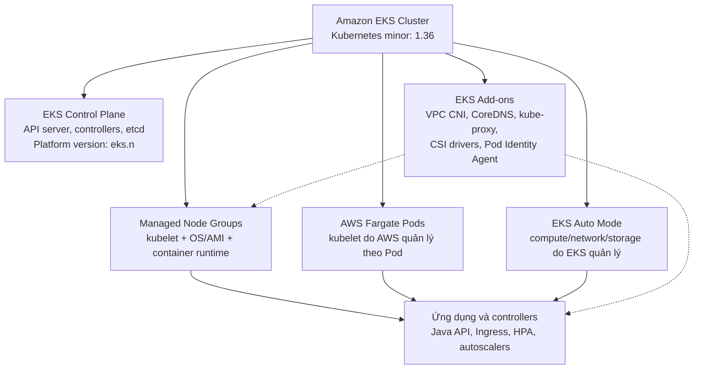
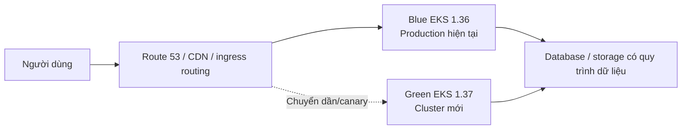
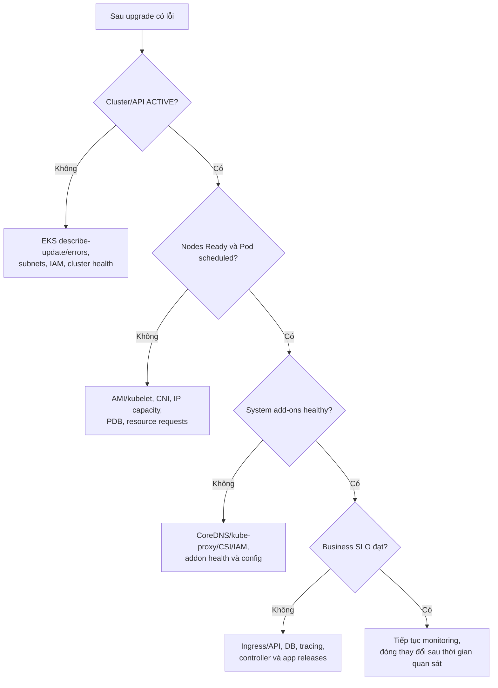

# Quản lý add-on, version và nâng cấp EKS

## Mục tiêu học tập

Sau bài học, bạn có thể:

1. Giải thích vì sao **Kubernetes version của EKS control plane**, **EKS platform version**, **node/kubelet version**, **Amazon EKS add-on version** và **phiên bản ứng dụng** là những vòng đời khác nhau.
2. Phân biệt add-on **self-managed**, **Amazon EKS managed add-on**, add-on từ **AWS Marketplace** và thành phần tích hợp sẵn của **EKS Auto Mode**.
3. Tra cứu version/add-on tương thích với cluster bằng AWS CLI; kiểm tra **VPC CNI, CoreDNS, kube-proxy, EBS CSI driver**, cũng như các add-on quản lý quyền IAM.
4. Lập kế hoạch nâng cấp Kubernetes **từng minor version**, sử dụng **EKS upgrade insights**, xử lý API đã bị loại bỏ và kiểm tra khả năng gián đoạn Pod.
5. Thực hành quy trình **control plane → compute nodes → add-ons/controllers → kubectl**, đồng thời điều chỉnh theo đặc thù Fargate, EKS Auto Mode và ứng dụng thực tế.
6. Hiểu giới hạn **rollback control plane trong vòng 7 ngày** theo tài liệu EKS hiện hành; phân biệt rollback đó với hạ version node group, add-on và dữ liệu ứng dụng.
7. Tạo checklist giám sát sau nâng cấp, xử lý lỗi, kiểm soát bảo mật, khả dụng và chi phí khi vận hành EKS production.

## 1. Tại sao nâng cấp EKS không chỉ là đổi một số version?

Một hệ thống thương mại điện tử chạy trên **Amazon Elastic Kubernetes Service (Amazon EKS)** có thể gồm:

- **EKS control plane** được AWS quản lý: Kubernetes API server, thành phần điều khiển và cơ sở dữ liệu trạng thái của cluster.
- **Managed node groups** chạy EC2 để thực thi Pods của ứng dụng.
- **VPC CNI** cấp địa chỉ mạng cho Pods, **CoreDNS** phân giải tên dịch vụ, **kube-proxy** thực hiện kết nối Service.
- **Amazon EBS CSI driver** giúp PersistentVolumeClaim (PVC) có thể provision và attach EBS volumes trên EC2 nodes.
- **AWS Load Balancer Controller**, **ExternalDNS**, **metrics-server**, **Cluster Autoscaler** hoặc công cụ monitoring do nhóm vận hành cài thêm.
- Ứng dụng Java/Spring Boot, Redis, API gateway, queue consumers và các thành phần dữ liệu.

Nếu chỉ nâng **control plane** từ Kubernetes 1.36 lên 1.37 rồi dừng, nodes có thể vẫn chạy kubelet 1.36, add-ons vẫn ở bản cũ, còn controller có thể dùng Kubernetes API không tương thích. Cluster API vẫn có thể phản hồi, nhưng tạo Pod mới, DNS, cấp IP, storage hoặc autoscaling có thể gặp lỗi.

Ngược lại, nếu nâng một add-on cốt lõi mà không kiểm tra version của cluster hay cấu hình tùy chỉnh, các Pod phụ thuộc vào networking/DNS/storage có thể bị gián đoạn trước khi nâng control plane.

> **Nguyên tắc:** nâng cấp EKS là một quy trình thay đổi **nhiều lớp**, không phải một nút “update all”. Cần kiểm tra tương thích, khả năng khôi phục, mức độ gián đoạn Pod và trạng thái ứng dụng trong từng bước.

## 2. Kiến trúc và các lớp version cần theo dõi



Sơ đồ biểu diễn **các khả năng triển khai có thể kết hợp**, không có nghĩa cluster nào cũng dùng đồng thời EC2, Fargate và Auto Mode.

| Lớp | Version điển hình | Ai quản lý? | Cần làm gì khi nâng cấp? |
| --- | --- | --- | --- |
| **Kubernetes control plane** | `1.36`, `1.37` | Amazon EKS nâng phiên bản theo API/console. | Kiểm tra upgrade readiness, chuyển lên **minor kế tiếp**. |
| **EKS platform version** | `eks.1`, `eks.2`... | AWS phát hành bản vá/cải tiến nền tảng cho từng minor. | Theo dõi và hiểu nó **khác** Kubernetes minor; thường AWS triển khai nền tảng theo cơ chế quản lý. |
| **Node kubelet** | `v1.36.x` | MNG/self-managed/hybrid/Fargate/Auto Mode theo loại compute. | Đảm bảo version skew hợp lệ, cập nhật AMI/runtime và node rollout phù hợp. |
| **EKS add-on** | `vA.B.C-eksbuild.N` | EKS nếu là managed add-on; người dùng nếu self-managed. | Chọn add-on version **compatible** và cập nhật có kiểm soát. |
| **Controller/CRD ngoài EKS** | Helm chart và image tag riêng | Nhóm vận hành hoặc nhà cung cấp. | Kiểm tra Kubernetes API/CRD/permissions, nâng theo tài liệu dự án. |
| **Ứng dụng** | Release/tag riêng | Nhóm phát triển. | Kiểm thử chức năng, probes, PDB, migration, tải và khôi phục. |

### Kubernetes minor, patch và EKS platform version

**Kubernetes 1.36 → 1.37** là thay **minor version**. Đổi minor có thể kéo theo xóa API cũ, thay đổi hành vi admission, scheduler, networking hoặc chính sách bảo mật. Đây là thao tác phải lên kế hoạch.

**Kubernetes patch** (ví dụ `1.36.x`) là các sửa lỗi/bảo mật trong cùng minor, còn `eks.N` là **EKS platform version** với bản vá/cải tiến môi trường control plane do AWS quản lý. Đừng nhầm `eks.4` với bản Kubernetes 1.4. Khi audit, cần ghi **cả** Kubernetes version và platform version.

### Trách nhiệm của AWS và của người vận hành

AWS chịu trách nhiệm về hạ tầng control plane được quản lý, các bản EKS platform, các quy trình nâng control plane và khả năng sẵn sàng của dịch vụ. Bạn vẫn chịu trách nhiệm về:

- Container images, runtime, Kubernetes manifests, Helm releases, CRDs và controllers.
- EC2 compute nodes tự quản lý hoặc managed node group mà bạn phải **chủ động nâng version**.
- Tương thích add-on, IAM permissions cho add-on, VPC subnet/IP capacity và Security Group.
- Phân phối workload qua AZ, PodDisruptionBudget, khả năng phục hồi dữ liệu, backup và giám sát.

Không coi “control plane update successful” là kết quả cuối cùng nếu DNS, CNI, EBS mounts, Pods hoặc API nghiệp vụ vẫn lỗi.

## 3. Vòng đời hỗ trợ Kubernetes trên Amazon EKS

Theo chính sách AWS hiện hành, **mỗi Kubernetes minor trên EKS** có:

1. **Standard support:** khoảng **14 tháng** từ khi version được EKS phát hành.
2. **Extended support:** thêm **12 tháng**, có **phí control plane theo giờ cao hơn**.
3. **Hết extended support:** AWS dần **tự động nâng control plane** lên phiên bản còn được hỗ trợ theo chính sách; node groups/add-ons không được tự đồng bộ toàn bộ.

Tổng cộng phiên bản thường được hỗ trợ **26 tháng**. Các ngày bắt đầu/kết thúc tính theo lịch do AWS công bố; phải tra cứu tại thời điểm bảo trì.

### Ví dụ phiên bản được EKS hỗ trợ vào ngày 20/11/2026

| Nhóm hỗ trợ | Kubernetes minor |
| --- | --- |
| **Standard support** | `1.37`, `1.36`, `1.35`, `1.34` |
| **Extended support** | `1.33`, `1.32`, `1.31` |

Danh sách trên là **ảnh chụp tại thời điểm biên soạn**, không phải danh sách bất biến cho những năm sau. Ví dụ `1.34` có hạn kết thúc standard support theo lịch AWS vào **02/12/2026**; một cluster chạy 1.34 sau mốc đó sẽ chịu chính sách extended support nếu chưa cập nhật và đang bật tương ứng.

### Upgrade policy: STANDARD và EXTENDED

| Giá trị `upgradePolicy.supportType` | Khi version hết standard support | Điều cần cân nhắc |
| --- | --- | --- |
| `EXTENDED` | Cluster vào extended support để giữ version thêm thời gian, trả phí cao hơn. | Là **mặc định** nếu chưa thay policy theo tài liệu AWS hiện hành. |
| `STANDARD` | AWS có thể tự động nâng khi kết thúc standard support. | Tránh phí extended nhưng phải chấp nhận và chuẩn bị cho auto-upgrade. |

Đọc policy và version của cluster:

```bash
aws eks describe-cluster \
  --name commerce-prod \
  --region ap-southeast-1 \
  --query 'cluster.{Name:name,Version:version,PlatformVersion:platformVersion,Status:status,UpgradePolicy:upgradePolicy,Health:health.issues}'
```

Kiểm tra những version có thể triển khai và thời hạn hỗ trợ từ API:

```bash
aws eks describe-cluster-versions \
  --region ap-southeast-1 \
  --query 'clusterVersions[].{Version:clusterVersion,Status:status,Default:defaultVersion,EndStandard:endOfStandardSupportDate,EndExtended:endOfExtendedSupportDate}' \
  --output table
```

**Không đợi đến lúc AWS tự nâng** mới phát hiện add-on/AMI đã lỗi thời. Hãy có lịch bảo trì chủ động, đánh giá theo quý hoặc mỗi khi minor được công bố, và theo dõi thông báo từ AWS Health.

## 4. Amazon EKS add-on: cài đặt, quản lý và trách nhiệm

Một **add-on** là phần mềm hỗ trợ hoạt động của Kubernetes nhưng không gắn riêng với một ứng dụng nghiệp vụ. Ví dụ mạng Pod, DNS, storage driver hoặc agent quan sát. Add-on có thể được quản lý qua **Amazon EKS API** hoặc được triển khai trực tiếp bằng Helm/manifests.

### 4.1. Self-managed và EKS managed add-on

| Khía cạnh | Self-managed add-on | Amazon EKS managed add-on |
| --- | --- | --- |
| Cách cài | Helm/kubectl/manifests/scripts. | EKS console, `aws eks create-addon` hoặc IaC tương thích. |
| Nơi giữ cấu hình | Helm values, GitOps, Kubernetes resources. | EKS Add-on resource và `configurationValues`, với Kubernetes resources tương ứng. |
| Ai chọn version | Nhóm vận hành. | Nhóm vận hành **vẫn chọn** version tương thích; EKS cung cấp danh mục đã kiểm thử. |
| Ai chịu trách nhiệm update | Nhóm vận hành. | EKS triển khai update **khi được yêu cầu**, không tự nâng mọi add-on lúc nâng control plane. |
| Xung đột cấu hình | Do công cụ quản lý tự xử lý. | `NONE` / `OVERWRITE` / `PRESERVE` khi update. |
| Nguy cơ khi đổi chế độ | Trùng resources/ownership, drift với GitOps/Helm. | Phải xem thủ tục chuyển ownership, conflicts và quản lý cấu hình sau chuyển. |

Tùy công cụ/tùy chọn tạo cluster, các thành phần `vpc-cni`, `coredns` và `kube-proxy` có thể bắt đầu dưới dạng **self-managed** hoặc EKS managed add-ons. **Không suy ra đã là managed add-on** chỉ vì thấy DaemonSet/Deployment trong `kube-system`.

Kiểm tra bằng:

```bash
aws eks list-addons --cluster-name commerce-prod --region ap-southeast-1
kubectl -n kube-system get daemonsets,deployments
```

Nếu `aws eks list-addons` không có `coredns` nhưng `kubectl -n kube-system get deployment coredns` vẫn tồn tại, CoreDNS có thể đang self-managed. Đừng gọi `update-addon` cho một add-on chưa được EKS quản lý.

### 4.2. Những add-on thường gặp

| Add-on | Chức năng | Tác động khi lỗi |
| --- | --- | --- |
| **Amazon VPC CNI** (`vpc-cni`) | Cấp địa chỉ IP/interface cho Pods trên EC2, gắn với VPC networking. | Pod mới có thể không nhận được IP hoặc không kết nối được; ảnh hưởng VPC/subnet IP capacity. |
| **CoreDNS** (`coredns`) | DNS nội bộ cho Kubernetes Services/Pods. | Lỗi phân giải `*.svc.cluster.local`, ứng dụng khó tìm dịch vụ. |
| **kube-proxy** (`kube-proxy`) | Duy trì quy tắc mạng cho Kubernetes Service trên các nodes phù hợp. | Traffic tới ClusterIP/Service có thể lỗi. |
| **Amazon EBS CSI driver** (`aws-ebs-csi-driver`) | Provision/attach EBS volume cho PVC trên EC2. | PVC Pending, Pod kẹt mount, khó scale workload có persistent storage. |
| **Amazon EFS CSI driver** | Mount EFS tới Pods theo compute được hỗ trợ. | Shared filesystem không mount được hoặc I/O lỗi. |
| **EKS Pod Identity Agent** | Cung cấp identity cho Pods dùng EKS Pod Identity trên compute tương ứng. | Add-on/controller không lấy được AWS credentials. |
| **Metrics Server** | Cung cấp resource metrics cho HPA/`kubectl top`. | HPA dựa CPU/RAM có thể không scale đúng. |
| **Observability agents** | Thu thập logs, metrics, traces. | Có thể “mù giám sát” dù ứng dụng còn chạy. |

Ngoài danh sách trên còn có **AWS Marketplace add-ons**, controller bên thứ ba và add-on theo vùng/compute type. Marketplace add-ons có thể yêu cầu đăng ký/subscription và chịu điều khoản/chi phí riêng. Không coi mọi image/chart được AWS Marketplace liệt kê là add-on luôn được cài sẵn.

### 4.3. Khác biệt của EKS Auto Mode

**EKS Auto Mode** tích hợp khả năng compute autoscaling, Pod/Service networking, cluster DNS, block storage và load balancing trên hạ tầng do EKS quản lý. Với cluster **chỉ chạy Auto Mode compute**, các add-ons truyền thống như VPC CNI, CoreDNS, kube-proxy, EBS CSI driver và Pod Identity Agent **có thể không cần cài như Pod riêng**.

Nếu cluster kết hợp **Auto Mode với managed EC2 nodes, self-managed nodes hoặc Fargate**, vẫn cần những add-on thích hợp cho compute type đó. Khi tra compatibility, phải xét **computeTypes** được `DescribeAddonVersions` trả về; đừng xóa add-on đang phục vụ EC2 chỉ vì Auto Mode đã được bật.

**Hybrid nodes** cũng có giới hạn riêng; ví dụ Amazon VPC CNI không triển khai trên hybrid nodes. Chọn CNI/CSI và phiên bản theo tài liệu hỗ trợ thực tế.

## 5. Quản lý vòng đời add-on như một sản phẩm độc lập

Lựa chọn add-on không nên chỉ dựa vào nhãn “latest”. Mỗi cluster Kubernetes minor và compute type có **danh sách version tương thích**; bản phù hợp với 1.36 chưa chắc tương thích hoặc tối ưu nhất cho 1.37.

### 5.1. Version schema và compatibility

Một managed add-on version có thể có dạng:

```text
v1.20.1-eksbuild.1
```

`v1.20.1` phản ánh version component, còn `eksbuild.1` là bản dựng/phát hành do EKS đóng gói. Không so sánh “số Kubernetes” với “số add-on” bằng cách nhìn chung các con số; hãy gọi API compatibility.

```bash
# 1) Những EKS add-ons thực sự được quản lý cho cluster này
aws eks list-addons \
  --cluster-name commerce-prod \
  --region ap-southeast-1

# 2) Version/trạng thái của một add-on
aws eks describe-addon \
  --cluster-name commerce-prod \
  --addon-name vpc-cni \
  --region ap-southeast-1 \
  --query 'addon.{Name:addonName,Version:addonVersion,Status:status,Issues:health.issues,Config:configurationValues}'

# 3) Version tương thích với Kubernetes 1.37
aws eks describe-addon-versions \
  --kubernetes-version 1.37 \
  --addon-name vpc-cni \
  --region ap-southeast-1 \
  --query 'addons[].addonVersions[].{Version:addonVersion,Default:compatibilities[0].defaultVersion}' \
  --output table
```

API cho biết những phiên bản được EKS cung cấp trong Region, gắn với Kubernetes target version. Danh sách có thể thay đổi theo thời gian; version minh họa trong tài liệu không phải chỉ định bắt buộc cho môi trường thật.

### 5.2. Những cấu hình phải lưu lại trước khi update

Các add-ons như VPC CNI và CoreDNS thường có cấu hình tùy chỉnh (ví dụ environment variables, resource limits, tolerations, topology spread, `replicaCount`). Nếu cập nhật thiếu kiểm soát, EKS có thể áp cấu hình default và làm mất customizations.

Để kiểm tra add-on và schema cấu hình:

```bash
# Thay addon-version bằng version THỰC TẾ mà bạn đã tra cứu
aws eks describe-addon-configuration \
  --addon-name vpc-cni \
  --addon-version v1.20.1-eksbuild.1 \
  --region ap-southeast-1
```

**Không mặc định `v1.20.1-eksbuild.1` luôn tồn tại hoặc tương thích**; đây chỉ là ví dụ cú pháp. Dùng `describe-addon-versions` để chọn version có thật, sau đó mới đọc schema.

Lưu `configurationValues`, IAM role/pod identity associations, annotations, resources và liên kết với GitOps/Helm. Nếu EKS add-on đã quản lý resources, đừng sửa live DaemonSet/Deployment bằng `kubectl edit` mà không biết cơ chế reconcile của EKS.

### 5.3. Xử lý xung đột khi cập nhật

`--resolve-conflicts` của `aws eks update-addon` có ba lựa chọn:

| Lựa chọn | Hành vi | Rủi ro |
| --- | --- | --- |
| **`NONE`** | Không ghi đè cấu hình bị thay đổi; update có thể **thất bại** nếu gặp conflict. | An toàn theo hướng phát hiện lỗi, nhưng cần xử lý thủ công. |
| **`PRESERVE`** | Cố giữ những giá trị người dùng đã tùy chỉnh. | Có thể gặp setting không còn hợp lệ với version mới; phải test schema. |
| **`OVERWRITE`** | Ghi đè các thay đổi bằng giá trị default do EKS quản lý. | Có thể **mất cấu hình ứng dụng/phân mạng/DNS tùy chỉnh**. |

Ví dụ sau là **lệnh thay đổi thật**, chỉ thực hiện khi đã kiểm tra version, backups và có quyền:

```bash
aws eks update-addon \
  --cluster-name commerce-prod \
  --addon-name vpc-cni \
  --addon-version "<version-compatible-with-cluster>" \
  --resolve-conflicts PRESERVE \
  --region ap-southeast-1
```

Không dùng `OVERWRITE` chỉ để “chạy thành công” khi chưa biết cấu hình nào sẽ bị thay đổi. Với một số setting cũ không tương thích, có thể phải điều chỉnh `configurationValues` và quyền IAM trước khi nâng.

### 5.4. IAM permissions cho add-on

Một số add-ons cần quyền AWS API, chẳng hạn VPC CNI cần quản lý network interfaces/IP và EBS CSI driver cần thao tác EBS. Hai cơ chế quan trọng:

- **EKS Pod Identity:** EKS quản lý association giữa Kubernetes service account và IAM role, cần **Pod Identity Agent** trên compute thích hợp. Đây là cách AWS khuyến nghị cho nhiều EKS add-ons.
- **IAM Roles for Service Accounts (IRSA):** dựa trên OIDC provider của cluster và `serviceAccountRoleArn`.

Khi dùng EKS-managed add-on, association được tạo qua add-on API có vòng đời gắn với add-on; xóa add-on có thể xóa association do add-on sở hữu. Nếu thay Pod Identity associations, EKS có thể khởi động lại các Pods của add-on.

**Không cấp toàn bộ quyền AWS cho EC2 node IAM role chỉ vì một add-on cần EBS/VPC API.** Nên tách role least privilege cho add-on tương ứng, rà soát ServiceAccount, IAM trust policy, SCP và Kubernetes RBAC.

## 6. Kiểm tra version skew trước khi nâng cluster

**Version skew** là chênh lệch minor version giữa các thành phần Kubernetes. Upstream Kubernetes có quy tắc skew khác nhau theo thành phần/phiên bản. Với EKS, đường nâng cấp an toàn được AWS hướng dẫn rõ:

1. Trước khi đưa **control plane từ N → N+1**, các **managed node groups và Fargate nodes** nên đã cùng minor **N** với control plane. EKS yêu cầu cập nhật managed node groups về cùng minor control plane để nâng cluster.
2. Nâng control plane **một minor mỗi lần** (ví dụ `1.35 → 1.36 → 1.37`); không nhảy trực tiếp từ 1.35 lên 1.37.
3. Sau khi nâng control plane lên N+1, nâng **managed/self-managed/hybrid nodes** lên N+1. Với Fargate, Pods mới nhận phiên bản phù hợp, Pods cũ có thể cần thay thế.
4. Cập nhật controllers/add-ons và `kubectl` theo version hỗ trợ.

Đừng dùng version skew tối đa mà upstream cho phép như lý do duy trì chênh lệch version lâu dài. Một số cấu hình EKS/API có điều kiện hỗ trợ chặt hơn; nên theo quy trình được Amazon EKS công bố.

### Kiểm tra các phiên bản đang chạy

```bash
aws eks describe-cluster \
  --name commerce-prod \
  --region ap-southeast-1 \
  --query 'cluster.{Kubernetes:version,Platform:platformVersion,Status:status}'

kubectl version
kubectl get nodes -o wide

# Xem kubelet của từng node, bao gồm các nhóm compute được hiển thị trong cluster
kubectl get nodes \
  -o custom-columns=NAME:.metadata.name,KUBELET:.status.nodeInfo.kubeletVersion,OS:.status.nodeInfo.osImage,RUNTIME:.status.nodeInfo.containerRuntimeVersion
```

Phiên bản `kubectl` nên ở phạm vi **±1 minor** so với control plane theo tài liệu EKS; nên dùng bản phù hợp ngay khi xong upgrade. Với production automation, pin phiên bản `kubectl`, Helm, Terraform provider, `eksctl`/AWS CLI thích hợp trong CI/CD.

### Một bảng kiểm tương thích điển hình

| Hạng mục | Trước nâng 1.36 → 1.37 | Sau nâng thành công |
| --- | --- | --- |
| Control plane | `1.36` | `1.37` |
| MNG kubelet | `1.36` | Nâng lên `1.37` theo quy trình rolling |
| Fargate pods | Không để Pod cũ thấp hơn điều kiện nâng | Pods được tạo mới theo version hỗ trợ |
| Self-managed nodes | Cùng minor `1.36` khi có thể | Tái tạo/upgrade lên `1.37` |
| VPC CNI/CoreDNS/kube-proxy | Phiên bản hiện tại phải tương thích quá trình nâng | Chọn phiên bản được EKS xác nhận cho `1.37` |
| CSI/ingress/autoscaler | Đã kiểm tra compatibility và API deprecations | Update tương ứng theo hướng dẫn vendor |
| Ứng dụng | Test staging, PDB, probes/backup sẵn | Smoke/integration/performance tests đạt |

## 7. Chuẩn bị trước khi nâng cấp: checklist kỹ thuật

### 7.1. Tồn tại API đã bị deprecated hoặc removed?

Một manifest/CRD cũ có thể dùng Kubernetes API đã bị loại khỏi version đích. Ví dụ các thay đổi từ `extensions/v1beta1`, `networking.k8s.io/v1beta1` hoặc `policy/v1beta1` trong những đợt upgrade trước cho thấy việc chỉ sửa version field là chưa đủ; schema, selectors, webhooks và controllers có thể cần thay đổi.

Kiểm tra:

- Release notes của Kubernetes và **Amazon EKS** cho **từng bước N → N+1**.
- EKS **upgrade insights** ở cluster.
- API versions trong Helm manifests, CRDs, admission webhooks và controller images.
- Thư viện Kubernetes client của ứng dụng và automation (Java client, operators, Argo CD/Flux).
- Hệ thống deployment không còn áp manifests dùng APIs bị remove.

Đừng chỉ chạy `kubectl get deployments` rồi kết luận không có deprecated API: một API cũ có thể nằm trong **request thực tế từ controller/automation**, không hiện trên Kubernetes manifest đang tồn tại.

### 7.2. EKS upgrade insights

Amazon EKS tự đánh giá các **upgrade readiness insights** để tìm những cấu hình có thể gây vấn đề khi đổi version, gồm API deprecations, node skew, kube-proxy hoặc cluster health. Các trạng thái thường gặp:

| Insight | Ý nghĩa vận hành |
| --- | --- |
| `PASSING` | Chưa phát hiện vấn đề trong phạm vi check, không phải bảo đảm tất cả ứng dụng tương thích. |
| `WARNING` | Có nguy cơ ảnh hưởng về version xa hơn hoặc vấn đề cần xem trước. |
| `ERROR` | Có vấn đề cần sửa trước nâng; xem tài liệu check tương ứng. |
| `UNKNOWN` | EKS chưa đủ dữ liệu kết luận; cần điều tra và refresh. |

```bash
aws eks list-insights \
  --cluster-name commerce-prod \
  --region ap-southeast-1 \
  --filter categories=UPGRADE_READINESS

# Đọc một insight cụ thể sau khi lấy id từ list-insights
aws eks describe-insight \
  --cluster-name commerce-prod \
  --id "<insight-id>" \
  --region ap-southeast-1

# Sau khi sửa vấn đề, yêu cầu EKS làm mới insights
aws eks start-insights-refresh \
  --cluster-name commerce-prod \
  --region ap-southeast-1
```

EKS console cũng cung cấp tab **Upgrade insights** trong phần giám sát cluster. Insight là tín hiệu hữu ích theo thời điểm kiểm tra, **không thay thế** staging/integration tests và review của đội vận hành.

**Cảnh báo về `--force`:** cơ chế yêu cầu force đối với blocking insights đã có thay đổi triển khai trong EKS; không dùng `--force` như mặc định hoặc đoán rằng có thể vượt mọi kiểm tra. `--force` có thể bỏ qua một số kiểm tra insight nhưng không bỏ qua mọi điều kiện tiền đề; khi vượt cảnh báo, đội vận hành chịu rủi ro.

### 7.3. VPC subnet, IP và security groups

EKS cần **tối đa 5 địa chỉ IP còn trống** từ các **cluster subnets** đã chỉ định khi tạo cluster để thay control plane network interfaces. Trước khi upgrade:

1. Kiểm tra các subnet liên quan còn tồn tại và có đủ available IPv4 addresses.
2. Kiểm tra **Security Groups** cho phép các kết nối bắt buộc giữa control plane và nodes qua những subnet đó.
3. Với private nodes, đảm bảo đường tới EKS API, ECR/S3, STS/SSM/CloudWatch endpoints hoặc NAT phù hợp với cách vận hành.
4. Đảm bảo IP capacity cho **new worker nodes và Pods** khi rolling update, không chỉ cho control plane.

Nếu VPC CNI đã dùng hết địa chỉ Pod, Managed Node Group có thể tạo EC2 được nhưng Pods mới vẫn Pending/ContainerCreating vì không có IP. Cần dự báo số node tăng tạm thời, Pod density, ENI/prefix delegation và subnet design.

### 7.4. Tính sẵn sàng của workloads

Trước ngày nâng cấp:

- Spread replicas qua **từ hai AZ trở lên** nếu SLO yêu cầu, có `topologySpreadConstraints`/anti-affinity phù hợp.
- Đặt **readiness/liveness/startup probes** sát trạng thái ứng dụng thực, không chỉ kiểm tra container process.
- Cấu hình **PodDisruptionBudget (PDB)** để bảo vệ replica tối thiểu khi drain nodes.
- Đảm bảo **resource requests/limits**, `terminationGracePeriodSeconds` và preStop hook đủ cho xử lý request đang chạy.
- Thử rollout deployment, đóng kết nối, restart Pods, scale-out và khôi phục sau một node failure.
- Kiểm tra `kubectl get pdb -A`, node taints, DaemonSets và các workload dùng local storage.

Một PDB quá chặt như `minAvailable: 3` cho Deployment chỉ có **3 replicas** sẽ chặn voluntary eviction. Đây là vấn đề an toàn nhưng cũng có thể khiến Managed Node Group update bị `PodEvictionFailure`. Sửa nguyên nhân/đảm bảo thêm replica trước, **không lập tức force update** để bỏ PDB.

### 7.5. Backup và kế hoạch khôi phục

EKS quản lý cơ sở dữ liệu control plane, nhưng bạn vẫn cần backup những cấu hình/ứng dụng/dữ liệu mà doanh nghiệp chịu trách nhiệm:

- GitOps/IaC manifests, Helm values, CRD definitions, admission webhooks và IAM policies.
- Dữ liệu trong RDS, EBS PV, EFS, S3, queue hoặc dịch vụ bên ngoài theo RPO/RTO.
- Snapshot/backup giải pháp phù hợp như **AWS Backup**, EBS snapshots, database-native backups, Velero và quy trình restore kiểm thử.
- Danh sách add-on versions/role associations, node group AMI/launch template và cluster settings.

**Không coi snapshot EBS hoặc export YAML đơn lẻ là backup đầy đủ cho toàn Kubernetes cluster.** Với StatefulSet/DB phải bảo đảm tính nhất quán ứng dụng và thử restore thực tế.

## 8. Inventory bằng CLI trước khi thay đổi

Giả sử:

```text
AWS Region: ap-southeast-1
Cluster: commerce-prod
Hiện tại: Kubernetes 1.36
Mục tiêu: Kubernetes 1.37
Managed node group: app-ng
Các command bên dưới: ví dụ thực hành, không được tự động chạy production
```

### 8.1. Xác nhận account/cluster

```bash
aws sts get-caller-identity
aws eks describe-cluster \
  --name commerce-prod \
  --region ap-southeast-1 \
  --query 'cluster.{Name:name,Version:version,Platform:platformVersion,Status:status,Issues:health.issues,UpgradePolicy:upgradePolicy}'

# Cập nhật kubeconfig bằng IAM role/profile có quyền truy cập cluster
aws eks update-kubeconfig --name commerce-prod --region ap-southeast-1
kubectl config current-context
kubectl get nodes -o wide
kubectl get pods -A --field-selector=status.phase!=Running
```

`update-kubeconfig` có thể **thay context hiện tại** trong kubeconfig cục bộ; kiểm tra kỹ cluster/account trước mọi lệnh ghi. Kết quả `kubectl get pods` với bộ lọc trên không thay thế kiểm tra Pods chạy nhưng chưa Ready.

### 8.2. Liệt kê node groups và add-ons

```bash
aws eks list-nodegroups --cluster-name commerce-prod --region ap-southeast-1

aws eks describe-nodegroup \
  --cluster-name commerce-prod \
  --nodegroup-name app-ng \
  --region ap-southeast-1 \
  --query 'nodegroup.{Version:version,Release:releaseVersion,Status:status,Issues:health.issues,UpdateConfig:updateConfig}'

aws eks list-addons --cluster-name commerce-prod --region ap-southeast-1

aws eks describe-addon \
  --cluster-name commerce-prod \
  --addon-name coredns \
  --region ap-southeast-1 \
  --query 'addon.{Name:addonName,Version:addonVersion,Status:status,Issues:health.issues,Config:configurationValues}'
```

Nếu một add-on không được liệt kê, nó có thể **chưa cài** hoặc được quản lý ngoài EKS. Đừng xem đó là bằng chứng Pod/component không tồn tại: kiểm tra namespace và công cụ quản lý hiện tại.

### 8.3. Workload health/điểm phụ thuộc

```bash
kubectl get nodes
kubectl get pods -A -o wide
kubectl get deployments,statefulsets,daemonsets -A
kubectl get pdb -A
kubectl get pvc -A
kubectl get events -A --sort-by='.lastTimestamp'
kubectl -n kube-system get deployments,daemonsets
```

Với ứng dụng Java chạy sau ALB, cần thêm smoke tests HTTP, database connection checks, queue consumer health và synthetic tests từ ngoài cluster; `Pods Ready` chỉ là một thành phần của khả dụng end-to-end.

## 9. Quy trình nâng control plane từ Kubernetes 1.36 lên 1.37

**Đây là quy trình có hành động làm thay đổi cluster.** Chỉ áp dụng sau khi kiểm tra version hiện tại/đích có thật ở Region, kết quả upgrade insights, trạng thái data plane, quyền IAM và khả năng khôi phục. Bài viết không trực tiếp kết nối tới AWS account thật.

### 9.1. Điều kiện trước lệnh update

1. Cluster `commerce-prod` đang ở `ACTIVE`, Kubernetes version **1.36**, và không có một update khác đang chạy.
2. Các **managed node groups** đã chạy cùng minor `1.36` với control plane. Các Fargate Pods đang dùng minor cũ hơn cần được xử lý theo hướng dẫn EKS trước upgrade.
3. Control plane subnets còn IP trống (EKS có thể cần **tối đa 5**), Security Group và IAM/KMS keys hợp lệ.
4. Đã review **upgrade insights** cho 1.37, không còn API deprecation/controller compatibility blockers chưa được giải quyết.
5. Đã thử staging, backup/rollback được chuẩn bị và có lịch thông báo/cửa sổ thay đổi.
6. Các workloads có replicas/PodDisruptionBudget và capacity để phục vụ sau khi node rollout.

### 9.2. Khởi chạy update

```bash
aws eks update-cluster-version \
  --name commerce-prod \
  --kubernetes-version 1.37 \
  --region ap-southeast-1
```

Lệnh trả một đối tượng `update` chứa `id` (ví dụ `7c3b6f0e-12ab-4f96-9dca-111122223333`) và `status=InProgress`. Lưu **Update ID thực tế**.

Đây là thao tác **bất đồng bộ**: lệnh trả kết quả không nghĩa control plane đã nâng xong. Với một upgrade đang chạy, bạn không thể tạm dừng/huỷ bằng việc ngắt CLI; không gửi nhiều lệnh update cạnh tranh.

Kiểm tra tiến độ:

```bash
aws eks describe-update \
  --name commerce-prod \
  --update-id "7c3b6f0e-12ab-4f96-9dca-111122223333" \
  --region ap-southeast-1 \
  --query 'update.{Id:id,Type:type,Status:status,Errors:errors,CreatedAt:createdAt}'
```

Khi `status=Successful`, cập nhật control plane hoàn tất. Nếu `Failed`, đọc `errors` và `describe-cluster`; đừng giả định cluster bị hỏng hay không thể hồi phục. EKS có cơ chế kiểm tra và khôi phục hạ tầng control plane trong quá trình update.

### 9.3. Xác minh ngay sau nâng control plane

```bash
aws eks describe-cluster \
  --name commerce-prod \
  --region ap-southeast-1 \
  --query 'cluster.{Version:version,Platform:platformVersion,Status:status,Issues:health.issues}'

kubectl version
kubectl get --raw='/readyz?verbose'
kubectl get nodes
kubectl -n kube-system get pods
```

`/readyz` là Kubernetes API readiness endpoint; việc tài khoản có quyền và endpoint truy cập được là điều kiện cần. Nó không chứng minh ứng dụng hoặc worker nodes đã đồng bộ version.

**Lưu ý về gián đoạn:** AWS rolling-upgrade các API server instances để duy trì sự sẵn sàng, nhưng client có thể bị ngắt kết nối ngắn, cần tự reconnect và retry. Controllers cũ có thể gặp lỗi tương thích khi API thay đổi; hãy theo dõi logs/sự kiện trong và sau upgrade.

## 10. Nâng phiên bản compute nodes

Sau khi control plane đã lên 1.37, data plane cần được đưa về version tương thích và AMI/runtime đã vá lỗi.

### 10.1. EKS Managed Node Group (MNG)

Kiểm tra node group:

```bash
aws eks describe-nodegroup \
  --cluster-name commerce-prod \
  --nodegroup-name app-ng \
  --region ap-southeast-1
```

Nếu node group dùng **EKS optimized AMI** phù hợp và có thể update trực tiếp, ví dụ:

```bash
aws eks update-nodegroup-version \
  --cluster-name commerce-prod \
  --nodegroup-name app-ng \
  --kubernetes-version 1.37 \
  --region ap-southeast-1
```

Lệnh trả update ID, dùng:

```bash
aws eks describe-update \
  --name commerce-prod \
  --nodegroup-name app-ng \
  --update-id "<update-id-from-nodegroup-update>" \
  --region ap-southeast-1
```

Trong rolling update, EKS tạo nodes mới, đánh giá chúng có sẵn sàng không, **cordon/drain** nodes cũ và thay thế theo cấu hình `maxUnavailable` hoặc `maxUnavailablePercentage`. Cơ chế update theo cách rolling **tôn trọng PDB**; nếu không thể drain trong điều kiện cho phép, update có thể báo lỗi.

**Không dùng `--force` như lựa chọn mặc định.** Forced node update có thể bỏ qua ràng buộc PDB và gây gián đoạn dịch vụ.

Ví dụ PDB cho API có ba replicas:

```yaml
apiVersion: policy/v1
kind: PodDisruptionBudget
metadata:
  name: checkout-api-pdb
  namespace: commerce
spec:
  minAvailable: 2
  selector:
    matchLabels:
      app: checkout-api
```

PDB giúp giới hạn số Pod bị evict tự nguyện, **không tự tạo thêm replicas hoặc EC2 capacity**. Phải bảo đảm scheduler có thể đưa các Pods thay thế lên node mới và readiness probes thành công.

Nếu node group dùng **custom AMI**, EKS có thể không cung cấp tùy chọn tự cập nhật Kubernetes version như nhóm dùng optimized AMI. Quy trình thường là:

1. Build AMI đã hỗ trợ Kubernetes 1.37 và được harden/test.
2. Tạo **launch template version** mới.
3. Update node group tới launch template version phù hợp hoặc tạo **node group thay thế**.
4. Drain/migrate Pods có kiểm soát, xem logs và chỉ xóa node group cũ sau khi smoke tests đạt.

### 10.2. Self-managed hoặc hybrid nodes

Với **self-managed EC2 nodes**, nhóm vận hành chịu trách nhiệm cập nhật AMI, kubelet, container runtime, bootstrap, CNI networking, scaling và drain. Cách an toàn thường là **tạo node mới trên image mới, chuyển Pods rồi loại node cũ**, thay vì sửa một node production theo cách khó tái lập.

Với **EKS Hybrid Nodes**, cần theo hướng dẫn riêng của AWS về version, nodeadm/agent, các add-on hỗ trợ và đường mạng tới control plane. Không giả định EKS tự thay host ngoài AWS.

### 10.3. AWS Fargate

Với Fargate, Kubernetes worker/kubelet chạy trên nền tảng được AWS quản lý. Khi control plane nâng minor, **Fargate Pods đang chạy không tự đổi kubelet version**; những Pods được tạo mới sau upgrade có phiên bản phù hợp.

Trước nâng control plane, nếu còn Fargate nodes ở minor thấp hơn yêu cầu, thực hiện tái tạo Pods theo quy trình được EKS hướng dẫn. Sau upgrade, triển khai lại các Fargate workloads khi cần để đồng bộ phiên bản, xác minh Pod scheduling, IAM và networking.

Không cố chạy lệnh `update-nodegroup-version` cho Fargate: Fargate không có managed EC2 node group kiểu đó.

### 10.4. EKS Auto Mode

Nếu cluster dùng **EKS Auto Mode compute**, sau khi control plane nâng minor, EKS bắt đầu cập nhật **Auto Mode nodes từng bước** và tuân thủ PodDisruptionBudget theo cơ chế quản lý. Bạn không phải tự upgrade các tính năng compute autoscaling, networking, block storage hoặc load balancing tích hợp của Auto Mode như những managed add-ons truyền thống.

Tuy nhiên, bạn vẫn phải quan sát Pods/scheduling, NodePools, disruptions, workload readiness và các add-ons/controller ngoài Auto Mode. Với cluster trộn Auto Mode và MNG, **MNG vẫn do bạn chủ động nâng**.

### Một lưu ý dễ gây ngắt dịch vụ

Khi thay đổi **desired size** của Managed Node Group trực tiếp để scale-in, EKS có thể làm ASG giảm node mà **không tôn trọng PDB** như luồng managed node group version update. Không xem “giảm desired capacity” như phương án thay thế an toàn cho drain/rolling update.

## 11. Cập nhật add-ons và các controller sau nâng cluster

Sau khi control plane và nodes đã ở version phù hợp, hãy nâng các thành phần hỗ trợ và controller theo **compatibility matrix**. Trước đó, nếu EKS release notes yêu cầu **minimum add-on version trước khi nâng control plane**, phải xử lý yêu cầu tiền đề đó trong giai đoạn chuẩn bị. Không áp một thứ tự máy móc cho mọi add-on.

### 11.1. VPC CNI, CoreDNS và kube-proxy

Đối với cluster EC2 truyền thống, ba thành phần cốt lõi:

1. **VPC CNI:** đảm bảo cấp IP và mạng Pod. Kiểm tra version tương thích, env vars, IAM role và IP capacity.
2. **CoreDNS:** đảm bảo DNS Services hoạt động; kiểm tra deployment replicas, node placements, `coredns` ConfigMap hoặc `configurationValues` được EKS quản lý.
3. **kube-proxy:** đảm bảo version skew theo yêu cầu, kiểm tra rules/DaemonSet và Network Service connectivity.

Ví dụ quy trình CLI cho CoreDNS managed add-on:

```bash
# Xác nhận CoreDNS đang được EKS quản lý
aws eks describe-addon \
  --cluster-name commerce-prod \
  --addon-name coredns \
  --region ap-southeast-1

# Lấy danh sách phiên bản tương thích với 1.37
aws eks describe-addon-versions \
  --addon-name coredns \
  --kubernetes-version 1.37 \
  --region ap-southeast-1

# Chỉ cập nhật sau khi đã chọn phiên bản thật, kiểm tra cấu hình hiện có
aws eks update-addon \
  --cluster-name commerce-prod \
  --addon-name coredns \
  --addon-version "<real-compatible-addon-version>" \
  --resolve-conflicts PRESERVE \
  --region ap-southeast-1
```

Theo dõi:

```bash
aws eks describe-addon \
  --cluster-name commerce-prod \
  --addon-name coredns \
  --region ap-southeast-1 \
  --query 'addon.{Version:addonVersion,Status:status,Issues:health.issues}'

kubectl -n kube-system rollout status deployment/coredns
kubectl -n kube-system get pods -o wide
```

Nếu `addon.status=DEGRADED`, xem `health.issues`, events và Pod logs, không tiếp tục nâng các thành phần phụ thuộc khi chưa xác định nguyên nhân.

### 11.2. EBS CSI driver và dữ liệu bền vững

Với cluster chạy stateful workloads trên EC2 và EBS, kiểm tra:

- Driver `aws-ebs-csi-driver` đã được cài theo chế độ managed/self-managed nào.
- ServiceAccount/Pod Identity hoặc IRSA có quyền tương ứng.
- Controller/node Pods khỏe, StorageClass/CSIDriver có cấu hình phù hợp.
- PVC mới provision được EBS volume, Pod mới mount được; **PVC/PV cũ không mất dữ liệu**.

```bash
aws eks describe-addon \
  --cluster-name commerce-prod \
  --addon-name aws-ebs-csi-driver \
  --region ap-southeast-1

kubectl get storageclass
kubectl get pvc -A
kubectl -n kube-system get pods
```

Không xóa driver để “cài lại cho sạch” khi cluster có workloads đang sử dụng PV mà chưa hiểu phương án bảo vệ dữ liệu và vòng đời Kubernetes resources.

### 11.3. Controllers ngoài EKS

Những thành phần không nhất thiết được EKS update tự động:

- **AWS Load Balancer Controller:** version của Helm chart, CRDs và IAM permissions.
- **Cluster Autoscaler:** AWS khuyến nghị version **major/minor khớp với Kubernetes cluster** để tránh lỗi API/scheduler behavior.
- **Karpenter**, ExternalDNS, cert-manager, metrics-server, logging agents, service mesh, CNI phụ trợ, admission webhooks.
- GitOps controllers như Argo CD/Flux, CI/CD deployment automation và custom operators.

Kiểm tra release notes vendor, API group/CRD conversion và khả năng tương thích với Kubernetes minor mới. Khi upgrade Helm, nên có bản ghi `helm list -A`, phiên bản chart và Git commit; tránh update controller trực tiếp mà không đồng bộ repo IaC/GitOps.

### 11.4. So sánh update in-place và thay thế workload

| Trường hợp | Cách xử lý |
| --- | --- |
| EKS managed add-on tương thích, config được EKS quản lý | `update-addon` có kiểm soát, `PRESERVE` hoặc chính sách conflict rõ ràng. |
| Add-on đang self-managed bằng Helm | Nâng Helm release theo chart compatibility; không gọi `update-addon` nếu chưa chuyển management. |
| Đổi CNI/storage driver lớn, API/CRD không tương thích | Môi trường staging, phương án migration và rollback riêng. |
| Controller không còn hỗ trợ version đích | Nâng hoặc thay controller **trước** control plane nếu release notes yêu cầu. |
| Auto Mode-only cluster | Không tự cài lại các thành phần nền tảng do Auto Mode đã quản lý; chỉ quản lý ngoại lệ và add-ons khác. |

## 12. EKS version rollback: phạm vi mới và giới hạn 7 ngày

**Thông tin AWS hiện hành (2026):** Sau một **in-place upgrade**, Amazon EKS cho phép **rollback control plane về minor version ngay trước đó trong vòng 7 ngày** kể từ khi upgrade hoàn thành. Đây là tính năng mới hơn những hướng dẫn cũ từng nói EKS không hỗ trợ downgrade.

### 12.1. Những gì được rollback và không rollback

| Thành phần | Rollback EKS xử lý? | Trách nhiệm còn lại |
| --- | --- | --- |
| Kubernetes API server và các control plane components | **Có**, về minor version N-1 được phép. | Kiểm tra API/CRD và tương thích workloads. |
| EKS platform version | **Có**, quay về bản phù hợp với minor cũ. | Xem release notes thay đổi control plane. |
| etcd data/Kubernetes objects | **Được giữ**, không “quay ngược thời gian”. | Backup/khôi phục nếu app hoặc resources đã bị thay đổi sai. |
| EKS managed add-ons | **Không** tự rollback. | Bạn chọn add-on version phù hợp với minor cũ. |
| Managed node groups | **Không** tự rollback. | Bạn phải hạ node version đúng cách trước control plane. |
| Self-managed/hybrid nodes | **Không**. | Tự cập nhật/recreate nodes về version phù hợp. |
| EKS Auto Mode nodes | **Có cơ chế tự xử lý trước control plane rollback**. | Giám sát disruption/NodePools/PDB. |
| Fargate Pods | Không tự rollback kubelet của Pods đang chạy. | Recreate Pods theo version rollback; kiểm tra skew. |
| Dữ liệu ứng dụng, PersistentVolumes, database | **Được giữ nguyên**, không hoàn tác migration đã chạy. | Phục hồi dữ liệu từ backup/replication nếu cần. |

### 12.2. Điều kiện rollback

Chỉ có thể rollback khi:

1. Cluster đã được nâng tới version hiện tại bằng **in-place upgrade**, không phải tạo mới ở version hiện tại.
2. **Chưa quá 7 ngày** kể từ lúc upgrade hoàn thành.
3. Quay về **đúng một minor trước (N-1)**, không nhảy qua nhiều version.
4. Version đích còn được EKS hỗ trợ. Nếu là **extended support**, phải chuyển `upgradePolicy.supportType=EXTENDED` trước khi rollback và chấp nhận phí tương ứng.
5. Cluster đang `ACTIVE`, không có update khác và không dùng tính năng chỉ hỗ trợ version mới hơn mà không thể đảo.
6. **Không** phải cluster đã được **AWS auto-upgrade khi hết extended support** (loại đó không được rollback).

Nếu auto-upgrade ở thời điểm kết thúc **standard support**, rollback có thể được phép theo điều kiện AWS, nhưng phải chuyển support policy phù hợp trước. Đừng suy ra mọi loại auto-upgrade có điều kiện rollback giống nhau.

### 12.3. Quy trình rollback 1.37 về 1.36 (chỉ khi đủ điều kiện)

Đầu tiên, đọc **rollback readiness insights**:

```bash
aws eks list-insights \
  --cluster-name commerce-prod \
  --filter categories=ROLLBACK_READINESS \
  --region ap-southeast-1
```

Kiểm tra điều kiện ứng dụng/API, add-on versions, kube-proxy/kubelet skew, PodDisruptionBudget và data integrity. Nếu đang có **managed EC2 node group tại 1.37**, nó phải được xử lý để không chạy kubelet **mới hơn** control plane 1.36 sau rollback:

```bash
# Ví dụ sau khi đã review đường rollback của node group và custom AMI
aws eks update-nodegroup-version \
  --cluster-name commerce-prod \
  --nodegroup-name app-ng \
  --kubernetes-version 1.36 \
  --region ap-southeast-1
```

Chờ node group về phiên bản hợp lệ. Cập nhật/downgrade các add-ons không tương thích với 1.36, xử lý self-managed nodes và **Fargate Pods** theo hướng dẫn. Cuối cùng mới rollback control plane:

```bash
aws eks update-cluster-version \
  --name commerce-prod \
  --kubernetes-version 1.36 \
  --region ap-southeast-1
```

Lệnh trả Update ID với type `VersionRollback`. Theo dõi bằng `aws eks describe-update` và kiểm tra ứng dụng sau khi `Successful`.

### 12.4. Những điều rollback không thể thay thế

- **Không hoàn tác dữ liệu etcd** về bản snapshot trước upgrade; objects và cấu hình đã sửa vẫn còn.
- **Không tự rollback Helm charts, CRDs, database schema, images** hoặc IAM policies.
- **Không vượt điều kiện 7 ngày**, không qua nhiều minor và không vô hiệu hóa mọi kiểm tra bằng `--force`.
- **Không thay thế blue-green migration** khi có breaking changes lớn, tích hợp phức tạp hoặc yêu cầu giảm rủi ro downtime.

Khi hết cửa sổ rollback hoặc một phiên bản đích không đủ điều kiện, lựa chọn khả thi có thể là **tạo cluster mới trên version được phép, triển khai lại workloads và chuyển traffic/data theo kế hoạch**. Cần có phương án blue-green dự phòng ngay cả khi có rollback 7 ngày.

## 13. Blue-green upgrade và canary trước production

**In-place upgrade** thường đơn giản hơn về chi phí và networking nhưng thay đổi control plane đang dùng thật. **Blue-green** tạo cluster mới ở version đích, chuyển workloads và traffic dần từ cluster cũ sang cluster mới:



Ưu/nhược điểm:

| Tiêu chí | In-place | Blue-green |
| --- | --- | --- |
| Control plane | Nâng cluster hiện hữu. | Tạo cluster mới version đích. |
| Thời gian/công vận hành | Ít resource hơn; quy trình ngắn hơn. | Cần chạy đồng thời và chuyển traffic. |
| Khả năng thử nghiệm | Staging riêng; một số lỗi xuất hiện khi chạy production. | Có thể test trên hạ tầng gần production trước khi cắt traffic. |
| Phục hồi | Rollback 7 ngày nếu đủ điều kiện; app rollback riêng. | Có thể chuyển traffic lại cluster cũ nếu dữ liệu/định tuyến còn tương thích. |
| Dữ liệu stateful | Không đổi cluster, nhưng app/CSI vẫn cần backup. | Cần kế hoạch migration/replication/PV/database và đảm bảo không ghi sai vào hai nơi. |
| Chi phí | Thường ít double-running hơn. | Chịu thêm phí hai control planes, nodes, load balancers và data transfer trong giai đoạn chuyển đổi. |

Với API Java stateless sau ALB, blue-green dễ hơn nếu state lưu ở RDS/S3/queue phù hợp. Với StatefulSet dùng EBS volumes chỉ gắn một AZ/cluster, việc tái sử dụng storage không đương nhiên đơn giản; cần snapshot/restore hoặc cơ chế replicate.

## 14. Giám sát và xác minh sau nâng cấp

### 14.1. Checklist kỹ thuật

Sau **mỗi** thay đổi control plane, node group, add-on hoặc controller:

1. **Cluster status:** `ACTIVE`, version/platform đúng, không có `health.issues` chưa giải quyết.
2. **Update status:** `Successful` và không còn Update ID `InProgress` ngoài dự kiến.
3. **Nodes:** `kubectl get nodes` đều Ready theo dự kiến, kubelet/AMI/container runtime phù hợp, AZ và capacity đủ.
4. **Pods:** số Running/Ready đúng, rollout deployments hoàn tất, không tăng CrashLoopBackOff, ImagePullBackOff hay Pending.
5. **Networking:** Pod nhận IP, DNS `kubernetes.default.svc` và các service names hoạt động; NetworkPolicies/SG for Pods nếu dùng còn đúng.
6. **Storage:** PVC Bound, CSI controller/node Pods khỏe, ghi/đọc dữ liệu trên EBS/EFS theo bài kiểm thử an toàn.
7. **Ingress:** ALB/NLB targets healthy, TLS hoạt động, API success rate/latency ổn định, không tăng 4xx/5xx bất thường.
8. **Autoscaling:** HPA/Karpenter/Cluster Autoscaler hoạt động, node provisioning đáp ứng thử nghiệm và quota.
9. **IAM/Pod Identity:** các Pods cần AWS APIs lấy credentials theo role được cấp; không tăng AccessDenied.
10. **Giám sát:** metrics/logs/traces từ add-ons và ứng dụng vẫn được gửi, CloudWatch/EventBridge alarms không bị ngắt.
11. **Dữ liệu:** kiểm tra tính nhất quán/khôi phục của workflow đặt hàng và stateful dependencies.

### 14.2. Lệnh kiểm chứng

```bash
kubectl get nodes -o wide
kubectl get pods -A
kubectl get deployments,statefulsets,daemonsets -A
kubectl get pvc -A
kubectl get pdb -A
kubectl -n kube-system rollout status deployment/coredns
kubectl get events -A --sort-by='.lastTimestamp'

aws eks describe-cluster \
  --name commerce-prod \
  --region ap-southeast-1 \
  --query 'cluster.{Version:version,Status:status,Issues:health.issues}'
```

Với ứng dụng web:

```bash
# Chạy từ client/test runner được cấp quyền trong môi trường phù hợp
curl --fail --silent --show-error https://api.example.com/health/ready
```

Đừng xem một lần `curl` thành công là bằng chứng toàn bộ hệ thống đã phục hồi. Theo dõi một cửa sổ đủ dài để kiểm tra failover AZ, error rate, latency P95/P99, autoscaling và scheduled jobs.

### 14.3. Nguồn quan sát

| Nguồn | Điều cần tìm |
| --- | --- |
| **EKS control plane logs** | API server/authenticator/audit/controller manager/scheduler logs theo các loại đã bật. |
| **Amazon CloudWatch** | Node/Pod metrics, app latency/errors, alerts, CPU/memory/disk qua agents. |
| **AWS Health/EventBridge** | Thông báo service lifecycle, version support, sự kiện liên quan cluster. |
| **VPC Flow Logs** | Kết nối mạng tới nodes/VPC endpoints hoặc traffic bị từ chối. |
| **EKS add-on health** | `addon.status` và `addon.health.issues`. |
| **Kubernetes Events/Pod logs** | Eviction, scheduling, image pull, CSI mount, CNI allocation và crashes. |
| **APM/traces và SLO dashboards** | Tỷ lệ giao dịch thành công của ứng dụng sau rollout. |

Không nhất thiết bật mọi loại log vĩnh viễn cho mọi cluster ở mức cao nhất: chọn retention, quyền truy cập, mã hóa và chi phí phù hợp. Tuy nhiên nên có **đủ dữ liệu** trước cửa sổ upgrade để điều tra khi xảy ra lỗi.

## 15. Xử lý lỗi thường gặp trong quá trình nâng cấp

| Triệu chứng | Nguyên nhân khả dĩ | Hướng chẩn đoán/khắc phục |
| --- | --- | --- |
| `InvalidParameterException` khi upgrade 1.35 → 1.37 | Cố nhảy **hai minor** trong một thao tác. | Nâng lần lượt **1.35 → 1.36 → 1.37**, kiểm thử mỗi chặng. |
| Control plane update fail vì subnet | Không đủ địa chỉ IP trống, subnet bị xóa hoặc SG không cho EKS tạo ENI/trao đổi traffic. | Kiểm tra cluster subnets, **tối đa 5 IP**, SG/IAM và `describe-update.errors`. |
| Upgrade insight `ERROR` | API đã deprecated, version skew, kube-proxy/cluster health. | `describe-insight`, sửa nguyên nhân rồi `start-insights-refresh`. |
| Managed node group `PodEvictionFailure` | PDB quá chặt, Pod không thể drain hoặc capacity thiếu. | Kiểm tra PDB, replicas, readiness, AZ, resource requests; không dùng force mặc định. |
| Node group không nhận version mới | Custom AMI/launch template không hỗ trợ cách update đang chọn. | Build AMI/launch template tương thích hoặc tạo node group mới. |
| Pods `ContainerCreating` kẹt sau upgrade | VPC CNI, IP capacity, node IAM role, SG/route hoặc image pull. | Xem CNI logs, subnet free IP, ECR/NAT/endpoints, `kubectl describe pod`. |
| CoreDNS `DEGRADED` | Version không tương thích, cấu hình bị overwrite, scheduling/replicas không đủ. | `describe-addon.health.issues`, schema/config, Pod logs và resource capacity. |
| Pod không mount được EBS | EBS CSI driver/IAM/Pod Identity/StorageClass hoặc volume/AZ không phù hợp. | CSI logs, `kubectl describe pvc/pod`, EBS API permissions và AZ. |
| HPA không scale | Metrics Server/controller hoặc CRD/API compatibility. | `kubectl top`, HPA events, controller logs và version matching. |
| `update-addon` conflict | Có sửa tay Kubernetes resources hoặc `configurationValues` không còn hợp lệ. | Xem diff/schema, thử `PRESERVE` sau test; chỉ dùng `OVERWRITE` khi chấp nhận mất custom config. |
| Load Balancer Controller lỗi sau upgrade | Controller/CRD/webhook dùng API/version không tương thích hoặc thiếu IAM. | Release notes controller, logs, webhooks, IAM và Ingress reconciliation. |
| Rollback request bị từ chối | Quá 7 ngày, version không đủ điều kiện, nodes mới hơn CP đích hoặc rollback insight lỗi. | Xem rollback readiness, cluster policy, nodegroup versions và tính năng không hỗ trợ version cũ. |
| API OK nhưng đơn hàng lỗi | Ứng dụng/database/queue không tương thích hoặc connection bị ngắt. | End-to-end transactions, app logs, tracing, RDS/queue health và rollback ứng dụng khi cần. |

### Chẩn đoán theo lớp



**Quan trọng:** đừng để sức ép “upgrade xong nhanh” dẫn đến việc tắt PDB, hạ Security Group hoặc cho node IAM role `AdministratorAccess`. Những thao tác này có thể che triệu chứng và tạo rủi ro bảo mật kéo dài.

## 16. Bảo mật, chính sách thay đổi và chi phí

### 16.1. Ranh giới IAM/RBAC

Quyền thực hiện `aws eks update-cluster-version`, `update-nodegroup-version` và `update-addon` là **AWS IAM permissions**, chịu tác động của SCP/permission boundaries. Còn quyền dùng `kubectl` trong cluster phụ thuộc **Kubernetes RBAC** và cơ chế xác thực EKS (ví dụ access entries/role mapping theo mô hình cluster).

Đội vận hành nên:

- Dùng **IAM Identity Center hoặc role phiên ngắn**; không dùng tài khoản root/long-lived access keys.
- Tách quyền **read-only audit**, **update add-ons**, **manage node groups** và **upgrade control plane** khi cần.
- Ghi nhật ký AWS API bằng **CloudTrail**, Kubernetes audit logs theo nhu cầu.
- Pin version Terraform providers, Helm charts, container images và controllers trong repository; review pull request trước production.
- Theo dõi image CVEs, kernel/AMI patches, IAM role trust/policies và những API/CRDs deprecated.
- Thử áp PDB, rolling update và khôi phục trên staging trước lịch thay đổi production.

### 16.2. Các khoản chi phí

| Thành phần | Có thể phát sinh phí khi nào? |
| --- | --- |
| **EKS control plane** | Giá theo cluster-hour, khác giữa **standard** và **extended support**. |
| **EC2 nodes/MNG** | Giờ EC2, EBS volumes, public IPv4, network transfer, tăng node tạm khi rolling upgrade. |
| **Fargate** | vCPU/memory được cấp theo thời gian hoạt động của Pods. |
| **EKS Auto Mode** | Phí theo tính năng/compute được AWS công bố, ngoài tài nguyên EC2 tương ứng khi áp dụng. |
| **Add-ons/Marketplace** | Nhiều EKS add-ons không có phí quản lý add-on riêng, nhưng tài nguyên dùng có phí; Marketplace có thể có subscription. |
| **Load balancers/ingress** | ALB/NLB giờ hoạt động và LCU, data transfer, logs. |
| **CloudWatch, CloudTrail, backup** | Log ingestion/retention, metric/alarm, dữ liệu audit, snapshot/restore. |
| **Blue-green** | Chạy **hai clusters/nodes/ingress** đồng thời để test/chuyển traffic. |

Với EKS, việc giữ version quá lâu trong **extended support** có thể tăng hóa đơn control plane đáng kể. Dùng **AWS Cost Explorer**, Pricing Calculator và lịch version support; không hardcode một đơn giá USD khi Region/bảng giá có thể thay đổi.

Đừng tiết kiệm bằng cách bỏ backup hoặc giảm node tới mức PDB không thể duy trì khả dụng trong rolling update. Phương án tốt là **dự báo và kiểm soát** chi phí nâng cấp theo cửa sổ đã biết.

## 17. Bài tập thực hành theo tình huống

### Bối cảnh

Một công ty chạy ứng dụng Java trên cluster `commerce-prod` ở Singapore:

- Control plane **1.36**, hai managed node groups dùng **1.36**.
- Ba replicas API `checkout` trên hai AZ sau ALB.
- Add-ons `vpc-cni`, `coredns`, `kube-proxy`, `aws-ebs-csi-driver`.
- Controller `Cluster Autoscaler` phiên bản dành cho Kubernetes 1.36.
- API lưu dữ liệu vào RDS, một số batch Pods dùng EBS PVC.
- Mục tiêu: nâng cluster lên **1.37** trong một đợt bảo trì, không làm gián đoạn tất cả replicas cùng lúc.

### Yêu cầu

1. Liệt kê các lệnh **read-only** lấy version control plane, platform, MNG, Pods và add-ons.
2. Kiểm tra **upgrade insights** và chọn phương án xử lý nếu có `ERROR` liên quan API bị loại bỏ.
3. Đề xuất `PodDisruptionBudget` cho ba replicas và giải thích tại sao vẫn cần thêm node capacity.
4. Nêu thứ tự nâng **control plane**, **node groups**, **add-ons**, **Cluster Autoscaler** và clients; giải thích ngoại lệ nếu một add-on cần minimum version trước upgrade.
5. Chọn add-on version bằng `describe-addon-versions` và `resolve-conflicts` phù hợp khi CoreDNS có `replicaCount` tùy chỉnh.
6. Nêu kiểm thử DNS, CNI, EBS, ALB và giao dịch checkout.
7. Nếu phát hiện lỗi nghiêm trọng trong hai ngày sau upgrade, mô tả điều kiện/đường **rollback 1.37 → 1.36** và các thành phần phải xử lý riêng.
8. Trình bày kế hoạch giảm rủi ro và ước lượng chi phí phát sinh khi chạy canary hoặc blue-green.

### Một lời giải gợi ý

**Bước A — Inventory:** `describe-cluster`, `list-nodegroups`/`describe-nodegroup`, `list-addons`/`describe-addon`, `kubectl get nodes/pods/pdb/pvc`. Đối chiếu với danh sách version hiện được EKS hỗ trợ.

**Bước B — Readiness:** review release notes 1.37 và `UPGRADE_READINESS` insights; sửa API deprecated/CRDs/controllers. Đảm bảo hai node groups cùng version 1.36, subnets còn IP, cluster healthy, IAM/KMS đúng và backup ứng dụng đã kiểm thử.

**Bước C — Workloads:** dùng ít nhất 3 replicas và PDB `minAvailable: 2`, phân bố qua hai AZ, request/limits và probes hợp lý. Thử rolling replacement trên staging, đảm bảo HPA/Cluster Autoscaler không bị thiếu capacity.

**Bước D — Upgrade:** control plane 1.36 → 1.37; sau khi `Successful`, rolling upgrade node groups về 1.37. Cập nhật Cluster Autoscaler cho phiên bản Kubernetes 1.37, sau đó chọn EKS add-on versions tương thích; trường hợp add-on có yêu cầu trước control plane cần nâng ở giai đoạn chuẩn bị. Nâng `kubectl` và toolchain.

**Bước E — Validate:** kiểm tra CoreDNS resolution, Pod networking, EBS PVC mount, ALB target health, checkout API transactions, logs/traces và alarms. Nếu lỗi, sửa nguyên nhân theo lớp; nếu rollback control plane là cần thiết và nằm trong **7 ngày**, chuẩn bị hạ nodes/add-ons tương thích **trước** khi gọi rollback N-1. Dữ liệu business phải có kế hoạch riêng.

**Bước F — Chốt thay đổi:** theo dõi SLO đủ dài, ghi version vào change log, cập nhật IaC và tài liệu vận hành. Theo dõi EKS control plane billing và phí capacity gia tăng trong cửa sổ chuyển đổi.

## 18. Những nhầm lẫn thường gặp

**Nhầm 1: “Nâng EKS cluster version sẽ tự nâng mọi EC2 node và add-on.”** Không đúng. Control plane, managed/self-managed nodes và add-ons có vòng đời riêng; Auto Mode có hành vi quản lý riêng.

**Nhầm 2: “Nâng trực tiếp 1.35 lên 1.37 cho nhanh.”** Không đúng. EKS in-place control plane chỉ nâng **một minor mỗi lần**.

**Nhầm 3: “Kubernetes version và eks.platformVersion giống nhau.”** Không đúng. `1.37` là Kubernetes minor; `eks.N` là bản EKS platform cho minor đó.

**Nhầm 4: “Một add-on có tag latest nghĩa là tương thích mọi cluster.”** Không đúng. Chọn version qua EKS compatibility API và kiểm tra compute type.

**Nhầm 5: “update-addon với OVERWRITE giữ mọi cấu hình custom.”** Không đúng. `OVERWRITE` có thể đặt lại defaults; `PRESERVE` cố giữ custom settings, nhưng vẫn phải test.

**Nhầm 6: “Nếu `kubectl get nodes` báo Ready thì upgrade hoàn tất.”** Không đúng. Còn DNS, CNI, storage, ingress, controllers và ứng dụng cần kiểm tra.

**Nhầm 7: “PDB làm ứng dụng luôn sẵn sàng dù thiếu tài nguyên.”** Không đúng. PDB giới hạn voluntary disruption, không tạo node hay tài nguyên để reschedule.

**Nhầm 8: “EKS không thể rollback control plane trong bất kỳ trường hợp nào.”** Đây là **thông tin cũ**. AWS hiện cho phép rollback N → N-1 trong **7 ngày** sau in-place upgrade nếu đáp ứng điều kiện; không tự rollback add-ons hoặc MNG.

**Nhầm 9: “Rollback EKS sẽ trả lại dữ liệu ứng dụng về trước upgrade.”** Không đúng. EKS giữ etcd/object state và volumes; không hoàn tác database migration/Helm rollout.

**Nhầm 10: “EKS Auto Mode luôn phải tự cài VPC CNI, CoreDNS và EBS CSI.”** Không đúng với các chức năng được Auto Mode tích hợp; cluster có compute hỗn hợp cần xem tính năng nào đang phục vụ nodes ngoài Auto Mode.

**Nhầm 11: “EKS extended support miễn phí như standard support.”** Không đúng. Extended support phát sinh phụ phí control plane theo giờ.

**Nhầm 12: “Đã có upgrade insights PASSING thì có thể bỏ staging/backup.”** Không đúng. Insight chỉ là đánh giá theo bộ kiểm tra cụ thể và thời điểm cụ thể; không bảo đảm mọi ứng dụng tương thích.

## 19. Câu hỏi tự kiểm tra

**Câu 1.** Những thành phần nào thường phải nâng sau khi control plane lên Kubernetes minor mới?

**Đáp án:** Managed/self-managed nodes, add-ons như VPC CNI/CoreDNS/kube-proxy/CSI và controllers/`kubectl`; thứ tự thực tế phải xét dependency và compute type.

**Câu 2.** EKS control plane có được nâng trực tiếp 1.35 lên 1.37 không?

**Đáp án:** Không. Nâng `1.35 → 1.36` rồi `1.36 → 1.37`, kiểm tra từng lần.

**Câu 3.** Nếu CoreDNS đã được tùy chỉnh `replicaCount`, `OVERWRITE` có rủi ro gì?

**Đáp án:** Có thể ghi đè custom settings về defaults; dùng `PRESERVE` có kiểm thử hoặc cập nhật cấu hình chủ động theo schema.

**Câu 4.** Lệnh nào cho biết version của một EKS managed add-on?

**Đáp án:** `aws eks describe-addon --cluster-name ... --addon-name ...`; chọn version đích qua `describe-addon-versions`.

**Câu 5.** Cluster upgrade có thể cần thêm bao nhiêu IP từ cluster subnets?

**Đáp án:** AWS EKS yêu cầu **tối đa 5 địa chỉ IP còn trống** để nâng control plane; vẫn phải tính thêm IP cho nodes/Pods.

**Câu 6.** Managed Node Group rolling update báo `PodEvictionFailure`. Có nên bật force ngay?

**Đáp án:** Không. Kiểm tra PDB, replicas, node capacity và tình trạng Pod; force có thể làm gián đoạn ngoài dự kiến.

**Câu 7.** Ngày 20/11/2026, cluster Kubernetes 1.33 đang ở standard hay extended support?

**Đáp án:** **Extended support** theo lịch EKS hiện hành; cần chú ý phí và lịch nâng.

**Câu 8.** EKS rollback 1.37 về 1.36 có tự hạ CoreDNS và managed node group không?

**Đáp án:** Không. Phải xử lý nodes/add-ons tương thích riêng; Auto Mode nodes có cơ chế rollback do EKS quản lý.

**Câu 9.** Một API Java bị lỗi sau nâng cluster dù nodes đều Ready. Nên xem gì?

**Đáp án:** Ingress/ALB, DNS, CNI, application logs, DB/queue, controller/webhook compatibility và end-to-end metrics; không chỉ node health.

**Câu 10.** Tại sao EKS Add-ons không nhất thiết cần cài cho Auto Mode-only cluster?

**Đáp án:** Nhiều khả năng cốt lõi như networking, DNS, block storage, Pod Identity agent đã được EKS Auto Mode tích hợp; cluster compute hỗn hợp lại có yêu cầu khác.

## Tài liệu AWS chính thức

- [Amazon EKS — Kubernetes version lifecycle](https://docs.aws.amazon.com/eks/latest/userguide/kubernetes-versions.html)
- [Amazon EKS — Update existing cluster to new Kubernetes version](https://docs.aws.amazon.com/eks/latest/userguide/update-cluster.html)
- [Amazon EKS — Roll back a cluster to a previous Kubernetes version](https://docs.aws.amazon.com/eks/latest/userguide/rollback-cluster.html)
- [Amazon EKS — Upgrade insights](https://docs.aws.amazon.com/eks/latest/userguide/cluster-insights.html)
- [Amazon EKS — View cluster insights](https://docs.aws.amazon.com/eks/latest/userguide/view-cluster-insights.html)
- [Amazon EKS — Amazon EKS add-ons](https://docs.aws.amazon.com/eks/latest/userguide/eks-add-ons.html)
- [Amazon EKS — Create an add-on](https://docs.aws.amazon.com/eks/latest/userguide/creating-an-add-on.html)
- [Amazon EKS — Update an add-on](https://docs.aws.amazon.com/eks/latest/userguide/updating-an-add-on.html)
- [Amazon EKS — IAM roles for EKS add-ons](https://docs.aws.amazon.com/eks/latest/userguide/add-ons-iam.html)
- [Amazon EKS — Update a managed node group](https://docs.aws.amazon.com/eks/latest/userguide/update-managed-node-group.html)
- [Amazon EKS — Cluster upgrade policy](https://docs.aws.amazon.com/eks/latest/userguide/view-upgrade-policy.html)
- [Amazon EKS — Add-ons available for EKS](https://docs.aws.amazon.com/eks/latest/userguide/workloads-add-ons-available-eks.html)
- [AWS Best Practices — Cluster upgrades](https://docs.aws.amazon.com/eks/latest/best-practices/cluster-upgrades.html)
- [AWS Best Practices — Version rollback](https://docs.aws.amazon.com/eks/latest/best-practices/rollback-cluster-upgrades.html)
- [AWS CLI — update-cluster-version](https://docs.aws.amazon.com/cli/latest/reference/eks/update-cluster-version.html)
- [AWS CLI — describe-addon-versions](https://docs.aws.amazon.com/cli/latest/reference/eks/describe-addon-versions.html)
- [AWS CLI — update-addon](https://docs.aws.amazon.com/cli/latest/reference/eks/update-addon.html)

**Ghi nhớ:** Nâng cấp EKS là chuỗi hoạt động **đánh giá compatibility → xử lý deprecations → nâng control plane từng minor → cập nhật compute nodes → cập nhật add-ons/controllers → kiểm chứng ứng dụng và dữ liệu**. EKS managed add-ons giúp chuẩn hóa phiên bản và cấu hình nhưng **không tự nâng mọi thành phần**, còn rollback control plane **trong vòng 7 ngày** chỉ là lưới an toàn có điều kiện. Để đạt mục tiêu an toàn, giám sát, phục hồi và kiểm soát chi phí, hãy vận hành EKS bằng checklist, IaC, staging tests, SLO và quy trình thay đổi có thể kiểm chứng.
