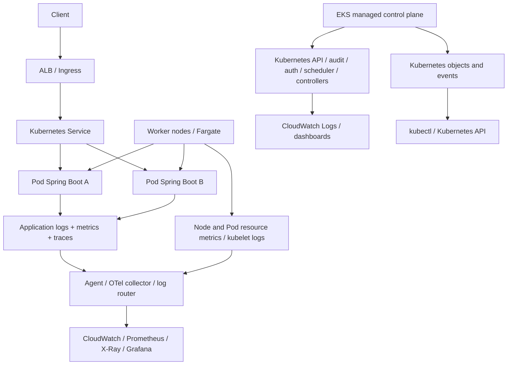
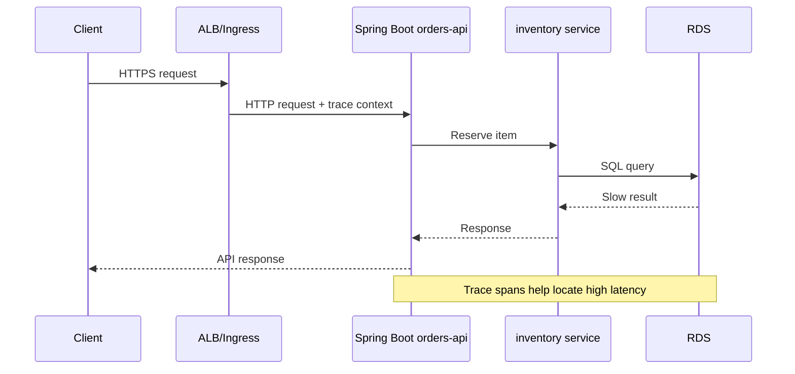
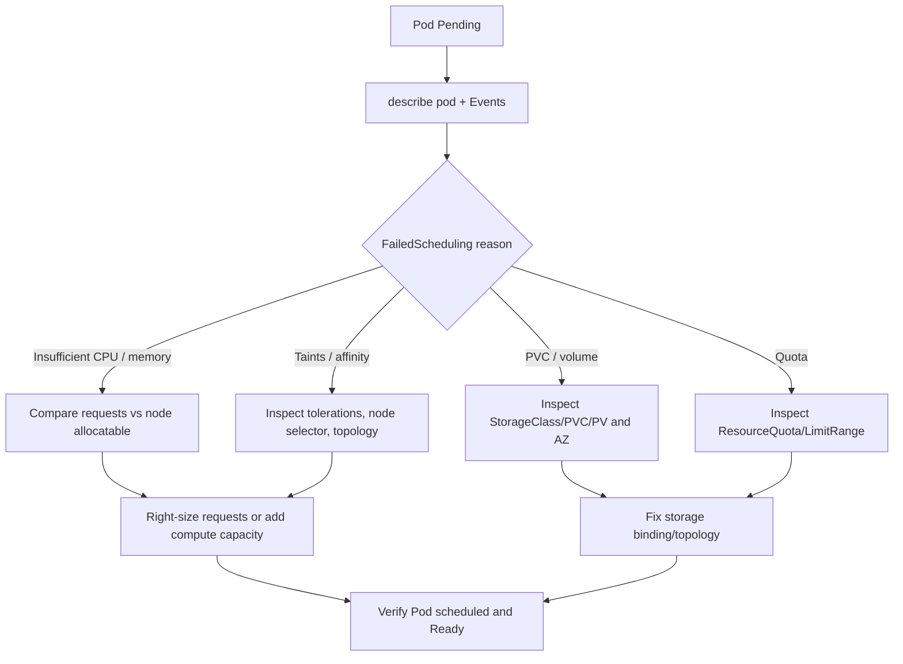

# Quan sát cluster, log control plane và hiệu năng Pod

> **Chương:** Kubernetes với EKS · **Mô-đun:** `CLOUD_PROVIDERS_AWS`

## 1. Vì sao cần quan sát nhiều lớp trong Amazon EKS?

Một dịch vụ Java Spring Boot chạy trong **Amazon Elastic Kubernetes Service (Amazon EKS)** có thể trả HTTP 503 dù trạng thái cluster là `ACTIVE`. Nguyên nhân có thể đến từ một Pod `CrashLoopBackOff`, worker node bị thiếu bộ nhớ, Kubernetes scheduler không tìm được node đủ tài nguyên, lệnh gọi Kubernetes API bị từ chối, ingress định tuyến sai hoặc database ở phía sau bị chậm. Không có một bảng điều khiển hay một tệp log nào tự trả lời mọi câu hỏi đó.

**Observability (khả năng quan sát)** là khả năng hiểu trạng thái và hành vi hệ thống từ **metrics, logs, traces và các sự kiện/trạng thái Kubernetes**. Mục tiêu không chỉ là biết “cluster đang chạy”, mà còn trả lời:

1. **Điều gì đang xảy ra?** Pod nào tăng latency, restart hoặc mất readiness?
2. **Xảy ra ở đâu?** Namespace, deployment, Pod, node, AZ, service, endpoint hay dependency nào?
3. **Từ khi nào?** Gắn mốc thời gian với rollout, autoscaling, thay đổi IAM/VPC hay sự kiện hạ tầng.
4. **Vì sao?** Kết hợp control plane audit, Pod events, ứng dụng, tài nguyên CPU/memory và distributed traces.
5. **Cần làm gì?** Giảm tác động, rollback có kiểm soát, tăng capacity đúng chỗ, sửa policy hoặc cấu hình, xác minh phục hồi.

Trong mô-đun `CLOUD_PROVIDERS_AWS`, kỹ năng quan sát EKS phải gắn với **AWS Region/AZ, IAM, VPC, EC2/Fargate, ECR, storage (EBS/EFS), RDS, tích hợp serverless, giám sát, phục hồi và kiểm soát chi phí**. EKS quản lý Kubernetes control plane nhưng người vận hành vẫn phải quản lý workload, permissions, mạng, logs, alerts và chi phí quan sát.

**Sau bài học, người học có thể:**

- Phân biệt control plane logs, Kubernetes events, node/container logs, metrics và traces.
- Bật và xác minh từng loại EKS control plane log xuất tới CloudWatch Logs; đọc mẫu audit logs.
- Dùng `kubectl get/describe/logs/top` để khoanh vùng Pod/Node và hiểu giới hạn của từng lệnh.
- Giám sát Pod CPU, memory, throttling, OOM, network, restart và scheduling dựa trên requests/limits.
- Chọn Container Insights, OpenTelemetry, Prometheus, CloudWatch/Application Signals và hệ thống cảnh báo đúng nhu cầu.
- Xây runbook cho `Pending`, `CrashLoopBackOff`, `OOMKilled`, `ImagePullBackOff`, node `NotReady` và latency tăng.
- Thiết kế bảo mật telemetry, log retention, SLO, dự phòng nhiều AZ và kiểm soát chi phí observability.

## 2. Bản đồ các lớp quan sát của EKS

EKS có **control plane do AWS quản lý** và lớp chạy Pod là **data plane** (Amazon EC2 managed/self-managed nodes, Fargate hoặc mô hình compute được hỗ trợ khác). Logs control plane được EKS xuất khi bật tính năng tương ứng; chúng **không chứa đầy đủ stdout/stderr của mọi container**.



| Tầng / tín hiệu | Trả lời câu hỏi | Nguồn phổ biến |
| --- | --- | --- |
| **EKS control plane logs** | Ai gọi API? Authentication/RBAC có lỗi? Scheduler/controller báo gì? | EKS export tới CloudWatch log group `/aws/eks/<cluster>/cluster`. |
| **Kubernetes objects và events** | Pod `Pending` vì sao? Deployment có đủ replicas không? Node `Ready` không? | Kubernetes API qua `kubectl get/describe/events`. |
| **Node/kubelet/container runtime** | Node thiếu disk/memory? Kubelet hoặc CNI lỗi? | Host/kubelet logs, node metrics, Container Insights. |
| **Pod/container logs** | Java có stack trace? HTTP 500 từ đâu? | Container stdout/stderr qua `kubectl logs` và log collector. |
| **Metrics tài nguyên** | CPU/memory đang dùng bao nhiêu? Throttling, network, filesystem? | Metrics Server (`kubectl top`), Container Insights, Prometheus/OTel. |
| **Metrics ứng dụng** | p95 latency, error rate, throughput, queue depth? | Spring Boot Actuator/Micrometer, OTel, Prometheus, CloudWatch Application Signals. |
| **Traces** | Request chậm ở service, DB hay external API nào? | OpenTelemetry + AWS X-Ray hoặc backend tracing được chọn. |
| **AWS infrastructure/audit** | Ai sửa EKS/VPC/IAM/ECR? EC2/RDS/AZ có sự kiện? | AWS CloudTrail, AWS Health, VPC Flow Logs, ALB logs, CloudWatch. |

**Không nhầm CloudTrail với Kubernetes audit log:** CloudTrail chủ yếu ghi **AWS API actions** (ví dụ `eks:UpdateClusterConfig`, thay IAM/VPC resource). **Kubernetes audit log** ghi tương tác với **Kubernetes API server** (ví dụ người dùng tạo/xóa Deployment trong cluster). Cả hai có thể cần được điều tra cùng nhau nhưng không thay thế cho nhau.

### 2.1. Ba trụ cột và tín hiệu vận hành

- **Logs:** các sự kiện theo thời gian, có ngữ cảnh (request ID, Pod name, component, exception). Hữu ích để biết “chuyện gì đã xảy ra”.
- **Metrics:** chuỗi số liệu theo thời gian (CPU, memory, error rate, latency, số Pod healthy). Hữu ích để theo dõi xu hướng, SLO và cảnh báo.
- **Traces:** các spans liên kết request xuyên nhiều dịch vụ, giúp định vị đoạn xử lý chậm.
- **Kubernetes events/desired state:** quan trọng nhưng **không phải lịch sử audit đầy đủ**; events có vòng đời lưu ngắn và có thể được gộp. Đừng dùng events thay log retention dài hạn.

### 2.2. Điều gì được AWS quản lý, điều gì vẫn thuộc đội vận hành?

AWS quản lý nhiều thành phần control plane của EKS. Nhóm vận hành **không SSH vào control plane** để đọc log như trên máy Linux tự dựng. Khi cần chẩn đoán, sử dụng EKS control plane logging, EKS observability dashboard và các Kubernetes/AWS APIs được cấp quyền. Đội vận hành vẫn chịu trách nhiệm về **cluster add-ons, worker nodes theo mô hình, application logs, telemetry pipelines, RBAC/IAM, namespace resources và hệ thống alerts**.

## 3. Năm loại control plane logs của Amazon EKS

EKS hỗ trợ bật/tắt độc lập **5 loại log** của managed control plane, xuất tới **Amazon CloudWatch Logs** trong cùng AWS account. **Mặc định không bật export**, do đó cluster tồn tại không đồng nghĩa CloudWatch đã chứa audit hay scheduler logs.

| Log type trong EKS | Component | Đọc khi nào? | Ví dụ dấu hiệu |
| --- | --- | --- | --- |
| `api` | Kubernetes API server | API lỗi, request handling, API server flags/diagnostics. | Request/response failures, thông tin vận hành API server. |
| `audit` | Kubernetes API audit | Điều tra ai thực hiện thao tác trên Kubernetes objects và kết quả. | `verb=create/update/delete`, identity, resource, namespace, response code. |
| `authenticator` | Amazon EKS authenticator | Đăng nhập Kubernetes bằng IAM identity bị từ chối hoặc mapping/quyền truy cập đáng ngờ. | Thông tin xác thực principal/role và kết quả authentication. |
| `controllerManager` | Kubernetes controller manager | Deployment/ReplicaSet/Node controllers không reconcile như mong đợi. | Controller reconcile lỗi, không xử lý được state. |
| `scheduler` | Kubernetes scheduler | Pod không được schedule, các tình huống queue/capacity/policy. | Lỗi scheduling, tương tác với plugin, thông tin scheduler. |

**Phân biệt gốc lỗi:** `scheduler` log hỗ trợ điều tra quá trình đặt Pod; sự kiện `FailedScheduling` trên chính Pod thường là dấu hiệu kiểm tra đầu tiên. Nếu Pod đã được schedule nhưng container không pull được ECR image, thường cần xem Pod events, kubelet và network/IAM của node hoặc Fargate chứ không chỉ scheduler log.

### 3.1. Địa chỉ log group và quyền xem

Log group control plane có dạng:

```text
/aws/eks/<cluster-name>/cluster
```

Ví dụ cluster `learning-eks`:

```text
/aws/eks/learning-eks/cluster
```

Trong group này có các streams tương ứng component, thường bắt đầu bởi:

```text
kube-apiserver-
kube-apiserver-audit-
authenticator-
kube-controller-manager-
kube-scheduler-
```

Log streams có thể được **rotate**; đừng hard-code một stream ID. Cần quyền IAM cho người xem CloudWatch Logs (ví dụ `logs:DescribeLogStreams`, `logs:FilterLogEvents`, `logs:StartQuery`, `logs:GetQueryResults` theo phạm vi), ngoài quyền đọc EKS/Kubernetes phù hợp. Kiểm soát truy cập audit logs vì có thể chứa identity, resource names, request metadata và dữ liệu nhạy cảm tùy event.

### 3.2. Logging được chuyển với độ trễ và không truy hồi lịch sử trước khi bật

AWS mô tả control plane logs thường được gửi trong **vài phút** theo cơ chế **best effort**, không có cam kết mỗi event sẽ xuất hiện ngay lập tức. Các log đã không được xuất trước khi bật không mặc nhiên được backfill. Khi điều tra sự cố, ghi rõ **thời điểm logging được bật**, ingestion delay và khả năng thiếu sự kiện.

**Giá thành:** EKS cluster control plane có phí theo giá dịch vụ; khi bật logging, còn có **CloudWatch Logs ingestion, storage và query scanning charges**. Audit logs thường có volume lớn tại cluster nhiều automation/API calls. Lựa chọn log types và retention dựa trên security/operations requirements, không “bật hết vĩnh viễn” mà không lập ngân sách.

### 3.3. Quan sát control plane không chỉ qua logs

Amazon EKS Console có **observability dashboard** với cluster health, configuration insights và **control plane metrics** cho các phiên bản Kubernetes được hỗ trợ (nhóm metric control plane trong dashboard từ Kubernetes **1.28 trở lên** theo tài liệu AWS). Bản dashboard có thể giúp xem tín hiệu API server, scheduler và controller manager mà không cần bắt đầu từ log text.

Các metrics cũng có thể được truy cập ở định dạng Prometheus từ các endpoints được EKS hỗ trợ, ví dụ API group `metrics.eks.amazonaws.com` dành cho scheduler/controller manager ở các cluster tương thích. **Đừng suy rằng `kubectl top` hiển thị metrics control plane**: `kubectl top` là resource metrics cho nodes/Pods, không đo API latency hay số request bị `429` của kube-apiserver.

## 4. Bật/tắt control plane logs an toàn

### 4.1. Preflight

Trước khi thay đổi một cluster thật:

1. Xác minh **AWS account, Region, cluster name** và quyền `eks:DescribeCluster` / `eks:UpdateClusterConfig` cần thiết.
2. Kiểm tra cluster state `ACTIVE`, Kubernetes version, logging configuration hiện có và quy trình duyệt thay đổi.
3. Xác định log types bắt buộc (thường audit, authenticator cho security; api/scheduler/controllerManager cho diagnostics), retention và quyền đọc logs.
4. Đảm bảo subnet được EKS dùng khi thực hiện update có đủ IP khả dụng; AWS lưu ý update control plane logging có thể cần **tối đa 5 IP trống trong mỗi subnet**.
5. Dự trù CloudWatch Logs ingestion/storage cost; không log secrets ở ứng dụng và bảo vệ audit log.

### 4.2. Đọc cấu hình EKS hiện tại (chỉ đọc)

```bash
aws sts get-caller-identity

aws eks describe-cluster \
  --region ap-southeast-1 \
  --name learning-eks \
  --query 'cluster.{name:name,status:status,version:version,logging:logging.clusterLogging}' \
  --output json
```

Các tên cluster/Region là **placeholder**. Nếu `logging.clusterLogging` chưa chứa loại được bật, CloudWatch chưa chắc có log tương ứng. Không suy rằng thiếu log streams là lỗi dịch vụ khi export chưa được kích hoạt.

### 4.3. Ví dụ chỉ bật `audit` và `authenticator`

**Lệnh dưới đây thay đổi cluster thật và có thể phát sinh phí CloudWatch; chỉ chạy sau phê duyệt**:

```bash
aws eks update-cluster-config \
  --region ap-southeast-1 \
  --name learning-eks \
  --logging '{"clusterLogging":[{"types":["audit","authenticator"],"enabled":true}]}'
```

Muốn bật cả 5 loại, dùng:

```bash
aws eks update-cluster-config \
  --region ap-southeast-1 \
  --name learning-eks \
  --logging '{"clusterLogging":[{"types":["api","audit","authenticator","controllerManager","scheduler"],"enabled":true}]}'
```

Lệnh trả `update.id` và trạng thái ban đầu; **không kết luận cập nhật đã hoàn tất chỉ vì AWS CLI trả HTTP thành công**. Kiểm tra:

```bash
aws eks describe-update \
  --region ap-southeast-1 \
  --name learning-eks \
  --update-id <update-id-from-previous-command> \
  --query 'update.{status:status,type:type,errors:errors}' \
  --output json

aws eks describe-cluster \
  --region ap-southeast-1 \
  --name learning-eks \
  --query 'cluster.logging.clusterLogging' \
  --output json
```

Thay placeholder `<update-id-from-previous-command>` bằng ID thật; có thể là `InProgress` trước khi thành `Successful`. Cấu hình control plane logging có thể được cập nhật độc lập theo mỗi log type; tránh ghi đè ngoài ý muốn các loại đã bật.

### 4.4. Xem CloudWatch log group và retention (chỉ đọc)

```bash
aws logs describe-log-groups \
  --region ap-southeast-1 \
  --log-group-name-prefix /aws/eks/learning-eks/cluster \
  --output json

aws logs describe-log-streams \
  --region ap-southeast-1 \
  --log-group-name /aws/eks/learning-eks/cluster \
  --order-by LastEventTime \
  --descending \
  --limit 10 \
  --output table
```

Để chỉnh retention, cần owner/approval và quyền `logs:PutRetentionPolicy`; lựa chọn số ngày theo security/compliance và budget. Ví dụ **thay đổi thực tế** sau chỉ minh họa:

```bash
aws logs put-retention-policy \
  --region ap-southeast-1 \
  --log-group-name /aws/eks/learning-eks/cluster \
  --retention-in-days 30
```

Retention 30 ngày là **giả định bài tập**, không phải giá trị AWS khuyến nghị cho mọi hệ thống. Cảnh báo: chỉnh retention ngắn có thể dẫn tới **xóa dữ liệu log cũ**; không coi thao tác này có thể hoàn tác như thay một filter. Với yêu cầu lưu audit dài hạn, đánh giá log archive/S3, security controls và quy định pháp lý.

## 5. Truy vấn audit, authenticator và scheduler logs

Control plane logs giúp biết **ai làm gì trên Kubernetes API**, quá trình xác thực xảy ra thế nào và scheduler/controller gặp vấn đề gì. Bên cạnh CloudWatch Console, **CloudWatch Logs Insights** có thể lọc theo thời điểm, component và trường trong log để tăng tốc điều tra.

### 5.1. Audit log: “ai xóa Deployment?”

Kubernetes audit log thường có các trường cấu trúc như `verb`, `user.username`, `sourceIPs`, `objectRef`, `responseStatus` và `requestURI`. Tùy cấp độ audit event, không phải tất cả dữ liệu đều có mặt; format của EKS log và các trường tự nhận diện trong Logs Insights cần kiểm tra thực tế.

Ví dụ truy vấn Logs Insights trên `/aws/eks/learning-eks/cluster`:

```sql
fields @timestamp, verb, user.username, objectRef.namespace,
       objectRef.resource, objectRef.name, responseStatus.code
| filter @logStream like /kube-apiserver-audit/
| filter verb in ["delete", "patch", "update"]
| sort @timestamp desc
| limit 100
```

Đây là mẫu cho **log events được parse thành trường JSON**. Nếu log được biểu diễn dưới dạng text hoặc trường không tự parse, kiểm tra `@message` rồi dùng `parse` phù hợp với log thực tế. `user.username` có thể là service account hoặc IAM principal đã map vào Kubernetes identity; **không suy ra người thực hiện cuối cùng** nếu nhiều người dùng chung role/service account hoặc automation.

Khi điều tra thay đổi bất thường:

1. Ghi mốc thời gian/namespace/resource, tìm event `delete`/`patch`/`update`.
2. Kiểm tra principal, source IP, user agent và response code; phân biệt thao tác **được yêu cầu** và thao tác **thực sự thành công**.
3. Đối chiếu CloudTrail (IAM/STS, AWS APIs), pipeline deploy và Kubernetes RBAC/access entries.
4. Kiểm tra Deployment/ReplicaSet events để biết tác động lên Pods.
5. Không đưa toàn bộ audit log nhạy cảm vào ticket công khai; trích dẫn phần cần thiết và giới hạn quyền truy cập.

### 5.2. Authenticator log: xác thực IAM và quyền Kubernetes

EKS có cơ chế ánh xạ IAM principal thành danh tính Kubernetes và kiểm soát truy cập thông qua EKS access entries/RBAC hoặc các cơ chế cũ tùy cluster. Nếu `kubectl get pods` báo `Unauthorized` hay `Forbidden`:

- **Unauthorized** thường là danh tính chưa được xác thực đúng / token không hợp lệ / principal chưa được EKS chấp nhận.
- **Forbidden** nghĩa là request đã đi tới bước ủy quyền nhưng danh tính không được phép thực hiện action theo policy/RBAC.

Đọc `authenticator` logs để xem dấu hiệu xác thực IAM, sau đó dùng `kubectl auth can-i` (khi đã xác thực được) để kiểm tra quyền Kubernetes. **Authenticator logs không thay thế toàn bộ RBAC audit trail**; kết hợp audit `responseStatus.code` và thông tin EKS access policy/RoleBinding.

Ví dụ xem quyền của context hiện tại:

```bash
kubectl auth can-i list pods --namespace orders
kubectl auth can-i get deployments --namespace orders
```

Không tự sửa `ClusterRoleBinding` hoặc cấp `cluster-admin` chỉ để thấy dashboard; cần tìm nguyên nhân thiếu quyền và cấp scope tối thiểu theo namespace/đối tượng.

### 5.3. Scheduler và controller manager logs

Truy vấn text đơn giản cho scheduler:

```sql
fields @timestamp, @logStream, @message
| filter @logStream like /kube-scheduler/
| filter @message like /schedule|pod|error|fail/
| sort @timestamp desc
| limit 100
```

Với Pod `Pending`, **`kubectl describe pod` và events** thường cho lý do chính xác hơn: `0/3 nodes are available: insufficient memory`, node affinity, taints, PVC pending hoặc pod topology constraints. Logs scheduler là lớp bổ sung khi tình trạng phức tạp, không phải công cụ đầu tiên trong mọi sự cố.

Controller manager logs hữu ích khi một controller không reconcile desired state. Ví dụ Deployment desired replicas=3 nhưng chỉ tạo được 1; kiểm tra `kubectl describe deployment`, ReplicaSet events, resource quota và controller logs, không chỉ nhìn Pod đã chạy.

### 5.4. Lựa chọn giữa CloudWatch Logs Insights và kubectl

| Tình huống | Bắt đầu ở đâu? | Vì sao |
| --- | --- | --- |
| Ai gọi Kubernetes API để xóa một namespace? | **Audit logs** và CloudTrail liên quan. | Events của namespace không phải audit history đầy đủ. |
| Pod mới `Pending` ở một AZ. | **`kubectl describe pod` và events**, sau đó scheduler logs. | Reason của Pod thường rõ ngay trong events. |
| Java exception của container đang chạy. | **`kubectl logs`** hoặc centralized app logs. | Control plane không chứa Java stack trace. |
| Pod bị restart vì OOM. | **`kubectl describe pod`**, container status, memory metrics, app logs. | `OOMKilled` xảy ra ở runtime/memory cgroup. |
| API server chậm, client thường xuyên `429`. | **EKS control plane metrics/API logs**, client retry behavior. | Node `kubectl top` không đo latency của API server. |

## 6. Quy trình điều tra cluster bằng `kubectl` (chỉ đọc)

Các lệnh mẫu giả định người học đã cấu hình `kubeconfig` với context của cluster lab đã được phép. Trước khi chạy bất kỳ lệnh nào, xác minh AWS account, Region và Kubernetes context để tránh đọc/sửa nhầm production.

### 6.1. Chọn context và xem trạng thái tổng thể

```bash
# Xem danh sách contexts và context đang dùng.
kubectl config get-contexts
kubectl config current-context

# Đọc toàn cluster; cần RBAC đủ quyền.
kubectl get nodes -o wide
kubectl get namespaces
kubectl get pods -A -o wide
kubectl get deployments -A

# Xem các sự kiện mới nhất của cluster.
kubectl get events -A --sort-by=.metadata.creationTimestamp
```

Trong EKS, để tạo/cập nhật kubeconfig thông qua AWS CLI (lệnh này **sửa kubeconfig cục bộ**, không sửa cluster):

```bash
aws eks update-kubeconfig --region ap-southeast-1 --name learning-eks
```

IAM permission `eks:DescribeCluster` để nhận endpoint/CA **không tự cấp quyền Kubernetes RBAC**. Xác minh access entry/policy và mapping của principal. Một người xem EKS Console chưa chắc có quyền `list pods` trên mọi namespace.

### 6.2. Từ Deployment tới Pod cụ thể

Giả sử ứng dụng ở namespace `orders`:

```bash
kubectl get deployment -n orders
kubectl describe deployment orders-api -n orders

# Liệt kê Pod, node và trạng thái restart.
kubectl get pods -n orders -o wide

# Thay <pod-name> bằng tên Pod thật lấy từ lệnh trên.
kubectl describe pod <pod-name> -n orders
kubectl get events -n orders --sort-by=.metadata.creationTimestamp
```

Đọc các trường sau trong `describe pod`:

- **Status/Conditions:** `Pending`, `Running`, `Ready` và trạng thái containers.
- **Containers.Last State:** `Terminated` reason (ví dụ `OOMKilled`), exit code, thời gian và restart count.
- **Requests/Limits:** CPU, memory, ephemeral storage có khai báo đúng?
- **Node/Node selector/Affinity/Tolerations:** Pod được gán node nào; có ràng buộc AZ/taints?
- **Events:** `FailedScheduling`, `FailedMount`, `FailedCreatePodSandBox`, `Pulling`, `BackOff`.

`Running` chưa chắc `Ready`. Một Pod có process đang chạy nhưng readiness probe thất bại có thể **không được đưa vào Service endpoints**, gây thiếu backend phục vụ request.

### 6.3. Đọc logs của container

```bash
# Logs hiện tại theo Pod và container.
kubectl logs -n orders <pod-name> -c orders-api --tail=200 --timestamps

# Theo dõi log mới (dừng bằng Ctrl+C).
kubectl logs -n orders <pod-name> -c orders-api -f --since=10m

# Nếu container đã restart và previous log còn tồn tại.
kubectl logs -n orders <pod-name> -c orders-api --previous --tail=200

# Logs theo deployment (kubectl chọn các Pods phù hợp).
kubectl logs -n orders deployment/orders-api --all-containers=true --tail=100
```

**Giới hạn:** `kubectl logs` đọc logs do container runtime/kubelet cung cấp, chủ yếu stdout/stderr của container. Log có thể bị rotate, mất khi node/Pod bị xóa hoặc không tồn tại sau nhiều lần restart. `--previous` chỉ có ý nghĩa khi có container instance trước được lưu lại. Để phân tích lịch sử qua nhiều Pod và AZ, cần **centralized logging**.

### 6.4. Sự khác biệt giữa events và logs

Events mô tả quyết định của Kubernetes (ví dụ image pull thất bại), còn application logs cho biết quá trình trong container (ví dụ Java exception). Events không thay thế log ứng dụng; Pod logs không giải thích hết lỗi scheduler hoặc IAM authentication. Phân tích cùng **timestamp, namespace, Pod UID/deployment revision và node** giúp ghép nguyên nhân.

## 7. Resource metrics: `kubectl top`, Metrics Server và giới hạn

`kubectl top` cung cấp cái nhìn nhanh về **CPU và memory usage hiện tại gần đây**:

```bash
kubectl top nodes
kubectl top pods -n orders
kubectl top pods -n orders --containers
```

Các lệnh này cần **Metrics Server** hoặc một implementation phù hợp cho Kubernetes Metrics API `metrics.k8s.io`. Trên EKS, Metrics Server có thể được cài như **community add-on** `metrics-server` (hoặc theo mô hình Kubernetes được quản trị khác). **Không mặc định Metrics Server được cài trong mọi EKS cluster.**

Kiểm tra:

```bash
kubectl get apiservices | grep metrics.k8s.io
kubectl get deployment metrics-server -n kube-system
kubectl get pods -n kube-system -l k8s-app=metrics-server
```

Label ở lệnh cuối là ví dụ, có thể khác theo manifest/add-on; nếu không thấy pod, xem `kubectl get pods -n kube-system`. Khi `kubectl top` báo `Metrics API not available`, cần kiểm tra cài đặt, RBAC, kubelet connectivity, TLS và trạng thái add-on thay vì kết luận cluster không dùng CPU.

### 7.1. Vì sao `kubectl top` không đủ cho giám sát dài hạn?

- Nó phản ánh **resource metrics của khoảng thời gian ngắn**, được thiết kế phục vụ Kubernetes autoscaling, không phải lịch sử chi tiết theo từng giây.
- Không tự cho biết request latency, HTTP error rate, Java GC, CPU throttling hay nguồn network I/O.
- Nó không tạo dashboard/alerting history nếu bạn chưa có metrics backend.
- CPU/memory usage không luôn bằng mức kernel/container process tools, vì Kubernetes dùng resource metrics semantics của kubelet.

Với trend, p95/p99 latency và capacity planning, nên bổ sung **Container Insights (CloudWatch)** hoặc **Prometheus/OTel metrics backend**.

### 7.2. Đọc bảng mẫu `kubectl top`

```text
NAME                           CPU(cores)   MEMORY(bytes)
orders-api-6cb789d7c4-8lz6p    480m         390Mi
orders-api-6cb789d7c4-p7bc2    120m         170Mi
```

`480m` nghĩa là khoảng **0,48 CPU core** trong khoảng đo; `390Mi` là mức memory được báo theo resource metrics. Những con số này **không phải yêu cầu tài nguyên**. Muốn biết requests/limits, xem Pod spec và `kubectl describe pod`:

```bash
kubectl get pod -n orders <pod-name> -o yaml
```

Nếu app dùng request `250m` nhưng usage `480m`, điều này không tự là lỗi: **CPU request phục vụ scheduling/share**, không phải hard ceiling. Nếu CPU limit là `500m`, container có thể đang gần limit và bị throttle; cần đo throttling counters và response latency. Nếu memory limit là `512Mi`, usage 390Mi chưa chứng minh không có rủi ro OOM khi traffic tăng hoặc memory spikes.

## 8. Pod performance: requests, limits và nguyên nhân bottleneck

### 8.1. CPU và memory có ý nghĩa khác nhau

| Khái niệm | CPU | Memory |
| --- | --- | --- |
| **Request** | Dùng cho scheduling và phân bổ resource/cpu shares theo cơ chế Kubernetes; ví dụ `250m`. | Dùng cho scheduling; ví dụ `256Mi`. |
| **Limit** | Giới hạn CPU runtime; vượt ngưỡng có thể bị **CPU throttling**. | Mức giới hạn memory; vượt có thể dẫn đến **OOM kill**. |
| **Usage** | Mức CPU tiêu thụ đo được trong cửa sổ thời gian. | Mức memory làm việc theo resource metrics, không đồng nhất mọi dạng memory accounting. |
| **Hiện tượng quá tải** | Requests chậm, queue tăng, throttle dù node còn CPU tổng thể. | Container `OOMKilled`, exit code thường 137, restart, tăng lỗi. |

**Không dùng một tỷ lệ CPU usage cao để kết luận throttling.** Cần so CPU limit và các metric như `container_cpu_cfs_throttled_periods_total` / `container_cpu_cfs_periods_total` nếu collector cung cấp, xem app latency và CPU saturation. Tương tự, một lần `OOMKilled` có thể do memory leak, heap sizing JVM sai, native/off-heap allocations, workload spike hoặc memory limit quá thấp.

### 8.2. Một Deployment Spring Boot có resource và probes rõ ràng

Ví dụ YAML dưới đây minh họa các trường quan trọng; image URI là **placeholder**, chưa thể deploy nếu chưa thay bằng image thật và cấu hình health endpoints:

```yaml
apiVersion: apps/v1
kind: Deployment
metadata:
  name: orders-api
  namespace: orders
spec:
  replicas: 3
  selector:
    matchLabels:
      app: orders-api
  template:
    metadata:
      labels:
        app: orders-api
    spec:
      containers:
        - name: orders-api
          image: 111122223333.dkr.ecr.ap-southeast-1.amazonaws.com/orders-api:v1.4.2
          ports:
            - containerPort: 8080
          resources:
            requests:
              cpu: "250m"
              memory: "256Mi"
            limits:
              cpu: "1000m"
              memory: "768Mi"
          startupProbe:
            httpGet:
              path: /actuator/health/liveness
              port: 8080
            periodSeconds: 10
            failureThreshold: 30
          readinessProbe:
            httpGet:
              path: /actuator/health/readiness
              port: 8080
            periodSeconds: 5
            failureThreshold: 3
          livenessProbe:
            httpGet:
              path: /actuator/health/liveness
              port: 8080
            periodSeconds: 10
            failureThreshold: 3
```

**Điều kiện:** Spring Boot Actuator phải được thêm và cấu hình kích hoạt probes/HTTP exposure phù hợp; không phải mọi application/version mặc định có hai URL này. `startupProbe` cho JVM thời gian warmup trước khi liveness/readiness được đánh giá bình thường. **Readiness** nên phản ánh khả năng nhận traffic; **liveness** không nên phụ thuộc máy chủ ngoài không ổn định, vì có thể gây restart hàng loạt dù app vẫn có thể phục hồi.

Giá trị CPU/memory/timeout ở trên là **ví dụ**, phải đo bằng load testing đúng image, JVM heap/off-heap, node type và SLO. Không tăng `limits` bừa bãi để “sửa” mọi tình huống: CPU limit quá thấp có thể throttle; memory limit quá cao có thể tạo memory pressure/OOM ở cấp node.

### 8.3. Pending không phải lúc nào thiếu CPU thực tế

Kubernetes scheduler dựa trên **requests** và điều kiện scheduling, không chỉ quan sát CPU usage tại thời điểm hiện tại. Pod có request `4Gi` RAM có thể `Pending` dù node đang dùng rất ít RAM nếu **allocatable - tổng requests đã được schedule** không đủ, hoặc quota, topology spread, taints/tolerations, PVC volume AZ và affinity không đáp ứng.

Đọc:

```bash
kubectl describe pod -n orders <pending-pod-name>
kubectl describe node <node-name>
kubectl get resourcequota -n orders
kubectl get limitrange -n orders
```

Nếu event báo thiếu CPU/memory, so **node allocatable, requests của các Pod đã đặt và node groups/compute autoscaling**. Nếu event báo `volume node affinity conflict`, kiểm tra PV/EBS AZ; thêm CPU ở AZ khác không giải quyết volume ràng buộc AZ. Nếu taint hoặc namespace quota chặn, tăng node count cũng có thể không giúp.

### 8.4. Các tín hiệu Pod quan trọng

| Tín hiệu | Diễn giải | Cần đối chiếu |
| --- | --- | --- |
| `pod_cpu_usage_total` / `container_cpu_usage_seconds_total` | Tiêu thụ CPU theo collector/schema tương ứng. | CPU request/limit, throttle, latency và traffic. |
| `pod_memory_working_set` / `container_memory_working_set_bytes` | Bộ nhớ làm việc ước lượng. | Memory limit, `OOMKilled`, heap/native memory. |
| `container_cpu_cfs_throttled_periods_total` | Số kỳ CPU CFS bị throttle (nếu export). | CPU limit và app response time; tính rate/tỷ lệ theo kỳ. |
| Restart count | Container restart. | `Last State`, exit code, liveness probe, JVM crash/OOM. |
| Pod readiness / desired vs available replicas | Khả năng nhận request. | Probe, ALB target health, deployment rollout. |
| Pod/node network RX/TX | Lưu lượng truyền nhận. | CNI, VPC networking, throughput và egress costs. |
| Filesystem và ephemeral storage | Disk pressure hoặc storage throughput. | `DiskPressure`, ephemeral limit, EBS/EFS/PVC, logs/cache. |

Metric names khác nhau giữa **CloudWatch Container Insights Classic, OTel Container Insights và Prometheus exporters**. Những tên trong bảng là ví dụ biểu đạt ý nghĩa, **không khẳng định mọi collector đều xuất mọi tên**, và không nên trộn Prometheus syntax với CloudWatch metric dimensions.

## 9. Container Insights, OpenTelemetry, Prometheus và Grafana

`kubectl top` rất hữu ích cho điều tra tại thời điểm sự cố nhưng không đủ để vẽ biểu đồ lịch sử, tính SLO hay cảnh báo dự báo. Cần có một pipeline thu thập **metrics/logs/traces**, một backend lưu trữ/truy vấn và dashboard/alert routing.

### 9.1. Chọn hệ sinh thái quan sát

| Giải pháp | Loại tín hiệu/điểm mạnh | Giới hạn/cân nhắc |
| --- | --- | --- |
| **EKS observability dashboard** | Trạng thái cluster, health/configuration insights và metrics control plane ở version được hỗ trợ. | Không thay application metrics, logs/traces và cảnh báo đầy đủ cho mọi use case. |
| **CloudWatch Container Insights** | Hạ tầng EKS: node, Pod, container, một số network/storage/resource metrics; dashboards và alarms. | Cần triển khai agent/add-on phù hợp, IAM, network; có phí ingest/observations. |
| **CloudWatch Application Signals** | Service-level metrics, request/dependency telemetry và SLO theo hỗ trợ instrumentation. | Cần instrumentation và điều kiện dịch vụ; phát sinh chi phí theo application signals. |
| **OpenTelemetry (OTel) / AWS Distro for OpenTelemetry (ADOT)** | Chuẩn thu thập/export metrics, traces và logs sang backend khác nhau. | Cần quản lý collector, sampling, processors, labels, schema và tài nguyên agent. |
| **Prometheus + Alertmanager** | Scrape metrics và query bằng **PromQL**, rules/alerts cho ứng dụng/Kubernetes. | Cần triển khai hoặc dùng managed service; kiểm soát cardinality/retention. |
| **Amazon Managed Service for Prometheus (AMP)** | Backend Prometheus-compatible được AWS quản lý, hỗ trợ collectors/scrapers. | Phí ingest, lưu trữ, query; cần policy/IAM, networking và cấu hình scrape. |
| **Amazon Managed Grafana / Grafana** | Dashboards từ Prometheus, CloudWatch, X-Ray và các nguồn được hỗ trợ. | Là lớp trực quan hóa; không tự tạo dữ liệu nếu thiếu collectors. |
| **AWS X-Ray / tracing backend** | Distributed tracing và service dependencies từ instrumented apps. | Cần trace context và sampling, quyền xuất dữ liệu, retention. |

**Một giải pháp không độc quyền:** EKS có thể dùng CloudWatch để thu thập Kubernetes/host metrics, đồng thời dùng Prometheus cho custom application metrics và OpenTelemetry cho traces. Tuy nhiên, nếu cùng metrics/logs được đẩy qua nhiều collectors, chi phí và trùng lặp dữ liệu có thể tăng. Chọn **một pipeline chuẩn cho từng loại tín hiệu** và định nghĩa rõ trách nhiệm.

### 9.2. Amazon CloudWatch Observability EKS add-on

AWS cung cấp EKS add-on **`amazon-cloudwatch-observability`**. Tùy version/configuration, add-on triển khai CloudWatch agent và Fluent Bit, hỗ trợ Container Insights và Application Signals theo cấu hình thích hợp.

Tài liệu CloudWatch hiện phân biệt:

1. **Enhanced Container Insights (Classic):** pipeline metrics truyền thống của Container Insights.
2. **OTel Container Insights (Recommended):** pipeline dựa trên **OpenTelemetry Protocol (OTLP)**, hỗ trợ phân tích theo PromQL ở điều kiện dịch vụ được hỗ trợ. AWS khuyến nghị phương án này cho deployment EKS mới.

**OTel Container Insights không nhất thiết tự bật chỉ vì đã cài add-on.** Phiên bản add-on hỗ trợ từ **`v6.2.0-eksbuild.1` trở lên**, và cần cấu hình `otelContainerInsights.enabled: true`. Theo tài liệu quick start hiện hành, cần Kubernetes **1.28 trở lên**, EKS platform tương thích, add-on đúng version và IAM/Pod Identity/IRSA đáp ứng. Đừng áp một hướng dẫn add-on cũ cho cluster mới mà không kiểm tra compatibility.

### 9.3. Kiểm tra add-on trước khi thay đổi (AWS CLI chỉ đọc)

```bash
aws eks list-addons \
  --region ap-southeast-1 \
  --cluster-name learning-eks

aws eks describe-addon \
  --region ap-southeast-1 \
  --cluster-name learning-eks \
  --addon-name amazon-cloudwatch-observability \
  --output json
```

Nếu add-on chưa cài, `describe-addon` trả lỗi không tìm thấy; điều đó **không chứng minh cluster hoàn toàn không có metrics** vì có thể đang dùng Helm, self-managed OTel, Prometheus hay hệ thống quan sát khác.

Đối với add-on đã cài và tương thích, AWS cung cấp cấu hình dạng:

```json
{
  "containerInsights": {
    "enabled": true
  },
  "otelContainerInsights": {
    "enabled": true
  }
}
```

**Đây là mẫu cấu hình, không phải lệnh cần chạy mặc định.** Bật đồng thời hai pipelines hữu ích khi migration/đối chiếu nhưng có thể tạo **double ingestion/chi phí**. Đọc schema chính xác của version add-on và tài liệu [OTel Container Insights](https://docs.aws.amazon.com/AmazonCloudWatch/latest/monitoring/container-insights-eks-otel.html) trước khi tạo hoặc update, đồng thời bảo đảm service account role có quyền CloudWatch/X-Ray phù hợp.

### 9.4. IAM, Pod Identity và đường truyền telemetry

Để agent ghi metrics/logs/traces vào AWS, cần IAM credentials đúng:

- Với add-on hỗ trợ, dùng **EKS Pod Identity** hoặc **IAM Roles for Service Accounts (IRSA)** theo prerequisites để cấp quyền cho service account; không nhúng access keys vào ConfigMap/Pod.
- Các quyền IAM như `CloudWatchAgentServerPolicy` và `AWSXrayWriteOnlyAccess` có thể là cơ sở theo cấu hình; review và thu hẹp khi phù hợp. Nếu không dùng tracing, kiểm tra có thật sự cần quyền X-Ray không.
- Kubernetes **RBAC** cho phép agent quan sát những metadata cần thiết; IAM quản lý quyền xuất tới AWS. Đây là **hai lớp quyền khác nhau**.
- Worker node và agent ở **private subnets** phải có đường HTTPS tới CloudWatch Logs/Monitoring, X-Ray, STS hay dịch vụ cần thiết qua NAT hoặc **VPC interface endpoints** được hỗ trợ. Security groups, VPC endpoint policies, DNS và KMS cũng ảnh hưởng.
- **EKS Fargate không chạy node-level DaemonSet theo cách EC2 nodes chạy**; cần mô hình log router/monitoring tương thích Fargate thay vì mặc định áp dụng cùng manifest DaemonSet cho tất cả. Kiểm tra tính năng addon/collector theo compute type (EC2, Fargate, EKS Auto Mode).

Không cấp quyền CloudWatch write rộng cho tất cả Pods ứng dụng nếu chỉ collector cần ghi. Thực hiện federation/role isolation; giới hạn người xem log nhạy cảm.

### 9.5. Container Insights cho node/Pod metrics

Container Insights có thể thu thập các metric tương ứng như:

| Cấp độ | Ví dụ metric/khái niệm | Chẩn đoán |
| --- | --- | --- |
| Cluster | `cluster_node_count`, `cluster_failed_node_count`. | Node sẵn sàng và mức suy giảm. |
| Node | `node_cpu_utilization`, memory/network/disk metrics theo schema. | Capacity, saturation, node áp lực tài nguyên. |
| Pod | `pod_cpu_utilization`, `pod_memory_utilization` hoặc usage tương ứng. | Pod nào dùng tài nguyên cao, tăng đột biến. |
| Container | Container CPU/memory, restart, disk I/O theo collector. | Container nào bị throttle/OOM/leak. |
| Workload | Running/desired Pods, namespace resource stats, pod failures. | Suy giảm service trước khi HTTP errors rõ ràng. |

**Metric names/dimensions phụ thuộc pipeline.** Ở **Enhanced Container Insights (Classic)**, tài liệu AWS nêu namespace `ContainerInsights` và các metric names cụ thể; với **OTel Container Insights**, metric schema/labels và cách truy vấn có khác biệt. Nên mở danh sách metrics thực tế trong CloudWatch trước khi viết alarm hoặc sao chép query.

### 9.6. Prometheus cho metrics ứng dụng

Nếu ứng dụng Spring Boot có **Micrometer Prometheus registry** và expose endpoint `/actuator/prometheus` với quy tắc bảo mật phù hợp, Prometheus-compatible collector có thể scrape thông tin:

- HTTP requests rate, 4xx/5xx và thời gian phản hồi.
- JVM heap/non-heap memory, garbage collection, threads, process CPU.
- HikariCP connection pool, custom business metrics, queue depth.
- Kubernetes objects từ `kube-state-metrics` và node metrics từ node exporters/cAdvisor nếu được triển khai.

**Không mở `/actuator/prometheus` công khai trên internet.** Dùng internal service discovery, network policies, authentication/TLS khi cần và metric labels có cardinality được kiểm soát.

Ví dụ PromQL cho một môi trường có exporters tương ứng (tên metric/labels phải kiểm tra):

```promql
# Tổng CPU cores được các containers sử dụng (trung bình trong 5 phút).
sum by (pod) (
  rate(container_cpu_usage_seconds_total{
    namespace="orders",
    container!="",
    pod!=""
  }[5m])
)
```

```promql
# Working-set memory theo Pod, đơn vị bytes.
sum by (pod) (
  container_memory_working_set_bytes{
    namespace="orders",
    container!="",
    pod!=""
  }
)
```

```promql
# Tỷ lệ CPU-throttled periods trong 5 phút, theo container.
sum by (pod, container) (
  rate(container_cpu_cfs_throttled_periods_total{namespace="orders"}[5m])
)
/
clamp_min(
  sum by (pod, container) (
    rate(container_cpu_cfs_periods_total{namespace="orders"}[5m])
  ), 1e-9
)
```

Các query chỉ hoạt động khi exporter cung cấp đúng metrics/labels, có dữ liệu trong thời gian được chọn và collector scrape chính xác. Một tỷ lệ throttled-periods cao cần **đối chiếu request latency, CPU limit, traffic**, không tự kết luận node “thiếu CPU”.

### 9.7. AWS-managed Prometheus collector và metrics control plane

**Amazon Managed Service for Prometheus (AMP)** hỗ trợ managed collectors cho EKS theo khả năng dịch vụ. Collector scrape endpoints Prometheus-compatible mà không cần tự vận hành một Prometheus server đầy đủ. Ở các version EKS hỗ trợ, API server metrics được expose; control plane metrics cho scheduler/controller manager có thể có trên Kubernetes **1.28+**.

Điều này **khác** Metrics Server: Metrics Server phục vụ `kubectl top`/HPA resource metrics API, còn Prometheus/AMP phục vụ history, queries, alerts và application/control plane metrics chi tiết. Trước khi cấu hình scraper, kiểm tra RBAC, security group/network, targets, scrape intervals và giới hạn label cardinality.

## 10. Log tập trung cho Pod, node và ứng dụng Java

### 10.1. Log từ stdout/stderr và log collector

Kubernetes thường lấy container stdout/stderr vào container runtime log files; `kubectl logs` đọc từ đó. Một pipeline tập trung dùng **Fluent Bit** (thường chạy DaemonSet trên EC2 worker nodes) hoặc log router tương thích để chuyển log vào CloudWatch Logs hay hệ thống khác.

Trong cấu hình phổ biến CloudWatch Container Insights/Fluent Bit, có các log groups:

| Log group phổ biến | Nội dung |
| --- | --- |
| `/aws/containerinsights/<cluster>/application` | Container application stdout/stderr có metadata Kubernetes. |
| `/aws/containerinsights/<cluster>/host` | Một số host/system logs từ nodes. |
| `/aws/containerinsights/<cluster>/dataplane` | Kubelet, kube-proxy và thành phần data plane theo cấu hình agent/runtime. |
| `/aws/eks/<cluster>/cluster` | **Control plane logs** do EKS export riêng, không phải Fluent Bit app log group. |

Đường dẫn/format thu thập có thể khác khi dùng **OTel Container Insights**, OpenTelemetry Collector tùy chỉnh, ECS/EKS Auto Mode hay Fargate. Không dựa vào sự tồn tại của tên log group để khẳng định tất cả loại log đã được thu thập.

### 10.2. Mẫu log ứng dụng Java có correlation ID

Ứng dụng nên ghi log cấu trúc JSON theo từng request/event để truy vấn được trong CloudWatch Logs Insights hoặc backend khác:

```json
{
  "timestamp": "2026-11-20T02:30:45.123Z",
  "level": "ERROR",
  "service": "orders-api",
  "environment": "staging",
  "requestId": "req-example-001",
  "traceId": "example-trace-id",
  "message": "Failed to reserve inventory",
  "errorType": "DependencyTimeout",
  "durationMs": 1220
}
```

Không ghi **authorization headers, access tokens, passwords, PII hoặc dữ liệu thanh toán nhạy cảm**. Dùng log levels/field masking và retention thích hợp. Một trace ID là mã tương quan, không phải chứng minh user identity đã được xác thực.

### 10.3. Logs Insights cho lỗi ứng dụng

Nếu log collector lưu JSON và CloudWatch tự nhận diện các fields:

```sql
fields @timestamp, service, level, message, requestId, traceId, durationMs
| filter service = "orders-api"
| filter level = "ERROR"
| sort @timestamp desc
| limit 100
```

Với lỗi Java stack trace nhiều dòng, Fluent Bit/collector cần cấu hình **multiline parsing** đúng để tránh tách một exception thành hàng chục events mất ngữ cảnh. Nếu một dòng log đã là JSON, ưu tiên structured logging có `errorType` và shortened stack trace phù hợp thay vì ghi payload rất lớn.

### 10.4. Độ tin cậy pipeline log

Một collector cũng có thể lỗi. Cần theo dõi:

- Log delivery rate, dropped/retry counts, buffer backlog và lỗi export.
- Collector CPU/memory, restart, `Pending`, IAM `AccessDenied` hoặc thiếu network tới endpoint.
- Các log groups/streams có **last event time** gần thời gian hiện tại.
- Thời gian chênh giữa application timestamp và ingestion timestamp.
- Tình trạng retention, ingestion spike và mất log khi node/Pod bị xóa.

Nếu collector mất mạng và buffer đầy, ứng dụng có thể vẫn chạy dù một phần log mất; cần thiết kế mức độ quan sát tương xứng nhu cầu. **CloudWatch Logs ingestion và Logs Insights queries có chi phí**, và audit/PII data cần quyền truy cập chặt.

## 11. Distributed tracing và SLO cho microservices

Metrics giúp biết mức độ lỗi, logs mô tả event, còn **traces** giúp thấy đường đi request:



### 11.1. Instrument Spring Boot

Một ứng dụng Java có thể dùng **OpenTelemetry Java instrumentation** hoặc tích hợp Micrometer Tracing/Actuator theo version. Thu thập spans HTTP server/client, DB calls (đã masking), messaging và custom business spans, rồi xuất qua **OTel Collector/ADOT** tới X-Ray hoặc backend được chọn.

Không mặc định mọi request đều được trace: **sampling** có thể giảm lưu lượng/chi phí. Log correlation nên kèm trace ID và request ID. Quan sát sampling phải xét tỷ lệ traffic và critical endpoints; một trace đơn lẻ không đủ kết luận lỗi toàn hệ thống.

### 11.2. Các chỉ số SLI/SLO thực dụng

Ví dụ API `orders` có mục tiêu nội bộ minh họa:

| SLI | Cách đo | SLO minh họa |
| --- | --- | --- |
| Availability | Tỷ lệ request hợp lệ nhận response không lỗi server trong cửa sổ được chọn. | ≥ 99,9% trong 30 ngày. |
| Latency | Phần trăm request thành công có thời gian phản hồi dưới ngưỡng. | 95% dưới 500 ms trong 30 ngày. |
| Error budget | Lượng lỗi/gián đoạn còn có thể chịu trước khi vi phạm SLO. | Tính theo mục tiêu và traffic của dịch vụ. |
| Saturation | CPU throttling, memory pressure, connection pool / queue depth. | Ngưỡng cảnh báo do benchmark và capacity plan quyết định. |

**Những số liệu là ví dụ học tập, không phải cam kết SLA của AWS hoặc target nên dùng cho mọi hệ thống.** Chọn SLO dựa nhu cầu người dùng và tác động kinh doanh; tránh chỉ cảnh báo CPU 80% mà bỏ qua error rate, latency và khả năng xử lý request.

### 11.3. Alert nên dẫn đến hành động

Tách ba nhóm:

1. **Page (đánh thức on-call):** SLO burn rate cao, service không phục vụ, tất cả replicas mất readiness, API server bị lỗi nghiêm trọng.
2. **Ticket:** Pod memory trend tăng, storage pressure, backup/DR drift, collector không ổn định nhưng còn đường quan sát khác.
3. **Dashboard/điều tra định kỳ:** CPU utilization thông thường, cost trend, deployment latency, log throughput.

Một alert cần có **owner, service, cluster, namespace, mức nghiêm trọng, link dashboard, runbook và cách tắt false positive**. Đặc biệt, đừng để mỗi Pod restart riêng lẻ tạo một page nếu ứng dụng vẫn đáp ứng SLO và có tự phục hồi; ngược lại, cảnh báo phải phát hiện khi cơ chế tự phục hồi liên tục thất bại.

## 12. Runbook: từ triệu chứng đến nguyên nhân gốc

Một runbook tốt bắt đầu bằng **tín hiệu đang bị ảnh hưởng**, xác định phạm vi theo cluster/namespace/Deployment/AZ, rồi đi từ ít xâm lấn đến thay đổi cấu hình có kiểm soát. Đừng sửa trực tiếp resources ở production chỉ vì `kubectl describe` báo một lỗi; cần cân nhắc deployments/IaC đang quản lý trạng thái mong muốn.

### 12.1. Ma trận triệu chứng

| Triệu chứng | Tín hiệu thường thấy | Kiểm tra trước | Hướng xử lý theo bằng chứng |
| --- | --- | --- | --- |
| **Pod `Pending`** | `FailedScheduling`, thiếu CPU/memory, taint, topology, PVC. | `kubectl describe pod`, node allocatable/requests, quotas/affinity. | Sửa requests/constraints, tăng capacity đúng node group/AZ, xử lý PVC. |
| **`CrashLoopBackOff`** | Restart tăng, exit code, logs bị lặp. | `kubectl logs --previous`, `describe pod`, probes. | Sửa config, secrets, dependency, startup logic hoặc rollback release. |
| **`OOMKilled`** | Last State `Terminated: OOMKilled`, restart, memory limit. | `describe pod`, JVM heap/native, memory working set history. | Điều chỉnh code/JVM/capacity hoặc memory limit theo benchmark. |
| **CPU throttling** | Latency tăng, throttled counters, CPU gần limit. | CPU limit/request, Prometheus/Container Insights, traffic. | Profiling, chỉnh CPU limit/replicas, tối ưu JVM/DB; xác minh p95. |
| **`ImagePullBackOff`** | `ErrImagePull`, `CannotPullContainerError` trong events/logs. | Image URI/tag/digest, ECR auth, node role/Pod execution role, network. | Sửa IAM/VPC endpoints/ECR image availability hoặc image architecture. |
| **`CreateContainerConfigError`** | Thiếu Secret/ConfigMap hoặc lỗi cấu hình. | Pod events, Pod spec, Secret/ConfigMap existence và namespace. | Sửa cấu hình qua pipeline; không ghi secrets vào logs. |
| **Pod `Running` nhưng không `Ready`** | Readiness probe fail, Service endpoints thiếu Pod. | Probe path/port, app logs, DB readiness, resource pressure. | Sửa readiness, rollback hoặc phục hồi dependency. |
| **Node `NotReady`** | Node conditions và kubelet/runtime/CNI logs. | `kubectl describe node`, EC2/ASG/health, DiskPressure/MemoryPressure. | Xử lý node/network/storage/capacity theo AZ, dùng cơ chế thay node. |
| **HPA không scale** | CPU cao nhưng desired replicas không đổi hoặc `Unknown` metrics. | `kubectl describe hpa`, Metrics API, requests, min/max. | Sửa Metrics Server/adapter/target config và capacity. |
| **Pods bị `Evicted`** | Events về memory/disk/ephemeral storage pressure. | Node conditions, ephemeral storage và Pod requests/limits. | Giảm logs/cache, bổ sung dung lượng/node capacity, chỉnh quota. |
| **API `Forbidden`** | Audit response code 403, `kubectl` từ chối. | IAM identity/access entry, Kubernetes RBAC, authenticator/audit. | Cấp quyền tối thiểu đúng namespace/resource, không mở `cluster-admin`. |
| **API server latency/429** | Client requests chậm, throttling/retries, control plane metrics. | EKS observability metrics, API logs, excessive watches/clients. | Tối ưu client retry/backoff, giảm polling, phân tích quota/scale. |
| **Ứng dụng HTTP 5xx** | ALB target 5xx, Java exceptions, trace DB chậm. | ALB logs, Pod logs, tracing, Service endpoints/RDS health. | Khoanh vùng lỗi app/dependency, rollback hoặc failover hợp lý. |
| **Không có CloudWatch logs mới** | Log stream last event time cũ, collector lỗi. | Add-on/Fluent Bit Pod logs, IAM, network, log group, retention. | Sửa export pipeline, permissions hoặc collector resources. |

### 12.2. Điều tra Pod `CrashLoopBackOff`

1. **Chọn đúng namespace/Pod** và xác minh restart count:

   ```bash
   kubectl get pods -n orders -o wide
   kubectl describe pod -n orders <pod-name>
   ```

2. **Đọc log hiện tại và lần chạy trước**:

   ```bash
   kubectl logs -n orders <pod-name> -c orders-api --tail=100
   kubectl logs -n orders <pod-name> -c orders-api --previous --tail=200
   ```

3. **Tách các nhóm nguyên nhân:** lỗi Spring profile/config, thiếu Secret, `ClassNotFoundException`, JVM `OutOfMemoryError`, DB timeout, liveness probe quá gắt, image không phù hợp CPU hoặc lỗi dependency khởi động.
4. **Đọc events và rollout gần nhất:** `kubectl rollout history deployment/orders-api -n orders` và Pod labels/image digest. Kiểm tra môi trường CI/CD, CloudTrail hoặc Kubernetes audit khi cần.
5. **Khắc phục theo nguyên nhân:** nếu lỗi do bản phát hành mới, rollback qua pipeline/GitOps đã được review; nếu tài nguyên không đủ, dùng benchmark và dashboards để thay requests/limits. **Đừng chỉ tăng restart delay rồi kết luận đã xử lý.**

Một `CrashLoopBackOff` là cơ chế backoff của Kubernetes sau những lần container fail, không phải lệnh sửa lỗi hay bằng chứng control plane hỏng.

### 12.3. Điều tra `OOMKilled` với Spring Boot

Giả sử Pod có `memory limit=512Mi`, JVM đặt `-Xmx512m`. **Heap tối đa 512 MiB không phải toàn bộ memory process**: còn metaspace, thread stacks, direct buffers, JIT/code cache, native allocations và overhead. Container có thể OOM dù Java heap chưa đạt Xmx, đặc biệt khi có traffic spike.

Quy trình:

1. Xác minh `Last State: OOMKilled` và exit code; phân biệt với `Java OutOfMemoryError` được JVM log trước khi container chết.
2. Đọc history `container_memory_working_set_bytes` hoặc collector tương đương và request rates tại thời điểm kill.
3. Kiểm tra `-Xmx`, JVM container awareness, thread pool, cache và native memory; xem có memory leak tăng dần không.
4. So requests/limits với **node allocatable và replicas**, không tăng limit lên vô hạn để lấn ép nodes khác.
5. Thử chỉnh JVM/memory limit/capacity trên staging bằng load test, giữ readiness và rollout có giám sát.
6. Xác minh `OOMKilled` biến mất, latency/error rate không xấu hơn và chi phí tăng trong mức chấp nhận.

**Quan trọng:** Kubernetes `kubectl top` memory working set có thể bao gồm một phần page cache và được làm trơn theo cửa sổ thu thập; nó không thay thế heap dump/continuous profiling trong chẩn đoán memory leak.

### 12.4. Điều tra Pod `Pending`



Khi tăng compute, xem có dùng **Karpenter, Cluster Autoscaler, EKS Auto Mode** hoặc managed node group khác. Các hệ thống tự mở rộng có thuật toán và quyền/IAM khác nhau; metric usage cao **không đồng nghĩa** autoscaler có thể tạo node nếu instance quota, subnet IP, AZ availability hoặc launch template bị ràng buộc.

### 12.5. Điều tra `ImagePullBackOff`

Đọc Pod events để biết image URI và lý do (`manifest unknown`, `403`, timeout, DNS, architecture mismatch). Với **private ECR**:

- Kiểm tra image **tag/digest thực sự tồn tại**, không bị expire/archive do lifecycle policy.
- Kiểm tra IAM role đúng **node role/Pod execution role** theo compute type, và ECR repository policy khi cross-account.
- Kiểm tra đường HTTPS tới ECR API, ECR DKR và **S3 image layers** khi dùng VPC endpoints; DNS, SG 443, route table/S3 gateway endpoint hoặc NAT.
- Với Fargate, kiểm tra platform/network profile; không dùng DaemonSet node log khi Fargate không hỗ trợ theo cách EC2.
- Nếu container đã pull nhưng `exec format error`, kiểm tra image manifest CPU architecture `amd64/arm64` khác với lỗi registry authentication.

Nếu chính lifecycle policy xóa image đang dùng, thay đổi policy chỉ ngăn xóa tiếp; cần **repush đúng artifact đã được xác minh** hoặc restore image archived trước khi service scale được.

### 12.6. Điều tra lỗi mạng và storage

| Triệu chứng | Nguồn xem thêm | Điểm khác so với lỗi CPU/memory |
| --- | --- | --- |
| Pod không gắn EBS volume | CSI driver logs, PVC/PV events, EBS volume/AZ. | EBS volume có ràng buộc AZ; tăng CPU không giúp. |
| Pod mount EFS timeout | EFS CSI driver, mount target theo AZ, SG TCP 2049, IAM/access point. | Đây là NFS/network/auth vấn đề; `kubectl top` có thể bình thường. |
| Pod không truy cập RDS | VPC/subnet/SG/NACL, DNS, RDS health, DB pool logs. | CPU Pod ít nhưng request có thể timeout vì DB. |
| Pod có network packet drops | VPC CNI logs, node ENIs/IP capacity, conntrack, Flow Logs. | Network saturation không luôn biểu hiện thành CPU 100%. |
| Service không thấy Pod backend | Kubernetes Service endpoints/EndpointSlices, labels, readiness. | Pod `Running` có thể không `Ready`. |

VPC Flow Logs, CloudWatch và EKS Kubernetes logs cần xem cùng nhau. Tránh mở rộng security group `0.0.0.0/0` cho TCP 2049, DB port hay API health check chỉ để “thử xem có hết lỗi” trên production.

## 13. Bảo mật, quyền truy cập và dữ liệu trong telemetry

Quan sát hệ thống có thể chứa **danh tính, hostname, internal endpoints, URL, business data và các thông tin nhạy cảm**. Kiến trúc quan sát phải được bảo vệ tương xứng với ứng dụng.

### 13.1. IAM và Kubernetes RBAC có phạm vi khác nhau

- **AWS IAM** kiểm soát ai được xem/sửa EKS configuration, CloudWatch log groups, AWS resources, và agent có được ghi telemetry tới CloudWatch/X-Ray hay không.
- **Kubernetes RBAC** kiểm soát các thao tác trên Kubernetes API như `get pods`, `get pods/log`, `list events` trong namespace.
- **EKS access entries/access policies** ánh xạ hoặc cấp quyền cho IAM principals truy cập Kubernetes API theo cơ chế hỗ trợ. Không đồng nhất một IAM role có quyền `eks:DescribeCluster` với Kubernetes `cluster-admin`.
- **Pod Identity/IRSA** cấp AWS credentials cho service account/Pod; không tự cấp Kubernetes ClusterRole.

Ví dụ Kubernetes Role chỉ đọc Pod, events và Pod logs trong namespace `orders`:

```yaml
apiVersion: rbac.authorization.k8s.io/v1
kind: Role
metadata:
  namespace: orders
  name: orders-observer
rules:
  - apiGroups: [""]
    resources: ["pods", "pods/log", "events"]
    verbs: ["get", "list", "watch"]
  - apiGroups: ["apps"]
    resources: ["deployments", "replicasets"]
    verbs: ["get", "list", "watch"]
```

Đây chỉ là **Role**, chưa cấp quyền cho user/service account nào; muốn dùng phải có **RoleBinding** phù hợp theo chính sách tổ chức. Người vận hành xem `kubectl top` còn có thể cần quyền trên `metrics.k8s.io`/Metrics API. Không dùng `ClusterRoleBinding cluster-admin` cho mọi người chỉ để đọc logs.

### 13.2. Bảo vệ logs và traces

1. **Redaction:** lọc password, access tokens, cookies, authorization headers, PII; không ghi request/response body một cách mặc định.
2. **Encryption:** dùng cơ chế mã hóa CloudWatch Logs (và KMS key khi yêu cầu) cùng TLS trên đường xuất telemetry. Quản lý key policy và quyền decrypt.
3. **Retention:** đặt ngày lưu log theo security/compliance; phân loại audit, infrastructure, debug và application logs.
4. **Least privilege:** hạn chế `logs:StartQuery`/`GetLogEvents` và quyền truy cập log groups nhạy cảm; kiểm soát cross-account dashboards.
5. **Integrity/auditability:** theo dõi `PutRetentionPolicy`, `DeleteLogGroup`, thay logging config và role permissions bằng CloudTrail/security processes.
6. **Cardinality:** giới hạn labels như `userId`/`requestId` trên metrics; dùng logs/traces cho định danh request vì metrics có cardinality cao sẽ tốn tiền và khó truy vấn.
7. **Sampling và access:** traces có thể tiết lộ đường dẫn DB và identifiers; áp sampling/redaction, hạn chế truy cập dữ liệu.

### 13.3. Rủi ro của log collectors

Log collector/OTel agent thường cần quyền đọc logs hoặc metadata của nhiều Pods/nodes, đôi khi dùng privileged host mounts. Một DaemonSet bị xâm nhập có thể có blast radius lớn. Review manifest, image digest, service account/IAM, RBAC, resource limits, network policies, cập nhật agent và log destinations. Không chạy manifest bất kỳ từ URL chưa review trực tiếp trên production.

Với private subnets, **đường xuất metrics/logs** cần được thiết kế riêng: Amazon VPC endpoints, NAT và VPC DNS/SG/IAM. Mất đường xuất CloudWatch không nhất thiết khiến ứng dụng ngừng chạy; nên có alert từ một nguồn giám sát độc lập khi **telemetry trở nên im lặng**.

## 14. Capacity planning, availability và chi phí observability

### 14.1. Duy trì khả năng quan sát khi AZ gặp sự cố

Một cluster EKS trải hai hoặc ba AZ có thể mất một node group tại AZ A. Để biết vấn đề và phục hồi:

1. Đảm bảo backend có đủ replicas, **Pod topology spread**, anti-affinity hay placement policies phù hợp; không dựa hoàn toàn vào ALB có hai AZ.
2. Kiểm tra **Deployment available replicas**, Pod readiness và PDB khi drain/upgrade; PDB không ngăn mọi dạng outage hoặc tự tạo replicas.
3. Nếu dùng Karpenter/Cluster Autoscaler/Auto Mode, kiểm tra có thể khởi tạo capacity ở AZ còn lại, subnet còn IP và IAM/quota phù hợp.
4. Đặt metrics/log collectors phù hợp với các AZ/compute types; khi mất node, vẫn có khả năng nhận tín hiệu từ các workload còn chạy.
5. Dự phòng backend metrics/alerting và đường gửi telemetry; theo dõi độ trễ ingestion.
6. Đánh giá EBS PV AZ affinity, EFS mount target, RDS Multi-AZ/replication và các endpoint AWS phụ thuộc.

**Phân bố Node đa AZ không có nghĩa dữ liệu stateful tự an toàn.** Khả năng phục hồi cần storage topology, replica strategy, backup/restore và runbook phù hợp RTO/RPO.

### 14.2. Chi phí CloudWatch / Prometheus / tracing

| Hạng mục | Vì sao phát sinh | Cách quản lý |
| --- | --- | --- |
| **EKS control plane logs** | Phí CloudWatch Logs ingestion/storage/query, đặc biệt audit volume lớn. | Chọn log types, retention, query windows, subscription filters hợp lý. |
| **Container Insights Classic/OTel** | Phí observations hoặc data ingestion/metrics tùy pipeline/version. | Chỉ bật pipeline cần dùng; tránh dual publishing lâu dài. |
| **Prometheus/AMP** | Metrics samples ingested, storage, queries, managed collector/network theo dịch vụ. | Giới hạn scrape interval, labels, high cardinality, unused exporters. |
| **CloudWatch Application Signals** | Signals theo requests, dependencies và SLOs được cấu hình. | Instrument services có giá trị, sampling và scope đúng. |
| **Traces/X-Ray** | Spans/segments được thu, lưu và truy vấn. | Sampling, bỏ span không cần thiết, retention và truy vấn có chủ đích. |
| **CloudWatch Logs Insights** | Phí theo khối lượng log được scan trong query. | Hẹp time range, log groups, filters và parse fields; không quét toàn account thường xuyên. |
| **Collector compute/network** | DaemonSets/pods dùng CPU/memory; egress/NAT/endpoints có thể tính phí. | Requests/limits vừa đủ, batch/compression, đặt endpoints phù hợp. |
| **Dashboards/log archive** | Lưu trữ S3, truy vấn, data transfer, visualization service costs. | Retention tiers, owner và budget alerts. |

**Ví dụ:** Một nhóm bật cả Enhanced Container Insights (Classic) lẫn OTel Container Insights để so sánh trong 7 ngày. Khi đã xác minh metrics tương đương và dashboard/alerts chuyển đổi xong, nên **tắt pipeline không cần thiết** để tránh chi phí kép. Đừng tắt thu thập trước khi hiểu lỗ hổng giám sát hoặc phá vỡ compliance.

### 14.3. Lập dashboard theo dịch vụ, không chỉ cluster

Một dashboard EKS production cho `orders-api` nên có:

- **Trải nghiệm người dùng:** request rate, 4xx/5xx, p50/p95/p99 latency và SLO error budget.
- **Workload:** desired/ready/available replicas, rollout version, restart count, OOM, pending pods.
- **Resource:** CPU usage/request/limit/throttling, memory working set/limit, node allocatable, pod/network rates.
- **Dependencies:** RDS connection pool/latency, queue depth, ECR image pull errors, EFS/EBS latency khi dùng.
- **Control plane:** scheduler pending, API errors, access denied và EKS health issues.
- **Observability health:** log ingestion lag, missing metrics, collector retries/drops.
- **FinOps:** EC2/Fargate/ALB/EKS costs, CloudWatch/AMP ingestion, expensive labels và query volume.

Thêm annotations cho **deployment time**, configuration change và AWS Health events. Khi một chỉ số tăng đột biến, mốc thời gian các thay đổi thường giúp khoanh vùng nhanh hơn chỉ đọc metrics đơn lẻ.

## 15. Bài tập thực hành và tình huống đánh giá

### Bài tập 1 — Tạo bản đồ observability cho ứng dụng EKS

Giả sử có:

- EKS cluster `learning-eks` ở một Region AWS, node groups trải hai AZ.
- Namespace `orders` chứa ba Spring Boot Pods và một Kubernetes Service.
- Internet-facing ALB gửi HTTP request tới backend.
- Application gọi RDS PostgreSQL và SQS; logs/metrics gửi CloudWatch.

**Yêu cầu:**

1. Vẽ luồng client → ALB/Ingress → Service → Pod → RDS/SQS.
2. Trên sơ đồ đánh dấu những nơi có **control plane logs, Kubernetes events, container logs, resource metrics, application metrics và traces**.
3. Cho biết cần xem gì khi request trả `503` mặc dù cluster vẫn `ACTIVE`.
4. Nêu hai khác biệt giữa CloudTrail và Kubernetes `audit` log.
5. Chỉ ra tín hiệu nào dễ mất sau khi Pod bị xóa nếu không dùng log tập trung.

**Kết quả cần nộp:** sơ đồ và bảng `tín hiệu → câu hỏi → công cụ → người phụ trách`. Đừng vẽ một luồng giả định rằng CloudWatch tự có mọi log khi chưa bật collector/exports.

### Bài tập 2 — Bật và truy vấn EKS audit logs có kiểm soát

Thực hiện trên **cluster lab đã được cấp quyền**, hoặc viết kế hoạch thay đổi nếu không được cấp quyền:

1. Dùng `aws sts get-caller-identity` và `aws eks describe-cluster` để xác nhận account, Region, cluster và logging configuration.
2. Đề xuất bật riêng `audit` và `authenticator`; ghi rõ CloudWatch log group dự kiến, IAM permissions và chi phí.
3. Mô tả lệnh `aws eks update-cluster-config --logging ...`, theo dõi update ID đến `Successful`.
4. Xem log streams và viết Logs Insights query tìm `delete` operations trong namespace `orders`.
5. Nêu cách đối chiếu service account/IAM identity với Kubernetes RBAC và CloudTrail.
6. Đặt retention giả định theo policy tổ chức, giải thích hậu quả nếu chọn quá ngắn.

**Tiêu chí đạt:** phân biệt bật log và log thực sự đã được gửi, không tiết lộ dữ liệu audit, không chạy lệnh thay đổi trên production thiếu phê duyệt.

### Bài tập 3 — Pod Pending nhưng node “vẫn còn CPU”

Cluster có hai nodes:

| Node | Allocatable CPU | Tổng CPU requests của Pods đã đặt | CPU usage quan sát |
| --- | --- | --- | --- |
| Node A | 2 CPU | 1,8 CPU | 0,5 CPU |
| Node B | 2 CPU | 1,9 CPU | 0,6 CPU |

Một Pod mới yêu cầu **500m CPU** và bị `Pending` với `FailedScheduling: Insufficient cpu`.

Hãy giải thích:

1. Vì sao CPU usage thấp không bảo đảm Pod mới schedule được?
2. Trên từng node, CPU còn theo **requests** là bao nhiêu?
3. Ba hướng xử lý phù hợp ngoài việc “đặt `requests.cpu: 1m`” là gì?
4. Nếu Pod còn yêu cầu một EBS PV ở AZ A, thêm node chỉ ở AZ B có giải quyết được không?
5. Những tác động đến chi phí và độ sẵn sàng khi tăng node capacity?

**Gợi ý:** Kết quả theo requests là Node A còn 0,2 CPU và Node B còn 0,1 CPU; cả hai đều không đủ 0,5 CPU theo scheduling. Còn phải xét allocatable, taints, topology và các điều kiện khác.

### Bài tập 4 — Spring Boot bị OOMKilled

Một Deployment Spring Boot có `memory request=256Mi`, `limit=512Mi`, `-Xmx512m`, Pod restart 8 lần trong 20 phút và có `Last State=OOMKilled`.

Hãy:

1. Đề xuất thứ tự `kubectl describe`, `logs --previous`, metrics history và JVM profiling.
2. Giải thích vì sao `Xmx` bằng memory limit có thể nguy hiểm.
3. Phân biệt memory leak tăng dần với traffic burst đột ngột.
4. Đề xuất điều chỉnh để thử nghiệm trên staging, không tự đoán một limit phù hợp production.
5. Định nghĩa chỉ số kiểm chứng: restart count, p95 latency, heap/native usage, throughput, node memory pressure và chi phí.

### Bài tập 5 — Lỗi API và quyền Kubernetes

Một nhân viên chạy `kubectl get pods -n payments` nhận `Forbidden`, trong khi một automation vừa xóa Deployment trong namespace khác.

1. Dữ liệu nào tìm trong `authenticator` logs, dữ liệu nào tìm trong `audit` logs?
2. Tại sao `Forbidden` khác `Unauthorized`?
3. Hãy viết `kubectl auth can-i` để kiểm tra quyền của context hiện tại.
4. Nên cấp quyền `cluster-admin` hay tạo Role/RoleBinding giới hạn? Vì sao?
5. Làm sao dùng CloudTrail để điều tra IAM/STS/AWS API liên quan mà không nhầm với bản thân Kubernetes API audit?

### Bài tập 6 — Chọn công cụ thu metrics

Một nhóm muốn:

- Xem tức thời CPU/memory của Pod bằng `kubectl top`.
- Lưu lịch sử throttling và memory để xử lý sự cố 14 ngày trước.
- Tính HTTP 5xx error rate và p95 latency từ Spring Boot.
- Theo dõi trace request qua hai microservices và RDS.

Hãy gán công cụ cho từng nhu cầu: **Metrics Server, CloudWatch Container Insights, Prometheus/AMP, OpenTelemetry/X-Ray/Application Signals**. So sánh chi phí, IAM, network, agent overhead và dashboard. Giải thích vì sao **Metrics Server không thay Prometheus** và **control plane logs không thay application tracing**.

### Bài tập 7 — Alert từ góc nhìn SLO

Giả sử `orders-api` có SLO 99,9% successful responses trong 30 ngày. Thiết kế:

1. Các SLIs: request rate, HTTP 5xx ratio, p95 latency, ready replicas, OOM/restarts.
2. Hai alarm conditions có thể **page on-call** và hai tín hiệu chỉ cần ticket, theo mức độ ảnh hưởng người dùng.
3. Dashboard theo cluster/namespace/deployment/AZ và correlation ID.
4. Quy trình phân biệt ALB 5xx do target với 5xx do load balancer và logs của ứng dụng.
5. Runbook rollback version/scale capacity mà không mở rộng security group bừa bãi.
6. Cách tránh false alarm khi không có requests hoặc collector đã mất kết nối.

Không cần dùng con số SLO nêu trong bài làm chuẩn cho mọi doanh nghiệp; phải giải thích dựa vào yêu cầu sản phẩm và error budget.

### Bài tập 8 — Tối ưu chi phí quan sát

Một cluster EKS phát sinh chi phí CloudWatch tăng gấp ba sau khi:

- Bật tất cả năm loại control plane logs.
- Cài addon Container Insights mới trong khi pipeline Classic chưa tắt.
- Cho ứng dụng debug ghi toàn bộ HTTP request body.
- Mở rộng labels Prometheus chứa user ID và request ID.

Lập kế hoạch đánh giá các khoản phí: CloudWatch ingestion/retention/query, metrics observations/OTel, Prometheus cardinality, traces và collector compute. Đề xuất **biện pháp giữ đủ security/operational visibility nhưng giảm log nhạy cảm và dữ liệu trùng**. Giải thích vì sao không nên xóa audit logs ngay nếu có yêu cầu điều tra tuân thủ.

### Câu hỏi tự kiểm tra

1. Vì sao EKS cluster `ACTIVE` vẫn có thể phục vụ người dùng lỗi?
2. Năm loại control plane logs của EKS tên chính xác là gì?
3. Có bật export control plane logs sang CloudWatch mặc định không?
4. Log group của một cluster `learning-eks` có dạng gì?
5. Kubernetes `audit` log khác AWS CloudTrail như thế nào?
6. Vì sao `kubectl events` không thay audit logging dài hạn?
7. `kubectl logs --previous` hữu ích khi nào, và giới hạn của nó là gì?
8. Điều kiện để `kubectl top pods` hoạt động là gì?
9. CPU usage và CPU requests khác nhau ra sao đối với scheduler?
10. Memory request khác memory limit, `OOMKilled` liên quan gì tới giới hạn?
11. Throttling do CPU limit có thể gây tác động gì đến p95 latency?
12. Vì sao Pod `Running` có thể chưa nhận request qua Service?
13. Metrics Server, Container Insights và AMP/Prometheus khác nhau ra sao?
14. Add-on `amazon-cloudwatch-observability` có mặc định bật OTel Container Insights không?
15. Vì sao Fargate không thể dùng mọi cách triển khai node-level DaemonSet?
16. Pod Identity/IRSA khác Kubernetes RBAC ở trách nhiệm nào?
17. Khi ứng dụng thiếu ECR image trong private subnet, cần kiểm tra những endpoints/permissions nào?
18. Mã trace ID có thay thế user identity trong audit logs không?
19. Cần kiểm tra gì trước khi giảm CloudWatch Logs retention xuống 7 ngày?
20. Vì sao một cluster nhiều AZ vẫn có thể mất dịch vụ nếu EBS PV hoặc RDS không có kế hoạch phục hồi?

## 16. Tài liệu chính thức để tra cứu và đối chiếu

Tính năng EKS/CloudWatch có thay đổi theo **Kubernetes version, EKS platform version, addon version, Region, compute type (EC2/Fargate/Auto Mode) và IAM configuration**. Khi triển khai, đối chiếu tài liệu hiện hành cho cluster của bạn:

### Amazon EKS control plane và cluster monitoring

- [Amazon EKS — Send control plane logs to CloudWatch Logs](https://docs.aws.amazon.com/eks/latest/userguide/control-plane-logs.html)
- [Amazon EKS — Monitor cluster performance and view logs](https://docs.aws.amazon.com/eks/latest/userguide/eks-observe.html)
- [Amazon EKS — Observability dashboard](https://docs.aws.amazon.com/eks/latest/userguide/observability-dashboard.html)
- [Amazon EKS — Fetch control plane raw metrics](https://docs.aws.amazon.com/eks/latest/userguide/view-raw-metrics.html)
- [Amazon EKS Best Practices — Auditing and logging](https://docs.aws.amazon.com/eks/latest/best-practices/auditing-and-logging.html)
- [Amazon EKS Best Practices — Control plane monitoring](https://docs.aws.amazon.com/eks/latest/best-practices/control_plane_monitoring.html)

### Container Insights, metrics và traces

- [Amazon EKS — Metrics Server / kubectl top](https://docs.aws.amazon.com/eks/latest/userguide/metrics-server.html)
- [Amazon EKS — Community add-ons](https://docs.aws.amazon.com/eks/latest/userguide/community-addons.html)
- [Amazon CloudWatch — Container Insights](https://docs.aws.amazon.com/AmazonCloudWatch/latest/monitoring/ContainerInsights.html)
- [Amazon CloudWatch — OTel Container Insights (Recommended)](https://docs.aws.amazon.com/AmazonCloudWatch/latest/monitoring/container-insights-eks-otel.html)
- [Amazon CloudWatch — OTel Container Insights quick start](https://docs.aws.amazon.com/AmazonCloudWatch/latest/monitoring/container-insights-eks-otel-quickstart.html)
- [Amazon CloudWatch — Install EKS Observability add-on](https://docs.aws.amazon.com/AmazonCloudWatch/latest/monitoring/install-CloudWatch-Observability-EKS-addon.html)
- [Amazon CloudWatch — Enhanced EKS metrics reference](https://docs.aws.amazon.com/AmazonCloudWatch/latest/monitoring/Container-Insights-metrics-enhanced-EKS.html)
- [Amazon CloudWatch — Fluent Bit application/host/data plane logs](https://docs.aws.amazon.com/AmazonCloudWatch/latest/monitoring/Container-Insights-setup-logs-FluentBit.html)
- [Amazon Managed Service for Prometheus — Managed collectors for EKS](https://docs.aws.amazon.com/prometheus/latest/userguide/AMP-collector-how-to.html)
- [Amazon EKS — Pod Identity](https://docs.aws.amazon.com/eks/latest/userguide/pod-identities.html)

### Kubernetes và giá

- [Kubernetes — Resource metrics pipeline](https://kubernetes.io/docs/tasks/debug/debug-cluster/resource-metrics-pipeline/)
- [Kubernetes — kubectl top](https://kubernetes.io/docs/reference/kubectl/generated/kubectl_top/)
- [Kubernetes — Manage resources for containers](https://kubernetes.io/docs/concepts/configuration/manage-resources-containers/)
- [Kubernetes — Configure liveness, readiness and startup probes](https://kubernetes.io/docs/tasks/configure-pod-container/configure-liveness-readiness-startup-probes/)
- [Kubernetes — Debug Pods](https://kubernetes.io/docs/tasks/debug/debug-application/debug-pods/)
- [Amazon CloudWatch — Pricing](https://aws.amazon.com/cloudwatch/pricing/)
- [Amazon Managed Service for Prometheus — Pricing](https://aws.amazon.com/prometheus/pricing/)
- [Amazon EKS — Pricing](https://aws.amazon.com/eks/pricing/)

**Ghi nhớ:** Không có một chỉ số “cluster healthy” nào thay thế được observability nhiều lớp. **EKS control plane logs** giúp điều tra API, audit, authentication, controllers và scheduler; **`kubectl`/events** cho trạng thái hiện tại của objects; **Container Insights/Metrics Server/Prometheus** giúp hiểu CPU, memory, performance và capacity; **application logs/traces/SLOs** giúp thấy tác động thực tế tới người dùng. Kết hợp đúng IAM/RBAC, networking, retention, alerts và chi phí để quan sát được hệ thống cả trong lúc triển khai lẫn khi AZ, Pod hoặc dependency gặp sự cố.
