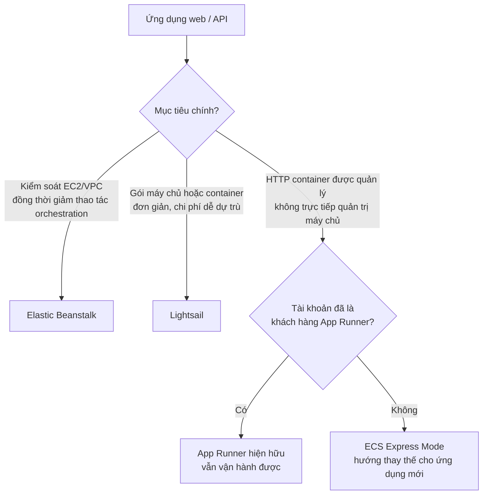
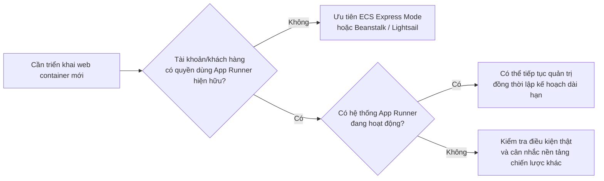
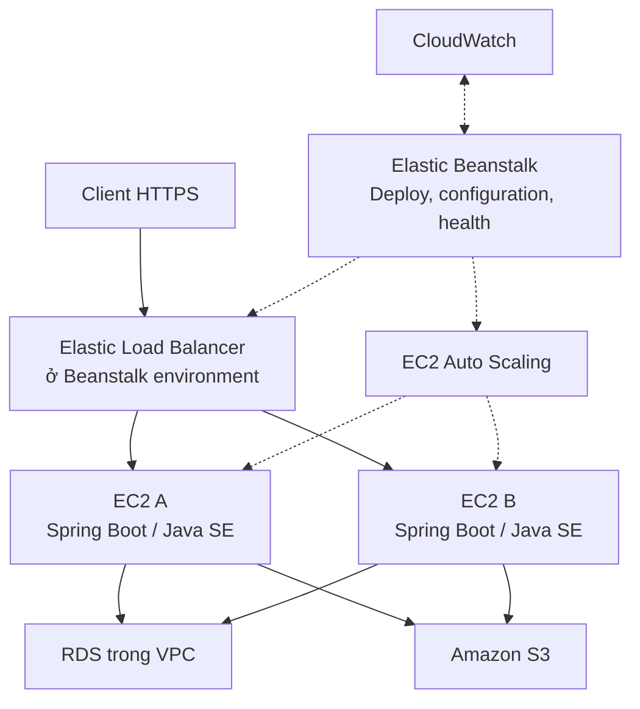
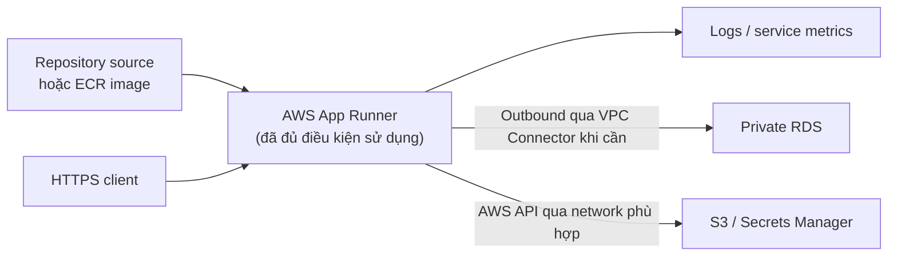
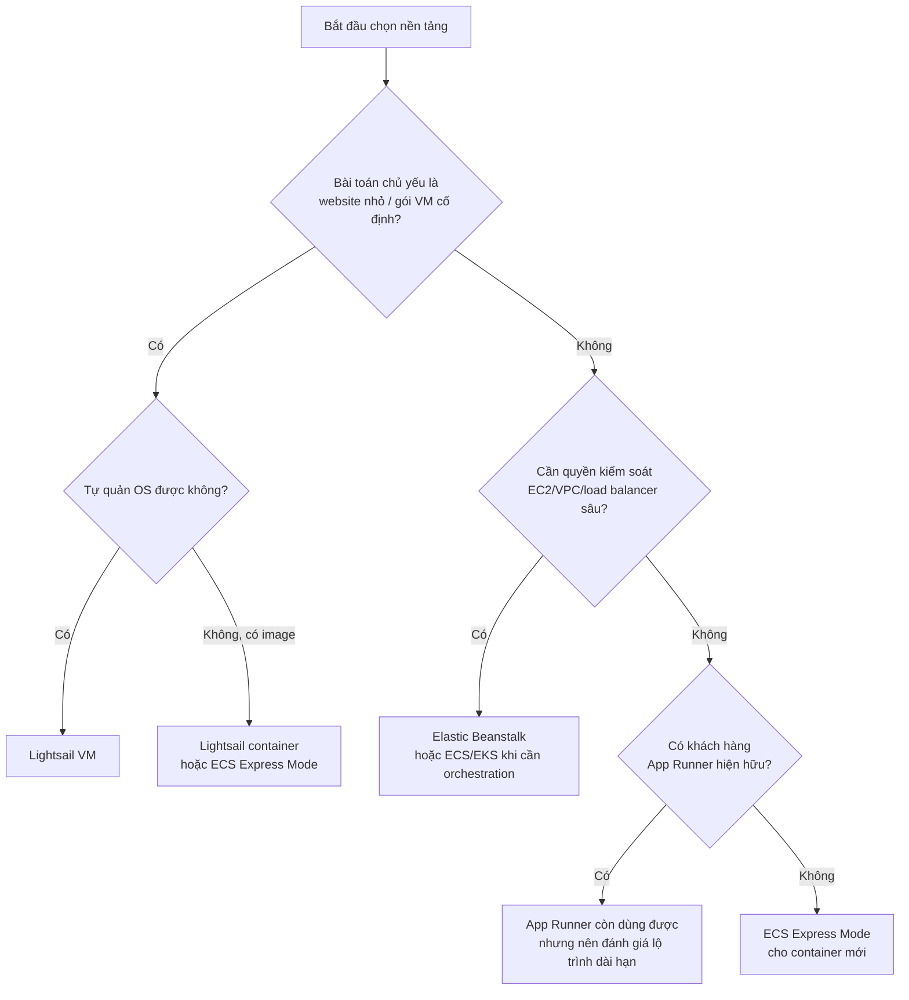
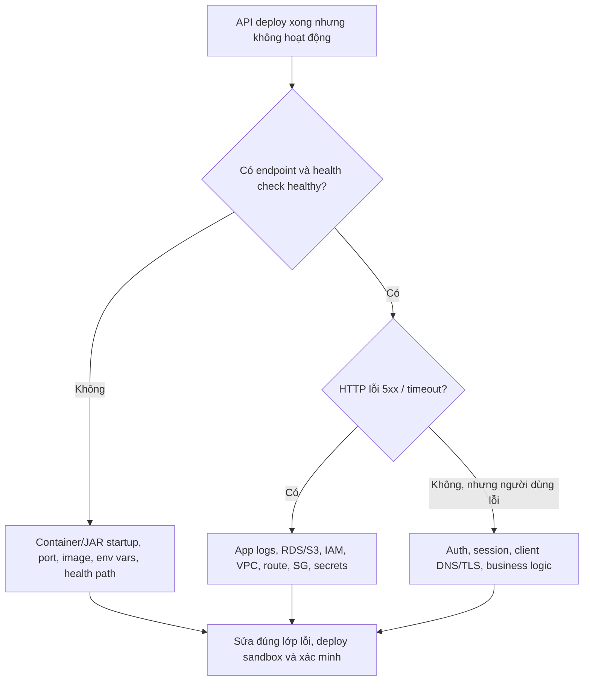

# Chọn Elastic Beanstalk, App Runner hoặc Lightsail

> **Học phần:** CLOUD_PROVIDERS_AWS  
> **Chương:** Nền tảng ứng dụng quản lý  
> **Trọng tâm:** Chọn dịch vụ triển khai ứng dụng web/API trên AWS theo loại ứng dụng, mức kiểm soát hạ tầng, mạng VPC, khả năng mở rộng, vận hành và chi phí.  
> **Đối tượng thực hành:** Ứng dụng Java/Spring Boot dạng JAR hoặc container, nhưng nguyên tắc lựa chọn áp dụng cho nhiều ngôn ngữ và framework.

> **Cập nhật quan trọng — 20/11/2026:** **AWS App Runner đã đóng với khách hàng mới kể từ 30/04/2026.** Khách hàng đã sử dụng dịch vụ vẫn được tiếp tục vận hành và tạo thêm tài nguyên, nhưng AWS không có kế hoạch bổ sung tính năng mới. Khi thiết kế **dự án mới trên tài khoản chưa đủ điều kiện dùng App Runner**, không chọn App Runner làm phương án triển khai. AWS khuyến nghị **Amazon ECS Express Mode** cho nhu cầu chạy web container đơn giản tương tự. Xem [thông báo chính thức của App Runner](https://docs.aws.amazon.com/apprunner/latest/dg/apprunner-availability-change.html) và [AWS Decision Guide](https://docs.aws.amazon.com/decision-guides/latest/decision-guides/modern-apps-strategy-on-aws-how-to-choose.html).

## 1. Bài toán: triển khai nhanh hay kiểm soát sâu?

Giả sử nhóm phát triển một API quản lý khóa học bằng Spring Boot. Ứng dụng cần:

- Phục vụ HTTP/HTTPS và mở rộng khi lưu lượng tăng.
- Đọc dữ liệu trong Amazon RDS hoặc DynamoDB.
- Tải lên các báo cáo hoặc tài liệu trong Amazon S3.
- Có health check, log, alert và cách triển khai bản mới ít gián đoạn.
- Bảo vệ secrets bằng IAM, Secrets Manager/SSM Parameter Store.
- Kiểm soát chi phí trong cả giai đoạn thử nghiệm và khi sử dụng thật.

Thay vì tự cấu hình từng EC2 instance, Application Load Balancer, Auto Scaling group, firewall, TLS và pipeline thủ công, AWS cung cấp các nền tảng khác nhau để **giảm phần hạ tầng phải tự vận hành**.

Tuy nhiên, ít thao tác triển khai không có nghĩa tất cả yêu cầu nghiệp vụ, bảo mật và phục hồi đều do AWS tự xử lý. Ngay trên một nền tảng được quản lý, ứng dụng vẫn phải biết kết nối database, xác thực, xử lý retry, lưu trạng thái bền vững và theo dõi lỗi.

### Kết quả học tập

Sau bài này, người học có thể:

1. Giải thích đúng vai trò của **AWS Elastic Beanstalk**, **AWS App Runner** và **Amazon Lightsail**.
2. Đánh giá khả năng sử dụng **App Runner theo thay đổi hiệu lực từ 30/04/2026** và nhận biết **ECS Express Mode** là phương án thay thế cho ứng dụng container mới.
3. Chọn giữa **Java JAR/ZIP**, **container image**, **máy chủ Lightsail** và **Lightsail container service**.
4. So sánh quyền kiểm soát EC2/VPC, khả năng tự mở rộng, cân bằng tải, TLS, CI/CD và cơ chế triển khai.
5. Lập kế hoạch kết nối **RDS/S3**, quyền IAM, secrets và log.
6. Thiết kế tối thiểu hai AZ hoặc có chiến lược khôi phục tương ứng với mức quan trọng.
7. Dự toán **tổng chi phí** thay vì chỉ so giá niêm yết của dịch vụ.
8. Thực hiện một lab trên môi trường được cấp quyền và giải thích vì sao chọn nền tảng này thay vì nền tảng khác.

## 2. Ba hướng tiếp cận: ai quản lý hạ tầng?



**Elastic Beanstalk** là một lớp quản lý triển khai môi trường ứng dụng. Ở chế độ phổ biến với EC2, Beanstalk cung cấp và điều phối những tài nguyên như **EC2, Auto Scaling, Elastic Load Balancing, CloudWatch** trong tài khoản AWS của bạn. Bạn có thể điều chỉnh nhiều đặc tính hạ tầng, nhưng vẫn phải vận hành, cập nhật và trả tiền cho tài nguyên nền.

**App Runner** là dịch vụ vận hành ứng dụng web/API từ source hoặc container image, tự lo nhiều phần của hạ tầng, HTTP/TLS và scale. Điểm cần nhớ ở thời điểm bài viết là **không còn nhận khách hàng mới**; đây không phải lựa chọn khả dụng chung cho các tài khoản mới.

**Lightsail** cung cấp gói hạ tầng đơn giản gồm **virtual servers (instances)**, **container services**, managed database, block/object storage, DNS, CDN và load balancer, thường với **mức giá gói hàng tháng dễ dự trù**. Lightsail instances mang tính VPS: nhóm vẫn có nhiều trách nhiệm với hệ điều hành và tiến trình ứng dụng.

### 2.1. So sánh nhanh

| Tiêu chí | Elastic Beanstalk | App Runner (khách hàng hiện hữu) | Lightsail |
|---|---|---|---|
| Đơn vị triển khai phổ biến | JAR/source bundle, Docker và platform phù hợp | Source code được hỗ trợ hoặc container image | VM instance hoặc container deployment |
| Quản lý máy chủ | AWS điều phối nhưng EC2 và cấu hình còn trong tài khoản của bạn | Không quản lý EC2 trực tiếp | Với VM: bạn quản lý OS; với container service: nền tảng quản lý compute nodes |
| Auto Scaling theo tải | Có qua môi trường load-balanced và ASG | Có theo cấu hình concurrency/instance | Instance VM không tự có ASG kiểu EC2; container service đổi **power/scale** theo cấu hình |
| HTTP load balancing | Có trong load-balanced environment | Tích hợp | Có lựa chọn Lightsail load balancer hoặc container service routing |
| HTTPS | Cấu hình qua load balancer/chứng chỉ hoặc kiến trúc tương ứng | HTTPS endpoint được quản lý | Cấu hình TLS/domain qua tính năng Lightsail hoặc web server |
| Điều khiển mạng | Sâu hơn, chọn VPC, subnet, SG, EC2/ELB | Ingress public/private; outbound qua VPC connector nếu cần | Đơn giản hóa; tích hợp VPC/AWS nâng cao có giới hạn cần đối chiếu |
| Deploy/rollback | Nhiều chính sách deployment/update, health monitoring | Deploy từ image/source, quản lý các revisions theo dịch vụ | Snapshot/triển khai VM hoặc container deployments |
| Billing | **Không thu riêng phí Beanstalk**, trả EC2/ELB/EBS và dịch vụ nền | Phí vCPU/memory theo mô hình provisioned/active | Các gói compute/container và dịch vụ bổ sung |
| Tính phù hợp 2026 | Đề xuất cho dự án mới phù hợp | **Chỉ dành cho khách hàng hiện hữu** | Có thể chọn cho workload đơn giản, quy mô dự trù được |

**Cần phân biệt** "AWS quản lý môi trường" với "không có trách nhiệm vận hành". Dịch vụ nào cũng cần code an toàn, IAM tối thiểu, kiểm thử, monitoring, backup và thiết kế phục hồi.

## 3. Điểm quyết định đầu tiên: App Runner có còn mở cho bạn không?

Theo [AWS App Runner availability change](https://docs.aws.amazon.com/apprunner/latest/dg/apprunner-availability-change.html), AWS ngừng nhận **khách hàng App Runner mới** từ **30/04/2026**:

- **Khách hàng App Runner hiện hữu:** vẫn có thể sử dụng dịch vụ, duy trì và tạo resources/services mới trong phạm vi điều kiện được AWS áp dụng.
- **Khách hàng chưa từng được chấp nhận sử dụng App Runner:** không nên lập kế hoạch triển khai dự án mới phụ thuộc vào khả năng tạo App Runner service.
- AWS tiếp tục đầu tư vào **security và availability** nhưng **không có kế hoạch giới thiệu tính năng mới**.
- AWS gợi ý **Amazon ECS Express Mode**, xây dựng từ Amazon ECS trên AWS Fargate, có ALB, networking và Auto Scaling được tự động thiết lập theo cách triển khai đơn giản.



**Không gộp hai vấn đề khác nhau:** Không nhận khách hàng mới **không có nghĩa dịch vụ hiện hữu lập tức bị tắt vào 30/04/2026**. Ngược lại, việc một công ty khác đang dùng App Runner **không chứng minh** tài khoản mới của bạn có thể tạo dịch vụ.

### 3.1. Khi nào vẫn nên tìm hiểu App Runner?

Nghiên cứu App Runner vẫn hữu ích để:

- Hiểu lựa chọn PaaS/container chạy HTTP với ít thao tác hạ tầng.
- Bảo trì hệ thống App Runner hiện hữu.
- Xây dựng kế hoạch chuyển từ App Runner sang ECS Express Mode, Beanstalk hoặc nền tảng khác.
- Học sự khác biệt giữa **inbound endpoint** và **outbound VPC connector**.

Trong bài này, các bước App Runner là **hướng dẫn tham khảo cho tài khoản đã có quyền sử dụng**, không phải lời hứa rằng mọi tài khoản AWS mới đều chạy được.

## 4. Elastic Beanstalk: triển khai có quản lý trên hạ tầng bạn kiểm soát

### 4.1. Khái niệm application, environment, version, platform

| Thành phần | Ý nghĩa | Ví dụ |
|---|---|---|
| **Application** | Đối tượng logic nhóm code, versions và environments. | `course-api` |
| **Application version** | Một bản đóng gói có thể triển khai. | `v2026-11-20-a` |
| **Environment** | Tài nguyên chạy ứng dụng, cấu hình hạ tầng và trạng thái sức khỏe. | `course-api-staging`, `course-api-prod` |
| **Platform branch/version** | Nền tảng runtime/OS và các thành phần AWS cung cấp cho ứng dụng. | Java SE trên platform được hỗ trợ |
| **Web server environment** | Phục vụ HTTP, có thể một instance hoặc load-balanced. | Spring Boot REST API |
| **Worker environment** | Nhận và xử lý công việc nền qua Amazon SQS theo cơ chế Beanstalk hỗ trợ. | Xử lý báo cáo bất đồng bộ |

Khi lựa chọn một **web server environment**, Beanstalk khởi tạo các nguồn lực theo loại môi trường.

**Single-instance environment**:
- Có **một EC2 instance**, không kèm load balancer.
- Phù hợp lab/dev/staging hoặc workload chấp nhận downtime.
- Không phải mô hình multi-AZ, không có HA thực chất khi node chết.

**Load-balanced, scalable environment**:
- Dùng EC2 Auto Scaling và Elastic Load Balancing.
- Cấu hình min/max capacity, health, rolling/immutable deployment.
- Có thể đặt instances ở nhiều AZ trong VPC phù hợp.
- Phù hợp hơn khi Production cần HA và tăng/giảm công suất.

> **Sai lầm thường gặp:** "Chọn Beanstalk thì mặc định đã có HA nhiều AZ". Không đúng với **single-instance environment**. Cần chọn kiểu môi trường, capacity và subnet/AZ phù hợp.

### 4.2. Luồng kiến trúc



Đây là **kiến trúc minh họa cho loại môi trường load-balanced**, không phải tài nguyên luôn được tạo khi bạn chọn single-instance.

### 4.3. Điều khiển và trách nhiệm

Bạn có thể cấu hình:

- Instance types, Auto Scaling min/max, subnets và security groups phù hợp.
- Môi trường staging/production, deployment policies, rolling/immutable updates.
- Môi trường Java SE, Docker và các platform branches AWS hỗ trợ.
- Environment properties, platform hooks và các cấu hình mở rộng như `.ebextensions`.
- Logs, health metrics và cảnh báo bằng CloudWatch.

Nhưng nhóm vẫn phải:

- Quản lý lifecycle ứng dụng và data migration.
- Thiết kế health endpoint và graceful shutdown.
- Kiểm tra platform updates, đặc biệt khi đổi major runtime/OS.
- Bảo vệ IAM instance profile, secrets và dữ liệu trên S3/RDS.
- Duy trì cơ chế backup/restore và rollback.

### 4.4. Platform updates không tự giải quyết mọi nâng cấp

Beanstalk hỗ trợ **managed platform updates** trong maintenance window phù hợp. Theo tài liệu, cơ chế cập nhật được quản lý hỗ trợ **patch/minor platform updates** nhưng **không tự chuyển sang platform branch có major runtime/OS mới**. Ví dụ một ứng dụng đang chạy Java major version cũ vẫn cần kế hoạch chuyển branch, kiểm thử tương thích và điều phối release.

Khi chuyển môi trường, cân nhắc **rolling**, **immutable** hoặc **blue/green deployment** tùy yêu cầu. Lựa chọn rollout phải dựa trên sức chứa tối thiểu, health check, ảnh hưởng tới kết nối và khả năng rollback.

## 5. Lab Elastic Beanstalk: triển khai Spring Boot Java JAR

### 5.1. Chuẩn bị ứng dụng

Ví dụ một Spring Boot REST API:

```java
package example.course;

import java.util.Map;
import org.springframework.web.bind.annotation.GetMapping;
import org.springframework.web.bind.annotation.RestController;

@RestController
public class CourseController {
    @GetMapping("/api/health-demo")
    public Map<String, String> hello() {
        return Map.of("status", "ok", "service", "course-api");
    }
}
```

Đây chỉ là controller demo; project còn cần class `@SpringBootApplication` và dependency Spring Web để build JAR thực thi. Trong production, dùng endpoint readiness của Spring Boot Actuator thay vì một endpoint trả `ok` cố định.

Build Maven trong dự án Java của bạn:

```bash
./mvnw clean package -DskipTests
```

Trong CI/Production, **không bỏ kiểm thử** chỉ vì lệnh lab có `-DskipTests`. JAR ví dụ được tạo ở `target/course-api.jar`; tên thật tùy dự án.

### 5.2. Source bundle và Procfile

Với Java SE, Beanstalk hỗ trợ JAR chạy bằng `java -jar`. Khi bundle có nhiều JAR hoặc cần lệnh khởi động rõ ràng, thêm **Procfile** tại gốc source bundle:

```text
course-api.jar
Procfile
```

Nội dung `Procfile`:

```text
web: java -jar course-api.jar --server.port=5000
```

Port `5000` là giá trị minh họa phù hợp cấu hình proxy mặc định phổ biến của Java SE; nếu thay application port, **cần đồng bộ với proxy/health check** của environment. Không mặc định rằng Beanstalk tự đoán đúng mọi port của Spring Boot.

**Chú ý:** Source bundle là **các file ở gốc gói ZIP**, không phải một thư mục cha duy nhất chứa toàn bộ nội dung. Kiểm tra lại file layout trước khi upload. Không đưa `.env` chứa mật khẩu hay `~/.aws/credentials` vào ZIP.

### 5.3. Triển khai qua AWS Console

1. Đăng nhập tài khoản sandbox, kiểm tra Region và IAM permissions.
2. Mở **Elastic Beanstalk → Create application**.
3. Chọn application name, ví dụ `course-api`.
4. Chọn môi trường **Web server environment**.
5. Chọn platform **Java SE** đúng runtime được AWS hỗ trợ; xác nhận AMI/platform version phù hợp bản build.
6. Tải lên ZIP source bundle hoặc JAR phù hợp hướng dẫn Java SE.
7. Chọn **Single-instance** cho lab chi phí thấp, hoặc **Load-balanced** nếu muốn thực hành HA.
8. Kiểm tra service role, EC2 instance profile, VPC, subnet, security groups và môi trường runtime.
9. Tạo environment, theo dõi Events/Health đến khi Ready/healthy.
10. Mở environment URL và gọi `/api/health-demo`; quan sát status code và application logs.

Để làm Production, cần ít nhất hai healthy instances và các AZ phù hợp (nếu chọn load-balanced), TLS, health/alerts, backup và review quyền.

### 5.4. EB CLI

Sau khi **cài đặt và xác minh phiên bản EB CLI** theo hướng dẫn AWS, từ dự án hợp lệ:

```bash
# Quy trình tương tác để chọn account, Region, app, platform.
eb init

# Tạo một environment sandbox sau khi kiểm tra các lựa chọn.
eb create course-api-lab

# Xem trạng thái và health của environment.
eb status course-api-lab
eb health course-api-lab

# Deploy bản ứng dụng mới.
eb deploy course-api-lab

# Đọc log để chẩn đoán startup/runtime.
eb logs course-api-lab
```

Lệnh `eb create` tạo tài nguyên và **có thể phát sinh phí**. Không chạy nếu project/Region/profile chưa đúng. Nếu application không có source bundle sẵn, cần cấu hình workflow đóng gói phù hợp thay vì giả định EB CLI luôn tự tìm JAR chính xác.

Dọn môi trường thử nghiệm bằng quy trình được phê duyệt:

```bash
# CẢNH BÁO: Có thể hủy toàn bộ tài nguyên của environment.
eb terminate course-api-lab
```

Đọc kỹ tên environment và tác động tới dữ liệu trước khi terminate. Database hoặc tài nguyên ngoại vi được tạo/ghép vào environment phải có chính sách giữ/backup tách biệt.

### 5.5. Environment variables và secrets

Ứng dụng Spring Boot có thể dùng biến môi trường:

```yaml
spring:
  datasource:
    url: jdbc:postgresql://db.example.internal:5432/courses
    username: app_user
    password: ${DB_PASSWORD}
```

Ở môi trường ứng dụng thực tế, Spring Boot cần property resolution đúng cấu hình. Ví dụ này thể hiện ý tưởng **không hard-code mật khẩu**; dòng `DB_PASSWORD` nên lấy từ cơ chế quản lý secrets được hỗ trợ, không commit giá trị thật.

Theo tài liệu AWS, các platform versions Beanstalk được phát hành **từ 26/03/2025** có thể đưa giá trị **Secrets Manager/SSM Parameter Store** vào environment variables theo tính năng đã hỗ trợ. Tuy nhiên, nếu secret được rotate, việc đồng bộ giá trị mới vào biến môi trường có thể cần **refresh thủ công theo quy trình AWS**, không giả định process đang chạy tự thấy secret mới. AWS SDK có thể truy vấn Secrets Manager trực tiếp khi cần cơ chế refresh khác.

IAM role EC2 trong environment phải có quyền tới secret và các hành động KMS cần thiết; không phát `secretsmanager:*` cho mọi tài nguyên.

## 6. App Runner: PaaS cho web/API container (chỉ khách hàng hiện hữu)

Dù App Runner đã đóng với khách hàng mới, việc hiểu đặc tính kỹ thuật vẫn quan trọng khi duy trì ứng dụng đang chạy.

### 6.1. Mô hình triển khai

App Runner có thể lấy ứng dụng từ:

1. **Source code repository** với managed runtime được AWS hỗ trợ cho ngôn ngữ/version cụ thể.
2. **Container image** từ Amazon ECR hoặc nguồn container được hỗ trợ, theo cấu hình IAM phù hợp.

App Runner lo nhiều phần bên dưới: chạy containers, cung cấp HTTPS endpoint, load balancing, monitoring và tự mở rộng active instances theo cấu hình tải/concurrency.



Hạn chế:

- Người vận hành **không có quyền điều khiển EC2 host** bên dưới như Beanstalk.
- Có giới hạn runtime, build, memory/CPU, startup và cấu hình nền tảng; cần đối chiếu theo từng use case.
- Scale theo concurrency **không đồng nghĩa** chạy arbitrary background jobs vô hạn hoặc giữ local filesystem bền vững.
- Cần đúng IAM access role và instance role theo nhiệm vụ.

### 6.2. Runtime Java: đừng nhầm Java trên Beanstalk và App Runner

Beanstalk Java SE cho phép triển khai một JAR với Java platform branch phù hợp. App Runner source-based deployments có **danh sách managed Java runtimes riêng**; không mặc định mọi phiên bản Java hiện đại đều được hỗ trợ ở source mode. Ứng dụng Java 17/21 có thể cần **container image** được build và test theo runtime phù hợp.

Với App Runner hiện hữu, cách tiếp cận container image giúp kiểm soát JDK/JRE version và dependencies trong image, nhưng AWS vẫn quản lý phần chạy ứng dụng ở cấp App Runner service.

### 6.3. IAM roles trong App Runner

| Role / quyền | Tác dụng |
|---|---|
| **Access role** | Cho App Runner truy cập image từ **ECR private repository** khi cấu hình image source phù hợp. |
| **Instance role** | Cho **mã ứng dụng đang chạy** truy cập AWS APIs như S3, DynamoDB hoặc Secrets Manager theo quyền tối thiểu. |
| **Người triển khai** | Có quyền tạo/sửa App Runner service, IAM pass role và quyền liên quan theo chính sách tổ chức. |

**Không đưa AWS access key vào biến môi trường** chỉ vì ứng dụng cần S3. Dùng IAM instance role của App Runner và AWS SDK default credentials chain, cộng với quyền tài nguyên/KMS phù hợp.

### 6.4. Inbound khác outbound VPC

Đây là nguồn nhầm lẫn phổ biến:

| Hướng lưu lượng | Cấu hình | Hệ quả |
|---|---|---|
| **Inbound public** | Public endpoint (mặc định cho service thông thường) | Endpoint có thể được gọi từ Internet; ứng dụng vẫn cần authentication. |
| **Inbound private** | **VPC interface endpoint + VPC Ingress Connection** | Giới hạn truy cập từ VPC theo cơ chế AWS; endpoint vẫn cần policy/SG phù hợp. |
| **Outbound public** | Mặc định không dùng custom VPC connector | Ứng dụng có thể gọi public endpoints theo chính sách. |
| **Outbound custom VPC** | **VPC Connector** với private subnets và SG | Cho phép kết nối private resources như RDS/ElastiCache; traffic outbound đi qua VPC đã chọn. |

**Kết nối RDS từ App Runner:** Cấu hình **outbound VPC connector**, chọn các **private subnets** phù hợp và security group có quyền truy cập RDS. **Đừng nhầm outbound connector với inbound private endpoint** — đó là hai tính năng khác nhau.

Khi bật VPC connector outbound, network egress của ứng dụng đi qua VPC đó; ứng dụng có thể **mất đường tới public Internet và AWS APIs** nếu không cấu hình NAT gateway hoặc VPC endpoints tương ứng. Một số traffic do chính App Runner quản lý (pull image, logs/secrets service operation) không dùng cùng đường VPC connector của ứng dụng.

### 6.5. Các bước tham khảo cho tài khoản App Runner hiện hữu

1. Xác minh tài khoản có quyền vận hành App Runner.
2. Chuẩn bị một container image web/API, có lệnh chạy và listen đúng port.
3. Push image lên ECR, cấp access role thích hợp.
4. Tại App Runner, chọn **Create service** hoặc update service hiện hữu theo điều kiện tài khoản.
5. Chọn image, CPU/memory, port, health check, autoscaling configuration.
6. Chọn ingress public/private và outbound public/VPC connector theo yêu cầu RDS/S3.
7. Cấp instance role chỉ có các quyền AWS API ứng dụng cần.
8. Quan sát deploy status, endpoint, request/error metrics và logs.
9. Xem mô hình phí provisioned memory/active vCPU+memory, pause/resume nếu có.

Lệnh **chỉ đọc** cho tài khoản đã có App Runner:

```bash
aws sts get-caller-identity

aws apprunner list-services \
  --region ap-southeast-1

# Dùng ServiceArn thật từ output trước.
aws apprunner describe-service \
  --service-arn arn:aws:apprunner:ap-southeast-1:123456789012:service/course-api/0123456789abcdef0123456789abcdef \
  --region ap-southeast-1
```

Ví dụ ARN ở trên chỉ là placeholder; không có quyền App Runner, lệnh có thể trả `AccessDenied` hoặc danh sách rỗng. Với tài khoản không đủ điều kiện, **không cố tạo service mới**; xem phương án ECS Express Mode dưới đây.

## 7. ECS Express Mode: thay thế thực tế cho ứng dụng container mới

AWS khuyến nghị **Amazon ECS Express Mode** như đường chuyển tiếp cho các ứng dụng muốn trải nghiệm đơn giản tương tự App Runner.

### 7.1. Nó cung cấp gì?

Theo tài liệu AWS hiện hành, bạn cung cấp **container image** và các **IAM roles** cần thiết. ECS Express Mode thiết lập stack dựa trên:

- **Amazon ECS service**.
- **AWS Fargate** chạy containers.
- **Application Load Balancer** để nhận HTTP/HTTPS.
- **Auto Scaling** và networking.
- Tích hợp logging/monitoring theo tài nguyên được tạo.

ECS Express Mode giảm phần cấu hình ban đầu nhưng tài nguyên nền vẫn có thể xuất hiện trong tài khoản và tính phí tương ứng. Không coi đây là App Runner được đổi tên hoặc một VM Lightsail.

### 7.2. Luồng Console mức khái niệm

1. Build và push image tới Amazon ECR.
2. Mở **Amazon ECS Console → Express mode**.
3. Chọn **image URI** và nguồn ECR.
4. Chọn cấu hình task, role và networking phù hợp.
5. Xác nhận public endpoint/TLS, scaling và các tài nguyên dự kiến được tạo.
6. Tạo service, kiểm tra ECS tasks, ALB/health, logs.
7. Cấu hình quyền truy cập RDS/S3, VPC endpoints/NAT và secrets phù hợp.
8. Thực hiện deploy bản mới và kiểm tra rollback/readiness.

Quy trình này được giới thiệu vì **App Runner không nhận khách hàng mới**, nhưng **không phải một trong ba nền tảng chính của tiêu đề**. Khi lựa chọn kiến trúc mới năm 2026, không nên bỏ qua lựa chọn thay thế này.

### 7.3. Khi nào không nên cố ép ứng dụng vào Express Mode?

Nếu cần nhiều microservices với service discovery phức tạp, nhiều task definitions, network policies đặc biệt, sidecars hay điều phối nâng cao, cân nhắc **ECS standard service**, **EKS** hoặc các mô hình quản lý khác. Express Mode là đường triển khai đơn giản ban đầu, không loại bỏ nhu cầu hiểu ECS/Fargate, VPC, IAM, ALB và chi phí.

## 8. Lightsail: gói máy chủ và container đơn giản

**Amazon Lightsail** phù hợp khi muốn triển khai nhanh một ứng dụng hoặc website, chọn gói compute/transfer rõ ràng, không cần tất cả tính năng hạ tầng chi tiết của EC2.

Nhưng **Lightsail không chỉ có một loại compute**. Cần phân biệt:

| Lựa chọn | Bạn nhận được | Trách nhiệm |
|---|---|---|
| **Lightsail instance (VM)** | Máy chủ ảo Linux/Windows với CPU, RAM, SSD, transfer theo bundle | Tự cập nhật OS, cài Java/Docker/reverse proxy, firewall, xử lý ứng dụng, backup |
| **Lightsail container service** | Chạy container image, có public endpoint, scale theo số nodes và power cấu hình | Quản lý image, config, health, deploy; không quản trị host như VM |
| **Lightsail managed database** | Database được quản lý trong phạm vi tính năng Lightsail | Schema, access credentials, backups, bảo mật ứng dụng; kiểm tra HA/tier |
| **Lightsail load balancer** | Cân bằng HTTP/HTTPS đơn giản cho VM | Cấu hình domain/certificate/health và giới hạn năng lực |
| **Lightsail object/block storage, snapshots** | Các dịch vụ bổ trợ | Lifecycle, backup/restore, quyền và chi phí |

### 8.1. Lightsail instance có phải PaaS không?

Nếu chọn **Lightsail Linux VM** để chạy Spring Boot, bạn vẫn phải:

1. Cài runtime Java được hỗ trợ.
2. Quản lý cập nhật hệ điều hành và security patches.
3. Cấu hình service bằng `systemd` hoặc Docker.
4. Thiết lập reverse proxy và TLS (nếu dùng VM trực tiếp).
5. Kiểm soát ports/firewall, SSH/credentials.
6. Sao lưu data và giám sát tài nguyên.

Do đó, VM Lightsail gần với **VPS/IaaS được đơn giản hóa** hơn là một nền tảng tự chạy source code hoàn toàn tự động. Nếu mục tiêu là không quản trị OS, hãy cân nhắc Lightsail **container service** hoặc Beanstalk/ECS Express Mode.

### 8.2. Container service: power và scale

Đối với **Lightsail container service**:

- **Power** chọn mức vCPU và RAM trên mỗi compute node.
- **Scale** là số nodes phục vụ container deployment.
- Có thể tăng/giảm power và scale theo cơ chế AWS cung cấp.
- Không mặc định có **Auto Scaling theo metric ở độ sâu tương đương ECS/ASG**; việc chọn capacity là quyết định người vận hành và cần đánh giá khả năng tự động hóa.
- Giá gói container service thường là **giá power mỗi node × scale**.
- AWS cho biết mỗi container service có **500 GB transfer allowance/tháng** trong mô hình hiện hành; overage có thể phát sinh.
- **Dịch vụ container vẫn bị tính phí ngay cả khi disabled hoặc chưa có deployment**; muốn ngừng phí phải kiểm tra và xóa tài nguyên theo hướng dẫn.

Ví dụ **minh họa dựa trên trang giá AWS**, không phải báo giá cho mọi Region: node mức Medium **40 USD/tháng** và **scale 3** dẫn tới **120 USD/tháng cho các nodes**, chưa bao gồm các dịch vụ bổ sung hoặc phí khác. Kiểm tra pricing tại Region và thời điểm triển khai.

### 8.3. Quy trình Console cho Lightsail instance

1. Mở **Lightsail → Create instance**, chọn Region/AZ.
2. Chọn Linux/Unix, blueprint/OS thích hợp và bundle có RAM đủ cho JVM.
3. Thiết lập SSH key và firewall tối thiểu; không mở cổng quản trị ra mọi IP nếu không cần.
4. Tạo instance, cập nhật hệ điều hành, cài Java hoặc Docker theo quy trình kiểm soát.
5. Copy artifact từ pipeline hoặc pull image đáng tin cậy.
6. Dùng `systemd` để chạy Spring Boot; cấu hình reverse proxy/TLS.
7. Dùng static IP, DNS hoặc load balancer tùy yêu cầu.
8. Thiết lập monitoring, snapshot và khôi phục thử nghiệm.

Ví dụ unit cho lab:

```ini
[Unit]
Description=Course API Spring Boot
After=network-online.target
Wants=network-online.target

[Service]
Type=simple
User=course-api
WorkingDirectory=/opt/course-api
ExecStart=/usr/bin/java -jar /opt/course-api/course-api.jar --server.port=8080
Restart=on-failure
RestartSec=5
TimeoutStopSec=120

[Install]
WantedBy=multi-user.target
```

Unit này chỉ quản lý **tiến trình Java**. Nó không tự làm HTTPS, Auto Scaling, backup hoặc hỗ trợ multi-AZ. Đảm bảo user `course-api`, thư mục/JAR, network và phiên bản Java hợp lệ trước khi áp dụng.

### 8.4. Quy trình Lightsail container service

1. Đóng gói ứng dụng thành container image và kiểm tra local.
2. Mở **Lightsail → Containers → Create container service**.
3. Chọn Region, power, scale dựa trên CPU/RAM và availability.
4. Đăng tải hoặc trỏ tới image được hỗ trợ theo cơ chế Lightsail.
5. Cấu hình tên container, entrypoint, environment variables và **public endpoint**.
6. Khai báo health check phù hợp, ví dụ `/actuator/health/readiness`.
7. Tạo deployment, xác minh trạng thái healthy và URL.
8. Cấu hình domain, certificate và backup/monitoring trong phạm vi tính năng dịch vụ.

Lightsail container service có các giới hạn khác ECS (networking, features, tài nguyên gói). **Không dùng ví dụ CLI của ECS trực tiếp cho Lightsail container service.**

### 8.5. Khi nào không nên chọn Lightsail?

Không nên chọn chỉ vì thấy bảng giá gói đơn giản nếu hệ thống cần:

- Network segmentation phức tạp với nhiều private subnets, NACL, VPC endpoints và tổ chức multi-account.
- Auto Scaling đa chiều theo nhiều metrics và workload bùng nổ lớn.
- Nhiều microservices, service discovery, queue consumers, container orchestration nâng cao.
- Cơ chế compliance và IAM resource policies đặc thù yêu cầu tích hợp sâu.
- Rollout/canary/blue-green, service mesh hoặc vận hành đa AZ với yêu cầu SLO nghiêm ngặt mà kiến trúc Lightsail đã chọn không đáp ứng.

Khi đó, Elastic Beanstalk với VPC kiểm soát chi tiết, ECS/Fargate hoặc EKS thường là ứng viên hợp lý hơn; nhưng phải kiểm chứng nhu cầu, không tự coi ứng dụng nhỏ là cần Kubernetes.

## 9. Một bảng quyết định đầy đủ

| Tiêu chí ưu tiên | Elastic Beanstalk | App Runner hiện hữu | Lightsail VM | Lightsail container |
|---|---|---|---|---|
| Không quản trị OS | **Một phần**, Beanstalk quản lý platform nhưng bạn còn EC2 config | **Tốt** | **Không** | **Tốt hơn VM** |
| Đưa Spring Boot JAR lên nhanh | **Phù hợp** | Cần runtime source hỗ trợ hoặc container image | Tự cài Java/deploy | Cần container image |
| VPC riêng với kiểm soát chi tiết | **Phù hợp** | Outbound connector/Private ingress có giới hạn | Đơn giản hóa, kiểm tra tích hợp | Đơn giản hóa, kiểm tra tích hợp |
| Multi-AZ + scaling tự động | Có với load-balanced môi trường phù hợp | Có theo kiến trúc dịch vụ | Cần thiết kế/bổ sung LB và nodes | Scale nodes do vận hành thiết lập |
| Bundle chi phí hàng tháng dễ đọc | Tính từ nhiều AWS resources | Theo provisioned/active resource usage | **Rất phù hợp** | **Phù hợp** |
| Runtime custom OS packages | Có cấu hình platform/instance hooks trong giới hạn | Qua image, không host access | **Có quyền host** | Qua image, không host access |
| Deploy nhanh website ít traffic | Có thể nhưng nhiều tài nguyên | Có nếu khách hàng hiện hữu | **Phù hợp** | Phù hợp nếu có image |
| Phù hợp tài khoản mới từ 30/04/2026 | Có | **Không** | Có | Có |
| Ứng dụng nhiều service và networking nâng cao | Khả thi trong giới hạn Beanstalk | Giới hạn, cân nhắc ECS | Thường không ưu tiên | Thường không ưu tiên |

### 9.1. Cây quyết định bằng câu hỏi



Đây là **heuristic** để thảo luận, không phải luật tuyệt đối. Ví dụ một startup cần VM vì có phần mềm legacy không đóng gói được cũng có thể dùng Lightsail; một doanh nghiệp cần VPC riêng có thể chọn Beanstalk, ECS hoặc dịch vụ khác tùy vận hành.

## 10. Tình huống thực tế: chọn cho Java/Spring Boot

### 10.1. Tình huống A — website giới thiệu + API nhỏ

- Một service Spring Boot đơn giản, lượng truy cập thấp.
- Ngân sách cố định, nhóm có thể vá OS và triển khai.
- Không có yêu cầu phức tạp về subnet/iam/multi-AZ.

**Ứng viên:** Lightsail instance hoặc Lightsail container service. Nếu chọn VM, phải nhận trách nhiệm OS, firewall, TLS, backup. Nếu container image sẵn, Lightsail container có thể giảm thao tác host.

**Khi không phù hợp:** Khi SLA yêu cầu khả năng chịu lỗi nhiều AZ, database private phức tạp hoặc scale bất ngờ.

### 10.2. Tình huống B — hệ thống khóa học có RDS riêng trong VPC

- Spring Boot REST API đã build thành JAR.
- Cần hai AZ, Auto Scaling, ALB, IAM instance profile và mạng tới RDS private.
- Nhóm muốn kiểm soát VPC, subnets, security groups và deployment policy.

**Ứng viên:** Elastic Beanstalk **load-balanced environment**. Có thể chọn Java SE platform và dùng EBS/RDS/S3 theo kiến trúc. Cần thiết kế session stateless hoặc shared store, health check và upgrade platform.

**Không dùng:** Beanstalk single-instance rồi tuyên bố đạt HA.

### 10.3. Tình huống C — web API container tối giản trên tài khoản AWS mới

- Có Docker image từ ECR.
- Muốn triển khai HTTPS, scale, không quản lý EC2.
- Tài khoản **chưa có quyền sử dụng App Runner**.

**Ứng viên ưu tiên theo hướng dẫn AWS hiện hành:** **ECS Express Mode**. Cần kiểm tra region, IAM, VPC, cost Fargate/ALB và các tài nguyên tạo tự động.

**Không nên:** Chọn App Runner vì một bài blog trước 2026 giới thiệu "deploy trong vài click" mà không biết dịch vụ đã đóng với khách hàng mới.

### 10.4. Tình huống D — bảo trì App Runner hiện hữu

- Hệ thống đã chạy trên App Runner, có CI/CD và metrics.
- Cần kết nối RDS trong VPC, tăng quyền S3 cho service và giữ endpoints ổn định.

**Giải pháp trước mắt:** Tiếp tục quản trị App Runner hiện hữu nếu tài khoản còn quyền, cấu hình outbound VPC connector/instance role đúng, theo dõi latency và chi phí.

**Giải pháp dài hạn:** Lập kế hoạch đánh giá ECS Express Mode hoặc giải pháp khác vì App Runner không có kế hoạch tính năng mới. Không bắt buộc di chuyển khẩn cấp chỉ từ thông báo đóng với khách hàng mới nếu hệ thống hiện hữu vẫn được AWS hỗ trợ vận hành.

### 10.5. Tình huống E — báo cáo chạy vài giờ, không phục vụ HTTP

- Job xử lý dữ liệu lớn, cần retry/checkpoint, lấy messages từ queue.
- Không cần giữ web request mở nhiều giờ.

**Không mặc định** dùng App Runner/Lightsail container như một worker dài hạn. Cân nhắc Beanstalk worker environment (nếu phù hợp SQS), AWS Batch, ECS tasks/services, Lambda cho workload đủ điều kiện. Cách chọn dựa trên mức độ kiểm soát, timeout, khả năng retry và chi phí.

## 11. Kiến trúc mạng và IAM khác nhau thế nào?

### 11.1. Kết nối database riêng

| Nền tảng | Cách tiếp cận RDS private |
|---|---|
| Elastic Beanstalk load-balanced | Đặt EC2 app trong private subnets VPC, cấu hình RDS SG inbound chỉ từ SG app; ALB public nếu cần. |
| App Runner hiện hữu | **Outbound VPC connector**, private subnets và SG; cấu hình NAT/VPC endpoints nếu app còn cần public AWS APIs. |
| Lightsail VM/container | Xem khả năng kết nối VPC/peering/endpoint được Lightsail hỗ trợ; kiến trúc riêng tư phức tạp có thể đòi hỏi dịch vụ AWS khác. |
| ECS Express Mode | Dựa trên ECS/Fargate + VPC networking do Express Mode tạo/cấu hình; kiểm tra task SG/subnets và SG RDS. |

Không dùng database trên cùng local filesystem của web container làm nguồn dữ liệu duy nhất; container/instance có thể được thay thế. Với dữ liệu quan trọng, dùng RDS/Aurora/DynamoDB hoặc kho bền vững theo yêu cầu.

### 11.2. IAM cho mã ứng dụng

- **Beanstalk:** Ứng dụng trên EC2 có thể dùng **EC2 instance profile** với IAM role.
- **App Runner:** Runtime dùng **instance role** cho AWS APIs; access role dành cho đọc image ECR private.
- **Lightsail VM:** Đánh giá khả năng IAM của tài nguyên và tích hợp được AWS hỗ trợ; **không giả định** mọi tính năng instance profile/EC2 IAM có sẵn y nguyên trên Lightsail VM. Không lưu IAM user access key dài hạn vào repository/AMI.
- **ECS Express Mode:** ECS task role cho mã ứng dụng, execution role cho ECS pull image/logs theo kiến trúc ECS/Fargate.

Ví dụ policy tối thiểu cho một API chỉ cần đọc object trong prefix S3:

```json
{
  "Version": "2012-10-17",
  "Statement": [
    {
      "Sid": "ReadCourseMaterial",
      "Effect": "Allow",
      "Action": "s3:GetObject",
      "Resource": "arn:aws:s3:::course-materials-demo-123456789012/public-lessons/*"
    }
  ]
}
```

Đây là policy minh họa **chỉ có quyền GetObject**. Nếu ứng dụng cần `ListBucket`, KMS Decrypt hoặc quyền sang tài nguyên cross-account, cần bổ sung đúng ARN/action, cùng bucket/key policy và security controls. Không thay bằng `AdministratorAccess` để tiện lab.

### 11.3. Secrets và cấu hình

Phân biệt:

| Loại cấu hình | Ví dụ | Cách quản lý |
|---|---|---|
| Không bí mật | `SPRING_PROFILES_ACTIVE`, port, public API URL | Environment properties/variables hoặc config được kiểm soát |
| Secret | DB password, API token | Secrets Manager/Parameter Store hoặc secret mechanism được nền tảng hỗ trợ |
| AWS credentials | AccessKeyId/SecretAccessKey/SessionToken | Ưu tiên IAM workload role/temporary credentials; không hard-code |
| Application data | Upload, report, user sessions | S3, RDS, DynamoDB, Redis/shared state theo workload |

Khi dùng environment variables chứa secrets, tránh ghi hết `env` vào log, dump hoặc support ticket. Với rotating secret, phải kiểm tra khi nào tiến trình thực sự nhận giá trị mới.

### 11.4. TLS, domain và public exposure

- ALB/Beanstalk: dùng ACM và listener HTTPS phù hợp, đặt security groups đúng nguồn/đích.
- App Runner: HTTPS endpoint do dịch vụ quản lý; với private endpoint cần cấu hình VPC interface endpoint/ingress connection.
- Lightsail: gắn domain, certificate/HTTPS theo tính năng Lightsail; nếu dùng VM thô, bạn vẫn phải quản lý reverse proxy/TLS.
- ECS Express Mode: xem HTTPS/ALB được thiết lập và quyền vào endpoints theo cấu hình.

**Không mặc định** "managed platform" = application authentication. Mọi API vẫn cần xác thực/ủy quyền nghiệp vụ nếu chứa dữ liệu riêng tư.

## 12. Health checks, scale và triển khai không gián đoạn

### 12.1. Readiness và liveness trong Spring Boot

Khi dùng Spring Boot Actuator:

```yaml
management:
  endpoint:
    health:
      probes:
        enabled: true

server:
  shutdown: graceful

spring:
  lifecycle:
    timeout-per-shutdown-phase: 60s
```

Endpoint readiness (nếu Actuator đã được thêm và được cấu hình/expose phù hợp) có thể là:

```text
/actuator/health/readiness
```

Chọn health path đúng platform: Beanstalk proxy/ELB, App Runner health config, Lightsail health check hoặc ALB trong ECS Express Mode. Health check phản ánh sẵn sàng phục vụ, không chỉ JVM còn chạy.

### 12.2. Triển khai phiên bản mới

| Nền tảng | Điểm kiểm soát |
|---|---|
| Beanstalk | Rolling/immutable/blue-green, health checks, min capacity, platform updates. |
| App Runner | Status deployment, health check, concurrency scaling, traffic của service hiện hữu. |
| Lightsail VM | Bạn tự orchestration deploy, restart, rollback/snapshot hoặc dùng load balancer. |
| Lightsail container | Tạo new deployment, kiểm tra trạng thái, quản lý power/scale. |
| ECS Express Mode | ECS tasks, ALB target health, deployment settings và khả năng rollback trong phạm vi tính năng ECS. |

**Không tuyên bố zero downtime** chỉ vì có nút "Deploy" hoặc "Update". Với Beanstalk single-instance, VM Lightsail hay một task/service duy nhất, deploy có thể gây thời gian không phục vụ. Với multi-instance, cần đủ capacity, kiểm tra readiness, draining và graceful shutdown.

### 12.3. Ghi dữ liệu có khả năng phục hồi

Không ghi dữ liệu tải lên của người dùng chỉ vào local disk của EC2/container rồi kỳ vọng bản mới còn file cũ. Giải pháp:

1. Đưa user-uploaded files vào S3.
2. Dùng RDS/DynamoDB cho dữ liệu nghiệp vụ.
3. Dùng Redis/shared session store hoặc stateless auth khi scale-out.
4. Dùng SQS/queue cho async jobs dài, kèm idempotency.
5. Backup, thử restore và ghi RPO/RTO rõ ràng.
6. Tách database khỏi lifecycle của web environment nếu muốn deploy/terminate mà không mất dữ liệu.

## 13. Quan sát ứng dụng và vận hành

### 13.1. Cần thu thập gì?

| Tín hiệu | Vì sao |
|---|---|
| Số HTTP requests, 4xx/5xx và latency p95/p99 | Theo dõi trải nghiệm người dùng và lỗi deploy |
| CPU, memory, concurrency/số instances hoặc nodes | Điều chỉnh capacity và chi phí |
| Health check status/readiness | Biết lúc nào app chưa đủ điều kiện nhận traffic |
| Application logs có request ID/correlation ID | Tìm lỗi Spring Boot, DB, upstream |
| Deployment events / rollout status | Liên hệ lỗi với thay đổi phiên bản |
| RDS connections, latency và storage | Tìm bottleneck ở database |
| External calls tới S3/Secrets Manager | Lỗi IAM/network và chi phí request |
| Chi phí theo account/Region/service/tag | Duy trì ngân sách và phát hiện tài nguyên quên xóa |

### 13.2. Theo nền tảng

- **Beanstalk:** Environment health/events, logs từ EC2 và CloudWatch, Auto Scaling/ALB metrics.
- **App Runner:** Service status, logs và application metrics được nền tảng cung cấp.
- **Lightsail:** Instance/container metrics và resource states; thêm công cụ quan sát ứng dụng khi cần.
- **ECS Express Mode:** ECS service/task metrics, ALB, CloudWatch Logs và các cấu hình observability liên quan.

CloudTrail hữu ích để audit hoạt động cấu hình như tạo/sửa service, role, networking, nhưng **không thay thế application access logs** hoặc metrics của HTTP requests.

### 13.3. Sơ đồ phân tích lỗi



## 14. So sánh chi phí: TCO, không phải mỗi giá niêm yết

### 14.1. Công thức tổng quát

**Elastic Beanstalk (EC2 environment):**

```text
Tổng / tháng ≈ EC2 instances
              + EBS
              + Load Balancer / LCU (nếu có)
              + data transfer / NAT / endpoints
              + CloudWatch / logs
              + RDS / S3 / secrets
```

Beanstalk **không tính phí riêng cho lớp dịch vụ điều phối** theo mô hình tiêu chuẩn; chi phí đến từ các resources được tạo. Single-instance có thể không có phí ALB nhưng thiếu HA.

**App Runner (khách hàng hiện hữu):**

```text
Tổng / tháng ≈ provisioned memory
              + active vCPU/memory trong lúc xử lý
              + data transfer
              + VPC/NAT/interface endpoints nếu dùng
              + logs / AWS APIs / database
```

Không khẳng định App Runner "chỉ trả tiền khi có HTTP request" vì **provisioned memory** có thể vẫn tính phí khi service ở trạng thái running/idle. Kiểm tra chi tiết pause/resume và các mô hình billing áp dụng.

**Lightsail instance/container:**

```text
Tổng / tháng ≈ VM bundle hoặc (container power price × scale)
              + load balancer (nếu cần)
              + database
              + snapshots / extra storage
              + data transfer vượt quota
              + dịch vụ AWS bổ sung
```

Gói hàng tháng **không đồng nghĩa tất cả chi phí được bao trọn**, nhất là overage transfer, snapshot và managed database.

### 14.2. Ví dụ số học có nhãn giả định

Giả sử nhóm xem xét một Lightsail container service **Medium với 3 nodes**. Nếu giá **40 USD/tháng/node** tại ví dụ trang giá AWS:

```text
3 nodes × 40 USD / node / tháng = 120 USD / tháng
```

Đây **chỉ là phần container nodes**, không bao gồm database, load balancer (nếu cấu hình thêm), snapshots, overage hay dịch vụ khác. Giá và tính sẵn có phải được tra lại theo Region hiện hành.

Với Beanstalk, nếu đội chọn hai EC2 instances và một ALB, cần tính từng resource theo giờ/GB/mức dùng. Không thể suy ra Beanstalk "đắt" chỉ vì có nhiều dòng billing; nó có thể tiết kiệm đáng kể khi tải ổn định, dùng commitments phù hợp hoặc cần networking riêng.

### 14.3. Chi phí bị bỏ quên

- NAT gateway theo giờ và GB xử lý để private workload gọi Internet/AWS APIs.
- ALB/LCU và health traffic, requests.
- Log ingestion/retention trong CloudWatch.
- S3 storage/GET/PUT, transfer khác AZ/Region theo chính sách.
- Database backup, snapshots và storage.
- Môi trường staging còn chạy sau khi test.
- Cache/proxy/containers dự phòng chạy liên tục.
- Thời gian kỹ sư dành cho OS patching, troubleshoot và phục hồi khi mất instance.

Đặt **AWS Budgets** và cảnh báo phù hợp, nhưng budget alert **không tự dừng compute** và không thay IAM permissions.

## 15. Bảng xử lý sự cố thường gặp

| Triệu chứng | Nền tảng thường gặp | Kiểm tra |
|---|---|---|
| JAR chạy local nhưng Beanstalk trả 502 | Elastic Beanstalk | App port so với reverse proxy, Procfile, Java version, environment logs |
| Beanstalk environment Healthy nhưng DB không truy cập được | Elastic Beanstalk | RDS SG, VPC/subnets/routes, DNS, DB credentials và IAM nếu dùng auth |
| Beanstalk single-instance mất kết nối khi deploy | Elastic Beanstalk | Không có target khác; xem đổi sang load-balanced, rolling/blue-green |
| Không thể tạo App Runner mới trong account | App Runner | **Dịch vụ ngừng nhận khách hàng mới từ 30/04/2026**; đánh giá ECS Express Mode |
| App Runner truy cập RDS private bị timeout | App Runner hiện hữu | Outbound VPC connector, subnets, SG, RDS inbound |
| App Runner sau khi bật VPC connector không gọi được public AWS API | App Runner hiện hữu | NAT hoặc VPC endpoints cho outbound; không nhầm với private ingress |
| Lightsail VM chạy nhưng API không ra Internet | Lightsail VM | Firewall port, reverse proxy, static IP/DNS, TLS và service logs |
| Lightsail VM mới mất dữ liệu sau thay instance | Lightsail VM | Snapshot/backup và data storage strategy, không để data chỉ ở local |
| Lightsail container không healthy | Lightsail container | Image, port, env, public endpoint, health path, resource power |
| Lightsail vẫn tính phí dù container service disabled | Lightsail container | Kiểm tra tài nguyên còn tồn tại; AWS tính phí cho service chưa xóa |
| Tăng số nodes nhưng vẫn lỗi 5xx | Mọi nền tảng | Database bottleneck, session state, health, timeout, logs |
| Bị `AccessDenied` khi gọi S3 | Mọi nền tảng | Workload IAM identity, policy, bucket/KMS/endpoint policy |
| Chi phí cao so với dự kiến | Mọi nền tảng | Resource inventory, RDS/NAT/ALB, transfer, logs, snapshots |

## 16. Bài tập vận dụng: chọn nền tảng cho ba sản phẩm

### 16.1. Case Study 1 — MVP cần lên Internet trong ngày

**Đề bài:** Nhóm có ứng dụng web rất nhỏ, truy cập ổn định, một người có thể quản trị Linux; chi phí cần dự trù theo tháng.

Hãy:
1. So sánh Lightsail VM và Lightsail container.
2. Cho biết ai chịu trách nhiệm OS patching và TLS.
3. Xác định yêu cầu tối thiểu của backup, monitoring và DNS.
4. Giải thích khi nào chuyển sang Beanstalk/ECS Express Mode là hợp lý.

**Định hướng:** Lightsail có thể là lựa chọn tốt nếu chấp nhận trách nhiệm vận hành và giới hạn năng lực tương ứng.

### 16.2. Case Study 2 — Spring Boot + RDS + 2 AZ

**Đề bài:** API thương mại điện tử được build thành JAR, cần private RDS, scale-out theo traffic và triển khai phiên bản mới ít gián đoạn.

Hãy:
1. Chọn môi trường **Elastic Beanstalk load-balanced** hay single-instance và giải thích.
2. Vẽ sơ đồ ALB public → EC2 private ở hai AZ → RDS private.
3. Thiết kế IAM instance profile cho phép đọc một prefix S3 và một secret DB.
4. Chọn readiness endpoint, min/max instances, rolling/immutable policy.
5. Liệt kê tài nguyên sẽ bị tính phí và phương án backup/rollback.

**Định hướng:** Beanstalk phù hợp khi muốn kiểm soát EC2/VPC nhưng giảm thao tác tạo LB/ASG thủ công.

### 16.3. Case Study 3 — container API trên account mới tháng 11/2026

**Đề bài:** Nhóm có Docker image ở ECR, không muốn quản trị OS, cần HTTP/TLS và autoscaling. Account chưa từng sử dụng App Runner.

Hãy:
1. Nêu lý do App Runner **không phải phương án khả dụng cho khách hàng mới**.
2. So sánh ECS Express Mode với Beanstalk Docker và Lightsail container.
3. Chọn một phương án kèm yếu tố networking, IAM và vận hành.
4. Vẽ luồng request và dependency tới S3/RDS.
5. Lập checklist kiểm tra health, latency, chi phí, cảnh báo và dọn resources.

**Định hướng:** ECS Express Mode là lựa chọn thay thế được AWS khuyến nghị, nhưng chọn cuối cùng phụ thuộc yêu cầu cụ thể.

### 16.4. Bảng chấm điểm mẫu

Để làm quyết định định lượng, nhóm tự gán **trọng số** theo ưu tiên (không cần mọi team giống nhau):

| Yếu tố | Trọng số ví dụ | Câu hỏi cần trả lời |
|---|---:|---|
| Bảo mật và VPC/private DB | 25% | Kiến trúc mạng có đáp ứng policy tổ chức không? |
| Khả năng mở rộng/HA | 25% | Có bao nhiêu AZ/nodes? Khi một node chết ra sao? |
| Đơn giản vận hành | 20% | Ai patch, deploy, rollback và theo dõi ứng dụng? |
| Tổng chi phí | 20% | Compute, network, LB, DB, logs, vận hành? |
| Phù hợp runtime/CI-CD | 10% | Có chạy Java version/image và pipeline hiện tại? |

Tổng trọng số **100%**. Đánh giá mỗi phương án theo một thang điểm nhất quán **và loại ngay phương án không khả dụng** (App Runner với khách hàng mới), không chấm App Runner cao rồi bỏ qua giới hạn dịch vụ.

## 17. Kiến thức kiểm tra nhanh

**1. Elastic Beanstalk có miễn phí toàn bộ ứng dụng không?**  
Không. Không có phí riêng cho lớp Beanstalk, nhưng EC2, EBS, ELB, network, logs và các resource khác vẫn tính phí.

**2. Beanstalk single-instance có tự bảo đảm hai AZ và không downtime khi deploy?**  
Không. Single-instance chỉ chạy một EC2 theo cấu hình môi trường phổ biến; cần load-balanced và thiết kế capacity phù hợp để tăng HA.

**3. Tại ngày 20/11/2026, khách hàng mới có thể chọn App Runner như trước không?**  
Không. AWS đã ngừng nhận khách hàng mới từ **30/04/2026**; khách hàng hiện hữu vẫn dùng được.

**4. AWS khuyến nghị dịch vụ nào để chuyển từ App Runner sang trải nghiệm web container đơn giản?**  
**Amazon ECS Express Mode**.

**5. Lightsail instance và Lightsail container service có giống nhau không?**  
Không. VM đòi hỏi quản trị OS/process; container service quản lý compute nodes và triển khai image theo cơ chế Lightsail.

**6. Tăng số nodes của Lightsail container có đồng nghĩa có Auto Scaling theo traffic như ECS không?**  
Không. Power/scale là capacity do bạn cấu hình; cần kiểm tra khả năng tự động hóa mà AWS hỗ trợ và yêu cầu vận hành thực tế.

**7. App Runner VPC Connector giúp user chỉ truy cập từ VPC phải không?**  
Không. VPC Connector ở đây chủ yếu xử lý **outbound** tới resources trong VPC. Private **inbound** dùng VPC interface endpoint/VPC Ingress Connection.

**8. Spring Boot có cần lưu access key IAM user trong `application.yml` để truy cập S3 trên Beanstalk không?**  
Không. Ưu tiên IAM role instance profile và AWS SDK default credentials.

**9. Dùng managed platform có đồng nghĩa DB tự có backup và ứng dụng không thể mất state không?**  
Không. Phải thiết kế backup/restore, shared data và kiểm tra hệ thống theo yêu cầu RPO/RTO.

**10. Khi chọn giữa ba nền tảng, nên so giá compute hay tổng chi phí?**  
**Tổng chi phí** gồm compute, load balancing, DB, storage, networking, logs, triển khai và vận hành.

## 18. Tổng kết và nguồn tham khảo

**Elastic Beanstalk** phù hợp khi muốn triển khai ứng dụng Java/Docker nhanh nhưng vẫn cần kiểm soát EC2, networking, Auto Scaling, deployment và environment. **Lightsail** phù hợp với website/API quy mô nhỏ đến vừa, gói tài nguyên rõ ràng và mức vận hành tương ứng với lựa chọn VM hay container. **App Runner** từng là đường chạy web container rất gọn, nhưng từ **30/04/2026 không nhận khách hàng mới**; khách hàng hiện hữu vẫn có thể tiếp tục vận hành và nên chủ động đánh giá lộ trình dài hạn. Với container app mới, **ECS Express Mode** là phương án thay thế được AWS nêu rõ.

### Tài liệu chính thức

- [AWS — App Runner availability change](https://docs.aws.amazon.com/apprunner/latest/dg/apprunner-availability-change.html)
- [AWS Decision Guide — Choosing a modern application strategy (updated 13/11/2026)](https://docs.aws.amazon.com/decision-guides/latest/decision-guides/modern-apps-strategy-on-aws-how-to-choose.html)
- [AWS Decision Guide — Lightsail, Elastic Beanstalk, or EC2?](https://docs.aws.amazon.com/decision-guides/latest/decision-guides/lightsail-elastic-beanstalk-ec2.html)
- [AWS Elastic Beanstalk — How Elastic Beanstalk works](https://docs.aws.amazon.com/elasticbeanstalk/latest/dg/concepts.html)
- [AWS Elastic Beanstalk — Environment types](https://docs.aws.amazon.com/elasticbeanstalk/latest/dg/using-features-managing-env-types.html)
- [AWS Elastic Beanstalk — Java SE platform](https://docs.aws.amazon.com/elasticbeanstalk/latest/dg/java-se-platform.html)
- [AWS Elastic Beanstalk — Quickstart: Java app](https://docs.aws.amazon.com/elasticbeanstalk/latest/dg/java-quickstart.html)
- [AWS Elastic Beanstalk — Managed platform updates](https://docs.aws.amazon.com/elasticbeanstalk/latest/dg/environment-platform-update-managed.html)
- [AWS Elastic Beanstalk — Environment variables and Secrets Manager](https://docs.aws.amazon.com/elasticbeanstalk/latest/dg/AWSHowTo.secrets.env-vars.html)
- [AWS App Runner — Using source code and source images](https://docs.aws.amazon.com/apprunner/latest/dg/service-source-code.html)
- [AWS App Runner — Outbound VPC networking](https://docs.aws.amazon.com/apprunner/latest/dg/network-vpc.html)
- [AWS App Runner — Incoming networking](https://docs.aws.amazon.com/apprunner/latest/dg/network-incoming.html)
- [Amazon ECS — Create your first Express Mode service](https://docs.aws.amazon.com/AmazonECS/latest/developerguide/express-service-first-run.html)
- [Amazon Lightsail — Instances, Containers and managed resources](https://docs.aws.amazon.com/lightsail/latest/userguide/what-is-amazon-lightsail.html)
- [Amazon Lightsail — Container services](https://docs.aws.amazon.com/lightsail/latest/userguide/amazon-lightsail-container-services.html)
- [Amazon Lightsail — Change container service capacity](https://docs.aws.amazon.com/lightsail/latest/userguide/amazon-lightsail-changing-container-service-capacity.html)
- [Amazon Lightsail — Pricing](https://aws.amazon.com/lightsail/pricing/)
- [AWS App Runner — Pricing](https://aws.amazon.com/apprunner/pricing/)
- [AWS Elastic Beanstalk — Pricing](https://aws.amazon.com/elasticbeanstalk/pricing/)

> **Lưu ý triển khai:** Mọi tên ứng dụng, domain, ARN, bucket, port và chi phí minh họa chỉ để học. Trước khi triển khai, phải kiểm tra quyền sử dụng dịch vụ, Region, quotas, pricing hiện hành và yêu cầu bảo mật nội bộ. Chỉ tạo/hủy môi trường thử nghiệm trong account được cấp quyền và tuyệt đối không đưa credentials thật vào source code hoặc tài liệu.
