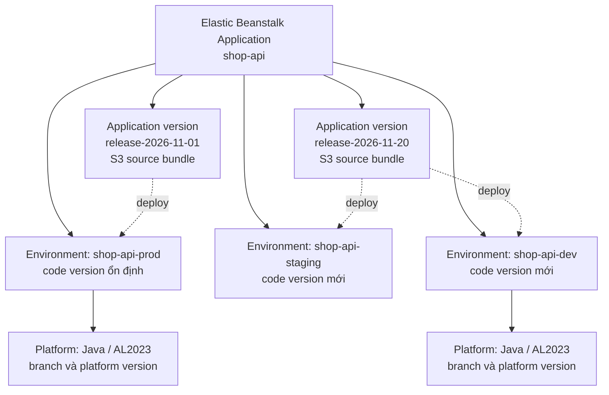
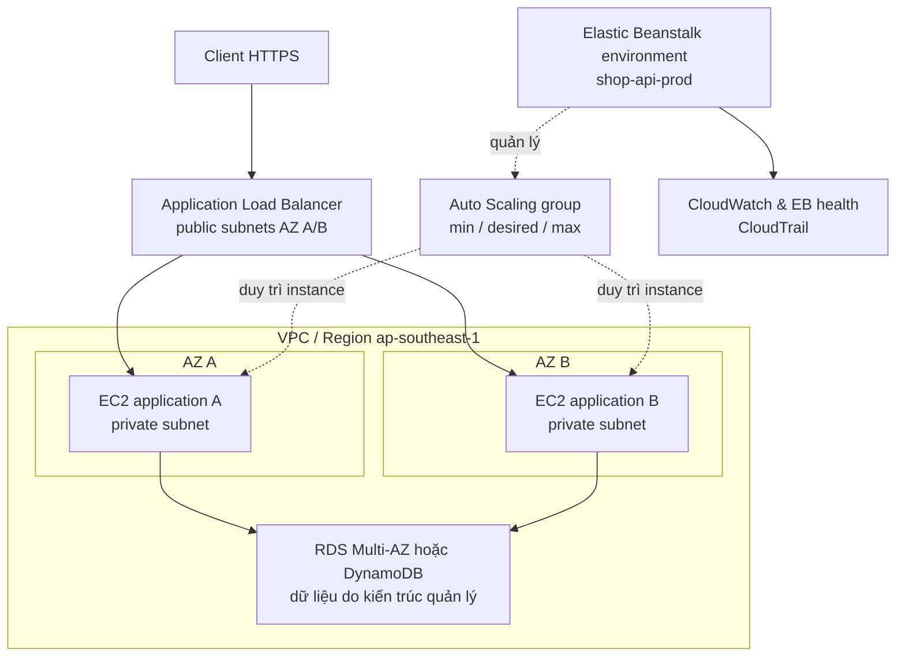
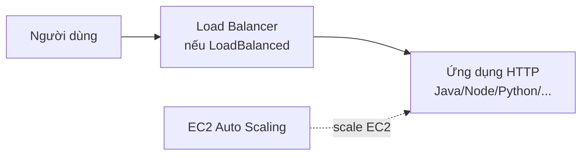
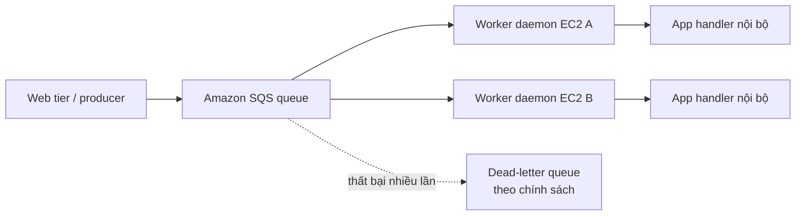
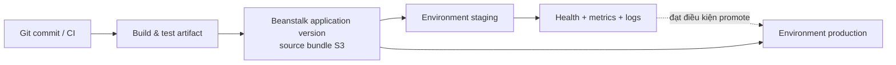
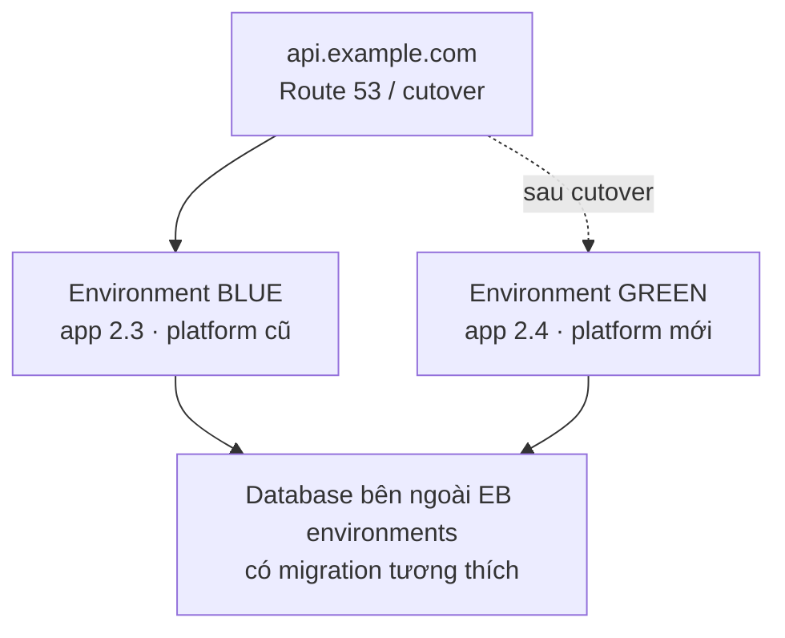
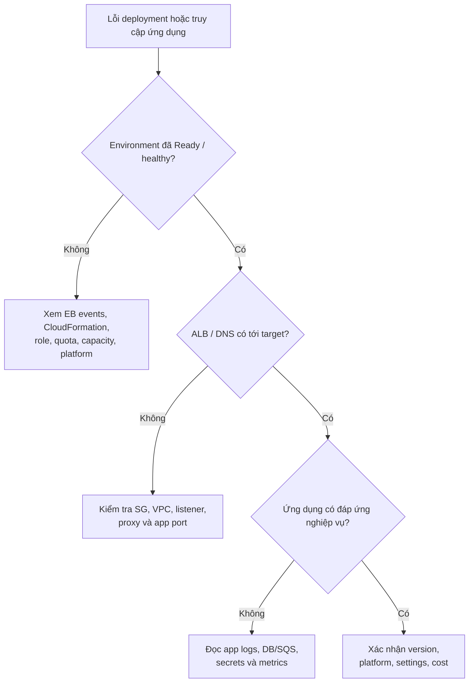

# Elastic Beanstalk application, environment và platform trên AWS

> **Chương:** Nền tảng ứng dụng quản lý  
> **Module:** CLOUD_PROVIDERS_AWS  
> **Mục tiêu:** phân biệt và sử dụng đúng ba khái niệm **application**, **environment**, **platform** trong AWS Elastic Beanstalk; biết cách đóng gói, triển khai, nâng cấp, giám sát và phục hồi một ứng dụng mà vẫn kiểm soát IAM, VPC, chi phí và vòng đời tài nguyên.

## 1. Elastic Beanstalk giải quyết vấn đề nào?

Một nhóm phát triển Java có một API bán hàng viết bằng Spring Boot. Nếu triển khai thủ công trên Amazon EC2, nhóm phải tự tổ chức nhiều công việc:

- Tạo instance và thiết lập hệ điều hành, Java runtime, reverse proxy.
- Tải source hoặc bản build, cấu hình quá trình chạy ứng dụng và cổng mạng.
- Tạo Security Group, subnet, Application Load Balancer (ALB), target group.
- Thiết lập Auto Scaling, kiểm tra sức khỏe và log.
- Đưa phiên bản mới lên các EC2 mà hạn chế gián đoạn.
- Cập nhật hệ điều hành/runtime, sao lưu dữ liệu và xử lý sự cố.

**AWS Elastic Beanstalk** cung cấp lớp điều phối để triển khai và quản lý nhiều thành phần đó từ một mô hình ứng dụng thống nhất. Người phát triển cung cấp mã nguồn hoặc artifact, chọn cách chạy và cấu hình; Elastic Beanstalk tạo, quản lý, cập nhật các tài nguyên AWS liên quan.

**Không hiểu nhầm:** “managed application platform” không có nghĩa AWS chịu mọi trách nhiệm. Với Beanstalk Standard, khách hàng vẫn chịu trách nhiệm về **mã ứng dụng, dữ liệu, IAM permissions, cấu hình VPC/security group, capacity, lựa chọn platform version và ứng dụng tương thích với runtime**. Elastic Beanstalk giúp giảm thao tác triển khai, nhưng các dịch vụ nền vẫn có chi phí và giới hạn riêng.

### 1.1. Ba từ khóa bắt buộc phân biệt

| Khái niệm | Câu hỏi nó trả lời | Ví dụ |
|---|---|---|
| **Application** | “Đây là sản phẩm/nhóm workload nào?” | `shop-api` |
| **Application version** | “Đang chạy bản code/artifact nào?” | `release-2026-11-20.1` |
| **Environment** | “Một bản code được chạy trên tập tài nguyên AWS cụ thể nào?” | `shop-api-dev`, `shop-api-prod` |
| **Platform** | “Hệ điều hành, runtime, web/app server và thành phần Beanstalk nào chạy code?” | Java trên Amazon Linux 2023 ở một platform branch được hỗ trợ |
| **Environment configuration** | “Môi trường cần bao nhiêu máy, mạng nào, secrets gì, scale ra sao?” | 2–6 EC2, load-balanced, VPC private instances |
| **Saved configuration** | “Có thể lưu mẫu cấu hình environment để tái sử dụng không?” | `prod-template` |

Bộ ba **application – environment – platform** thuộc các trục khác nhau; **application version** lại là artifact được triển khai trên một environment. Hiểu được mối liên hệ này là nền tảng cho các quyết định nâng cấp và rollback.

## 2. Sơ đồ quan hệ: một application có nhiều environments



Trong ví dụ:

- `shop-api` là **một application logic**.
- `shop-api-dev`, `shop-api-staging`, `shop-api-prod` là **ba environments khác nhau**: chúng có thể có compute, network, database, vai trò IAM và URL riêng.
- Mỗi environment chạy **một application version tại một thời điểm**. Nhiều environments có thể cùng dùng một version hoặc dùng những version khác nhau.
- Platform được chọn cho **environment**; hai environments cùng application có thể đang ở platform versions khác nhau trong khi chuẩn bị nâng cấp.

**Bài học vận hành:** không nên tạo application mới chỉ để triển khai mỗi lần thay đổi code; đó là công việc của **application version**. Cũng không nên dùng một environment duy nhất vừa để thử nghiệm vừa phục vụ production nếu yêu cầu cách ly lỗi và quyền truy cập.

## 3. Application: đơn vị tổ chức logic

### 3.1. Application chứa gì?

Elastic Beanstalk **application** nhóm:

1. Các **application versions** (từng lần phát hành code/artifact).
2. Các **environments** triển khai những versions đó.
3. **Saved configurations** và metadata liên quan.

Application không phải trực tiếp là EC2 instance, Docker image, IAM role hay một DNS record. Nó là ranh giới tổ chức workload trong Elastic Beanstalk.

**Ví dụ đặt tên:**

| Thành phần | Tên đề xuất | Ý nghĩa |
|---|---|---|
| Application | `shop-api` | Hệ thống API đặt hàng |
| Application version | `git-a92b71c` | Artifact gắn commit bất biến |
| Environment development | `shop-api-dev` | Thử nhanh các thay đổi |
| Environment staging | `shop-api-stg` | Kiểm thử gần production |
| Environment production | `shop-api-prod` | Phục vụ khách hàng |
| Saved configuration | `shop-api-prod-baseline` | Mẫu cấu hình production |

Đối với tổ chức lớn, có thể tạo **AWS account** riêng cho development, staging và production để cách ly IAM/billing; khi đó mỗi account có application/environments riêng hoặc cơ chế triển khai tương ứng. Tên giống nhau không làm các tài nguyên trở thành một.

### 3.2. Application không phải microservice orchestrator

Nếu hệ thống gồm `shop-web`, `shop-api`, `payment-worker` với các vòng đời phát hành độc lập, có thể tạo **nhiều Elastic Beanstalk applications**. Không nhất thiết nhét tất cả thành một application:

- Đội quản trị, quyền IAM và CI/CD có thể khác nhau.
- Web và worker có loại environment khác nhau.
- Mỗi thành phần có yêu cầu capacity/platform/rollback khác.
- Database và message queue cần có ownership rõ ràng.

Có thể sử dụng một application chứa nhiều environments cho **cùng dịch vụ code** ở nhiều giai đoạn. Tách application khi thực sự là **artifact và lifecycle khác nhau**.

## 4. Application version: phiên bản mã triển khai

### 4.1. Application version thực sự là gì?

Với mô hình **Beanstalk Standard**, một **application version** là lần lặp được gắn nhãn của ứng dụng, thường tham chiếu đến **source bundle** lưu tại Amazon S3. Ví dụ:

- Java: tệp JAR/WAR và cấu hình khởi động trong source bundle theo platform.
- Node.js: mã ứng dụng và `package.json`.
- Python: ứng dụng và khai báo dependencies.
- Docker: Dockerfile hoặc cấu hình container phù hợp platform Docker.

Một application có nhiều versions, nhưng **mỗi environment chạy một version đã chọn**. Đội triển khai có thể upload version mà chưa áp dụng cho production; sau khi staging đạt yêu cầu mới deploy version đó sang môi trường production.

Với **Beanstalk Cluster** mới, các khái niệm application/version vẫn được dùng, nhưng artifact có thể là **container image** hoặc source code để Beanstalk build thành image chạy trên EKS. Không áp dụng máy móc mô hình “luôn là WAR trong S3” cho mọi mode.

### 4.2. Version label khác platform version

Có hai số phiên bản dễ bị nhầm:

| Trường | Đối tượng | Ví dụ |
|---|---|---|
| **Application version label** | Code/artifact của sản phẩm | `build-1837`, `v2.4.0` |
| **Platform version** | OS/runtime/proxy/Beanstalk components | Một bản trong branch Java trên AL2023, số `X.Y.Z` |
| **Platform branch** | Dòng sản phẩm nền tảng theo runtime/OS major | Java 21 trên Amazon Linux 2023, tùy branch hiện có |
| **EC2 instance type** | Cấu hình compute chạy ứng dụng | `t3.small`, `m7i.large` |
| **Environment name** | Triển khai độc lập | `shop-api-prod` |

**Deploy ứng dụng phiên bản mới không tự động nâng Java runtime**; cập nhật platform cũng không có nghĩa ứng dụng được build lại theo commit mới.

### 4.3. Versioning để rollback đáng tin cậy

Một pipeline an toàn nên:

1. Build và test ở CI, tạo artifact xác định được.
2. Gắn **version label duy nhất**, chứa build ID/commit SHA.
3. Upload artifact vào vùng lưu được quản lý; tránh sửa nội dung của source bundle đã gắn nhãn.
4. Deploy version đó vào staging, kiểm tra smoke/integration/performance.
5. Promote **cùng artifact** sang production.
6. Giữ những versions còn cần rollback cùng dependencies liên quan.
7. Thiết lập **application version lifecycle policy** để không chạm giới hạn số versions và giảm chi phí lưu trữ.

**Lưu ý:** lifecycle policy có thể xóa versions cũ theo **tuổi hoặc số lượng**, nhưng không tự xóa version đang được một environment sử dụng; việc dọn S3 source bundle phụ thuộc tùy chọn cấu hình. Một chính sách cleanup quá ngắn có thể khiến version cũ không còn phục vụ rollback sau một thời gian.

## 5. Environment: nơi ứng dụng thực sự chạy

### 5.1. Environment bao gồm tài nguyên AWS nào?

**Environment** là tập tài nguyên được Elastic Beanstalk provision và phối hợp để chạy một application version.

Ở **Beanstalk Standard** thường có:

- Một hoặc nhiều **Amazon EC2 instances** trong một Auto Scaling group.
- **Security groups**, EC2 instance profile, service role và các tài nguyên network liên quan.
- **Elastic Load Balancer (ALB, NLB hoặc loại được platform/mô hình hỗ trợ)** nếu chọn load-balanced environment.
- **CloudWatch metrics/logs**, health reporting và resource configuration.
- **S3** lưu source bundles/logs/ứng dụng nếu được cấu hình.
- Tùy chọn tích hợp **RDS**, nhưng dữ liệu production thường được quản lý **bên ngoài vòng đời environment**.

Beanstalk sử dụng **AWS CloudFormation** để quản lý nhiều tài nguyên của environment. Điều này quan trọng: người vận hành có thể thấy EC2, Auto Scaling, ELB, CloudFormation stack thực trong tài khoản AWS, không phải tài nguyên “ảo” hoàn toàn ẩn đi.



**Không giả định tự động có multi-AZ production:** loại environment, subnets, instance min/max, database và load balancer phải được cấu hình tương ứng.

### 5.2. Một environment chỉ chạy một application version

Một environment production có thể đang chạy `build-1829`, trong khi staging chạy `build-1837`. Nếu deploy lại version `build-1829` vào production, không cần tạo application mới. Nhưng environment vẫn có **platform version** riêng; nếu runtime của bản cũ không tương thích với platform đang chạy, rollback chỉ code có thể không thành công.

### 5.3. Environment name, CNAME và endpoint

Elastic Beanstalk có thể cấp tên miền môi trường dạng:

```text
shop-api-prod.<region>.elasticbeanstalk.com
```

Tên thực do dịch vụ cấp và tùy Region. Có thể thiết lập **custom domain** như `api.example.com` qua **Route 53 CNAME/alias** theo tài nguyên đích phù hợp, đồng thời cấu hình **HTTPS/TLS certificate** bằng ACM và listener của load balancer.

Đừng nhầm:

- **Environment URL:** tên do Beanstalk cung cấp.
- **ALB DNS name:** endpoint của load balancer trong environment.
- **Custom domain:** DNS công cộng do tổ chức sở hữu.
- **Application name:** nhóm logic, không phải tên domain.

Với môi trường internal-only, DNS và route truy cập phải phù hợp VPC/VPN/Direct Connect; environment vẫn có thể tồn tại dù không truy cập trực tiếp từ Internet.

## 6. Hai environment tiers của Beanstalk Standard

### 6.1. Web server environment tier

**Web server tier** phục vụ lưu lượng HTTP từ người dùng:



Thường dùng cho:

- Website, REST API và backend phục vụ HTTP.
- Dịch vụ có thời gian response tương đối ngắn.
- API cần HTTP health check, ALB, TLS, autoscaling.

Để sẵn sàng phục vụ production, thiết kế nên xét nhiều AZ, minimum instances phù hợp và database độc lập.

### 6.2. Worker environment tier

**Worker tier** xử lý công việc bất đồng bộ thông qua **Amazon SQS**. Elastic Beanstalk tạo/cấu hình worker daemon trên EC2, nhận message từ queue và gửi payload tới HTTP endpoint của ứng dụng xử lý.



Ví dụ web nhận đơn hàng rồi enqueue công việc gửi email và tạo hóa đơn. Worker chạy riêng, có capacity và scale policy phù hợp.

Điểm vận hành cần nhớ:

- Daemon gọi ứng dụng qua HTTP và **xóa message từ SQS khi nhận phản hồi thành công theo quy tắc của worker daemon**.
- Với lỗi/timeout, message có thể trở lại queue sau visibility timeout và được xử lý lại.
- **SQS thông thường có mô hình at-least-once delivery:** ứng dụng worker phải xử lý **idempotent** để tránh gửi hai hóa đơn hoặc trừ tiền hai lần.
- Cấu hình visibility timeout, retries, dead-letter queue, metrics queue age và worker concurrency.
- Worker tier **không sử dụng load balancer theo mô hình web tier**. Nó có Auto Scaling group để tăng giảm năng lực xử lý message.
- Một số platform như **.NET trên Windows Server** không hỗ trợ worker environment tier; kiểm tra platform/tier compatibility trước khi tạo.

### 6.3. Tier không phải environment type

Đây là hai trục khác nhau:

| Khái niệm | Các lựa chọn phổ biến | Ý nghĩa |
|---|---|---|
| **Environment tier (Standard)** | Web server, Worker | Ứng dụng nhận HTTP người dùng hay xử lý SQS jobs |
| **Web environment type** | Single instance, Load balanced | Một EC2 không LB hay nhóm EC2 có LB/Auto Scaling |
| **Platform** | Java/Node.js/Python/... cùng OS/runtime version | Runtime/OS/proxy dùng chạy code |
| **Application version** | `build-123`, `build-124` | Mã nghiệp vụ được deploy |

Không tạo worker tier chỉ vì API chạy background thread; chọn nó khi muốn dùng luồng SQS/worker daemon được Elastic Beanstalk quản lý.

## 7. Single-instance và load-balanced environments

### 7.1. Single-instance

Single-instance web environment thông thường có:

- **Một EC2** (được quản lý bởi Auto Scaling group với min/max/desired = 1).
- Không có load balancer.
- Environment endpoint gắn với **Elastic IP** theo mô hình Standard.
- Rẻ hơn ở thành phần ALB/LB, phù hợp **dev/test, demo, workload chấp nhận downtime**.

Nhược điểm:

- Không chịu lỗi một EC2/AZ theo mô hình HA.
- Deploy/update có thể làm app gián đoạn.
- Không scale số instance khi traffic tăng vì capacity cố định một máy.
- Public IPv4/EBS/EC2 và logs vẫn phát sinh phí; không đồng nghĩa “miễn phí”.

**Không nên dùng single-instance làm lựa chọn mặc định cho production có SLA cao** chỉ vì nó dễ tạo.

### 7.2. Load-balanced, scalable

Load-balanced web environment thường:

- Tạo **Elastic Load Balancer** và **Auto Scaling group**.
- Có thể phân bố EC2 trên nhiều AZ.
- Tăng giảm số EC2 trong giới hạn min/max theo metrics/scale policies.
- Có thể dùng các deployment policies giảm downtime.

Với production, cân nhắc:

1. Min instances đủ để tiếp tục phục vụ khi một EC2 hoặc AZ lỗi.
2. ALB health checks tới endpoint sẵn sàng thực sự của app.
3. ECS/EKS không phải thành phần bắt buộc: Beanstalk Standard chạy trực tiếp trên EC2 theo platform.
4. Session state, uploads và database nên dùng các dịch vụ độc lập nếu scale ngang.
5. Cấu hình subnets, SG, NAT/VPC endpoints, SSL/TLS và auto scaling theo nhu cầu thực tế.

### 7.3. Từ dev sang production

Có thể bắt đầu với single-instance tại dev, rồi chuyển environment type thành load-balanced khi cần. Nhưng thao tác đó có thể **tạo/thay tài nguyên**, thay endpoint và phát sinh downtime/cost. Với production quan trọng, thường nên tạo environment mới và kiểm thử trước khi chuyển traffic.

| Tiêu chí | Single-instance | Load-balanced |
|---|---|---|
| Số EC2 | Một | Một hoặc nhiều, tùy min/max |
| ALB/NLB | Không | Có LB theo cấu hình |
| Scale-out | Không theo mô hình tăng số EC2 | Có thể Auto Scaling |
| Chịu lỗi EC2/AZ | Không đáp ứng HA | Có thể khi nhiều AZ/backend/data phù hợp |
| Chi phí | Thường thấp hơn | Thêm phí LB, EC2 capacity |
| Deploy | Có thể gián đoạn | Nhiều chính sách rolling/immutable/traffic splitting |
| Sử dụng | Dev/test/POC | Production và workload cần scale |

## 8. Platform: nơi OS, runtime và Beanstalk components gặp nhau

### 8.1. Platform gồm những gì?

Với **Beanstalk Standard**, **platform** là tổ hợp:

- Hệ điều hành (ví dụ Amazon Linux 2023 hoặc Windows Server theo branch).
- Runtime lập trình (Java/Corretto, Node.js, Python, PHP, Ruby, .NET... theo danh sách hỗ trợ).
- Web server/reverse proxy/application server (Nginx, Apache HTTPD, Tomcat/IIS... tùy platform).
- Thành phần Elastic Beanstalk để quản lý deploy, cấu hình, health và logs.

**Platform không phải application code.** Java 21, Nginx, Amazon Linux 2023 là các lớp nền; `shop-api.jar` mới là artifact nghiệp vụ.

### 8.2. Platform, platform branch và platform version

| Thuật ngữ | Mức độ | Ví dụ khái niệm |
|---|---|---|
| **Platform family** | Nhóm nền tảng theo hệ sinh thái | Java |
| **Platform branch** | Dòng cùng OS/runtime/web/app server major | Corretto/Java trên Amazon Linux 2023 với runtime major được hỗ trợ |
| **Platform version** | Bản phát hành cụ thể trong branch, gồm patches/cập nhật components | `X.Y.Z` |
| **Application version** | Mã do đội phát triển build/deploy | `release-2026-11-20` |

**Không dùng số `X.Y.Z` minh họa làm platform version thật.** Hãy truy vấn danh sách supported/recommended platform versions trong Region/tài khoản.

### 8.3. Platform branch lifecycle

AWS phân loại các platform branches theo vòng đời:

| Trạng thái | Diễn giải | Cách hành động |
|---|---|---|
| **Supported** | Nhánh được hỗ trợ, có cập nhật | Phù hợp production nếu đáp ứng nhu cầu |
| **Beta** | Nhánh thử nghiệm/pre-release | Thử ở lab, tránh production quan trọng |
| **Deprecated** | Có component sắp hoặc đã tới EOL; đang trong quá trình ngừng hỗ trợ | Lập kế hoạch migration trước retirement |
| **Retired** | Nhánh không nhận cập nhật; thường không tạo mới được trong console | Chuyển sang supported branch |

Với **platform version** trong branch, AWS còn phân biệt:

- **Recommended:** phiên bản cập nhật được AWS khuyến nghị.
- **Not recommended:** phiên bản cũ hơn trong cùng branch, có thể thiếu patches.

Một branch **Supported** vẫn có platform version cũ không recommended. Tình trạng branch và tình trạng version là hai câu hỏi khác nhau.

### 8.4. Nâng platform version và đổi platform branch khác nhau

**Within-branch update:** ví dụ cập nhật bản Java platform trong cùng nhánh Amazon Linux 2023, nhằm nhận patches runtime/OS/web server. AWS khuyến nghị cập nhật; có thể dùng **managed platform updates**.

**Cross-branch migration:** ví dụ chuyển từ runtime major cũ sang runtime major mới, hoặc Amazon Linux 2 sang Amazon Linux 2023. Thay đổi này có thể yêu cầu:

- Build lại code/dependencies/Java target compatibility.
- Thay các package đã không còn trong OS mới.
- Kiểm tra `.ebextensions` và `.platform/hooks`, reverse proxy, systemd và file paths.
- Cập nhật monitoring agents, secrets, KMS/IAM policies và health checks.
- Tạo **environment mới** trên branch đích nếu không thể đổi trực tiếp.
- Dùng blue/green và rollback có kế hoạch.

**Điểm đặc biệt từ tài liệu AWS:** mỗi lần cập nhật **platform version** có thể **thay thế các EC2 instances của environment**, kể cả update trong cùng branch. Cần dùng rolling/immutable updates phù hợp và chuẩn bị capacity, state externalization, connection draining. Không coi platform patch là thao tác không gián đoạn mặc định.

### 8.5. Vòng đời runtime không đồng nghĩa phiên bản app

Một phiên bản ứng dụng Java có thể được build trên JDK 21 nhưng platform production đang chạy Java 17. Nếu code dùng API chỉ có ở Java 21, việc deploy artifact có thể khiến app không start. Cần kiểm tra:

- `java -version`/platform branch thực tế.
- Bytecode target và thư viện native dependencies.
- Các environment variables, JVM options, port/proxy.
- Start command, container logs và health checks.
- Platform patch level và deprecations.

**Tách ba tiến trình:** (1) nâng ứng dụng, (2) nâng platform version trong cùng branch, (3) migrate sang branch/runtime major khác. Không gộp cả ba vào cùng một thay đổi khẩn cấp nếu không có chiến lược rollback rõ ràng.

## 9. Beanstalk Standard và Beanstalk Cluster (cập nhật hiện hành)

Tài liệu AWS hiện mô tả **hai modes** cùng sử dụng các khái niệm application, application version, environment và configuration:

| Tiêu chí | **Beanstalk Standard** | **Beanstalk Cluster** |
|---|---|---|
| Compute layer | Ứng dụng chạy **trực tiếp trên Amazon EC2** do environment quản lý | Ứng dụng chạy dưới dạng **containers trên Amazon EKS** do Beanstalk tạo/vận hành |
| Nền tảng ứng dụng | Chọn platform branch/version (OS/runtime/proxy) | Ứng dụng cung cấp image hoặc source để dịch vụ build image; **không chọn Java/Node OS platform branch kiểu Standard** |
| Quản lý scale | EC2 Auto Scaling group và trigger/cấu hình capacity | Replica scaling trên EKS, nodes được EKS Auto Mode cấp theo cơ chế dịch vụ |
| Namespace cấu hình | `aws:autoscaling:*`, `aws:elasticbeanstalk:*`... | `aws:elasticbeanstalk:eks` và các namespace con |
| Cơ chế cập nhật | Deploy đến các EC2, platform updates | Rolling updates của container workloads |
| Customization `.ebextensions` | Áp dụng cho Standard | **Không dùng theo cách của Standard**; dùng configuration options/API phù hợp Cluster |
| Isolation | Environment có ASG/EC2 resources riêng | Nhiều Cluster environments cùng account và subnet set có thể chia sẻ một EKS cluster, workload được cách ly theo mô hình dịch vụ |
| Bài toán phù hợp | Nhanh chóng chạy web/backend trên runtime do AWS quản lý, kiểm soát cấu hình EC2 | Muốn dùng container orchestration và compute do dịch vụ vận hành nhiều hơn |

**Tại sao cần nhắc Cluster trong một bài về platform?** Vì câu “tạo Beanstalk environment là phải chọn platform Java/Python trên EC2” **đúng cho Standard nhưng không đúng cho Cluster**. Đối với Cluster, nền chạy của workload nằm trong container image và EKS compute do dịch vụ quản lý.

Trong phần thực hành của bài, các ví dụ `.ebextensions`, EC2 platform branch và EB CLI cấu hình **được ghi rõ là Standard**. Nếu làm với Cluster, hãy xem tài liệu Cluster riêng; không sử dụng `aws:autoscaling:asg` để cấu hình EKS replicas.

### 9.1. Cluster chia sẻ compute không có nghĩa dữ liệu tự dùng chung

Trong Beanstalk Cluster, nhiều environments có thể dùng chung EKS cluster theo điều kiện tài khoản/subnet set, nhưng vẫn cần:

- Chọn cách ly mạng, quyền IAM, secret injection và access đến dữ liệu.
- Quy hoạch replicas, scale và availability.
- Bảo vệ namespaces/workload identity theo mô hình AWS.
- Kiểm tra chi phí nền EKS và EKS Auto Mode ở môi trường thực tế.

**Không nhầm Cluster với một ECS service tự động xuất hiện.** Đây là mô hình container dựa trên **Amazon EKS**, khác hạ tầng ECS/Fargate mà người học có thể đã gặp.

## 10. Cấu hình environment: values đến từ đâu?

### 10.1. Những thông số environment quan trọng

Một environment có nhiều nhóm cấu hình:

| Nhóm | Ví dụ | Tác động |
|---|---|---|
| **Software** | Runtime environment properties, proxy, process command | Cách application start và đọc config |
| **Instances** | EC2 instance type, root volume, instance profile | Capacity và quyền ứng dụng |
| **Capacity** | Single/LoadBalanced, min/max EC2, scaling triggers | Availability và chi phí |
| **Load balancer** | Type, listener 80/443, health check path | Kết nối client/backend |
| **Network** | VPC, public/private subnets, security groups | Đường đi traffic, ECR/S3/RDS access |
| **Rolling updates/deployments** | Batch size, policy, timeout, health | Downtime và khả năng rollback |
| **Monitoring** | Health reporting, log streaming, retention | Khả năng điều tra sự cố |
| **Platform updates** | Managed updates/window/options | Patching và EC2 replacement |
| **Database** | RDS coupled hoặc external | Vòng đời dữ liệu và phục hồi |

Đổi một setting không nhất thiết chỉ sửa file config ở EC2. Elastic Beanstalk có thể cập nhật/recreate AWS resources theo loại thay đổi; cần xem **environment events** và đánh giá downtime.

### 10.2. Nguồn cấu hình và thứ tự ưu tiên với Standard

Với Beanstalk Standard, tài liệu AWS công bố thứ tự ưu tiên từ cao đến thấp:

1. **Giá trị đặt trực tiếp cho environment** qua console/EB CLI/API (bao gồm một số recommended settings mà client áp).
2. **Saved configuration** được gán khi tạo/apply.
3. **`.ebextensions/*.config`** trong source bundle.
4. **Giá trị mặc định**.

Ví dụ: `.ebextensions` khai báo min EC2 = 2, nhưng môi trường được console đặt min = 3 thì giá trị console/direct environment thắng.

**Vấn đề vận hành:** sửa file trong Git mà triển khai lại vẫn không thấy thay đổi có thể do **một option có ưu tiên cao hơn đang override**. Kiểm tra configuration thực tế, không mặc định source bundle là “single source of truth” nếu console updates vẫn được phép.

### 10.3. Saved configuration

Saved configuration là **mẫu cấu hình environment** để tái sử dụng, hữu ích khi:

- Muốn chuẩn hóa dev/staging/prod.
- Cần lưu baseline khi clone hoặc tạo environment mới.
- Muốn xem sự khác nhau giữa những phiên bản cấu hình.

Nhưng **saved configuration không phải runtime database backup**, cũng không phải tệp chứa code. Nó không thay thế IaC và quy trình bảo vệ secrets. Một số values/resource references có thể không hợp lệ khi copy sang VPC/Region/account khác; cần kiểm thử trước khi áp dụng.

### 10.4. Ví dụ `.ebextensions` (chỉ dành cho Standard)

Cấu trúc của một Java source bundle:

```text
shop-api-bundle.zip
├── application.jar
├── Procfile
└── .ebextensions/
    └── 01-app-env.config
```

Nội dung ví dụ `.ebextensions/01-app-env.config`:

```yaml
option_settings:
  aws:elasticbeanstalk:application:environment:
    SPRING_PROFILES_ACTIVE: production
    LOG_LEVEL: INFO
```

Trong đây:

- `.config` phải là YAML/JSON hợp lệ.
- Thư mục `.ebextensions` cần nằm ở **gốc source bundle**.
- Không đưa password/API token/KMS private key trực tiếp vào repo.
- Những values có ưu tiên cao hơn từ console/API vẫn có thể override.

**Procfile** minh họa Java SE:

```text
web: java -jar application.jar --server.port=5000
```

Cần bảo đảm tên artifact, main class/JAR executable, port mà reverse proxy chuyển tiếp và cấu hình platform thực tế khớp nhau. Một số Java platform có conventions khác, nhất là Tomcat WAR; đừng copy `Procfile` từ Java SE sang Tomcat platform mà không kiểm tra.

### 10.5. Platform hooks khác .ebextensions

Trên những platform Amazon Linux 2/2023 đủ điều kiện, có thể dùng các thư mục như `.platform/hooks/prebuild`, `predeploy` và `postdeploy` để tùy chỉnh các giai đoạn deployment.

Khi dùng hooks:

- Lệnh phải **idempotent** vì có thể chạy lại ở lần deploy/instance mới.
- Không đặt migration phá hủy dữ liệu trong hook sẽ chạy trên nhiều instances.
- Kiểm tra quyền thực thi, line endings, shell và platform version.
- Không viết dữ liệu quan trọng lên local filesystem vì instance có thể bị thay thế.
- Ghi log rõ ràng để điều tra khi deploy thất bại.

**Tùy chỉnh hệ thống càng nhiều càng tăng gánh nặng bảo trì.** Nếu hệ thống cần tùy biến host rất sâu, hãy đánh giá lại Standard vs container platform hoặc ECS/EKS.

## 11. Environment properties và secrets

### 11.1. Environment variables để cấu hình ứng dụng

Một ứng dụng nên tách settings khỏi binary:

- `SPRING_PROFILES_ACTIVE=production`.
- `LOG_LEVEL=INFO`.
- `ORDER_QUEUE_URL=https://sqs...` hoặc endpoint theo cấu hình.
- `DB_HOST=db.internal...`.
- Feature flags phục vụ rollout.

Các biến môi trường là **configuration**, không phải hệ thống phân quyền. Đừng lưu secret dạng plaintext trong file `.ebextensions` hoặc để lộ qua build logs.

### 11.2. AWS Secrets Manager và Systems Manager Parameter Store

Elastic Beanstalk hỗ trợ tham chiếu một số secrets/parameters vào environment properties theo khả năng của platform; hoặc ứng dụng có thể đọc trực tiếp bằng AWS SDK nhờ **EC2 instance profile/task identity** thích hợp.

Thiết kế an toàn cần:

1. Tạo secret trong **Secrets Manager/Parameter Store** với KMS key phù hợp.
2. Gán IAM policy tối thiểu cho role của ứng dụng.
3. Bảo đảm network/VPC endpoints hoặc NAT để truy cập dịch vụ khi instance ở private subnet.
4. Quản lý rotation/reload secret trong app; thay secret trong store không luôn làm process đã chạy tự đọc giá trị mới.
5. Kiểm tra log/diagnostics không in secret ra stdout hoặc console.

**Role phân biệt:** Elastic Beanstalk **service role** cho Beanstalk quản lý tài nguyên/health, còn **EC2 instance profile** để code trên EC2 gọi AWS APIs; đây là hai vai trò khác nhau.

## 12. Deployment vào environment

### 12.1. Luồng phát hành một application version



Mỗi lần release có thể dùng **Application versions → chọn version → Deploy** hoặc EB CLI để triển khai trên environment mong muốn.

Các câu hỏi cần trả lời trước khi deploy:

- Version artifact đã test chưa, có tái lập được không?
- Runtime của platform branch có tương thích với artifact mới không?
- Database schema có tương thích với **cả bản cũ và bản mới** trong thời gian triển khai không?
- Environment type và số instances có đủ capacity để deploy ít gián đoạn không?
- Health check endpoint có phản ánh readiness không?
- Khi deployment fail, cách phục hồi về phiên bản cũ là gì?

### 12.2. Deployment policies phổ biến cho Beanstalk Standard

| Policy | Cách hoạt động | Downtime/capacity trade-off |
|---|---|---|
| **All at once** | Deploy code mới lên toàn bộ instances cùng lúc | Nhanh, nhưng có thể khiến toàn environment gián đoạn |
| **Rolling** | Deploy từng batch, tạm loại batch khỏi phục vụ | Capacity giảm trong lúc batch cập nhật |
| **Rolling with additional batch** | Tạo thêm một batch mới trước khi thay từng batch | Giữ capacity tốt hơn; phát sinh capacity tạm |
| **Immutable** | Deploy vào một nhóm instances mới, kiểm tra health rồi thay nhóm cũ | Giảm rủi ro thay đổi nhóm cũ; cần nhiều tài nguyên, có thời gian tạo instance |
| **Traffic splitting** | Dùng nhóm instances mới và gửi một phần traffic trong thời gian đánh giá | Có thể thử/canary phần traffic; cần **ALB** và cấu hình hỗ trợ |

**Không phải policy nào cũng dùng được với Single-instance.** Tài liệu AWS cho biết **All at once** và **Immutable** được hỗ trợ trên Single-instance, trong khi **Rolling** và **Rolling with additional batch** yêu cầu môi trường load-balanced; **Traffic splitting** cần load-balanced environment dùng **ALB**.

### 12.3. Rollback code và blue/green

Một cách phục hồi nhanh là **deploy lại application version cũ** vào environment. Nhưng nếu rolling deploy dở dang, các EC2 có thể đang chạy những batch version khác nhau; cần xem environment events, instance health và chính sách deploy.

**Blue/green** là cách chạy **hai environments riêng**, ví dụ:

- Blue: `shop-api-prod-blue` đang phục vụ.
- Green: `shop-api-prod-green` trên platform/runtime/app version mới.
- Kiểm thử Green với environment URL riêng.
- Chuyển traffic bằng **CNAME swap** hoặc điều chỉnh DNS/route theo thiết kế.



**Lý do blue/green phù hợp khi đổi platform branch:** các EC2/OS/runtime khác nhau có thể được kiểm tra độc lập trước cutover.

**Cảnh báo:** CNAME swap không tự đồng bộ database hay session; DNS caches/TTL có thể làm một số người dùng đến Blue trong thời gian chuyển tiếp. Giữ Blue đủ lâu cho rollback và kiểm tra dữ liệu **backward compatible**.

### 12.4. Deployment thành công không có nghĩa sản phẩm thành công

Elastic Beanstalk có thể báo môi trường `Ready/Green` vì process và HTTP health check hoạt động, nhưng API checkout vẫn lỗi ở nghiệp vụ. Cần:

- Smoke tests/contract tests.
- p95 latency, 4xx/5xx, database errors, conversion metrics.
- So sánh metrics trước/sau deploy.
- Cảnh báo CloudWatch và rollback theo runbook khi bất thường.
- Không chỉ trông chờ health status của platform.

## 13. Platform updates và maintenance

### 13.1. Managed platform updates

Elastic Beanstalk có khả năng **managed platform updates** để định kỳ áp những platform patches phù hợp theo cài đặt. Người quản trị vẫn phải:

1. Chọn branch **Supported**.
2. Xem changelog và những component được cập nhật.
3. Kiểm tra ứng dụng ở staging khi có thể.
4. Chọn maintenance window/rolling vs immutable update phù hợp.
5. Theo dõi environment health và logs.
6. Có rollback/migration plan nếu update không tương thích.

**Platform updates có thể thay EC2 instances**, do đó dữ liệu trên local instance store hoặc filesystem không được backup đúng cách có thể mất. Dùng S3/EFS/RDS hoặc storage bền vững có lifecycle tách khỏi EC2 nếu dữ liệu cần giữ.

### 13.2. Một số thành phần được cập nhật độc lập

Không nhầm:

- **Application version:** mã của khách hàng.
- **Platform version:** OS/runtime/proxy/Beanstalk components.
- **EC2 instance type:** thay đổi tài nguyên compute.
- **Environment configuration:** security groups, ASG capacity, VPC, health settings.
- **RDS engine:** được nâng theo kế hoạch database riêng.

Ví dụ update Java platform không tự cập nhật PostgreSQL schema; deploy code mới không tự vá Amazon Linux platform.

### 13.3. Migration cross-branch an toàn

Ví dụ tổ chức chuyển một Java Beanstalk Standard environment từ branch cũ sang branch supported trên AL2023:

1. Kiểm kê configuration, Java version, dependencies, nginx/Tomcat behavior, OS commands.
2. Build artifact cho runtime mới, chạy test.
3. Tạo **environment mới** đúng supported branch.
4. Dùng saved config/`.ebextensions` được rà soát thay vì copy nguyên values không tương thích.
5. Kết nối **database external** bằng IAM/SG/secret hợp lệ.
6. Kiểm tra smoke, performance, security, logs và scaling.
7. Cắt chuyển traffic (CNAME/DNS) và theo dõi.
8. Giữ environment cũ để rollback có kiểm soát; hủy sau khi hết nhu cầu và xác nhận retention.

Mục tiêu không chỉ là ứng dụng “start được” mà là **đáp ứng an toàn, hiệu năng, phục hồi và tổng chi phí** sau thay đổi.

## 14. Database: quản lý vòng đời độc lập với environment

### 14.1. Tại sao nên tránh gắn chặt production database vào environment?

Elastic Beanstalk Standard hỗ trợ tích hợp **coupled RDS** trong một số trường hợp. Với ứng dụng mới/dev, tùy chọn này thuận tiện: Beanstalk tạo database cùng environment và cung cấp các environment properties liên quan.

Nhưng ở production, có nhiều rủi ro:

- Terminate/recreate environment có thể ảnh hưởng vòng đời database nếu deletion policy không được kiểm soát.
- Blue/green cần hai environments có thể dùng chung database hoặc dữ liệu đã replication theo mô hình.
- Database có lịch patch, backup, Multi-AZ/restore và IAM/KMS riêng.
- Dễ xảy ra sai sót khi cập nhật RDS bên ngoài đường quản lý của Beanstalk.

AWS khuyến nghị cân nhắc **decouple RDS** hoặc dùng database được tạo và quản lý **ngoài environment** khi tiến tới production.

### 14.2. Database deletion policies

Các lựa chọn có thể gồm:

| Policy | Khi decouple/terminate theo quy tắc hỗ trợ | Rủi ro cần chú ý |
|---|---|---|
| **Retain** | Giữ database hoạt động độc lập với environment | Tiếp tục tính phí; cần quản lý kết nối/SG/secrets riêng |
| **Snapshot** | Tạo snapshot rồi xóa DB instance theo quá trình được hỗ trợ | RTO phụ thuộc restore, snapshot có phí |
| **Delete** | Xóa database | Có nguy cơ mất dữ liệu nếu không có backup riêng |

**Rủi ro vận hành:** nếu thay **deletion policy** đồng thời với thao tác **decouple**, AWS cảnh báo setting mới có thể **không được áp dụng**; cần lưu thay đổi deletion policy ở một thao tác riêng **trước** khi decouple.

**Không bao giờ terminate environment production để “dọn tài nguyên” khi chưa xác nhận dữ liệu, snapshots, S3, log retention, IAM/CloudFormation và RDS deletion policy.**

### 14.3. Dữ liệu và session nên nằm ở đâu?

| Loại dữ liệu | Vị trí gợi ý |
|---|---|
| Files tĩnh/uploads | S3 hoặc EFS khi ứng dụng thực sự cần POSIX share |
| Dữ liệu giao dịch | RDS/Aurora/DynamoDB theo yêu cầu |
| Session state | ElastiCache/Redis hoặc cơ chế session store thích hợp |
| Background jobs | SQS/worker tier hoặc hệ điều phối phù hợp |
| Logs | CloudWatch Logs hoặc log store được quản lý |
| Build artifact | S3 source bundle/ECR theo mode |
| Cache tạm | Disk/memory của EC2 chỉ khi chấp nhận mất khi instance thay thế |

**Stateless web tier** giúp ứng dụng scale và cập nhật platform mà ít rủi ro dữ liệu hơn.

## 15. IAM, VPC và bảo mật

### 15.1. Những roles không nên nhầm

| Role | Ai sử dụng? | Chức năng |
|---|---|---|
| **Elastic Beanstalk service role** | Dịch vụ EB | Quản lý/giám sát tài nguyên environment theo quyền được giao |
| **EC2 instance profile** | Code và agent trên instances của Standard | Truy cập S3, SQS, DynamoDB, CloudWatch, Secrets... theo nhiệm vụ |
| **CI/CD deployment role** | Pipeline hoặc người deploy | Tạo application versions, deploy/update environment, `iam:PassRole` có giới hạn |
| **EKS cluster/node roles (Cluster mode)** | Amazon EKS và EC2 nodes theo mô hình Cluster | Tạo/vận hành EKS foundation và nodes |
| **End user identity** | Người sử dụng API | Không được thay thế bằng quyền quản trị Beanstalk |

**Least privilege:** cho application đúng quyền data API; không cấp `s3:*`, `ec2:*` hay `iam:*` vì “Beanstalk cần hoạt động”. Chỉ admin/pipeline có quyền sửa environment và roles; end users cần authentication/authorization ứng dụng riêng.

### 15.2. VPC networking

Với load-balanced production Standard, mô hình phổ biến:

- ALB ở **public subnets** trong nhiều AZ (khi internet-facing).
- EC2 application ở **private subnets**, không cần public IPv4.
- EC2 có outbound tới ECR/S3/CloudWatch/Secrets khi cần qua **NAT Gateway/VPC endpoints**.
- SG của EC2 chỉ cho inbound từ SG của ALB trên cổng app.
- RDS ở private subnets với SG chỉ cho phép app tới DB port.
- HTTPS listener và ACM certificate cho domain chính thức.

**Không phải cứ tạo Beanstalk environment là mọi kết nối Internet đều tự hoạt động.** Một instance ở private subnet cần route/NAT/endpoints và DNS phù hợp; nếu thiếu, deploy có thể thất bại vì không tải dependencies hoặc gửi logs.

### 15.3. Hệ quả của thay đổi thủ công resources do Beanstalk tạo

Nếu admin sửa trực tiếp Auto Scaling group, listener, SG hoặc CloudFormation stack mà không đồng bộ với Beanstalk environment configuration, hệ thống dễ bị **configuration drift** và thay đổi có thể bị ghi đè trong lần cập nhật tiếp theo.

Nên ưu tiên:

- Elastic Beanstalk configuration/EB CLI/API được hỗ trợ.
- `.ebextensions` hoặc IaC đúng scope.
- Quy trình change control có versioning, review và rollback.
- CloudTrail/Config để giám sát thay đổi ngoài dự kiến.

Khi cần resource có lifecycle độc lập, thường tạo **ngoài environment** và tham chiếu vào app thay vì để Beanstalk sở hữu toàn bộ.

## 16. Health reporting và giám sát

### 16.1. Basic vs enhanced health

| Đặc tính | Basic health | Enhanced health |
|---|---|---|
| Dữ liệu chính | EC2/ELB health và trạng thái resources | Thêm agent và các tín hiệu request/OS/app theo khả năng |
| Trạng thái | Các màu tổng quát | Trạng thái chi tiết như OK, Warning, Degraded, Severe, Pending... |
| Dùng để làm gì? | Nhận diện môi trường có sẵn sàng cơ bản không | Phân tích rõ nguyên nhân instance/environment kém khỏe |
| Giới hạn | Không phản ánh mọi business failure | Vẫn cần logs, metrics nghiệp vụ và synthetic tests |

Khi `Health = Green/OK`, nó **không chứng minh** dữ liệu giao dịch đúng hay toàn bộ API paths không có lỗi. Nên kết hợp:

- ALB target health và CloudWatch 4xx/5xx.
- CPU/memory/response latency/request rates.
- Application logs và trace, dependency timeouts.
- Database/SQS metrics.
- Alarm cho sản phẩm (checkout success rate, queue age...).

### 16.2. Environment events, CloudWatch và log

Elastic Beanstalk ghi **events** khi tạo/update environment, deploy, scale, thiếu IAM permission hoặc health chuyển trạng thái. Người vận hành có thể xem trên console/EB CLI/API.

Một runbook điều tra gồm:

1. Xem **environment events** gần nhất.
2. Kiểm tra `HealthStatus`, `Status` và version hiện chạy.
3. Xem **EC2/ALB** health và ASG activity.
4. Xem logs của Nginx/app/deployment agent từ Beanstalk hoặc CloudWatch.
5. Đối chiếu IAM/KMS, SG/subnet/NAT và database.
6. Ghi nhận thời điểm gần nhất ứng dụng hoạt động, release/platform update/config change.

**CloudTrail** theo dõi API quản trị; logs ứng dụng phản ánh request/exception. Không dùng CloudTrail thay cho application access logs.

## 17. Thực hành AWS CLI và EB CLI

> Các lệnh **`describe/list` dưới đây là read-only**. Những lệnh `create`, `deploy` và `terminate` ở phần mô phỏng có thể tạo/sửa/xóa resources và phát sinh phí; chỉ dùng trong lab được cấp quyền.

### 17.1. Liệt kê applications

```bash
aws elasticbeanstalk describe-applications \
  --region ap-southeast-1 \
  --query "Applications[].[ApplicationName,DateCreated]" \
  --output table
```

Dùng để biết application logic nào đang tồn tại trong Region. **Không** phải danh sách EC2 instances.

### 17.2. Xem environments

```bash
aws elasticbeanstalk describe-environments \
  --region ap-southeast-1 \
  --application-name shop-api \
  --include-deleted false \
  --query "Environments[].[EnvironmentName,EnvironmentId,Status,Health,VersionLabel,CNAME,PlatformArn]" \
  --output table
```

Cần chú ý:

- `EnvironmentName/EnvironmentId`: môi trường nào.
- `Status`: lifecycle như Ready/Updating/Launching theo điều kiện.
- `Health`: tín hiệu sức khỏe tổng quát.
- `VersionLabel`: application version đang chạy.
- `PlatformArn` hoặc `SolutionStackName`: nền tảng được chỉ định, tùy generation/mode.
- `CNAME`: environment URL do AWS cấp.

**Nếu chỉ muốn xem một environment**, dùng tham số `--environment-names shop-api-prod`. Chạy query với application name không tồn tại có thể trả danh sách rỗng hoặc lỗi tùy API, không chứng minh tài nguyên bị xóa.

### 17.3. Liệt kê application versions

```bash
aws elasticbeanstalk describe-application-versions \
  --region ap-southeast-1 \
  --application-name shop-api \
  --query "ApplicationVersions[].[VersionLabel,Status,DateCreated]" \
  --output table
```

Đối chiếu `VersionLabel` ở môi trường production với những versions trong application. Nếu cần xem `SourceBundle` và `BuildArn`/image-related metadata được API hỗ trợ, dùng JSON đầy đủ.

### 17.4. Xem platform versions được hỗ trợ

```bash
aws elasticbeanstalk list-platform-versions \
  --region ap-southeast-1 \
  --query "PlatformSummaryList[].[PlatformArn,PlatformBranchName,PlatformVersion,PlatformBranchLifecycleState,PlatformLifecycleState]" \
  --output table
```

Danh sách tùy Region/tài khoản/mode và có thể được phân trang. Kiểm tra **Supported/Recommended** trước khi chọn version. Để đọc chi tiết một platform version:

```bash
aws elasticbeanstalk describe-platform-version \
  --region ap-southeast-1 \
  --platform-arn arn:aws:elasticbeanstalk:ap-southeast-1::platform/EXAMPLE-PLATFORM/1.0.0 \
  --output json
```

ARN `EXAMPLE-PLATFORM` chỉ là mẫu; thay bằng `PlatformArn` có thật từ `list-platform-versions`. **Không hard-code số phiên bản giả cho môi trường production.**

### 17.5. Xem cấu hình environment

```bash
aws elasticbeanstalk describe-configuration-settings \
  --region ap-southeast-1 \
  --application-name shop-api \
  --environment-name shop-api-prod \
  --query "ConfigurationSettings[0].{Platform:PlatformArn,SolutionStack:SolutionStackName,Options:OptionSettings}" \
  --output json
```

**Cảnh báo:** `OptionSettings` có thể bao gồm environment properties mang dữ liệu nhạy cảm hoặc thông tin cấu hình nội bộ; không chia sẻ toàn bộ JSON ra kênh công khai. Dùng IAM read-only thích hợp và chỉ trích những fields cần cho chẩn đoán.

### 17.6. Xem events gần đây

```bash
aws elasticbeanstalk describe-events \
  --region ap-southeast-1 \
  --environment-name shop-api-prod \
  --max-records 20 \
  --query "Events[].[EventDate,Severity,Message]" \
  --output table
```

Lệnh giúp nhận diện triển khai lỗi, capacity, instance health và thay đổi platform. Cần kết hợp logs/ALB metrics khi app xảy ra lỗi nghiệp vụ.

### 17.7. Xem resources do environment quản lý

```bash
aws elasticbeanstalk describe-environment-resources \
  --region ap-southeast-1 \
  --environment-name shop-api-prod \
  --output json
```

Kết quả có thể liệt kê EC2 instances, launch configurations/templates, Auto Scaling groups, load balancers và các resources phù hợp mode. Dùng để truy ngược **Beanstalk environment → AWS resources thật** khi kiểm tra hạ tầng.

### 17.8. EB CLI giúp làm gì?

**EB CLI** là công cụ chuyên cho quy trình Elastic Beanstalk, bên cạnh AWS CLI chung:

| Lệnh | Tác dụng |
|---|---|
| `eb init` | Khởi tạo cấu hình project và chọn application/platform khi phù hợp |
| `eb create` | Tạo environment mới, có thể phát sinh tài nguyên và phí |
| `eb status` | Xem trạng thái environment |
| `eb health` | Quan sát enhanced health khi có hỗ trợ/cấu hình |
| `eb events` | Xem các sự kiện |
| `eb logs` | Lấy logs |
| `eb deploy` | Đóng gói/đẩy version mới, thay đổi environment |
| `eb config` | Xem/chỉnh cấu hình environment |
| `eb terminate` | Chấm dứt environment; cần kiểm tra resources/data trước |

**Ví dụ chuỗi thao tác tại lab riêng (có thay đổi tài nguyên):**

```bash
# Lab: cần cài EB CLI và có AWS credentials được cấp quyền.
eb init
eb create shop-api-dev
eb status shop-api-dev
eb deploy shop-api-dev
eb health shop-api-dev
eb logs shop-api-dev

# Chỉ sau khi đã xác nhận backup/cost/resource lifecycle mới cân nhắc:
# eb terminate shop-api-dev
```

**Không chạy chuỗi này trong production như lệnh copy-paste**. `eb create` provision EC2/LB và có thể tạo RDS theo settings; `eb deploy` thay code; `eb terminate` xóa environment resources theo chính sách, có nguy cơ mất dữ liệu coupled.

## 18. Vận hành hằng ngày: deploy, scale và rollback

### 18.1. Một release production nên đi theo quy trình nào?

1. Build JAR/WAR/container image, unit/integration tests và vulnerability checks.
2. Tạo application version bất biến.
3. Deploy cùng artifact vào staging; kiểm tra health và API smoke tests.
4. So sánh staging platform branch với production, nhất là runtime/OS.
5. Chọn deployment policy phù hợp downtime/capacity.
6. Deploy production, giám sát environment events, ALB, CloudWatch metrics và logs.
7. Nếu lỗi, sử dụng version cũ hoặc **blue/green** đã chuẩn bị để khôi phục.
8. Ghi nhận artifact version, platform version, environment configuration và kết quả.
9. Dọn artifact cũ theo lifecycle policy nhưng giữ những bản còn cần rollback.

### 18.2. Chuyển traffic và rollback không tự hoàn tác dữ liệu

Ví dụ bản mới thêm cột database, bản cũ không đọc được dữ liệu mới. Ngay cả khi Beanstalk rollback code, dữ liệu và DB schema vẫn ở trạng thái mới. Nên sử dụng migration kiểu **expand/contract**:

1. Thêm schema tương thích với bản cũ.
2. Triển khai bản mới, vẫn tương thích.
3. Migrate dữ liệu có giám sát.
4. Chỉ xóa schema cũ khi đã vượt qua cửa sổ rollback và mọi clients đã migrate.

Thêm vào đó, worker jobs phải xử lý retry/idempotency. Không xem “chuyển CNAME về Blue” là hoàn tất sự cố nếu đã có thay đổi dữ liệu không thể đảo ngược.

### 18.3. Scale và capacity

Với load-balanced Standard, chỉnh min/max EC2 dựa trên:

- Request rates, CPU/memory, response time và error ratio.
- Thời gian khởi tạo mới của instance và deploy app.
- Số AZ và capacity tối thiểu khi một AZ lỗi.
- Database connection limits, session state, caching.
- Cost headroom vào lúc traffic peak.

**Auto Scaling không giải quyết bottleneck của database hoặc third-party API.** Nên dùng CloudWatch alarms và load testing để nhận diện tầng giới hạn thật.

## 19. Giám sát và xử lý sự cố theo triệu chứng

| Triệu chứng | Khả năng nguyên nhân | Cách kiểm tra |
|---|---|---|
| Tạo environment bị lỗi | Service role/instance profile thiếu quyền, quota EC2, VPC/subnet lỗi | Environment events, CloudFormation resources, IAM/EC2 quotas |
| Health = Green nhưng API lỗi nghiệp vụ | Health endpoint chỉ kiểm tra process, DB hoặc business logic lỗi | App logs, ALB 5xx, custom metrics |
| Single-instance bị downtime khi deploy | Một EC2 thay code và khởi động lại | Xem deployment policy, cân nhắc load-balanced |
| ALB trả 502/503 | App không listen đúng port, target unhealthy, security group chặn | Target health, proxy logs, instance SG |
| Dev chạy tốt, prod bị lỗi | Khác environment vars, platform/runtime, IAM, VPC, database | `describe-configuration-settings` và artifacts |
| `eb deploy` thành công nhưng không thấy thay đổi | Chọn sai environment/application version hoặc cache | `VersionLabel`, environment events, CDN/DNS |
| Update platform gây downtime | Instance replacement, rolling/immutable config chưa đủ capacity | Platform update events, ASG/ALB health |
| App không tải được dependency/secrets | Private subnet thiếu NAT/VPC endpoints, execution/instance IAM role | VPC route, SG, DNS, IAM, CloudWatch logs |
| Autoscaling không mở rộng | MaxSize thấp, CloudWatch trigger, subnet hết IP, EC2 quota | ASG activity, scaling policies, capacity |
| Beanstalk worker xử lý một đơn hai lần | SQS at-least-once + retries, handler không idempotent | Worker logs, SQS metric, DB idempotency key |
| Rollback version cũ vẫn lỗi | DB schema đã đổi, secret đã rotate, platform không tương thích | Release timeline, schema/secret/platform history |
| Terminate env làm dữ liệu biến mất | Coupled RDS với Delete/Snapshot policy, local files trên EC2 | DB deletion policy, backup/restore |
| Chi phí cao khi traffic thấp | LoadBalanced min EC2 cao, ALB/NAT/RDS vẫn chạy | Cost Explorer, ASG min/max, environment resources |
| Config trong `.ebextensions` không có hiệu lực | Console/EB CLI option ưu tiên cao hơn, YAML lỗi | `describe-configuration-settings`, precedence, events |
| Đổi platform branch bị từ chối | Branch migration không được áp trực tiếp, runtime incompatibility | Platform docs, tạo new environment để migration |
| Beanstalk Cluster không nhận `.ebextensions` Standard | Cluster dùng namespace/config surface EKS khác | Kiểm tra mode, dùng Cluster config options |

### 19.1. Hướng chẩn đoán theo tầng



**Tránh sửa sai tầng:** deploy lỗi vì không còn private IP trong subnet sẽ không được giải quyết bằng thay Java code; app trả HTTP 500 vì database timeout cũng không nên xử lý bằng cách tắt health check hoặc mở SG cho toàn Internet.

## 20. Chi phí và mô hình trách nhiệm

### 20.1. Elastic Beanstalk có miễn phí không?

Trang giá AWS cho biết **không có phí dịch vụ bổ sung chỉ để dùng Elastic Beanstalk**. Tuy nhiên **các tài nguyên do Beanstalk tạo và sử dụng đều có thể bị tính phí**:

| Thành phần | Phí có thể phát sinh |
|---|---|
| **Compute Standard** | EC2 instance-hours, EBS volumes và snapshots |
| **Load balancing** | ALB/NLB hours, units/traffic |
| **VPC egress** | NAT Gateway, endpoints, public IPv4, data transfer |
| **Application versions** | S3 source bundles/log storage |
| **Database** | RDS/Aurora hoặc dịch vụ dữ liệu ngoài environment |
| **Logging/monitoring** | CloudWatch Logs, metrics, alarms, S3 logs |
| **Container/Cluster** | EKS foundation, EKS Auto Mode/compute theo bảng giá liên quan |
| **Domain/cert/security** | Route 53, WAF, AWS KMS, ACM Private CA nếu dùng |

**Với Beanstalk Cluster**, tài liệu AWS pricing hiện lưu ý phải trả **các khoản chi tiêu chuẩn cho nền Amazon EKS do dịch vụ vận hành**, ngoài compute/traffic. Vì vậy kết luận “Beanstalk miễn phí nên Cluster không có phí EKS” là sai.

### 20.2. Ví dụ ước tính tương đối

Hai environments cùng một application:

- `shop-api-dev`: SingleInstance EC2 1 máy, không có ALB.
- `shop-api-prod`: LoadBalanced 2–4 EC2, ALB, NAT, RDS Multi-AZ, CloudWatch logs.

Cả hai đều chạy trong Elastic Beanstalk, nhưng **chi phí hoàn toàn khác nhau** do hạ tầng. Ước tính bằng **AWS Pricing Calculator/Cost Explorer** theo Region và workload, không chỉ theo số application/version labels.

**Nguyên tắc:** một application mới và nhiều versions không nhất thiết làm tăng compute cost nếu không có thêm environments; nhưng thêm một environment production sẽ tạo resources chạy theo thời gian, dù traffic thấp.

### 20.3. Checklist dọn tài nguyên

Khi ngừng thử nghiệm:

1. Kiểm tra environment đang phục vụ người dùng nào.
2. Xác nhận data backup, RDS deletion/retain policy và artifact cần giữ.
3. Terminate environment bằng quy trình được phê duyệt.
4. Kiểm tra CloudFormation/EC2/ELB/ASG resources đã cleanup đúng.
5. Kiểm tra S3 source bundles, CloudWatch log groups, snapshots, EIP và tài nguyên ngoài environment còn cần không.
6. Theo dõi hóa đơn sau cleanup; tài nguyên external/coupled-retained có thể vẫn tính phí.

Không xóa AWS account hoặc application chỉ để “tắt máy” khi chưa phân biệt resource ownership với môi trường và dữ liệu.

## 21. So sánh Elastic Beanstalk với các lựa chọn AWS khác

| Nền tảng | Nên cân nhắc khi | Khác biệt chính |
|---|---|---|
| **Elastic Beanstalk Standard** | Muốn deploy mã web trên managed OS/runtime/EC2 đơn giản, vẫn có quyền cấu hình EC2/VPC | Dịch vụ điều phối EC2/ASG/LB và platform updates |
| **Elastic Beanstalk Cluster** | Muốn container orchestration do dịch vụ quản lý, cùng mô hình Beanstalk application/environment | EKS-based, container images/source build, managed cluster |
| **AWS App Runner** | Muốn chạy web/API container/source với lớp hạ tầng đơn giản hơn | Ít lộ khái niệm EC2/ASG, nhưng mức cấu hình và tính năng khác |
| **Amazon ECS/Fargate** | Muốn điều khiển container tasks/services, network/scale/deployment rõ ràng | ECS task/service là mô hình quản lý chính |
| **Amazon EKS** | Đội ngũ muốn Kubernetes API và hệ sinh thái controllers/CRDs | Cần chuyên môn K8s, chi phí/vận hành tùy Auto Mode/node model |
| **AWS Lambda** | Sự kiện/nghiệp vụ ngắn, scale theo invocation | Function runtime và giới hạn serverless, không phải server lâu dài truyền thống |
| **EC2 tự quản** | Cần kiểm soát OS, agent, cấu hình đặc biệt | Đội vận hành chịu nhiều trách nhiệm hơn |

Không có phương án tuyệt đối tốt nhất. Chọn theo **vòng đời deploy, runtime, mức kiểm soát, tải, bảo mật, HA, chi phí và năng lực vận hành**. Đối với người đang học AWS, Beanstalk là cầu nối tốt từ “chạy một ứng dụng trên một EC2” đến “một nền tảng quản lý nhiều thành phần AWS”.

## 22. Bài tập tình huống có đáp án

### Bài 1 — Một ứng dụng, ba môi trường

Đội phát triển có một sản phẩm `shop-api` và cần dev, staging, production. Có nhất thiết tạo ba Beanstalk applications không?

**Đáp án:** Không. Một **application** có thể chứa ba **environments** độc lập, mỗi environment triển khai version phù hợp. Có thể tách application/account nếu yêu cầu tổ chức/bảo mật.

### Bài 2 — Deploy code khác nhưng không cập nhật Java

Đội triển khai artifact `build-25` mới lên môi trường Java Standard cũ. Java runtime có tự lên major version mới không?

**Đáp án:** Không. **Application version** và **platform branch/version** là hai chiều độc lập. Cần quản lý platform updates riêng.

### Bài 3 — Đổi OS/runtime

Ứng dụng phải chuyển từ Java platform branch cũ sang AL2023/runtime major mới. Nên chỉ dùng `eb deploy` code mới hay lập môi trường mới?

**Đáp án:** Cần đánh giá **cross-branch migration**, thường tạo/kiểm thử environment mới rồi cutover; thay code không tự thay platform. Kiểm tra hooks, dependencies, proxy và thời gian thay EC2.

### Bài 4 — Nhiều versions nhưng một environment

Một application có 20 application versions, production vẫn chạy version 12. Những versions 13–20 có tạo thêm EC2 không?

**Đáp án:** Không chỉ vì versions tồn tại. **Environment** mới là nơi provision compute. Versions chưa deploy chủ yếu là artifacts/metadata và có chi phí lưu trữ theo cách quản lý.

### Bài 5 — Chạy nền gửi email

Một API cần xử lý gửi email bất đồng bộ, muốn dùng SQS và worker daemon được quản lý. Tier nào phù hợp?

**Đáp án:** **Worker environment tier** của Beanstalk Standard. Phải thiết kế retry, DLQ và idempotent handler.

### Bài 6 — Dev SingleInstance có HA không?

Dev có một single-instance environment, báo trạng thái Green. Một AZ lỗi thì app có đảm bảo tiếp tục chạy không?

**Đáp án:** Không. Green chỉ là tín hiệu khỏe tại thời điểm kiểm tra. SingleInstance không cung cấp HA đa AZ; production cần load-balanced/multi-AZ và dữ liệu dự phòng.

### Bài 7 — Vì sao .ebextensions không thắng console?

`.ebextensions` khai báo `MinSize=2`, nhưng console đặt `MinSize=3`. Sau deploy environment vẫn chạy min 3.

**Đáp án:** Giá trị **direct environment configuration** có ưu tiên cao hơn `.ebextensions`. Cần xem precedence và thay đúng tầng cấu hình.

### Bài 8 — App được deploy nhưng chưa sẵn sàng

Environment health là Warning/Degraded sau deploy, ALB target unhealthy dù EC2 Running.

**Đáp án:** EC2 Running chưa chứng minh web app ready. Kiểm tra target health path, proxy/port, app startup, SG, logs và grace/health settings.

### Bài 9 — Traffic splitting trên SingleInstance

Team muốn 10% traffic vào version mới nhưng đang dùng single-instance environment.

**Đáp án:** Traffic splitting deployment policy yêu cầu **load-balanced environment với ALB** theo hỗ trợ AWS; cần chuyển mô hình hoặc tạo environment phù hợp.

### Bài 10 — Mất dữ liệu khi terminate

Môi trường thử nghiệm tạo RDS coupled với deletion policy Delete, người vận hành dự tính terminate rồi khôi phục database sau.

**Đáp án:** Nguy hiểm. Delete có thể xóa DB. Cần backup, kiểm tra deletion policy và lựa chọn Retain/Snapshot theo mục tiêu; thay policy ở thao tác riêng trước decouple khi cần.

### Bài 11 — Rollback code sau migration

Bản mới đổi DB schema không còn tương thích bản cũ. Beanstalk deploy lại application version cũ nhưng API vẫn hỏng.

**Đáp án:** Code rollback không tự hoàn tác schema/dữ liệu. Dùng expand/contract migrations và kế hoạch data compatibility.

### Bài 12 — Cluster mode có chọn Java platform branch không?

Một môi trường Beanstalk Cluster dùng container image Java. Người vận hành muốn cấu hình bằng `.ebextensions` `aws:autoscaling:asg`.

**Đáp án:** Không đúng model. Cluster dùng **EKS-based container compute** và namespace `aws:elasticbeanstalk:eks`, không chọn Standard Java platform branch hay dùng các ASG options Standard như vậy.

### Bài 13 — Nâng platform patch

Đội cập nhật platform version trong cùng Java branch và cho rằng không thay EC2 vì “chỉ patch runtime”.

**Đáp án:** AWS nêu platform version updates **thay các instances**. Cần chuẩn bị rolling/immutable update, data externalization, health check và headroom.

### Bài 14 — Bí mật trong file config

Developer commit `DB_PASSWORD=...` vào `.ebextensions/01.config` để production luôn lấy đúng mật khẩu.

**Đáp án:** Không an toàn. Dùng Secrets Manager/Parameter Store hoặc cơ chế tham chiếu được hỗ trợ, role tối thiểu, tránh in secret trong logs.

### Bài 15 — Quyền của ứng dụng

Code cần đọc một S3 bucket. Có nên thêm `s3:*` vào Elastic Beanstalk service role không?

**Đáp án:** Không. Quyền đọc S3 của ứng dụng Standard thường thuộc **EC2 instance profile role**, giới hạn đúng bucket/actions; service role phục vụ Beanstalk quản lý tài nguyên.

### Bài 16 — Số lượng app không đồng nghĩa chi phí

Một tài khoản có hai applications; App A có 10 versions và 1 environment, App B có 2 versions và 4 environments load-balanced.

**Đáp án:** Không thể kết luận App A đắt hơn vì có nhiều versions. Chi phí compute/LB và tài nguyên chạy của **environments** mới thường chi phối; còn source bundles/metadata có thể phát sinh phí lưu trữ.

### Bài 17 — Platform bị Retired

Một environment chạy trên platform branch `Retired` nhưng vẫn hoạt động. Nhóm định tiếp tục dùng production thêm nhiều năm.

**Đáp án:** Rủi ro bảo mật và hỗ trợ vì branch đã ngừng nhận cập nhật. Cần kế hoạch chuyển sang branch **Supported**, thử ở environment mới và theo dõi retirement schedule.

### Bài 18 — Blue/green và DNS cache

Team dùng CNAME swap từ Blue sang Green và thấy một số clients vẫn đi Blue trong vài phút.

**Đáp án:** Có thể do DNS caches/TTL hoặc kết nối cũ. Giữ Blue đủ thời gian, giám sát cả hai và đảm bảo database/session tương thích; đổi CNAME không đồng bộ state.

## 23. Checklist triển khai Elastic Beanstalk có kiểm soát

1. **Ranh giới:** xác định application, versions, environments và ownership theo account/Region.
2. **Mode:** chọn Standard EC2 hay Cluster EKS phù hợp; đừng trộn cấu hình giữa hai mode.
3. **Platform:** với Standard, chọn supported branch và recommended version; lập lịch patches/migration.
4. **Environment:** chọn web/worker tier, SingleInstance/LoadBalanced và capacity theo yêu cầu.
5. **Versioning:** artifact bất biến, labels rõ ràng, CI tests, S3/ECR retention cho rollback.
6. **Mạng:** VPC, public/private subnets, AZ, ALB, NAT/endpoints, DNS và TLS certificate.
7. **IAM:** tách service role, instance profile, CI/CD role; secrets dùng KMS/Secrets Manager.
8. **Data:** RDS external/decoupled production, S3/EFS uploads, session store, backup và RPO/RTO.
9. **Deployment:** policy All-at-once/Rolling/Immutable/Traffic splitting phù hợp environment.
10. **Configuration:** biết precedence; ghi config versioned, tránh console drift và password plaintext.
11. **Observability:** enhanced health, events, CloudWatch, app logs và synthetic/business metrics.
12. **Platform update:** phân biệt within-branch patch và cross-branch migration; kiểm tra instance replacement.
13. **Rollback:** giữ version cũ, blue/green khi cần, dữ liệu/schema luôn tính tới compatibility.
14. **Chi phí:** EC2/EBS/ALB/NAT/RDS/S3/CloudWatch/EKS tính theo tài nguyên thực, không theo tên application.
15. **Dọn dẹp:** xác minh environment resources, DB deletion policy, snapshots, logs và tài nguyên còn tính phí.
16. **Diễn tập:** kiểm thử một lần deployment fail, rollback, ASG scale, mất AZ và restoration theo mục tiêu kinh doanh.

**Kết luận:** trong Elastic Beanstalk, **application** là ranh giới quản lý logic, **environment** là một triển khai với tài nguyên AWS và cấu hình cụ thể, còn **platform** là nền OS/runtime/Beanstalk components (đặc biệt trong Standard). Khi tách rõ **application version** với **platform version** và nắm môi trường nào sở hữu tài nguyên/dữ liệu, người học có thể triển khai nhanh mà vẫn xây được quy trình cập nhật, giám sát, phục hồi và quản lý chi phí đáng tin cậy.

## Tài liệu AWS tham khảo

- [Understanding concepts in Elastic Beanstalk](https://docs.aws.amazon.com/elasticbeanstalk/latest/dg/concepts.html)
- [Elastic Beanstalk supported platforms](https://docs.aws.amazon.com/elasticbeanstalk/latest/dg/concepts.platforms.html)
- [Elastic Beanstalk platforms glossary](https://docs.aws.amazon.com/elasticbeanstalk/latest/dg/platforms-glossary.html)
- [Managing application versions](https://docs.aws.amazon.com/elasticbeanstalk/latest/dg/applications-versions.html)
- [Configuring application version lifecycle settings](https://docs.aws.amazon.com/elasticbeanstalk/latest/dg/applications-lifecycle.html)
- [Creating an Elastic Beanstalk environment](https://docs.aws.amazon.com/elasticbeanstalk/latest/dg/using-features.environments.html)
- [Environment types: Load balanced and single instance](https://docs.aws.amazon.com/elasticbeanstalk/latest/dg/using-features-managing-env-types.html)
- [Elastic Beanstalk worker environment tier](https://docs.aws.amazon.com/elasticbeanstalk/latest/dg/concepts-worker.html)
- [Beanstalk Cluster architecture](https://docs.aws.amazon.com/elasticbeanstalk/latest/dg/beanstalk-cluster-concepts.html)
- [Beanstalk Cluster](https://docs.aws.amazon.com/elasticbeanstalk/latest/dg/beanstalk-cluster.html)
- [Configuration options and precedence](https://docs.aws.amazon.com/elasticbeanstalk/latest/dg/command-options.html)
- [Advanced environment customization: .ebextensions](https://docs.aws.amazon.com/elasticbeanstalk/latest/dg/ebextensions.html)
- [Deployment policies and settings](https://docs.aws.amazon.com/elasticbeanstalk/latest/dg/using-features.rolling-version-deploy.html)
- [Updating your environment platform version](https://docs.aws.amazon.com/elasticbeanstalk/latest/dg/using-features.platform.upgrade.html)
- [Adding a database and decoupling RDS](https://docs.aws.amazon.com/elasticbeanstalk/latest/dg/using-features.managing.db.html)
- [Enhanced health reporting](https://docs.aws.amazon.com/elasticbeanstalk/latest/dg/health-enhanced.html)
- [AWS Elastic Beanstalk pricing](https://aws.amazon.com/elasticbeanstalk/pricing/)
