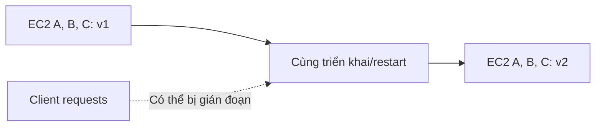
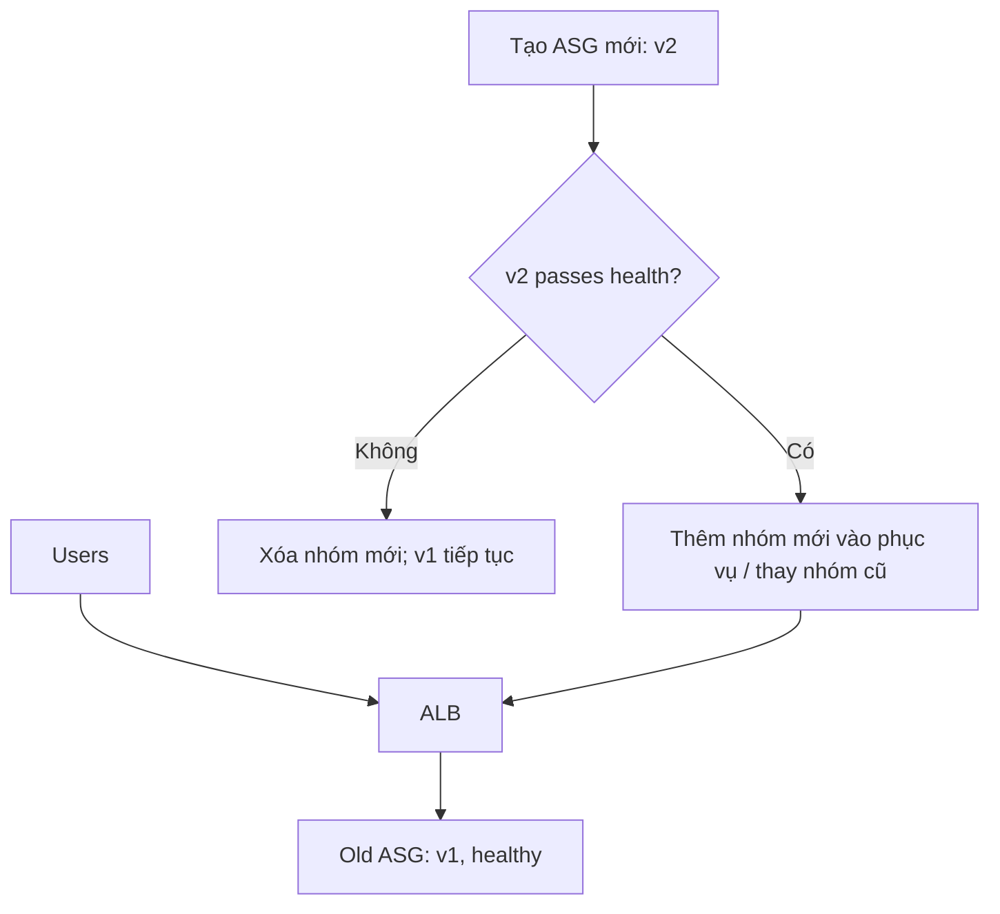
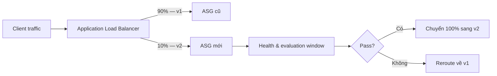
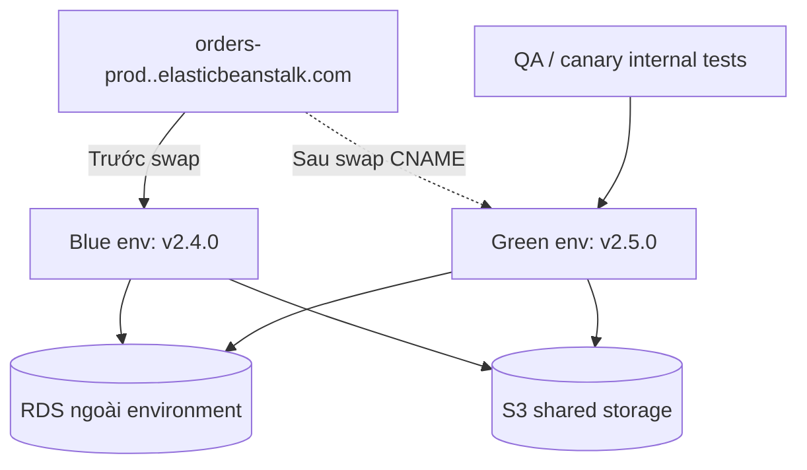
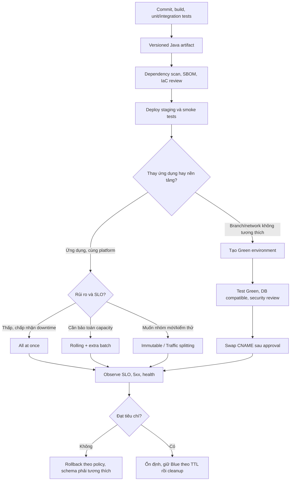

# Chính sách triển khai và thay thế môi trường Elastic Beanstalk

Một nhóm phát triển **Java Spring Boot** chạy ứng dụng đặt hàng trên **AWS Elastic Beanstalk**. Họ muốn phát hành phiên bản mới mà người dùng không gặp lỗi, nhưng các yêu cầu của mỗi lần triển khai không giống nhau:

- Thay đổi nhỏ trong môi trường thử nghiệm có thể chấp nhận ngừng dịch vụ vài phút để tiết kiệm thời gian.
- Một API production cần duy trì năng lực phục vụ trong suốt đợt phát hành.
- Một tính năng quan trọng cần kiểm chứng bằng 10% lưu lượng thật trước khi chuyển 100%.
- Việc nâng **platform branch** hoặc thay đổi nền tảng mạng có thể cần một **environment mới**, không chỉ cập nhật application version.
- Dữ liệu **RDS**, phiên đăng nhập, tệp người dùng và các job nền **không được mất** khi đổi máy chủ hay tráo môi trường.

Để xử lý chính xác, đội vận hành phải phân biệt **deployment policy**, **environment configuration update**, **managed platform update** và **blue/green environment replacement**. Đây là các cơ chế có tác động khác nhau đối với availability, rollback, tài nguyên và dữ liệu.

Bài học thuộc chương **Nền tảng ứng dụng quản lý** của module **CLOUD_PROVIDERS_AWS**. Người học vận dụng kiến thức AWS Region/AZ, IAM, VPC, EC2, load balancing, storage, database, giám sát, khả năng phục hồi, serverless và chi phí để chọn chiến lược phát hành phù hợp cho ứng dụng Java.

> **Lưu ý về hai mô hình Beanstalk:** AWS hiện có **Beanstalk Standard** (mô hình truyền thống trên EC2/Auto Scaling) và **Beanstalk Cluster** (chạy containers trên EKS do Beanstalk quản lý). **Năm deployment policies cổ điển** trong bài áp dụng cho **Beanstalk Standard** theo điều kiện loại environment. **Beanstalk Cluster** có tập tùy chọn riêng, được trình bày ở phần 13. Không lấy cấu hình Standard áp cho Cluster.

## 1. Mục tiêu học tập

Sau bài học, bạn có thể:

1. Phân biệt **application version**, **environment**, **platform version**, **deployment policy** và **environment replacement**.
2. So sánh năm deployment policies của **Beanstalk Standard**: **All at once**, **Rolling**, **Rolling with additional batch**, **Immutable**, **Traffic splitting**.
3. Giải thích cách cấu hình **batch size**, health threshold, timeout và phần trăm canary.
4. Phân biệt cập nhật application code với **configuration updates** và **managed platform updates**.
5. Thiết kế **blue/green deployment** bằng hai environments, kiểm thử **green** và **swap environment URLs/CNAMEs** có rollback.
6. Nhận biết khác biệt giữa **clone**, **rebuild**, **terminate/restore** và việc tạo mới môi trường.
7. Xây dựng quy trình phát hành an toàn cho **Spring Boot + ALB + Auto Scaling + RDS + S3**, có health checks, schema migration, externalized state và bảo vệ dữ liệu.
8. Đọc cấu hình bằng **AWS CLI/EB CLI**, chẩn đoán deployment failed và tính trade-off về chi phí/downtime.

## 2. Mô hình tài nguyên trong Elastic Beanstalk

Elastic Beanstalk là dịch vụ nền tảng ứng dụng quản lý, giúp đội ngũ triển khai code và vận hành ứng dụng mà không phải tự ghép mọi bước dựng hạ tầng. Tuy nhiên, tài nguyên nền, quyền truy cập, bảo mật, database và chi phí vẫn phải được quản lý.

### 2.1. Các khái niệm thường bị nhầm

| Khái niệm | Ý nghĩa | Ví dụ |
|---|---|---|
| **Application** | Đối tượng logic tập hợp nhiều versions/environments của một ứng dụng | `orders-service` |
| **Application version** | Phiên bản artifact/source bundle hoặc image được Beanstalk dùng để deploy | `orders-2.4.0` |
| **Environment** | Triển khai ứng dụng đang chạy với URL, cấu hình và resources riêng | `orders-prod-blue` |
| **Platform branch/version** | Stack runtime, OS và các thành phần do Beanstalk hỗ trợ theo mô hình | Corretto Java trên Amazon Linux hoặc container runtime của Cluster |
| **Deployment policy** | Cách Beanstalk đưa **application version** mới vào environment | `Rolling`, `Immutable` |
| **Configuration update policy** | Cách thay đổi hạ tầng/config có thể thay EC2 instances | Rolling, Immutable hoặc Disabled theo lựa chọn |
| **Managed platform update** | Beanstalk cập nhật phiên bản nền tảng trong cửa sổ bảo trì | Patch/minor version update |
| **Blue/green** | Hai environments chạy song song, chuyển lưu lượng qua đổi URL/CNAME | `orders-prod-blue` ↔ `orders-prod-green` |
| **Rebuild** | Hủy và dựng lại tài nguyên của cùng environment theo cấu hình | Khôi phục environment bị drift/hỏng, có rủi ro dữ liệu |

**Cập nhật code** không giống **thay đổi VPC/subnet/instance type**, cũng không giống **chuyển platform branch**. Quyết định dùng policy nào cần bắt đầu bằng việc xác định **đang thay cái gì**.

### 2.2. Hai mô hình triển khai

| Tiêu chí | **Beanstalk Standard** | **Beanstalk Cluster** |
|---|---|---|
| Compute | EC2 instances trong Auto Scaling group của environment | Container replicas trên EKS cluster do Beanstalk tạo/quản lý, capacity qua EKS Auto Mode |
| Artifact | Source bundle, Java JAR/WAR hoặc Docker theo platform | Container image từ ECR hoặc build image theo khả năng hỗ trợ |
| Deployment | All at once, Rolling, Rolling with additional batch, Immutable, Traffic splitting theo điều kiện | `RollingUpdate` hoặc `Recreate` |
| Sizing | EC2 instance size, ASG min/max, batch | Container CPU/RAM, replica bounds, `max-surge`/`max-unavailable` |
| Cấu hình | Các namespaces như `aws:elasticbeanstalk:command` | Các namespaces `aws:elasticbeanstalk:eks:*` |
| Blue/green | Tạo environment khác và swap URL | Cũng hỗ trợ đổi URL giữa environments |

Các bài tập ở phần lớn tài liệu dùng **Beanstalk Standard load-balanced trên EC2** để học rõ năm chính sách và ảnh hưởng của batch/capacity.

Nguồn: [AWS — Beanstalk Cluster architecture](https://docs.aws.amazon.com/elasticbeanstalk/latest/dg/beanstalk-cluster-concepts.html).

## 3. Năm deployment policies của Beanstalk Standard

### 3.1. So sánh tổng quan

| Policy | Cách triển khai | Năng lực phục vụ lúc deploy | Tài nguyên tạm | Nếu thất bại |
|---|---|---|---|---|
| **All at once** | Thay version trên tất cả instances đồng thời | Có thể **ngừng dịch vụ** trong thời gian restart | Không cần fleet mới | Thường phải tự deploy lại version cũ |
| **Rolling** | Thay theo từng batch trên instances hiện có | **Giảm capacity** tương đương batch đang rời LB | Không cần thêm instances | Có thể còn **trộn versions**; cần kế hoạch redeploy/khôi phục |
| **Rolling with additional batch** | Tạo batch mới rồi rolling từng batch | Giữ capacity mục tiêu nếu hạ tầng còn đủ capacity | Thêm một batch EC2 tạm | Vẫn có rủi ro version trộn, tùy batch lỗi |
| **Immutable** | Tạo **nhóm instances mới** chạy version mới, kiểm tra trước khi thay nhóm cũ | Giữ nhóm cũ phục vụ trong quá trình đánh giá | Gần tương đương **một fleet mới** | Nếu fail trước cutover, nhóm cũ giữ nguyên |
| **Traffic splitting** | Tạo fleet mới, chuyển thử một tỷ lệ traffic, đánh giá rồi mới cutover | Nhóm cũ vẫn phục vụ đa số requests | Gần tương đương **một fleet mới** | Nếu fail trong giai đoạn đánh giá, chuyển traffic về nhóm cũ |

**Không có một policy tốt nhất cho mọi ứng dụng.** Policy nhanh thường ít lớp an toàn; policy an toàn hơn thường tốn thêm EC2 hours, deployment time và năng lực dự phòng.

### 3.2. Điều kiện hỗ trợ

| Policy | Load-balanced Standard | Single-instance Standard | Ghi chú |
|---|---|---|---|
| All at once | Có | Có | Có thể downtime |
| Rolling | Có | Không | Cần nhiều instances để xoay batch |
| Rolling with additional batch | Có | Không | Cần đủ instance capacity/quota |
| Immutable | Có | Có | Tạo mới instances; cần quyền/quota/resources |
| Traffic splitting | Có **khi dùng Application Load Balancer** | Không | Canary bằng ALB |
| Blue/green | Có thể thiết kế với environments riêng | Có thể thiết kế tùy mô hình | **Không phải** một trong năm policies in-place |

Tài liệu: [AWS — Deploying applications](https://docs.aws.amazon.com/elasticbeanstalk/latest/dg/using-features.deploy-existing-version.html), [Deployment policies and settings](https://docs.aws.amazon.com/elasticbeanstalk/latest/dg/using-features.rolling-version-deploy.html).

## 4. All at once — nhanh nhưng có thể gián đoạn

Với **All at once**, Beanstalk triển khai version mới lên tất cả EC2 instances gần như cùng lúc. Khi server/proxy restart, toàn bộ targets có thể tạm thời không sẵn sàng.



**Ưu điểm:** đơn giản, ít thời gian nhất, không cần bổ sung capacity.

**Nhược điểm:** có khả năng mất dịch vụ; nếu artifact lỗi có thể khiến cả fleet không phục vụ được; rollback thường bằng một đợt deploy version cũ.

**Dùng khi:** dev/test, môi trường nội bộ có maintenance window, workload không chịu tải production quan trọng.

**Không dùng theo mặc định** cho một API thanh toán có SLO nghiêm ngặt chỉ vì deploy nhanh hơn.

## 5. Rolling — cập nhật theo lô

Trong **Rolling**, Beanstalk chia EC2 instances thành các **batches** rồi triển khai version mới trên từng batch. Batch được tháo khỏi load balancer, update/restart, kiểm tra health rồi đưa vào phục vụ; các batches khác tiếp tục phục vụ version cũ.

```text
Environment có 8 instances, BatchSize = 2:

Bước 0: [v1 v1] [v1 v1] [v1 v1] [v1 v1]  → 8 khả dụng
Bước 1: [deploy] [v1 v1] [v1 v1] [v1 v1] → khoảng 6 còn phục vụ
Bước 2: [v2 v2] [deploy] [v1 v1] [v1 v1] → khoảng 6 còn phục vụ
Bước 3: [v2 v2] [v2 v2] [deploy] [v1 v1] → khoảng 6 còn phục vụ
Bước 4: [v2 v2] [v2 v2] [v2 v2] [deploy] → khoảng 6 còn phục vụ
Bước 5: [v2 v2] [v2 v2] [v2 v2] [v2 v2] → 8 khả dụng
```

### 5.1. Quyết định batch size

- **BatchSizeType = Fixed**: số lượng instances cố định trong mỗi batch.
- **BatchSizeType = Percentage**: phần trăm fleet.
- Batch càng lớn: deploy thường nhanh hơn nhưng giảm capacity nhiều hơn.
- Batch càng nhỏ: giảm nguy cơ quá tải nhưng tăng thời gian deploy và thời gian tồn tại hai versions.

Ví dụ: ứng dụng có 8 instances, mỗi instance xử lý tối đa khoảng 200 RPS trong SLO, còn traffic peak cần 1.100 RPS. Nếu đưa 2 instances ra ngoài cùng lúc, 6 instances còn khoảng 1.200 RPS trên lý thuyết — **headroom rất thấp**. Cần benchmark capacity thực tế, chừa biên dự phòng, không chọn batch 25% chỉ vì số đó đẹp.

### 5.2. Version compatibility là điều kiện bắt buộc

Trong rolling, một khoảng thời gian **v1 và v2 phục vụ đồng thời**. Vì vậy:

- API contract và database schema phải tương thích cả hai phiên bản.
- Không đổi session serialization theo cách làm v1 không đọc được session của v2.
- Không thay message format/queue consumers theo cách hỏng consumers cũ.
- Không thực hiện database migration phá cột/bảng trước khi v1 rời hoàn toàn.
- Health check cần phát hiện ứng dụng **thực sự ready**, không chỉ process chạy.

**Khi một batch fail**, hệ thống có thể đang chứa cả v1/v2; rollback **không nên được hiểu là tự quay về trạng thái ban đầu**. Chuẩn bị sẵn version trước và runbook redeploy/khôi phục.

## 6. Rolling with additional batch — giữ capacity trong quá trình deploy

Chính sách này **tạo thêm một batch EC2 instances trước** khi cập nhật lần lượt các batches cũ, giúp giữ lượng instances phục vụ tối thiểu tương ứng fleet ban đầu.

```text
Fleet ban đầu: 8 instances (v1)
Tạo thêm batch: +2 instances → tổng capacity tạm đến 10
Triển khai luân phiên các batches, duy trì khoảng 8 instances phục vụ
Hoàn tất: bỏ batch bổ sung, trở lại 8 instances (v2)
```

**Ưu điểm:** tránh giảm capacity mục tiêu, phù hợp API không chịu được giảm năng lực tạm thời.

**Đánh đổi:** chậm hơn Rolling, cần thêm EC2 quota, subnet IP/ENI, EBS, egress và đôi khi khả năng đăng ký target của load balancer. Nếu account bị thiếu EC2 capacity ở AZ, deployment có thể không bắt đầu được như mong muốn.

**Không có nghĩa là blue/green.** Vẫn triển khai theo batches với các versions tồn tại đồng thời; không mặc định có đường rollback bằng tráo CNAME.

## 7. Immutable — thay cả fleet sau khi kiểm tra version mới

**Immutable deployment** tạo một **Auto Scaling group tạm** chứa nhóm EC2 mới chạy application version mới. Nhóm cũ vẫn phục vụ; khi nhóm mới vượt health checks, Beanstalk chuyển sang sử dụng nhóm mới và dọn nhóm cũ theo quy trình của dịch vụ.



**Ưu điểm:** version lỗi trước khi chuyển traffic không làm hỏng instances cũ; tạo mới instances giúp kiểm thử AMI/bootstrap nhất quán; giảm rủi ro deployment dở dang.

**Nhược điểm:** cần gần **gấp đôi số instances trong thời gian chuyển đổi**, có thể lâu và chịu phí EC2/EBS/network tăng tạm thời. Sau khi đã thành công và nhóm cũ bị loại bỏ, nếu lỗi nghiệp vụ xuất hiện muộn thì **không có bảo đảm tự động rollback bằng nhóm cũ**.

**Ứng dụng cần stateless** hoặc đưa state ra dịch vụ bền vững. Những file chỉ lưu trên disk EC2, local sessions, queue trong RAM… có thể bị mất khi instances bị thay.

### 7.1. Tài nguyên và giới hạn cần dự trù

- EC2 service quotas, Spot/On-Demand capacity và khả năng dùng instance type tại từng AZ.
- Subnet IPv4 capacity/ENI và ALB targets.
- EBS volumes/snapshot/cache warm-up, chi phí trong thời gian chạy hai fleets.
- Runtime Java warm-up, kết nối RDS/Redis, limits/connection pools khi số process tăng gấp đôi.
- Tác động tới burst credit balance của T-family khi thay instances.
- Environment variables, IAM instance profile, security groups, certificates và agent logs phải giống nhau giữa các instances.

Nguồn: [AWS — Immutable environment updates](https://docs.aws.amazon.com/elasticbeanstalk/latest/dg/environmentmgmt-updates-immutable.html).

## 8. Traffic splitting — canary một phần lưu lượng

**Traffic splitting** là một biến thể immutable có giai đoạn **kiểm thử bằng lưu lượng thật**:

1. Beanstalk dựng một nhóm EC2 mới chạy v2.
2. Khi health đạt, load balancer chuyển **một tỷ lệ do bạn chọn** của client traffic sang v2.
3. Theo dõi health trong **EvaluationTime** đã cấu hình.
4. Nếu khỏe và không bị hủy, dịch vụ chuyển tiếp 100% traffic sang v2 rồi bỏ fleet cũ.
5. Nếu v2 không đạt health trong giai đoạn đánh giá hoặc deployment bị hủy theo cơ chế hỗ trợ, traffic được chuyển về v1.



*Các tỷ lệ 90/10 chỉ là ví dụ, không phải default của AWS.*

### 8.1. Khi nào traffic splitting có giá trị?

- Phiên bản mới thay đổi serializer, cache, JDK, downstream client hoặc hiệu năng.
- Muốn kiểm chứng **p95/p99 latency, 5xx, lỗi nghiệp vụ** trên phân bố traffic thật.
- Khách hàng có nhiều tác vụ, không thể chỉ dựa vào synthetic health check.
- Hệ thống có khả năng vận hành **hai versions cùng lúc** trong evaluation window.

### 8.2. Những điều traffic splitting không giải quyết

- Không tự rollback database migration đã phá schema.
- Không tự xác minh mọi business KPI, chỉ dựa vào những health criteria đã được cấu hình và tín hiệu có thể đánh giá.
- Không biến single-instance environment thành cluster HA.
- Không bảo đảm user stickiness/định tuyến phiên theo yêu cầu nghiệp vụ nếu ứng dụng không thiết kế.
- Không thể dùng với mọi kiểu load balancer; **Beanstalk Standard cần ALB** cho policy này.
- Không tạo khả năng canary nếu account thiếu quota/capacity để chạy fleet mới.

**Gợi ý:** với thay đổi có thể gây thiệt hại nghiệp vụ, ngoài canary health, giám sát telemetry của Java app và định nghĩa điều kiện dừng bằng lỗi business, conversion rate hoặc latency theo SLO. Nếu cần chặn theo chỉ số tùy biến chưa được Beanstalk hỗ trợ tự động, đội vận hành phải có cơ chế dừng/rollback được phê duyệt.

## 9. Bảng lựa chọn chính sách theo tình huống

| Môi trường/tình huống | Chính sách nên xem xét | Lý do |
|---|---|---|
| Dev, thử code nhỏ, có thể downtime | **All at once** | Nhanh, ít tài nguyên |
| Production tải thấp, có nhiều instances và chịu giảm capacity | **Rolling** | Cân đối thời gian/chi phí, cần mixed-version compatibility |
| Production cần giữ đủ capacity nhưng có thể chấp nhận rolling | **Rolling with additional batch** | Tăng capacity tạm để không hụt năng lực |
| Release rủi ro cao, cần thay nguyên nhóm instances | **Immutable** | Version mới được thử trên instances riêng trước chuyển |
| Muốn đo một phần traffic thật trước 100% | **Traffic splitting** | Canary với ALB |
| Nâng platform branch/JDK/OS lớn, đổi cấu hình không tương thích | **Blue/green environment replacement** | Test green riêng, đổi CNAME khi đạt |
| Environment bị hỏng do cấu hình/tài nguyên drift | **Rebuild** chỉ khi có phương án dữ liệu và downtime | Phá/dựng lại resources, không phải deployment policy |

**Các quyết định này là gợi ý kiến trúc**, không thay kiểm thử workload và các điều kiện hỗ trợ theo platform/Region.

## 10. Cấu hình deployment policy với `.ebextensions`

Trong **Beanstalk Standard**, tùy chọn application deployment policy thuộc namespace `aws:elasticbeanstalk:command`. Bạn có thể cấu hình trong Console hoặc file `.ebextensions/*.config` thuộc source bundle. Nên quản lý thông qua IaC/pipeline để tránh lệch cấu hình giữa environments.

### 10.1. Rolling 25% mỗi batch

```yaml
# .ebextensions/01-rolling-deployment.config
option_settings:
  aws:elasticbeanstalk:command:
    DeploymentPolicy: Rolling
    BatchSizeType: Percentage
    BatchSize: 25
```

### 10.2. Rolling with additional batch

```yaml
# .ebextensions/02-rolling-additional-batch.config
option_settings:
  aws:elasticbeanstalk:command:
    DeploymentPolicy: RollingWithAdditionalBatch
    BatchSizeType: Fixed
    BatchSize: 2
```

### 10.3. Immutable

```yaml
# .ebextensions/03-immutable-deployment.config
option_settings:
  aws:elasticbeanstalk:command:
    DeploymentPolicy: Immutable
```

### 10.4. Traffic splitting 10% trong 15 phút

```yaml
# .ebextensions/04-traffic-splitting.config
option_settings:
  aws:elasticbeanstalk:command:
    DeploymentPolicy: TrafficSplitting
  aws:elasticbeanstalk:trafficsplitting:
    NewVersionPercent: "10"
    EvaluationTime: "15"
```

**Quan trọng:** đây là **bốn cấu hình thay thế nhau**, **không** đặt cả bốn trong cùng source bundle! Chọn **một** policy cho environment và kiểm chứng lựa chọn được áp dụng.

**Chú ý nguồn cấu hình:** Console và EB CLI có thể áp đặt **recommended option values** có độ ưu tiên cao hơn các giá trị trong `.ebextensions`. Nếu policy file không có hiệu lực, kiểm tra saved configurations, môi trường đang dùng và precedence của các option settings; không chỉ sửa file rồi cho rằng production sẽ đổi. Trong Console có thể chỉnh ở mục cấu hình **Rolling updates and deployments** cho Standard.

Nguồn: [Deployment policy option namespaces](https://docs.aws.amazon.com/elasticbeanstalk/latest/dg/using-features.rolling-version-deploy.html).

### 10.5. Health threshold, timeout và rủi ro bỏ health checks

Các options liên quan deployment gồm:

- `BatchSize` / `BatchSizeType`: kích thước batch khi rolling hoặc khi restart ứng dụng theo batches.
- `HealthCheckSuccessThreshold`: health status được chấp nhận khi đánh giá.
- `Timeout`: giới hạn thời gian chờ batch/operation.
- `IgnoreHealthCheck`: cho phép tiếp tục theo điều kiện cấu hình dù health chưa đạt.

**Không đặt `IgnoreHealthCheck: true` chỉ để vượt qua deployment failed**. Việc này có thể đưa phiên bản lỗi vào production; ưu tiên sửa health endpoint/startup/capacity/network.

## 11. Configuration updates khác application deployments

Trong Standard environment, đổi application version không giống cập nhật **instance type, AMI/platform settings, load balancer, Auto Scaling** hoặc cấu hình buộc thay EC2.

**Configuration changes** có thể yêu cầu Beanstalk tạo mới instances. Chính sách cập nhật hạ tầng nằm ở namespace `aws:autoscaling:updatepolicy:rollingupdate`, với các lựa chọn cơ bản:

| Loại cập nhật | Cách hoạt động | Rủi ro |
|---|---|---|
| **Disabled** | Thay instances mà không ưu tiên duy trì availability | Có thể downtime |
| **Rolling — Health** | Thay theo batches, chờ health đạt rồi tiếp tục | Giảm capacity và cần đủ headroom |
| **Rolling — Time** | Chờ khoảng thời gian quy định giữa các batches | Thời gian không chứng minh health/business readiness |
| **Immutable** | Tạo nhóm instances mới để kiểm chứng trước khi đổi nhóm cũ | Thêm capacity/chi phí tạm |

Ví dụ cấu hình health-based rolling configuration update cho Standard:

```yaml
# .ebextensions/10-rolling-config-update.config
option_settings:
  aws:autoscaling:updatepolicy:rollingupdate:
    RollingUpdateEnabled: true
    RollingUpdateType: Health
    MinInstancesInService: 4
    MaxBatchSize: 2
```

**Cần điều chỉnh số instance theo thực tế**: nếu environment chỉ có 2 instances, `MinInstancesInService: 4` không hợp lý. Đây là ví dụ cho một fleet có đủ capacity và quota.

Đừng nhầm `RollingUpdateType` (cho **configuration update**) với `DeploymentPolicy` (cho **application version**). Một environment có thể cấu hình **application Immutable** và **configuration update Rolling**, nhưng cần hiểu hoạt động của từng loại thay đổi và loại platform đang dùng.

Nguồn: [AWS — Configuration changes](https://docs.aws.amazon.com/elasticbeanstalk/latest/dg/environments-updating.html), [Rolling environment configuration updates](https://docs.aws.amazon.com/elasticbeanstalk/latest/dg/using-features.rollingupdates.html).

## 12. Managed platform updates — cập nhật nền tảng có bảo trì

AWS phát hành **Elastic Beanstalk platform updates** nhằm cập nhật OS/runtime, sửa lỗi và thêm khả năng mới.

**Managed platform updates** cho phép đặt lịch bảo trì hàng tuần để cập nhật **patch** hoặc **minor + patch** trong cùng platform branch (theo điều kiện hỗ trợ). Không tự động nâng sang **platform branch không tương thích/major**; loại thay đổi đó thường cần kế hoạch migration riêng và **blue/green**.

### 12.1. Các điểm cần nhớ

- Managed platform updates yêu cầu **enhanced health reporting**.
- Chúng sử dụng **immutable environment updates**, kể cả khi bạn áp dụng managed update ngoài maintenance window.
- Có thể cấu hình **instance replacement** để chủ động thay mới instances theo lịch, ngay cả khi không có bản platform update mới.
- Khi thay instances, EC2 T-family có thể mất burst credit balance đã tích lũy.
- Nếu có rất nhiều environments trong cùng account, nên **trải maintenance windows** để giảm rủi ro throttling.
- Maintenance window không có nghĩa một operation đã bắt đầu sẽ chắc chắn hoàn tất đúng trước cuối cửa sổ.
- Cập nhật thủ công platform version có thể dùng policy dành cho **configuration changes** thay vì hành vi managed update.

Ví dụ bật managed updates cho **patch** vào thứ Ba 09:00 UTC:

```yaml
# .ebextensions/20-managed-platform-update.config
option_settings:
  aws:elasticbeanstalk:managedactions:
    ManagedActionsEnabled: true
    PreferredStartTime: "Tue:09:00"
  aws:elasticbeanstalk:managedactions:platformupdate:
    UpdateLevel: patch
    InstanceRefreshEnabled: false
```

**Không nên** cấu hình update window trùng giờ cao điểm chỉ vì đội phát triển ít họp vào thời điểm đó. Với ứng dụng Java, hãy kiểm tra JDK/JVM flags, native dependencies, proxy và security agents trước khi cập nhật.

Nguồn: [AWS — Managed platform updates](https://docs.aws.amazon.com/elasticbeanstalk/latest/dg/environment-platform-update-managed.html).

## 13. Beanstalk Cluster: triển khai theo replicas, không dùng năm policy cổ điển

**Beanstalk Cluster** chạy ứng dụng như **container images trên Amazon EKS cluster do Beanstalk vận hành**; nhiều environments có thể sử dụng chung EKS cluster theo tập VPC subnets. Các nodes do EKS Auto Mode quản lý.

### 13.1. Hai chiến lược deployment của Beanstalk Cluster

| Strategy | Cơ chế | Ghi chú |
|---|---|---|
| `RollingUpdate` | Thay application replicas theo giới hạn surge/unavailable | Là mặc định; phù hợp production khi được cấu hình và test đúng |
| `Recreate` | Tắt replicas cũ rồi tạo replicas mới | Tương đương all-at-once, có thể downtime |

Tùy chọn thuộc namespace `aws:elasticbeanstalk:eks:environment:deployment`, với `max-surge` và `max-unavailable` trong namespace phụ `...:deployment:strategy:rolling`.

Ví dụ giá trị cấu hình khi dùng EKS-based Cluster:

```text
Namespace: aws:elasticbeanstalk:eks:environment:deployment
  strategy = RollingUpdate

Namespace: aws:elasticbeanstalk:eks:environment:deployment:strategy:rolling
  max-surge = 1
  max-unavailable = 0
```

**`max-unavailable=0`** giúp giữ số replicas sẵn sàng theo desired replicas trong giới hạn khả năng scheduler/node capacity, còn `max-surge` cho phép tạo thêm replicas tạm. Nó **không bảo đảm zero downtime** nếu ứng dụng không có readiness/shutdown đúng hoặc cluster thiếu tài nguyên.

**Không dùng** `DeploymentPolicy: TrafficSplitting`, `Immutable` hoặc `RollingWithAdditionalBatch` từ `aws:elasticbeanstalk:command` cho Cluster: những cơ chế này thuộc Standard. Theo tài liệu hiện tại, Cluster **vẫn hỗ trợ blue/green CNAME swap** giữa hai environments.

### 13.2. Khi thay cấu hình Cluster phải tạo môi trường mới?

Trong Beanstalk Cluster, các thông số hạ tầng như **tập VPC subnets**, **cluster role**, **node role**, **observability role** có hạn chế thay đổi trực tiếp đối với environment đang chạy. Nếu cần chuyển sang subnets/roles khác, thiết kế **green environment** đúng cấu hình rồi **swap CNAME**, thay vì ép sửa một môi trường đang tồn tại.

Beanstalk quản lý EKS cluster; không chỉnh trực tiếp các tài nguyên EKS/service-managed theo ý muốn vì có thể gây **configuration drift**, khiến Beanstalk ngừng hỗ trợ updates/maintenance cho cluster đó.

Nguồn: [Beanstalk Cluster architecture](https://docs.aws.amazon.com/elasticbeanstalk/latest/dg/beanstalk-cluster-concepts.html), [Cluster configuration options](https://docs.aws.amazon.com/elasticbeanstalk/latest/dg/command-options-general-eks.html).

## 14. Thay môi trường bằng Blue/Green Deployment

**Blue/green** không phải cách update batch trong cùng fleet. Bạn chuẩn bị **hai environments độc lập**:

- **Blue:** production hiện tại, ví dụ version `orders-2.4.0`.
- **Green:** environment mới với version `orders-2.5.0`, có thể mang platform/JDK/config mới.

Sau khi kiểm tra Green thành công, thực hiện **Swap environment URLs** để chuyển traffic từ URL production sang Green. Khi DNS cập nhật/propagate, người dùng dần tới Green. Blue được giữ lại trong một khoảng thời gian để rollback.



### 14.1. Các bước thực hiện

1. **Lưu và kiểm kê cấu hình Blue**: platform branch/version, IAM roles, VPC/subnets, SG, ALB, TLS certificate, env properties, autoscaling, health URL, logging.
2. **Tạo Green environment**: clone Blue hoặc create environment mới, đảm bảo môi trường mục tiêu có cấu hình được kiểm chứng.
3. Deploy application version mới vào Green; chuẩn bị dependencies/network và schema migration theo phương án tương thích.
4. Truy cập **Green URL** độc lập để kiểm tra API contract, auth/cookie, readiness, logs, metrics, database, message queues và performance.
5. Kiểm tra các tích hợp phụ thuộc **domain production**: OAuth redirect URLs, CORS, webhook allowlists, TLS/SNI, signed cookies và URL callback.
6. Đặt thời điểm cutover; bảo đảm old/new đều sẵn sàng. Thực hiện **Swap environment URLs** trong Console hoặc **EB CLI `eb swap`**.
7. Quan sát response times, 4xx/5xx, ALB health, errors, database metrics và transaction counts.
8. Giữ Blue **đủ lâu** cho DNS caches hết hạn và rollback nếu cần; chỉ terminate Blue sau khi có quyết định chính thức.

### 14.2. Swap CNAME là gì?

Với Beanstalk environments có domain như:

```text
Blue:  orders-blue.ap-southeast-1.elasticbeanstalk.com
Green: orders-green.ap-southeast-1.elasticbeanstalk.com
```

**Swap environment URLs** hoán đổi ánh xạ CNAME giữa hai environments. **Environment name/ID không được đổi chỗ**; nền hạ tầng và tài nguyên vẫn gắn với mỗi environment. Sau swap, URL mà khách hàng dùng trước đây để truy cập Blue sẽ hướng tới Green.

**DNS caching không chuyển ngay lập tức trên toàn thế giới.** Trong thời gian lan truyền, một số người dùng tiếp tục tới Blue; vì vậy Blue và Green phải **đồng thời tương thích** với database/message formats và không được hủy Blue ngay sau khi bấm Swap.

### 14.3. Custom domain và Route 53

Nếu khách hàng dùng `api.example.com`:

- Nếu custom DNS record trỏ tới **environment CNAME**, cần kiểm tra nó vẫn theo đúng ánh xạ khi swap.
- Nếu Route 53 Alias/cấu hình khác **trỏ trực tiếp tới ALB** hoặc một endpoint riêng, **swap environment URL không mặc định sửa những record tùy chỉnh này**.
- Kiểm tra cả IPv4/IPv6, TTL và Route 53 health/failover policies khi có.
- Với CloudFront/WAF/third-party DNS đứng trước Beanstalk, xác định **đích thực tế** và runbook riêng; không khẳng định swap CNAME sẽ tự thay mọi lớp DNS.

### 14.4. Rollback sau swap

Rollback có thể bằng **swap URL lại** để Blue nhận traffic production. Điều kiện cần:

- Blue còn hoạt động và đủ capacity.
- Database/schema/event formats vẫn tương thích với Blue.
- Không có dữ liệu/side effects chỉ Green hiểu hoặc đã làm thay đổi không thể phục hồi.
- DNS propagation được theo dõi; rollback DNS cũng không “tức thì” cho mọi client.
- Các secrets/certificate/roles của Blue chưa bị vô hiệu hóa.

**Điều quan trọng:** blue/green bảo vệ luồng tính toán/ứng dụng, **không tự rollback database**.

Nguồn: [AWS — Blue/Green deployments with Elastic Beanstalk](https://docs.aws.amazon.com/elasticbeanstalk/latest/dg/using-features.CNAMESwap.html).

## 15. Clone, Rebuild, Terminate và Restore: không phải một hành động

| Hành động | Hành vi | Khi dùng | Rủi ro |
|---|---|---|---|
| **Clone environment** | Tạo environment mới dựa trên cấu hình environment hiện tại | Chuẩn bị Green, kiểm thử/cô lập phiên bản | Cần rà soát khác biệt SG, secrets, platform version, policy |
| **Rebuild environment** | Hủy rồi dựng lại **tài nguyên của cùng environment** | Thử phục hồi environment bị hỏng/drift | **Downtime và nguy cơ mất dữ liệu/tài nguyên** |
| **Terminate environment** | Hủy environment và tài nguyên do nó quản lý theo lifecycle | Dọn Green/Blue đã ngừng dùng | Có thể ảnh hưởng RDS tích hợp, DNS, logs, data |
| **Restore terminated environment** | Dựng lại environment từ metadata còn được lưu theo thời hạn hỗ trợ | Khôi phục environment vừa terminate | Không bảo đảm khôi phục dữ liệu trên EC2/RDS hay URL cũ |
| **Blue/green + CNAME swap** | Chuyển traffic giữa **hai environments đã chạy** | Cutover/rollback có kiểm soát | DNS propagation, chi phí chạy hai environments, DB compatibility |

### 15.1. Clone không có nghĩa cấu hình giống 100%

Theo AWS EB CLI, **`eb clone` có thể chọn platform version mới nhất** trong branch khi clone; dùng `--exact` khi thật sự cần giữ solution stack version tương đương theo phạm vi hỗ trợ.

**Cảnh báo quan trọng từ AWS:** một environment clone có thể **không mang theo các ingress security group settings**, khiến ingress mặc định rộng hơn dự kiến. Sau clone phải **kiểm tra lại security groups, load balancer listeners, WAF, public access và subnet routes** trước khi đưa Green vào sản xuất. Không đưa Green ra Internet công cộng khi chưa kiểm tra.

### 15.2. Rebuild có thể xóa dữ liệu

Rebuild environment đang chạy **hủy toàn bộ resources của environment rồi tạo resources mới** theo cấu hình. Với RDS database **coupled** do Beanstalk tạo cùng environment, rebuild **có thể xóa database**; database mới không chứa dữ liệu cũ. Phải kiểm tra **database deletion policy**, snapshot, retention và phương án restore trước khi hành động.

**Không dùng rebuild chỉ để “restart Java app”.** Beanstalk có chức năng restart application servers hoặc triển khai lại, ít phá hủy hạ tầng hơn. Rebuild chỉ là biện pháp hồi phục có tính hủy và cần xét tác động tới business.

### 15.3. Restore không phải bản sao dữ liệu

AWS có cơ chế **rebuild/restore environment vừa terminated** trong khoảng thời gian hỗ trợ (tài liệu hiện hành nêu **42 ngày** cho một số trường hợp). Điều này chủ yếu nhằm khôi phục **configuration/environment identity** khi điều kiện vẫn cho phép; không phải backup EC2 disks, RDS records hay tự động hoàn nguyên toàn bộ dữ liệu.

Nếu URL đã bị môi trường khác chiếm, application version đã xóa hoặc cấu hình phụ thuộc không còn, restore có thể thất bại.

Nguồn: [Clone environment](https://docs.aws.amazon.com/elasticbeanstalk/latest/dg/using-features.managing.clone.html), [Rebuild environment](https://docs.aws.amazon.com/elasticbeanstalk/latest/dg/environment-management-rebuild.html).

## 16. Bảo toàn dữ liệu và state khi thay environments

Một trong những rủi ro nghiêm trọng nhất của blue/green là **vô tình gắn dữ liệu production vào vòng đời environment**.

### 16.1. RDS nên độc lập với vòng đời Beanstalk

Với production database, lựa chọn thường tốt là **RDS/Aurora được tạo và quản lý độc lập** khỏi Beanstalk environments:

- Blue và Green kết nối tới database qua endpoint/config được cấp quyền.
- Khi terminate Blue hoặc rebuild Green, database không bị Beanstalk xóa theo lifecycle.
- SG chỉ cho phép kết nối từ application subnets/SG hợp lệ.
- Secrets/credentials được quản lý an toàn; không hardcode password trong artifact.
- Backup, PITR, Multi-AZ và DR có kế hoạch riêng.

**Nếu database đã được Beanstalk tạo gắn với environment**, cần **decouple** trước khi thiết kế blue/green. Khi decouple, **deletion policy** (`Delete`, `Snapshot`, `Retain`) quyết định điều gì xảy ra với database. Đặc biệt, AWS cảnh báo **không cập nhật deletion policy cùng lúc với thao tác decouple**, vì thay đổi policy có thể không được áp dụng như bạn tưởng. Chốt deletion policy riêng, đọc lại, rồi mới decouple.

Nguồn: [AWS — Database lifecycle and decoupling](https://docs.aws.amazon.com/elasticbeanstalk/latest/dg/using-features.managing.db.html).

### 16.2. Database schema migration: Expand → Migrate → Contract

Để Blue v1 và Green v2 cùng hoạt động trong lúc DNS propagation/canary:

1. **Expand**: thêm cột/bảng/field mới tương thích ngược, không xóa field cũ.
2. **Migrate**: backfill hoặc dual-read/dual-write có kiểm soát; kiểm tra version cũ và mới cùng đọc/ghi được.
3. **Deploy** Green và kiểm tra cả v1/v2 với schema chung.
4. **Cutover** traffic, giữ khả năng rollback ứng dụng nếu nghiệp vụ cần.
5. **Contract**: chỉ sau khi không còn consumers cũ, loại cột/field/đường code cũ theo đợt thay đổi riêng.

**Không chạy drop-column migration trước khi chắc chắn Blue không cần cột đó.** Nếu đã đổi schema phá vỡ compatibility, swap CNAME ngược lại có thể đưa người dùng về một ứng dụng không chạy nổi.

### 16.3. Những dạng state khác cần tách

| Dữ liệu/state | Thiết kế phù hợp | Lý do |
|---|---|---|
| User uploads | S3 bucket ngoài environment, IAM least privilege | Thay EC2 không mất file |
| HTTP sessions | Stateless JWT đúng thiết kế hoặc session store ngoài fleet (ví dụ ElastiCache) | User không mất session khi traffic đổi instances/environments |
| Jobs / event queues | SQS/EventBridge, consumer có idempotency | Tránh duplicate side effects khi Blue+Green cùng chạy |
| Scheduled jobs | Leader election, một scheduler độc lập hoặc feature flag | Tránh chạy job hai lần từ hai environments |
| Logs / metrics | CloudWatch Logs, S3 lưu trữ và alarms | Terminate instances không làm mất lịch sử log cần giữ |
| Secrets / config | Secrets Manager/Parameter Store và IAM roles | Không gắn secrets vào AMI/source bundle |
| Certificate/TLS | ACM cho ALB, cấu hình listener theo environment | Green phải có HTTPS đúng trước cutover |

### 16.4. Cần điều khiển việc chạy hai versions

Trong traffic splitting/bluegreen, **cả hai versions có thể xử lý request đồng thời**. Đối với consumer SQS, job scheduler, Kafka consumers hay callback payment gateways:

- Có thể cần bật/tắt consumer theo feature flag hoặc leader election.
- Thiết kế idempotency key cho việc tạo giao dịch.
- Không để cả Blue và Green gửi email/đẩy sự kiện hai lần cho cùng bản ghi.
- Kiểm soát webhook URLs và các external integrations khi đổi DNS.

## 17. Ví dụ Spring Boot: chuẩn bị readiness và graceful shutdown

Khi Beanstalk dùng rolling/immutable, **health check** và **thời gian khởi động JVM** là yếu tố quyết định rollout có an toàn không.

### 17.1. Mẫu Spring Boot Actuator

Ví dụ ứng dụng có dependency `spring-boot-starter-actuator`:

```yaml
# src/main/resources/application.yml — ví dụ
server:
  port: 5000
  shutdown: graceful

spring:
  lifecycle:
    timeout-per-shutdown-phase: 30s

management:
  endpoint:
    health:
      probes:
        enabled: true
  endpoints:
    web:
      exposure:
        include: health,info
```

**Lưu ý:** cổng `5000` chỉ là ví dụ phù hợp với một số Java SE reverse-proxy defaults; phải đồng bộ **PORT**, Nginx upstream, platform branch, ALB target group và cấu hình thật. Không coi 5000 là chuẩn cho mọi Docker/Tomcat/Cluster environment.

Đường readiness thường là:

```text
/actuator/health/readiness
```

Endpoint này phải trả trạng thái thành công khi ứng dụng **sẵn sàng nhận request**, không chỉ đã mở socket. Tùy cấu hình Spring Boot, endpoint có thể khác; phải kiểm tra bằng HTTP ở môi trường test.

### 17.2. Health check không phải business monitoring

Health check 200 có thể bỏ sót:

- API authorization/checkout xử lý sai business logic.
- Database connection pool gần cạn.
- Third-party payment gateway timeout.
- Queue consumer không hoạt động.
- Memory leak chỉ xuất hiện sau vài giờ.

Vì thế, ngoài EB enhanced health và ALB health check, cần quan sát **latency p95/p99, 5xx, order success rate, DB/queue metrics và JVM GC**.

### 17.3. Thời gian JVM warm-up

Một app Java có thể cần 60–120 giây để boot, kết nối RDS, init cache, kiểm tra dependencies và ấm JIT. Deployment timeout/health thresholds quá ngắn khiến target bị đánh dấu unhealthy dù sau đó app hoạt động tốt.

**Cách xử lý đúng:** đo startup time thật, cân đối health intervals/timeouts, readiness và server shutdown. Tránh tăng timeout vô hạn khiến một deployment lỗi kéo dài mà không được phát hiện.

## 18. Sơ đồ quy trình phát hành và rollback



### 18.1. Các điều kiện dừng nên có

| Tín hiệu | Ví dụ ngưỡng do đội vận hành tự chọn | Hành động |
|---|---|---|
| ALB `HTTPCode_Target_5XX_Count` | Tỷ lệ lỗi vượt error budget so với baseline | Dừng mở rộng/cutover, điều tra |
| p95/p99 latency | Vượt SLO trong nhiều cửa sổ quan sát | Giữ hoặc rollback traffic |
| EB environment health | `Severe`/`Degraded` kéo dài | Dừng operation, kiểm tra events/instances |
| `HealthyHostCount` | Dưới min capacity đã định | Dừng deployment, phục hồi target health |
| DB metrics | Connections/latency/locks tăng bất thường | Kiểm tra cả hai versions và schema migration |
| Business KPIs | Checkout lỗi, duplicate job, 409/422 bất thường | Ngắt feature/canary theo runbook |
| Costs/capacity | Quota hoặc EC2 instance launch failures | Giảm batch/đổi thời gian/đánh giá mode khác |

**Health success không bảo đảm 0% lỗi.** Đặt SLO thật trước khi chọn policy, kết hợp test readiness và nghiệp vụ.

## 19. Các công cụ kiểm tra và triển khai

### 19.1. AWS CLI chỉ đọc trạng thái

Dùng account/Region/test application được phép. Các ARN/IDs/names là ví dụ.

```bash
# Xem environments thuộc một application
aws elasticbeanstalk describe-environments \
  --application-name orders-service \
  --region ap-southeast-1 \
  --query 'Environments[].{Name:EnvironmentName,Id:EnvironmentId,Status:Status,Health:Health,Version:VersionLabel,CNAME:CNAME}' \
  --output table

# Xem cấu hình đã áp dụng (có thể chứa thông tin nhạy cảm)
aws elasticbeanstalk describe-configuration-settings \
  --application-name orders-service \
  --environment-name orders-prod-blue \
  --region ap-southeast-1

# Xem events gần nhất
aws elasticbeanstalk describe-events \
  --application-name orders-service \
  --environment-name orders-prod-blue \
  --region ap-southeast-1 \
  --max-records 20

# Xem health theo resources, cần quyền phù hợp
aws elasticbeanstalk describe-environment-health \
  --environment-name orders-prod-blue \
  --region ap-southeast-1 \
  --attribute-names Status HealthStatus Color Causes
```

**Lệnh chỉ đọc** vẫn có thể trả về environment properties hoặc connection strings không nên chia sẻ công khai; hãy lọc/ẩn thông tin nhạy cảm khi lưu kết quả kiểm tra.

### 19.2. EB CLI kiểm tra trạng thái

```bash
# Trong một dự án đã được eb init đúng application/region
eb status orders-prod-blue
eb events orders-prod-blue
eb health orders-prod-blue
```

Tùy nền tảng và quyền, `eb health` có thể cần enhanced health reporting.

### 19.3. Các lệnh thay đổi environment — chỉ dùng trong quy trình được phê duyệt

```bash
# Ví dụ minh họa, KHÔNG chạy vào production trước khi review.
eb deploy orders-prod-green

# Tạo clone để kiểm thử: kiểm tra security groups và platform version sau clone
eb clone orders-prod-blue --clone_name orders-prod-green --exact

# Chỉ chuyển production traffic sau khi Green đã được kiểm chứng
eb swap orders-prod-blue --destination_name orders-prod-green
```

**`eb swap` là thao tác thay đổi DNS production.** Nó không cấp certificate, không migrate dữ liệu và không tự kiểm tra business SLO. Không coi câu lệnh `eb deploy` hoặc `eb clone` trong tài liệu là authorization để chạy trên tài khoản thật.

### 19.4. Trước khi phát hành: kiểm tra cấu hình JSON/YAML

- `DeploymentPolicy` đã chọn đúng loại Standard/Cluster?
- `BatchSize` phù hợp ASG min/max và peak load?
- ALB health check path/readiness đã test?
- VPC, subnets, security groups và instance profile không vô tình mở rộng ingress?
- Green có thể gọi RDS/S3/Secrets Manager qua IAM role và VPC routes?
- Custom domain/ACM TLS có hoạt động với URL production trước cutover?
- Database migration có backward compatibility?
- Có rollback version cũ/Blue, backup/restore và runbook?

## 20. Logging và chẩn đoán deployment failed

### 20.1. Nguồn quan sát

| Nguồn | Nội dung | Khi nào dùng |
|---|---|---|
| **Beanstalk Events** | Timeline deployments, config updates, instance failures và health changes | Bắt đầu điều tra sự cố |
| **Beanstalk Deployments tab** | Request ID, policy, thời điểm, duration, events và deployment logs | Kiểm tra chính xác operation đang fail |
| **Enhanced health** | Trạng thái của environment/instances và nguyên nhân | Giải thích vì sao batch không đạt threshold |
| **EC2/Beanstalk logs** | `/var/log/eb-engine.log`, application/proxy logs trên platform hỗ trợ | Lỗi build/startup/permission/bootstrap |
| **ALB metrics/logs** | `HealthyHostCount`, target 5xx, latency và health checks | Kiểm tra traffic và target readiness |
| **CloudWatch Logs/metrics** | App logs, JVM GC, exceptions, dashboard | So sánh v1/v2 và xác định lỗi nghiệp vụ |
| **CloudTrail** | API thay đổi environment/roles/config | Kiểm toán ai triển khai/thay cấu hình |
| **RDS/CloudWatch metrics** | Connections, CPU, locks, latency | Phát hiện tác động của nhiều fleets đồng thời |
| **Cost Explorer/Budgets** | EC2/ELB/RDS/NAT/logs charges | Kiểm tra chi phí deployment và môi trường bỏ quên |

Đường dẫn log phụ thuộc **platform branch** và cấu hình. `/var/log/eb-engine.log` phổ biến trên các Amazon Linux 2/2023-based Standard environments; không suy ra có cùng file trên Beanstalk Cluster.

### 20.2. Bảng xử lý sự cố

| Hiện tượng | Nguyên nhân có thể | Kiểm tra trước |
|---|---|---|
| `All at once` làm API không sẵn sàng | Tất cả instances restart đồng thời | Chọn rolling/immutable, capacity và maintenance window |
| Rolling fail ở batch thứ hai | App lỗi, readiness, DB/schema incompatibility | Deployments tab, version đang chạy từng instance và health logs |
| Additional batch không tạo được EC2 | Quota/capacity/subnet IP/SG/IAM | EC2 events, ASG, quotas, available IP mỗi AZ |
| Immutable không hoàn tất | Fleet mới không healthy, bootstrap/agent/JDK lỗi | New ASG, instance logs, ALB health path |
| Traffic splitting báo fail | v2 trả errors/không đạt health khi canary | Evaluation time, ALB/Beanstalk events, metrics per version |
| Green healthy nhưng production 502 | ALB target group/cert/proxy, app không nhận port thật | ALB logs, SG, readiness, HTTPS config |
| Sau CNAME swap user vẫn thấy Blue | DNS cache hoặc domain trỏ thẳng ALB khác | `dig/nslookup`, Route53 alias/CNAME, TTL, CDN |
| Swap xong không login được | Session in-memory, OAuth redirect, cookie domain | External sessions, auth callbacks, app config |
| Swap xong bị lỗi DB | Schema migration phá compatibility, thiếu SG/secrets | Migration logs, DB privileges, dual version tests |
| Clone bị public ngoài ý muốn | Ingress SG không được clone đầy đủ hoặc listener/policy khác | SG, public IP/ALB, WAF và scan ingress |
| Rebuild mất dữ liệu | Coupled RDS, local EBS/instance store | Deletion policy, snapshots, restore plan |
| Managed platform update fail | Runtime/JDK/agent compatibility hoặc health | Managed updates tab, events, enhanced health |
| Deploy thành công nhưng batch jobs chạy hai lần | Blue/Green cùng chạy scheduler/consumers | Leader election, feature flags, idempotency keys |

### 20.3. Quy trình điều tra có thứ tự

1. **Xác định operation**: application deploy, config change, managed update, swap hay rebuild?
2. **Xác định platform**: Standard EC2 hay Cluster EKS?
3. **Xem Events/Deployments tab**, thời điểm bắt đầu, policy, batch và health status.
4. **Kiểm tra target health/metrics**: lỗi mạng/startup hay lỗi nghiệp vụ?
5. **Xem app/Beanstalk logs**: JDK/Procfile, dependency download, secrets, application port.
6. **Kiểm tra resources**: EC2 quotas, subnet IP, ALB, SG, IAM, RDS.
7. **Phân biệt rollback**: canary fail có thể tự trở về v1; rolling/All at once thường cần redeploy; bluegreen có swap-back.
8. **Ghi root cause** và chỉnh pipeline/test trước khi thử lại.

Nguồn: [Deployment logs in Elastic Beanstalk](https://docs.aws.amazon.com/elasticbeanstalk/latest/dg/environments-deployment-logs.html).

## 21. Bảo mật và kiểm soát chi phí khi có nhiều environments

### 21.1. IAM và network

- **Service role** của Beanstalk và **EC2 instance profile** là hai vai trò khác nhau; chỉ cấp quyền AWS cần thiết.
- CI/CD dùng IAM role tạm thời/federation theo chính sách công ty; không hardcode access keys.
- Green dùng security groups/subnets, ALB listeners và WAF giống mức bảo vệ Blue hoặc chặt hơn.
- App secrets từ Secrets Manager/Parameter Store; kiểm tra cách luân chuyển giữa environments.
- Environment properties có thể chứa thông tin nhạy cảm; không log toàn bộ config.
- Giữ RDS private và giới hạn SG connections theo application roles/security groups.
- Mã hóa TLS viewer → ALB, và tới backend/database nếu chính sách cần.
- Kiểm tra CloudTrail, AWS Config/Security Hub và audit access khi môi trường mới ra đời.

### 21.2. Ước tính chi phí

```text
Tổng chi phí deploy trong thời gian chuyển đổi ≈
    Compute của fleet Blue
  + Compute của fleet Green / immutable ASG / additional batch
  + Load balancers và capacity-related charges
  + EBS volumes, snapshots, dữ liệu qua AZ/Region
  + NAT gateways, VPC endpoints và public IPv4
  + RDS / cache / queues được dùng chung hay nhân đôi theo thiết kế
  + Logs, metrics và deployment tooling
```

Ví dụ minh họa:

- Một Standard environment Blue dùng 6 EC2 instances.
- Nếu chạy Green cũng dùng 6 instances trong 4 giờ kiểm thử/cutover, riêng **compute instance-hours tăng thêm 24 giờ máy** so với chỉ Blue trong cùng khoảng thời gian, chưa tính ALB/EBS/network.
- Immutable/Traffic splitting cũng có giai đoạn dùng gần gấp đôi compute.
- Running environments không có traffic vẫn có thể bị tính phí EC2, ELB, EBS và các tài nguyên đi kèm.

**Elastic Beanstalk không tự biến toàn bộ hệ thống thành miễn phí**. Dù dịch vụ quản lý không có phí riêng trong mô hình thông thường, các tài nguyên AWS được tạo/vận hành vẫn có hóa đơn. Với Beanstalk Cluster, chi phí EKS/Auto Mode và các tài nguyên liên quan phải xem riêng theo mức sử dụng và bảng giá hiện hành.

### 21.3. Tối ưu không làm mất an toàn

- Dùng **All at once cho dev** và chiến lược an toàn hơn cho production theo SLO.
- Chỉ giữ Green/Blue trùng lặp trong **khoảng kiểm thử và rollback cần thiết**, sau đó dọn môi trường không dùng.
- Chọn batch size vừa đủ giảm chi phí nhưng giữ headroom cho peak traffic.
- Theo dõi **AWS Budgets/Cost Explorer** và tags `environment`, `owner`, `cost-center`.
- Lập lịch platform updates ngoài giờ cao điểm nhưng không bỏ kiểm thử.
- Đừng xóa environment quá sớm nếu còn DNS cache, webhook, rollback dependency hoặc coupled DB.

## 22. Bài thực hành tình huống

### Bài A — Chọn deployment policy

Cho một môi trường Standard load-balanced có 12 EC2 instances, cần tối thiểu 10 instances healthy trong giờ cao điểm.

**Lựa chọn:**

1. All at once.
2. Rolling batch size 4.
3. Rolling batch size 2.
4. Rolling with additional batch size 4.
5. Immutable.

**Đáp án gợi ý:** All at once không đảm bảo availability. Rolling batch 4 còn khoảng 8 đang phục vụ, **không đủ**. Rolling batch 2 còn khoảng 10, có thể đủ nhưng gần như không có headroom. Additional batch 4 giữ capacity tốt hơn nếu đủ quota/IP, còn Immutable tạo nhóm mới ít ảnh hưởng traffic cũ hơn nhưng tốn nhiều tài nguyên. Chọn theo thời gian deploy, ngân sách, SLO và khả năng vận hành.

### Bài B — Canary trên ALB

Một ứng dụng thanh toán cần cho **5% traffic** đi qua version mới trong **20 phút**, sau đó chuyển 100% khi đáp ứng health/SLO.

**Gợi ý:** Beanstalk **Standard load-balanced với ALB**, dùng **Traffic splitting**; đặt `NewVersionPercent=5` và `EvaluationTime=20`. Đồng thời theo dõi **payment errors, duplicate transactions, p95/p99 latency**. Không chỉ dựa vào một readiness endpoint xanh.

### Bài C — Cập nhật sang platform branch không tương thích

Một app Java đang chạy nền tảng cũ. Đội ngũ muốn đổi OS/JDK major version trong khi vẫn phục vụ API.

**Đáp án:** tạo **Green environment** trên target platform branch, kiểm tra dependency/agent/JVM, test schema, đo tải và vận hành song song. Sau đó **swap CNAME** khi đạt yêu cầu. Không mong managed patch/minor update tự thực hiện migration branch.

### Bài D — RDS gắn trực tiếp environment

Một hệ thống production dùng RDS do Beanstalk tạo cùng Blue. Nhóm định **rebuild Blue** hoặc **terminate Blue ngay sau swap**.

**Đáp án:** dừng kế hoạch, kiểm tra **database deletion policy** và **decouple/retain** dữ liệu, snapshot/backup và xác minh restore. Rebuild/terminate có thể xóa RDS đã gắn; Green không mặc nhiên giữ database.

### Bài E — Clone environment

Một developer chạy `eb clone` rồi cho Green nhận traffic mà không kiểm tra ingress SG.

**Đáp án:** sai quy trình. Clone có thể không mang sang thiết lập ingress security groups, tăng public exposure. Review VPC/subnets, SG, LB listeners, certificate, WAF, IAM, secrets và platform version trước cutover.

### Bài F — Deployment policy và configuration policy

App config:

```yaml
option_settings:
  aws:elasticbeanstalk:command:
    DeploymentPolicy: Immutable
  aws:autoscaling:updatepolicy:rollingupdate:
    RollingUpdateEnabled: true
    RollingUpdateType: Health
```

**Câu hỏi:** tại sao hai policy không mâu thuẫn trực tiếp?

**Đáp án:** một policy điều khiển **application version deployment**; policy còn lại điều khiển **environment configuration changes** có thay instances. Cần kiểm tra cả hai theo loại thay đổi thực tế.

### Bài G — Beanstalk Cluster

Một nhóm có environment dạng Cluster (EKS-based), copy file:

```yaml
option_settings:
  aws:elasticbeanstalk:command:
    DeploymentPolicy: TrafficSplitting
```

**Đáp án:** không phù hợp Beanstalk Cluster. Dùng `strategy=RollingUpdate` hoặc `Recreate`, với `max-surge`, `max-unavailable`; nếu cần blue/green, tạo hai environments và dùng CNAME swap. Muốn canary phần trăm như Standard TrafficSplitting phải thiết kế cơ chế phù hợp riêng, không áp cấu hình Standard.

### Bài H — DNS sau swap

`api.example.com` là record trỏ **trực tiếp ALB của Blue**, không đi qua environment URL/CNAME. Đội Beanstalk swap CNAME Blue và Green nhưng client vẫn vào Blue.

**Đáp án:** custom DNS record không tự đổi nếu nó đang trỏ thẳng ALB. Kiểm tra DNS chain, Route 53 Alias/third-party DNS/CloudFront và cập nhật theo runbook có kiểm soát.

### Câu hỏi ôn tập

1. Các deployment policies của Beanstalk Standard là gì?
2. Vì sao All at once có thể gây downtime?
3. Rolling có làm v1 và v2 tồn tại đồng thời không?
4. Rolling with additional batch khác Rolling ở điểm nào?
5. Immutable triển khai application version mới vào resource cũ hay instances mới?
6. Traffic splitting yêu cầu loại load balancer nào trong Standard?
7. Health check xanh có đảm bảo business logic thành công không?
8. Config update và application deploy có cùng option namespace không?
9. Managed platform updates có tự nâng major platform branch không?
10. Managed platform updates dùng cơ chế cập nhật nào?
11. Beanstalk Cluster dùng `TrafficSplitting` như Standard được không?
12. `RollingUpdate` và `Recreate` trong Cluster khác nhau thế nào?
13. Blue/green khác traffic splitting ở cấp độ tài nguyên/URL ra sao?
14. Sau CNAME swap nên terminate Blue ngay không?
15. Custom domain trỏ trực tiếp ALB có tự được swap không?
16. Vì sao production RDS nên độc lập với Beanstalk environment?
17. Vì sao schema migration cần backward compatibility?
18. Rebuild có phải restart app an toàn không?
19. Clone có bảo đảm giữ tất cả ingress SG không?
20. Khi production rollout lỗi nhưng `eb deploy` trả thành công, cần xem gì?
21. Vì sao không nên dùng `IgnoreHealthCheck` để “chữa” deployment fail?
22. Tại sao rollout 2 fleets có thể gây duplicate background jobs?

**Đáp án nhanh:** (1) All at once, Rolling, Rolling with additional batch, Immutable, Traffic splitting; (2) tất cả instances restart; (3) có; (4) thêm batch để duy trì capacity; (5) instances mới; (6) ALB; (7) không; (8) không; (9) không; (10) immutable; (11) không; (12) rolling replicas hoặc recreate; (13) đổi cả environment/CNAME chứ không chia traffic trong một Standard environment; (14) không, cần DNS TTL/rollback; (15) không tự động; (16) tránh bị xóa khi rebuild/terminate và hỗ trợ green; (17) hai versions cùng truy cập dữ liệu; (18) không; (19) không; (20) ALB/application metrics và business KPIs; (21) có thể đưa phiên bản lỗi vào production; (22) cả Blue và Green chạy consumer/scheduler.

## 23. Checklist trước khi triển khai production

- [ ] Đã xác định **Beanstalk Standard hay Beanstalk Cluster**.
- [ ] Biết operation là **application deploy**, **configuration update**, **managed platform update** hay **environment replacement**.
- [ ] Deployment policy được chọn theo SLO, traffic peak, khả năng rollback và ngân sách.
- [ ] Batch size, health threshold, timeout và canary evaluation time đã được kiểm tra.
- [ ] Có đủ EC2/ASG capacity, subnet IP, ELB targets và quota cho instances tạm.
- [ ] Java app có readiness/health endpoint chính xác và graceful shutdown.
- [ ] CI pipeline build/test/scans artifact; version label có thể truy vết/khôi phục.
- [ ] V1 và V2 cùng hoạt động với DB schema, session store và event contracts.
- [ ] RDS/data store đã **decouple khỏi lifecycle** hoặc được bảo vệ đúng deletion policy.
- [ ] User files ở S3/external storage, không phụ thuộc local instance disk.
- [ ] Jobs/consumers có idempotency hoặc cơ chế tránh duplicate trong Blue/Green.
- [ ] Green được kiểm tra IAM, SG, VPC, TLS, LB, WAF và secrets sau khi clone.
- [ ] Custom DNS/Route 53/Alias/CloudFront path tới production đã được kiểm tra trước swap.
- [ ] Có runbook rollback theo từng policy và kịch bản không thể rollback DB.
- [ ] Giữ Blue đủ lâu cho DNS propagation và quan sát SLO hậu cutover.
- [ ] Có alarms cho environment health, 5xx, p95/p99, JVM, RDS và chi phí.
- [ ] Managed platform updates có cửa sổ bảo trì, enhanced health và thông báo.
- [ ] Không bật IgnoreHealthCheck tùy tiện; đã thử lỗi một AZ và scale-out.
- [ ] Đã tính chi phí khi chạy thêm batch/fleet/Green, không để environment bỏ quên.
- [ ] Có owner/approval, kế hoạch backup, DR và audit log phù hợp.

## 24. Tổng kết

**Chính sách triển khai** xác định cách phát hành application version mới trong Elastic Beanstalk Standard:

- **All at once** nhanh nhưng có thể downtime.
- **Rolling** giảm gián đoạn nhưng tạm giảm capacity và có lúc chạy nhiều versions.
- **Rolling with additional batch** giữ capacity bằng instances tạm.
- **Immutable** dựng fleet mới rồi mới đổi, giúp cô lập lỗi deployment ban đầu.
- **Traffic splitting** cho một tỷ lệ requests thật thử v2 trước khi chuyển toàn bộ.

**Thay thế môi trường** dùng **blue/green** là quyết định khác: tạo Green với nền tảng/cấu hình mới, kiểm chứng rồi **swap CNAME**, giữ Blue đủ lâu để rollback. **Clone** để chuẩn bị Green; **rebuild** là thao tác phá/dựng lại có thể mất dữ liệu; **managed platform update** là cơ chế cập nhật patch/minor theo lịch; và **Beanstalk Cluster** có `RollingUpdate`/`Recreate` riêng.

Với Java production, điều quyết định độ tin cậy không chỉ là một policy. Phải kết hợp **readiness, graceful shutdown, multi-AZ, IAM/VPC least privilege, RDS độc lập, schema tương thích, externalized state, logs/alerts, rollback drills và cost controls**. Khi chọn đúng cơ chế cho từng thay đổi, đội ứng dụng sẽ phát hành nhanh hơn mà vẫn quan sát, phục hồi và bảo vệ dữ liệu có hệ thống.

### Tài liệu AWS chính thức

1. [Elastic Beanstalk deployment policies and settings](https://docs.aws.amazon.com/elasticbeanstalk/latest/dg/using-features.rolling-version-deploy.html)
2. [Deploying applications to environments](https://docs.aws.amazon.com/elasticbeanstalk/latest/dg/using-features.deploy-existing-version.html)
3. [Configuration changes](https://docs.aws.amazon.com/elasticbeanstalk/latest/dg/environments-updating.html)
4. [Rolling configuration updates](https://docs.aws.amazon.com/elasticbeanstalk/latest/dg/using-features.rollingupdates.html)
5. [Managed platform updates](https://docs.aws.amazon.com/elasticbeanstalk/latest/dg/environment-platform-update-managed.html)
6. [Blue/Green deployments](https://docs.aws.amazon.com/elasticbeanstalk/latest/dg/using-features.CNAMESwap.html)
7. [Migrate to a different platform branch](https://docs.aws.amazon.com/elasticbeanstalk/latest/dg/using-features.platform.upgrade.html)
8. [Clone an environment](https://docs.aws.amazon.com/elasticbeanstalk/latest/dg/using-features.managing.clone.html)
9. [Rebuild an environment](https://docs.aws.amazon.com/elasticbeanstalk/latest/dg/environment-management-rebuild.html)
10. [Database lifecycle and decoupling](https://docs.aws.amazon.com/elasticbeanstalk/latest/dg/using-features.managing.db.html)
11. [View Beanstalk deployment logs](https://docs.aws.amazon.com/elasticbeanstalk/latest/dg/environments-deployment-logs.html)
12. [Beanstalk Cluster architecture](https://docs.aws.amazon.com/elasticbeanstalk/latest/dg/beanstalk-cluster-concepts.html)
13. [Beanstalk Cluster configuration options](https://docs.aws.amazon.com/elasticbeanstalk/latest/dg/command-options-general-eks.html)
14. [EB CLI — eb swap](https://docs.aws.amazon.com/elasticbeanstalk/latest/dg/eb3-swap.html)
15. [EB CLI — eb clone](https://docs.aws.amazon.com/elasticbeanstalk/latest/dg/eb3-clone.html)
16. [Elastic Beanstalk pricing](https://aws.amazon.com/elasticbeanstalk/pricing/)
17. [AWS Well-Architected Reliability Pillar](https://docs.aws.amazon.com/wellarchitected/latest/reliability-pillar/welcome.html)
