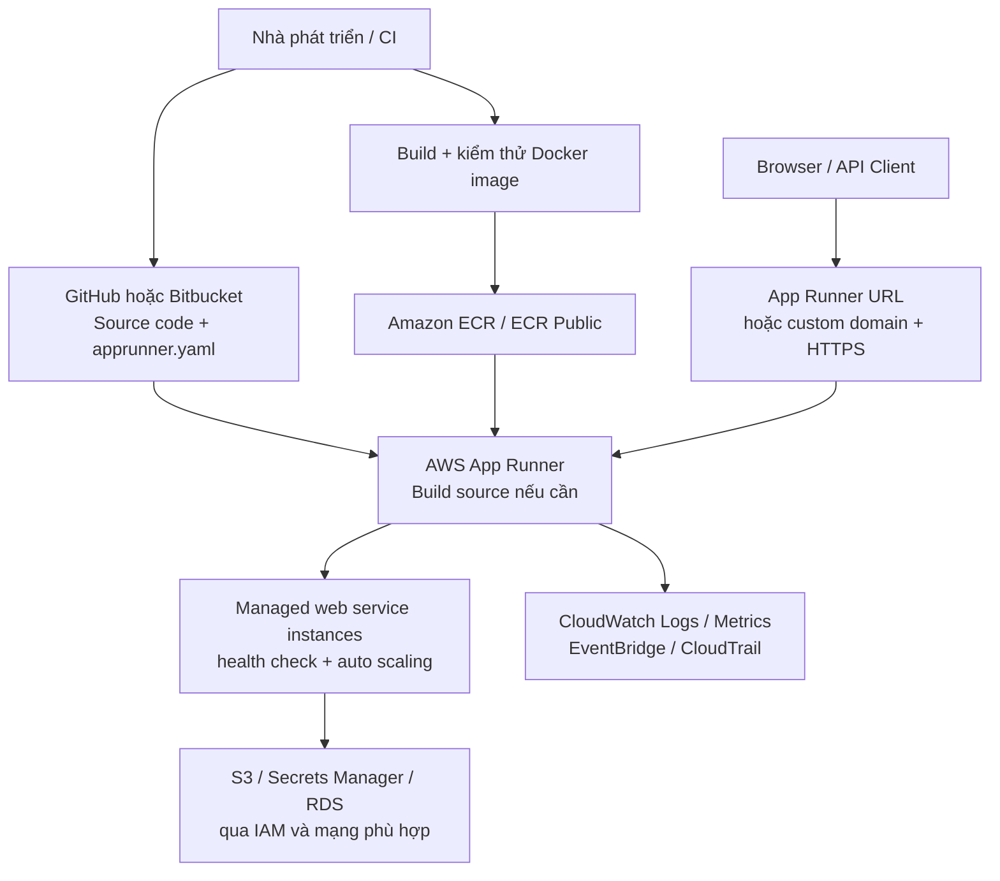
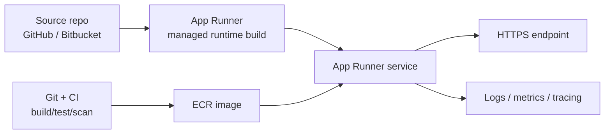
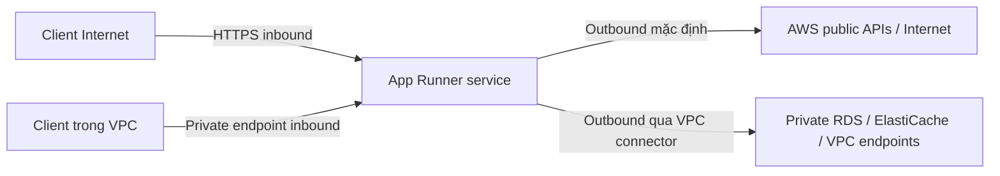

# App Runner service từ mã nguồn hoặc container image

**AWS App Runner** là dịch vụ AWS quản lý việc đưa **ứng dụng web/API** từ mã nguồn hoặc container image thành một **dịch vụ HTTP(S) có địa chỉ truy cập, TLS, cân bằng tải, health check và tự động mở rộng**. Khi chọn App Runner, nhóm phát triển không phải tự tạo EC2, cấu hình Application Load Balancer (ALB) hay điều hành một Kubernetes cluster chỉ để chạy một ứng dụng web.

Bài thuộc chương **Nền tảng ứng dụng quản lý** của mô-đun **CLOUD_PROVIDERS_AWS**. Các khái niệm IAM, VPC, Region/AZ, tính toán, lưu trữ, cơ sở dữ liệu, tích hợp dịch vụ và giám sát vẫn có vai trò quan trọng: App Runner giảm phần vận hành máy chủ, **không loại bỏ trách nhiệm quản lý mã nguồn, bảo mật, dữ liệu, kết nối mạng và chi phí**.

Nội dung tập trung vào **hai đường triển khai**:

- **Source code repository**: App Runner kết nối GitHub hoặc Bitbucket, dùng **managed runtime** tương thích để build code thành image rồi triển khai.
- **Container registry**: nhóm tự build image và đẩy vào **Amazon ECR private** hoặc **Amazon ECR Public**; App Runner kéo image đã có và chạy mà không tự build lại source.

> **Phạm vi:** Bài dùng ví dụ HTTP API Java. Với một Spring Boot phiên bản hiện đại yêu cầu **Java 17/21**, đường triển khai **container image** thường thực tế hơn: theo tài liệu runtime Java chính thức hiện hành của App Runner, lựa chọn **managed Java source runtimes** được liệt kê là **Corretto 8 và Corretto 11**, không nên mặc định rằng một runtime `corretto17` hay `corretto21` được cung cấp. Danh sách runtime có thể thay đổi; hãy đối chiếu tài liệu trước khi tạo service.

## 1. Mục tiêu học tập

Sau bài học, bạn có thể:

1. Giải thích mô hình **App Runner service**, **source**, **deployment**, **instance configuration**, **health checks**, **auto scaling** và **service URL**.
2. So sánh **triển khai từ mã nguồn** với **triển khai từ image**, dựa trên runtime, quản lý artifact, CI/CD, bảo mật và khả năng tái lập.
3. Xây dựng ví dụ source Java đơn giản với `apprunner.yaml` và hiểu giới hạn managed runtime.
4. Đóng gói Java API vào image, đẩy image lên ECR và tạo service sử dụng image đó.
5. Phân biệt **ECR access role** và **App Runner instance role** khi truy cập AWS APIs/Secrets Manager/RDS.
6. Thiết kế **public/private inbound** và **public/VPC outbound** đúng chiều lưu lượng.
7. Cấu hình health check, concurrency, MinSize/MaxSize, deployment và custom domain.
8. Quan sát metric/log, phân tích lỗi khởi tạo hoặc kết nối và đề xuất khôi phục/rollback.
9. Chọn giữa App Runner, Lambda, ECS Fargate, EKS và Elastic Beanstalk theo nhu cầu cụ thể.
10. Lập checklist bảo mật, khả năng phục hồi và kiểm soát chi phí trước khi đưa service vào production.

## 2. App Runner làm gì và không làm gì?

### 2.1. Kiến trúc tổng quan



Một App Runner service bao gồm nguồn ứng dụng, cấu hình deploy, tài nguyên thực thi và URL. App Runner cung cấp hạ tầng để nhận HTTP(S) và tự điều chỉnh số lượng instance theo traffic; AWS vận hành các host. Bạn quản lý **code/image, thông số CPU/memory, cấu hình port, lệnh chạy, quyền AWS và phụ thuộc bên ngoài**.

### 2.2. Trách nhiệm của AWS và của ứng dụng

| Thành phần | App Runner/AWS quản lý | Nhóm phát triển/vận hành quản lý |
| --- | --- | --- |
| Máy chủ nền tảng và scale-out HTTP service | Cấp và vận hành hạ tầng hỗ trợ | Chọn giới hạn auto scaling và resources |
| Runtime mã nguồn | Cung cấp managed runtime tương thích | Chọn runtime được hỗ trợ, cập nhật dependencies |
| Container image | Kéo và chạy image từ ECR | Build, scan, patch và publish image |
| TLS đầu vào | App Runner cung cấp HTTPS domain mặc định | Custom domain, DNS, xác thực nghiệp vụ |
| Load balancing, health checks | Thực thi theo cấu hình | Chọn HTTP port/health path và kiểm tra readiness |
| Quyền AWS | IAM cung cấp cơ chế role và policy | Cấp đúng role, trust và least privilege |
| Dữ liệu và backend | AWS cung cấp S3, RDS, DynamoDB... riêng | Chọn dịch vụ dữ liệu, backup, migrations, RPO/RTO |
| Logs và metrics | Có tích hợp CloudWatch và một số dịch vụ quan sát | Đặt alarms, log retention, correlation IDs và quy trình ứng cứu |

**App Runner không phải một nơi lưu file bền vững mặc định** cho dữ liệu người dùng. Không đặt file upload, session hoặc database quan trọng lên local filesystem của container: instance có thể được thay thế/scale và phần lưu tạm không có bảo đảm persistence giống S3/RDS.

## 3. Quyết định triển khai: mã nguồn hay container image?

| Tiêu chí | **Source code repository** | **Container image** |
| --- | --- | --- |
| Nơi chứa đầu vào | GitHub/Bitbucket repository và branch | ECR private hoặc ECR Public image URI |
| Ai build image? | App Runner build từ mã nguồn | Nhóm/CI build trước, App Runner chỉ deploy image |
| Runtime | Phụ thuộc danh sách managed runtimes được hỗ trợ | Tự chọn JDK, framework và OS trong Dockerfile |
| Cấu hình build | Console/API hoặc `apprunner.yaml` | Dockerfile/CI ngoài App Runner |
| `apprunner.yaml` | **Có**, đặt trong source directory | **Không áp dụng** |
| Quyền kết nối nguồn | Repository connection | ECR access role với ECR private; ECR Public không cần role đó |
| Đổi phiên bản | Commit/branch trong source directory | Push image/tag mới hoặc cập nhật ImageIdentifier |
| Khả năng kiểm soát build | Tương đối đơn giản, phụ thuộc runtime | Cao: dependencies, base image, SBOM, image scanning |
| Phù hợp | API nhỏ, runtime được hỗ trợ, ít yêu cầu hệ thống | Java 17/21, Spring Boot 3+, custom runtime, pipeline bảo mật |
| Trách nhiệm patch base image | App Runner quản lý runtime ở phương án source | Nhóm phải build lại image với các security patches |

**Không nên coi source và image là hai kiểu khác nhau về độ công khai của service.** Cả hai đều có thể cấu hình public/private endpoint, VPC outbound, scaling và service URL theo tính năng App Runner. Khác biệt lớn nhất là **nguồn và quy trình build/deploy**.

### 3.1. Chọn nhanh theo tình huống

- Một ứng dụng Java 11 nhỏ, có build/start commands đơn giản: cân nhắc **source code**.
- Spring Boot 3 hoặc Java 21, cần native dependencies, test/build artifacts được ký: ưu tiên **container image**.
- Image đã build tại CI và phải qua ECR scanning trước khi deploy: **container image**.
- Muốn thử nhanh code từ repository với runtime hỗ trợ: **source code**.
- Ứng dụng yêu cầu UDP server, daemon dài hạn không nhận HTTP, cron batch phức tạp hoặc Kubernetes control plane: xem **ECS, Lambda, Batch hoặc EKS**, không chọn App Runner chỉ vì tên “fully managed”.

## 4. Các khái niệm khi cấu hình service

| Khái niệm | Ví dụ | Ý nghĩa |
| --- | --- | --- |
| **Service name** | `java-api-demo` | Định danh service trong Region |
| **SourceConfiguration** | CodeRepository hoặc ImageRepository | Mô tả nguồn code/image và kiểu deployment |
| **Port** | `8080` | TCP port mà tiến trình ứng dụng bên trong container lắng nghe |
| **CPU/Memory** | `1 vCPU / 2 GB` | Tài nguyên được cấp cho instance của service |
| **Instance role** | `AppRunnerJavaApiInstanceRole` | Quyền AWS API cho ứng dụng đang chạy |
| **Access role** | `AppRunnerEcrAccessRole` | Quyền App Runner kéo image ECR private |
| **HealthCheckConfiguration** | `HTTP /health` | Kiểm tra ứng dụng đã sẵn sàng |
| **AutoScalingConfiguration** | MaxConcurrency=50, MinSize=1, MaxSize=5 | Điều chỉnh capacity theo mức concurrent requests |
| **EgressConfiguration** | Default hoặc VPC connector | Đường mạng **đi ra** của ứng dụng |
| **IngressConfiguration** | Public hoặc private endpoint | Phạm vi mạng **đi vào** service |
| **Service URL** | `https://xxxxx.region.awsapprunner.com` | URL HTTPS do App Runner cung cấp |

App Runner service là tài nguyên có **vòng đời**: `CREATING`, `RUNNING`, `PAUSED`, `OPERATION_IN_PROGRESS`, các trạng thái thất bại hoặc bị xóa tùy hoạt động. Chỉ dựa vào kết quả `create-service` trả về thành công là **chưa đủ**; cần đợi `RUNNING`, xác nhận health và gọi API thật.

## 5. Luồng A: tạo App Runner từ source code repository

### 5.1. Điều kiện trước khi bắt đầu

Bạn cần:

1. Repository trên **GitHub** hoặc **Bitbucket**, branch và source directory được cấp quyền.
2. Ứng dụng là HTTP web service, có lệnh build/start phù hợp với managed runtime được App Runner hỗ trợ.
3. Quyền IAM để tạo App Runner service và liên kết repository.
4. **Repository connection** tới nhà cung cấp Git: Console hỗ trợ liên kết account/organization, thường qua bước chấp thuận connector.
5. Xác định port server lắng nghe, biến môi trường, health check và chi phí dự kiến.

Trong **monorepo**, hãy xác định source directory, ví dụ `services/catalog-api`, để App Runner chạy build/start từ đúng thư mục. Với tự động deployment, thay đổi **ngoài source directory** có thể không kích hoạt lần deploy tự động; cần cơ chế CI/manual deployment nếu dùng shared libraries nằm ở nơi khác.

### 5.2. Giới hạn runtime Java được cung cấp

Theo danh sách runtime release Java của App Runner được đối chiếu cho bài này, có **Corretto 8 (`corretto8`)** và **Corretto 11 (`corretto11`)** trong nhóm managed Java source runtimes. Danh sách của **AWS CodeBuild** hoặc Amazon Corretto nói chung **không phải** danh sách runtime App Runner.

Hệ quả:

- Có thể dùng `corretto11` cho ví dụ Java 11 nếu dependency và build tool tương thích.
- Không đặt `runtime: corretto21` vào `apprunner.yaml` mà chưa xác nhận App Runner hỗ trợ.
- Spring Boot 3 cần Java 17+, nên đường **image do CI tự build** thường dễ bảo đảm tính tương thích nhất.
- Java 8/11 có thể không phù hợp cho ứng dụng production mới nếu quy định bảo mật/support lifecycle của tổ chức không cho phép.

**Quy tắc:** Kết hợp **runtime AWS thực sự hỗ trợ** + **Java framework compatibility** + **chính sách patch**; không chọn bằng suy đoán.

## 6. Ví dụ source Java 11 tối thiểu

Để minh họa quy trình mã nguồn, dùng một HTTP server Java 11 không phụ thuộc Spring Boot. Cấu trúc repo:

```text
demo-java-http/
  apprunner.yaml
  src/
    main/
      java/
        example/
          HelloApp.java
```

### 6.1. Code Java

```java
package example;

import com.sun.net.httpserver.HttpExchange;
import com.sun.net.httpserver.HttpServer;
import java.io.IOException;
import java.net.InetSocketAddress;
import java.nio.charset.StandardCharsets;

public class HelloApp {
    public static void main(String[] args) throws IOException {
        // Phải trùng port đã khai báo trong App Runner.
        int port = 8080;
        HttpServer server = HttpServer.create(
            new InetSocketAddress("0.0.0.0", port), 0
        );

        server.createContext("/health", exchange -> respond(exchange, 200, "ok"));
        server.createContext("/hello", exchange -> respond(exchange, 200, "hello from App Runner"));
        server.setExecutor(null);
        server.start();

        System.out.println("HTTP server listening on port " + port);
    }

    private static void respond(HttpExchange exchange, int status, String text)
        throws IOException {
        byte[] data = text.getBytes(StandardCharsets.UTF_8);
        exchange.getResponseHeaders().set("Content-Type", "text/plain; charset=utf-8");
        exchange.sendResponseHeaders(status, data.length);
        try (java.io.OutputStream output = exchange.getResponseBody()) {
            output.write(data);
        }
    }
}
```

Đây là ví dụ học tập cho HTTP routing, **không phải production web framework**: chưa có authentication, rate limits, structured logs, graceful shutdown hay xử lý lỗi đầy đủ.

### 6.2. Cấu hình `apprunner.yaml` cho source

```yaml
version: 1.0
runtime: corretto11

build:
  commands:
    build:
      - mkdir -p build/classes
      - javac -d build/classes src/main/java/example/HelloApp.java

run:
  command: java -cp build/classes example.HelloApp
  network:
    port: 8080
  env:
    - name: APP_ENV
      value: "training"
```

Giải thích:

- `version: 1.0` là **phiên bản schema của cấu hình App Runner**, không phải phiên bản Java.
- `runtime: corretto11` chọn runtime Java được App Runner hỗ trợ.
- `build.commands.build` khai báo lệnh compile; các giai đoạn `pre-build` và `post-build` là tùy chọn.
- `run.command` là lệnh khởi động HTTP server sau build.
- `run.network.port` phải khớp cổng server thực sự lắng nghe.
- `run.env` ở đây chỉ chứa biến môi trường **không bí mật**.

`apprunner.yaml` đặt trong **source directory**, không nhất thiết ở root toàn repository nếu dùng monorepo. Nó **không** chứa CPU/memory hoặc auto scaling policy; những thuộc tính đó cấu hình ở **service level** qua Console/API/IaC.

### 6.3. Kiểm tra local trước khi deploy

Ví dụ với Java 11 JDK đã có trên máy phát triển:

```bash
mkdir -p build/classes
javac -d build/classes src/main/java/example/HelloApp.java
java -cp build/classes example.HelloApp
```

Trong terminal khác:

```bash
curl -i http://localhost:8080/health
curl -i http://localhost:8080/hello
```

Kỳ vọng HTTP **200** với body tương ứng. Nếu lệnh chạy local thất bại, nên sửa code trước khi cấu hình AWS; App Runner không tự làm code hết lỗi.

## 7. Tạo service từ source bằng AWS Console

1. Mở [AWS App Runner Console](https://console.aws.amazon.com/apprunner/) tại đúng **AWS account/Region**.
2. Chọn **Create service** → nguồn **Source code repository**.
3. Chọn **GitHub** hoặc **Bitbucket**; liên kết repository provider với quyền cần thiết.
4. Chọn repository, branch và **Source directory** chính xác.
5. Chọn **Deployment settings**:
   - **Automatic** nếu muốn thay đổi code trong source directory kích hoạt deployment.
   - **Manual** nếu cần cổng kiểm soát phát hành và kiểm thử.
6. Ở **Configure build**, chọn lấy cấu hình từ `apprunner.yaml` (nếu dùng file trên) hoặc khai báo runtime/build/start từ Console/API.
7. Ở **Configure service**, đặt tên, CPU/memory, cổng `8080`, IAM instance role nếu ứng dụng cần AWS APIs.
8. Chọn health check **HTTP `/health`** thay vì mặc định TCP nếu muốn xác nhận ứng dụng thật sự phản hồi.
9. Kiểm tra inbound/outbound networking, auto scaling, observability, environment variables, secrets và tags.
10. Review và **Create & deploy**. Theo dõi trạng thái đến `RUNNING`.
11. Mở **Default domain**, gọi `/health` và `/hello` qua HTTPS, kiểm tra logs.

**Không copy access token GitHub/Bitbucket vào `apprunner.yaml`.** Sử dụng kết nối do AWS quản lý và cấp quyền tối thiểu cho repository tương ứng.

### 7.1. Tự động deployment của source code

App Runner theo dõi thay đổi repository theo source directory:

- Khi code trong source directory thay đổi, service có thể tự build và deploy nếu bật **Automatic deployment**.
- Nếu library dùng chung nằm **ngoài source directory**, thay đổi library có thể không kích hoạt deployment; cân nhắc cấu hình pipeline/manual trigger.
- Auto deployment không thay thế CI tests và approvals. Với production, cần xác định branch protection, kiểm thử, người phê duyệt và rollback.

Một lỗi phổ biến là developer push vào branch `feature/x` nhưng App Runner đang theo dõi branch `main`. Service không đổi vì nguồn deploy khác với nơi vừa commit.

## 8. Luồng B: tạo service từ container image trong ECR

### 8.1. Khi nào nên dùng image?

Dùng image khi muốn:

- Chạy Java 17/21, Spring Boot 3 hoặc runtime không có trong managed source list.
- Khóa phiên bản framework/JDK, binary và base OS theo image.
- Build/test một lần trong CI rồi triển khai **cùng artifact** qua nhiều môi trường.
- Sử dụng image scan, SBOM, ký artifact và quy trình duyệt theo tổ chức.
- Kiểm soát runtime dependencies và cách khởi động ứng dụng.

**App Runner không build Dockerfile từ ECR image.** Khi cung cấp image URI, bạn phải bảo đảm image đã có, kiến trúc CPU tương thích, port và entrypoint đúng.

### 8.2. Dockerfile minh họa cho Spring Boot với Java 21

Giả sử một dự án Maven Wrapper Spring Boot 3 có artifact sau khi package là `target/catalog-api-1.0.0.jar`. Một Dockerfile multi-stage:

```dockerfile
# Stage 1: compile/package ứng dụng.
FROM public.ecr.aws/amazoncorretto/amazoncorretto:21 AS build
WORKDIR /workspace
COPY .mvn/ .mvn/
COPY mvnw pom.xml ./
COPY src/ src/
RUN chmod +x mvnw && ./mvnw -B -DskipTests package

# Stage 2: image runtime.
FROM public.ecr.aws/amazoncorretto/amazoncorretto:21
WORKDIR /app
COPY --from=build /workspace/target/catalog-api-1.0.0.jar /app/app.jar
USER 10001
EXPOSE 8080
ENTRYPOINT ["java", "-jar", "/app/app.jar"]
```

Trong ứng dụng, cấu hình:

```properties
# Ví dụ application.properties của Spring Boot.
server.port=8080
server.address=0.0.0.0
management.endpoints.web.exposure.include=health,info
management.endpoint.health.probes.enabled=true
```

**Điều kiện của ví dụ:** Artifact JAR phải có **đúng tên** `catalog-api-1.0.0.jar` và có đầy đủ dependencies/entrypoint để chạy. Dự án phải có Maven Wrapper `mvnw` và thư mục `.mvn`. Nếu module xây dựng khác, sửa Dockerfile phù hợp. Người học không nên copy nguyên Dockerfile khi chưa biết output thực tế.

Đối với production:

- Pin image base theo chính sách tổ chức, vá image định kỳ, quét lỗ hổng.
- Bỏ `-DskipTests` ở pipeline test; ví dụ tách riêng **test stage** và **package stage** để không bỏ qua bảo đảm chất lượng.
- Chạy dưới **non-root user** khi ứng dụng hỗ trợ.
- Không ghi secrets vào image, Maven arguments hoặc source repository.
- Đặt heap và giới hạn memory phù hợp với CPU/memory instance, tránh JVM OutOfMemoryError.

### 8.3. Xây dựng và đẩy image tới ECR

Giả sử đã được cấp quyền dùng repository ECR `catalog-api` trong Region `ap-southeast-1` và account giả lập `123456789012`.

```bash
# Xác nhận AWS account trước.
aws sts get-caller-identity --profile training

# CÓ TÁC ĐỘNG/CHI PHÍ: tạo ECR private repository nếu chưa có.
aws ecr create-repository \
  --repository-name catalog-api \
  --region ap-southeast-1 \
  --profile training

# Đăng nhập Docker vào ECR theo AWS credentials.
aws ecr get-login-password \
  --region ap-southeast-1 \
  --profile training |
docker login --username AWS --password-stdin \
  123456789012.dkr.ecr.ap-southeast-1.amazonaws.com

# Build image phù hợp với runtime App Runner được hỗ trợ.
docker build -t catalog-api:1.0.0 .

# Gắn tag trỏ về ECR.
docker tag catalog-api:1.0.0 \
  123456789012.dkr.ecr.ap-southeast-1.amazonaws.com/catalog-api:1.0.0

# Push image lên ECR.
docker push \
  123456789012.dkr.ecr.ap-southeast-1.amazonaws.com/catalog-api:1.0.0
```

Các ID/URI là **minh họa**, không chạy nguyên trên tài khoản không thuộc quyền. Nếu repo `catalog-api` đã tồn tại, **không cần** tạo lại. Các lệnh build/push có thể tạo image/storage/chi phí ECR.

**Mẹo phát hành:** Hạn chế dùng tag `latest` cho production. Dùng tag gắn với phiên bản/commit và chính sách image immutability của ECR khi phù hợp; ghi lại image digest để có khả năng truy vết và rollback chính xác. Trước khi deploy phải biết image architecture và binary có chạy trong môi trường Linux được App Runner hỗ trợ không.

### 8.4. Các bước tạo service từ image bằng Console

1. App Runner Console → **Create service**.
2. Ở **Source**, chọn **Container registry**.
3. Chọn **Amazon ECR private** hoặc **Amazon ECR Public**.
4. Với ECR private, chọn image URI/tag và **ECR access role** phù hợp.
5. Chọn **Manual/Automatic deployment** theo khả năng nguồn:
   - ECR private **cùng AWS account** có thể dùng auto deployment nếu hỗ trợ/cấu hình đúng.
   - **ECR Public** không hỗ trợ auto deployment theo trigger App Runner.
   - ECR private **khác account** không hỗ trợ App Runner automatic deployment; dùng manual hoặc pipeline explicit.
6. Đặt container port `8080`, CPU/memory, instance IAM role nếu code gọi dịch vụ AWS.
7. Chọn health check HTTP phù hợp, inbound/outbound networking, scale min/max, observability và tags.
8. Chọn **Create & deploy**; đợi `RUNNING`, sau đó kiểm tra service URL.

**ECR access role không phải là instance role.** Vai trò kéo image cho App Runner không tự cấp cho ứng dụng Java quyền đọc S3/DynamoDB/Secrets Manager.

## 9. So sánh hai đường deploy theo vòng đời



| Giai đoạn | Source code | Container image |
| --- | --- | --- |
| Build | App Runner chạy commands/runtime | CI build image và đẩy ECR |
| Kiểm thử | Kiểm thử repo; build có thể chạy test commands | CI unit/integration/image scan |
| Deploy | App Runner build & release | App Runner pull image & release |
| Trigger tự động | Commit trong source directory | Push phù hợp loại ECR hỗ trợ |
| Tái lập artifact | Phụ thuộc runtime và build/dependencies được khóa | Có thể dựa trên immutable image digest |
| Rollback | Deploy lại commit/branch version đã kiểm chứng | Deploy lại image tag/digest cũ đã kiểm chứng |
| Vận hành | Theo dõi health/metrics tương tự | Theo dõi health/metrics tương tự |

Không giả định **tự động deployment** đồng nghĩa **zero downtime hoặc không có lỗi phiên bản**. Luôn có health checks, tương thích database schema và phương án khôi phục version trước.

## 10. IAM: ba vai trò rất dễ nhầm

### 10.1. Identity tạo service

Người vận hành sử dụng **IAM Identity Center** hoặc IAM role được ủy quyền để gọi App Runner API; quyền của người này cần cho `apprunner:CreateService`, `apprunner:UpdateService`, `iam:PassRole` với role cho phép và thao tác liên quan. Không dùng root user hoặc access key dài hạn để triển khai thường ngày.

### 10.2. ECR access role

**Access role** để App Runner kéo image từ **ECR private**. Trust policy cho service principal:

```json
{
  "Version": "2012-10-17",
  "Statement": [
    {
      "Effect": "Allow",
      "Principal": {
        "Service": "build.apprunner.amazonaws.com"
      },
      "Action": "sts:AssumeRole"
    }
  ]
}
```

Gắn chính sách được AWS quản lý `AWSAppRunnerServicePolicyForECRAccess` khi phù hợp hoặc policy tối thiểu tương đương cho repo cần đọc.

Với **ECR Public**, access role cho ECR private thường không cần. Cross-account ECR private yêu cầu xem xét cả policy bên registry/account nguồn và quyền role phù hợp.

### 10.3. Instance role

**Instance role** là role ứng dụng container dùng để gọi AWS APIs khi chạy, ví dụ đọc object S3. Trust policy:

```json
{
  "Version": "2012-10-17",
  "Statement": [
    {
      "Effect": "Allow",
      "Principal": {
        "Service": "tasks.apprunner.amazonaws.com"
      },
      "Action": "sts:AssumeRole"
    }
  ]
}
```

Ví dụ IAM policy chỉ đọc prefix `catalog/` của một bucket S3 minh họa:

```json
{
  "Version": "2012-10-17",
  "Statement": [
    {
      "Sid": "ReadCatalogObjects",
      "Effect": "Allow",
      "Action": ["s3:GetObject"],
      "Resource": "arn:aws:s3:::example-catalog-data/catalog/*"
    }
  ]
}
```

Đây là quyền **data plane** của ứng dụng, không dùng để truy cập ECR nhằm kéo chính image đang deploy. AWS SDK trong Java có thể dùng credential provider chain để nhận temporary credentials từ instance role khi cấu hình đúng; không hard-code `AWS_ACCESS_KEY_ID` hoặc `AWS_SECRET_ACCESS_KEY` trong image.

Nếu bucket dùng SSE-KMS, cần kiểm tra thêm `kms:Decrypt`/key policy khi phù hợp. **Một policy Allow ở instance role không vượt được explicit deny** của SCP, bucket policy hoặc KMS key policy.

### 10.4. Bảng ghi nhớ

| Vai trò | Principal trust hoặc danh tính | Khi nào cần |
| --- | --- | --- |
| Người triển khai | IAM role/Identity Center principal | Tạo/sửa/xóa App Runner service |
| **ECR access role** | `build.apprunner.amazonaws.com` | Kéo image **ECR private** |
| **App Runner instance role** | `tasks.apprunner.amazonaws.com` | Ứng dụng gọi S3/RDS IAM auth/Secrets Manager và AWS APIs |

## 11. Secrets và environment variables

Ứng dụng Java có thể cần các cấu hình:

- `APP_ENV=prod`.
- `SPRING_PROFILES_ACTIVE=prod`.
- `DB_HOST=...`.
- `DB_PASSWORD` hoặc API token.

**Không đưa mật khẩu dưới dạng plaintext** vào `apprunner.yaml`, Dockerfile, repository hoặc biến build. App Runner hỗ trợ tham chiếu **AWS Secrets Manager** và **SSM Parameter Store** khi cấu hình runtime environment secrets.

Ví dụ cấu hình minh họa (đường source code, trong `apprunner.yaml`):

```yaml
version: 1.0
runtime: corretto11
build:
  commands:
    build:
      - mvn -B package
run:
  command: java -jar target/legacy-demo.jar
  network:
    port: 8080
  env:
    - name: APP_ENV
      value: "prod"
  secrets:
    - name: DB_PASSWORD
      value-from: "arn:aws:secretsmanager:ap-southeast-1:123456789012:secret:catalog/db/password-EXAMPLE"
```

Đây là **ví dụ cấu hình thay thế**, không áp dụng cho code Java HTTP tối thiểu ở mục 6 vì nó không có Maven/JAR đó. Giá trị ARN là placeholder; phải thay theo secret thực và cấp **instance role** quyền `secretsmanager:GetSecretValue`, `kms:Decrypt` nếu sử dụng key cần quyền. Với **image-based service**, thiết lập secrets ở cấu hình App Runner service/API thay vì `apprunner.yaml`.

Lưu ý khi xoay secret: đánh giá **khi nào tiến trình nhận giá trị mới** và có cần redeploy/restart theo hướng dẫn App Runner; đừng giả định mọi Pod/instance cập nhật secret ngay khi Secret Manager đổi.

## 12. Networking: inbound và outbound là hai hướng độc lập

### 12.1. Tư duy bằng hai mũi tên



Sơ đồ mô tả các **tùy chọn** (một service chọn cách phù hợp), không có nghĩa tất cả đường inbound/outbound đồng thời được bật. Đặc biệt, **VPC connector** liên quan đến **outbound traffic của ứng dụng**, còn **private endpoint** liên quan đến **inbound**.

### 12.2. Inbound public mặc định

Nếu chọn **Public endpoint**, App Runner cấp HTTPS URL có thể truy cập từ Internet. Cần tự xây dựng authentication/authorization nghiệp vụ; có HTTPS **không** đồng nghĩa các API nội bộ được bảo vệ.

Nếu dùng custom domain, App Runner hỗ trợ xác minh quyền sở hữu miền và TLS qua ACM. Trong Route 53, có thể tạo record theo hướng dẫn Console/API; với domain root cần dùng **alias** phù hợp thay vì CNAME tại apex.

### 12.3. Outbound mặc định

Ở cấu hình **Public access (outgoing)**, ứng dụng có thể gửi request đến Internet và public AWS service endpoints theo khả năng dịch vụ. Đây **không** phải lời khẳng định mọi RDS private IP trong VPC của tổ chức đều truy cập được: RDS private chỉ có đường nội bộ VPC, cần kiến trúc kết nối thích hợp.

### 12.4. Outbound VPC connector

Khi Java API phải truy cập RDS PostgreSQL private hoặc ElastiCache:

1. Tạo **VPC connector** cho đúng VPC.
2. Chọn các **private subnets** phù hợp, đủ IP và Availability Zones được App Runner hỗ trợ.
3. Chọn security group cho connector để kiểm soát lưu lượng đi ra.
4. Security group của RDS cho inbound port `5432` từ **security group của connector**.
5. Cấu hình App Runner **Outgoing network traffic = Custom VPC**, chọn connector.
6. Kiểm tra DNS, route, database credentials, TLS và application timeout.

**Điểm cốt lõi:** Khi bật VPC connector, **outbound traffic của application** đi qua VPC. Các subnet không tự có quyền ra Internet. Muốn ứng dụng gọi public Internet/AWS APIs cần **NAT Gateway** hoặc **VPC endpoints** thích hợp, route và SG phù hợp.

**Đừng đặt VPC connector vào public subnet rồi kỳ vọng Internet Gateway giúp nó có Internet.** VPC connector network interfaces không có public IP để đi Internet trực tiếp qua IGW; thường cần private subnet và NAT/endpoint.

Lần đầu cấu hình VPC connector có thể khiến startup thêm vài phút; nếu thay đổi SG/subnets phải tính thời gian provisioning.

### 12.5. VPC connector không đổi inbound

Rất dễ nhầm rằng nối App Runner tới một VPC làm API thành private. **Không phải.** VPC connector chỉ điều khiển **egress** từ app. Nếu ingress đang là public, người dùng vẫn vào service qua public URL.

App Runner có **private endpoint cho incoming traffic**, triển khai bằng **VPC interface endpoint (AWS PrivateLink)** và **App Runner VPC Ingress Connection**. Chọn **Private endpoint** khi chỉ client trong VPC được phép truy cập. Phần này có cấu hình và chi phí interface endpoint riêng.

**VPC interface endpoint dùng cho API quản trị App Runner**, **VPC interface endpoint dùng làm private application ingress**, và **VPC connector cho application egress** là các chức năng khác nhau. Không dùng nhầm một loại endpoint thay cho loại còn lại.

### 12.6. Ví dụ App Runner gọi PostgreSQL qua VPC

Giả sử:

| Thành phần | Cấu hình |
| --- | --- |
| App Runner source | Container ECR chạy Java API |
| Inbound | Public HTTPS qua App Runner URL |
| Egress | VPC connector ở hai private subnets |
| Database | RDS PostgreSQL, không public |
| RDS SG inbound | TCP `5432` từ connector SG |
| App IAM role | Quyền Secrets Manager lấy DB credential |
| DNS | RDS endpoint phân giải được trong VPC |
| TLS | JDBC sử dụng TLS theo chính sách database |

**Route đúng nhưng thiếu SG vẫn không kết nối**; SG đúng nhưng DB không lắng nghe/credential sai vẫn thất bại. Để phân tích sự cố cần tách **network, IAM, TLS, authentication và application**.

## 13. Health check và khả năng sẵn sàng của ứng dụng

App Runner health check mặc định là **TCP**: kiểm tra có thể kết nối tới cổng được cấu hình. Với web API, TCP open **chưa đủ** chứng minh ứng dụng có thể phục vụ nghiệp vụ.

### 13.1. Đổi sang HTTP health check

Ví dụ chọn:

| Thuộc tính | Giá trị minh họa |
| --- | --- |
| Protocol | `HTTP` |
| Path | `/actuator/health/readiness` hoặc `/health` |
| Interval | 5 giây (mặc định) |
| Timeout | 2 giây (mặc định) |
| Healthy threshold | 1 (mặc định) |
| Unhealthy threshold | 5 (mặc định) |

**Spring Boot Actuator** chỉ sẵn sàng tại đường dẫn probes khi đã cấu hình phù hợp. Nếu `/actuator/health/readiness` yêu cầu authentication hoặc không được expose, health check có thể nhận 401/404 và service không healthy.

Một health endpoint hợp lý nên:

- Trả **200** khi ứng dụng có thể nhận request.
- Phản ánh tình trạng thiết yếu nhưng tránh phụ thuộc không cần thiết khiến mọi lần chập chờn của dịch vụ ngoài làm cả fleet bị xem là unhealthy.
- Không tiết lộ secrets, SQL connection strings hoặc PII.
- Có timeout đủ cho JVM startup và health checks.
- Được kiểm tra local/container trước khi deploy.

### 13.2. Port binding

Với App Runner, container phải lắng nghe **đúng port** bạn khai báo. Nếu App Runner gửi traffic vào port `8080` nhưng Spring Boot chạy `8081`, deployment có thể thất bại hoặc không bao giờ healthy.

Đồng thời, app nên bind tới **`0.0.0.0`** bên trong container. Bind riêng `127.0.0.1` có thể khiến App Runner không tiếp cận được listener.

## 14. Auto scaling: concurrency, MinSize và MaxSize

App Runner tự động scale web service dựa trên **số request đang xử lý đồng thời** và cấu hình hạn mức.

| Thuộc tính | Ví dụ | Ý nghĩa |
| --- | --- | --- |
| **MaxConcurrency** | 50 | Khi lượng concurrent requests vượt mức mỗi instance, App Runner có thể scale out |
| **MinSize** | 1 | Số instance được provision tối thiểu, có thể gồm active và standby |
| **MaxSize** | 5 | Số instance active tối đa có thể phục vụ traffic |
| **CPU/Memory** | 1 vCPU, 2 GB | Tài nguyên trên mỗi instance |
| **Actual active instances** | 1–5 theo tải | Phụ thuộc concurrency và thời gian scale |

### 14.1. Ví dụ sizing

Giả sử:

- Một request Java xử lý trung bình **100 ms**, nhưng P95 khoảng **350 ms**.
- App Runner instance có MaxConcurrency=50.
- Hệ thống nhận peak **150 concurrent requests**.

Ước lượng thô:

\[
N_{\text{instance}} \gtrsim \left\lceil \frac{150}{50} \right\rceil = 3
\]

Đây là công thức **trực giác**, không phải lời bảo đảm App Runner luôn chạy đúng 3 instances. Phản ứng scale, warm-up, tài nguyên CPU/memory, số kết nối tới database và giới hạn MaxSize có thể tạo bottleneck.

Nếu `MaxSize=2`, service không thể tự scale active instances lên 3 bất kể concurrency. Nếu `MaxConcurrency` đặt quá cao, một instance Java có thể nhận nhiều request đến mức CPU/heap/DB pool bị nghẽn trước khi scaling kịp phản ứng.

### 14.2. MinSize và chi phí idle

**MinSize** là số instance được provision tối thiểu. App Runner có thể giữ capacity reserve để kích hoạt nhanh:

- Phí **memory provisioned** áp dụng cho toàn bộ instance được provision.
- Phí **CPU** chủ yếu áp dụng cho các instance **active** xử lý công việc.
- Số **ActiveInstances=0** trong CloudWatch có thể chỉ là **không có traffic**, không chứng minh service không có provisioned capacity hoặc không có phí.

App Runner có thể tạm thời tăng provisioned instances trong quá trình deployment để chuyển version; cần dự toán peak costs và quota khi phát hành thường xuyên.

### 14.3. App Runner autoscaling khác EC2 ASG/HPA

| Dịch vụ | Đơn vị mở rộng chính | Tín hiệu |
| --- | --- | --- |
| App Runner | Managed application instances | Concurrent HTTP requests |
| EC2 Auto Scaling | EC2 instances | Metric, alarm, schedule, target tracking |
| Kubernetes HPA | Pod replicas | Resource/custom/external metrics |
| ECS Service Auto Scaling | ECS tasks | Metric target tracking/step/schedule theo cấu hình |

Không có API Kubernetes `kubectl scale` cho App Runner, và App Runner không cho bạn lựa chọn chi tiết EC2 instance/AZ placement như EKS/EC2.

## 15. Deployments: manual, automatic và rollback

### 15.1. Manual deployment

**Manual** phù hợp khi:

- Branch dùng production nhưng mỗi đợt release cần approval.
- Artifact phải được kiểm thử, scan, ký và có release notes.
- Nguồn image ECR Public/cross-account ECR không hỗ trợ automatic trigger của App Runner.
- Muốn kiểm soát thời điểm deploy để giảm rủi ro thay đổi giờ cao điểm.

Qua Console, chọn service và **Deploy** theo UI; qua CLI dùng `start-deployment` khi service hợp lệ.

### 15.2. Automatic deployment

**Automatic** có thể phù hợp ở môi trường dev/staging:

- Source: commit vào source directory của branch đang theo dõi.
- Image: thay đổi nguồn ECR private được hỗ trợ (thường cùng account).
- App Runner phát hiện và deploy theo cơ chế dịch vụ.

**Không hỗ trợ automatic deployment** cho image từ **ECR Public** hoặc ECR private thuộc **tài khoản AWS khác với service**. Khi thiết kế cross-account pipeline, dùng deploy explicit bằng CLI/API/IaC thay vì giả định push sẽ tự cập nhật.

### 15.3. Rollback

Nếu release v2 lỗi:

1. Ghi nhận `ServiceArn`, deployment/operation status, code commit hoặc image digest của v2.
2. Xác định version v1 đã chạy ổn và tương thích schema/database hiện có.
3. Với source: phục hồi mã ở branch/commit hoặc có quy trình build lại version cũ, rồi **deploy**.
4. Với image: cập nhật nguồn sang tag/digest artifact cũ được xác nhận và deploy.
5. Theo dõi trạng thái, health, error rate, latency, request logs, DB connections.
6. Sau khôi phục, làm postmortem và cải thiện pipeline.

**Đừng giả định App Runner tự lưu một nút rollback về bất kỳ version nào theo cách giống một hệ thống release management đầy đủ.** Tổ chức cần giữ image/commit artifact, quy trình xác định version và database migration tương thích ngược.

### 15.4. Tính tương thích schema database

Khi deploy nhiều instances:

- Có thể có phiên bản v1 và v2 tồn tại trong giai đoạn chuyển đổi.
- Migration **phá vỡ tương thích** có thể khiến phiên bản cũ thất bại dù rollback code.
- Dùng chiến lược **expand–migrate–contract**, migration kiểm soát và backup/restore.
- Đảm bảo request retry/idempotency khi client gặp lỗi trong chuyển đổi.

## 16. AWS CLI: kiểm tra service mà không phát sinh hạ tầng mới

Dùng AWS CLI v2 với IAM Identity Center profile/role và Region đúng. Những câu lệnh sau **chỉ đọc**:

```bash
# Xác nhận danh tính đang dùng.
aws sts get-caller-identity --profile training

# Liệt kê App Runner services trong Region.
aws apprunner list-services \
  --region ap-southeast-1 \
  --profile training

# Xem service cụ thể.
aws apprunner describe-service \
  --service-arn "arn:aws:apprunner:ap-southeast-1:123456789012:service/java-api-demo/EXAMPLE-ID" \
  --region ap-southeast-1 \
  --profile training

# Xem cấu hình tự động mở rộng dùng chung.
aws apprunner list-auto-scaling-configurations \
  --region ap-southeast-1 \
  --profile training

# Xem các hoạt động deploy/update của service.
aws apprunner list-operations \
  --service-arn "arn:aws:apprunner:ap-southeast-1:123456789012:service/java-api-demo/EXAMPLE-ID" \
  --region ap-southeast-1 \
  --profile training

# Xem VPC connectors nếu service có egress custom.
aws apprunner list-vpc-connectors \
  --region ap-southeast-1 \
  --profile training
```

ARN là **placeholder**. Nếu không thấy service, kiểm tra **account/Region/IAM role** trước khi kết luận hệ thống đã bị xóa.

### 16.1. Deploy thủ công bằng CLI

Khi service đã tạo và có source mới, lệnh này **thay đổi ứng dụng**, có thể ảnh hưởng traffic:

```bash
aws apprunner start-deployment \
  --service-arn "arn:aws:apprunner:ap-southeast-1:123456789012:service/java-api-demo/EXAMPLE-ID" \
  --region ap-southeast-1 \
  --profile training
```

Cần có quyền `apprunner:StartDeployment` và nguồn code/image đã sẵn sàng. Lệnh không tự đảm bảo deployment sẽ kết thúc thành công; kiểm tra operation status và metrics.

## 17. Ví dụ CLI CreateService từ ECR image

Đây là ví dụ **JSON cấu hình đầu vào**. **Không lưu thành file trong repository ngoài phạm vi được giao** khi chỉ đọc bài; khi thực hành thật, người học có thể tạo một `service.json` riêng trong sandbox được cấp quyền.

```json
{
  "ServiceName": "java-api-demo",
  "SourceConfiguration": {
    "ImageRepository": {
      "ImageIdentifier": "123456789012.dkr.ecr.ap-southeast-1.amazonaws.com/catalog-api:1.0.0",
      "ImageRepositoryType": "ECR",
      "ImageConfiguration": {
        "Port": "8080",
        "RuntimeEnvironmentVariables": {
          "APP_ENV": "training"
        }
      }
    },
    "AuthenticationConfiguration": {
      "AccessRoleArn": "arn:aws:iam::123456789012:role/AppRunnerEcrAccessRole"
    },
    "AutoDeploymentsEnabled": false
  },
  "InstanceConfiguration": {
    "Cpu": "1 vCPU",
    "Memory": "2 GB",
    "InstanceRoleArn": "arn:aws:iam::123456789012:role/AppRunnerJavaInstanceRole"
  },
  "HealthCheckConfiguration": {
    "Protocol": "HTTP",
    "Path": "/actuator/health/readiness"
  },
  "NetworkConfiguration": {
    "EgressConfiguration": {
      "EgressType": "DEFAULT"
    },
    "IngressConfiguration": {
      "IsPubliclyAccessible": true
    }
  }
}
```

Điều kiện để cấu hình này hoạt động:

- Image URI thực sự tồn tại trong ECR và chạy process lắng nghe port `8080`.
- **ECR access role** có trust principal/policy đúng.
- **Instance role** tồn tại; nếu app không cần AWS APIs thì có thể bỏ `InstanceRoleArn`.
- Spring Boot readiness endpoint trả **200** khi healthy; nếu app dùng `/health` phải đổi `Path`.
- CPU/memory nằm trong tổ hợp được App Runner hỗ trợ và có quota.
- Dữ liệu bí mật không đặt trong `RuntimeEnvironmentVariables` plaintext.
- Tài khoản, Region, mạng và chi phí được phép.

Trong sandbox, sau khi có file JSON được cấp phép, lệnh tạo service là:

```bash
# CÓ TÁC ĐỘNG VÀ PHÁT SINH CHI PHÍ: chỉ chạy trong sandbox được duyệt.
aws apprunner create-service \
  --cli-input-json file://service.json \
  --region ap-southeast-1 \
  --profile training
```

Phản hồi ban đầu có thể cho `Status: CREATING`. Sau đó dùng `describe-service` và `list-operations` để xác nhận `RUNNING` và HTTP endpoint.

## 18. Custom domain, HTTPS và bảo mật đầu vào

App Runner cấp **default HTTPS URL** cho service. Khi muốn gắn `api.example.com`:

1. Chọn **Custom domains** trên service.
2. Nhập domain được sở hữu/quản trị.
3. App Runner tạo yêu cầu xác minh certificate qua ACM.
4. Với **Route 53**, Console có thể tự thiết lập DNS/certificate records phù hợp; với DNS provider ngoài, cấu hình CNAME/validation records theo hướng dẫn.
5. Giữ **DNS validation records** để certificate được tự gia hạn.
6. Kiểm tra domain trạng thái Active, TLS certificate hợp lệ và HTTP requests hoạt động.

Với **Route 53**, subdomain có thể dùng alias/CNAME theo trường hợp; **apex/root domain** cần alias phù hợp, không đặt CNAME tại apex một cách mù quáng.

### 18.1. AWS WAF cho public App Runner

App Runner hỗ trợ liên kết **AWS WAF web ACL** để chặn/rate limit các web requests theo quy tắc. Tùy tình huống có thể áp:

- Managed rules chống common web exploits.
- Rate-based rules chống lạm dụng.
- Quy tắc đường dẫn/header/query string cần kiểm chứng với API.
- Logging và test rule `COUNT` trước khi `BLOCK` ở production.

Với **App Runner private endpoint**, **WAF source IP/CIDR rules không đáng tin** vì dịch vụ không chuyển được source IP gốc tới WAF theo trường hợp được AWS ghi nhận. Nếu cần giới hạn IP của client truy cập private service, dùng **security group của VPC interface endpoint**/kiến trúc network access thay vì WAF source IP rule.

Dù có WAF, ứng dụng phải tự thực hiện **authentication**, **authorization** và kiểm tra quyền đối với dữ liệu người dùng. WAF không phải IAM role của ứng dụng.

### 18.2. Private ingress cho API nội bộ

Nếu API chỉ dành cho ứng dụng nội bộ:

- Chọn **Incoming traffic = Private endpoint**.
- Tạo hoặc chọn **VPC interface endpoint** của App Runner để kết nối.
- Kiểm tra security group của endpoint, subnets/AZ và clients được phép.
- Cấu hình DNS/routing trong VPC, TLS và thử với client nội bộ.
- Dự toán **AWS PrivateLink endpoint-hours và data processing**.

Không nên chỉ bỏ custom domain và cho rằng default URL sẽ tự private. **Private endpoint là một cấu hình mạng cụ thể.**

## 19. Logging, metrics, tracing và cảnh báo

### 19.1. Nguồn quan sát

| Công cụ | Dữ liệu cung cấp | Khi nào cần |
| --- | --- | --- |
| **App Runner operations** | Tạo service, deployments, updates, errors | Truy nguyên release thất bại |
| **CloudWatch Logs** | Application logs và service/deployment logs | Java exception, startup/port error |
| **CloudWatch Metrics** | Requests, response status, latency, concurrency, CPU, memory, ActiveInstances | Xác nhận SLO và scaling |
| **EventBridge** | Sự kiện liên quan hoạt động App Runner | Thông báo thay đổi/trạng thái |
| **CloudTrail** | Hoạt động API quản lý của danh tính AWS | Kiểm toán ai sửa service/config/role |
| **AWS X-Ray / tracing** | Distributed tracing theo tích hợp được hỗ trợ | Tìm bottleneck upstream/downstream |
| **Cost Explorer / Budgets** | Chi phí compute, NAT, logs, dữ liệu | Kiểm soát ngân sách |

Những metric quan trọng:

- `Requests`: tổng request vào service.
- `RequestLatency`: độ trễ xử lý HTTP requests.
- `2xxStatusResponses`, `4xxStatusResponses`, `5xxStatusResponses`: nhóm status.
- `Concurrency`: số yêu cầu đồng thời xấp xỉ đang xử lý.
- `CPUUtilization`, `MemoryUtilization`: hiệu năng compute.
- `ActiveInstances`: số instances active xử lý request.

**`ActiveInstances=0` thường chỉ là hiện không có request**, không chứng minh App Runner đã giải phóng hết capacity hoặc không còn phí memory provisioned.

### 19.2. Ví dụ cảnh báo

| Tình huống | Gợi ý alert |
| --- | --- |
| Release lỗi | App Runner operation failed / EventBridge |
| HTTP 5XX tăng | CloudWatch `5xxStatusResponses` trên nhiều kỳ |
| Latency P95 tăng | Application metrics/tracing hoặc metric phù hợp |
| CPU/memory cao kéo dài | `CPUUtilization` / `MemoryUtilization` |
| Lưu lượng tăng tới giới hạn | `Concurrency` gần capacity MaxConcurrency×MaxSize |
| Chi phí tăng | AWS Budgets theo account/service, Cost Explorer |
| Mất truy cập RDS | App logs/connection timeouts + VPC/DB metrics |

Không log plaintext `Authorization`, cookies, password hoặc nội dung chứa PII; đặt log retention và phân quyền đọc CloudWatch Logs.

## 20. Các lỗi thường gặp và cách chẩn đoán

| Triệu chứng | Nguyên nhân có thể | Kiểm tra ưu tiên |
| --- | --- | --- |
| Service source build failed | Runtime không hỗ trợ, sai source directory, build command, dependency | App Runner build logs, `apprunner.yaml`, Java version |
| Java 17/21 không chạy từ source | Managed source runtime không có phiên bản tương ứng | Dùng container image Java 17/21 |
| Image service không tạo được | ECR role/trust/repository policy sai, URI/tag không tồn tại | `build.apprunner.amazonaws.com`, ECR permissions, image URI |
| `RUNNING` nhưng 404 | App không có route tương ứng hoặc sai base path | Test `/health`/`/hello`, app logs |
| Service không healthy | Process sai port, bind `127.0.0.1`, health path 401/404 | Container entrypoint, port và HTTP health config |
| App crash khi startup | JVM memory limit, thiếu env/secret, cấu hình sai | CloudWatch application logs, CPU/memory |
| Deploy code mới không xảy ra | Auto deployments tắt, commit sai branch/source directory | Source settings và operations |
| Push ECR Public không tự deploy | Loại image không hỗ trợ automatic deployment | Manual deployment hoặc pipeline |
| App không gọi được S3 | Instance role thiếu quyền, KMS/SCP/bucket policy deny | App Runner instance role, logs, IAM policy |
| App không kết nối RDS private | Chưa có VPC connector, RDS SG không cho inbound, DNS/route sai | VPC connector/subnets/SG, RDS port |
| App có VPC connector mất Internet | Egress qua VPC, thiếu NAT hoặc VPC endpoints | Route table, endpoints, SG/NACL |
| App vẫn public sau khi thêm VPC connector | Connector **chỉ outbound** | Ingress configuration; chọn private endpoint nếu cần |
| Custom domain Pending | DNS validation CNAME/CAA sai, chưa propagate | DNS records, ACM validation, Console status |
| Public API quá tải | Concurrency, MaxSize, JVM/DB bottleneck | App Runner metrics, database pool, autoscaling config |
| Private WAF IP filter không đúng | Source IP không forwarded cho private endpoint | SG của VPC interface endpoint thay vì WAF source IP rules |
| Không thấy logs/metrics | Sai account/Region, thiếu logging hoặc retention | Service observability configuration |
| Không thấy tiết kiệm sau khi traffic về 0 | MinSize provisioned memory vẫn được tính phí | CloudWatch, Billing/Cost Explorer |

### 20.1. Quy trình chẩn đoán theo lớp

1. **Identity**: đúng AWS account, Region, IAM role?
2. **Source**: Git repository/branch/source directory hoặc ECR URI/tag/digest đúng?
3. **Build**: runtime tương thích, dependencies, container entrypoint?
4. **Service**: trạng thái App Runner operations, CPU/memory, port, HTTP health?
5. **Network**: inbound public/private; outbound default/VPC connector; NAT/endpoints?
6. **Security**: ECR access role, instance role, Secrets Manager/KMS, WAF?
7. **Application**: log exception, database migrations, routes, latency, error rate?
8. **Scaling/Cost**: concurrency, max/min, ActiveInstances, CPU/memory, budget?

Không đổi đồng thời nhiều cấu hình production để “thử vận may”. Xem logs/metrics, xác định lớp lỗi rồi thay đổi có kiểm soát.

## 21. Thiết kế an toàn và phục hồi cho Java API

### 21.1. Stateless application

App Runner có thể tạo và thay thế nhiều instances nên:

- **Không lưu session duy nhất trong RAM** của một instance; dùng cơ chế xác thực stateless hoặc kho session có chia sẻ phù hợp.
- **Không lưu tệp upload lâu dài trên local filesystem**; dùng Amazon S3.
- Dùng RDS/Aurora/DynamoDB cho dữ liệu nghiệp vụ tùy nhu cầu.
- Thiết kế API **idempotent** với các thao tác ghi nhạy cảm khi client retry.
- Thực hiện graceful shutdown và cho request đang xử lý cơ hội kết thúc khi deploy/scale.

### 21.2. Độ bền phụ thuộc dịch vụ dữ liệu

App Runner service scale/health không có nghĩa **database tự có Multi-AZ, backup và PITR**. Cần:

1. Đặt RDS/Aurora theo yêu cầu HA/backup/replication.
2. Thiết kế migrations/backward compatibility.
3. Thử backup restore và quy trình ứng cứu.
4. Xác định RPO/RTO của toàn bộ đường dữ liệu.
5. Kiểm tra retry, connection timeout và pool size khi App Runner scale out.

Ví dụ App Runner tăng từ 2 lên 10 active instances, mỗi JVM có 30 DB connections có thể tạo tối đa khoảng **300 connections** theo cấu hình; database có thể nghẽn dù App Runner metrics cho thấy scale thành công. Cần giới hạn pool và xem xét RDS Proxy nếu phù hợp.

### 21.3. Bảo mật nguồn và artifact

- Bảo vệ branch bằng code reviews, CI tests và dependency scanning.
- Với image, dùng ECR private, image scanning và immutable artifacts.
- Giới hạn `iam:PassRole` để người triển khai không tự gán role rộng quyền.
- Tách IAM role **deploy** và IAM role **runtime**.
- Quản lý secrets ngoài code/image, đánh giá rotation.
- Dùng WAF/cấu hình private ingress theo yêu cầu truy cập; không mở API quản trị ra Internet chỉ vì URL mặc định public.
- Bật CloudTrail và alerts cho thay đổi service, role, VPC connector và domain.

## 22. Chi phí App Runner và cách ước lượng

### 22.1. Những nguồn chi phí

| Hạng mục | Vì sao phát sinh | Lưu ý tối ưu |
| --- | --- | --- |
| **Provisioned memory** | Memory cho các instances đang provision | `MinSize` càng cao thì mức nền chi phí càng tăng |
| **Active CPU/compute** | App Runner instances xử lý requests | Quan sát peak traffic, concurrency và thời gian active |
| **Deployment/build** | Phần phí liên quan quá trình build/deploy theo bảng giá | Tần suất deployments và pipeline |
| **Data transfer** | Lưu lượng ra/vào theo bảng giá và kiến trúc | CloudFront và cache hợp lý nếu có nội dung tĩnh |
| **CloudWatch Logs/metrics/X-Ray** | Log ingestion/retention, tracing | Sampling, retention và lọc PII |
| **ECR** | Lưu image, scan và requests theo dịch vụ | Lifecycle image và cleanup |
| **NAT Gateway/VPC endpoints** | App egress qua VPC/private endpoint | Tránh NAT/endpoint chưa sử dụng nhưng vẫn tính phí |
| **RDS/S3/Secrets Manager/KMS** | Dịch vụ phụ thuộc ngoài App Runner | Rà chi phí tổng hệ thống |

App Runner billing dựa trên **tài nguyên được provision/active** theo quy tắc của dịch vụ, **không phải** đơn giản “giá một EC2 cố định”. App Runner có thể duy trì **bộ nhớ provisioned** ngay cả khi không có request. Nếu tạo service lab và bỏ đó, vẫn có thể phát sinh phí; hãy **pause hoặc delete đúng theo mục tiêu** và kiểm tra tác động/giá hiện hành.

### 22.2. Công thức ước lượng đơn giản

Giả sử cấu hình một service:

- MinSize=1, MaxSize=5.
- 1 vCPU, 2 GB memory/instance.
- Service có traffic nhẹ nhiều giờ, có peak đòi 3 instances trong một số thời đoạn.

Một biểu thức để lập dự toán (không phải thuật toán bill chính xác):

\[
\text{Tổng phí} \approx
\text{provisioned memory-hours}
+
\text{active CPU-hours}
+
\text{build/deploy}
+
\text{data transfer}
+
\text{logs/tracing}
+
\text{VPC/ECR/backend}
\]

Tính theo **giá của Region**, cấu hình CPU/memory và cách App Runner đo active/provisioned; không tự đưa một giá USD cố định vào tài liệu cho mọi Region. Dùng [App Runner pricing](https://aws.amazon.com/apprunner/pricing/) và [AWS Pricing Calculator](https://calculator.aws/).

### 22.3. Những lựa chọn có thể tiết kiệm

- Đo thật latency/concurrency để đặt `MaxConcurrency` không quá thấp (scale quá nhiều) cũng không quá cao (overload một instance).
- Dùng `MinSize` đủ cho latency và HA nghiệp vụ, tránh nâng cao theo suy đoán.
- Chọn CPU/memory phù hợp JVM heap, GC, request volume.
- Dùng CloudFront cho asset cache phù hợp thay vì để Java backend phục vụ mọi ảnh tĩnh.
- Dọn image ECR không còn dùng và log giữ quá lâu.
- Kiểm tra chi phí **NAT Gateway/VPC interface endpoints** trước khi thêm VPC connector/private endpoint.
- Xóa resource lab đúng owner/phạm vi khi kết thúc.

## 23. So sánh App Runner với các nền tảng khác của AWS

| Nhu cầu | App Runner | Lambda + API Gateway | ECS on Fargate | EKS | Elastic Beanstalk |
| --- | --- | --- | --- | --- | --- |
| Web/API HTTP từ code/image | **Rất phù hợp** | Phù hợp event-driven/API | Phù hợp | Phù hợp | Phù hợp |
| Quản lý infrastructure đơn giản | Cao | Cao, theo hàm | Trung bình | Thấp hơn, cần Kubernetes | Trung bình |
| Tùy chỉnh networking/load balancer sâu | Giới hạn | Theo tích hợp | Linh hoạt | Rất linh hoạt | Có EC2/ALB config |
| Giao thức TCP/UDP server riêng | Không phải use case chính | Không trực tiếp | Phù hợp | Phù hợp | Phụ thuộc cấu hình |
| Kubernetes CRDs/controllers | Không | Không | Không | **Có** | Không |
| HTTP request dài/worker đặc thù | Xem giới hạn service | Có giới hạn thời gian/event | Linh hoạt | Linh hoạt | Linh hoạt |
| Cần quản trị AMI/node/host | Không | Không | Không với Fargate | Có thể | Có thể |
| Khả năng scale về rất ít capacity | Có MinSize và provisioned memory | Pay-per-invocation theo kiểu Lambda | Cấu hình tasks | Cấu hình Pods/nodes | EC2 capacity |
| Triển khai Java hiện đại từ image | Có | Có | Có | Có | Có |

**Chọn App Runner** khi ứng dụng chính là web API, muốn triển khai nhanh từ Git/ECR, chấp nhận mô hình networking và scaling của dịch vụ. **Chọn ECS/EKS** khi cần nhiều service orchestration, gRPC/TCP/UDP đặc thù, volumes hoặc topology điều khiển sâu. **Chọn Lambda** khi bài toán là function/event-driven hoặc API phù hợp giới hạn runtime; không cần duy trì web server liên tục.

## 24. Bài thực hành: thiết kế App Runner cho Java API

**Bối cảnh:** Nhóm phát triển ứng dụng Java `catalog-api` có endpoint HTTP `/health`, `/products`. Dữ liệu sản phẩm nằm trên RDS PostgreSQL private; ảnh nằm trên S3; yêu cầu có TLS và log tập trung. Có hai hướng deploy được xem xét:

- **Phương án A:** code Java 11 đơn giản trong GitHub, App Runner build managed runtime.
- **Phương án B:** Spring Boot 3 với Java 21, Docker image trong ECR private.

### Nhiệm vụ A — Chọn nguồn triển khai

Điền bảng:

| Tiêu chí | Source code | Container image |
| --- | --- | --- |
| Runtime phù hợp | Corretto 11 cho ví dụ Java 11 | Java 21 trong Dockerfile |
| Build | App Runner | CI/Maven/Docker trước khi push |
| Source | GitHub/Bitbucket + branch | ECR private image URI |
| Build config | `apprunner.yaml` | Dockerfile + CI pipeline |
| ECR access role | Không áp dụng khi source | Có cho ECR private |
| Instance role | Cần nếu app gọi AWS API | Cần nếu app gọi AWS API |
| Port | 8080 | 8080 |
| Health | HTTP `/health` | HTTP `/actuator/health/readiness` nếu đã expose |
| Deployment trigger | Commit trong source directory | Image push/explicit deploy theo loại ECR |

Hãy giải thích vì sao **Java 21 Spring Boot 3** trong ví dụ không nên chỉ đổi `runtime: corretto11` thành `runtime: corretto21` mà chưa kiểm tra hỗ trợ runtime.

### Nhiệm vụ B — Thiết kế inbound/outbound

Yêu cầu: API chỉ cho nhân viên trong VPC truy cập và có đường tới RDS private.

1. Chọn inbound **Public hay Private endpoint**? Vì sao?
2. Thiết lập VPC connector ở đâu? Nó giải quyết inbound hay outbound?
3. Security Group nào phải cho phép PostgreSQL cổng `5432`?
4. Nếu ứng dụng cần gọi public AWS APIs sau khi bật VPC connector, cần NAT hoặc VPC endpoints ra sao?
5. Chi phí nào phát sinh do private ingress và outbound network components?

### Nhiệm vụ C — Xử lý deployment failure

Service đã tạo nhưng báo `CREATE_FAILED` hoặc không healthy. Cho dữ kiện:

- ECR image tag tồn tại.
- App Runner Port=8080.
- Spring Boot log: `Tomcat started on port(s): 9090`.
- HTTP health path trên Console là `/health` nhưng app chỉ expose `/actuator/health/readiness`.

Trả lời:

1. Có bao nhiêu lỗi cấu hình độc lập?
2. Cần sửa setting nào ở App Runner và ứng dụng?
3. Vì sao tăng MaxSize không giải quyết được lỗi?
4. Dùng loại logs/metrics nào để chứng minh service đã hoạt động sau sửa?

### Nhiệm vụ D — Chẩn đoán ECR/IAM

App Runner báo không thể kéo image private ECR:

1. Access role phải trust principal AWS nào?
2. Instance role có sửa được lỗi ECR pull không?
3. Cần kiểm tra ECR repository policy, image URI, Region và quyền `iam:PassRole` thế nào?
4. Nếu image nằm ở ECR Public hoặc ECR private **khác account**, automatic deployment có hỗ trợ không?

### Nhiệm vụ E — Chỉ đọc nếu có sandbox AWS

Chỉ chạy các lệnh `list-services`, `describe-service`, `list-operations` và `list-auto-scaling-configurations` ở mục 16 khi được cấp quyền. Tạo báo cáo:

```text
Account / Region: ...
App Runner service name / ARN (redacted): ...
Source type: CodeRepository / ImageRepository
Source provider / branch or ECR image tag: ...
Deployment mode: Manual / Automatic
Managed runtime or image JDK version: ...
Application port / health path: ...
Instance CPU / memory: ...
MaxConcurrency / MinSize / MaxSize: ...
Inbound: Public / Private
Outbound: Default / VPC connector
Access role / Instance role: ...
Status / last operation: ...
Logs / metrics checked: ...
Secrets configuration: ...
RDS connectivity assumptions: ...
Expected cost and cleanup owner: ...
Reviewer / Date: ...
```

**Tiêu chí hoàn thành:** người học phân biệt nguồn code/image, vai trò IAM và chiều mạng; phát hiện các lỗi build/port/health; đề xuất auto scaling, logging, bảo mật và tổng chi phí cho Java API. Bài mô phỏng/đọc-only **không cần** tạo App Runner service hoặc ECR repo trả phí.

## 25. Câu hỏi tự kiểm tra

1. App Runner source deployment khác image deployment ở giai đoạn build nào?
2. `apprunner.yaml` dùng cho image-based service không? File có thể cấu hình MinSize không?
3. Vì sao khi dùng Spring Boot 3 Java 21 cần kiểm tra managed runtime App Runner trước khi chọn source code?
4. Trong monorepo, thay đổi library ở ngoài source directory có luôn tự kích hoạt deployment không?
5. Với ECR private, **access role** khác **instance role** như thế nào?
6. Principal trust cho ECR access role và instance role lần lượt là gì?
7. App Runner URL mặc định dùng HTTP hay HTTPS? HTTPS có thay thế authentication nghiệp vụ không?
8. Vì sao ứng dụng bind `127.0.0.1:8080` có thể thất bại dù Port App Runner là 8080?
9. Health check HTTP khác health check TCP ở khả năng phát hiện lỗi ứng dụng như thế nào?
10. VPC connector làm API tự chuyển thành private endpoint không? Vì sao?
11. Vì sao bật VPC connector có thể làm ứng dụng mất đường ra Internet/AWS APIs?
12. Muốn chỉ internal VPC clients truy cập App Runner, dùng thành phần nào?
13. Khi dùng WAF với private App Runner service, tại sao không nên dựa vào source IP/CIDR rule để giới hạn client?
14. `MaxConcurrency`, `MinSize` và `MaxSize` điều khiển các đặc điểm gì?
15. `ActiveInstances=0` có nghĩa App Runner chắc chắn không còn chi phí hay không?
16. ECR Public image có hỗ trợ automatic deployments không? Cross-account ECR private thì sao?
17. Tại sao App Runner không phù hợp thay thế mặc định cho một TCP/UDP game server cần host networking?
18. Vì sao app Java chạy được không có nghĩa RDS tự có Multi-AZ và backup?
19. Những nguồn metrics/logs nào cần kiểm tra khi deployment lỗi?
20. Khi rollback một version Java, migration database có thể tạo rủi ro gì?
21. Cần ghi nhận thông tin nào về image artifact để rollback có thể tái lập?
22. Vì sao tăng MaxSize không xử lý được mọi sự cố HTTP 5XX?
23. Khi muốn dọn lab, cần kiểm tra những tài nguyên phụ trợ nào ngoài App Runner service?

## 26. Tài liệu AWS chính thức

1. [What is AWS App Runner?](https://docs.aws.amazon.com/apprunner/latest/dg/what-is-apprunner.html).
2. [Create an App Runner service](https://docs.aws.amazon.com/apprunner/latest/dg/manage-create.html).
3. [App Runner service from source code](https://docs.aws.amazon.com/apprunner/latest/dg/service-source-code.html).
4. [App Runner service from a container image](https://docs.aws.amazon.com/apprunner/latest/dg/service-source-image.html).
5. [Using the Java platform](https://docs.aws.amazon.com/apprunner/latest/dg/service-source-code-java.html).
6. [Java runtime release information](https://docs.aws.amazon.com/apprunner/latest/dg/service-source-code-java-releases.html).
7. [Configure App Runner using apprunner.yaml](https://docs.aws.amazon.com/apprunner/latest/dg/config-file.html).
8. [App Runner configuration file reference](https://docs.aws.amazon.com/apprunner/latest/dg/config-file-ref.html).
9. [Deploy a new application version](https://docs.aws.amazon.com/apprunner/latest/dg/manage-deploy.html).
10. [How App Runner works with IAM](https://docs.aws.amazon.com/apprunner/latest/dg/security_iam_service-with-iam.html).
11. [Reference secrets as environment variables](https://docs.aws.amazon.com/apprunner/latest/dg/env-variable-manage.html).
12. [Configure App Runner automatic scaling](https://docs.aws.amazon.com/apprunner/latest/dg/manage-autoscaling.html).
13. [Configure service health checks](https://docs.aws.amazon.com/apprunner/latest/dg/manage-configure-healthcheck.html).
14. [Enable outgoing VPC access with VPC connector](https://docs.aws.amazon.com/apprunner/latest/dg/network-vpc.html).
15. [Enable private endpoint for incoming traffic](https://docs.aws.amazon.com/apprunner/latest/dg/network-pl.html).
16. [Configure incoming network traffic](https://docs.aws.amazon.com/apprunner/latest/dg/network-incoming.html).
17. [Manage custom domain names](https://docs.aws.amazon.com/apprunner/latest/dg/manage-custom-domains.html).
18. [Associate AWS WAF with an App Runner service](https://docs.aws.amazon.com/apprunner/latest/dg/waf.html).
19. [App Runner CloudWatch metrics](https://docs.aws.amazon.com/apprunner/latest/dg/monitor-cw.html).
20. [App Runner observability](https://docs.aws.amazon.com/apprunner/latest/dg/monitor.html).
21. [AWS CLI: apprunner create-service](https://docs.aws.amazon.com/cli/latest/reference/apprunner/create-service.html).
22. [AWS App Runner pricing](https://aws.amazon.com/apprunner/pricing/).

> **Ghi nhớ:** **Source deployment** để App Runner build từ Git theo managed runtime; **image deployment** chạy artifact đã build trong ECR. Cả hai tạo HTTPS service có managed scaling, nhưng production vẫn cần **đúng Java runtime/port/health, IAM least privilege, inbound/outbound networking, backup dữ liệu, observability và kế hoạch chi phí/rollback**.
