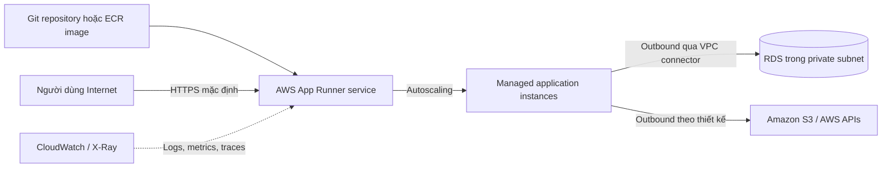
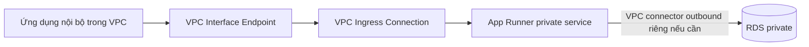
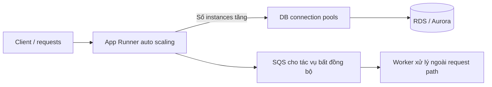
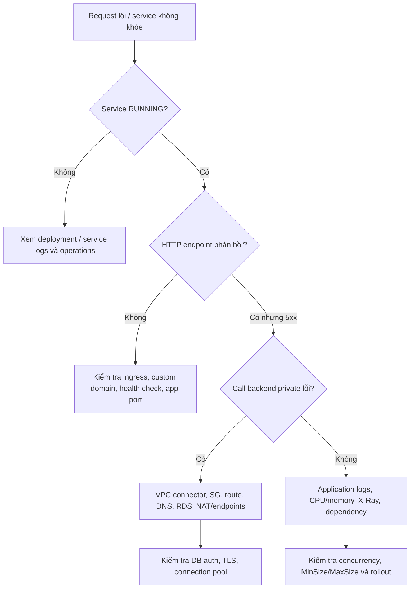

# App Runner VPC connector, autoscaling và observability

## 1. Bối cảnh: chạy web API mà không quản lý máy chủ

Một doanh nghiệp bán lẻ có API nhận đơn hàng được đóng gói thành container. Ứng dụng cần truy cập **Amazon RDS** trong private subnet, tải tệp từ **Amazon S3**, tự tăng số bản sao khi có chiến dịch quảng cáo và cung cấp log/metrics/traces để điều tra lỗi. Nhóm phát triển muốn tập trung vào mã nguồn thay vì tự vận hành EC2 instances, Kubernetes hoặc một hệ thống load balancing phức tạp.

**AWS App Runner** được thiết kế để triển khai web application và HTTP API từ source code hoặc container image, tự cung cấp HTTPS endpoint, cân bằng request và điều chỉnh số instance theo tải. Nhưng **serverless/managed không đồng nghĩa không cần thiết kế VPC, IAM, scalability và observability**. Chẳng hạn:

- App Runner API có URL công khai nhưng **không kết nối được tới RDS private endpoint** nếu chưa cấu hình egress phù hợp.
- Bật VPC connector để gọi RDS nhưng lại **mất đường gọi API công khai** do VPC không có NAT Gateway/VPC endpoints.
- Lưu session trong RAM của một instance; khi App Runner scale out, người dùng thấy các phiên không nhất quán.
- HTTP request trả lỗi 500, nhưng chỉ nhìn trạng thái dịch vụ `RUNNING` nên nhóm vận hành không biết ứng dụng đang thất bại.

Bài này thuộc chương **Nền tảng ứng dụng quản lý** của lộ trình **CLOUD_PROVIDERS_AWS**: khám phá hệ sinh thái AWS qua Region/AZ, IAM, VPC, compute, storage, database, tích hợp và serverless, đồng thời rèn khả năng chọn dịch vụ, triển khai an toàn, giám sát, phục hồi và quản lý chi phí. Trọng tâm là **App Runner VPC connector, autoscaling và observability**, minh họa qua một API kết nối database.

> **Lưu ý tình trạng dịch vụ (cập nhật năm 2026):** AWS **đóng App Runner đối với khách hàng mới từ ngày 30/04/2026**. Những khách hàng đã sử dụng App Runner vẫn có thể vận hành dịch vụ và tạo tài nguyên mới; AWS tiếp tục hỗ trợ bảo mật và tính sẵn sàng nhưng không dự kiến phát triển tính năng mới. Với tài khoản chưa từng dùng App Runner hoặc dự án mới cần nền tảng tương tự, **AWS khuyến nghị Amazon ECS Express Mode**. Bài học vẫn hữu ích cho vận hành, tối ưu và chuyển đổi hệ thống App Runner hiện hữu. Nguồn: [AWS App Runner availability change](https://docs.aws.amazon.com/apprunner/latest/dg/apprunner-availability-change.html).

Sau bài học, bạn có thể:

- Phân biệt **outbound VPC connector** với **private inbound endpoint/VPC ingress connection**.
- Thiết kế subnets, security groups, NAT Gateway/VPC endpoints, IAM và truy cập database an toàn.
- Giải thích các tham số **MaxConcurrency, MinSize, MaxSize**, đặc điểm instance chủ động và instance dự phòng.
- Thiết lập CloudWatch metrics/logs, X-Ray tracing, EventBridge và health checks.
- Chẩn đoán lỗi kết nối RDS, lỗi scaling, HTTP 5xx, deployment và cold-start connector.
- So sánh chi phí, xác định SLO, xây dựng runbook và chọn lộ trình tới ECS Express Mode.

## 2. App Runner quản lý gì và nhóm ứng dụng còn chịu trách nhiệm gì?

App Runner cung cấp một lớp triển khai cao hơn ECS/EKS: người dùng chỉ định **source repository hoặc container image**, cổng ứng dụng, tài nguyên CPU/memory, các biến cấu hình, IAM role, autoscaling và networking. Dịch vụ triển khai web process, cung cấp endpoint và hỗ trợ cân bằng tải khi tăng/giảm số instance.



### 2.1. Phân chia trách nhiệm

| Thành phần | App Runner quản lý | Đội ứng dụng/đội cloud quản lý |
| --- | --- | --- |
| Năng lực compute cho service | Cấp và thay thế application instances | CPU/memory chọn, cấu trúc ứng dụng, trạng thái và hiệu năng |
| HTTP endpoint | URL mặc định, TLS và đường inbound của App Runner | Custom domain, ứng dụng, xác thực người dùng, kiểm thử endpoint |
| Code/image deployment | Build từ source hoặc dùng image, điều phối release | Chất lượng code/image, dependency, secrets, cấu hình và rollback |
| Autoscaling | Điều chỉnh số instance theo cấu hình | Concurrency target, Min/Max, connection pools, SLO và load testing |
| Mạng outbound | Cung cấp cơ chế VPC connector | Private subnets, security groups, NAT/endpoints, DNS, database connectivity |
| Quan sát | Đẩy service/application logs và metrics | Structured logging, tracing instrumentation, alarms, runbooks, retention |
| Dữ liệu | Không tự sao lưu database/file ứng dụng | RDS/S3, backup, encryption, consistency, phục hồi |

**App Runner không phải EKS control plane**, và không cho phép quản lý EC2 worker host như ECS trên EC2. Nếu cần nhiều container/process chuyên biệt, GPU, custom host networking, job scheduling phức tạp hoặc quyền điều khiển tài nguyên Kubernetes, phải đánh giá ECS/EKS hoặc giải pháp khác.

### 2.2. Những tài nguyên App Runner liên quan

| Resource/API concept | Chức năng |
| --- | --- |
| **Service** | Web application/API có source, runtime, IAM, network, autoscaling và URL |
| **VPC connector** | Cấu hình **đường đi outbound** từ mã ứng dụng đến VPC |
| **VPC ingress connection** | Liên kết một App Runner service với VPC interface endpoint phục vụ **private incoming traffic** |
| **Auto scaling configuration** | Tài nguyên dùng chung có revision với MaxConcurrency/MinSize/MaxSize |
| **Observability configuration** | Tài nguyên dùng chung có revision; hỗ trợ bật tracing |
| **Access role** | Quyền App Runner lấy image từ **private ECR** |
| **Instance role** | Quyền mã ứng dụng gọi **AWS APIs** như S3, DynamoDB, Secrets Manager |

Các loại resource này **không thay thế nhau**: cho ứng dụng quyền `rds-db:connect` chẳng hạn không tự tạo network path tới RDS; gắn VPC connector không tự cấp quyền SDK gọi S3.

## 3. Hai hướng kết nối mạng: inbound và outbound

Sai lầm phổ biến là nghĩ rằng gắn App Runner vào VPC đồng nghĩa dịch vụ chỉ còn truy cập được nội bộ. App Runner có hai thiết lập **độc lập**:

| Hướng | Cấu hình | Tác động | Không tự làm gì? |
| --- | --- | --- | --- |
| **Inbound (đi vào service)** | Public endpoint hoặc private endpoint + **VPC ingress connection** | Quyết định client từ Internet hay từ VPC được gọi URL service | Không quyết định đường ứng dụng gọi RDS/S3 |
| **Outbound (đi từ app ra ngoài)** | Public access mặc định hoặc **VPC connector** | Quyết định đường kết nối của **application-generated traffic** tới backend | Không biến một public App Runner endpoint thành private endpoint |

### 3.1. Mặc định: inbound public, outbound public

Nếu tạo service mà không cấu hình private ingress hoặc VPC connector, App Runner cung cấp đường inbound công khai qua URL do dịch vụ cấp; mã ứng dụng có thể gọi các public endpoints theo mạng mặc định của App Runner. RDS **không public** trong private subnet thường không thể truy cập chỉ nhờ một DNS hostname.

### 3.2. VPC connector chỉ phục vụ outbound

Nếu App Runner service vẫn dùng **public incoming endpoint** nhưng gắn **VPC connector**:

```text
Người dùng Internet ---HTTPS---> Public App Runner URL
                                     |
                                     v
                               App code chạy
                                     |
                             outbound qua VPC connector
                                     |
                   +-----------------+-----------------+
                   |                                   |
                   v                                   v
              RDS private                       NAT / VPC endpoints
                                               (nếu cần public APIs)
```

**Đường request từ Internet đến App Runner vẫn do App Runner quản lý và không đi qua VPC connector.** Cấu hình chỉ định private subnets/security groups cho connector **không tự khóa truy cập từ Internet**.

### 3.3. Private inbound là một tính năng khác

Nếu yêu cầu API chỉ có thể được gọi từ mạng nội bộ, bạn phải chọn **private endpoint** cho incoming traffic. App Runner sử dụng một **VPC interface endpoint (AWS PrivateLink)** và **VPC ingress connection** để liên kết App Runner service với VPC.



Private inbound cũng không tự tạo VPC connector outbound. Một service có thể cần **cả hai** nếu client nội bộ gọi API và API phải gọi RDS. Interface endpoint có **phí theo giờ và dữ liệu xử lý** theo AWS PrivateLink; phải kiểm soát endpoint security group, private DNS và khả năng truy cập từ các VPC/mạng kết nối.

## 4. VPC connector và AWS Hyperplane ENIs

VPC connector là resource App Runner tham chiếu đến **những subnet và security group trong một VPC**. Khi được service sử dụng, App Runner thiết lập **Hyperplane ENIs** trong các subnet đó để ứng dụng gửi traffic đi vào VPC.

### 4.1. Vì sao dùng Hyperplane ENI?

Hyperplane là công nghệ mạng do AWS quản lý cho phép nhiều phiên/instances chia sẻ đường kết nối theo subnet-security-group configuration. Khi App Runner tăng số ứng dụng instances, **không có quan hệ cố định “một App Runner instance = một ENI trong subnet của bạn”**. Điều này giúp giảm lượng địa chỉ IP phải dùng so với mô hình cấp ENI riêng cho mỗi container.

Một **VPC connector có thể được nhiều App Runner services tái sử dụng** khi security groups/subnets phù hợp và hai service có cùng yêu cầu mạng. Tuy nhiên, chia sẻ connector cũng đồng nghĩa chia sẻ một phần cấu hình quyền outbound; không dùng chung nếu cần phân đoạn mạng ở mức service khác nhau.

### 4.2. Chọn private subnets đúng

AWS khuyến nghị chọn **private subnets** ở ít nhất **ba Availability Zones** khi Region có đủ AZ được hỗ trợ; nếu Region có ít hơn, dùng tất cả AZ được hỗ trợ phù hợp. Những subnets phải thuộc **cùng một VPC** và có cùng IP address type (IPv4 hoặc dual-stack theo phạm vi hỗ trợ). Một số AZ ở vài Region không hỗ trợ subnet dành cho App Runner connector, nên phải kiểm tra thông báo khi tạo.

**Không chọn public subnet cho VPC connector.** Hyperplane ENIs do App Runner cấp **chỉ có private IP**, nên một public subnet có default route tới Internet Gateway **không cung cấp public IPv4 cho ENI**. App Runner có thể thất bại khi tạo/cập nhật service nếu dùng public subnet.

| Thành phần | Kiểm tra trước khi tạo connector |
| --- | --- |
| VPC | Đúng Region/account, không chồng CIDR với các mạng phụ thuộc |
| Subnets | Private, thuộc VPC đó, multi-AZ, có IP khả dụng, AZ được hỗ trợ |
| Address type | Các subnets cùng IPv4 hoặc dual-stack theo điều kiện của connector |
| Security group | Cho phép **egress** tới backend được duyệt, ví dụ TCP 5432 |
| Route table | Route phù hợp tới database, NAT Gateway hoặc VPC endpoints |
| DNS | Resolve được RDS endpoint/private hosted zone theo cấu hình VPC |

### 4.3. Độ trễ tạo connector lần đầu

AWS mô tả việc khởi tạo Hyperplane ENIs cho một tổ hợp subnet/security-group mới có thể khiến service startup **chậm thêm khoảng 2–5 phút một lần**. Khi tái sử dụng cùng cấu hình VPC connector, bước chuẩn bị ban đầu này thường không lặp lại. Đây là **độ trễ khởi tạo network integration**, **không phải** thời gian mọi request đều chậm thêm vài phút.

Một service mới chưa `RUNNING` ngay sau khi gắn connector không nhất thiết lỗi; theo dõi service operation/health và thông báo thiếu subnet, SG, IP hoặc AZ. Không nhầm với cold-start của mã ứng dụng khi tải tăng.

## 5. Egress từ VPC connector đến RDS, S3 và Internet

Khi một App Runner service bật **custom VPC egress**, **application-generated outbound traffic** đi qua VPC theo route/security policy. Ứng dụng sẽ **không mặc nhiên có đường ra public Internet hoặc các public AWS APIs**. Để giao tiếp với public endpoint hoặc một số AWS APIs, phải chuẩn bị NAT Gateway hoặc VPC endpoints thích hợp.

### 5.1. Kết nối tới RDS trong private subnet

Giả sử:

```text
VPC: 10.20.0.0/16
Connector subnets: private AZ A/B/C
Connector security group: sg-app-outbound
RDS PostgreSQL endpoint: orders-db.xxxx.ap-southeast-1.rds.amazonaws.com
RDS security group: sg-rds
RDS port: TCP 5432
```

Cấu hình tối thiểu ở tầng mạng:

1. Connector SG cho phép **outbound TCP 5432** đến database/SG hoặc CIDR đích theo quy tắc SG phù hợp.
2. RDS SG cho phép **inbound TCP 5432 từ SG của VPC connector**. Không mở 5432 cho `0.0.0.0/0` chỉ để thử.
3. RDS private endpoint phải phân giải được; VPC DNS và route table/NACL không chặn.
4. Ứng dụng dùng TLS kết nối PostgreSQL khi phù hợp, lấy credentials từ Secrets Manager/IAM database authentication theo kiến trúc và **không hardcode password**.
5. VPC/Subnet/SG thuộc cùng phạm vi mạng hợp lệ; với database khác VPC, cần VPC peering, Transit Gateway, PrivateLink hoặc giải pháp được hỗ trợ cùng routing/policy thích hợp.

**VPC connector không chạy RDS trong chính subnet đã chọn.** Nó cung cấp đường egress từ ứng dụng đến những IP có thể reach qua VPC. Truy cập RDS vẫn cần quyền database và kiểm soát network.

### 5.2. Gọi S3, Secrets Manager hoặc AWS API

Sau khi bật VPC connector, một API vốn đọc S3 qua endpoint công khai có thể bắt đầu timeout nếu VPC chưa có đường egress. Có hai nhóm giải pháp:

- **NAT Gateway:** private subnet route tới NAT trong public subnet có Internet Gateway để gọi public endpoints; phát sinh phí NAT theo thời gian/data processing và có thể thêm phí truyền qua AZ.
- **VPC endpoints:** với dịch vụ hỗ trợ, ví dụ **S3 Gateway endpoint** cho route table hoặc **interface endpoints** cho Secrets Manager, CloudWatch Logs và nhiều AWS APIs; traffic có thể đi riêng trong mạng AWS, phụ thuộc endpoint policy, security group và private DNS.

S3 Gateway endpoint có quan hệ **route table và Region** cụ thể; không dùng nó như giải pháp chung cho mọi dịch vụ AWS. Interface endpoints có phí theo giờ và data processing, nên so tổng chi phí trước khi tạo endpoint cho rất nhiều services.

### 5.3. App Runner management traffic không đi qua connector

AWS phân biệt lưu lượng do **ứng dụng** phát ra với lưu lượng mà **App Runner quản lý**. Các thao tác App Runner thực hiện thay bạn, ví dụ **pull source/image, push service logs, retrieve secrets theo cơ chế nền tảng**, **không chạy qua VPC connector**. Vì vậy:

- Việc image được kéo thành công **không chứng minh ứng dụng có đường egress tới Internet**.
- Service có log App Runner bình thường **không chứng minh SDK bên trong code gọi S3/Secrets Manager qua VPC thành công**.
- Nếu **mã ứng dụng tự gọi Secrets Manager/S3**, đó là application outbound traffic và cần đường NAT/endpoint phù hợp sau khi bật connector.

Đây là phân biệt quan trọng khi điều tra trường hợp “deploy thành công nhưng request nào gọi database cũng lỗi”.

## 6. Ví dụ tạo VPC connector bằng AWS CLI

**Các lệnh ghi sau chỉ dành cho khách hàng App Runner hiện hữu có quyền sử dụng dịch vụ.** Mọi ID/ARN đều là placeholder, không chạy trực tiếp trên production khi chưa có phê duyệt và kế hoạch rollback.

### 6.1. Preflight bằng các lệnh đọc

```bash
# Xác nhận tài khoản và quyền AWS CLI hiện hành
aws sts get-caller-identity

# Liệt kê App Runner services hiện có
aws apprunner list-services --region ap-southeast-1

# Kiểm tra subnets và Availability Zones
aws ec2 describe-subnets \
  --subnet-ids subnet-11111111111111111 subnet-22222222222222222 \
  --region ap-southeast-1 \
  --query 'Subnets[*].[SubnetId,VpcId,AvailabilityZone,CidrBlock,AvailableIpAddressCount]'

# Xem những VPC connectors đã có để cân nhắc reuse
aws apprunner list-vpc-connectors --region ap-southeast-1
```

Những lệnh này cần IAM permissions tương ứng và không thay đổi tài nguyên. Trong production, hãy kiểm tra **route table association, private/public subnet, SG outbound và subnet support** trước khi tạo connector; chỉ nhìn tên subnet có chữ “private” là chưa đủ.

### 6.2. Tạo một connector

Giả sử bạn có ba private subnets (thuộc các AZ được hỗ trợ), SG `sg-0123456789abcdef0` chỉ cho phép outbound thích hợp. Tạo connector:

```bash
aws apprunner create-vpc-connector \
  --vpc-connector-name shop-api-outbound \
  --subnets subnet-11111111111111111 subnet-22222222222222222 subnet-33333333333333333 \
  --security-groups sg-0123456789abcdef0 \
  --region ap-southeast-1
```

Lệnh trả về `VpcConnectorArn` để liên kết vào service. Không tự tạo một ARN bằng cách đoán revision/ID.

```bash
# Kiểm tra trạng thái connector vừa tạo; thay ARN thật từ response
aws apprunner describe-vpc-connector \
  --vpc-connector-arn 'arn:aws:apprunner:ap-southeast-1:111122223333:vpcconnector/shop-api-outbound/1/EXAMPLE' \
  --region ap-southeast-1
```

### 6.3. Liên kết connector vào App Runner service

Lưu file `network-configuration.json` (sử dụng ARN **thật**):

```json
{
  "EgressConfiguration": {
    "EgressType": "VPC",
    "VpcConnectorArn": "arn:aws:apprunner:ap-southeast-1:111122223333:vpcconnector/shop-api-outbound/1/EXAMPLE"
  },
  "IngressConfiguration": {
    "IsPubliclyAccessible": true
  },
  "IpAddressType": "IPV4"
}
```

Ví dụ trên **giữ incoming public** để minh họa rằng outbound connector **không làm service private**. Nếu service đang có private ingress hoặc dual-stack, bạn phải **giữ cấu hình phù hợp hiện tại**, không sao chép `true/IPV4` rồi vô tình thay đổi endpoint/khả năng truy cập.

```bash
# Xem cấu hình service trước khi thay đổi
aws apprunner describe-service \
  --service-arn 'arn:aws:apprunner:ap-southeast-1:111122223333:service/shop-api/EXAMPLE' \
  --region ap-southeast-1 \
  --query 'Service.NetworkConfiguration'

# Ghi cấu hình: chỉ chạy sau khi review và thay placeholder
aws apprunner update-service \
  --service-arn 'arn:aws:apprunner:ap-southeast-1:111122223333:service/shop-api/EXAMPLE' \
  --network-configuration file://network-configuration.json \
  --region ap-southeast-1
```

Sau update, theo dõi `describe-service`, `list-operations` và thực hiện request thật tới một route cần đọc RDS. **Chỉ trạng thái connector `ACTIVE` không chứng minh đã cấu hình đúng SG, port, DNS và DB credentials.**

## 7. App Runner autoscaling: concurrency, MinSize và MaxSize

Autoscaling của App Runner tập trung vào số **HTTP requests đồng thời** mà instances xử lý, chứ không phải cơ chế tự tăng EC2 worker nodes do bạn quản lý. Một **auto scaling configuration** có ba tham số chính:

| Tham số | Ý nghĩa | Mặc định API AWS được tài liệu hóa |
| --- | --- | ---: |
| **MaxConcurrency** | Ngưỡng concurrent HTTP requests mà mỗi instance xử lý; vượt ngưỡng, App Runner có thể scale out | **100** |
| **MinSize** | Số **provisioned instances tối thiểu** cần được giữ sẵn | **1** |
| **MaxSize** | Số application instances tối đa có thể active xử lý request | **25** |

Đây là giá trị mặc định được tài liệu AWS API công bố, **không phải khuyến nghị cấu hình cho mọi ứng dụng**. Quota/limits và khả năng hỗ trợ có thể thay đổi theo account/Region và cấu hình CPU/memory. Kiểm tra tài liệu hiện hành trước khi triển khai.

### 7.1. Active instance và provisioned instance

**Active instance** đang xử lý request, sử dụng CPU và RAM; **provisioned inactive instance** là năng lực đã chuẩn bị để có thể được kích hoạt khi tải tăng. Theo mô hình giá App Runner được AWS mô tả, người dùng trả cho **memory của các instances được provision**, và **CPU cho phần instances active** theo quy tắc tính phí dịch vụ.

```text
MinSize = 3                 MaxSize = 12

Lúc ít traffic:
  [active] [provisioned idle] [provisioned idle]

Lúc traffic tăng:
  [active] [active] [active] ... đến giới hạn MaxSize

Lúc traffic giảm:
  Active capacity co lại theo cơ chế dịch vụ,
  nhưng MinSize provisioned capacity vẫn được duy trì.
```

**MinSize không đồng nghĩa luôn có đúng MinSize requests được xử lý song song.** Nó xác định mức năng lực được chuẩn bị, một phần có thể chưa active. **MaxSize không bảo đảm AWS sẽ cấp đủ instances ngay lập tức** khi nhu cầu tăng: thời gian phản ứng, quota và các giới hạn khác vẫn tồn tại.

### 7.2. MaxConcurrency không phải số user và không phải CPU %

Một request đồng thời là request **đang được xử lý**. Nó không phải số người đã đăng nhập hoặc số request/giây.

Ví dụ định tính:

```text
200 requests/giây, thời gian mỗi request trung bình 0,4 giây
=> Số request đang xử lý trung bình xấp xỉ 200 × 0,4 = 80

Nếu MaxConcurrency = 40:
  Về mặt sức chứa concurrency, cần khoảng 2 instances active
  để chia đều 80 requests đang xử lý.
```

Phép tính dùng ý tưởng của Little's Law và **chỉ là mô hình ước lượng**. Traffic theo burst, phân phối tải, slow queries, queueing, startup và CPU pressure khiến số instance thực tế khác. Nếu đặt MaxConcurrency quá cao, mỗi instance có thể nhận quá nhiều request, tăng p95/p99 latency hoặc memory. Nếu đặt quá thấp, dịch vụ có thể scale nhiều hơn cần thiết, tạo nhiều kết nối RDS và tăng chi phí.

### 7.3. MinSize và MaxSize ảnh hưởng sự sẵn sàng

- **MinSize thấp:** tiết kiệm memory provisioned nhưng có thể cần thời gian kích hoạt thêm capacity khi traffic tăng.
- **MinSize cao:** có thêm headroom cho tải hoặc thay thế, nhưng chi phí nền có thể tăng.
- **MaxSize thấp:** dễ kiểm soát chi phí/connection count, nhưng nếu đạt ngưỡng khi traffic cao, ứng dụng có thể tăng độ trễ/lỗi vì không scale thêm.
- **MaxSize cao:** cho phép scale out lớn, nhưng backend như RDS, Redis, external API cũng phải đủ capacity.

Một API cần RDS có `max_connections` giới hạn không nên cấu hình App Runner `MaxSize=100` và mỗi instance tự tạo pool 100 connections mà không tính tổng: trong đỉnh tải, **10.000 kết nối** có thể làm database kiệt sức ngay cả khi App Runner còn khỏe.

## 8. Tạo và liên kết auto scaling configuration

### 8.1. Một cấu hình minh họa

Giả sử ứng dụng HTTP API stateless có p95 dưới 300 ms, mức nền cần 2 instances dự phòng và giới hạn 10 instances để không tạo quá nhiều kết nối database:

```bash
aws apprunner create-auto-scaling-configuration \
  --auto-scaling-configuration-name shop-api-autoscaling \
  --max-concurrency 40 \
  --min-size 2 \
  --max-size 10 \
  --region ap-southeast-1
```

Nhận `AutoScalingConfigurationArn` từ response. Những con số trên là **giả định để học**, phải load test và kiểm tra quota/cost. Một cấu hình có thể dùng chung giữa nhiều services; tạo lại cùng tên có thể sinh **revision mới**. Không nên sửa dùng chung nếu chưa xác định các service phụ thuộc và ARN revision đang được gán.

### 8.2. Gán cho một service hiện hữu

```bash
aws apprunner update-service \
  --service-arn 'arn:aws:apprunner:ap-southeast-1:111122223333:service/shop-api/EXAMPLE' \
  --auto-scaling-configuration-arn 'arn:aws:apprunner:ap-southeast-1:111122223333:autoscalingconfiguration/shop-api-autoscaling/1/EXAMPLE' \
  --region ap-southeast-1
```

Đây là thay đổi cấu hình service **bất đồng bộ**; theo dõi operation và đọc lại service. Với revision, dùng ARN **thật** để tránh vô tình chọn phiên bản mới nhất mà chưa kiểm thử.

### 8.3. Khi nào cần tăng CPU/memory thay vì chỉ autoscale?

App Runner có **instance configuration** cho vCPU/memory. Autoscaling theo concurrency giúp tăng số instances khi requests tăng; nó **không tự thay cấu hình CPU/memory của một instance**. Nếu một request tốn nhiều RAM, mã ứng dụng bị memory pressure hoặc xử lý CPU nặng, giảm MaxConcurrency/tăng instances có thể giúp phân tán tải nhưng cũng có thể cần **điều chỉnh instance size hoặc tối ưu thuật toán**.

Để quyết định đúng, quan sát **CPUUtilization, MemoryUtilization, Concurrency, RequestLatency và 5xxStatusResponses** cùng lúc. Một request chậm vì database truy vấn kém không được chữa triệt để chỉ bằng thêm instances.

## 9. Thiết kế ứng dụng để scaling không làm hỏng dữ liệu

### 9.1. Stateless HTTP handlers

Ứng dụng App Runner nên **stateless theo từng instance**:

- Không lưu session đăng nhập chỉ trong RAM local của một instance; dùng session store bên ngoài hoặc token với cơ chế thu hồi phù hợp.
- Không lưu object upload duy nhất vào filesystem local; đưa dữ liệu bền vững vào S3 hoặc storage được hỗ trợ.
- Với yêu cầu retry, dùng **idempotency key**, transaction/conditional updates; request có thể được client gửi lại sau timeout.
- Dùng database connection pool có giới hạn và timeout; không tạo một pool cực lớn ở mỗi instance.
- Đặt timeout hợp lý khi gọi downstream, chống retry storm và xử lý backpressure.

### 9.2. Năng lực backend phải theo kịp frontend



Nếu RDS đang ở giới hạn connections, App Runner có thể tăng số instance và **làm nghẽn database nghiêm trọng hơn**. Cân nhắc **RDS Proxy** cho những workload phù hợp, giới hạn connection pool per instance, caching và tách công việc lâu thành queue/workers dùng ECS/Fargate/Lambda/AWS Batch khi phù hợp.

### 9.3. Horizontal scaling không thay thế multi-Region DR

App Runner có thể duy trì và thay thế instances trong phạm vi dịch vụ/Region, nhưng **không tự đồng bộ database hay tạo vùng dự phòng khác**. Một cấu hình MinSize=3 chỉ đảm bảo mức provisioned capacity theo dịch vụ, không có nghĩa ứng dụng chống được mọi lỗi RDS hoặc sự cố toàn Region.

Với hệ thống quan trọng, cần thêm chiến lược backup/restore, RDS HA, kiểm thử Region failover theo RTO/RPO và cách chuyển DNS/traffic.

## 10. App Runner observability: logs, metrics, traces và events

**Observability** trả lời ba câu hỏi khác nhau:

1. **Metrics:** hệ thống lỗi/độ trễ tăng bao nhiêu, vào thời điểm nào?
2. **Logs:** request, container hoặc deployment đã xảy ra điều gì?
3. **Traces:** request mất thời gian ở App Runner, database hay downstream HTTP API nào?

App Runner tích hợp **Amazon CloudWatch**, **AWS X-Ray**, **Amazon EventBridge** và **AWS CloudTrail**. Một dashboard tốt cần cả dấu hiệu hạ tầng lẫn **SLO của người dùng**.

### 10.1. CloudWatch metrics trong namespace `AWS/AppRunner`

| Metric | Cấp độ | Cách sử dụng |
| --- | --- | --- |
| `Requests` | Service | Tổng request HTTP trong khoảng đo |
| `2xxStatusResponses` | Service | Số response 2xx, kiểm tra traffic thành công |
| `4xxStatusResponses` | Service | Số response 4xx; cần tách lỗi client, auth và route |
| `5xxStatusResponses` | Service | Lỗi server; tính error rate và cảnh báo |
| `RequestLatency` | Service | Độ trễ xử lý HTTP request (ms), theo thống kê phù hợp |
| `Concurrency` | Service | Số concurrent requests xấp xỉ đang xử lý |
| `ActiveInstances` | Service | Số instances đang xử lý requests |
| `CPUUtilization` | Service và instance | Phần trăm CPU so với cấu hình đã dành |
| `MemoryUtilization` | Service và instance | Phần trăm memory so với cấu hình đã dành |

**Lưu ý:** `ActiveInstances=0` khi **không có requests** không đồng nghĩa service đã bị xóa hoặc không còn bất kỳ provisioned instances nào. Con số này khác `MinSize` và không nên dùng một mình để kết luận khả năng phục vụ.

Một số chỉ số có nhiều dimension (service/instance). Khi tạo CloudWatch alarm hoặc API query, phải chọn dimension và statistic đúng; không tự cộng Average hoặc lấy ngưỡng CPU theo MB như hướng dẫn cũ. AWS hiện mô tả CPU/Memory utilization theo **phần trăm**.

### 10.2. Những cảnh báo nên đặt

| Cảnh báo | Công thức/tín hiệu gợi ý | Ý nghĩa |
| --- | --- | --- |
| 5xx error rate tăng | `5xxStatusResponses / Requests` khi request count đủ lớn | Phát hiện lỗi người dùng thật |
| p95/p99 RequestLatency tăng | CloudWatch statistics và application latency | Backend/network có thể đang chậm |
| Concurrency gần ngưỡng vận hành | `Concurrency` kết hợp `ActiveInstances` và cấu hình MaxSize | Nguy cơ không còn headroom |
| CPU/MemoryUtilization cao kéo dài | Tín hiệu theo service/instance | Cần right sizing, điều chỉnh concurrency hoặc tối ưu code |
| Deployment thất bại | App Runner service events/EventBridge | Cần rollback/điều tra image, health |
| Database connections / latency tăng | CloudWatch RDS + app tracing | Autoscaling đang gây sức ép tới DB |

**Không đặt một ngưỡng cho mọi service.** Với API thanh toán, 5xx tăng 1% trong vài phút có thể nghiêm trọng; với endpoint thử nghiệm có ít traffic, mẫu vài request không đủ để kết luận. Nên có cả **synthetic request** và error budget/SLO cụ thể.

## 11. CloudWatch Logs: phân biệt service logs và application logs

App Runner phát ra hai nhóm log quan trọng cho mỗi service:

| Nhóm | Ví dụ đường dẫn | Nội dung |
| --- | --- | --- |
| **Service logs** | `/aws/apprunner/<service-name>/<service-id>/service` | Lifecycle events và deployment/build operations |
| **Application logs** | `/aws/apprunner/<service-name>/<service-id>/application` | Output của mã ứng dụng, tách stream theo instance |

**Service logs** giúp chẩn đoán tại sao build/deployment không lên `RUNNING`. **Application logs** giúp hiểu lỗi runtime, DB timeout, exception, request và latency do ứng dụng ghi. App Runner console có thể hiển thị log tổng hợp, còn CloudWatch cho phép xem stream của từng instance.

### 11.1. Structured logging

Ví dụ một log JSON minh họa (không log access token/password):

```json
{
  "timestamp": "2026-11-20T08:15:00Z",
  "level": "ERROR",
  "service": "shop-api",
  "route": "POST /orders",
  "requestId": "req-abc123",
  "status": 503,
  "durationMs": 1650,
  "errorCode": "DB_CONNECTION_TIMEOUT"
}
```

Ghi `requestId`/trace ID để nối metrics ↔ logs ↔ traces. Không log **Authorization headers, session cookies, DB passwords, payment card data, PII** hoặc toàn bộ request body tùy tiện. Cấu hình CloudWatch Logs retention, IAM read access và kiểm soát chi phí ingestion/storage.

### 11.2. AWS CLI đọc log

Sau khi đã biết tên service, service ID và Region:

```bash
# Liệt kê log groups liên quan
aws logs describe-log-groups \
  --log-group-name-prefix '/aws/apprunner/shop-api/' \
  --region ap-southeast-1

# Thay service ID thật nhận được từ console/API
aws logs tail '/aws/apprunner/shop-api/EXAMPLE_SERVICE_ID/application' \
  --since 15m \
  --region ap-southeast-1
```

Nếu đọc `application` logs rỗng nhưng service không khởi chạy được, hãy xem **service/deployment** logs trước. Ngược lại, nếu deployment thành công mà request vẫn lỗi, xem application logs, metrics và traces.

## 12. Distributed tracing với AWS X-Ray

Khi request đi qua App Runner → RDS/HTTP downstream/S3, log từng service đôi khi không đủ để xác định chỗ gây tăng latency. **AWS X-Ray** cùng **AWS Distro for OpenTelemetry (ADOT)** hỗ trợ trace đường đi của request theo điều kiện runtime/instrumentation.

### 12.1. Các bước bật tracing

1. **Instrument ứng dụng** bằng thư viện OpenTelemetry/ADOT phù hợp runtime để tạo spans cho HTTP requests và downstream calls.
2. Tạo **App Runner observability configuration** có `TraceConfiguration.Vendor = AWSXRAY`.
3. Cấp quyền X-Ray phù hợp cho **instance role** của App Runner service, theo hướng dẫn AWS (có thể dùng managed policy `AWSXRayDaemonWriteAccess` nếu phù hợp và được phê duyệt).
4. Gắn observability configuration vào service và đặt `ObservabilityEnabled = true`.
5. Gửi request thực tế, kiểm tra X-Ray/service map, trace sampling và khả năng liên kết request ID.

**Bật observability configuration đơn thuần không đảm bảo nhìn thấy mọi span ứng dụng.** Cần instrument đúng framework, đặt environment/propagator/exporter tương thích và bảo đảm IAM role có quyền. AWS App Runner tracing **mặc định tắt**.

### 12.2. Ví dụ AWS CLI

```bash
aws apprunner create-observability-configuration \
  --observability-configuration-name shop-api-xray \
  --trace-configuration Vendor=AWSXRAY \
  --region ap-southeast-1
```

Lưu `ObservabilityConfigurationArn` được trả về. Ví dụ một file `observability-configuration.json` để gắn lên service:

```json
{
  "ObservabilityEnabled": true,
  "ObservabilityConfigurationArn": "arn:aws:apprunner:ap-southeast-1:111122223333:observabilityconfiguration/shop-api-xray/1/EXAMPLE"
}
```

```bash
aws apprunner update-service \
  --service-arn 'arn:aws:apprunner:ap-southeast-1:111122223333:service/shop-api/EXAMPLE' \
  --observability-configuration file://observability-configuration.json \
  --region ap-southeast-1
```

Mọi ARN là placeholder. Việc update service có thể triển khai cấu hình mới; phải theo dõi service operation và **đảm bảo instance role đã được cấp quyền X-Ray** trước khi thử tracing.

### 12.3. Tracing không thay thế metrics và logs

- Tracing hữu ích khi cần biết request đã mất thời gian ở database, external HTTP API hay xử lý business logic.
- Metrics tốt hơn để quan sát tỷ lệ lỗi và số lượng request trên toàn dịch vụ trong nhiều giờ/ngày.
- Logs cung cấp nội dung exception và thông tin nghiệp vụ có kiểm soát.

Không bật trace sampling 100% trong mọi môi trường chỉ vì muốn có càng nhiều dữ liệu càng tốt: dữ liệu có thể nhạy cảm và phát sinh chi phí. Chọn sampling/retention theo SLO, bảo mật và ngân sách.

## 13. EventBridge, CloudTrail và health checks

### 13.1. EventBridge và CloudTrail

**Amazon EventBridge** có thể nhận những service events App Runner hỗ trợ, giúp kích hoạt cảnh báo/automation khi service thay đổi trạng thái hoặc deployment có vấn đề. **AWS CloudTrail** ghi lại hoạt động App Runner API ở mặt quản trị, giúp trả lời ai đã gọi `UpdateService`, thay đổi cấu hình hoặc xóa resource.

Ví dụ runbook:

```text
Deployment operation thất bại
   -> EventBridge rule nhận service event phù hợp
   -> SNS / notification workflow
   -> Người trực xem App Runner service/deployment logs
   -> Kiểm tra image, health checks, instance settings, VPC connector
   -> Rollback configuration/image nếu cần, xác minh SLO sau sửa
```

EventBridge/CloudTrail không thay thế application logging. Một service có thể `RUNNING` về mặt API nhưng hàng nghìn request 500; CloudWatch metrics và tracing mới thể hiện ảnh hưởng trực tiếp đến người dùng.

### 13.2. TCP và HTTP health checks

App Runner hỗ trợ cấu hình health check:

| Tùy chọn | Ý nghĩa | Nhận xét |
| --- | --- | --- |
| **TCP** | Kiểm tra khả năng mở kết nối đến port ứng dụng | Mặc định; không phát hiện toàn bộ lỗi nghiệp vụ |
| **HTTP** | Gửi HTTP request đến path xác định | Phù hợp route `/health` hoặc readiness check |
| Interval/Timeout | Tần suất và thời gian chờ | Chọn theo startup và latency của ứng dụng |
| Healthy/Unhealthy thresholds | Số lần liên tiếp xác nhận trạng thái | Quá nhạy có thể gây thay instance liên tục |

Ví dụ JSON health check theo API:

```json
{
  "Protocol": "HTTP",
  "Path": "/health",
  "Interval": 10,
  "Timeout": 3,
  "HealthyThreshold": 2,
  "UnhealthyThreshold": 3
}
```

Đường `/health` nên nhẹ, phản ánh khả năng phục vụ theo chính sách nhưng không gây tải phụ thuộc không cần thiết. Nếu health check đòi kết nối RDS mà RDS chập chờn, toàn bộ instances có thể bị đánh dấu unhealthy và restart liên tục. Phân biệt **liveness** của process và **readiness** của application theo thiết kế quan sát phù hợp.

## 14. IAM và bảo mật ứng dụng App Runner

### 14.1. Access role khác instance role

| Vai trò | Chủ thể tin cậy | Quyền phù hợp |
| --- | --- | --- |
| **Access role** | App Runner build/management service khi lấy private ECR image | ECR pull authorization và image read theo quyền tối thiểu |
| **Instance role** | Ứng dụng đang chạy trên App Runner instances | S3/DynamoDB/Secrets Manager/X-Ray và những API app thực sự cần |
| **IAM role của người quản trị/CI** | Người dùng hoặc pipeline đã được xác thực | `apprunner:CreateService`/`UpdateService`, `iam:PassRole` có giới hạn, quản trị resources |

Trust policy ví dụ cho **instance role**:

```json
{
  "Version": "2012-10-17",
  "Statement": [
    {
      "Effect": "Allow",
      "Principal": {
        "Service": "tasks.apprunner.amazonaws.com"
      },
      "Action": "sts:AssumeRole"
    }
  ]
}
```

Trust principal cho **access role ECR** khác instance role; phải dùng mẫu chính thức cho App Runner ECR access, không áp dụng cùng một role cho cả hai chỉ để đơn giản hóa. Tách role giúp giảm phạm vi ảnh hưởng nếu mã ứng dụng bị khai thác.

### 14.2. Secrets, TLS và quyền dữ liệu

- Lưu credentials trong **AWS Secrets Manager** hoặc Systems Manager Parameter Store theo khả năng App Runner hỗ trợ; giới hạn quyền từng secret.
- Ứng dụng gọi RDS nên bật TLS khi có thể, giới hạn SG 5432/3306 và quyền database user; không mở DB public chỉ để dễ kết nối.
- Không cấp `AdministratorAccess` cho App Runner instance role; kiểm tra S3 bucket policies/KMS key policies và SCP khi gặp `AccessDenied`.
- Bảo vệ pipeline/registry, quét image, đặt quy trình deployment/rollback; tránh dùng image tag không kiểm soát trong production.
- Với public inbound, App Runner cung cấp HTTPS termination, nhưng **API authentication/authorization, rate-limiting và bảo vệ nghiệp vụ** vẫn do ứng dụng/kiến trúc edge chịu trách nhiệm. Đánh giá WAF hoặc lớp edge riêng nếu mô hình hỗ trợ.

### 14.3. VPC connector không tự thêm firewall cho ingress

Chỉ đặt VPC connector SG chỉ cho outbound TCP 5432 **không chặn người dùng Internet gọi App Runner public URL**. Nếu ứng dụng là API nội bộ, cấu hình **private inbound endpoint** theo thiết kế. Với API public, xác thực JWT/session, permission checks và kiểm soát chống lạm dụng phải ở tầng ứng dụng/edge.

## 15. Chi phí App Runner và chi phí ẩn của VPC

Chi phí phụ thuộc Region, CPU/memory, trạng thái active/provisioned, thời gian hoạt động và các dịch vụ đi kèm. Trong mô hình App Runner:

```text
Chi phí App Runner (khái niệm)
   ≈ compute của những instances active
     + memory provisioned cho instances theo chính sách MinSize
     + các khoản build/deployment nếu áp dụng theo bảng giá

Chi phí hệ thống đầy đủ
   = App Runner + RDS + NAT/VPC endpoints
     + CloudWatch Logs/metrics + X-Ray + data transfer
     + Secrets Manager/KMS + backups + dịch vụ khác
```

Không giả định “ứng dụng không có request thì tổng chi phí bằng 0”: **MinSize vẫn giữ provisioned memory capacity**, RDS và NAT Gateway vẫn có chi phí nếu đang chạy, và logs/storage/monitoring còn tồn tại có thể tiếp tục tính phí.

### 15.1. Bài tập tính capacity, không dùng giá niêm yết

Giả sử:

- Trung bình 80 concurrent requests, mỗi App Runner instance xử lý mục tiêu 40 concurrent requests.
- Đội vận hành đặt `MinSize=2` và `MaxSize=10`.
- Mỗi instance kết nối RDS bằng pool tối đa 10 connections.

| Thành phần | Tính toán minh họa | Ý nghĩa |
| --- | --- | --- |
| Active instances cần về mặt concurrency | `80 / 40 = 2` | Chưa tính burst, latency variance, headroom |
| Số instances có thể active tối đa | `10` | Theo MaxSize, không phải đảm bảo cấp ngay |
| Kết nối RDS tối đa nếu mọi instance tạo đủ pool | `10 × 10 = 100` | Cần đặt dưới DB connection budget thực tế |
| Capacity nền được provision | `MinSize = 2` | Có chi phí memory provisioned theo mô hình App Runner |

Nếu workload có request chờ RDS lâu, concurrency tăng mà CPU có thể vẫn thấp. Điều này cho thấy **chỉ dùng CPUUtilization** để chọn MaxConcurrency sẽ không phản ánh đủ tải và nguy cơ nghẽn backend.

### 15.2. Chọn NAT hay VPC endpoints

| Phương án | Lợi ích | Đánh đổi |
| --- | --- | --- |
| NAT Gateway | Dễ tạo đường outbound công khai cho nhiều API/endpoints | Phí theo giờ + data processing, cần route/HA theo AZ |
| S3 Gateway endpoint | Truy cập S3 qua VPC khi route/policy hỗ trợ | Chỉ giải quyết S3 và không thay mọi loại endpoint |
| Interface VPC endpoints | Truy cập API AWS được hỗ trợ qua PrivateLink, không cần public Internet cho các API đó | Phí theo endpoint/AZ/data, SG/private DNS và policy |
| Không có NAT/endpoints | Hạn chế external egress | Mã ứng dụng không gọi public APIs được trừ những đường nội bộ sẵn có |

VPC connector dùng Hyperplane ENIs; **việc tồn tại connector không có nghĩa NAT/VPC endpoints miễn phí**. Cần định kỳ tìm connector không còn service sử dụng, NAT không cần thiết, endpoints trùng và CloudWatch log groups giữ quá lâu.

## 16. Chẩn đoán lỗi thường gặp

| Triệu chứng | Giả thuyết chính | Hướng kiểm tra |
| --- | --- | --- |
| App Runner public URL hoạt động nhưng RDS timeout | Chưa có VPC connector hoặc SG/route/DNS sai | Egress configuration, connector subnets/SG, RDS inbound SG |
| Tạo connector xong service không `RUNNING` ngay | Khởi tạo Hyperplane ENI lần đầu, subnet/AZ không được hỗ trợ hoặc lỗi thực tế | Service operations/logs, connector settings; phân biệt delay 2–5 phút với lỗi |
| App gọi S3/Secrets Manager thất bại sau khi gắn connector | VPC không có NAT hoặc VPC endpoints phù hợp | Private subnet route tables, endpoint policy/SG/private DNS, IAM |
| Service vẫn truy cập được từ Internet dù đã chọn private subnet | Connector **chỉ dành cho outbound** | Kiểm tra `IngressConfiguration.IsPubliclyAccessible`; dùng private endpoint nếu cần |
| Truy cập internal API qua private endpoint thất bại | VPC interface endpoint, ingress connection, DNS/SG sai | VPCE status, App Runner VPC ingress connection, endpoint SG |
| HTTP 5xx tăng khi traffic tăng | Concurrency/MaxSize không đủ, app crash hoặc RDS connections hết | Metrics 5xx/Requests/Latency, logs, DB connections |
| CPU thấp nhưng request latency cao | DB query/connection pool/downstream chậm | X-Ray traces, structured logs, RDS metrics |
| `ActiveInstances=0` lúc không có traffic | Không có requests, không có active instances lúc quan sát | Đối chiếu MinSize/provisioned capacity, test endpoint |
| Không thấy X-Ray trace | Chưa instrument ADOT, chưa bật observability hoặc IAM role thiếu quyền | Instance role X-Ray, tracing config, app instrumentation |
| Build/deploy failure nhưng application logs rỗng | Service chưa có running application | Service/deployment log group và service operation |
| Service gặp `AccessDenied` khi gọi S3 | Instance role/bucket/KMS/SCP thiếu quyền | CloudTrail, IAM policy và resource policy |
| API đáp ứng ở dev nhưng lỗi ở production | Secret, DB route/SG, network egress, env vars khác | So diff cấu hình service, IAM, SG, Region |

### 16.1. Sơ đồ chẩn đoán theo tầng



### 16.2. Bộ lệnh quan sát không thay đổi hệ thống

```bash
# Mô tả trạng thái/config của service
aws apprunner describe-service \
  --service-arn 'arn:aws:apprunner:ap-southeast-1:111122223333:service/shop-api/EXAMPLE' \
  --region ap-southeast-1

# Xem các operation gần đây và lỗi deployment
aws apprunner list-operations \
  --service-arn 'arn:aws:apprunner:ap-southeast-1:111122223333:service/shop-api/EXAMPLE' \
  --region ap-southeast-1

# Liệt kê các auto scaling configurations
aws apprunner list-auto-scaling-configurations \
  --region ap-southeast-1

# Liệt kê observability configurations
aws apprunner list-observability-configurations \
  --region ap-southeast-1
```

Để tìm nguyên nhân cụ thể, kết hợp AWS API, CloudWatch logs/metrics, RDS telemetry, VPC Flow Logs (trong phạm vi traffic quan sát được) và application logs. Không xuất đầy đủ environment/secrets ra chat/log như cách “debug cho nhanh”.

## 17. Vận hành production và quy trình thay đổi có kiểm soát

### 17.1. Trước thay đổi

1. Ghi nhận service ARN, Region/account, source image revision, runtime instance settings.
2. Export cấu hình network, autoscaling và observability hiện tại; xác định ARN/revision của resources dùng chung.
3. Đối chiếu IAM access/instance roles, database SG, VPC route tables, NAT/endpoints và DNS.
4. Ghi lại baseline `Requests`, p95 latency, error rate, concurrency, instances, RDS connections và chi phí.
5. Xác định điều kiện rollback và các bên chịu trách nhiệm khi một dependency bị ảnh hưởng.

### 17.2. Triển khai theo từng thay đổi nhỏ

- Đầu tiên tạo VPC connector và thử truy cập RDS trong môi trường tương tự production.
- Sau đó thay đổi egress configuration, xác minh application vẫn có đường gọi AWS APIs cần thiết.
- Tiếp theo thử điều chỉnh MaxConcurrency/MinSize/MaxSize bằng load test, quan sát RDS.
- Cuối cùng bật tracing/alarms, kiểm tra request IDs và chi phí bổ sung.

**Không đổi đồng thời SG, ingress, egress, autoscaling và app image trong một lần thử**, vì khi lỗi xảy ra sẽ rất khó xác định biến nào gây ảnh hưởng.

### 17.3. Sau thay đổi

Kiểm tra `describe-service`/operations, gửi synthetic HTTP requests, xác nhận RDS query, S3 access, health check, CloudWatch log output, 5xx/latency và X-Ray. Theo dõi trong các khoảng tải đại diện, không chỉ năm phút đầu. Nếu cần rollback, khôi phục **cấu hình và image revision phù hợp** rồi xác minh dữ liệu/traffic.

## 18. Hướng đi từ App Runner sang Amazon ECS Express Mode

Theo thông báo AWS năm 2026, **App Runner không còn mở cho khách hàng mới**; các dịch vụ hiện hữu vẫn được hỗ trợ. AWS khuyến nghị **Amazon ECS Express Mode** cho khách hàng mới và các hệ thống cân nhắc di chuyển.

**ECS Express Mode** sử dụng container image để tạo và quản lý một stack **Amazon ECS trên AWS Fargate**, **Application Load Balancer**, auto scaling và networking trong tài khoản AWS. Trải nghiệm triển khai đơn giản tương tự App Runner, nhưng cơ chế/cấu hình và resource ownership thuộc ECS/Fargate/ALB thay vì App Runner.

| Khía cạnh | App Runner hiện hữu | ECS Express Mode |
| --- | --- | --- |
| Trạng thái khách hàng mới năm 2026 | Không nhận khách hàng mới sau 30/04/2026 | Hướng AWS khuyến nghị cho triển khai mới |
| Đầu vào | Source code hoặc container image theo hỗ trợ | Container image |
| Runtime | App Runner managed application instances | Amazon ECS service trên AWS Fargate |
| HTTP endpoint / cân bằng tải | App Runner URL và managed routing | ALB và endpoint theo ECS Express Mode |
| Auto scaling | App Runner MaxConcurrency/MinSize/MaxSize | Cơ chế scaling thuộc ECS/Fargate/ALB được Express Mode cấu hình |
| Networking | VPC connector egress, private endpoint ingress | VPC/subnets/SG và các tài nguyên networking của ECS |
| Observability | App Runner Logs/Metrics/X-Ray | ECS/ALB/CloudWatch/X-Ray theo thiết kế Express Mode |
| Di chuyển | Cần migration plan | Tạo service mới, kiểm tra và chuyển traffic |

### 18.1. Checklist migration

1. **Inventory:** source image/code, service env/secrets, custom domain, network connector, ingress mode, IAM, scaling, logs, tracing và dependency.
2. **Chuẩn hóa image:** nếu App Runner build trực tiếp từ source code, thêm CI build Docker image và push ECR; gắn digest/version được kiểm soát.
3. **Tạo Express Mode service:** chuẩn bị image, IAM roles và các yêu cầu VPC/ALB; dùng tài liệu/CLI chính thức thay vì giả định schema App Runner áp dụng cho ECS.
4. **Mapping network:** thay App Runner egress connector bằng ECS task networking, subnet, SG và NAT/endpoints; thay private App Runner ingress bằng ALB/internal networking tương thích nếu cần.
5. **Mapping scaling:** chuyển MaxConcurrency/MinSize/MaxSize thành mục tiêu ECS capacity/scaling thích hợp **dựa trên load test**, không sao chép số liệu 1:1.
6. **Mapping observability:** tạo dashboard/error rate/log routing/traces theo ECS/ALB; giữ correlation IDs và SLO chung.
7. **Data and failover:** giữ database/secret compatibility, kiểm thử requests thực và session; chuẩn bị rollback.
8. **Traffic cutover:** nếu đã có custom domain, chuyển dần bằng DNS/routing theo khả năng hỗ trợ và kiểm tra TTL/cache. Nếu chỉ dùng App Runner default URL, ECS Express Mode có endpoint mới; cần cập nhật client hoặc tạo hostname thống nhất.

**Không xóa App Runner service cũ trước khi kiểm chứng hệ thống mới đạt SLO và dữ liệu nhất quán.** Khi di chuyển API chứa giao dịch, duy trì một chính sách writer/transaction nhất quán để tránh duplicate writes trong giai đoạn chạy song song.

## 19. Tình huống ứng dụng

### Tình huống A — API kết nối PostgreSQL private

Ứng dụng App Runner có public endpoint và muốn gọi RDS PostgreSQL ở subnet riêng. Nhóm đã thêm IAM role nhưng vẫn timeout TCP.

**Cách giải:** tạo **VPC connector** tới các private subnets được hỗ trợ, SG outbound TCP 5432 và cho inbound TCP 5432 tại RDS SG từ connector SG. Kiểm tra RDS DNS, TLS và DB credentials. Nếu API còn phải gọi public payment gateway, thêm **NAT Gateway** qua subnet route phù hợp; không đặt connector vào public subnet để lấy Internet egress. Kiểm chứng bằng request thật và application logs.

### Tình huống B — Đỉnh tải gấp 20 lần làm RDS hết kết nối

App Runner tự tăng instances trong chiến dịch sale nhưng mỗi instance tạo database pool quá lớn. HTTP 5xx tăng mặc dù CPU/MemoryUtilization không cao.

**Cách giải:** đối chiếu `Concurrency`, `ActiveInstances`, `5xxStatusResponses` và RDS `DatabaseConnections`. Giới hạn pool mỗi instance, đánh giá RDS Proxy, cache/queue phù hợp; thử MaxConcurrency và MaxSize theo khả năng thật của backend. Không tiếp tục tăng MaxSize mà bỏ qua connection exhaustion.

### Tình huống C — Không thấy X-Ray trace

Service tạo observability configuration thành công nhưng CloudWatch không có trace ứng dụng.

**Cách giải:** kiểm tra `ObservabilityEnabled=true`, ARN configuration hiện hành, instance role được quyền X-Ray và runtime đã instrument bằng ADOT/OpenTelemetry. Sau đó gửi synthetic requests và kiểm tra các traces/spans được xuất. Logs và metrics hoạt động **không chứng minh X-Ray đã được thiết lập đủ**.

### Tình huống D — Doanh nghiệp mới dùng AWS trong năm 2026

Nhóm phát triển muốn tạo App Runner service lần đầu để triển khai container, nhưng tài khoản chưa có quyền dùng App Runner theo thay đổi availability.

**Cách giải:** không thiết kế bài toán mới phụ thuộc App Runner như điều kiện tiên quyết. Đánh giá **Amazon ECS Express Mode** theo khuyến nghị AWS, hoặc ECS Fargate/EKS/Lambda nếu yêu cầu khác. Những kiến thức về VPC egress, NAT/endpoints, IAM, scaling, observability vẫn dùng được khi chuyển sang mô hình khác, dù lệnh CLI và cấu hình không giống hệt.

## 20. Câu hỏi tự kiểm tra

**Câu 1.** Gắn App Runner VPC connector đến private subnets có làm API công khai trở thành API riêng trong VPC không?

**Gợi ý:** Không. Connector chỉ ảnh hưởng **application outbound**. Muốn private incoming traffic, cần cấu hình private endpoint và VPC ingress connection qua AWS PrivateLink.

**Câu 2.** Vì sao service App Runner có thể pull image ECR và ghi App Runner logs được, nhưng mã ứng dụng không gọi S3 API được sau khi bật connector?

**Gợi ý:** App Runner management traffic không đi qua VPC connector, còn application-generated outbound đi qua VPC. Cần NAT hoặc endpoint S3 phù hợp cùng IAM/bucket policies.

**Câu 3.** Subnet public với route Internet Gateway có phải lựa chọn tốt cho VPC connector?

**Gợi ý:** Không. Hyperplane ENIs của connector chỉ có private IP; phải chọn private subnets, kiểm tra AZ support và cấu hình NAT/endpoints nếu cần Internet.

**Câu 4.** `MaxConcurrency=50` có nghĩa service xử lý tối đa 50 request/giây không?

**Gợi ý:** Không. Đây là ngưỡng **concurrent requests trên một instance**, không phải RPS. Thời gian request, traffic burst và số instances ảnh hưởng throughput.

**Câu 5.** `ActiveInstances=0` có nghĩa App Runner không giữ provisioned capacity nên chi phí bằng 0?

**Gợi ý:** Không. Khi không có requests, ActiveInstances có thể bằng 0 trong khi service vẫn giữ MinSize provisioned instances và phát sinh memory charges theo mô hình pricing.

**Câu 6.** Đã bật App Runner X-Ray configuration, vì sao ứng dụng vẫn không có traces?

**Gợi ý:** Cần instrument runtime bằng OpenTelemetry/ADOT, cấu hình observability enabled và cấp quyền X-Ray cho instance role.

**Câu 7.** Khi App Runner tự scale từ 2 lên 10 instances, backend nào cần được xem xét đầu tiên ngoài CPU/memory App Runner?

**Gợi ý:** Database connection budget/pool, RDS capacity, cache, downstream APIs, network và số request retry. Horizontal scale có thể đẩy nghẽn xuống backend.

**Câu 8.** Khách hàng AWS mới sau 30/04/2026 có nên bắt đầu sản phẩm mới bằng App Runner theo mặc định?

**Gợi ý:** Không. AWS đã đóng App Runner cho khách hàng mới và khuyến nghị ECS Express Mode. Hệ thống App Runner hiện hữu vẫn có thể tiếp tục vận hành và nâng cấu hình.

## 21. Ghi nhớ

**App Runner VPC connector** cho phép **outbound traffic của mã ứng dụng** truy cập tài nguyên trong VPC qua Hyperplane ENIs; nó **không** khóa public inbound. Nếu cần private ingress, dùng **VPC ingress connection và interface endpoint** trong mô hình PrivateLink. Với connector, hãy chọn **private subnets thuộc nhiều AZ**, SG outbound đúng đích và NAT/VPC endpoints cho các API bên ngoài nếu cần.

**App Runner autoscaling** dựa trên concurrency qua **MaxConcurrency**, giữ nền **MinSize** và giới hạn mở rộng bằng **MaxSize**. Đây không phải giới hạn RPS và không thay thế tối ưu ứng dụng/database. **Observability** cần phối hợp CloudWatch metrics, service/application logs, health checks, EventBridge, CloudTrail và X-Ray/ADOT tracing với IAM được cấp phù hợp. Bảo mật và HA vẫn cần chú ý IAM roles, secrets, TLS, dữ liệu bền vững, backup, health checks, runbook và quản trị chi phí.

**Tính đến tháng 11/2026, App Runner chỉ tiếp tục phục vụ khách hàng hiện hữu**; những triển khai mới của khách hàng chưa sử dụng dịch vụ nên xem **Amazon ECS Express Mode** theo khuyến nghị chính thức. Kỹ năng quan trọng xuyên suốt là thiết kế **đường mạng đúng hướng + autoscaling phù hợp sức chịu tải backend + quan sát được lỗi và độ trễ + có khả năng khôi phục**.

### Tài liệu AWS tham khảo

- [AWS App Runner — Availability change và hướng dẫn di chuyển](https://docs.aws.amazon.com/apprunner/latest/dg/apprunner-availability-change.html)
- [AWS Decision Guide — Choosing a modern application strategy](https://docs.aws.amazon.com/decision-guides/latest/decision-guides/modern-apps-strategy-on-aws-how-to-choose.html)
- [AWS App Runner — Architecture and concepts](https://docs.aws.amazon.com/apprunner/latest/dg/architecture.html)
- [AWS App Runner — VPC connector cho outbound traffic](https://docs.aws.amazon.com/apprunner/latest/dg/network-vpc.html)
- [AWS App Runner — Private incoming endpoints](https://docs.aws.amazon.com/apprunner/latest/dg/network-pl.html)
- [AWS App Runner — Incoming traffic configuration](https://docs.aws.amazon.com/apprunner/latest/dg/network-incoming.html)
- [AWS App Runner — Manage auto scaling](https://docs.aws.amazon.com/apprunner/latest/dg/manage-autoscaling.html)
- [AWS App Runner — CreateAutoScalingConfiguration API](https://docs.aws.amazon.com/apprunner/latest/api/API_CreateAutoScalingConfiguration.html)
- [AWS App Runner — Observability overview](https://docs.aws.amazon.com/apprunner/latest/dg/monitor.html)
- [AWS App Runner — CloudWatch service metrics](https://docs.aws.amazon.com/apprunner/latest/dg/monitor-cw.html)
- [AWS App Runner — CloudWatch Logs](https://docs.aws.amazon.com/apprunner/latest/dg/monitor-cwl.html)
- [AWS App Runner — Configure observability](https://docs.aws.amazon.com/apprunner/latest/dg/manage-configure-observability.html)
- [AWS App Runner — Tracing with X-Ray](https://docs.aws.amazon.com/apprunner/latest/dg/monitor-xray.html)
- [AWS App Runner — Configure health checks](https://docs.aws.amazon.com/apprunner/latest/dg/manage-configure-healthcheck.html)
- [AWS App Runner — IAM service roles](https://docs.aws.amazon.com/apprunner/latest/dg/security_iam_service-with-iam.html)
- [AWS App Runner — Pricing](https://aws.amazon.com/apprunner/pricing/)
- [Amazon ECS — Express Mode](https://docs.aws.amazon.com/AmazonECS/latest/developerguide/express-mode.html)
