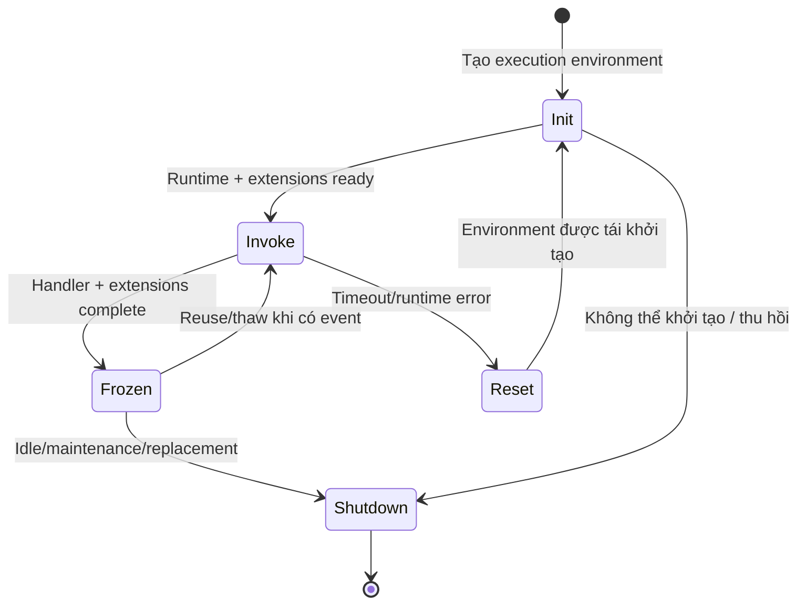
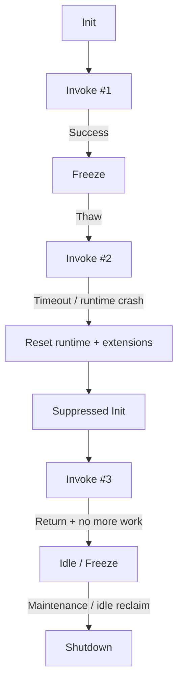
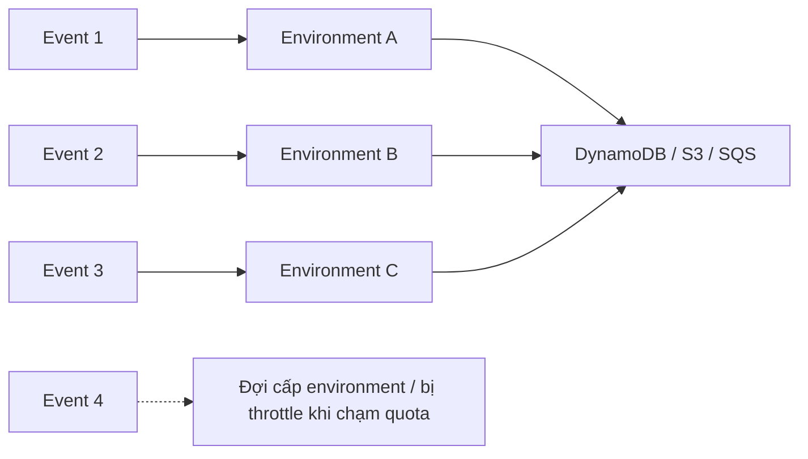
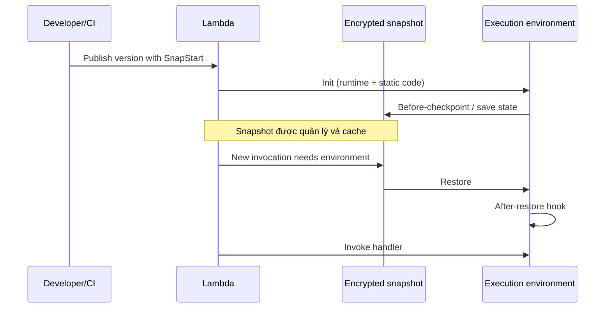
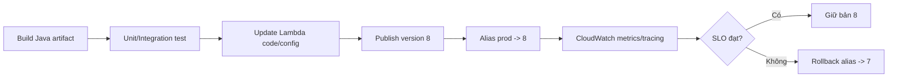
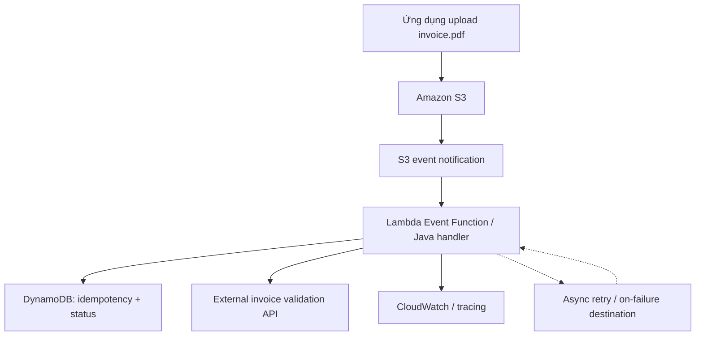

# Mô hình thực thi và vòng đời AWS Lambda function

> **Chương:** Điện toán Lambda  
> **Module:** `CLOUD_PROVIDERS_AWS`  
> **Bối cảnh:** Khám phá Amazon Web Services theo góc nhìn kiến trúc an toàn, giám sát được, phục hồi được và tối ưu chi phí. Bài này tập trung vào **AWS Lambda Event Functions** — kiểu Lambda truyền thống nhận sự kiện và gọi handler — từ khi code được triển khai đến lúc Lambda tạo execution environment, thực hiện `Init → Invoke → Shutdown`, tái sử dụng môi trường, mở rộng đồng thời và thu hồi tài nguyên. Phần cuối giới thiệu các biến thể mới của Lambda để tránh nhầm mô hình.

## Mục tiêu học tập

Sau bài học, người học có thể:

1. Giải thích các khái niệm **function**, **deployment package**, **runtime**, **handler**, **event**, **invocation**, **execution environment**, **version/alias** và **execution role**.
2. Mô tả vòng đời Lambda Event Function theo các pha **Init**, **Invoke**, **Shutdown**; phân biệt cold start, warm start, freeze/thaw, reset và **suppressed init**.
3. Giải thích **state nào có thể được tái sử dụng** (Java static object, SDK client, `/tmp`) và tại sao không được dựa vào state đó để bảo đảm tính đúng đắn hoặc lưu dữ liệu bền.
4. Phân biệt **synchronous**, **asynchronous** và **poll-based invocation** qua event source mapping; thiết kế retry, dead-letter queue/destination và xử lý event trùng lặp.
5. Ước lượng **concurrency = request rate × average duration**, phân biệt reserved concurrency, provisioned concurrency và SnapStart.
6. Viết handler Java với AWS SDK, tổ chức code khởi tạo an toàn, quản lý timeout, cấu hình memory, logging, IAM và networking.
7. Sử dụng AWS CLI và CloudWatch Logs/Metrics để kiểm tra cấu hình, theo dõi `Init Duration`, `Duration`, `Throttles`, lỗi runtime và diễn giải tình huống thực tế.
8. Nhận biết khác biệt giữa **Lambda Event Functions mặc định**, **Lambda Managed Instances**, **Web Functions** và **Durable Functions** theo tài liệu AWS hiện hành.

## 1. Lambda function là gì?

**AWS Lambda** là dịch vụ compute serverless: bạn cung cấp code và cấu hình, còn AWS quản lý phần lớn việc chuẩn bị môi trường chạy, mở rộng năng lực, bảo trì hạ tầng và xử lý lời gọi. Lambda đặc biệt phù hợp các tác vụ **event-driven**: xử lý file S3 mới, gọi API, chạy định kỳ, gửi thông báo, xử lý thông điệp SQS hoặc stream data.

Một **Lambda Event Function** nhận event, thực thi handler và trả kết quả. Lambda không buộc bạn phải tự tạo EC2 server hoặc quản lý Docker host cho mô hình chạy mặc định.

Ví dụ quy trình đơn hàng:

```text
Client → API Gateway → Lambda Event Function (orders-api)
                              |
                              +→ DynamoDB: tra/tạo đơn
                              +→ SQS: gửi event đơn hàng
                              +→ CloudWatch: log và metrics
```

Sự kiện từ SQS, S3, EventBridge hoặc một HTTP request có thể có cấu trúc khác nhau. **Handler phải hiểu đúng event contract** của từng nguồn; không có một JSON schema duy nhất cho mọi trigger.

### 1.1 Phân biệt các thực thể

| Khái niệm | Ý nghĩa | Ví dụ |
|---|---|---|
| **Function** | Tài nguyên Lambda có code và cấu hình | `orders-api` |
| **Deployment package** | Code/thư viện triển khai dưới dạng ZIP hoặc container image | `orders-api.jar` được đóng gói vào ZIP |
| **Runtime** | Môi trường ngôn ngữ và Runtime API, có thể do AWS quản lý hoặc tự cung cấp | `java21` |
| **Handler** | Điểm vào của mỗi invocation; nhận event/context | `com.example.OrdersHandler::handleRequest` hoặc tên class khi dùng `RequestHandler` |
| **Invocation** | Một lần Lambda gọi handler để xử lý event | Xử lý `orderId=O-1001` |
| **Execution environment** | Môi trường cô lập để runtime, extensions và code chạy | Một môi trường đã được init cho `orders-api` |
| **Execution role** | IAM role được Lambda assume để cấp AWS credentials tạm thời cho function | Role đọc S3, ghi DynamoDB theo least privilege |
| **Version** | Bản chụp bất biến của code/cấu hình function khi publish | `orders-api:7` |
| **Alias** | Tên trỏ đến version để phát hành/rollback, có thể phân chia traffic theo cấu hình | `orders-api:prod` |
| **Trigger/event source** | Cách event đến function | API Gateway, S3 notification, SQS mapping |

**Function không đồng nghĩa execution environment.** Một function có thể có **nhiều execution environments** khi tải đồng thời tăng; mỗi environment có bộ nhớ, tiến trình và `/tmp` riêng. Thay code/config hoặc publish version có thể dẫn tới tạo môi trường mới; không coi các môi trường đang chạy là một JVM hoặc ổ đĩa chung.

### 1.2 Lambda không phải một máy chủ chạy liên tục

Với Lambda Event Functions ở **mô hình compute mặc định**:

- Hàm được gọi khi có invocation, không phải lúc nào cũng chạy một process liên tục như EC2 service.
- Lambda có thể giữ execution environment sau invocation để tái sử dụng, nhưng **không có bảo đảm** môi trường tiếp tục tồn tại.
- Một execution environment thông thường xử lý **tối đa một invocation tại một thời điểm**; concurrency được tăng bằng các môi trường độc lập.
- Lambda có thể đóng/khởi tạo lại environment do không có traffic, thay đổi cấu hình, lỗi runtime hoặc bảo trì.

Các nhận định này áp dụng cho **default Lambda Event Function**. **Lambda Managed Instances** có mô hình khác: một execution environment có thể xử lý **nhiều invocation đồng thời**, nên cần thêm kỷ luật thread safety. Phần 15 sẽ giải thích ranh giới này.

## 2. Một invocation diễn ra từ đâu?

Nguồn event và kiểu invocation quyết định cách function nhận dữ liệu, trả kết quả, retry và xử lý lỗi.

### 2.1 Synchronous invocation

Ví dụ:

- Một client gọi API Gateway tích hợp với Lambda theo mô hình request/response.
- Một dịch vụ gọi `Invoke` API với `InvocationType=RequestResponse`.

Luồng:

```text
Client → Invoke → Lambda handler → Response/Error → Client
```

Caller chờ Lambda xử lý rồi nhận kết quả hoặc lỗi theo tầng tích hợp. Khi function fail, **Lambda không tự retry lỗi code cho một lời gọi đồng bộ trực tiếp**. Caller hoặc dịch vụ phía trước phải quyết định retry, timeout, backoff và idempotency.

Lưu ý: API Gateway timeout/định dạng response riêng có thể khác Lambda timeout; không thể đặt Lambda timeout dài rồi tự suy rằng client HTTP sẽ đợi cùng khoảng thời gian.

### 2.2 Asynchronous invocation

Ví dụ EventBridge hoặc S3 notification gọi Lambda theo chế độ bất đồng bộ:

```text
Event source → Lambda async event queue → Execution environment → Handler
                          |
                          └→ Retry hoặc on-failure destination khi lỗi
```

Lambda có cơ chế queue nội bộ và retry do Lambda quản lý. Với **lỗi do handler/runtime trả về**, mặc định Lambda thử lại tối đa **2 lần** sau lần đầu (thường khoảng 1 và 2 phút). Với lỗi throttling hoặc system errors, cơ chế retry/backoff và thời gian event có thể khác, tối đa khoảng **6 giờ theo cấu hình mặc định**.

Không suy rằng mỗi event chỉ được xử lý đúng một lần: duplicate delivery có thể xảy ra ngay cả khi handler trả thành công. Cần thiết kế **idempotency** ở cấp nghiệp vụ, chẳng hạn tạo đơn theo unique order ID với conditional write.

### 2.3 Poll-based invocation qua event source mapping

Với SQS, Kinesis hoặc DynamoDB Streams, Lambda thường dùng **event source mapping** để poll dữ liệu nguồn, gom record thành batch và invoke function.

```text
SQS/Kinesis/DynamoDB stream
        ↓
Event source mapping poller
        ↓
Batch records → Lambda handler
        ↓
Thành công / thất bại / partial batch response
```

Phương thức retry khác theo nguồn:

- **SQS:** message bị xóa khỏi queue khi xử lý thành công theo cơ chế tích hợp. Khi lỗi, visibility timeout và redrive policy/DLQ của SQS ảnh hưởng lần xuất hiện tiếp theo; cấu hình `ReportBatchItemFailures` có thể trả danh sách message lỗi để tránh xử lý lại toàn bộ batch.
- **Kinesis/DynamoDB Streams:** retry và checkpoint gắn với batch/shard, thứ tự record và quy tắc stream; một record lỗi có thể chặn tiến trình của shard nếu không thiết kế partial failures, bisect batch hoặc tuổi record phù hợp.
- **Event source mapping có concurrency controls riêng**, có thể tạo áp lực lên reserved concurrency của function nếu cấu hình không phối hợp.

**Không áp dụng quy tắc “retry 2 lần của Lambda async queue” cho mọi trigger SQS/stream.** Hãy xác định loại invocation trước khi chẩn đoán retry hoặc chi phí.

### 2.4 Bảng so sánh ba đường vào

| Kiểu | Ai chịu trách nhiệm đưa event đến? | Phản hồi | Retry khi lỗi |
|---|---|---|---|
| **Synchronous** | Caller/API integration | Caller nhận response/error | Caller/dịch vụ tích hợp quyết định |
| **Asynchronous** | Lambda async event queue | Caller thường nhận xác nhận đã queue, không phải kết quả business | Lambda retry theo async config; có DLQ/destinations |
| **Poll-based** | Lambda event source mapping | Thường xử lý batch, không trả response trực tiếp cho producer | Theo SQS/stream mapping, visibility/retention/partial failure |

## 3. Execution environment được chuẩn bị như thế nào?

Lambda tạo **execution environment** khi cần xử lý invocation mà không còn environment sẵn sàng phù hợp. Mỗi môi trường cung cấp runtime, mã nguồn, layers, extensions, memory, CPU tương ứng và thư mục tạm.

Các cấu hình quan trọng:

| Thành phần | Chức năng | Tác động tới vòng đời |
|---|---|---|
| **Runtime** | Java/Node.js/Python/.NET hoặc custom runtime được hỗ trợ | Quyết định bootstrap/handler loading |
| **MemorySize** | Lượng RAM cấp cho function; CPU được phân bổ tỷ lệ theo memory ở mô hình mặc định | Ảnh hưởng tốc độ init/invoke và GB-second cost |
| **Timeout** | Giới hạn thời gian xử lý invocation | Hết hạn có thể làm invocation fail và environment reset |
| **EphemeralStorage** | Dung lượng `/tmp` | Cache tạm theo environment; không phải storage bền |
| **Architecture** | `x86_64` hoặc `arm64` theo runtime/định dạng package | Native libraries và chi phí/hiệu năng khác nhau |
| **Execution role** | IAM permissions cho code | Ứng dụng gọi AWS SDK cần quyền phù hợp |
| **VPC config** | Subnet/security groups để truy cập mạng riêng | Ảnh hưởng DNS, NAT, VPC endpoints và cold start cấu hình |
| **Environment variables** | Chuỗi cấu hình của function version | Được load vào environment; không nên dùng làm kho secret động |
| **Layers/extensions** | Thư viện dùng chung, agent/tracing/telemetry | Có thể tăng thời gian init/invoke/shutdown |

Bản thân **Lambda service** quản lý hạ tầng vật lý/ảo hóa; **người dùng** vẫn chịu trách nhiệm code, cấu hình, IAM least privilege, dependencies, dữ liệu và các dịch vụ được gọi.

### 3.1 Ba pha tiêu chuẩn

Vòng đời cơ bản của **default Lambda Event Function** có ba pha:



**Freeze/thaw không phải cam kết** môi trường sẽ sống qua khoảng thời gian nhàn rỗi, và `Shutdown` không nhất thiết phát như một callback vào Java handler để bạn có thể lưu dữ liệu vào database.

### 3.2 Init, Invoke, Shutdown được đo ở đâu?

- `Init`: chuẩn bị runtime và chạy mã khởi tạo trước handler.
- `Invoke`: runtime gọi handler, code xử lý event, extensions hoạt động; hoàn tất khi runtime và các extension báo sẵn sàng nhận event tiếp.
- `Shutdown`: Lambda dừng runtime/extensions khi environment bị thu hồi hoặc reset.

Đối với runtime/extension tùy chỉnh, các pha có cơ chế Runtime API và Extensions API để báo ready/complete. Với Java managed runtime, bạn thường viết class/handler, không cần tự gọi các API cấp thấp này.

## 4. Pha Init: cold start bắt đầu từ đây

**Cold start** thường xảy ra khi invocation cần môi trường chưa có sẵn. Lambda phải chuẩn bị execution environment, tải package/layers, khởi chạy runtime/extensions và thực hiện phần khởi tạo của code.

Pha `Init` gồm:

1. **Extension init:** khởi động các extensions được đăng ký.
2. **Runtime init:** bootstrap runtime, ví dụ JVM cho Java handler.
3. **Function init:** thực thi mã **ngoài handler**: static initializer, instance initializer, tạo dependency clients…
4. **Before-checkpoint hooks** nếu dùng Lambda SnapStart.

### 4.1 Ví dụ Java: điều gì chạy trong Init?

```java
package example;

import com.amazonaws.services.lambda.runtime.Context;
import com.amazonaws.services.lambda.runtime.RequestHandler;
import java.util.Map;

public final class LifecycleDemo
        implements RequestHandler<Map<String, Object>, Map<String, String>> {

    // Được khởi tạo khi execution environment/JVM được init.
    // Đây KHÔNG phải nơi lưu trạng thái đơn hàng quan trọng.
    private static final String CONFIG =
            System.getenv().getOrDefault("APP_ENV", "dev");

    private static final long INIT_TIME_NANOS = System.nanoTime();

    public LifecycleDemo() {
        // Java managed runtime tạo handler instance khi khởi tạo.
        // Tránh làm công việc blocking dài hoặc để lộ secret ở đây.
    }

    @Override
    public Map<String, String> handleRequest(
            Map<String, Object> event,
            Context context) {

        String requestId = context.getAwsRequestId();
        Object orderId = event.getOrDefault("orderId", "unknown");

        // Dữ liệu của từng invocation phải ở biến cục bộ.
        context.getLogger().log(
                "Handling requestId=" + requestId
                + ", orderId=" + orderId + "\n");

        return Map.of("status", "accepted", "environment", CONFIG);
    }
}
```

- **`CONFIG`** và `INIT_TIME_NANOS` được tính khi class được khởi tạo. Nếu environment được tái sử dụng, chúng **không tính lại trước mỗi request**.
- `handleRequest` chạy cho **mỗi invocation**.
- `requestId` và `orderId` là dữ liệu của **từng lời gọi**, không ghi vào static mutable state.
- `INIT_TIME_NANOS` ở ví dụ chỉ là dấu mốc chẩn đoán trong một JVM; `System.nanoTime()` không phải một thời gian toàn cục có thể so giữa nhiều environments.
- Với Lambda Java managed runtime, handler khi implement `RequestHandler` thường được cấu hình bằng **tên class đầy đủ**, ví dụ `example.LifecycleDemo`. Nếu không implement interface, tên cấu hình handler có thể ở dạng `package.Class::methodName`.

### 4.2 Thời gian của Init

Với mô hình **on-demand chuẩn**, AWS thường giới hạn Init tối đa **10 giây**; nếu Init chưa hoàn tất trong ngưỡng đó, Lambda có thể thử Init lại tại thời điểm invocation đầu tiên với giới hạn timeout của function.

**Ngoại lệ quan trọng:** Provisioned Concurrency, SnapStart và Lambda Managed Instances có quy tắc Init dài hơn, theo tài liệu AWS; không được suy rằng mọi function đều có cùng giới hạn 10 giây cho mọi tình huống. Với các cơ chế này, giới hạn Init có thể tới 15 phút, với quy tắc timeout cụ thể theo cấu hình.

Nếu khởi tạo Java/Spring mất nhiều giây, hãy đo trước khi chỉ tăng timeout. Các nguồn chậm thường gặp:

- Tải quá nhiều classes/dependencies và dependency injection container.
- Tạo network connection tới RDS/API trong init.
- Download file hoặc secret trước khi handler chạy.
- Khởi động nhiều extensions/agents.
- Quá ít memory dẫn đến CPU cấp phát thấp.

### 4.3 Tối ưu Init an toàn

- **Chỉ package dependencies cần thiết.** Với Java, hạn chế ứng dụng framework rất lớn cho một hàm xử lý nhỏ nếu không cần.
- **Tái sử dụng AWS SDK client:** Tạo client ở static/constructor và dùng lại khi environment được giữ.
- **Lazy initialization:** Khởi tạo tài nguyên nặng khi cần, nhưng cân nhắc tác động tới latency của nhánh đầu tiên dùng chúng.
- **Không lấy dữ liệu nghiệp vụ thay đổi liên tục rồi cố định mãi trong static fields.**
- **Không nhúng secret** vào source code/package hoặc log init.
- **Memory tuning:** Tăng memory có thể tăng CPU và giảm init time, nhưng phải đo tổng chi phí.
- **Phân tách trách nhiệm:** Một function đa nhiệm, nạp nhiều thư viện không cần, có thể chậm hơn nhiều functions nhỏ chuyên trách.

## 5. Pha Invoke: code xử lý event

Khi môi trường đã sẵn sàng, Lambda cung cấp event cho runtime. Managed runtime gọi handler tương ứng. Handler nhận event/context, xử lý và trả kết quả hoặc lỗi.

### 5.1 Một invocation có deadline

**`Timeout`** của function giới hạn toàn bộ pha `Invoke`, bao gồm thời gian handler và extensions hoạt động theo mô hình Lambda. Timeout tối đa thông thường của Event Function mặc định là **900 giây (15 phút)**.

Ví dụ timeout 30 giây, Java handler:

1. Parse event: 2 ms.
2. Đọc S3: 300 ms.
3. Gọi REST API: 12 giây.
4. Ghi DynamoDB: 30 ms.
5. Extensions flush telemetry: thêm thời gian liên quan.

Nếu tổng xử lý không hoàn thành trước deadline, Lambda có thể **terminate invocation và reset environment**. Lambda timeout **không tự rollback** một `PutItem`/HTTP request đã thành công ở dịch vụ phía sau.

**Đặt timeout upstream đúng:** SDK client timeout, HTTP connect/read timeout, API Gateway, SQS visibility timeout hoặc database statement timeout phải phối hợp. Không để HTTP client tự chờ vô hạn gần hết function timeout rồi tạo nửa giao dịch khó khôi phục.

### 5.2 Dùng Context để biết thời gian còn lại

Trong Java:

```java
@Override
public Map<String, String> handleRequest(
        Map<String, Object> event,
        Context context) {

    int remainingMs = context.getRemainingTimeInMillis();
    if (remainingMs < 2000) {
        throw new IllegalStateException(
                "Not enough execution time to start a new external operation");
    }

    // Chỉ bắt đầu tác vụ khi còn deadline đủ cho nó.
    return Map.of("status", "ok");
}
```

`getRemainingTimeInMillis()` hữu ích để từ chối bắt đầu một tác vụ mới quá trễ, nhưng không thay thế retry/backoff, idempotency hay transaction timeout ở dịch vụ downstream. Không tự đẩy việc chưa xong sang background thread rồi return khi không có cách bảo đảm nó sẽ hoàn tất.

### 5.3 Invocation không phải một HTTP thread lâu dài

Ở **default Event Functions**, mỗi execution environment chỉ xử lý **một invocation tại một thời điểm**. Tuy nhiên:

- Một invocation có thể dùng nhiều threads trong JVM nếu bạn tự tạo.
- Những môi trường khác nhau có thể xử lý invocation đồng thời.
- Không có shared static variables giữa **các** environments.
- Một environment có thể được tái sử dụng cho **nhiều invocation nối tiếp**, nên static mutable state có thể gây **rò rỉ dữ liệu giữa các lời gọi**.
- Handler phải có tính **idempotent** ở mức nghiệp vụ vì retry/duplicate event có thể xảy ra.

## 6. Freeze, thaw và warm start

Khi handler và các extensions hoàn tất pha Invoke, Lambda có thể **freeze execution environment** để tiết kiệm tài nguyên, rồi **thaw** khi có event tiếp theo.

**Warm start** nghĩa là Lambda có thể tái sử dụng environment đã init, giúp bỏ qua phần lớn bootstrap và static initialization. Nhưng bạn **không thể chọn trước hoặc đảm bảo** một event sẽ chạy trên environment nào.

### 6.1 Những thứ có thể sống qua warm start

| Thành phần | Có thể tái sử dụng trong cùng execution environment? | Có đảm bảo sống bền không? |
|---|---|---|
| Java static fields / singleton | Có | Không |
| AWS SDK clients / HTTP connection pools | Có, nếu connection còn hợp lệ | Không |
| Files trong `/tmp` | Có | Không |
| Environment variables của version đang chạy | Có cùng môi trường/version | Không dùng để cập nhật cấu hình động |
| JVM threads/async callbacks chưa hoàn tất | Có thể bị freeze rồi tiếp tục khi thaw | **Không**; không dùng để bảo đảm công việc |
| Request ID / event payload | Chỉ dữ liệu của invocation | Không được cache như state chung |
| DynamoDB, S3, RDS | Dữ liệu được lưu bởi dịch vụ ngoài Lambda | Có theo độ bền/chính sách của dịch vụ |

### 6.2 Vì sao không dùng biến static để đếm đơn hàng?

Giả sử:

```java
private static int processedOrders = 0;

public String handleRequest(String orderId, Context context) {
    processedOrders++;
    return "processed=" + processedOrders;
}
```

Nếu Lambda tạo ba execution environments khác nhau, mỗi JVM có `processedOrders` riêng. Khi environment bị thu hồi, biến mất; khi warm start trong cùng JVM, biến vẫn tăng nhưng không đại diện tổng đơn hàng toàn hệ thống.

Đối với bộ đếm nghiệp vụ, dùng **DynamoDB atomic counter/conditional write**, transaction phù hợp hoặc một hệ thống trạng thái bền, không dùng bộ nhớ của Lambda.

### 6.3 `/tmp`: cache tạm, không phải storage bền

Lambda có thư mục `/tmp` riêng cho execution environment. Dung lượng mặc định **512 MB**, có thể cấu hình tới **10.240 MB** theo mức áp dụng của Event Functions thông thường, tăng theo bước 1 MB.

Có thể dùng `/tmp` để:

- Giải nén file ZIP lớn trong lúc xử lý.
- Cache một model hoặc dictionary không nhạy cảm.
- Chứa file PDF/ảnh trung gian.
- Tối ưu các invocation tiếp theo trong cùng environment.

Không dùng `/tmp` để giữ bản duy nhất của giao dịch, message chưa ACK, secret lâu dài hoặc dữ liệu cá nhân chưa được quản lý retention. **Tệp có thể còn sau freeze/thaw và thậm chí reset**, nhưng mất khi environment bị thay. Đặt tên file có phạm vi invocation khi xử lý đồng thời nhiều tác vụ con và chủ động dọn data nhạy cảm.

### 6.4 Connections cần kiểm tra trước khi dùng lại

Một client HTTP/JDBC được tạo ở Init có thể giữ socket quá lâu:

```text
Init: kết nối DB được mở
Invoke 1: truy vấn thành công
Freeze: môi trường tạm nghỉ
DB/firewall: đóng idle TCP connection
Thaw:
Invoke 2: dùng connection cũ → lỗi stale connection
```

Giải pháp: cho phép SDK/client reconnect, dùng timeouts, connection health check phù hợp, backoff có giới hạn và connection pooling cẩn thận. Với Lambda đến RDS, cân nhắc **RDS Proxy** khi concurrent invocations có thể tạo rất nhiều kết nối DB.

## 7. Shutdown và Reset: môi trường kết thúc ra sao?

Lambda có thể dừng execution environment khi không còn cần, do bảo trì, đổi cấu hình, idle hoặc lỗi. Khi đó runtime và extensions được thu hồi.

### 7.1 Shutdown không phải “finally” đáng tin để lưu dữ liệu

Trong Extensions API, Lambda gửi sự kiện `Shutdown` cho các **external extensions** đã đăng ký. Theo tài liệu AWS, giới hạn pha này phụ thuộc extensions:

- **0 ms** nếu không đăng ký extension.
- **500 ms** với internal extension được đăng ký.
- **2.000 ms** nếu có một hoặc nhiều external extensions.

Nếu runtime/extension không hoàn tất trong giới hạn, Lambda có thể kết thúc process bằng `SIGKILL`.

Vì vậy không dựa vào việc “mỗi environment tắt sẽ tự gọi handler cleanup” để commit đơn hàng, ACK SQS message, lưu tệp hay flush dữ liệu duy nhất. **Hoàn tất các side effects bắt buộc trước khi trả kết quả từ handler.**

### 7.2 Khi Invoke lỗi, Lambda có thể reset

Nếu handler **timeout**, crash, runtime exit hoặc gặp lỗi làm môi trường không tiếp tục được, Lambda có thể reset execution environment:

1. Kết thúc runtime hiện tại theo hành vi giống Shutdown.
2. Gửi shutdown cho extensions khi áp dụng.
3. Nếu environment tiếp tục được dùng, Lambda **khởi tạo lại runtime + extensions** trước invocation tiếp theo.
4. Nội dung `/tmp` có thể được giữ qua reset, **không** được xóa tự động.

Đây là một trường hợp dễ gây sai: có thể thấy tệp ở `/tmp` của invocation trước trong khi Java static state đã bị tái khởi tạo. Không dùng tệp `/tmp` như bằng chứng một giao dịch đã commit hoàn chỉnh.

### 7.3 Suppressed init: Init ẩn giữa hai lời gọi

Sau invoke failure, Lambda có thể phải init lại trước invoke tiếp theo nhưng không hiển thị `INIT` như một pha tách biệt trong **CloudWatch log chuẩn**. AWS gọi hiện tượng này là **suppressed init**.

Ví dụ log rút gọn:

```text
START RequestId: req-A ...
END RequestId: req-A
REPORT RequestId: req-A Duration: ... Status: timeout

START RequestId: req-B ...
END RequestId: req-B
REPORT RequestId: req-B Duration: ... Init Duration: ... 
```

Các định dạng `REPORT` thay đổi theo bản cập nhật Lambda/kiểu log và cấu hình; đừng viết parser chỉ phụ thuộc vào một format cố định. Để quan sát suppressed init chính xác hơn, dùng **Lambda Telemetry API**; những sự kiện `INIT_START`, `INIT_RUNTIME_DONE`, `INIT_REPORT` với `phase=invoke` là tín hiệu hữu ích.

### 7.4 Sơ đồ đường lỗi



Sơ đồ minh họa, không có nghĩa Lambda sẽ luôn reuse đúng một environment sau mọi lỗi hoặc tồn tại một chuỗi request theo thứ tự cố định.

## 8. Cold start, concurrency và thời gian phản hồi

### 8.1 Một function có thể có nhiều execution environments

Giả sử `orders-api` có:

```text
100 requests/second
Average execution duration = 0.20 second
```

Concurrency trung bình cần thiết xấp xỉ:

```text
Concurrency ≈ RPS × AverageDurationSeconds
            ≈ 100 × 0.20
            ≈ 20 concurrent executions
```

Khi request rate hoặc duration tăng:

```text
RPS = 400, Duration = 0.50 s
Concurrency ≈ 400 × 0.50 = 200
```

Đây là **ước lượng trung bình** theo Little's Law, không đảm bảo số môi trường yêu cầu tại mọi millisecond. Burst, độ lệch duration, timeout, retries, reserved quota, RPS quotas và provisioned concurrency có thể làm mức cần thực tế khác.

### 8.2 Default Lambda Event Function: một invocation tại một environment



Với model mặc định, Lambda không chạy **hai handler invocations cùng lúc trong một execution environment**. Những invocation đồng thời thường cần các environments riêng. Tuy vậy, environment A có thể xử lý Event 5 sau khi xử lý xong Event 1 và được reuse.

### 8.3 Concurrency quota và throttling

AWS có quota theo **Account/Region**, theo function và theo tốc độ mở rộng. Mức concurrency mặc định của Account thường là **1.000** nhưng có thể khác theo Account/quota đang được cấp. Ngoài concurrency còn có **request-per-second limit**, và Lambda giới hạn tốc độ tạo execution environments trong những burst rất lớn.

Khi vượt quota, invocation có thể nhận **`TooManyRequestsException`/429**, bị delay/retry theo nguồn event hoặc không được xử lý ngay. Một function bão hòa có thể ảnh hưởng những function khác nếu cùng dùng unreserved concurrency của Account.

Kiểm tra **Service Quotas**, CloudWatch metrics và dữ liệu tải thực tế, không lấy mức 1.000 làm quota bảo đảm cho mọi tài khoản.

## 9. Reserved Concurrency và Provisioned Concurrency

Hai cấu hình có tên gần nhau nhưng giải quyết các mục tiêu khác nhau.

| Tiêu chí | **Reserved Concurrency (RC)** | **Provisioned Concurrency (PC)** |
|---|---|---|
| Mục tiêu | Giới hạn và bảo đảm capacity được dành riêng cho function | Chuẩn bị trước execution environments để giảm cold start |
| Khởi tạo trước runtime? | **Không** | **Có** |
| Có thể còn cold start? | Có | PC invocations dùng môi trường sẵn sàng sẽ không phải cold-start Init |
| Giới hạn max concurrency? | Có, RC đóng vai trò trần cho function | PC không phải hard max nếu còn on-demand capacity được phép |
| Phí cấu hình thêm | Không có phí riêng cho việc reserve concurrency | Có phí provisioned concurrency theo thời gian và usage liên quan |
| Khi nên dùng | Bảo vệ DB/API downstream, cô lập năng lực cho function quan trọng | Workload interactive nhạy cold-start p95/p99 |
| Phạm vi cấu hình | Function | **Published version hoặc alias**, không đặt trực tiếp trên `$LATEST` |

### 9.1 Ví dụ bảo vệ database

Function `orders-api` có thể xử lý nhanh nhưng RDS chỉ chịu khoảng 50 concurrent connections từ Lambda. Đặt **`ReservedConcurrentExecutions=30`** có thể hạn chế concurrency tại function nhằm tránh làm quá tải backend, giả sử số connection trên mỗi invocation được kiểm soát.

Tuy nhiên:

- `RC=30` **không khiến 30 môi trường đã Init sẵn**.
- Không bảo đảm mỗi invocation dùng đúng một database connection.
- Nếu dùng async/SQS, throttling/backlog tăng có thể ảnh hưởng message age, visibility và DLQ.
- Đặt RC bằng `0` có thể **throttle** function theo thiết kế; dùng cẩn trọng trong production.

### 9.2 Ví dụ giảm cold start bằng PC

Một API Java có cold start dài do nạp nhiều classes. Nếu tải nền ổn định 20 concurrent executions, có thể thử **PC=20** trên alias `prod`. Lambda chuẩn bị các environments trước các invocation, giảm phần Init trên critical path.

Lưu ý:

- PC cần thời gian **allocate/initialize**, không có hiệu lực ngay khi lệnh cấu hình trả về.
- Nếu traffic vượt PC, Lambda có thể dùng **on-demand spillover** trong giới hạn RC/account cho phép; phần spillover có thể gặp cold start.
- PC có phí ngay cả khi environments nhàn rỗi theo mô hình tính phí.
- Cấu hình RC không được nhỏ hơn tổng PC của function versions/aliases theo quy tắc dịch vụ.

### 9.3 Có nên cấu hình cả RC và PC?

Có, nếu yêu cầu vừa bảo vệ downstream vừa giảm cold start. Ví dụ `RC=50`, `PC=20`: 20 concurrency được chuẩn bị, khả năng dùng thêm on-demand tới trần RC còn lại tùy quota và limits.

**Đừng hiểu PC là số lượng container Docker cố định mãi.** AWS vẫn quản lý thay thế/rà soát environments và có các ngoại lệ khởi tạo; theo dõi metrics thực tế thay vì khẳng định latency luôn cố định.

## 10. Lambda SnapStart và pha Restore

**Lambda SnapStart** thay đổi đường khởi tạo:

1. Khi **publish function version** có SnapStart, Lambda chạy `Init`, bao gồm Java runtime và static initialization.
2. Lambda lưu snapshot đã mã hóa của **memory và disk state** của execution environment đã init.
3. Khi có invocation cần environment mới, Lambda **restore snapshot** thay vì chạy lại Init từ đầu.
4. Nếu có **after-restore hook**, nó được thực hiện cuối pha `Restore`.
5. Sau đó Lambda chuyển sang `Invoke`.



### 10.1 Cần quan tâm đến uniqueness

Nhiều môi trường được khôi phục từ **một snapshot giống nhau**. Nếu Init tạo:

- Một UUID làm định danh **duy nhất cho mọi instance**;
- Mã hóa/nonce dựa vào state random không hỗ trợ SnapStart;
- Token ngắn hạn hoặc thời điểm cache không bao giờ refresh;
- Network connection đến DB được coi là luôn hợp lệ;

thì khi restore có thể gặp **trùng identity, stale credentials hoặc connection hỏng**.

Giải pháp: tạo unique IDs theo **invocation** hoặc sau restore, dùng nguồn random an toàn tương thích, tái kiểm tra connections và refresh dữ liệu ngắn hạn. AWS cung cấp **before-checkpoint** và **after-restore runtime hooks** cho các use cases phù hợp.

### 10.2 Khả năng hỗ trợ và hạn chế

Theo tài liệu AWS hiện hành, SnapStart hỗ trợ một tập managed runtimes (bao gồm **Java 11+**), với yêu cầu cụ thể theo deployment format và runtime; kiểm tra chi tiết trước khi triển khai.

Các hạn chế quan trọng:

- SnapStart dùng cho **published versions và aliases**, không dùng trực tiếp trên `$LATEST`.
- **Không dùng đồng thời với Provisioned Concurrency** trên cùng function configuration.
- Có hạn chế với **EFS** và lượng `/tmp` lớn hơn mức cho phép.
- Mỗi bản version có thể có chính sách snapshot/cache/retention và chi phí riêng theo runtime; không mặc định mọi runtime có giá SnapStart giống nhau.
- Một version không được gọi lâu ngày có thể chuyển sang **Inactive** theo quy tắc của runtime/tính năng và phải khởi tạo lại snapshot.

### 10.3 Khi chọn SnapStart hay PC?

| Bài toán | SnapStart | Provisioned Concurrency |
|---|---|---|
| Java init nặng, tải bursty | Thường đáng thử nếu hỗ trợ | Có thể đắt nếu nhiều khoảng idle |
| API đòi latency cực ổn định | Giảm Init, vẫn có restore overhead | Phù hợp khi cần environments chuẩn bị sẵn |
| Cần EFS hoặc cấu hình không được SnapStart hỗ trợ | Có thể không dùng được | Xem yêu cầu PC và EFS |
| Cần kiểm soát chi phí idle | Tùy runtime/đơn giá và số version active | Phải trả phí PC trong thời gian cấu hình |
| Có cache state/unique IDs trong init | Phải audit SnapStart uniqueness | Không clone snapshot như SnapStart |

Không chọn chỉ dựa trên một lần đo cold start. Thử nhiều mức tải, đo `Init Duration`, `Restore Duration`, p95/p99 và tổng chi phí cùng hiệu quả ứng dụng.

## 11. Java Lambda: handler, SDK reuse và dữ liệu theo invocation

Ví dụ code Java dùng AWS SDK for Java v2. Hệ thống nhận event có `orderId`, đọc dữ liệu tham chiếu trong S3, trả kết quả. Mẫu minh họa việc **tạo client một lần cho mỗi environment** nhưng **không giữ event state** giữa các lời gọi.

```java
package example;

import com.amazonaws.services.lambda.runtime.Context;
import com.amazonaws.services.lambda.runtime.RequestHandler;
import java.util.Map;
import software.amazon.awssdk.regions.Region;
import software.amazon.awssdk.services.s3.S3Client;
import software.amazon.awssdk.services.s3.model.HeadObjectRequest;

public final class OrderDocumentHandler
        implements RequestHandler<Map<String, String>, Map<String, String>> {

    // Khởi tạo ở Init, có thể dùng lại khi warm start.
    // SDK lấy IAM temporary credentials từ Lambda execution role.
    private static final S3Client S3 = S3Client.builder()
            .region(Region.AP_SOUTHEAST_1)
            .build();

    private static final String BUCKET =
            System.getenv().getOrDefault(
                    "DOCUMENT_BUCKET", "orders-documents-example");

    @Override
    public Map<String, String> handleRequest(
            Map<String, String> event,
            Context context) {

        String orderId = event.get("orderId");
        if (orderId == null || !orderId.matches("[A-Za-z0-9-]{1,64}")) {
            throw new IllegalArgumentException("Invalid orderId");
        }

        String objectKey = "orders/" + orderId + ".json";

        S3.headObject(HeadObjectRequest.builder()
                .bucket(BUCKET)
                .key(objectKey)
                .build());

        context.getLogger().log(
                "Validated document for requestId="
                + context.getAwsRequestId() + "\n");

        return Map.of(
                "orderId", orderId,
                "status", "document-present");
    }
}
```

Mẫu này:

- Cần dependency **`aws-lambda-java-core`** và **`software.amazon.awssdk:s3`**.
- Giả định object trong S3 đã có; nếu không, SDK sẽ ném exception phù hợp.
- Dùng **`HeadObject`** nên cần policy tương ứng cho object theo hành vi `s3:GetObject`/bucket policy; nếu thiếu `ListBucket`, một key không tồn tại có thể nhận 403 thay vì 404.
- Cần execution role giới hạn quyền đọc prefix `orders/*`.
- Không ghi access key hoặc secret vào code/biến static.
- Kiểm tra `orderId` đầu vào để tránh tự tạo key ngoài phạm vi mong đợi.
- Không chứa bộ đếm static mutable hoặc cache kết quả nghiệp vụ của người dùng.

### 11.1 IAM role mẫu cho quyền đọc S3

```json
{
  "Version": "2012-10-17",
  "Statement": [
    {
      "Sid": "ReadOrderDocuments",
      "Effect": "Allow",
      "Action": "s3:GetObject",
      "Resource": "arn:aws:s3:::orders-documents-example/orders/*"
    }
  ]
}
```

Nếu S3 object được mã hóa bằng customer managed KMS key, cần đánh giá thêm `kms:Decrypt`/key policy. Đối với logging, role cần các quyền CloudWatch Logs phù hợp, thường thông qua policy quản lý được AWS khuyến nghị.

**Không cấp `s3:*` hoặc `AdministratorAccess` chỉ vì function cần đọc một object.** Nếu function được gọi bởi S3/API Gateway, phải quản lý thêm **resource-based Lambda permission** cho caller/triggers nếu loại tích hợp yêu cầu; đừng nhầm nó với **execution role** mà function dùng để gọi AWS services.

### 11.2 Tách thời điểm init và invoke

Với Java/Spring Boot, cân nhắc:

- Init: tạo SDK clients, cấu hình/objects dùng chung, nạp các class cần thiết.
- Invoke: xác thực event, lấy request ID, thực hiện các side effects/transactions và trả kết quả.
- Sau invoke: không chạy công việc cần đảm bảo thành công trong background thread chưa được quản lý.
- Trước khi dùng connection cũ: kiểm tra và tái kết nối khi hợp lý.

Có thể dùng framework/DI, nhưng phải đo tác động cold start; không cần khởi động toàn bộ HTTP server nếu chỉ xử lý một sự kiện đơn giản.

## 12. Phiên bản, alias và điều gì xảy ra khi deploy code mới?

### 12.1 `$LATEST` và published versions

`$LATEST` là version chưa publish, có thể thay code/config. Khi **publish version**, Lambda tạo bản version **bất biến** của code và các cấu hình version-specific được hỗ trợ.

Ví dụ:

```text
orders-api:$LATEST  (unpublished)
orders-api:7        (published version)
orders-api:8        (published version)
orders-api:prod     (alias → version 8)
```

Khi thay đổi code/config, Lambda có thể tạo execution environments mới; không giả định các environment cũ được “patch” ngay giữa invocation. Với aliased deployment, cần xem alias đang trỏ bản nào và routing weights khi chia traffic.

### 12.2 Vì sao alias quan trọng?

- Giữ một endpoint/integration ổn định cho client.
- Thử nghiệm canary rollout bằng weighted aliases (trong giới hạn và quy tắc Lambda).
- Rollback nhanh về published version đã được kiểm thử.
- Gắn Provisioned Concurrency vào alias/version phù hợp.
- SnapStart gắn với published version.

**Rollback alias không rollback dữ liệu ở DynamoDB/S3/RDS** đã bị code mới thay đổi. Thiết kế backward-compatible schema và idempotent changes trước khi phát hành.

### 12.3 Đường đi của một lần deploy



Khi dùng SnapStart, quá trình publish version có thêm bước Init/snapshot; khi dùng PC, cần chờ allocation healthy trước khi chuyển traffic theo đúng chiến lược.

## 13. Security và networking trong vòng đời Lambda

### 13.1 IAM Execution Role

Khi Lambda code gọi S3, DynamoDB, SQS hoặc Secrets Manager, function dùng **temporary credentials** từ **Lambda execution role**. Trust policy của role cho phép Lambda service principal:

```json
{
  "Version": "2012-10-17",
  "Statement": [
    {
      "Effect": "Allow",
      "Principal": {
        "Service": "lambda.amazonaws.com"
      },
      "Action": "sts:AssumeRole"
    }
  ]
}
```

Role cần policy chỉ cho các hành động/resource thực sự cần. Người/CI/CD deploy function cần quyền cập nhật Lambda và `iam:PassRole` nếu chỉ định execution role; không nhầm với quyền SDK bên trong handler.

### 13.2 Secrets: đừng coi env vars là kho bí mật

Lambda encrypt environment variables at rest theo dịch vụ, nhưng **không nên** đặt DB password, API token hoặc credentials nhạy cảm dưới dạng plain env variables khi có thể dùng **AWS Secrets Manager**.

Khi Java lấy secret ở runtime:

- Role cần `secretsmanager:GetSecretValue` trên đúng ARN secret.
- Customer managed KMS key có thể yêu cầu `kms:Decrypt` và key policy.
- Cache ngắn hạn nếu phù hợp để giảm latency/API cost.
- Chú ý rotation: secret lấy trong init và giữ static vô hạn **sẽ bị stale**.
- Không ghi secret hoặc full HTTP headers ra log/trace.

### 13.3 VPC và Internet egress

Đưa Lambda function vào các VPC subnets giúp kết nối RDS, ElastiCache hoặc dịch vụ private. Nhưng:

- Việc gắn VPC **không mặc định cấp Internet outbound**.
- Private subnet thường cần **NAT Gateway** cho Internet/IPv4 endpoints hoặc **VPC endpoints** được hỗ trợ cho AWS services.
- Security group, route table, NACL, DNS, ENI/IP capacity và IAM cần đồng bộ.
- Lambda dùng cơ chế **Hyperplane ENI** cho kết nối VPC; không tự suy mỗi invocation tạo ENI riêng.
- Network timeout do cấu hình VPC có thể khiến handler bị timeout và environment reset.

Giám sát kết nối RDS/API, tính chi phí NAT/PrivateLink và test đường đi trước khi thêm VPC chỉ vì nghĩ điều đó “an toàn hơn”.

### 13.4 Extensions và quyền truy cập

Lambda extensions có thể phục vụ telemetry, secret caching, tracing hoặc security. Nhưng extension cũng dùng tài nguyên của execution environment, có thể ảnh hưởng init/invoke/shutdown và chi phí.

Không dùng extension không rõ nguồn gốc hoặc cấp role quá rộng. Giới hạn layer/extension versions, quan sát logs và đo thời gian CPU/memory mà nó sử dụng. Một extension lỗi có thể làm init/restore/invoke thất bại dù handler code không đổi.

## 14. CloudWatch Logs: đọc được dấu vết vòng đời

Lambda có hệ thống log mặc định và hỗ trợ cấu hình logging nâng cao. Với Event Functions, CloudWatch Logs thường cung cấp các dòng hệ thống và application logs.

### 14.1 Các dòng `START`, `END` và `REPORT`

Ví dụ minh họa:

```text
START RequestId: 11111111-2222-3333-4444-555555555555 Version: 8
2026-11-20T00:00:00Z INFO Processing order O-1001
END RequestId: 11111111-2222-3333-4444-555555555555
REPORT RequestId: 11111111-2222-3333-4444-555555555555 Duration: 112.50 ms Billed Duration: 113 ms Memory Size: 512 MB Max Memory Used: 148 MB Init Duration: 681.20 ms
```

Dữ liệu giả định, không phải logs của tài khoản đang hoạt động. Lambda đang cập nhật cách xuất system logs/trace; một số function hiển thị field như `Status: timeout` hoặc các sự kiện `INIT_REPORT` khác nhau theo cấu hình runtime/provisioned/SnapStart.

| Log/field | Giúp trả lời |
|---|---|
| `START RequestId` | Invocation nào được bắt đầu? |
| `END RequestId` | Handler/invocation có hoàn tất xử lý tại tầng Lambda? |
| `REPORT Duration` | Mất bao lâu theo cách Lambda tính? |
| `Billed Duration` | Thời lượng billable theo hình thức compute và quy tắc giá hiện hành |
| `Memory Size / Max Memory Used` | Có cấp quá ít/nhiều memory? |
| `Init Duration` | Có cold start hay init bổ sung trong phép đo? |
| `Status / Error Type` | Timeout, runtime crash, memory error hoặc lỗi được báo |
| `INIT_REPORT` | Init success/failure theo quy tắc log của chế độ đang dùng |
| `RESTORE_REPORT` | Restore SnapStart và lỗi post-restore |
| `Telemetry API INIT_*` | Quan sát suppressed init/phase chi tiết |

**`REPORT` không chứng minh side effect nghiệp vụ thành công.** Một handler có thể trả 200 sau khi gửi SQS message nhưng backend phía sau xử lý thất bại; cần end-to-end tracing và metrics riêng.

### 14.2 CloudWatch Metrics cần xem

| Metric | Ý nghĩa |
|---|---|
| `Invocations` | Số lần Lambda thực hiện function invocation |
| `Errors` | Số invocation lỗi ở tầng Lambda |
| `Duration` | Thời gian xử lý, có thể xem percentiles |
| `ConcurrentExecutions` | Concurrent invocations hiện tại |
| `Throttles` | Những lời gọi bị throttle do quota/RC/RPS |
| `IteratorAge` | Độ trễ xử lý record trong một số stream integrations |
| `AsyncEventAge` / `AsyncEventsDropped` | Độ tuổi/lượng async event bị discard theo cơ chế hỗ trợ |
| `ProvisionedConcurrencyUtilization` / spillover metrics | PC có đủ hay không |
| `DeadLetterErrors` / `DestinationDeliveryFailures` | Không gửi được bản ghi lỗi tới đích theo cấu hình |
| `MaxMemoryUsed` trong logs | Đánh giá nguy cơ OOM hoặc memory sizing |

Metrics cụ thể phụ thuộc invocation type, account, Region và cấu hình; không bật alarm trên một metric không phát sinh mà chưa kiểm tra nguồn event.

### 14.3 Dùng tracing đúng cách

AWS X-Ray/CloudWatch Application Signals/OpenTelemetry có thể cho thấy:

- Init overhead và tổng latency.
- Gọi DynamoDB/S3/RDS nào chậm.
- Lỗi retried downstream.
- Phân bố p95/p99 giữa warm/cold invocation.
- Sự khác biệt giữa time spent in application, network và external services.

Tránh ghi PII/secret vào trace attributes hoặc request payload. Quan sát distributed trace từ API Gateway → Lambda → SQS/DB cần propagation và cấu hình tương ứng; một request ID duy nhất trong Lambda không thay thế trace ID end-to-end.

## 15. Những mô hình Lambda mới và ngoại lệ quan trọng

Tài liệu AWS hiện hành phân biệt nhiều compute primitives/compute types. Vì bài này nói về **mô hình thực thi**, cần hiểu phạm vi để không áp dụng sai những khẳng định ở phần trước.

### 15.1 Lambda Event Functions truyền thống (compute mặc định)

- Nhận event, chạy handler, trả kết quả.
- Một execution environment thông thường chỉ xử lý **một invocation tại một thời điểm**.
- Lambda tạo thêm environments để đáp ứng concurrency.
- Vòng đời cơ bản `Init → Invoke → Shutdown`, freeze/thaw khi reuse.
- Tối đa 15 phút cho invocation thông thường; cần chọn dịch vụ khác khi workload vượt mức (xem thêm Durable Functions nếu bài toán hỗ trợ).

### 15.2 Lambda Managed Instances

AWS cung cấp **Lambda Managed Instances** cho Event Functions trên các EC2 capacity providers do Lambda quản lý. Điểm khác biệt:

- Một execution environment có thể xử lý **nhiều invocations đồng thời**.
- Scaling theo các tín hiệu tài nguyên/capacity, **không** đơn thuần theo quy tắc “một invocation mới → một environment”.
- **Static mutable state phải thread-safe**; không dựa vào giả định single-invocation của default Lambda.
- Capacity providers, VPC placement, EC2 instance models và pricing khác default Lambda.
- Theo tài liệu hiện hành, một số asynchronous/event-source-mapping invocations trên Managed Instances có giới hạn duration khác 15 phút mặc định.
- Có chi phí instance và phí quản lý liên quan; không khẳng định cùng mô hình request-only pricing.

**Ví dụ:** Một cache Map static mà code default Lambda chỉ đọc trong mỗi invocation vẫn có thể cần synchronization, scope phân biệt request hoặc loại bỏ trên Managed Instances vì các handler threads có thể chạy đồng thời.

### 15.3 Lambda Web Functions

**Web Functions** phục vụ ứng dụng HTTP server bằng model riêng (ví dụ Node.js server có listener) thay vì mỗi request luôn chạy qua một Event Function handler như các ví dụ Java của bài. Có lifecycle/phương pháp mở rộng riêng; không lấy toàn bộ quy tắc RequestHandler/event JSON trong bài để mô tả một web server.

### 15.4 Durable Functions

**Durable Functions** thêm khả năng checkpoint state và tạm dừng/tiếp tục workflow dài hạn, với các pha như **Wait/Resume** bên cạnh Init/Invoke/Shutdown. Nó phù hợp multi-step workflow, approval/human-in-the-loop và chờ sự kiện dài hạn khi được AWS hỗ trợ.

**Không dùng `/tmp` hay static field để tự giả lập durability.** Durable state phải đi qua cơ chế checkpoint được hỗ trợ hoặc dịch vụ như AWS Step Functions/DynamoDB/SQS.

### 15.5 Quy tắc an toàn khi chọn tài liệu

Nếu một hướng dẫn AWS mô tả `Lambda Event Functions`, `Managed Instances`, `Web Functions` hoặc `Durable Functions`, phải giữ đúng phạm vi. Những con số timeout, concurrency per environment, pricing, SnapStart compatibility và log format **có thể khác** giữa các kiểu. Khi làm production, chốt rõ **compute type + runtime + Region + version** trước khi áp dụng thông số.

## 16. AWS CLI: kiểm tra vòng đời function (ưu tiên read-only)

> **Điều kiện:** AWS CLI v2, credentials được phép và đúng Region. Các ARN, function names và request payload dưới đây là ví dụ. Lệnh đọc không thay đổi hạ tầng; lệnh `invoke` **gọi code thật và có thể có side effects** nên cần môi trường thử nghiệm đã được phép.

### 16.1 Kiểm tra Account và function configuration

```bash
aws sts get-caller-identity

aws lambda get-function-configuration \
  --function-name orders-api \
  --region ap-southeast-1 \
  --query '{Name:FunctionName,Runtime:Runtime,Handler:Handler,Memory:MemorySize,Timeout:Timeout,Architecture:Architectures,State:State,LastUpdateStatus:LastUpdateStatus,Role:Role,Version:Version,Ephemeral:EphemeralStorage,SnapStart:SnapStart}' \
  --output json
```

Nếu function không tồn tại tại Region hoặc quyền IAM thiếu, AWS trả lỗi API. Một số field không có giá trị hoặc chưa được hỗ trợ có thể vắng mặt; không suy rằng Lambda bị hỏng.

### 16.2 Kiểm tra versions và aliases

```bash
aws lambda list-versions-by-function \
  --function-name orders-api \
  --region ap-southeast-1 \
  --query 'Versions[].{Version:Version,Runtime:Runtime,Status:State,LastModified:LastModified}' \
  --output table

aws lambda list-aliases \
  --function-name orders-api \
  --region ap-southeast-1 \
  --output json
```

Kiểm tra `prod` alias trỏ đúng version trước khi kiểm thử hoặc rollback. Nếu đã publish version 8, không mặc định invocation gọi `orders-api` không có qualifier sẽ chạy version 8: không qualifier thường đi tới `$LATEST` theo API, tùy cấu hình nguồn tích hợp.

### 16.3 Kiểm tra reserved/provisioned concurrency

```bash
aws lambda get-function-concurrency \
  --function-name orders-api \
  --region ap-southeast-1

aws lambda get-provisioned-concurrency-config \
  --function-name orders-api \
  --qualifier prod \
  --region ap-southeast-1
```

Nếu không cấu hình PC/RC, API tương ứng có thể trả `ResourceNotFoundException`. Đừng nhầm với việc function bị xóa; hãy xác minh lại function ARN/config.

### 16.4 Gọi một invocation thử nghiệm

```bash
aws lambda invoke \
  --function-name orders-api \
  --qualifier prod \
  --invocation-type RequestResponse \
  --cli-binary-format raw-in-base64-out \
  --payload '{"orderId":"O-1001"}' \
  --region ap-southeast-1 \
  response.json
```

**Cảnh báo:** Lệnh này **thực thi handler thật** và có thể ghi DB, tạo đơn, gửi event hoặc tính phí. Chỉ dùng với test ID/data và function thuộc môi trường thử nghiệm. Tên `response.json` là file output cục bộ do người thực hành lựa chọn; lệnh minh họa không được chạy trong quy trình viết bài này.

### 16.5 Kiểm tra trigger dạng event source mapping

```bash
aws lambda list-event-source-mappings \
  --function-name orders-api \
  --region ap-southeast-1 \
  --query 'EventSourceMappings[].{UUID:UUID,EventSourceArn:EventSourceArn,State:State,BatchSize:BatchSize,LastResult:LastProcessingResult}' \
  --output table
```

Không phải mọi trigger đều là event source mapping: API Gateway, S3 notifications hoặc EventBridge rules có đường cấu hình khác. Không thấy mapping **không có nghĩa function không có trigger**.

### 16.6 Xem CloudWatch log tail

```bash
aws logs tail /aws/lambda/orders-api \
  --region ap-southeast-1 \
  --since 30m \
  --format short
```

Log group và retention có thể được cấu hình khác mặc định. Để chẩn đoán hiệu năng, so sánh lần có `Init Duration` với lần warm start, đồng thời xem CloudWatch `Duration` và `Throttles`. Tránh dùng request payload chứa secret/PII khi thử chức năng logging.

## 17. Tình huống thiết kế: xử lý hóa đơn từ S3 bằng Lambda Java

Một ứng dụng thương mại điện tử lưu hóa đơn PDF lên S3. Khi có object mới, S3 gửi notification; Lambda Java đọc metadata, gọi service kiểm tra hóa đơn và ghi record xử lý sang DynamoDB.

### 17.1 Sơ đồ



### 17.2 Phân tách Init và Invoke

**Init:**

- Nạp cấu hình Region/bucket.
- Tạo S3/DynamoDB SDK clients để reuse.
- Khởi tạo HTTP client với connect/read timeout.
- Không tạo order ID ngẫu nhiên “duy nhất” rồi lưu static cho mọi event.

**Invoke:**

1. Parse từng S3 record; xác minh bucket/key/version nếu có.
2. Dùng **business idempotency key** gồm bucket + key + version/ETag theo yêu cầu; ETag không phải luôn là checksum duy nhất trong mọi cơ chế upload, nên chọn key phù hợp nghiệp vụ.
3. Dùng DynamoDB conditional write để chỉ một worker giữ quyền xử lý record.
4. Thực hiện xử lý PDF/validation trong giới hạn timeout; nếu cần dài hơn, chuyển sang Step Functions, SQS worker hoặc mô hình xử lý phù hợp.
5. Ghi status hoàn tất hoặc lỗi có thể retry, không bỏ qua duplicate event.
6. Trả kết quả sau khi các side effects bắt buộc được lưu an toàn.

**Retry:** S3 notification có thể trùng; function được gọi lại do lỗi xử lý. Mọi thao tác có tác dụng bên ngoài cần có idempotency và cơ chế phân biệt lỗi tạm thời/lỗi vĩnh viễn.

### 17.3 Lựa chọn concurrency để bảo vệ backend

Nếu API kiểm tra hóa đơn chỉ chịu **20 request đồng thời**, có thể bắt đầu với **RC nhỏ hơn hoặc bằng 20** sau khi đo số outbound request trên mỗi invocation. Cần xem thêm:

- S3 async queue backlog và thời gian retry.
- Tuổi event, DLQ/destination khi đạt giới hạn.
- Timeout/retry HTTP client để tránh bão retry.
- Không gọi external API hàng chục lần cho cùng một hóa đơn.
- Memory/CPU và chi phí trong các đợt upload cao điểm.

### 17.4 Khi một event cần xử lý lâu hơn 15 phút

Không “chạy background thread sau khi handler return” để vượt giới hạn. Tùy workload, cân nhắc:

- **AWS Step Functions** điều phối nhiều tác vụ ngắn, retry và waiting states.
- **SQS + Lambda** chia nhỏ/batch và checkpoint.
- **AWS Batch, ECS/Fargate hoặc EC2** cho tác vụ tính toán dài hoặc cần môi trường đặc thù.
- **Lambda Durable Functions** khi mô hình và Region hỗ trợ và cần checkpoint/workflow kéo dài.

Mục tiêu không phải ép mọi workload vào Lambda mặc định, mà chọn đúng hình thức compute đáp ứng RTO, độ tin cậy và chi phí.

## 18. Những lỗi vận hành thường gặp

| Triệu chứng | Lỗi thiết kế/điều kiện có thể | Hướng xử lý |
|---|---|---|
| Invocation đầu tiên chậm, sau đó nhanh | Cold start và Java static initialization | Đo Init Duration, giảm dependencies, tăng memory sau benchmark, cân nhắc SnapStart/PC |
| `INIT_REPORT Status: timeout` | Init quá dài, extension/network blocked | Kiểm tra init code, VPC, secrets/API, timeout theo compute type |
| `RESTORE_REPORT Status: timeout` | SnapStart after-restore hook/connection kéo dài quá mức | Kiểm tra hooks và các thao tác restore |
| `REPORT Status: timeout` | Handler/extension chạy quá deadline | Xem downstream timeout, memory/CPU, giảm khối lượng công việc |
| Lúc chạy được lúc lỗi kết nối RDS | TCP/JDBC stale connection sau freeze | Reconnect/validate, RDS Proxy, retry có giới hạn |
| Static counter bị reset hoặc không chính xác | Nhiều environments hoặc environment bị thu hồi | Lưu counter ở DynamoDB hay dịch vụ bền |
| `/tmp` còn file cũ từ event trước | Warm reuse/reset giữ thư mục tạm | Đặt tên file theo invocation, cleanup, không tin `/tmp` là độc lập giữa các invoke |
| S3 event xử lý hai lần | Async retries/duplicate delivery | Conditional idempotency, không dựa vào exactly-once |
| SQS message chạy lại | Handler fail, visibility timeout, batch retry | Visibility timeout hợp lý, DLQ, partial batch response |
| Function bị throttle dù duration thấp | Account/RC/RPS quota | Xem `Throttles`, concurrency và request rate, đề nghị quota phù hợp |
| PC vẫn thấy latency bất thường | PC spillover, PC chưa allocate đủ, downstream chậm | Xem provisioned concurrency utilization/spillover và tracing |
| SnapStart sinh trùng unique ID | Random/ID tạo trong init trước snapshot | Tạo sau restore/invoke, dùng runtime hooks, audit uniqueness |
| Lambda trong VPC không ra Internet | Thiếu NAT/VPC endpoint, sai route/SG/DNS | Kiểm tra VPC config và kết nối từng dịch vụ |
| Logs không xuất hiện | IAM CloudWatch Logs, logging config, log group/retention | Kiểm tra execution role, log group và CloudWatch |
| Deployment mới chỉ lỗi production | Alias, published version, runtime/layers khác staging | Kiểm tra version/alias, IAM/VPC/env và rollout |
| Database quá tải khi burst | Lambda scale nhanh tạo nhiều connections | RC, RDS Proxy, cache, backpressure và giới hạn app |

### 18.1 Trình tự chẩn đoán ngắn

1. Xác định **Account, Region, function ARN, alias/version và compute type**.
2. Xác định **kiểu invocation**: sync, async hay event source mapping.
3. Kiểm tra lỗi ở pha **Init, Restore, Invoke** hay **throttling trước invoke**.
4. Xem `REPORT`/`INIT_REPORT`/`RESTORE_REPORT`, CloudWatch Metrics, tracing và request IDs.
5. Kiểm tra IAM, network và downstream SDK timeouts.
6. Phân biệt lỗi ảnh hưởng **một event** hay một **execution environment**; kiểm tra duplicate handling.
7. Xác minh cấu hình RC/PC/SnapStart và quota hiện tại.
8. Test lại với event an toàn và đo p95/p99/chi phí trước khi rollout production.

## 19. Tối ưu chi phí và khả năng phục hồi

### 19.1 Giá Lambda không chỉ là số invocation

Với **default Lambda Event Functions**, tổng chi phí liên quan có thể gồm:

- Số requests và thời gian xử lý tính theo bộ nhớ được cấu hình.
- Provisioned Concurrency nếu bật.
- SnapStart cache/restore charges khi áp dụng theo runtime và chính sách giá.
- Ephemeral storage lớn hơn phần miễn phí, nếu được cấu hình.
- CloudWatch Logs, X-Ray tracing, Secrets Manager, KMS.
- NAT Gateway/VPC endpoints, data transfer và chi phí dịch vụ downstream (DynamoDB, S3, SQS).
- Quản lý versions, container image/storage hoặc CI/CD artifacts theo mô hình triển khai.

**Reserved concurrency không có phụ phí riêng**, nhưng làm giới hạn năng lực của function và giữ concurrency quota cho function đó, có thể ảnh hưởng dịch vụ khác.

### 19.2 Memory tăng có thể làm giảm tổng chi phí

Nếu 512 MB chạy 1.200 ms, còn 1.024 MB chạy 450 ms, tổng memory × duration (chưa tính requests/extra services) có thể giảm dù memory lớn hơn.

```text
512 MB = 0,5 GiB;  Duration = 1,2 giây
Compute = 0,5 × 1,2 = 0,60 GiB-second

1024 MB = 1,0 GiB; Duration = 0,45 giây
Compute = 1,0 × 0,45 = 0,45 GiB-second
```

Ví dụ thuần minh họa. **Đo thực tế** bằng load test hoặc Lambda Power Tuning trên phiên bản/runtime/architecture phù hợp; không tăng memory theo cảm tính.

### 19.3 Khả năng phục hồi không chỉ do Lambda tự scale

Lambda quản lý hạ tầng, nhưng business resilience yêu cầu:

- Retry/backoff có giới hạn và idempotency.
- Dead-letter queue hoặc on-failure destination cho async flow theo hỗ trợ.
- Monitoring event age/backlog; cảnh báo khi lỗi kéo dài.
- Tách dữ liệu bền ra DynamoDB/RDS/S3, không để `/tmp` là source of truth.
- Bảo vệ downstream bằng RC/backpressure/batching.
- Mã hóa và IAM least privilege; hạn chế quyền invoke/function URL.
- Multi-Region backup/failover nếu yêu cầu mức độ phục hồi cấp Region.
- Có runbook rollback version/alias và kiểm thử sau khi code/runtime cập nhật.

## 20. Bài tập và câu hỏi tự kiểm tra

**Bài 1 — Các thực thể.** Một Lambda function Java nhận 200 requests đồng thời. Có phải tất cả requests chia sẻ cùng một JVM và cùng static field hay không? Khi nào static field có thể được tái sử dụng?

**Bài 2 — Pha Init.** Một Java handler tạo S3 client ngoài `handleRequest` và nạp cấu hình trong static initializer. Những thao tác đó chạy khi nào trong vòng đời và tác động gì đến cold start?

**Bài 3 — Suppressed init.** Sau một lần timeout, request tiếp theo có thời gian `REPORT Duration` bất thường nhưng không thấy INIT log riêng. Hiện tượng nào có thể xảy ra và dùng nguồn telemetry nào để xác minh?

**Bài 4 — Storage tạm.** Function ghi file PDF trung gian vào `/tmp`. Nếu cùng environment được reuse, file có thể còn không? Nếu function bị chạy trên environment mới thì sao? Có nên lưu tài liệu pháp lý duy nhất ở đây không?

**Bài 5 — Concurrency.** Hệ thống có 150 requests/second và duration trung bình 400 ms. Ước lượng concurrency trung bình. Nếu đặt RC=40, vấn đề nào có thể xuất hiện?

**Bài 6 — RC vs PC.** Một API có reserved concurrency 100. Đặt PC=20 có bảo đảm mọi request không cold start không? Vì sao RC=100 một mình không giảm cold start?

**Bài 7 — Retries.** Hệ thống nhận sự kiện S3 bất đồng bộ và có retry. Handler đã ghi DynamoDB thành công nhưng timeout trước khi return. Tại sao record có thể được xử lý lại và giải pháp nghiệp vụ là gì?

**Bài 8 — SQS.** Một SQS event source mapping lấy batch 10 messages, 1 message lỗi. Nếu handler ném exception, những messages nào có thể được xử lý lại? Cấu hình nào hỗ trợ chỉ báo item lỗi?

**Bài 9 — SnapStart.** Một Java function tạo một UUID static trong Init và dùng làm transaction ID cho mọi invocation. Khi bật SnapStart, điều gì có thể sai? Sửa ở pha nào?

**Bài 10 — Timeout.** Lambda timeout 20 giây, Java gọi API không có read timeout rồi bắt đầu ghi DB ở giây thứ 19. Nêu hai rủi ro và cách thiết kế lại.

**Bài 11 — Security.** Function cần đọc đúng một S3 prefix, gọi Secrets Manager và ghi logs. Những quyền IAM và mạng nào nên cân nhắc? Có nên lưu secret trực tiếp trong environment variable không?

**Bài 12 — Model mới.** Một hướng dẫn nói “mỗi Lambda execution environment chỉ xử lý một request tại một thời điểm”. Điều này có áp dụng nguyên vẹn cho Lambda Managed Instances không? Còn Web Functions và Durable Functions có cùng API handler/lifecycle với Event Function mặc định không?

<details>
<summary>Gợi ý trả lời</summary>

1. Không. Default Lambda scale bằng nhiều execution environments, mỗi JVM có state riêng. Static chỉ có thể reuse giữa các invocation nối tiếp trong cùng environment.
2. Trong Function Init, thường trước invocation đầu tiên. Khởi tạo quá nặng làm tăng cold start; SDK client reuse giúp warm invocation nhanh hơn.
3. Suppressed init sau runtime reset; dùng Lambda Telemetry API `INIT_START/INIT_REPORT` với `phase=invoke`.
4. File có thể còn khi warm reuse, nhưng không đảm bảo. Environment mới có `/tmp` riêng. Dùng S3/EFS/dịch vụ bền cho dữ liệu cần giữ.
5. `150 × 0,4 = 60` concurrency trung bình. RC=40 có thể throttle và làm tăng queue/response errors tùy invocation type.
6. Không; vượt 20 PC có thể spill sang on-demand và cold start. RC chỉ reserve/cap concurrency, không pre-initialize.
7. Event bị retry hoặc delivery trùng; dùng idempotency key và conditional write/transaction.
8. Có thể retry cả batch, tùy source behavior. Cấu hình `ReportBatchItemFailures` và trả `batchItemFailures` đúng contract để xử lý riêng item lỗi.
9. UUID static có thể bị clone qua nhiều environments. Tạo ID trong Invoke hoặc refresh ở after-restore hook.
10. Timeout giữa side effects, duplicate processing và stale connection; đặt SDK client timeouts dưới deadline, kiểm tra `getRemainingTimeInMillis()`, idempotency.
11. Execution role least privilege S3/Secrets/Logs, KMS permissions nếu cần, NAT/endpoints nếu VPC private. Dùng Secrets Manager cho secret động thay vì hardcode env value.
12. Không với Lambda Managed Instances, vì nhiều invocations có thể đồng thời trên một environment. Web Functions và Durable Functions bổ sung model riêng, phải đọc tài liệu theo compute primitive.

</details>

## 21. Checklist trước khi đưa Lambda Event Function vào production

- [ ] Đã xác định đúng **loại Lambda**: default Event Function, Managed Instances, Web hay Durable.
- [ ] Đã hiểu rõ event schema, invocation type, retry/duplicate semantics và nguồn trigger.
- [ ] Handler tách biệt business logic, validate input và có idempotency cho side effects.
- [ ] Static/SDK clients chỉ dùng để tái sử dụng tài nguyên an toàn; không lưu request data/secret hết hạn vô thời hạn.
- [ ] Không dùng `/tmp` hay thread chạy ngầm làm source of truth.
- [ ] Đã đo `Init Duration`, `Duration`, p95/p99 và biết phân biệt cold/warm/suppressed init.
- [ ] Memory, timeout và `/tmp` được chọn bằng benchmark, không sao chép giá trị mặc định vô thức.
- [ ] RC bảo vệ backend/quota, PC hoặc SnapStart được chọn theo tương thích và chi phí.
- [ ] Nếu dùng SnapStart, đã audit unique IDs, secrets, connections và runtime hooks.
- [ ] IAM execution role giới hạn AWS APIs/tài nguyên; Lambda invoke permissions đúng nguồn sự kiện.
- [ ] VPC egress, VPC endpoints/NAT, DNS và RDS/S3/SQS connectivity đã được kiểm tra.
- [ ] Logs, traces và metrics có request correlation, không lộ secret/PII.
- [ ] Async failure có DLQ/destination hoặc cách xử lý tương ứng; SQS/stream có retry/partial failures đúng semantics.
- [ ] Có version/alias deployment, canary/rollback và kiểm tra backward compatibility của data.
- [ ] Đã tính chi phí requests, compute, PC/SnapStart, logs, KMS, networking và downstream.
- [ ] Đã diễn tập lỗi cold start, timeout, throttling, network failure, duplicate events và Region dependency khi cần.

## Tài liệu AWS/Kubernetes chính thức tham khảo

- [AWS Lambda — What is Lambda?](https://docs.aws.amazon.com/lambda/latest/dg/)
- [AWS Lambda — Event Functions](https://docs.aws.amazon.com/lambda/latest/dg/lambda-functions-chapter.html)
- [AWS Lambda — Understanding the execution environment lifecycle](https://docs.aws.amazon.com/lambda/latest/dg/lambda-runtime-environment.html)
- [AWS Lambda — Invocation methods](https://docs.aws.amazon.com/lambda/latest/dg/lambda-invocation.html)
- [AWS Lambda — Async retry behavior](https://docs.aws.amazon.com/lambda/latest/dg/invocation-async-error-handling.html)
- [AWS Lambda — Events from streams and queues](https://docs.aws.amazon.com/lambda/latest/dg/invocation-eventsourcemapping.html)
- [AWS Lambda — Concurrency scaling](https://docs.aws.amazon.com/lambda/latest/dg/lambda-concurrency.html)
- [AWS Lambda — Reserved concurrency](https://docs.aws.amazon.com/lambda/latest/dg/configuration-concurrency.html)
- [AWS Lambda — SnapStart](https://docs.aws.amazon.com/lambda/latest/dg/snapstart.html)
- [AWS Lambda — SnapStart uniqueness](https://docs.aws.amazon.com/lambda/latest/dg/snapstart-uniqueness.html)
- [AWS Lambda — Java function handler](https://docs.aws.amazon.com/lambda/latest/dg/java-handler.html)
- [AWS Lambda — Java function runtime](https://docs.aws.amazon.com/lambda/latest/dg/lambda-java.html)
- [AWS Lambda — Ephemeral storage](https://docs.aws.amazon.com/lambda/latest/dg/configuration-ephemeral-storage.html)
- [AWS Lambda — Environment variables](https://docs.aws.amazon.com/lambda/latest/dg/configuration-envvars.html)
- [AWS Lambda — Extensions](https://docs.aws.amazon.com/lambda/latest/dg/lambda-extensions.html)
- [AWS Lambda — Managed Instances](https://docs.aws.amazon.com/lambda/latest/dg/lambda-managed-instances.html)
- [AWS Lambda — Managed Instances scaling](https://docs.aws.amazon.com/lambda/latest/dg/lambda-managed-instances-scaling.html)
- [AWS Lambda — Web Functions lifecycle](https://docs.aws.amazon.com/lambda/latest/dg/web-functions-env-lifecycle.html)
- [AWS Lambda — AWS CLI reference](https://docs.aws.amazon.com/cli/latest/reference/lambda/index.html)
- [AWS Lambda — Pricing](https://aws.amazon.com/lambda/pricing/)

**Điểm cần ghi nhớ:** Với **Lambda Event Functions mặc định**, AWS tạo execution environment và điều phối **Init → Invoke → Shutdown**, có thể **freeze/thaw** để tái sử dụng runtime và cache nhưng không cam kết state được duy trì. **Cold start** là chi phí khởi tạo; **Concurrency** được đáp ứng bằng nhiều môi trường, có thể kiểm soát bằng reserved/provisioned concurrency hoặc tối ưu với SnapStart khi tương thích. Hệ thống đáng tin cậy phải thiết kế **idempotency, timeout, IAM, networking, logs và phục hồi** theo đúng **kiểu invocation** và **loại compute** đang sử dụng.

