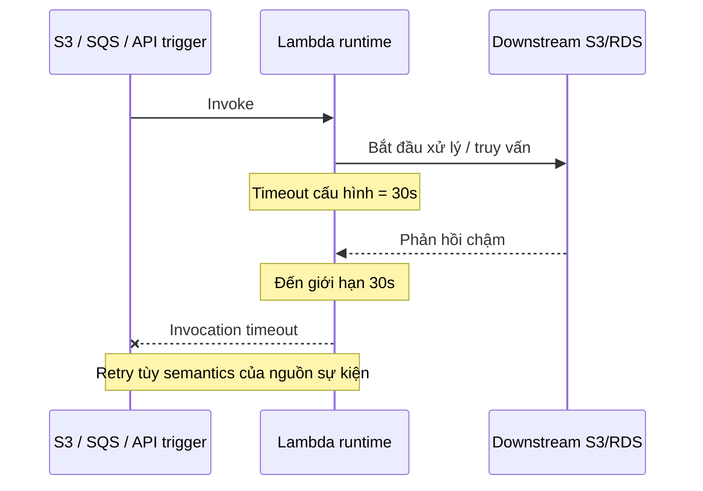
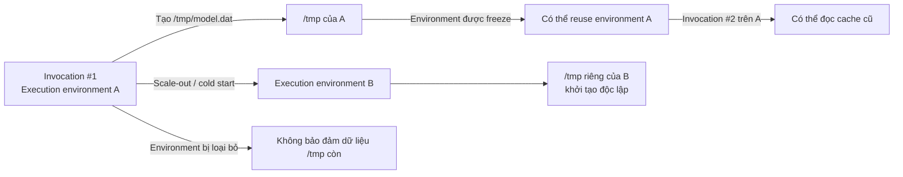
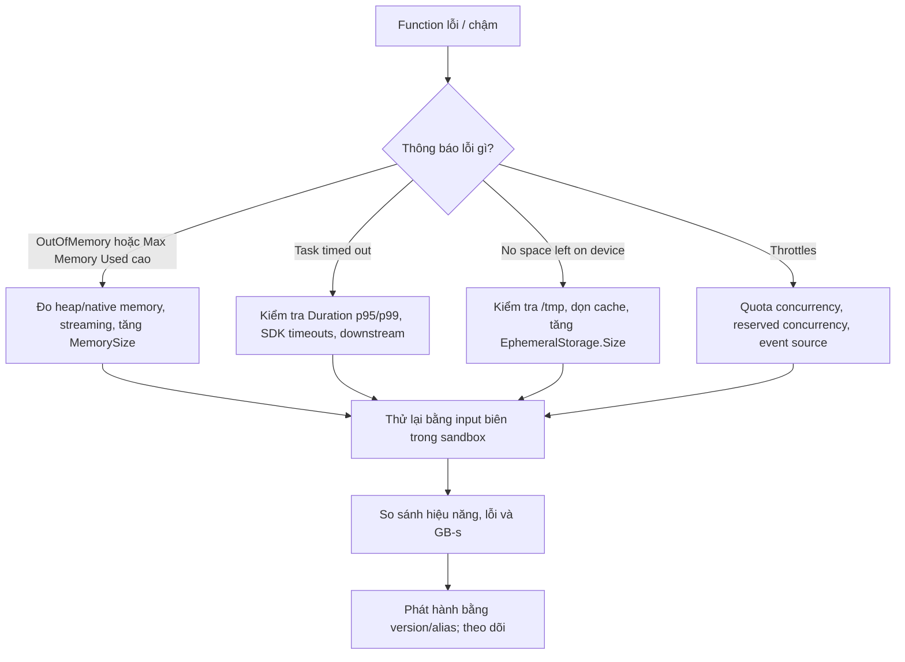

# Memory, CPU, timeout và ephemeral storage

> **Học phần:** CLOUD_PROVIDERS_AWS  
> **Chương:** Điện toán Lambda  
> **Chủ đề:** Cấu hình tài nguyên thực thi AWS Lambda, tối ưu hiệu năng, an toàn dữ liệu tạm, khống chế thời gian chạy và chi phí.  
> **Đối tượng:** Lập trình viên Java/Spring Boot và người vận hành ứng dụng serverless trên AWS.

> **Phạm vi và mốc thời gian:** Bài học tập trung vào **AWS Lambda Event Functions tiêu chuẩn** (mô hình một invocation trên một execution environment tại một thời điểm). Các giới hạn phổ biến trong bài được kiểm tra theo tài liệu AWS ngày **20/11/2026**. AWS đã có các mô hình mới như **Lambda Managed Instances**, **Lambda Web Functions** và một số cấu hình có accelerator, nên **không dùng các giới hạn của Event Functions tiêu chuẩn để kết luận cho mọi sản phẩm Lambda**. Ví dụ, một số invocation trên Lambda Managed Instances có thể được cấu hình tối đa **5.400 giây (90 phút)**; cấu hình accelerator đặc thù có thể cho phép ephemeral storage tới **32.768 MB**. Phải xem hướng dẫn và quota riêng khi sử dụng những tính năng đó.

## 1. Bài toán: cùng một hàm Lambda nhưng cấu hình tài nguyên khác nhau

Một hệ thống quản lý khóa học nhận tệp CSV qua Amazon S3. S3 kích hoạt một **Lambda function** viết bằng Java để:

1. Tải tệp từ S3.
2. Giải nén và phân tích dữ liệu.
3. Tạo bản tóm tắt PDF hoặc CSV.
4. Ghi kết quả lên S3 và cập nhật trạng thái xử lý vào DynamoDB.
5. Ghi nhật ký và metrics vào Amazon CloudWatch.

Với tập dữ liệu nhỏ, hàm có thể hoàn thành trong vài giây. Nhưng khi tệp lớn, một hoặc nhiều lỗi xảy ra:

- `Runtime.OutOfMemory` hoặc container bị hệ thống kết thúc vì thiếu RAM.
- Phân tích dữ liệu mất nhiều thời gian dù mức sử dụng heap chưa cao vì **CPU đang thiếu**.
- Invocation thất bại vì vượt **timeout**.
- Ghi file ra `/tmp` gặp `No space left on device` dù hàm vẫn còn RAM.
- Tăng bộ nhớ làm thời gian chạy giảm nhưng không biết **tổng chi phí** tăng hay giảm.
- Một lần invoke thành công do cache trong `/tmp`, lần sau chạy trên environment mới lại thất bại vì code phụ thuộc file tạm đã có.

Để vận hành hiệu quả, cần hiểu bốn đại lượng **liên hệ nhưng không đồng nhất**.

| Tài nguyên | Cấu hình AWS | Nó giới hạn hoặc điều chỉnh điều gì? |
|---|---|---|
| **Memory** | `MemorySize` | Ngân sách RAM runtime của execution environment và gián tiếp lượng CPU được cấp. |
| **CPU** | Tăng theo `MemorySize` trên Lambda Event Functions tiêu chuẩn | Năng lực xử lý tính toán; không có trường `Cpu: 2` độc lập khi dùng cấu hình tiêu chuẩn. |
| **Timeout** | `Timeout` | Giới hạn thời gian tối đa mỗi invocation trước khi Lambda dừng thực thi. |
| **Ephemeral storage** | `EphemeralStorage.Size` | Dung lượng filesystem tạm có thể ghi ở `/tmp`, **không phải RAM** và không phải nơi lưu bền vững. |

**Mục tiêu bài học:** Chọn cấu hình đúng theo workload, đo kiểm có bằng chứng, bảo vệ dữ liệu và vận hành Lambda trong hạ tầng AWS có IAM, VPC, S3, database, monitoring, retry và kiểm soát chi phí.

## 2. Tổng quan giới hạn của Lambda Event Functions tiêu chuẩn

| Thông số | Mặc định | Khoảng cấu hình được hỗ trợ | Ghi chú |
|---|---:|---:|---|
| **Memory** | **128 MB** | **128–10.240 MB**, bước 1 MB | CPU tăng theo memory. |
| **CPU** | Tương ứng memory mặc định | Tương đương khoảng **1 vCPU tại 1.769 MB**, lên tới khoảng **6 vCPU ở 10.240 MB** | Không đặt vCPU độc lập trong Event Functions tiêu chuẩn. |
| **Timeout** | **3 giây** | **1–900 giây**, bước 1 giây | 900 giây = 15 phút. |
| **Ephemeral storage** | **512 MB** | **512–10.240 MB**, bước 1 MB | Áp dụng cho thư mục `/tmp`, được mã hóa khi lưu. |
| **Số invocation đồng thời** | Theo quota account/Region | Điều khiển bởi quota, reserved/provisioned concurrency và cơ chế scale | Mỗi execution environment có `/tmp` riêng. |

**Đơn vị:** Tài liệu và Console Lambda dùng nhãn `MB`, trong khi quota AWS mô tả `MB` tương ứng **1.024 KB**. Khi tính toán chi phí hoặc dung lượng, cần đọc kỹ đơn vị mà dịch vụ dùng, tránh trộn **MB, MiB, GB, GiB** và đơn vị tính giá.

**Ngoại lệ mới:** Với **Lambda Managed Instances**, một số invocation bất đồng bộ/event source mapping có timeout lên tới 90 phút, **ngoại trừ các nguồn sự kiện cụ thể** như Amazon MQ và Amazon DocumentDB. Những môi trường này có cách cấu hình tài nguyên khác. **Lambda Web Functions** cũng có chế độ CPU/request timeout riêng. Từ đây, mọi câu lệnh mẫu đều hướng tới **Event Function tiêu chuẩn**.

## 3. Tư duy đúng: tăng memory cũng tăng CPU

Trên Lambda Event Functions tiêu chuẩn, AWS phân bổ **CPU power theo lượng memory cấu hình**. Vì vậy:

- Một hàm chỉ dùng 150 MB RAM vẫn có thể chạy **rất chậm** ở cấu hình 256 MB nếu nó xử lý JSON, nén dữ liệu hoặc ký mã hóa.
- Tăng từ 512 MB lên 2.048 MB không chỉ thêm dung lượng RAM mà còn tăng lượng CPU được cấp.
- Tăng memory có thể giảm **thời gian thực thi**, đôi khi giảm **chi phí GB-giây** nếu giảm duration đủ lớn.
- Tăng memory không tự giúp khi bottleneck là database lock, API downstream chậm, đợi S3/network hoặc code tuần tự kém hiệu quả.

### 3.1. Mốc CPU tham chiếu

AWS mô tả tại khoảng **1.769 MB**, Lambda cung cấp lượng CPU tương đương **một vCPU** (một vCPU-second công suất mỗi giây). Ở mức **10.240 MB**, Event Function tiêu chuẩn có thể sử dụng khoảng **6 vCPU**.

| Memory cấu hình | Cách hiểu đúng về CPU |
|---:|---|
| 128 MB | Rất ít năng lực CPU; hợp các tác vụ cực nhẹ, điều hướng sự kiện. |
| 512 MB | CPU được cấp nhiều hơn 128 MB, nhưng không bảo đảm đủ cho ETL nặng. |
| 1.769 MB | Mốc tham chiếu khoảng **1 vCPU**. |
| 2.048–4.096 MB | Có nhiều CPU hơn; chương trình đa luồng có thể được lợi nếu xử lý song song thực sự. |
| 10.240 MB | Nhiều nhất trong dải tiêu chuẩn; tối đa khoảng **6 vCPU**. |

**Không suy ra:** Cấu hình memory tăng gấp đôi **bảo đảm** tốc độ ứng dụng tăng gấp đôi. Kết quả phụ thuộc CPU utilization, I/O, JVM startup, network, thuật toán, số threads và dữ liệu thử nghiệm.

### 3.2. Kiểu bottleneck khác nhau

| Triệu chứng | Nút thắt khả dĩ | Hướng kiểm tra |
|---|---|---|
| `Max Memory Used` gần `Memory Size`, OOM | Thiếu RAM hoặc memory leak | Heap, native memory, buffer, libraries, extensions |
| RAM còn rộng nhưng xử lý nén/parse chậm | Thiếu CPU | So sánh duration ở nhiều `MemorySize` |
| Tăng memory mà thời gian không giảm | Đợi I/O hoặc dependency | S3/RDS latency, retry, kết nối VPC |
| Download rất nhanh nhưng tạo PDF lâu | CPU/library/GC | Profiling, CPU/memory tuning |
| Hàm timeout chỉ ở input lớn | Input size, thuật toán hoặc downstream | Dữ liệu p95/p99, max workload, timeout |
| `No space left on device` trong `/tmp` | Thiếu ephemeral disk | Theo dõi free space, cleanup, tăng storage |
| Memory thấp nhưng disk đầy | Phải tách RAM và disk | Tăng `EphemeralStorage.Size` hoặc streaming |

### 3.3. Java/Spring Boot và CPU

Với Java:

- **Cold start** có thể phải tải class, khởi tạo dependency injection, JVM/JIT và clients.
- Quá nhiều thư viện có thể tăng thời gian init và memory sử dụng.
- Các tác vụ JSON parsing, PDF generation, compression, encryption và image processing có thể bị giới hạn CPU.
- `-Xmx` chỉ quản lý Java heap, không đại diện toàn bộ RAM của process (metaspace, thread stacks, native allocations và extensions cũng tiêu thụ memory).
- Nhiều threads không giúp nếu Lambda chưa được cấp đủ CPU tương ứng hoặc tác vụ không có song song thật.

**Đừng cố đặt `-Xmx` bằng toàn bộ `MemorySize`**: runtime còn cần native memory, JVM metadata, threads và AWS extensions. Dùng memory profiling theo môi trường phù hợp thay vì một con số cứng áp dụng mọi app.

## 4. Chọn memory bằng thí nghiệm thay vì cảm tính

Giả sử hàm Java xử lý một tệp CSV 20 MB. Hãy đo một tập các cấu hình với **cùng input và cùng tài nguyên downstream**:

| Memory | Duration quan sát *giả định* | GB-giây cho một invocation *giả định* | Nhận xét |
|---:|---:|---:|---|
| 512 MB | 9,0 s | 0,5 × 9,0 = **4,5 GB-s** | Chậm hơn; CPU có thể thiếu. |
| 1.024 MB | 5,0 s | 1 × 5,0 = **5,0 GB-s** | Nhanh hơn, GB-s cao hơn một chút. |
| 2.048 MB | 2,2 s | 2 × 2,2 = **4,4 GB-s** | Nhanh và có thể rẻ hơn mức 512 MB về compute GB-s. |
| 4.096 MB | 1,9 s | 4 × 1,9 = **7,6 GB-s** | Lợi ích tốc độ nhỏ so với tăng compute GB-s. |

**Đây là số liệu minh họa, không phải benchmark AWS.** Nó chỉ thể hiện vì sao cấu hình tối ưu phụ thuộc cả độ trễ lẫn chi phí. Chưa tính phí request, khởi tạo, Provisioned Concurrency, ephemeral storage, network, S3 hoặc các tính năng đặc thù.

### 4.1. Cách tiến hành tuning

1. Xác định yêu cầu **p95/p99 latency**, throughput và chi phí mục tiêu.
2. Chuẩn bị tập input thật: nhỏ, trung bình, lớn, dữ liệu khó/biên và input bất thường.
3. Chạy baseline ở memory hiện tại; ghi duration, errors, memory, cold start, GB-s và phụ thuộc downstream.
4. Thử nhiều cấu hình (ví dụ 512, 1.024, 2.048, 3.008, 4.096 MB); chỉ đổi một nhóm thông số tại một thời điểm.
5. Đối chiếu chi phí/số invocation, p95/p99, OOM và timeout; không chỉ nhìn duration trung bình.
6. Chọn cấu hình có **SLO đạt** với chi phí chấp nhận được, thêm biên cho tăng trưởng.
7. Quản lý kết quả trong CI/CD/IaC, theo dõi sau deploy và chạy lại benchmark khi code/dependency thay đổi.

Công cụ mã nguồn mở [AWS Lambda Power Tuning](https://github.com/alexcasalboni/aws-lambda-power-tuning) dùng Step Functions để thử memory allocations. **Cẩn trọng:** Nó thực sự invoke function trên tài khoản AWS, có thể gọi API và sinh side effects/chi phí. Chỉ chạy với dữ liệu sandbox, tác vụ idempotent hoặc mock dependencies phù hợp.

### 4.2. Khi nào tăng memory thay vì tăng timeout?

- **CPU-bound:** Tăng memory có thể làm xử lý nhanh hơn, giảm nguy cơ timeout.
- **Memory-bound:** Tăng memory tránh OOM; cũng cần sửa leak/streaming/buffer nếu có.
- **I/O-bound:** Đặt timeout cho HTTP/database và xử lý retries; tăng memory có thể không sửa vấn đề.
- **Data-bound:** Dữ liệu quá lớn so với mô hình xử lý một invocation thì chia nhỏ batch, dùng SQS, Step Functions hoặc AWS Batch/ECS thay vì chỉ kéo memory/timeout lên tối đa.

## 5. Timeout: thời gian tối đa của một invocation

**Timeout** là thời lượng tối đa AWS Lambda cho phép một invocation chạy trước khi dừng. Với Event Functions tiêu chuẩn:

- Mặc định: **3 giây**.
- Cấu hình: **1–900 giây**, bước 1 giây.
- 900 giây = **15 phút**.
- Khi vượt giới hạn, invocation kết thúc với **timeout error**, có thể kích hoạt retry hoặc cơ chế xử lý thất bại tùy nguồn gọi.

### 5.1. Timeline khi hàm hết thời gian



Một lỗi timeout **không có nghĩa mọi thao tác bên ngoài đã được rollback**. Ví dụ Lambda có thể đã ghi một record RDS thành công, sau đó hết hạn khi cập nhật trạng thái. Nếu sự kiện được gửi lại, hàm có thể ghi trùng trừ khi có **idempotency key/unique constraint/transaction**.

### 5.2. Ước lượng timeout hợp lý

Đừng lấy duration trung bình 8 giây rồi đặt timeout 9 giây. Cần tính:

- Kích thước input lớn thực tế và phân bố p95/p99.
- Cold start/khởi tạo thư viện ở các môi trường tương ứng.
- Độ trễ cao nhất chấp nhận được của S3/RDS/HTTP downstream.
- Số lần retry/backoff của AWS SDK và HTTP client.
- Thời gian upload kết quả, commit giao dịch và cleanup.
- Giới hạn của nguồn gọi (API Gateway, ALB, client timeout, SQS visibility, Step Functions).

Ví dụ một job thường chạy 15–20 giây nhưng có thể tới 45 giây khi dữ liệu lớn; thử timeout **60–90 giây** là một giả thuyết hợp lý để đo kiểm, không phải cấu hình bảo đảm. Với API đồng bộ, client có thể timeout sớm hơn Lambda và coi request thất bại dù Lambda vẫn còn chạy.

### 5.3. Timeout ở nhiều lớp

| Lớp | Timeout hoặc deadline | Nguy cơ nếu bỏ qua |
|---|---|---|
| Lambda function | `Timeout` | Runtime bị dừng khi vượt giới hạn. |
| HTTP client / AWS SDK | Connect/read/API call timeout | Một request xuống DB/API kéo dài chiếm hết ngân sách invocation. |
| API Gateway hoặc ALB | Integration/idle timeout theo loại tích hợp | User gặp timeout trước khi Lambda xong. |
| Database | Statement/transaction/connect timeout | Lock hoặc query chậm kéo dài. |
| SQS | Visibility timeout của message | Message xuất hiện lại khi Lambda chưa xử lý xong. |
| Step Functions | Task timeout/heartbeat theo workflow | Workflow xử lý sự kiện timeout/redo khác Lambda. |
| Client browser/mobile | Request timeout và retry policy | Có thể gửi trùng yêu cầu nếu thiếu idempotency. |

**Tránh tuyên bố một giá trị HTTP timeout cố định** cho mọi API Gateway/ALB, vì giới hạn có thể khác theo loại API, chế độ tích hợp và quota hiện hành. Tra đúng dịch vụ trước khi thiết kế endpoint chạy nhiều phút.

### 5.4. Dùng ngân sách thời gian còn lại trong Java

AWS Lambda Java Context có API `getRemainingTimeInMillis()` để ứng dụng biết còn bao lâu trước khi hết hạn.

Ví dụ:

```java
long remainingMs = context.getRemainingTimeInMillis();

if (remainingMs < 5_000) {
    // Không bắt đầu công việc mới mà không đủ ngân sách thời gian.
    throw new IllegalStateException("Not enough time to start another step");
}
```

Đối với pipeline nhiều bước, dùng **deadline nội bộ** trước timeout AWS để còn kịp upload checkpoint/ghi trạng thái. Nhưng **không giả định luôn có cơ hội chạy finally khi timeout cứng**: hệ thống có thể chấm dứt invocation mà cleanup không hoàn tất.

## 6. Ephemeral storage: /tmp không phải RAM hoặc S3

AWS Lambda cấp một filesystem tạm **`/tmp`** cho mỗi **execution environment**.

- Mặc định **512 MB**, có thể tăng tới **10.240 MB** trong Event Functions tiêu chuẩn.
- Kích thước cấu hình từng bước **1 MB**.
- Storage là **disk space**, không phải Java heap hay memory allocation.
- Dữ liệu ở `/tmp` được **mã hóa at rest bằng khóa do AWS quản lý**.
- Các execution environments khác nhau **không chia sẻ cùng một thư mục `/tmp`**.
- Dữ liệu có thể **còn trong lần invoke tiếp theo nếu Lambda tái sử dụng đúng environment**, nhưng **không được bảo đảm** tồn tại dài hạn.

### 6.1. Sơ đồ vòng đời /tmp



**Câu quan trọng:** *Warm reuse có thể giữ file tạm; cold start hoặc một environment khác không thể giả định có file đó*. Với cache, luôn triển khai logic **cache miss → tải/tạo lại từ nguồn dữ liệu đáng tin cậy**.

### 6.2. Ví dụ sử dụng

| Workload | File tạm ở /tmp | Nơi dữ liệu cần lưu lâu dài |
|---|---|---|
| Đọc CSV 1 GB, tạo aggregate | Input tạm, file trung gian | S3 input và output |
| Tạo báo cáo PDF | Ảnh, font, PDF tạm | S3 output |
| Xử lý ảnh/video | Frame, ảnh resize, audio segment | S3 original và kết quả |
| ML inference nhỏ | Model cache hoặc tokenizer | S3 hoặc nguồn model được quản lý |
| Giải nén archive | File tạm khi unzip | S3 hoặc EFS nếu cần chia sẻ |
| Log/biên bản kiểm toán | Buffer ngắn hạn khi flush | CloudWatch Logs/S3/dịch vụ log |
| Secret/API token | **Không ưu tiên ghi ra file tạm** | Secrets Manager/SSM Parameter Store, IAM role |

### 6.3. /tmp không giống container image hay deployment package

Với **container image Lambda**, image filesystem đa phần chỉ đọc trong runtime; `/tmp` là nơi ghi tạm thường dùng. **Tăng `EphemeralStorage.Size` không làm tăng giới hạn kích thước container image/ZIP package**, cũng không làm heap Java lớn hơn.

Các tài nguyên cần phân biệt:

- **Lambda function code/layers:** được cung cấp theo cơ chế deployment, không phải vùng trống để lưu output.
- **Memory:** RAM runtime.
- **/tmp:** local scratch độc lập từng execution environment.
- **Amazon EFS:** hệ thống file dùng qua mạng, chia sẻ và lưu bền vững theo cấu hình; cần VPC/access point/IAM/network phù hợp.
- **Amazon S3:** object storage cho đầu vào/đầu ra bền vững; thao tác bằng API chứ không coi là block disk.

## 7. Chọn bao nhiêu ephemeral storage?

Đối với một job, tổng dung lượng cần thường lớn hơn kích thước input:

```text
Dung lượng scratch ước tính
= input tải về
+ các file giải nén
+ intermediate/sort/temporary output
+ output trước khi upload
+ bộ đệm và margin an toàn
```

Ví dụ **ước tính minh họa**:

| Thành phần | Dung lượng giả định |
|---|---:|
| Input nén từ S3 | 300 MiB |
| Dữ liệu sau giải nén | 1.100 MiB |
| File sort trung gian | 700 MiB |
| Output trước upload | 150 MiB |
| Margin | 500 MiB |
| **Tổng dự kiến** | **2.750 MiB** |

Với trường hợp đó, cấu hình `EphemeralStorage.Size=3072` hoặc lớn hơn là một ứng viên để test trong sandbox; nhưng còn phải kiểm tra kích thước lớn nhất thực, số file mở đồng thời, thư viện, thời gian chạy và cost. Không gán 10.240 MB cho mọi Lambda chỉ để "cho chắc" nếu không có nhu cầu.

### 7.1. Phân biệt disk-full và out-of-memory

| Lỗi | Gợi ý kiểm tra |
|---|---|
| `No space left on device` | Filesystem `/tmp` bị đầy; `Files.getFileStore(...).getUsableSpace()`; kiểm tra file rác/cache. |
| `java.lang.OutOfMemoryError: Java heap space` | Java heap bị thiếu hoặc leak; tăng memory hợp lý, streaming/chunking. |
| Runtime exited / out of memory | Memory tổng của runtime/extension vượt giới hạn; không nhất thiết chỉ là heap. |
| `Permission denied` ghi file | Sai đường dẫn/quyền; chỉ ghi vào writable locations được hỗ trợ. |
| File không tồn tại ở invocation sau | Environment mới hoặc cache bị dọn; phải tái tạo dữ liệu. |
| File cũ của invocation trước | Environment reuse; cần đặt tên file theo invocation, cleanup và không lẫn dữ liệu tenant. |

### 7.2. Concurrency và /tmp

Với Event Functions tiêu chuẩn, mỗi concurrent invocation dùng một execution environment riêng.

Giả sử:

- `EphemeralStorage.Size=5120` MB trên mỗi environment.
- Lambda có **100 concurrent invocations**.

Hệ thống có thể có **100 môi trường với dung lượng /tmp độc lập**, thay vì một ổ chia sẻ 5 GiB cho cả 100 invocations. Không có gì bảo đảm tất cả 100 environments đều chứa một cache model tải sẵn; mỗi môi trường có thể tải model riêng từ S3.

Hệ quả:

1. Thời gian warm-up và số S3 GET có thể tăng khi concurrency tăng.
2. Cùng một file model có thể bị tải lặp về nhiều environments.
3. Không sử dụng `/tmp` để phối hợp lock hoặc state giữa các concurrent invocations.
4. Nếu nhiều process/threads trong **một environment** cùng ghi file, phải tránh race condition.

## 8. Ví dụ Java: dùng /tmp đúng cách và kiểm tra thời gian

Ví dụ dưới đây dùng **AWS Lambda Java runtime** với interface `RequestHandler`. Nó tạo file tạm, đo dung lượng disk còn lại, không hard-code credentials, và dọn file trong đường thành công/lỗi thông thường.

```java
package com.example.lambda;

import com.amazonaws.services.lambda.runtime.Context;
import com.amazonaws.services.lambda.runtime.RequestHandler;

import java.io.IOException;
import java.io.UncheckedIOException;
import java.nio.charset.StandardCharsets;
import java.nio.file.Files;
import java.nio.file.Path;
import java.util.Map;

public final class ScratchHandler
        implements RequestHandler<Map<String, Object>, Map<String, Object>> {

    private static final Path SCRATCH = Path.of("/tmp");

    @Override
    public Map<String, Object> handleRequest(
            Map<String, Object> event, Context context) {

        if (context.getRemainingTimeInMillis() < 5_000) {
            throw new IllegalStateException(
                "Too little time remaining to process event");
        }

        Path tempFile = null;

        try {
            long usableBytes = Files.getFileStore(SCRATCH).getUsableSpace();
            if (usableBytes < 20L * 1024 * 1024) {
                throw new IllegalStateException(
                    "Insufficient scratch space in /tmp");
            }

            // Tên khác nhau theo invocation, tránh đè lên cache/file cũ.
            tempFile = Files.createTempFile(
                SCRATCH, "request-" + context.getAwsRequestId() + "-", ".txt");

            Files.writeString(
                tempFile,
                "temporary report output\n",
                StandardCharsets.UTF_8);

            long bytes = Files.size(tempFile);
            context.getLogger().log("scratch.bytes=" + bytes);

            // Production: upload output tới S3, xác minh kết quả,
            // rồi mới báo job thành công.
            return Map.of(
                "requestId", context.getAwsRequestId(),
                "outputBytes", bytes,
                "remainingMs", context.getRemainingTimeInMillis());

        } catch (IOException io) {
            throw new UncheckedIOException(io);

        } finally {
            if (tempFile != null) {
                try {
                    Files.deleteIfExists(tempFile);
                } catch (IOException cleanupError) {
                    context.getLogger().log(
                        "Failed to clean scratch file: "
                        + cleanupError.getClass().getSimpleName());
                }
            }
        }
    }
}
```

**Điều kiện để build:** Project Java cần dependency **`com.amazonaws:aws-lambda-java-core`** và một cơ chế đóng gói deployment artifact phù hợp với runtime. Nếu dùng Maven, xác định đúng Java version và artifact layout. Mã trên là ví dụ nghiệp vụ tối giản, **không phải đầy đủ một dự án Maven**.

**Lưu ý an toàn:**

- `finally` chạy trong đường control flow thông thường nhưng **không bảo đảm chạy nếu Lambda bị kết thúc cưỡng bức khi timeout, OOM hoặc crash**.
- Khi execution environment được tái sử dụng, các file cũ có thể còn; nên có chiến lược cleanup theo tuổi, dung lượng, và tên được ràng buộc theo job.
- Không ghi dữ liệu cá nhân hoặc secret vào log; ví dụ chỉ log số byte.
- Nếu cần file kết quả bền vững, upload ra S3/EFS trước khi trả success.
- Không truyền key S3 hoặc tên file tùy ý của user vào đường dẫn `/tmp` mà không normalize/validate, tránh path traversal.
- Memory của ứng dụng và disk space là hai nguồn lực độc lập.

### 8.1. Mô hình Java xử lý S3 object lớn

Khi đọc một S3 object 500 MiB, **không nên luôn `getObject()` thành một `byte[]` lớn** rồi giữ toàn bộ dữ liệu trong heap Java. Có hai hướng:

1. **Streaming:** Dùng AWS SDK for Java 2.x `ResponseInputStream<GetObjectResponse>` và xử lý theo chunks.
2. **Scratch file:** Tải xuống `/tmp/input-<request-id>` nếu thư viện cần file ngẫu nhiên; sau đó tạo output và upload ra S3.

Trong cả hai trường hợp, cần:

- IAM execution role cho `s3:GetObject`/`s3:PutObject` trong prefix cần thiết.
- Kiểm tra kích thước object và dung lượng tạm còn trước khi download.
- SDK read/connect timeouts nhỏ hơn ngân sách Lambda còn lại.
- Kiểm tra checksum, số byte hoặc manifest nếu nghiệp vụ yêu cầu.
- Không coi download thành công là job thành công nếu kết quả chưa được ghi ra đích bền vững.

### 8.2. Không tạo cache chứa dữ liệu tenant lẫn nhau

Execution environment có thể tái sử dụng giữa các invocations. Nếu handler phục vụ nhiều tenant, tránh:

- Đặt filename cố định `/tmp/input.csv` rồi đọc lại mà không kiểm tra người sở hữu/dữ liệu.
- Tin rằng dữ liệu được xóa hoàn toàn chỉ vì handler kết thúc.
- Đọc cache cũ không có version/checksum/TTL.
- Ghi token, mật khẩu, nội dung người dùng vào global static variables hoặc cache tạm thiếu cách ly.

Cách an toàn hơn: dùng key theo tenant/job có kiểm soát, xác minh checksum/version của nguồn, hạn chế quyền, xóa khi xong và ưu tiên dữ liệu bền vững ở dịch vụ được thiết kế cho việc đó.

## 9. Cấu hình cả ba thông số qua AWS Console

Một quy trình thao tác trên **Event Function** trong sandbox:

1. Mở **AWS Lambda Console → Functions**, chọn đúng Region.
2. Chọn function đã tồn tại và bạn có quyền thay đổi.
3. Mở **Configuration → General configuration → Edit**.
4. Chọn **Memory** phù hợp, ví dụ `2048 MB`.
5. Chọn **Timeout** `120 seconds`.
6. Chọn **Ephemeral storage** `3072 MB`.
7. Xem tác động chi phí và cấu hình trước khi **Save**.
8. Đợi Lambda cập nhật configuration; kiểm tra trạng thái update thành công.
9. Chạy invocation sandbox với input nhỏ, trung bình và lớn, xem CloudWatch Logs/metrics.
10. Ghi lại kết quả, điều chỉnh dựa trên đo kiểm thay vì giữ mãi giá trị thử nghiệm.

**Không chạy thử cấu hình cao nhất 10 GiB RAM và 10 GiB /tmp trên production chỉ vì muốn kiểm tra API.** Thay config ảnh hưởng runtime/cost/latency; tổ chức nên dùng alias hoặc quy trình phát hành kiểm soát.

### 9.1. Thay đổi memory có thể thay đổi thời gian xử lý

Nếu API sử dụng Lambda đồng bộ, sau khi đổi memory:

- Quan sát thời gian cold start và warm duration.
- Xác minh không có lỗi do thiếu RAM, GC hoặc thư viện native.
- Kiểm tra deadline của API Gateway/ALB/client.
- Kiểm tra số invocation đồng thời, lỗi và kết quả downstream.
- So sánh chi phí **trên một yêu cầu thành công**, không chỉ giá cấu hình memory cao.

## 10. AWS CLI: đọc và cập nhật cấu hình

Các lệnh dưới đây chỉ dùng với function do bạn được phép quản lý. Các tên là ví dụ.

### 10.1. Đọc cấu hình hiện tại (không thay đổi tài nguyên)

```bash
aws sts get-caller-identity

aws lambda get-function-configuration \
  --function-name course-report-worker \
  --region ap-southeast-1 \
  --query '{Memory:MemorySize,Timeout:Timeout,TempMB:EphemeralStorage.Size,Runtime:Runtime,Status:LastUpdateStatus}' \
  --output json
```

Thao tác đọc giúp phát hiện config đang được sử dụng. Nếu function chạy trên **published version/alias**, cần tìm cấu hình version thực đang được trigger; **không mặc định cấu hình `$LATEST` là cấu hình đang chạy Production**.

### 10.2. Cập nhật memory, timeout và /tmp

Ví dụ dành cho **shell POSIX/bash**, chú ý cú pháp JSON quote trong PowerShell có thể cần điều chỉnh:

```bash
aws lambda update-function-configuration \
  --function-name course-report-worker \
  --memory-size 2048 \
  --timeout 120 \
  --ephemeral-storage '{"Size":3072}' \
  --region ap-southeast-1
```

Sau đó:

```bash
aws lambda wait function-updated \
  --function-name course-report-worker \
  --region ap-southeast-1

aws lambda get-function-configuration \
  --function-name course-report-worker \
  --region ap-southeast-1 \
  --query '{Memory:MemorySize,Timeout:Timeout,TempMB:EphemeralStorage.Size,Update:LastUpdateStatus}' \
  --output table
```

Không gọi `update-function-configuration` liên tục khi chức năng đang cập nhật. Quan sát lỗi như cấu hình không hợp lệ, vượt quota hoặc policy IAM không đủ.

### 10.3. Hiểu tác động tới version/alias

Lambda **published versions** lưu code và phần lớn cấu hình **bất biến**, gồm memory/timeout/ephemeral storage. Thay đổi qua CLI thường cập nhật **`$LATEST`**, không thay thế trực tiếp published version đang dùng bởi alias Production.

Luồng chuẩn:

1. Cập nhật cấu hình/code trên `$LATEST`.
2. Test version chưa publish hoặc môi trường sandbox.
3. **Publish new version** sau khi kết quả đạt yêu cầu.
4. Chuyển **alias** hoặc cấu hình event source để dùng version mới theo deployment strategy.
5. Theo dõi metrics và có kế hoạch rollback về version ổn định trước đó.

**Đừng tin** đổi memory ở `$LATEST` tự sửa những invocation đang trỏ vào alias chứa published version cũ.

## 11. AWS SAM: cấu hình tài nguyên bằng Infrastructure as Code

AWS SAM cho phép khai báo cấu hình function trong source control, giảm tình trạng Console và CI/CD lệch nhau.

Mẫu `template.yaml` cho hàm Java:

```yaml
AWSTemplateFormatVersion: '2010-09-09'
Transform: AWS::Serverless-2016-10-31
Description: Course report worker example

Resources:
  CourseReportWorker:
    Type: AWS::Serverless::Function
    Properties:
      FunctionName: course-report-worker
      CodeUri: .
      Handler: com.example.lambda.ScratchHandler::handleRequest
      Runtime: java21
      Architectures:
        - arm64
      MemorySize: 2048
      Timeout: 120
      EphemeralStorage:
        Size: 3072
      Environment:
        Variables:
          APP_MODE: demo
```

Đây là **mẫu cấu hình cho dự án có Maven/Gradle/packaging phù hợp**, không phải toàn bộ source project. Một số Java dependencies native cần được build đúng kiến trúc `arm64`. Để sử dụng SDK/CloudWatch/S3 trong thực tế phải cấu hình IAM role/policies và triggers phù hợp; không dùng role quyền admin.

Quy trình triển khai thông thường:

```bash
# Chạy tại gốc project đã có template.yaml và build tool.
sam validate
sam build
sam deploy --guided
```

**Lưu ý:** `sam local invoke`/Docker giúp thử hành vi nghiệp vụ nhưng **không bảo đảm mô phỏng chính xác CPU, cold start, timeout hoặc chi phí của Lambda thực tế**. Benchmark cần có invocation trên môi trường AWS tương ứng, dùng dữ liệu không nhạy cảm.

### 11.1. Chọn kiến trúc CPU

AWS Lambda Event Functions có thể chạy các kiến trúc được hỗ trợ như `x86_64` và `arm64`. Chọn dựa trên:

- Các thư viện native (JNI, image/pdf processing) có build đúng kiến trúc.
- Tốc độ CPU thực tế của workload.
- Giá GB-second của từng kiến trúc theo Region và tính năng.
- Tương thích runtime, layers, extensions và container images.

**Không đổi architecture rồi so trực tiếp duration nếu code/native dependencies khác nhau**. Kiểm thử cả tính đúng và hiệu năng.

## 12. CloudWatch: biết hàm thiếu RAM, CPU hay thời gian

AWS Lambda tự gửi các metrics tiêu chuẩn vào **Amazon CloudWatch**. Chúng bao gồm:

| Metric | Điều cần xem |
|---|---|
| `Invocations` | Có bao nhiêu lần invoke; không đồng nghĩa số sự kiện duy nhất nếu retry. |
| `Duration` | Thời gian xử lý invocation; xem p95/p99 và Max. |
| `Errors` | Invocations thất bại (gồm lỗi runtime/timeout). |
| `Throttles` | Invocation bị từ chối do giới hạn concurrency/scaling. |
| `ConcurrentExecutions` | Mức concurrency trong account/function theo dimensions. |
| `AsyncEventAge` hoặc các metrics event source mapping | Độ trễ xử lý queue/async, cần xem theo nguồn gọi. |

Ngoài metrics tiêu chuẩn, các dòng **REPORT** trong CloudWatch Logs có thể thể hiện:

- `Duration`
- `Billed Duration`
- `Memory Size`
- `Max Memory Used`
- Có thể có `Init Duration` hoặc `Status: timeout/error` tùy runtime/log format.

Ví dụ **dòng log minh họa**, không phải output thực:

```text
REPORT RequestId: example-request-id Duration: 1680.25 ms Billed Duration: 1681 ms Memory Size: 1024 MB Max Memory Used: 910 MB Init Duration: 420.00 ms
```

**Ý nghĩa:** Max Memory Used 910 MB trên Memory Size 1024 MB cho thấy biên RAM không lớn. Nhưng chưa đủ để kết luận nguyên nhân CPU hay một memory leak; phải xem nhiều invocation và biểu đồ theo thời gian.

### 12.1. Logs Insights: xem memory và duration

Với log group Lambda có **auto-discovered REPORT fields**:

```sql
fields @timestamp, @duration, @billedDuration, @memorySize, @maxMemoryUsed
| filter @type = "REPORT"
| sort @timestamp desc
| limit 50
```

Để nhìn xu hướng duration:

```sql
filter @type = "REPORT"
| stats count(*) as invokes,
        avg(@duration) as avgDurationMs,
        pct(@duration, 95) as p95DurationMs,
        max(@duration) as maxDurationMs
  by bin(5m) as timeBucket
| sort timeBucket asc
```

Field tự khám phá có thể khác theo log format và loại function; nếu query không chạy, kiểm tra `@message` và field names thật, không nghĩ rằng chỉ vì không có kết quả thì Lambda không ghi log.

### 12.2. /tmp disk metrics có sẵn không?

Không mặc định có một metric CloudWatch tiêu chuẩn thể hiện **free bytes của `/tmp`** trong mọi Lambda function. Nếu workload cần monitor scratch space, ứng dụng có thể ghi custom metric hoặc dùng Lambda Insights/telemetry được cấu hình phù hợp.

Ví dụ Java:

```java
long freeBytes = Files.getFileStore(Path.of("/tmp")).getUsableSpace();
context.getLogger().log("tmp.free.bytes=" + freeBytes);
```

Để biến log thành cảnh báo, dùng CloudWatch Logs metric filter, Embedded Metric Format (EMF), hoặc custom metrics một cách có kiểm soát chi phí. Không ghi metrics với dimension có cardinality cực cao (ví dụ requestId cho từng request), vì làm tăng chi phí và khó quản lý.

### 12.3. Cảnh báo nên thiết kế

- `Errors > 0` hoặc error rate vượt baseline liên tục.
- `Duration p95/p99` tiến sát mức timeout.
- `Max Memory Used` thường gần giới hạn ở nhiều invocation.
- `ConcurrentExecutions` cao so với quota hoặc `Throttles` xuất hiện.
- `/tmp free bytes` dưới ngưỡng an toàn ở các batch lớn.
- DLQ/on-failure destination tích lũy sự kiện không xử lý được.
- Chi phí Lambda, logs hoặc data transfer tăng bất thường sau khi thay cấu hình.

## 13. Quy trình xử lý khi Lambda timeout hoặc OOM



### 13.1. Khi `Max Memory Used` gần MemorySize

1. Xác nhận nó xảy ra ở tất cả input hay chỉ một số.
2. Kiểm tra heap, buffer, thư viện native, extensions và thread count.
3. Dùng streaming/chunking thay vì tải dữ liệu khổng lồ vào một `byte[]`.
4. Thử tăng memory vừa đủ; đo p95, GC, OOM và cost.
5. Kiểm tra memory leak qua những lần warm reuse; static caches có thể lớn dần.

### 13.2. Khi invocation timeout

1. Xem `Duration` và lỗi có xuất hiện khi cold start/large input không.
2. Đo latency tới S3/RDS/API bên ngoài và số lần retry.
3. Thiết lập các deadline nội bộ cho SDK HTTP/database.
4. Đặt timeout lớn hơn worst-case hợp lý, **không chỉ tăng lên 900 giây cho mọi hàm**.
5. Với job dài bất thường, cân nhắc chia nhỏ batch hoặc dùng Step Functions/ECS/Batch.
6. Đảm bảo idempotency để tránh ghi trùng khi event được xử lý lại.

### 13.3. Khi /tmp đầy

1. Kiểm tra `EphemeralStorage.Size` hiện tại.
2. Kiểm tra bao nhiêu bytes được tải, giải nén, tạo output, và tồn đọng file.
3. Dọn file không cần thiết qua `finally` trong điều kiện bình thường.
4. Giới hạn tối đa input và dùng chunking/streaming nếu được.
5. Tăng /tmp nếu workload cần scratch lớn và còn trong dải Lambda hỗ trợ.
6. Nếu phải dùng workspace lớn, có trạng thái chia sẻ hoặc giữ lâu, cân nhắc **Amazon EFS hoặc S3**.

**Cảnh báo:** Không format, mount thủ công thiết bị của hạ tầng Lambda như một EC2. AWS Lambda quản lý runtime và `/tmp`; ứng dụng chỉ sử dụng vùng writable được cung cấp.

## 14. Timeout và semantics của các event sources

Cấu hình tài nguyên phải phù hợp với **nguồn gọi Lambda**. Sự kiện bị retry không cùng quy tắc ở mọi nguồn.

| Nguồn gọi | Hành vi cần quan tâm | Thiết kế |
|---|---|---|
| API Gateway / ALB / gọi đồng bộ | Client nhận lỗi nếu integration timeout hoặc Lambda timeout. | Giới hạn response time, đặt deadline, dùng async job cho tác vụ dài. |
| S3 Event Notifications | Xử lý bất đồng bộ, có thể delivery trùng. | Idempotency theo object key/version/ETag, destination/DLQ khi phù hợp. |
| SQS event source mapping | Nhận batch, message visibility timeout và retries. | Kiểm soát batch size, visibility, partial batch failures, DLQ. |
| DynamoDB Streams / Kinesis | Batch/iterator age, ordering theo shard và retry. | Kiểm soát checkpoint, batch windows và idempotency. |
| EventBridge | Retry/delivery tùy cấu hình target và event bus. | DLQ/retry policy, xử lý sự kiện trùng. |
| Step Functions | Workflow có retries, catches và deadlines riêng. | Chia job lớn thành các bước nhỏ, lưu state ở workflow hoặc dịch vụ bền vững. |

### 14.1. Ví dụ đặc biệt quan trọng: SQS visibility timeout

Theo AWS, với **SQS queue là nguồn Lambda Event Function**, nên đặt visibility timeout của queue **ít nhất 6 lần Lambda function timeout**, cộng thêm batching window nếu cấu hình.

Ví dụ:

```text
Lambda Timeout             = 120 giây
Maximum batching window    = 0 giây
SQS visibility timeout     >= 6 × 120 = 720 giây
```

Nếu batching window là 30 giây, khuyến nghị thành ít nhất **750 giây** trong mô hình minh họa.

**Giải thích:** Khoảng dự phòng hỗ trợ việc Lambda retry batch sau throttling. Nếu visibility quá ngắn, message có thể xuất hiện lại khi invocation trước chưa xử lý xong. **Ngay cả cấu hình đúng vẫn phải dùng idempotency**, vì event source có semantics *at least once*.

### 14.2. Task dài hơn 15 phút

Nếu không dùng một tính năng Lambda đặc biệt có giới hạn cao hơn, **một Event Function tiêu chuẩn không chạy một invocation 30 phút được**. Các lựa chọn:

- Chia một công việc thành các bước nhỏ với **Step Functions**.
- Đưa jobs vào **SQS**, xử lý theo lô nhỏ có checkpoint.
- Dùng **ECS/Fargate, AWS Batch hoặc EC2** cho compute dài liên tục.
- Xem xét **Lambda Managed Instances** nếu workload đáp ứng điều kiện/khuôn khổ mới và có lý do rõ ràng; đối chiếu giới hạn nguồn gọi và cơ chế triển khai thực tế.

Không dùng vòng lặp gọi lại chính Lambda vô hạn rồi coi đó là workflow bền vững; phải lưu state, deadline, retry count và trạng thái hoàn tất ở một hệ thống phù hợp.

## 15. Chi phí: memory và /tmp là hai cấu phần riêng

Trên mô hình tính phí Lambda tiêu chuẩn, chi phí thường xét:

1. **Requests:** số lượt invoke được tính phí theo điều kiện tài khoản/gói sử dụng.
2. **Compute duration:** thời gian tính phí × memory cấu hình, thường tính theo **GB-second** và có khác biệt theo kiến trúc, tính năng, Region.
3. **Ephemeral storage bổ sung:** vượt **512 MB miễn phí bổ sung** được tính theo dung lượng cấu hình × thời lượng thực thi, cũng theo mô hình **GB-second**.
4. **Provisioned concurrency / SnapStart / tính năng khác nếu dùng:** có mô hình phí riêng.
5. **CloudWatch Logs, X-Ray, S3, DynamoDB, NAT/VPC endpoints và data transfer:** các dịch vụ liên quan có thể tính phí riêng.

### 15.1. Ví dụ GB-second cho memory

Giả sử một function dùng **2.048 MB (2 GiB)**, chạy trung bình **3 giây**, được gọi **100.000 lần**:

```text
Compute (GiB-seconds quy đổi để minh họa)
= 2 GiB × 3 giây × 100.000
= 600.000 GiB-giây
```

Con số trên là khối lượng compute **giả định**, không phải tiền USD. Thực tế cần xem cách AWS tính billed duration, thời gian init/billing theo tính năng, free tier, tiered pricing và giá Region/architecture.

### 15.2. Ví dụ GB-second cho /tmp

Cùng function đó cấu hình **5.120 MB (5 GiB) ephemeral storage**. Mặc định **512 MB (0,5 GiB)** đã được cung cấp không tính thêm tiền storage.

```text
Ephemeral storage bổ sung
= 5 GiB - 0,5 GiB
= 4,5 GiB

Additional ephemeral storage usage
= 4,5 GiB × 3 giây × 100.000
= 1.350.000 GiB-giây
```

Mức giá GB-second cho phần storage **khác** giá GB-second tính toán; không được dùng giá compute rồi nhân cho storage. Mô hình trên cũng không tự tính toàn bộ chi phí nếu invocation có phần billed duration/initialization khác nhau.

**Tăng /tmp mà không tăng MemorySize** sẽ giúp tăng scratch capacity nhưng không tăng CPU/RAM. **Tăng MemorySize mà không tăng /tmp** có thể làm parsing nhanh hơn nhưng vẫn hết disk khi cần giải nén nhiều file.

### 15.3. Ba sai lầm khi tính chi phí

- **Sai lầm 1:** Chọn memory thấp nhất luôn rẻ nhất. Một hàm CPU-bound ở memory thấp có thể mất thời gian đủ lâu để GB-s cao hơn phương án memory lớn.
- **Sai lầm 2:** Cấp 10 GiB /tmp không tốn phí vì filesystem chỉ tạm thời. AWS tính phí cho **dung lượng bổ sung đã cấu hình vượt 512 MB**, theo thời lượng và biểu phí áp dụng.
- **Sai lầm 3:** Chỉ tính Lambda mà không tính S3 requests, network/NAT, CloudWatch ingestion, EFS, database và retry.

Nên so sánh **chi phí trên một job thành công**, có tính tỷ lệ retry và latency mục tiêu. Dùng AWS Pricing Calculator, Cost Explorer và Cost and Usage Report với thông số thực tế.

## 16. Bảo mật và độ tin cậy khi tăng tài nguyên

### 16.1. IAM least privilege

Việc tăng memory, timeout hay /tmp **không tự cấp quyền AWS API**. Function dùng **execution role** riêng để đọc/ghi S3, DynamoDB, KMS, Secrets Manager hoặc CloudWatch Logs.

Ví dụ policy chỉ cho phép đọc từ một prefix và ghi kết quả vào prefix khác:

```json
{
  "Version": "2012-10-17",
  "Statement": [
    {
      "Sid": "ReadInputs",
      "Effect": "Allow",
      "Action": "s3:GetObject",
      "Resource": "arn:aws:s3:::course-data-demo-123456789012/input/*"
    },
    {
      "Sid": "WriteReports",
      "Effect": "Allow",
      "Action": "s3:PutObject",
      "Resource": "arn:aws:s3:::course-data-demo-123456789012/output/*"
    }
  ]
}
```

Các ARNs chỉ minh họa. Nếu object dùng SSE-KMS, phải xem quyền KMS/key policy tương ứng; nếu muốn list bucket hoặc đọc Secrets Manager phải bổ sung các action/resource thực sự cần. Không dùng `AdministratorAccess` để khắc phục thiếu quyền nhanh chóng.

### 16.2. Dữ liệu nhạy cảm trong /tmp

Dữ liệu `/tmp` được AWS mã hóa at rest bằng khóa do AWS quản lý, nhưng:

- Một invocation sau trên cùng environment **có thể nhìn thấy file còn sót**.
- Một process/library chạy cùng environment có thể truy cập vùng filesystem trong phạm vi quyền của nó.
- Không dùng /tmp làm nơi lưu thông tin riêng lâu dài.
- Cần dọn file, tách tên theo job/tenant, kiểm tra input và tránh để secret trong logs.
- Dữ liệu cần backup/audit phải được lưu ở S3/RDS/CloudWatch hoặc hệ thống bền vững phù hợp.

### 16.3. VPC không thay đổi định nghĩa /tmp

Đặt Lambda vào private subnets để truy cập RDS/ElastiCache **không làm `/tmp` trở thành EBS/EFS**. Runtime vẫn có ephemeral storage của Lambda.

Mạng vẫn cần được thiết kế:

- Security group cho phép TCP từ Lambda ENI đến database.
- Routes, DNS và NAT/VPC endpoints để gọi AWS APIs theo kiến trúc.
- Khi function nằm trong VPC mà không có đường outbound phù hợp, S3/API calls có thể timeout dù IAM role đúng.
- EFS integration cần mount targets, access points và quyền riêng; nó là lựa chọn khác cho lưu trữ file bền vững/chia sẻ.

### 16.4. Timeouts cần gắn với idempotency

Nếu function đã ghi một phần dữ liệu rồi timeout, downstream state có thể ở trạng thái nửa chừng. Hãy:

1. Đặt job ID/idempotency key duy nhất.
2. Kiểm tra trạng thái job trước khi xử lý lại.
3. Ghi output vào key tạm hoặc versioned prefix theo job.
4. Chỉ mark `COMPLETED` sau khi kết quả bền vững được xác nhận.
5. Giữ cơ chế retry có giới hạn và DLQ/on-failure destination khi nguồn sự kiện hỗ trợ.
6. Test host/runtime failure, timeout, OOM và disk-full.

## 17. Lab: tối ưu Lambda tạo báo cáo từ S3

**Kịch bản:** Một Lambda Java phân tích CSV và tạo báo cáo. Tập input gồm ba tệp giả định:

- `small.csv` — 1 MiB.
- `medium.csv` — 50 MiB.
- `large.csv` — 400 MiB, khi giải nén tạo tới 1.200 MiB dữ liệu.

Yêu cầu: xử lý thành công trong **dưới 120 giây với input lớn**, không giữ dữ liệu tạm như nguồn chân lý, giới hạn chi phí và có log/metrics để giải thích kết quả.

### 17.1. Checklist lab

1. Tạo hoặc dùng function **sandbox** từ Java source/ZIP/SAM với execution role chỉ được đọc `input/` và ghi `output/` vào S3.
2. Đọc cấu hình hiện tại bằng `get-function-configuration`; ghi lại memory, timeout, /tmp và Region.
3. Chạy baseline với `MemorySize=512` MB, `Timeout=30` giây, `EphemeralStorage.Size=512` MB trên input nhỏ/trung bình; không thử large input nếu biết sẽ gây disk-full.
4. Thu thập `Duration`, `Max Memory Used`, errors, input size và lượng `/tmp` còn trống.
5. Thử `MemorySize=1024` hoặc `2048` MB; giữ timeout/storage như cũ nếu input cho phép để đánh giá riêng ảnh hưởng CPU.
6. Cấp thêm `EphemeralStorage.Size=3072` MB rồi thử input lớn trong sandbox.
7. Tăng timeout lên `120` giây khi có lý do từ benchmark; kiểm tra SDK timeouts và S3 throughput.
8. Tính GB-second từ số liệu đã đo; so p95, success rate và chi phí.
9. Thử scale concurrency ở mức an toàn và quan sát mỗi environment có /tmp riêng; không chia sẻ file giữa invocations.
10. Tạo lỗi chủ động ở sandbox: timeout thấp, thiếu disk hoặc exception ứng dụng; xác nhận retry/idempotency không tạo output trùng.
11. Triển khai version mới qua alias/staging, theo dõi CloudWatch.
12. Dọn resource thử nghiệm hoặc đưa về mức ngân sách cho phép theo quy trình.

### 17.2. Bảng ghi kết quả

| Lần thử | Input | Memory MB | Timeout s | /tmp MB | Duration p95 | Max Memory Used | Kết quả | GB-s |
|---|---|---:|---:|---:|---:|---:|---|---:|
| A | small | 512 | 30 | 512 | Đo thực tế | Đo thực tế | Pass/Fail | Tính |
| B | medium | 512 | 30 | 512 | Đo thực tế | Đo thực tế | Pass/Fail | Tính |
| C | medium | 2.048 | 30 | 512 | Đo thực tế | Đo thực tế | Pass/Fail | Tính |
| D | large | 2.048 | 120 | 3.072 | Đo thực tế | Đo thực tế | Pass/Fail | Tính |
| E | large | 4.096 | 120 | 3.072 | Đo thực tế | Đo thực tế | Pass/Fail | Tính |

Không điền số benchmark bịa đặt vào bảng. Tính chi phí từ **billed duration và cấu hình thực**, không dùng thời gian chạy của máy laptop như thời gian Lambda.

### 17.3. Một tình huống điều tra

Sau khi tăng memory từ 512 MB lên 2.048 MB, p95 giảm từ 18 giây còn 6 giây nhưng 2% invocations vẫn timeout.

Nhóm cần phân tích:

1. Timeout có rơi vào input lớn hoặc lúc RDS chậm không?
2. Có retries khi S3 download hoặc gọi API bên ngoài không?
3. Java heap và native memory có gần giới hạn không?
4. /tmp có đầy hoặc tồn file rác từ warm reuse không?
5. Khả năng xử lý khác biệt giữa cold starts và warm starts thế nào?
6. Tăng timeout có giải quyết đúng nguyên nhân hay chỉ che giấu lỗi?
7. Những jobs timeout đã ghi dữ liệu ra S3/DynamoDB một phần chưa?
8. Có nên chuyển workload dài sang Step Functions/ECS/Batch không?

## 18. Các câu hỏi tự kiểm tra

**1. Lambda 512 MB memory thì /tmp cũng có nghĩa là 512 MB RAM?**  
Không. Memory là ngân sách RAM; /tmp là disk storage tạm, cấu hình riêng.

**2. Cấu hình MemorySize từ 512 lên 2.048 MB có ảnh hưởng CPU không?**  
Có. Với Event Functions tiêu chuẩn, AWS cấp CPU theo memory.

**3. Muốn cấp đúng 2 vCPU nhưng giữ MemorySize 128 MB bằng setting CPU riêng được không?**  
Không theo mô hình Event Functions tiêu chuẩn. Những chế độ Lambda khác có cơ chế cấu hình riêng và phải đọc tài liệu của chúng.

**4. Lambda Event Function tiêu chuẩn có thể đặt timeout 1.800 giây không?**  
Không. Dải tiêu chuẩn là 1–900 giây. Một số Lambda Managed Instances có ngoại lệ tới 5.400 giây cho invocation được hỗ trợ.

**5. /tmp có được chia sẻ giữa 20 concurrent invocations của Event Function tiêu chuẩn không?**  
Không. Mỗi execution environment có /tmp riêng; không dùng /tmp làm shared datastore.

**6. Khi function được gọi lại sau 5 phút, file trong /tmp chắc chắn còn?**  
Không. File có thể còn nếu đúng warm environment được reuse, nhưng không được bảo đảm.

**7. Vì sao có thể tăng MemorySize mà chi phí compute GB-s lại giảm?**  
Nếu duration giảm **theo tỷ lệ lớn hơn mức tăng memory**, tích số memory × duration có thể nhỏ hơn.

**8. Nếu code lỗi `No space left on device`, chỉ tăng MemorySize có giải quyết chắc chắn không?**  
Không. Cần kiểm tra và tăng ephemeral disk hoặc giảm nhu cầu scratch/streaming.

**9. /tmp đã mã hóa thì có thể lưu secret để invocation sau dùng lại mãi không?**  
Không. Mã hóa at rest không biến /tmp thành secret store bền vững; dùng IAM/Secrets Manager/SSM phù hợp.

**10. Lệnh update cấu hình `$LATEST` có tự đổi memory của published version mà alias production đang trỏ tới không?**  
Không. Published version có cấu hình bất biến; cần phát hành version mới và cập nhật alias/deployment.

**11. SQS visibility timeout đặt bằng đúng Lambda timeout có phải khuyến nghị tốt?**  
Không. AWS khuyến nghị tối thiểu khoảng **6 × Lambda timeout**, cộng batching window khi có.

**12. Một job 45 phút nên làm thế nào nếu đang dùng Lambda Event Function tiêu chuẩn?**  
Thiết kế workflow chia nhỏ, queue/checkpoint hoặc chuyển sang ECS/Batch; xem xét Managed Instances đặc thù nếu đủ điều kiện và phù hợp.

**13. Có thể coi `Max Memory Used` gần 50% là bằng chứng CPU không thiếu?**  
Không. RAM và CPU liên quan qua cấu hình, nhưng CPU bottleneck cần chứng minh bằng duration/benchmark/profiling.

**14. Tăng ephemeral storage mặc định từ 512 lên 5.120 MB có mất tiền phần thêm không?**  
Có, theo cơ chế giá của Lambda cho **dung lượng cấu hình vượt 512 MB** và billed duration.

## 19. Tổng kết và nguồn tham khảo chính thức

Đối với **AWS Lambda Event Functions tiêu chuẩn**, *memory* là nút điều chỉnh cả **RAM lẫn CPU**, *timeout* giới hạn thời gian invocation, còn *ephemeral storage* cấp dung lượng file tạm ở `/tmp`. Chọn cấu hình tốt cần **đo duration, memory, errors, disk usage, concurrency và chi phí**, chứ không chỉ đặt tất cả thông số tối đa. Ứng dụng phải xử lý timeout, retry, idempotency và cleanup; mọi dữ liệu quan trọng phải được lưu trong **S3, EFS, database hoặc kho bền vững** phù hợp.

### Tài liệu AWS

- [AWS Lambda — Configure function memory](https://docs.aws.amazon.com/lambda/latest/dg/configuration-memory.html)
- [AWS Lambda — Configure function timeout](https://docs.aws.amazon.com/lambda/latest/dg/configuration-timeout.html)
- [AWS Lambda — Configure ephemeral storage](https://docs.aws.amazon.com/lambda/latest/dg/configuration-ephemeral-storage.html)
- [AWS Lambda — Quotas](https://docs.aws.amazon.com/lambda/latest/dg/gettingstarted-limits.html)
- [AWS Lambda — Execution environment lifecycle and reuse](https://docs.aws.amazon.com/lambda/latest/dg/lambda-runtime-environment.html)
- [AWS Lambda — Configuration troubleshooting](https://docs.aws.amazon.com/lambda/latest/dg/troubleshooting-configuration.html)
- [AWS Lambda — Best practices](https://docs.aws.amazon.com/lambda/latest/dg/best-practices.html)
- [AWS Lambda — Function versions and aliases](https://docs.aws.amazon.com/lambda/latest/dg/configuration-versions.html)
- [AWS Lambda — Monitoring metrics](https://docs.aws.amazon.com/lambda/latest/dg/monitoring-metrics-types.html)
- [AWS Lambda — Lambda with SQS event source mapping](https://docs.aws.amazon.com/lambda/latest/dg/services-sqs-configure.html)
- [AWS Lambda — Concurrency and scaling](https://docs.aws.amazon.com/lambda/latest/dg/lambda-concurrency.html)
- [AWS Lambda — Using Amazon EFS](https://docs.aws.amazon.com/lambda/latest/dg/configuration-filesystem.html)
- [AWS Lambda — AWS SAM templates for Lambda](https://docs.aws.amazon.com/serverless-application-model/latest/developerguide/sam-resource-function.html)
- [AWS Lambda — Pricing including additional ephemeral storage](https://aws.amazon.com/lambda/pricing/)
- [AWS Lambda — Lambda Managed Instances overview](https://docs.aws.amazon.com/lambda/latest/dg/lambda-managed-instances.html)
- [AWS Lambda — Lambda Web Functions](https://docs.aws.amazon.com/lambda/latest/dg/web-functions.html)

> **Ghi nhớ:** **Memory ≠ /tmp.** Tăng memory giúp tăng CPU; tăng `/tmp` chỉ mở rộng dung lượng lưu file tạm. Timeout phải phù hợp với thời gian thực, hệ thống gọi, khả năng retry và yêu cầu phục hồi. Giữ kết quả quan trọng ở nơi bền vững, không dựa vào warm cache, và tối ưu dựa trên số liệu của workload thực tế.
