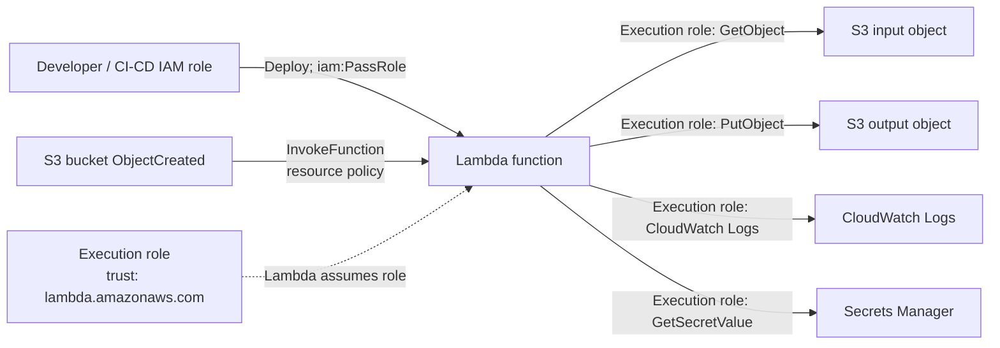
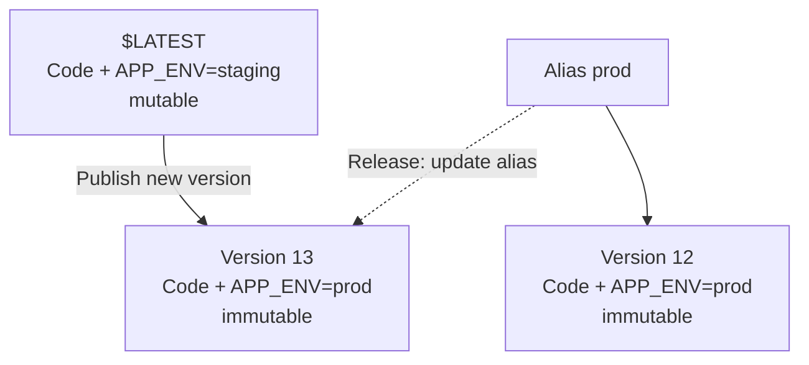
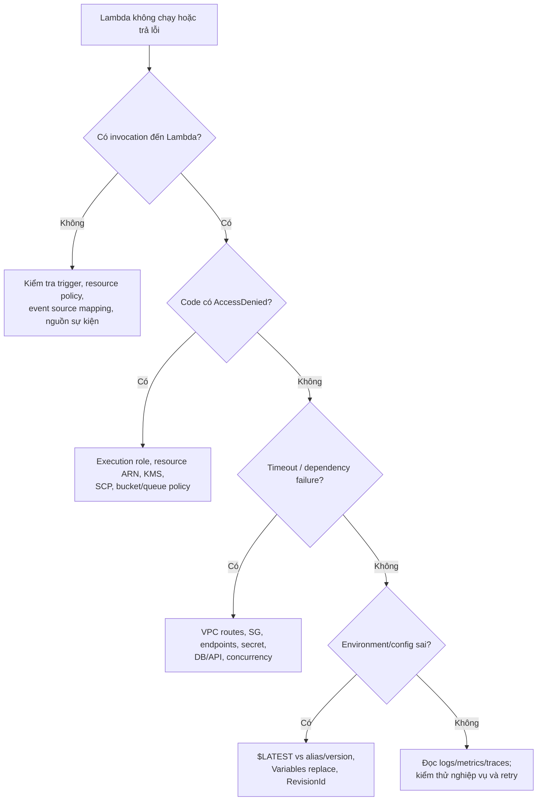
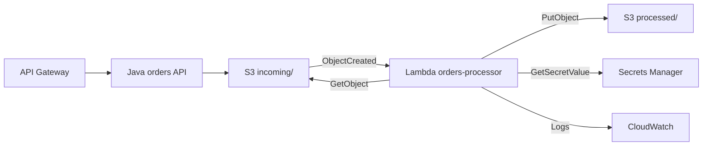

# Execution role, resource policy và cấu hình môi trường

## Mục tiêu học tập

Sau bài này, bạn có thể:

1. Phân biệt **execution role**, **trust policy**, **identity-based permissions policy**, **resource-based policy** và **quyền của người triển khai** trong AWS Lambda.
2. Giải thích các luồng gọi Lambda từ API, S3, EventBridge, SNS, SQS, DynamoDB Streams và các principal ở account khác; xác định **ai cần quyền invoke**, **ai cần quyền đọc nguồn sự kiện**.
3. Tạo execution role theo **least privilege**, cho phép ghi CloudWatch Logs, truy cập một prefix S3 và dùng Secrets Manager/KMS khi cần, tránh gán `AdministratorAccess`.
4. Cấp quyền invoke bằng function resource policy, giới hạn `SourceArn` và `SourceAccount`, phân biệt policy tại **function**, **version** và **alias**.
5. Cấu hình **environment variables** đúng quy tắc 4 KB UTF-8, hiểu rủi ro của thao tác cập nhật toàn bộ `Variables`, bảo mật bằng KMS và lựa chọn Secrets Manager/SSM Parameter Store.
6. Dùng AWS CLI đọc, cập nhật, kiểm chứng role/policy/configuration, thử function ở môi trường lab và chẩn đoán lỗi `AccessDenied`, timeout hoặc thiếu logs.
7. Xây dựng phương án triển khai an toàn cho ứng dụng Java/serverless: environment `dev/staging/prod`, IAM, monitoring, khả năng phục hồi và chi phí.

## 1. Vì sao Lambda cần nhiều lớp quyền?

Một dịch vụ thương mại điện tử dùng Lambda xử lý tệp đơn hàng:

1. Người dùng upload `orders/incoming/order-001.json` vào S3.
2. Amazon S3 phát sự kiện `ObjectCreated` để **invoke Lambda**.
3. Lambda đọc object, ghi kết quả sang `orders/processed/`, rồi ghi log vào CloudWatch.
4. Ứng dụng cần kết nối database trong VPC và đôi khi lấy mật khẩu từ Secrets Manager.

Những hành động này cần **các quyền độc lập**:

- **S3 gọi được Lambda?** Lambda **resource-based policy** phải cho phép `s3.amazonaws.com` invoke function từ đúng bucket.
- **Lambda đọc/ghi S3?** **Execution role** phải có `s3:GetObject`/`s3:PutObject` trên ARN object tương ứng.
- **Lambda ghi logs?** Execution role cần các quyền CloudWatch Logs phù hợp.
- **Lambda kết nối VPC?** Cần cấu hình subnet/SG và quyền quản lý Hyperplane ENI lúc thiết lập.
- **Lambda lấy secret?** Execution role cần `secretsmanager:GetSecretValue` và quyền KMS tương ứng nếu secret dùng customer managed key.
- **Ai được thay role, code hoặc cấu hình function?** Principal triển khai cần IAM permissions quản trị như `lambda:UpdateFunctionConfiguration` và `iam:PassRole` trong phạm vi cho phép.

**Không có một policy duy nhất thay thế tất cả các quyền trên.** Sự nhầm lẫn giữa “ai gọi Lambda” và “Lambda được phép làm gì” là nguyên nhân thường gặp của lỗi `AccessDeniedException`.

### Sơ đồ các lớp quyền



Đường đứt nét biểu thị quan hệ **Lambda service assume role**, không phải function tự tùy ý chọn IAM role tại runtime. Khi function code dùng AWS SDK, SDK lấy temporary credentials do Lambda cung cấp cho execution role.

## 2. Từ vựng IAM quan trọng

| Thuật ngữ | Câu hỏi giải quyết | Ví dụ |
| --- | --- | --- |
| **Execution role** | Code Lambda khi chạy có thể gọi API AWS nào? | Role `orders-processor-exec-role`. |
| **Role trust policy** | Principal nào được **assume** role? | `Service: lambda.amazonaws.com`. |
| **Identity-based policy** | Role/user được phép thực hiện action trên resource nào? | `s3:GetObject` trên `arn:aws:s3:::company-orders-dev/incoming/*`. |
| **Resource-based policy** | Ai được gọi/hành động lên Lambda function? | `s3.amazonaws.com` có quyền `lambda:InvokeFunction` từ một S3 bucket. |
| **Deployment role** | Ai được tạo/sửa Lambda và chuyển execution role cho Lambda? | CI role có `lambda:UpdateFunctionCode`, `lambda:UpdateFunctionConfiguration`, `iam:PassRole`. |
| **Function version/alias** | Cấu hình và quyền áp dụng lên bản phát hành nào? | Alias `prod` trỏ version `42`. |
| **KMS key policy** | Ai/dịch vụ nào được sử dụng khóa mã hóa? | Lambda và principal được cấp quyền để mã hóa/giải mã biến môi trường. |

**Hai câu cần nhớ:**

- **Execution role** trả lời “**Lambda có thể truy cập tài nguyên nào?**”.
- **Function resource policy** trả lời “**Ai/dịch vụ nào được phép gọi Lambda?**”.

Trong nhiều trường hợp, một request còn phải vượt **nhiều lớp**: IAM identity policy, resource policy, SCP của AWS Organizations, permissions boundary, explicit `Deny`, KMS key policy, VPC network và quyền của chính dịch vụ được gọi.

## 3. Execution role: trust policy và permissions policy

Mỗi Lambda function phải có một **execution role**. AWS Lambda **assume role đó qua AWS Security Token Service (STS)** và cung cấp temporary credentials cho code. Trên thực tế SDK mặc định tự lấy credentials, không cần lưu access key vào environment variables.

### 3.1. Trust policy: cho phép Lambda assume role

Ví dụ file `lambda-trust.json`:

```json
{
  "Version": "2012-10-17",
  "Statement": [
    {
      "Effect": "Allow",
      "Principal": {
        "Service": "lambda.amazonaws.com"
      },
      "Action": "sts:AssumeRole"
    }
  ]
}
```

Trust policy nói **dịch vụ Lambda** được assume role; nó **không** tự cấp quyền S3, DynamoDB, Secrets Manager hay CloudWatch Logs.

Trong AWS Lambda, execution role nên được dùng **chỉ cho function**, không để người dùng thông thường tự assume. Nếu cần share role giữa nhiều function, phải phân tích phạm vi quyền; thường nên **mỗi nhóm function có một role theo mục đích** để giảm blast radius.

### 3.2. Permissions policy: Lambda được phép làm gì?

Ví dụ Lambda chỉ đọc object từ một prefix S3 và ghi kết quả vào prefix khác, với bucket minh họa `company-orders-dev-7c4f9e2a`:

```json
{
  "Version": "2012-10-17",
  "Statement": [
    {
      "Sid": "ReadIncomingOrders",
      "Effect": "Allow",
      "Action": "s3:GetObject",
      "Resource": "arn:aws:s3:::company-orders-dev-7c4f9e2a/incoming/*"
    },
    {
      "Sid": "WriteProcessedOrders",
      "Effect": "Allow",
      "Action": "s3:PutObject",
      "Resource": "arn:aws:s3:::company-orders-dev-7c4f9e2a/processed/*"
    }
  ]
}
```

Đây là identity-based policy gắn lên execution role, **không phải bucket policy**. Nó không cho phép list toàn bucket, delete object hoặc đọc những prefix khác. Nếu app cần `ListObjectsV2`, phải cấp riêng `s3:ListBucket` trên **bucket ARN** và điều kiện `s3:prefix` thích hợp.

Nếu bucket có policy **explicit Deny**, hoặc dữ liệu mã hóa SSE-KMS bằng customer managed key, policy trên vẫn có thể **chưa đủ**; cần xét quyền bucket/KMS và các lớp khác.

### 3.3. CloudWatch Logs: quyền tối thiểu để ghi log

AWS-managed policy `AWSLambdaBasicExecutionRole` cấp khả năng tạo log group/stream và ghi log vào CloudWatch Logs. Khi tạo function bằng Lambda console với role mặc định, AWS thường gắn policy này.

```text
logs:CreateLogGroup
logs:CreateLogStream
logs:PutLogEvents
```

Lambda thường ghi log vào `/aws/lambda/<function-name>`. Tên log group có thể khác khi bạn cấu hình custom logging. Nếu cần IAM hẹp hơn, nên tạo sẵn log group, chỉ cấp create stream/put events trong log group tương ứng, và kiểm tra ARN của từng action.

**Function chạy được không đồng nghĩa logs chắc chắn được ghi:** nếu role thiếu quyền logging, code vẫn có thể chạy nhưng CloudWatch Logs thiếu dữ liệu; đây là lỗi khó quan sát khi xảy ra sự cố.

### 3.4. Quyền triển khai khác quyền runtime

Người dùng hoặc CI/CD role muốn gán `orders-processor-exec-role` cho function cần `iam:PassRole` trong phạm vi đúng role, ngoài các quyền Lambda như `CreateFunction` hoặc `UpdateFunctionConfiguration`.

Ngược lại, code Lambda **không cần `iam:PassRole` chỉ để đọc một object**. Việc thêm `iam:*` hoặc `sts:AssumeRole` rộng vào execution role là cách làm rủi ro và thường không cần.

| Principal | Quyền hợp lý trong ví dụ | Không nên tự cấp |
| --- | --- | --- |
| CI/CD deploy role | `lambda:CreateFunction`/`UpdateFunctionCode`/`UpdateFunctionConfiguration`, `iam:PassRole` trên execution role cho phép. | `iam:PassRole` trên mọi role hoặc `AdministratorAccess`. |
| Lambda execution role | S3 read/write đúng prefix, CloudWatch Logs. | `s3:*` trên tất cả buckets. |
| S3 service principal | `lambda:InvokeFunction` theo bucket ARN và account. | Quyền đọc DynamoDB hay quản trị IAM. |
| Người gọi trực tiếp từ account khác | Quyền `lambda:InvokeFunction` ở identity policy của mình và function resource policy cho phép. | Quyền sửa function hoặc assume execution role. |

### 3.5. VPC networking: cần quyền tạo ENI nhưng đó không phải quyền truy cập mạng

Lambda mặc định chạy trong một VPC do Lambda quản lý, không phải VPC của khách hàng. Để truy cập RDS/ElastiCache/tài nguyên private trong **VPC của bạn**, gắn cấu hình VPC subnets + Security Groups và cấp quyền cho Lambda tạo/quản lý **Hyperplane ENIs**.

AWS-managed policy `AWSLambdaVPCAccessExecutionRole` thường dùng khi thiết lập, gồm:

```text
ec2:CreateNetworkInterface
ec2:DescribeNetworkInterfaces
ec2:DescribeSubnets
ec2:DeleteNetworkInterface
ec2:AssignPrivateIpAddresses
ec2:UnassignPrivateIpAddresses
```

Các quyền này có thể được code Lambda dùng **nếu nằm trên execution role**, nên cân nhắc hạn chế code bằng IAM condition `lambda:SourceFunctionArn` hoặc thu hẹp role theo hướng dẫn AWS. AWS mô tả rằng các quyền ENI cần để **tạo/cấu hình** chứ không phải mỗi lần invoke.

**Có IAM EC2 permissions không đồng nghĩa network có route tới Internet hoặc RDS.** Khi gắn VPC:

- Subnets có route/NAT Gateway hoặc VPC endpoints phù hợp nếu Lambda cần Internet/AWS APIs.
- Security Group/NACL cho phép Lambda tới database và traffic trả lời.
- Kiểm tra DNS, IP capacity, DB credentials và kết nối TLS.

Lambda gắn vào **public subnet** không tự có public IPv4 để ra Internet. Nếu đang kết nối RDS private, không nên mở database public chỉ vì function timeout.

## 4. Resource-based policy: ai được invoke Lambda?

Lambda cho phép gắn policy trực tiếp lên function để cấp quyền cho **AWS service**, account hoặc principal khác. Policy có thể giới hạn theo function, **version** hoặc **alias**.

### 4.1. Đường push: S3/SNS/EventBridge gọi Lambda

Ví dụ S3 gửi sự kiện ObjectCreated từ `company-orders-dev-7c4f9e2a`:

```json
{
  "Version": "2012-10-17",
  "Statement": [
    {
      "Sid": "AllowS3FromSpecificBucketAndAccount",
      "Effect": "Allow",
      "Principal": {
        "Service": "s3.amazonaws.com"
      },
      "Action": "lambda:InvokeFunction",
      "Resource": "arn:aws:lambda:ap-southeast-1:111122223333:function:orders-dev-processor",
      "Condition": {
        "ArnLike": {
          "AWS:SourceArn": "arn:aws:s3:::company-orders-dev-7c4f9e2a"
        },
        "StringEquals": {
          "AWS:SourceAccount": "111122223333"
        }
      }
    }
  ]
}
```

Các giá trị chỉ minh họa, không phải tài nguyên thật. Trong ARN của **S3 bucket**, **không có account ID**; vì tên bucket có thể bị xóa và đăng ký lại theo phạm vi namespace, nên kết hợp **SourceArn** và **SourceAccount** để tránh dịch vụ bị lợi dụng theo kiểu confused deputy.

- `Principal.Service`: dịch vụ nào thực hiện invoke.
- `Action=lambda:InvokeFunction`: quyền gọi function, không phải quyền sửa code.
- `Resource`: ARN function hoặc alias/version cụ thể.
- `AWS:SourceArn`: ARN tài nguyên nguồn (bucket, topic SNS, EventBridge rule).
- `AWS:SourceAccount`: account sở hữu tài nguyên nguồn, đặc biệt hữu ích với S3.

**Chỉ có Lambda resource policy chưa tạo ra trigger.** Còn phải cấu hình **S3 bucket notification**, SNS subscription hoặc EventBridge rule/target trỏ đúng Lambda ARN. Hai phía phải được triển khai nhất quán.

### 4.2. AddPermission và policy đầy đủ

Bạn có thể thêm một statement qua `aws lambda add-permission` hoặc quản lý toàn bộ JSON policy bằng API/CLI `put-resource-policy` mới hơn.

| Cách quản lý | Đặc điểm | Lưu ý |
| --- | --- | --- |
| **`add-permission`** | Thêm **một Allow statement** mỗi lần, hỗ trợ những condition thông dụng `SourceArn`, `SourceAccount`, `PrincipalOrgID`. | Không dùng để biểu diễn mọi condition IAM hoặc explicit `Deny`. |
| **`remove-permission`** | Gỡ đúng statement theo `StatementId`. | Phải kiểm tra quyền khác có thể vẫn cho phép invoke. |
| **Full JSON resource policy** (`put-resource-policy`) | Hỗ trợ nhiều principals/conditions và explicit `Deny`; kích thước policy tối đa **20 KB**. | **Thay thế toàn bộ policy hiện có**; cần đọc/diff trước khi cập nhật để không xóa quyền hợp lệ. |

**Không copy policy rộng có `Principal: "*"` lên production** chỉ để trigger hoạt động. Thêm quyền theo từng dịch vụ, resource và account đã xác minh.

### 4.3. Function, alias và version

```text
orders-dev-processor               (function ARN)
orders-dev-processor:$LATEST       (unpublished version, mutable)
orders-dev-processor:12            (published immutable version)
orders-dev-processor:prod          (alias ARN -> published version 12)
```

Nếu cấp policy ở **alias `prod`**, người gọi phải dùng đúng **qualified ARN** của alias. Alias có thể được chuyển từ version 12 sang version 13 mà không đổi địa chỉ trigger; policy tại alias vẫn áp dụng.

Ví dụ:

```bash
aws lambda add-permission \
  --function-name orders-dev-processor \
  --qualifier prod \
  --statement-id AllowOrdersS3Prod \
  --action lambda:InvokeFunction \
  --principal s3.amazonaws.com \
  --source-arn arn:aws:s3:::company-orders-prod-7c4f9e2a \
  --source-account 111122223333 \
  --region ap-southeast-1
```

Sau đó S3 notification phải trỏ **ARN alias `:prod`**. Nếu notification lại gọi function ARN **không có qualifier**, policy chỉ gắn cho alias sẽ không đáp ứng yêu cầu của invocation đó.

Lambda không hỗ trợ gắn policy trực tiếp lên **version `$LATEST`** bằng cách dùng qualifier `$LATEST` với AddPermission. Với release production, dùng published version và alias thay vì trigger thẳng mutable code.

### 4.4. Cross-account invocation

Nếu IAM role ở account B gọi function của account A:

1. Caller ở account B cần identity-based `lambda:InvokeFunction` trên function ARN tương ứng.
2. Function resource policy tại account A cần cho phép đúng principal hoặc account B.
3. Bất kỳ SCP, permission boundary, explicit Deny hoặc policy cấp trên đều có thể chặn request.

Ngược lại, principal **cùng account** có thể invoke qua identity-based policy đủ quyền mà không cần Lambda resource policy riêng. Nhưng AWS service principal như S3/SNS vẫn cần resource policy để Lambda chấp nhận sự kiện push.

## 5. Phân biệt push event và event source mapping

Không phải mọi trigger đều **gọi thẳng** Lambda từ dịch vụ nguồn. Với các sự kiện từ hàng đợi hoặc streams, **Lambda poll nguồn** theo event source mapping.

| Nguồn sự kiện | Ai lấy/gửi bản ghi? | Quyền chủ yếu cần |
| --- | --- | --- |
| **Amazon S3 ObjectCreated** | S3 **push** thông báo tới Lambda. | Function resource policy cho `s3.amazonaws.com`; execution role cần S3 API nếu function đọc object. |
| **Amazon SNS topic** | SNS **push** message. | Function resource policy cho `sns.amazonaws.com`, giới hạn topic ARN. |
| **EventBridge rule** | EventBridge **push** event. | Function resource policy cho `events.amazonaws.com`, giới hạn rule ARN. |
| **Amazon SQS queue** | Lambda **poll** queue qua event source mapping. | Execution role cần `sqs:ReceiveMessage`, `sqs:DeleteMessage`, `sqs:GetQueueAttributes`; queue policy/KMS nếu nguồn khác account/mã hóa. |
| **Kinesis/DynamoDB Streams** | Lambda event source mapping **poll** streams. | Execution role cần quyền đọc stream/shard và checkpoint theo cơ chế hỗ trợ; không chỉ cấp InvokeFunction vào function. |
| **API Gateway** | API Gateway **push** invoke. | Lambda resource policy cho `apigateway.amazonaws.com` với `execute-api` source ARN phù hợp. |

### Một ví dụ SQS sai và đúng

**Sai:** thêm statement cho `sqs.amazonaws.com` gọi function rồi đợi Lambda tự đọc queue.

**Đúng:** tạo event source mapping và cấp cho **execution role** quyền đọc/xóa message:

```bash
aws lambda create-event-source-mapping \
  --function-name orders-dev-processor \
  --event-source-arn arn:aws:sqs:ap-southeast-1:111122223333:orders-dev-queue \
  --batch-size 10 \
  --region ap-southeast-1
```

Function và queue SQS phải **cùng Region**; có thể khác account theo điều kiện. Khi dùng queue mã hóa bằng customer managed KMS key, Lambda execution role còn cần `kms:Decrypt` theo key policy phù hợp. Với workload có thể retry, nên thiết kế **idempotency**, visibility timeout, DLQ và partial batch failure để tránh xử lý trùng.

## 6. Environment variables: tách cấu hình khỏi code

Lambda cho phép khai báo **key/value dạng string** trong cấu hình function; runtime làm chúng sẵn có cho code, ví dụ:

```text
APP_ENV=dev
ORDERS_BUCKET=company-orders-dev-7c4f9e2a
PROCESSED_PREFIX=processed/
LOG_LEVEL=INFO
FEATURE_FLAG_V2=false
```

Trong Java:

```java
String env = System.getenv().getOrDefault("APP_ENV", "dev");
String bucket = System.getenv("ORDERS_BUCKET");
if (bucket == null || bucket.isBlank()) {
    throw new IllegalStateException("ORDERS_BUCKET is required");
}
```

Không cần biên dịch lại JAR chỉ để đổi giá trị cấu hình của `$LATEST`; nhưng khi **publish version**, env vars và nhiều thiết lập khác sẽ được **đóng băng theo version đó**.

### 6.1. Các giới hạn và điều kiện

| Quy tắc | Ý nghĩa |
| --- | --- |
| Key bắt đầu bằng **chữ cái**, dài ít nhất **2 ký tự**. | `APP_ENV` hợp lệ; `1_ENV` hoặc `X` không hợp lệ. |
| Chỉ cho phép **chữ cái, số và dấu gạch dưới `_`**. | Không đặt `db.password`, `APP-ENV`. |
| Không được dùng **reserved keys** của Lambda. | `AWS_REGION`, `AWS_LAMBDA_FUNCTION_NAME`, `_HANDLER` và nhiều key runtime khác do Lambda cung cấp. |
| Tổng kích thước **tất cả env vars không quá 4 KB**. | Tính cả keys/values; đừng nhét JSON cấu hình lớn hoặc certificate vào đây. |
| Values là **literal strings**, không tự được expand. | `S3_URL=s3://$ORDERS_BUCKET/incoming` không tự giải biến `$ORDERS_BUCKET`. |
| Cấu hình thuộc **version** của function. | Published version immutable; update `$LATEST` không tự sửa version đã publish. |
| Khi update qua AWS CLI, `Variables` **bị thay toàn bộ**. | Nếu chỉ gửi một key, các key cũ không có trong request sẽ bị xóa. |

Các Lambda-provided env vars còn gồm `AWS_EXECUTION_ENV`, `AWS_LAMBDA_FUNCTION_VERSION`, `TZ`...; giá trị có thể khác theo runtime, version và hình thức khởi tạo. **Không ghi access key ID/secret key tĩnh vào env** vì SDK đã nhận temporary credentials từ execution role.

### 6.2. $LATEST, published version và alias



Một alias chỉ trỏ tới **published version**, không trực tiếp có một bộ environment variables riêng. Nếu muốn `dev` và `prod` có **cấu hình khác nhau** mà không xung đột khi cập nhật, thường chọn **function riêng theo environment** hoặc publish các version có config tương ứng và quản trị alias cẩn thận.

Khi đổi một environment variable trên `$LATEST`, alias `prod` vẫn chạy published version cũ cho đến khi alias được chuyển. Điều này hữu ích cho rollout nhưng có thể gây nhầm nếu bạn “đã đổi cấu hình” mà traffic production vẫn nhận giá trị cũ.

## 7. Bảo mật biến môi trường và secret

Lambda mặc định **mã hóa environment variables at rest** bằng AWS KMS key do AWS quản lý. Bạn có thể chọn **customer managed KMS key** nếu tổ chức cần kiểm soát quyền dùng khóa, rotation, audit và các ràng buộc riêng.

### 7.1. KMS không đồng nghĩa env vars là secret store phù hợp

Việc environment variables được mã hóa ở trạng thái lưu **không bảo đảm** chúng không thể bị đọc bởi code, người dùng có quyền xem cấu hình hoặc log lỗi:

- Code Lambda có thể truy cập tất cả env vars hiện diện trong execution environment.
- Principal có quyền xem function configuration và KMS tương ứng có thể đọc cấu hình theo điều kiện.
- Giá trị có thể bị lộ khi ứng dụng log toàn bộ môi trường hoặc trong output debug.
- Thay secret thường phải cập nhật config/publish version và xử lý deployment.

AWS khuyến nghị lưu **database credentials, API keys và tokens** trong **AWS Secrets Manager** thay vì plaintext environment variables. **SSM Parameter Store (SecureString)** cũng có thể dùng theo yêu cầu workflow.

### 7.2. Pattern tham chiếu secret theo ARN

Thay vì:

```text
DB_PASSWORD=my-secret-password
```

dùng:

```text
DB_SECRET_ARN=arn:aws:secretsmanager:ap-southeast-1:111122223333:secret:orders/dev/db-ABC123
```

Function lấy secret khi cần qua AWS SDK với execution role có quyền:

```json
{
  "Version": "2012-10-17",
  "Statement": [
    {
      "Sid": "ReadOnlyOneDbSecret",
      "Effect": "Allow",
      "Action": "secretsmanager:GetSecretValue",
      "Resource": "arn:aws:secretsmanager:ap-southeast-1:111122223333:secret:orders/dev/db-ABC123"
    }
  ]
}
```

Nếu secret mã hóa bằng **customer managed KMS key**, role/key policy phải đáp ứng `kms:Decrypt`. Với secret rotation, cân nhắc cache secret trong execution environment **với TTL hợp lý**, refresh khi xác thực thất bại và tránh log dữ liệu nhạy cảm. Secrets Manager có phí và quota/API request, nên không nhất thiết gọi GetSecretValue cho **mỗi** business request.

**Không** nhập giá trị secret thật vào ví dụ, command-line history, Git repository, CloudFormation template hay CloudWatch logs. IAM role, KMS, subnet/SG và credential rotation phải phối hợp theo thiết kế ứng dụng.

### 7.3. KMS permissions cho environment variables

Khi dùng **AWS-managed key mặc định**, AWS xử lý quyền mã hóa mặc định; bạn không cần tự cấp KMS cho role chỉ để đọc env var bình thường.

Khi dùng **customer managed key** cho môi trường Lambda:

- Principal cấu hình khóa cần các quyền như `kms:CreateGrant`, `kms:Encrypt` theo yêu cầu AWS.
- Principal muốn xem/sửa environment variables mã hóa cần `kms:Decrypt` phù hợp.
- Nếu dùng **console encryption helpers** để mã hóa client-side trước khi lưu, code Lambda phải giải mã và cần `kms:Decrypt` riêng cho bước này.

**Phân biệt** server-side encryption của Lambda (dịch vụ giải mã env trước khi cung cấp) với **client-side encrypted value** (code của bạn tự giải mã). Không cấp `kms:*` trên mọi key chỉ vì function có env vars.

## 8. Thực hành AWS CLI: tạo execution role theo least privilege

Bài lab giả định bạn có quyền tạo IAM role và Lambda trong **tài khoản thử nghiệm**. Các tên, account ID, bucket và ARN chỉ mang tính minh họa:

```text
Account:       111122223333
Region:        ap-southeast-1
Function:      orders-dev-processor
Execution role: orders-dev-lambda-exec
S3 bucket:     company-orders-dev-7c4f9e2a
Runtime:       nodejs22.x (dùng mã ngắn để tập trung vào IAM/config)
```

**Đọc kỹ trước khi chạy:** CLI dưới đây sẽ tạo tài nguyên AWS và có thể phát sinh phí. Không dùng trên production hoặc IAM role dùng chung. Cần thay account/bucket bằng tài nguyên **thuộc quyền sở hữu thật**; role, bucket, function có thể chưa tồn tại.

### 8.1. Kiểm tra account và Region

```bash
aws sts get-caller-identity
aws configure get region
```

So khớp account ID với môi trường lab trước khi thay IAM. AWS IAM là dịch vụ global trong partition; Lambda function được tạo ở Region cụ thể.

### 8.2. Tạo execution role

Lưu trust policy `lambda-trust.json` đúng như mục 3.1, rồi:

```bash
aws iam create-role \
  --role-name orders-dev-lambda-exec \
  --assume-role-policy-document file://lambda-trust.json \
  --description "Execution role for orders dev Lambda"
```

Gắn policy logging cơ bản:

```bash
aws iam attach-role-policy \
  --role-name orders-dev-lambda-exec \
  --policy-arn arn:aws:iam::aws:policy/service-role/AWSLambdaBasicExecutionRole
```

Lưu S3 policy ở mục 3.2 thành `orders-s3-permissions.json`, sau đó:

```bash
aws iam put-role-policy \
  --role-name orders-dev-lambda-exec \
  --policy-name OrdersS3Restricted \
  --policy-document file://orders-s3-permissions.json
```

Kiểm tra:

```bash
aws iam get-role --role-name orders-dev-lambda-exec
aws iam list-attached-role-policies --role-name orders-dev-lambda-exec
aws iam get-role-policy \
  --role-name orders-dev-lambda-exec \
  --policy-name OrdersS3Restricted
```

Role được tạo mới có thể cần một khoảng **IAM propagation** trước khi Lambda tạo function thành công. Nếu mới tạo role mà `CreateFunction` báo không thể assume role, trước hết xác minh trust policy, role ARN và đợi IAM cập nhật; không thêm quyền `AdministratorAccess` để “thử”.

### 8.3. Code minh họa chỉ đọc env vars

Tạo `index.js` với code đơn giản, **không ghi token hoặc secret vào logs**:

```javascript
"use strict";

exports.handler = async (event) => {
  const environment = process.env.APP_ENV ?? "unknown";
  const bucket = process.env.ORDERS_BUCKET;
  if (!bucket) {
    throw new Error("Missing ORDERS_BUCKET configuration");
  }

  console.log(JSON.stringify({
    message: "orders processor invoked",
    environment,
    hasOrderId: Boolean(event?.orderId)
  }));

  return {
    statusCode: 200,
    body: JSON.stringify({
      environment,
      accepted: Boolean(event?.orderId)
    })
  };
};
```

Đây là function kiểm chứng **configuration và logging**; nó **chưa đọc/ghi S3 thực sự**. Để triển khai xử lý S3 trong Java hay Node.js, code cần AWS SDK và nghiệp vụ tương ứng. Các IAM permissions đã được chuẩn bị cho bước mở rộng.

Đóng gói tại thư mục có `index.js`:

```bash
zip -j lambda.zip index.js
```

Với Windows PowerShell, có thể tạo file ZIP tương đương bằng `Compress-Archive`; không đặt cả thư mục cha vào zip khiến Lambda không tìm thấy `index.handler`.

### 8.4. Khai báo environment variables

Tạo file `env.json`:

```json
{
  "Variables": {
    "APP_ENV": "dev",
    "ORDERS_BUCKET": "company-orders-dev-7c4f9e2a",
    "PROCESSED_PREFIX": "processed/",
    "LOG_LEVEL": "INFO"
  }
}
```

Chỉ lưu **configuration không nhạy cảm** trong file. Với IaC, file trên có thể nằm trong repository nếu không chứa secret, access keys hoặc token.

### 8.5. Tạo Lambda function

```bash
aws lambda create-function \
  --function-name orders-dev-processor \
  --runtime nodejs22.x \
  --handler index.handler \
  --role arn:aws:iam::111122223333:role/orders-dev-lambda-exec \
  --zip-file fileb://lambda.zip \
  --timeout 15 \
  --memory-size 256 \
  --environment file://env.json \
  --region ap-southeast-1
```

**Chú ý:** `--role` là ARN execution role, không phải ARN account root hoặc role CI/CD. Người chạy lệnh cần quyền `iam:PassRole` cho đúng role cùng quyền `lambda:CreateFunction`.

Đợi function sẵn sàng rồi đọc cấu hình:

```bash
aws lambda wait function-active-v2 \
  --function-name orders-dev-processor \
  --region ap-southeast-1

aws lambda get-function-configuration \
  --function-name orders-dev-processor \
  --region ap-southeast-1 \
  --query '{Name:FunctionName,State:State,Runtime:Runtime,Role:Role,Environment:Environment.Variables,LastUpdate:LastUpdateStatus,RevisionId:RevisionId}'
```

Output có `Environment.Variables` có thể chứa giá trị cấu hình: **tránh dán nguyên output vào chat, ticket hoặc log công khai** nếu môi trường thật có dữ liệu nhạy cảm.

### 8.6. Gọi thử function bằng AWS CLI

```bash
aws lambda invoke \
  --function-name orders-dev-processor \
  --cli-binary-format raw-in-base64-out \
  --payload '{"orderId":"lab-001"}' \
  --region ap-southeast-1 \
  response.json
```

Lệnh tạo `response.json` chứa response body của function; metadata CLI có thể chứa `StatusCode` và `FunctionError`. Nếu có `FunctionError`, mã 200 của Invoke API **không chứng minh code thành công**: mở `response.json` và CloudWatch logs để đọc lỗi.

Lưu ý: ký tự quote ở lệnh Bash có thể cần điều chỉnh khi chạy trong PowerShell. Có thể dùng `--payload fileb://event.json` cùng một file JSON cục bộ để tránh khác biệt shell quoting.

## 9. Cấp quyền S3 invoke bằng resource-based policy

Với function lab đã tạo, trước hết xem policy hiện tại:

```bash
aws lambda get-policy \
  --function-name orders-dev-processor \
  --region ap-southeast-1
```

Nếu chưa có resource policy, API có thể trả `ResourceNotFoundException`; đó không phải bằng chứng function không tồn tại. Việc chưa có resource policy riêng **không ngăn người cùng account** có identity permission hợp lệ gọi Lambda trực tiếp.

### 9.1. Cấp quyền cho đúng S3 bucket

```bash
aws lambda add-permission \
  --function-name orders-dev-processor \
  --statement-id AllowOrdersDevBucket \
  --action lambda:InvokeFunction \
  --principal s3.amazonaws.com \
  --source-arn arn:aws:s3:::company-orders-dev-7c4f9e2a \
  --source-account 111122223333 \
  --region ap-southeast-1
```

Kiểm tra policy đã có statement mới:

```bash
aws lambda get-policy \
  --function-name orders-dev-processor \
  --region ap-southeast-1
```

**Cấp permission không tự bật S3 notification.** Cần tạo/cập nhật **S3 Event Notifications** chọn `ObjectCreated` và Lambda ARN phù hợp. Trước khi thay notification, **đọc cấu hình hiện có** để không ghi đè các triggers khác: API `put-bucket-notification-configuration` thay thế cấu hình notification đã có.

Nếu input bucket cũng là nơi Lambda ghi output, hãy dùng các **prefix khác nhau** (ví dụ event chỉ trên `incoming/`, kết quả chỉ ghi `processed/`) để tránh tạo vòng lặp invoke vô hạn, tăng chi phí và ảnh hưởng dữ liệu.

### 9.2. Kiểm tra Scope của statement

Với các function được gọi qua alias, ví dụ `:prod`:

```bash
aws lambda get-policy \
  --function-name orders-dev-processor \
  --qualifier prod \
  --region ap-southeast-1
```

Policy tại function và policy tại alias có thể khác nhau. **Không copy ARN function thiếu qualifier** vào S3 notification rồi kỳ vọng một permission chỉ cho `:prod` sẽ được áp dụng.

### 9.3. Thu hồi permission thử nghiệm

Khi không còn cần trigger lab và đã **gỡ S3 notification tương ứng**, xóa statement đã cấp:

```bash
aws lambda remove-permission \
  --function-name orders-dev-processor \
  --statement-id AllowOrdersDevBucket \
  --region ap-southeast-1
```

Không xóa statement của các trigger khác nếu function đã dùng chung. `StatementId` phải khớp policy thật; `remove-permission` xóa đúng statement này, không tự gỡ cấu hình S3 Event Notifications.

## 10. Sửa environment variables mà không làm mất cấu hình cũ

### 10.1. Trước khi sửa, luôn đọc cấu hình hiện tại

```bash
aws lambda get-function-configuration \
  --function-name orders-dev-processor \
  --region ap-southeast-1 \
  --query '{RevisionId:RevisionId,Variables:Environment.Variables,LastUpdateStatus:LastUpdateStatus}'
```

Giả sử đang có `APP_ENV`, `ORDERS_BUCKET`, `PROCESSED_PREFIX` và `LOG_LEVEL`. Nếu bạn gọi:

```bash
# Ví dụ RỦI RO: làm mất các biến khác khỏi cấu hình
aws lambda update-function-configuration \
  --function-name orders-dev-processor \
  --environment "Variables={LOG_LEVEL=DEBUG}" \
  --region ap-southeast-1
```

Lambda **thay thế cả map `Variables`**; `APP_ENV` và `ORDERS_BUCKET` có thể mất. Đây không phải một lệnh “patch một field”.

### 10.2. Cách cập nhật có kiểm soát

Chuẩn bị file `env-updated.json` với **toàn bộ** keys hiện có cần giữ, chỉ thay giá trị muốn chỉnh:

```json
{
  "Variables": {
    "APP_ENV": "dev",
    "ORDERS_BUCKET": "company-orders-dev-7c4f9e2a",
    "PROCESSED_PREFIX": "processed/",
    "LOG_LEVEL": "DEBUG"
  }
}
```

Lấy `RevisionId` **thực tế** từ `get-function-configuration` rồi:

```bash
aws lambda update-function-configuration \
  --function-name orders-dev-processor \
  --environment file://env-updated.json \
  --revision-id "<real-revision-id>" \
  --region ap-southeast-1
```

`RevisionId` hỗ trợ **optimistic concurrency**: nếu cấu hình đã được người/CI khác thay đổi, request không nên im lặng ghi đè trên bản cũ. Khi bị mismatch, đọc lại cấu hình và reconcile; **không bỏ RevisionId để ép update**.

Đợi kết quả:

```bash
aws lambda wait function-updated-v2 \
  --function-name orders-dev-processor \
  --region ap-southeast-1

aws lambda get-function-configuration \
  --function-name orders-dev-processor \
  --region ap-southeast-1 \
  --query '{Status:LastUpdateStatus,Environment:Environment.Variables,Revision:RevisionId}'
```

### 10.3. Khi publish version

```bash
aws lambda publish-version \
  --function-name orders-dev-processor \
  --description "Validated orders processor with dev configuration" \
  --region ap-southeast-1
```

Ghi lại `Version` AWS trả về. Published version chứa snapshot **code + env vars + các thiết lập version-specific** tại thời điểm publish. Nếu muốn alias `dev` chuyển sang version mới, tạo hoặc cập nhật alias sau khi test:

```bash
# Chỉ là ví dụ khi version thực tế đã được xác minh là 1
aws lambda create-alias \
  --function-name orders-dev-processor \
  --name dev \
  --function-version 1 \
  --region ap-southeast-1
```

Nếu alias đã tồn tại, dùng `update-alias` thay vì `create-alias`. Trong production, nên dùng IaC/SAM/CDK hoặc deployment pipelines để đồng bộ code, environment, IAM, alias và alarms thành một release có thể audit.

## 11. Function URL và những quyền dễ bị bỏ sót

Lambda function URL cung cấp HTTPS endpoint trực tiếp cho function. Có hai kiểu auth:

- `AWS_IAM`: request từ viewer phải được **SigV4 signed** và principal có các quyền invoke cần thiết.
- `NONE`: Lambda không yêu cầu IAM authentication cho viewer, nhưng **resource-based policy vẫn áp dụng**; có thể tạo endpoint công khai nếu policy cho phép.

**Từ tháng 10/2025, function URLs mới yêu cầu cả hai quyền** `lambda:InvokeFunctionUrl` **và** `lambda:InvokeFunction` cho việc gọi qua URL. Chỉ cấp một trong hai có thể bị 403.

### 11.1. Ví dụ URL riêng tư dùng AWS_IAM

```bash
aws lambda create-function-url-config \
  --function-name orders-dev-processor \
  --auth-type AWS_IAM \
  --region ap-southeast-1
```

Đối với principal **trong cùng account**, identity-based policy có cả hai action trên function tương ứng có thể đủ. Khi cho IAM principal của **account khác** (ví dụ `444455556666`), cần policy ở account gọi **và** function resource policy. Ví dụ thêm hai statement (mỗi lần chỉ cấp một action):

```bash
aws lambda add-permission \
  --function-name orders-dev-processor \
  --statement-id PartnerInvokeFunctionURL \
  --action lambda:InvokeFunctionUrl \
  --principal 444455556666 \
  --function-url-auth-type AWS_IAM \
  --region ap-southeast-1

aws lambda add-permission \
  --function-name orders-dev-processor \
  --statement-id PartnerInvokeFunctionViaURL \
  --action lambda:InvokeFunction \
  --principal 444455556666 \
  --invoked-via-function-url \
  --region ap-southeast-1
```

Caller phải gửi yêu cầu **SigV4** tới function URL và được cấp hai quyền tương ứng ở identity policy. Lưu ý `--invoked-via-function-url` giúp giới hạn permission thứ hai vào lối gọi qua URL.

### 11.2. Vì sao phải cẩn thận với NONE?

Nếu chọn `AuthType=NONE` và resource policy có `Principal="*"` cấp cả `InvokeFunctionUrl`/`InvokeFunction` (với điều kiện theo URL), **bất kỳ ai có URL đều có thể gọi function**. Đây có thể là chủ đích cho endpoint công khai, nhưng không phù hợp API nội bộ chứa dữ liệu nhạy cảm nếu chưa có lớp xác thực riêng.

Không tạo public URL để “test nhanh” trên production. Chọn `AWS_IAM`, API Gateway với authorizer, WAF hoặc lớp xác thực phù hợp. Function URL **không tự tạo** resource policy theo mọi phương pháp triển khai; console/SAM và CLI/CloudFormation có hành vi tự cấp quyền khác nhau.

**CORS không phải authorization**: CORS chỉ điều khiển chính sách trình duyệt chia sẻ response giữa các origins; không chặn `curl` hay request từ ứng dụng backend khác.

### 11.3. Kiểm tra function URL và policy

```bash
aws lambda get-function-url-config \
  --function-name orders-dev-processor \
  --region ap-southeast-1

aws lambda get-policy \
  --function-name orders-dev-processor \
  --region ap-southeast-1
```

Nếu resource policy có public access ngoài dự kiến, cần điều tra statement cụ thể và xem cả SCP/IAM Access Analyzer. Không chỉ thay `AuthType` rồi quên permission cũ.

## 12. Giám sát IAM, lỗi runtime và thay đổi cấu hình

Chỉ số sức khỏe của Lambda không chỉ là **code trả kết quả**. Chúng phản ánh cả quyền gọi, quyền truy cập dịch vụ phụ thuộc, giới hạn concurrency, thời gian chạy và cấu hình deployment.

### 12.1. CloudWatch metrics nên theo dõi

| Nguồn/metric | Điều phản ánh | Hành động khi bất thường |
| --- | --- | --- |
| **Lambda Invocations** | Số lần function được invoke. | Nếu giảm đột ngột: kiểm tra trigger, permissions và nguồn sự kiện. |
| **Lambda Errors** | Runtime/code invocation lỗi. | Đối chiếu logs, IAM AccessDenied, timeout, dependencies. |
| **Lambda Duration** | Thời gian thực thi. | Kiểm tra cold starts, VPC networking, DB/Secrets latency, cấu hình memory/timeout. |
| **Lambda Throttles** | Gọi function bị giới hạn concurrency. | Kiểm tra reserved concurrency, account quotas, spikes và retry semantics. |
| **ConcurrentExecutions** | Số invocations đồng thời. | Đối chiếu reserved/provisioned concurrency, scaling và chi phí. |
| **AsyncEventsDropped** | Async events bị loại bỏ theo retry/age policy. | Cấu hình on-failure destination/DLQ theo nhu cầu, điều tra nguồn lỗi. |
| **CloudWatch Logs** | Exception, timeout, latency theo nghiệp vụ. | Dùng structured logs; không log secret/env toàn bộ. |
| **CloudTrail** | Thay role/policy/config, invoke API khi được ghi nhận. | Audit thao tác bất thường và thay đổi quyền. |

**Có thể lỗi ở phía trigger nhưng Invocations không tăng**: nếu S3 không được phép invoke, CloudWatch metric của Lambda có thể không phản ánh một invocation thành công hay lỗi handler. Phải kiểm tra quyền từ nguồn, thông báo giao hàng của dịch vụ và cấu hình trigger.

### 12.2. Xác định lỗi bằng CLI

```bash
# Cấu hình và role của function
aws lambda get-function-configuration \
  --function-name orders-dev-processor \
  --region ap-southeast-1 \
  --query '{Role:Role,LastUpdate:LastUpdateStatus,State:State,Reason:StateReason,Errors:LastUpdateStatusReason}'

# Resource policy, nếu đã được gắn
aws lambda get-policy \
  --function-name orders-dev-processor \
  --region ap-southeast-1

# Managed policy/inline policies trên execution role
aws iam list-attached-role-policies \
  --role-name orders-dev-lambda-exec
aws iam list-role-policies \
  --role-name orders-dev-lambda-exec

# Các event source mappings liên quan
aws lambda list-event-source-mappings \
  --function-name orders-dev-processor \
  --region ap-southeast-1
```

Để điều tra CloudWatch Logs, kiểm tra log group `/aws/lambda/orders-dev-processor`, thời điểm lỗi, `RequestId`, trace ID (nếu bật) và các hành động AWS SDK bị `AccessDenied`. Với AWS CLI có thể dùng `aws logs describe-log-streams`/`filter-log-events` khi IAM principal có quyền phù hợp.

### 12.3. AWS CloudTrail và IAM Access Analyzer

IAM Access Analyzer giúp phát hiện resource policies có quyền truy cập ngoài account hoặc public; đặc biệt nên kiểm tra function URLs và function resource policies khi cho phép `Principal: "*"` hoặc nhiều account.

CloudTrail hỗ trợ audit người nào đã gọi `UpdateFunctionConfiguration`, `AddPermission`, `RemovePermission`, `PutResourcePolicy`, `PassRole` gián tiếp trong quá trình triển khai và các API khác theo cấu hình logging. Cần phân biệt **control plane management events** với **data events** như `Invoke`: không mặc định mọi lần invoke đều được log với cùng cấu hình và chi phí.

### 12.4. Cấu hình bảo mật cho nhiều môi trường

| Thành phần | Development | Production |
| --- | --- | --- |
| Function | `orders-dev-processor`. | `orders-prod-processor` hoặc alias `prod` có quy trình release. |
| Execution role | Chỉ đọc/ghi bucket/prefix dev. | Chỉ đọc/ghi bucket/prefix prod. |
| Trigger policy | Bucket/rule dev, account phù hợp. | SourceArn/SourceAccount của production. |
| Environment variables | `APP_ENV=dev`, bucket dev, secret ARN dev. | `APP_ENV=prod`, bucket prod, secret ARN prod. |
| Secrets | Secret thử nghiệm, quyền IAM dev. | Customer managed key/rotation/audit theo yêu cầu. |
| Observability | Logs, integration tests và quota hợp lý. | Alarms, SLO dashboards, concurrency protections và on-call. |

Nếu dùng cùng một execution role cho dev và prod, chỉ một lần role bị cấp rộng hoặc cấu hình function bị sửa sai có thể làm môi trường dev truy cập production. **Tách theo account/role/resource** giúp giảm blast radius, kể cả khi cùng source code hoặc package.

## 13. Troubleshooting: tìm đúng lớp gây lỗi

| Triệu chứng | Nguồn gốc thường gặp | Hướng kiểm tra |
| --- | --- | --- |
| `The role defined for the function cannot be assumed by Lambda` | Trust policy thiếu `lambda.amazonaws.com`, ARN sai, IAM vừa cập nhật chưa propagate. | `iam get-role` và trust policy, chờ consistency, kiểm tra account/role. |
| `AccessDeniedException: s3:GetObject` trong handler | Execution role thiếu S3 read, object ARN/prefix sai, bucket policy explicit deny hoặc KMS permission thiếu. | Role policy `Resource`, bucket policy, KMS key, object key. |
| S3 ObjectCreated không gọi Lambda | Thiếu resource policy `InvokeFunction` hoặc notification chưa trỏ function đúng. | `lambda get-policy`, S3 notification, SourceArn/SourceAccount, Region. |
| SNS/EventBridge không invoke | Thiếu function resource policy, sai principal hoặc SourceArn/rule/target. | Kiểm tra SNS subscription/EventBridge targets và Lambda policy. |
| SQS messages còn trong queue nhưng Lambda không chạy | Chưa có event source mapping, role thiếu SQS read, queue policy/KMS hoặc mapping bị disabled. | `list-event-source-mappings`, queue state, execution role, EventSourceMapping.LastProcessingResult. |
| `AccessDenied` từ Secrets Manager | Thiếu `GetSecretValue`, sai ARN/Region, KMS key policy không cho decrypt. | Role, secret ARN, KMS và VPC connectivity. |
| Có logging code nhưng không thấy CloudWatch log | Thiếu logs permissions, sai log group, logging config hoặc đang xem sai account/Region. | `AWSLambdaBasicExecutionRole`, group/stream, role, Region. |
| Lambda trong VPC bị timeout khi gọi Internet/API AWS | Thiếu NAT Gateway/VPC endpoint, route/SG/NACL/DNS, không phải đơn thuần IAM. | VPC config, subnets, SG, endpoints, flow logs. |
| Một env var biến mất sau deploy | `update-function-configuration` thay toàn bộ map `Variables`. | So sánh release config, `RevisionId`, pipeline/IaC. |
| Đổi env vars nhưng alias prod vẫn giá trị cũ | Alias trỏ published version immutable. | `GetAlias`, `GetFunctionConfiguration --qualifier`, publish new version. |
| `InvalidParameterValueException` khi đặt env | Key không hợp lệ/reserved, vượt 4 KB, giá trị hoặc JSON format sai. | Đối chiếu keys, `AWS_REGION` reserved, byte size và cấu trúc file. |
| Function URL báo `403 Forbidden` | Thiếu `InvokeFunctionUrl` hoặc `InvokeFunction`, SigV4 sai, resource policy hoặc SCP chặn. | AuthType, identity + resource policies, hai permissions, signatures. |
| Function URL `NONE` truy cập được công khai ngoài dự kiến | Policy public `Principal: "*"` cùng `AuthType=NONE`. | Giới hạn auth, public policy, Access Analyzer, guardrails. |
| `iam:PassRole` bị từ chối khi cập nhật function | Principal deploy không có PassRole trên role đích hoặc SCP/boundary chặn. | Deployment role policy, role ARN, `iam:PassedToService` condition. |
| Trigger tạo vòng lặp làm hóa đơn tăng | Function ghi object vào cùng bucket/prefix đang được notify. | S3 notification filter, prefix input/output, idempotency. |

### Quy trình xử lý theo lớp



Không thay role thành `AdministratorAccess` hoặc đặt `Principal: "*"` để “xác định có phải lỗi quyền hay không” trên production. Dùng CloudTrail/IAM policy simulation trong phạm vi hỗ trợ và môi trường thử nghiệm cô lập để khoanh vùng.

## 14. Runbook thay đổi an toàn: IAM và cấu hình Lambda

Một thay đổi nhỏ như thêm bucket ARN hoặc secret reference vẫn có thể làm Lambda ngừng xử lý dữ liệu nếu đụng policy hoặc version sai.

### Trước triển khai

1. Xác minh **AWS account, Region, function name, alias**, deployment principal và change ticket.
2. Đọc **trust policy**, execution role policies, function resource policy, event source mappings và environment variables hiện có.
3. Đối chiếu IAM actions/resources với code thật; chỉ cấp đúng API operations được dùng.
4. Review S3 `SourceArn/SourceAccount`, SQS queue policy, KMS grants và IAM trust boundaries.
5. Xác minh **không đưa secret plaintext** vào env var, output, CI logs hoặc repo.
6. Kiểm tra `RevisionId`, version/alias hiện tại và có kế hoạch rollback deployment.
7. Chuẩn bị integration test cho trigger thật, retry/idempotency và đường tới DB/Secrets.

### Trong triển khai

1. Cập nhật role/bucket/KMS permissions theo thứ tự tránh downtime.
2. Cập nhật function config bằng **toàn bộ** `Variables`, giữ những key cũ còn dùng.
3. Chờ `LastUpdateStatus=Successful`; xác nhận runtime đọc được các giá trị không nhạy cảm.
4. Tạo/điều chỉnh đúng Lambda resource policy trước khi bật source trigger.
5. Triển khai function version mới và chuyển alias theo strategy đã review.
6. Chỉ chuyển traffic/sự kiện sau khi logs, IAM và các phụ thuộc sẵn sàng.

### Sau triển khai

1. Chạy smoke/integration test: trigger → invoke → S3/DynamoDB/DB → log → output.
2. Kiểm tra CloudWatch `Errors`, `Duration`, `Throttles`, queue depth/DLQ và các metrics nghiệp vụ.
3. Dùng **IAM Access Analyzer** xem có public/cross-account access mới không.
4. Kiểm tra event delivery/retries; xác nhận không phát sinh vòng lặp S3.
5. Ghi nhận ARN/role/version/revision đã thay, chuẩn bị phương án roll back IAM và alias.

**Rollback code bằng alias không tự rollback IAM role hoặc secret đã đổi.** Vì IAM role/resource policy/KMS permissions có vòng đời riêng, rollback hoàn chỉnh có thể cần phục hồi cấu hình quyền và external dependencies.

## 15. Thiết kế hệ thống nhiều môi trường

Giả sử hệ thống Java Spring Boot nhận yêu cầu tạo đơn hàng qua API Gateway, ghi S3 event và dùng Lambda để chuẩn hóa file:



### 15.1. Đề xuất cấu hình

| Quyết định | Lựa chọn | Lý do |
| --- | --- | --- |
| Execution role | Một role riêng cho `orders-processor`, trust `lambda.amazonaws.com`. | Function không cần quyền của CI/CD hoặc ứng dụng Java. |
| S3 identity permissions | `GetObject` trên `incoming/*`, `PutObject` trên `processed/*`. | Không cấp rộng bucket khác. |
| S3 resource permission | Cho `s3.amazonaws.com` với SourceArn bucket/SourceAccount chính xác. | Chỉ cho phép đúng bucket gửi event tới Lambda. |
| Env vars | `APP_ENV`, `ORDERS_BUCKET`, `PROCESSED_PREFIX` và secret ARN. | Tách cấu hình theo môi trường và version. |
| Secret | Secrets Manager + KMS policy khi cần. | Rotation, hạn chế lộ credential. |
| VPC | Chỉ gắn nếu cần private DB; subnets/SG, NAT/endpoints phù hợp. | Không tăng độ phức tạp mạng khi không có nhu cầu. |
| Trigger | S3 ObjectCreated **chỉ prefix `incoming/`**. | Tránh xử lý kết quả `processed/` lặp lại. |
| Deployment | IaC + version/alias, stages dev/staging/prod. | Dễ audit, kiểm thử và rollback release. |
| Monitoring | CloudWatch Lambda errors/throttles, S3 event volume, SQS DLQ nếu dùng queue trung gian. | Phát hiện lỗi và kiểm soát chi phí. |

Nếu áp lực sự kiện lớn hoặc cần retry/dead-letter có kiểm soát, cân nhắc **S3 → EventBridge/SQS → Lambda**. Khi đó authorization thay đổi: S3/EventBridge cần quyền đưa sự kiện vào queue, **Lambda execution role** cần SQS permissions và event source mapping; không chỉ copy function resource policy cũ.

### 15.2. Mẫu kiểm tra quyền theo sự kiện

Đặt các câu hỏi trước khi deploy:

- S3 event đã được cấu hình đúng **bucket/prefix/suffix** và ARN function/alias chưa?
- Lambda resource policy có đúng `Principal=s3.amazonaws.com`, SourceArn và SourceAccount không?
- Execution role có đủ quyền **đọc object thực tế** và **ghi output** mà không lan sang dữ liệu prod/dev khác không?
- Những object có SSE-KMS có cần `kms:Decrypt` và key policy riêng không?
- Config của alias đang chạy là version nào; biến `APP_ENV`/`ORDERS_BUCKET` có đúng không?
- Nếu Lambda thất bại sau khi xử lý một phần, event có được retry và idempotency bảo vệ khỏi xử lý trùng không?

## 16. Bài tập tình huống

**Bối cảnh:** một công ty có hai môi trường `dev` và `prod` ở Singapore. Cả hai đều có Lambda `invoice-processor` xử lý file invoice JSON gửi từ S3. Môi trường prod đọc secret DB từ Secrets Manager và ghi dữ liệu vào database private; hệ thống nhận lỗi `AccessDenied` sau một bản deploy, còn một số file bị xử lý hai lần.

### Yêu cầu

1. Vẽ hai đường permission khác nhau: **S3 → Lambda invoke** và **Lambda → S3/Secrets Manager**.
2. Thiết kế **execution role policy** chỉ đọc `incoming/*` và ghi `processed/*` trong đúng bucket prod.
3. Viết **Lambda resource policy** hoặc lệnh `add-permission` chỉ cho S3 bucket prod (và account chủ sở hữu).
4. Đề xuất env vars không chứa plaintext secret và nêu cách function tìm DB credential.
5. Nêu chính xác lỗi khi chạy `update-function-configuration --environment "Variables={APP_ENV=prod}"` trên function đang có nhiều biến.
6. Thiết kế cách tránh vòng lặp S3 event và **idempotency** khi retry/duplicate event.
7. Trình bày điều kiện mạng để Lambda gọi RDS private và Secrets Manager.
8. Đề xuất phép kiểm chứng sau deploy và quy trình rollback an toàn.

### Một hướng giải

**Bước A — Quyền và đường gọi:** S3 là principal **invoke Lambda**; policy gắn lên Lambda với `s3.amazonaws.com` + SourceArn bucket prod + SourceAccount. Function gọi S3/Secrets Manager bằng **execution role**. IAM role deploy phải riêng.

**Bước B — Scope:** execution role chỉ có `s3:GetObject` trên `prod-bucket/incoming/*`, `s3:PutObject` trên `prod-bucket/processed/*` và `secretsmanager:GetSecretValue` cho đúng secret ARN; thêm quyền KMS khi thực sự cần.

**Bước C — Config:** dùng `DB_SECRET_ARN` và `APP_ENV` thay cho password; update **toàn bộ map env** với `RevisionId`. Publish version/alias prod và kiểm tra version active.

**Bước D — VPC:** chọn private subnets có route tới RDS, Security Groups đúng, dùng NAT hoặc VPC endpoints khi gọi Secrets Manager từ VPC; xét quyền Hyperplane ENI khi cấu hình.

**Bước E — Chống lặp:** thông báo S3 chỉ trên prefix `incoming/`, output sang `processed/`; dùng object key + version ID/ETag hoặc business event ID làm idempotency key, lưu trạng thái đã xử lý trong DynamoDB/DB khi cần.

**Bước F — Kiểm chứng:** test event thực, role/KMS/DB connectivity, logs không chứa secret, CloudWatch errors/concurrency, DLQ/retry và dữ liệu kết quả. Nếu rollback alias, vẫn phải kiểm tra role/bucket policy/env ngoài version.

## 17. Những sai lầm phổ biến

**Sai lầm 1: “Execution role cho phép S3 gọi Lambda.”** Không. Role cho **Lambda gọi các tài nguyên**; S3 gọi Lambda nhờ function **resource-based policy**.

**Sai lầm 2: “Trust policy có lambda.amazonaws.com đã đủ để đọc S3.”** Không. Trust chỉ cho phép assume role; phải có identity permission `s3:GetObject` trên đúng object.

**Sai lầm 3: “Có add-permission S3 là trigger tự hoạt động.”** Không. Còn phải tạo notification ở bucket và trỏ đúng function/alias ARN.

**Sai lầm 4: “Mọi event source đều cần add-permission cho service.”** Không. SQS/Kinesis/DynamoDB Streams thường dùng **event source mapping** và quyền **đọc nguồn ở execution role**, khác push services.

**Sai lầm 5: “Dùng `--environment Variables={X=Y}` chỉ thêm một biến.”** Không. Toàn bộ `Variables` bị thay, những biến không có trong request bị mất.

**Sai lầm 6: “Environment variables mã hóa rồi thì lưu password là đủ an toàn.”** Không. Code và principal có quyền có thể đọc; Secrets Manager và access control phù hợp hơn cho credentials.

**Sai lầm 7: “Role cần AdministratorAccess để AWS SDK hoạt động.”** Không. Có thể cấp API/action/resource đúng nhu cầu, kiểm tra explicit denies và key policies.

**Sai lầm 8: “Đổi biến trên `$LATEST` sẽ đổi ngay alias prod.”** Không. Published version có env immutable; alias cần trỏ version mới được publish.

**Sai lầm 9: “Bật function URL `NONE` vẫn mặc định riêng tư.”** Sai. Nếu policy cấp public invoke, mọi client có URL có thể gọi; `NONE` không thực hiện IAM authentication.

**Sai lầm 10: “Function URL chỉ cần lambda:InvokeFunctionUrl.”** Không còn đúng cho function URLs mới: cần **cả `InvokeFunctionUrl` và `InvokeFunction`**.

**Sai lầm 11: “Đưa Lambda vào public subnet sẽ tự có Internet.”** Không. Lambda ENI trong VPC cần route/NAT hoặc endpoints thích hợp.

**Sai lầm 12: “Một ARN source là đủ cho mọi S3 trigger.”** Với S3, nên dùng **SourceArn và SourceAccount** để bảo vệ trường hợp tên bucket bị tái sử dụng.

**Sai lầm 13: “Migrate alias có thể rollback mọi thứ.”** Không. Alias rollback không tự phục hồi IAM policies, KMS keys, Secrets Manager, dữ liệu hoặc kết nối.

## 18. Câu hỏi tự kiểm tra

**Câu 1.** Execution role và resource-based policy khác nhau thế nào?

**Đáp án:** Execution role quyết định **API/tài nguyên Lambda có thể truy cập khi chạy**; resource policy quyết định **principal nào có thể invoke/hành động lên function**.

**Câu 2.** Vì sao role trust policy cần `lambda.amazonaws.com`?

**Đáp án:** Vì Lambda service phải được phép assume role qua STS để cung cấp temporary credentials cho runtime.

**Câu 3.** S3 có notification ObjectCreated nhưng Lambda không được gọi. Nên kiểm tra những gì?

**Đáp án:** SourceArn/SourceAccount của function policy, principal `s3.amazonaws.com`, notification target ARN/qualifier, Region, bucket notification filter và việc cấu hình nguồn.

**Câu 4.** Vì sao Lambda đọc S3 thành công nhưng không ghi được `processed/*`?

**Đáp án:** Role có thể chỉ có GetObject, thiếu PutObject trên prefix output hoặc bucket/KMS policy khác chặn; kiểm tra resource ARN.

**Câu 5.** Lệnh cập nhật env chỉ chứa `APP_ENV=prod` gây lỗi gì?

**Đáp án:** Lambda thay **toàn bộ `Variables`**, khiến những biến không được gửi lại bị xóa. Hãy đọc config, hợp nhất toàn bộ keys và dùng RevisionId.

**Câu 6.** Tại sao `AWS_REGION` không nên do người dùng đặt như env variable tùy chỉnh?

**Đáp án:** Đây là reserved variable do Lambda cung cấp; dùng key riêng như `APP_REGION` nếu cần giá trị business.

**Câu 7.** Lưu DB password trong env vars mặc định có tốt bằng Secrets Manager không?

**Đáp án:** Không. Env vars được mã hóa at rest nhưng không có vòng đời secret rotation/audit/least privilege phù hợp như Secrets Manager; dùng secret ARN và runtime retrieval.

**Câu 8.** SQS có cần thêm `sqs.amazonaws.com` vào Lambda resource policy như S3 không?

**Đáp án:** Thông thường không. Lambda poll SQS qua event source mapping; execution role cần SQS receive/delete/get attributes và KMS/queue policy nếu áp dụng.

**Câu 9.** Function URL AWS_IAM từ account khác cần những permission nào?

**Đáp án:** `lambda:InvokeFunctionUrl` **và** `lambda:InvokeFunction` trong các identity/resource policies thích hợp, request SigV4, không có explicit deny.

**Câu 10.** Sau khi publish version 12, sửa env vars trên `$LATEST` rồi gọi alias prod đang trỏ version 12. Prod dùng biến nào?

**Đáp án:** Biến đã đóng băng trong **version 12**. Cần publish version mới và cập nhật alias để đổi cấu hình production.

## Tài liệu tham khảo AWS chính thức

- [AWS Lambda — Managing permissions](https://docs.aws.amazon.com/lambda/latest/dg/lambda-permissions.html)
- [AWS Lambda — Execution role](https://docs.aws.amazon.com/lambda/latest/dg/lambda-intro-execution-role.html)
- [AWS Lambda — Resource-based policies](https://docs.aws.amazon.com/lambda/latest/dg/access-control-resource-based.html)
- [AWS Lambda — Granting AWS services permission to invoke functions](https://docs.aws.amazon.com/lambda/latest/dg/permissions-function-services.html)
- [AWS Lambda — Using aliases with event sources and permissions](https://docs.aws.amazon.com/lambda/latest/dg/using-aliases.html)
- [AWS Lambda — Working with environment variables](https://docs.aws.amazon.com/lambda/latest/dg/configuration-envvars.html)
- [AWS Lambda — Securing environment variables](https://docs.aws.amazon.com/lambda/latest/dg/configuration-envvars-encryption.html)
- [AWS Lambda — Giving a function access to VPC resources](https://docs.aws.amazon.com/lambda/latest/dg/configuration-vpc.html)
- [AWS Lambda — Function URL permissions](https://docs.aws.amazon.com/lambda/latest/dg/urls-auth.html)
- [AWS Lambda — SQS event source mapping](https://docs.aws.amazon.com/lambda/latest/dg/services-sqs-configure.html)
- [AWS Lambda — S3 event notifications](https://docs.aws.amazon.com/lambda/latest/dg/with-s3.html)
- [AWS CLI — AddPermission](https://docs.aws.amazon.com/cli/latest/reference/lambda/add-permission.html)
- [AWS CLI — UpdateFunctionConfiguration](https://docs.aws.amazon.com/cli/latest/reference/lambda/update-function-configuration.html)
- [AWS CLI — GetFunctionConfiguration](https://docs.aws.amazon.com/cli/latest/reference/lambda/get-function-configuration.html)
- [AWS IAM — Pass a role to an AWS service](https://docs.aws.amazon.com/IAM/latest/UserGuide/id_roles_use_passrole.html)

**Ghi nhớ:** Với AWS Lambda, hãy luôn xác định **ai invoke function** (resource policy/identity caller), **function làm được gì khi chạy** (execution role), **ai được triển khai/gán role** (deployer IAM + PassRole) và **cấu hình nào thuộc version đang phục vụ** (env vars, alias). Sử dụng **SourceArn/SourceAccount**, least privilege, Secrets Manager/KMS, RevisionId, monitoring và kiểm thử end-to-end để có hệ thống serverless an toàn, có khả năng phục hồi và kiểm soát chi phí.
