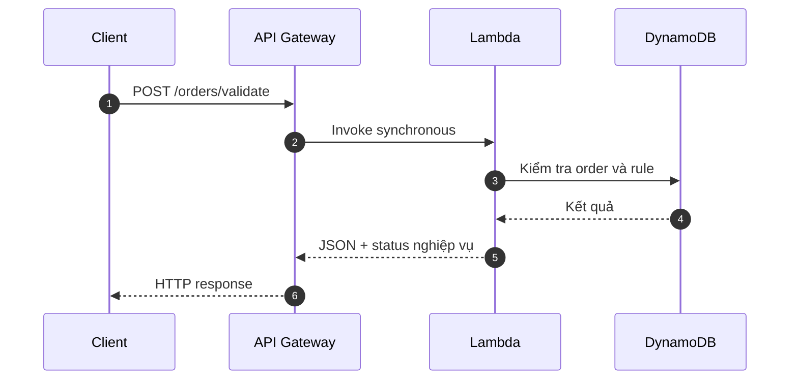
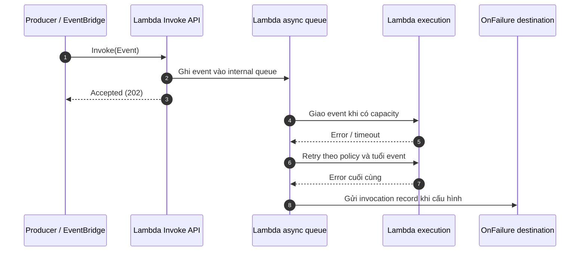
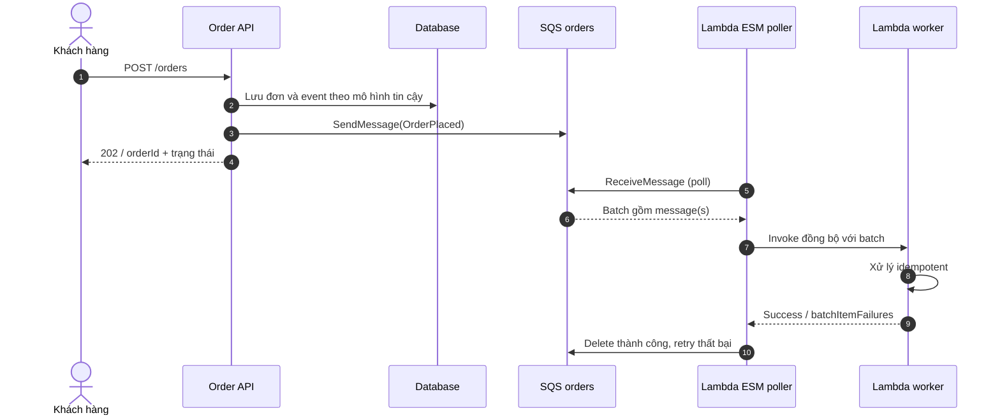
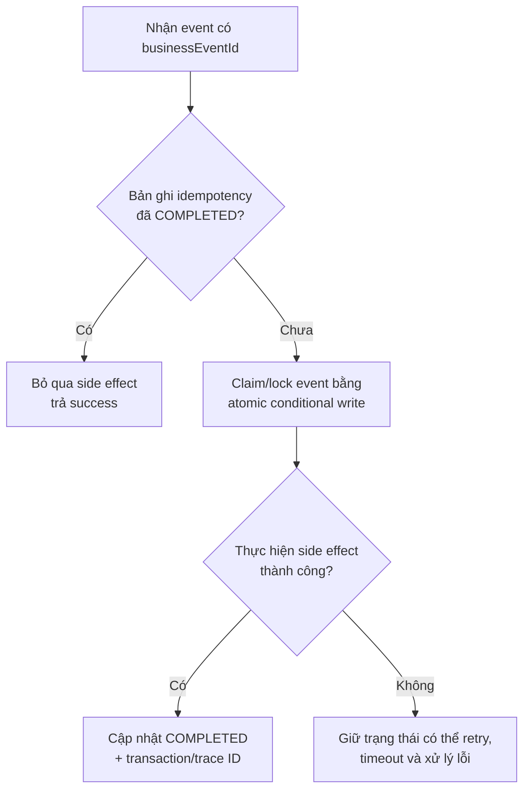
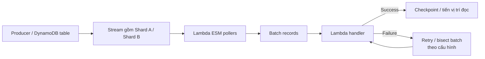
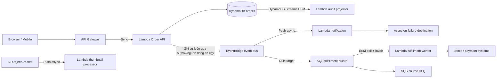
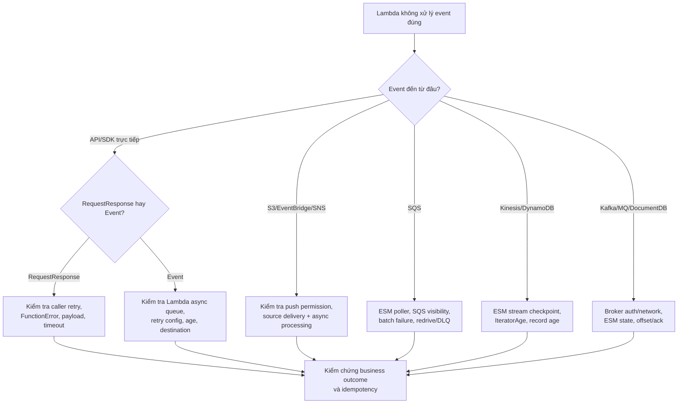

# Gọi đồng bộ, bất đồng bộ và event source mapping trong AWS Lambda

**AWS Lambda** chạy code theo sự kiện mà không yêu cầu đội phát triển tự quản trị máy chủ. Một hàm có thể nhận request HTTP từ API Gateway, xử lý thông báo từ Amazon SQS, phản ứng với tệp mới trên Amazon S3 hoặc tiêu thụ dữ liệu từ Kinesis. Tuy nhiên, những luồng này không có cùng cơ chế giao nhận, thời điểm trả kết quả hoặc chính sách xử lý lỗi.

Ba khái niệm trọng tâm của bài học là **gọi đồng bộ (synchronous invocation)**, **gọi bất đồng bộ (asynchronous invocation)** và **event source mapping**. Nhầm lẫn chúng dễ tạo ra lỗi nghiêm trọng: một API trả thành công trước khi tác vụ thật sự hoàn tất, message SQS bị xử lý nhiều lần, một record lỗi làm kẹt cả batch, hoặc sự kiện hết thời hạn mà không ai nhận được cảnh báo.

Bài thuộc chương **Điện toán Lambda**, module **CLOUD_PROVIDERS_AWS**. Trong hệ sinh thái AWS gồm Region/Availability Zone, IAM, VPC, dịch vụ tính toán, lưu trữ, database, tích hợp và serverless, người học cần chọn cơ chế gọi Lambda theo **yêu cầu phản hồi, độ bền sự kiện, thứ tự, thông lượng, khả năng phục hồi, bảo mật và chi phí**. Các ví dụ sử dụng hệ thống bán hàng với API đặt đơn, SQS, S3, EventBridge và DynamoDB.

## 1. Mục tiêu và tình huống xuyên suốt

Sau bài học, người học có thể:

1. Phân biệt rõ **ai kích hoạt Lambda**, **ai chờ phản hồi**, **event được lưu ở đâu** và **ai chịu trách nhiệm retry**.
2. Dùng `InvocationType=RequestResponse`, `InvocationType=Event` và hiểu `DryRun` qua Lambda Invoke API.
3. Nhận diện nguồn **push event trực tiếp** và nguồn **pull qua event source mapping**.
4. Cấu hình SQS event source mapping: batch size, batch window, visibility timeout, concurrency, xử lý lỗi từng record và DLQ.
5. So sánh retry/destination của Lambda asynchronous invocation với retry của **SQS**, **Kinesis/DynamoDB Streams** và upstream event source.
6. Thiết kế idempotency, thứ tự, timeout, logging, IAM và monitoring phù hợp cho từng luồng.
7. Chọn giải pháp cho API cần phản hồi nhanh, xử lý nền, stream processing và các hệ thống chịu tải cao.

**Bối cảnh:** người dùng đặt hàng trên website Shop. API phải kiểm tra dữ liệu và trả kết quả ngay, còn công việc gửi email, tính điểm thưởng và đồng bộ kho có thể chạy nền. Đơn hàng cũng phát sinh sự kiện cho nhiều đội tiêu thụ độc lập. Một ứng dụng đáng tin cậy phải biết phần nào cần xử lý **trước khi phản hồi** và phần nào nên chuyển thành **thông điệp được lưu bền** để xử lý sau.

## 2. Khái niệm cốt lõi: ba đường gọi Lambda

| Tiêu chí | Đồng bộ | Bất đồng bộ | Event source mapping |
|---|---|---|---|
| Ai gửi sự kiện? | Caller như AWS SDK, API Gateway, Step Functions | Caller hoặc dịch vụ push event như S3/EventBridge/SNS | Lambda poller đọc queue/stream như SQS, Kinesis, DynamoDB Streams |
| Người gọi có chờ code chạy xong? | **Có** | **Không** | Nguồn không chờ một response ứng dụng trực tiếp; poller xử lý batch |
| AWS Lambda Invoke API | `InvocationType=RequestResponse` | `InvocationType=Event` | ESM tự invoke Lambda; không phải gọi trực tiếp với `Event` |
| Phản hồi caller | Payload/kết quả hoặc lỗi từ hàm khi hoàn tất | ACK nhận sự kiện, thường HTTP 202 qua Invoke API | Không có HTTP response trực tiếp cho producer ban đầu |
| Nơi tồn tại backlog | Thường ở caller/hệ thống upstream | Hàng đợi nội bộ cho async invocation của Lambda | **Nguồn** SQS/stream/Kafka/broker giữ message/record |
| Retry chính | **Caller/upstream** quyết định | **Lambda async processing** retry theo loại lỗi/cấu hình | **ESM và chính sách nguồn** xử lý lại batch/record |
| Xử lý lỗi cuối | Response/exception cho caller | On-failure destination hoặc function DLQ theo cấu hình | SQS redrive/DLQ; stream retry/record age/on-failure destination theo hỗ trợ |
| Ngữ nghĩa giao nhận | Mỗi lệnh Invoke là một request; caller có thể retry | **At least once**; có thể trùng lặp | **At least once**; có thể trùng lặp |
| Phù hợp | Kiểm tra đơn, tra cứu giá, tác vụ đòi kết quả ngay | Gửi email, tạo thumbnail khi push event, side effect nền | SQS worker, DynamoDB Streams, Kinesis, Kafka |

**Đừng nhầm tên “asynchronous” của kiến trúc queue với `InvocationType=Event`.** Khi SQS kích hoạt Lambda, ESM **poll queue và invoke hàm đồng bộ cho batch**. Hệ thống tổng thể bất đồng bộ với producer, nhưng cơ chế invocation giữa ESM và Lambda không phải internal async queue của Lambda.

### 2.1. Sơ đồ ba luồng

```mermaid
flowchart TB
    subgraph SYNC["1. Synchronous"]
      C["API / SDK caller"] -->|"Invoke RequestResponse"| L1["Lambda handler"]
      L1 -->|"Kết quả / function error"| C
    end
    subgraph ASYNC["2. Asynchronous"]
      S["S3 / EventBridge / SDK"] -->|"Push event"| QI["Lambda internal async queue"]
      QI -->|"Invoke khi có capacity"| L2["Lambda handler"]
      L2 -->|"Success / OnFailure destination"| D["SQS / SNS / EventBridge / Lambda"]
    end
    subgraph ESM["3. Event source mapping"]
      P["Producer"] --> Q["SQS / stream / broker"]
      POLL["Lambda event poller"] -->|"Poll / Read batch"| Q
      Q -->|"Records"| POLL
      POLL -->|"Synchronous batch invoke"| L3["Lambda handler"]
      L3 -->|"Batch result"| POLL
      POLL -->|"Ack / delete / checkpoint theo nguồn"| Q
    end
```



Mũi tên mang ý nghĩa logic. Với một số nguồn push như S3, đường gửi sự kiện có thể qua dịch vụ nguồn và Lambda asynchronous invocation; còn với stream/broker, vị trí poller, kiểm soát kết nối và offset/checkpoint thay đổi theo loại nguồn.

## 3. Gọi đồng bộ: nhận kết quả trước khi đi tiếp

Trong **synchronous invocation**, caller gửi event và đợi Lambda kết thúc để nhận response. Với Lambda Invoke API, giá trị `InvocationType` là `RequestResponse` (mặc định của API Invoke). Các tích hợp như API Gateway Lambda proxy thường dùng kiểu xử lý cần response ngay.

### 3.1. Luồng xử lý



**Hạn chế:** client/upstream có timeout riêng, có thể **ngắn hơn timeout của Lambda**. Nếu xử lý mất quá lâu, client nhận timeout dù Lambda có thể đã thực hiện một phần hoặc toàn bộ side effect. Không sử dụng synchronous request để thực hiện tác vụ nhiều phút mà caller phải giữ kết nối nếu không có lý do và cấu hình tích hợp hỗ trợ.

### 3.2. AWS CLI gọi đồng bộ

Giả sử bạn có tệp sự kiện thử nghiệm `order-event.json` với nội dung:

```json
{
  "orderId": "ORD-1001",
  "customerId": "CUS-42",
  "amount": 125000,
  "currency": "VND"
}
```

Invoke:

```bash
aws lambda invoke \
  --function-name shop-validate-order \
  --invocation-type RequestResponse \
  --payload fileb://order-event.json \
  --region ap-southeast-1 \
  sync-response.json
```

Tệp đầu vào/đầu ra trong ví dụ là tệp thực hành của người học, không phải tệp được worker này tạo. Đối với AWS CLI v2, `fileb://` truyền binary payload mà không cần chuyển đổi theo chế độ JSON của CLI.

Phản hồi CLI có thể gồm:

```json
{
  "StatusCode": 200,
  "ExecutedVersion": "$LATEST"
}
```

**Cực kỳ quan trọng:** `StatusCode: 200` từ **Lambda Invoke API** chỉ xác nhận request Invoke đã được thực thi thành công ở cấp API. Hàm vẫn có thể ném exception; khi đó response thường có trường `FunctionError` và payload đầu ra chứa chi tiết lỗi. Phải kiểm tra **cả `FunctionError` và response payload**, không chỉ `StatusCode`.

### 3.3. Ví dụ caller Java dùng AWS SDK v2

Ứng dụng Java trên EC2/ECS có thể gọi Lambda trực tiếp khi IAM role được cấp `lambda:InvokeFunction`:

```java
import software.amazon.awssdk.core.SdkBytes;
import software.amazon.awssdk.regions.Region;
import software.amazon.awssdk.services.lambda.LambdaClient;
import software.amazon.awssdk.services.lambda.model.InvokeRequest;
import software.amazon.awssdk.services.lambda.model.InvokeResponse;
import software.amazon.awssdk.services.lambda.model.InvocationType;

public class SyncLambdaCaller {
    public static void main(String[] args) {
        String payload = "{\"orderId\":\"ORD-1001\",\"amount\":125000}";

        try (LambdaClient client = LambdaClient.builder()
                .region(Region.AP_SOUTHEAST_1)
                .build()) {
            InvokeResponse response = client.invoke(InvokeRequest.builder()
                    .functionName("shop-validate-order")
                    .invocationType(InvocationType.REQUEST_RESPONSE)
                    .payload(SdkBytes.fromUtf8String(payload))
                    .build());

            if (response.statusCode() != 200 || response.functionError() != null) {
                throw new IllegalStateException(
                        "Lambda failed: " + response.payload().asUtf8String());
            }
            System.out.println(response.payload().asUtf8String());
        }
    }
}
```

Ví dụ dùng AWS SDK for Java v2, credentials provider chain mặc định và region Singapore. Trong production, caller cần timeout, circuit breaker, retry có giới hạn và correlation ID; tránh log toàn bộ payload nếu có dữ liệu nhạy cảm.

### 3.4. Retry và timeout khi đồng bộ

Với synchronous invocation, Lambda **không tự chạy lại handler khi code ném exception** chỉ vì caller dùng RequestResponse. Caller/upstream quyết định có retry hay trả lỗi.

| Tình huống | Ai xử lý? | Hành động hợp lý |
|---|---|---|
| Hàm trả lỗi nghiệp vụ (ví dụ số tiền không hợp lệ) | Caller | Không retry vô hạn; trả kết quả 4xx nghiệp vụ |
| Hàm lỗi tạm thời khi gọi database | Caller hoặc workflow | Retry có giới hạn, exponential backoff/jitter, idempotency |
| Lambda Invoke API bị throttling | SDK/caller | Backoff và giới hạn tốc độ; điều chỉnh concurrency |
| Client mất kết nối sau khi gửi request | Caller và backend | Dùng request ID/idempotency key trước khi thử lại |
| Handler xử lý quá lâu | Đội kiến trúc | Tách công việc nền sang SQS/async, điều chỉnh timeout |

Một request HTTP đơn giản tới API Gateway thường cần response theo hợp đồng API. Một số API integration có giới hạn timeout khác nhau; **không suy luận giới hạn Lambda 15 phút là thời gian tối đa client HTTP luôn có thể chờ**.

### 3.5. InvocationType=DryRun

Lambda Invoke API còn hỗ trợ `InvocationType=DryRun` để kiểm tra sơ bộ cấu hình quyền/tham số mà **không thực thi handler**. Nó không chứng minh database, networking hoặc business logic thành công.

```bash
aws lambda invoke \
  --function-name shop-validate-order \
  --invocation-type DryRun \
  --region ap-southeast-1 \
  dryrun-response.json
```

## 4. Gọi bất đồng bộ: nhận sự kiện rồi xử lý sau

Với **asynchronous invocation**, caller gửi event và Lambda xác nhận đã nhận để xếp vào **internal asynchronous event queue**. Qua Lambda Invoke API, `InvocationType=Event` thường trả `StatusCode: 202` khi event được chấp nhận. Điều đó **không có nghĩa handler đã chạy hoặc hoàn thành thành công**.

Ví dụ gọi từ SDK/CLI:

```bash
aws lambda invoke \
  --function-name shop-send-receipt \
  --invocation-type Event \
  --payload fileb://order-event.json \
  --region ap-southeast-1 \
  async-ack.json
```

Phản hồi API có thể chỉ ra event được accepted; nội dung trả về của handler không được gửi lại cho caller theo mô hình này.

### 4.1. Luồng push event

Các nguồn thường dùng kiểu push bất đồng bộ đến Lambda bao gồm:

- **Amazon S3 Event Notifications**, ví dụ khi upload object thành công.
- **Amazon EventBridge rules**, ví dụ `OrderPlaced` event.
- **Amazon SNS notifications** đến Lambda subscriber.
- SDK/CLI gọi Lambda Invoke với `InvocationType=Event`.

**Không đánh đồng tất cả trigger:** API Gateway/Function URL là luồng HTTP cần response, không nên mặc định coi như async chỉ vì chúng cũng kích hoạt Lambda. **Amazon SQS không push trực tiếp để Lambda xếp event vào internal async queue**; Lambda dùng event source mapping để poll SQS.

### 4.2. Chấp nhận request khác với xử lý thành công



Thành công ở bước 3 không đảm bảo bước 5 hoàn tất. Ứng dụng phải có **trạng thái công việc**, log, tracing và cơ chế báo lỗi/đối soát riêng nếu muốn người dùng biết tác vụ gửi hóa đơn đã xong hay chưa.

## 5. Retry cho asynchronous invocation

Lambda quản lý việc đọc lại event từ internal async queue, với chính sách khác nhau theo nguyên nhân lỗi.

| Lỗi | Hành vi mặc định/đặc trưng | Cách quản lý |
|---|---|---|
| **Function error/timeout** sau khi handler chạy | Lambda thường retry tối đa **2 lần bổ sung** (tổng đến 3 lần invoke) | Cấu hình `MaximumRetryAttempts` từ 0 đến 2 |
| **Throttling (429)** hoặc lỗi hệ thống 5xx | Lambda retry với backoff khi còn trong thời gian cho phép | Giảm tải, tăng concurrency, giám sát event age |
| **Event quá tuổi** | Lambda có thể loại event khỏi internal queue | `MaximumEventAgeInSeconds`, on-failure destination |
| **Đã chạy thành công nhưng event bị giao trùng** | Vẫn có thể xảy ra với at-least-once delivery | Handler idempotent |
| **Producer gửi lặp** | Hai event nghiệp vụ độc lập nhưng cùng mục đích | Dedupe theo business event ID |

Giá trị mặc định về thời gian lưu event async có thể lên tới **6 giờ** theo hướng dẫn AWS; nên cấu hình cụ thể dựa trên SLA thay vì dựa vào mặc định. Cấu hình tối đa có giới hạn theo AWS, ví dụ `MaximumEventAgeInSeconds` tối đa 21600 giây và `MaximumRetryAttempts` tối đa 2 đối với function errors.

### 5.1. Ví dụ giới hạn retry và tuổi sự kiện

```bash
aws lambda put-function-event-invoke-config \
  --function-name shop-send-receipt \
  --maximum-retry-attempts 1 \
  --maximum-event-age-in-seconds 1800 \
  --destination-config '{"OnFailure":{"Destination":"arn:aws:sqs:ap-southeast-1:111122223333:receipt-failures"}}' \
  --region ap-southeast-1
```

Lệnh trên **tạo cấu hình asynchronous invocation** cho hàm; nếu cấu hình đã tồn tại, dùng thao tác update phù hợp sau khi đọc trạng thái hiện tại để không ghi đè phần khác ngoài ý muốn. Role thực thi Lambda phải được cấp quyền gửi message đến destination và KMS nếu destination được mã hóa theo key riêng.

**Mấu chốt:** tham số `MaximumRetryAttempts`/`MaximumEventAgeInSeconds` ở cấu hình **async function invocation** **không trực tiếp điều khiển** retry của SQS event source mapping. Với SQS, visibility timeout, message retention và redrive policy tại queue mới là các thành phần quan trọng.

### 5.2. Destination khác dead-letter queue ra sao?

| Cơ chế | Nội dung nhận | Khi dùng |
|---|---|---|
| **Lambda async on-success destination** | Invocation record sau xử lý thành công | Audit/khởi động bước tiếp theo theo nhu cầu |
| **Lambda async on-failure destination** | Invocation record chứa thông tin request, context và trạng thái lỗi | Điều tra/replay khi xử lý async thất bại hoặc event bị loại |
| **Function dead-letter queue (DLQ) cho async** | Chủ yếu lưu **original event** cùng một số metadata | Giữ sự kiện thất bại để xử lý lại |
| **SQS source queue DLQ** | Message SQS bị redrive sau số lần nhận vượt giới hạn | Lưu poison messages của **SQS event source mapping** |

**Không nhầm Lambda function DLQ của async với DLQ của SQS nguồn.** Chúng áp dụng cho các đường đi sự kiện khác nhau. ESM dành cho stream còn có cơ chế **on-failure destination riêng trên mapping**, không dùng mặc nhiên cấu hình async của function.

### 5.3. Thêm trách nhiệm của upstream

Khi EventBridge, SNS hoặc dịch vụ khác đẩy event đến Lambda, **dịch vụ nguồn có thể có retry policy / DLQ riêng khi không gửi được event đến Lambda**. Sau khi Lambda nhận event thành công, Lambda lại có cơ chế queue/retry async của mình.

Do đó, một event có thể bị thử lại ở **nhiều lớp khác nhau**. Không cộng một cách máy móc số lần retry để hứa số lần xử lý chính xác; phải theo dõi event ID xuyên từ producer tới handler, thiết kế idempotency và đặt thời hạn dữ liệu nghiệp vụ.

## 6. Event source mapping: Lambda chủ động đọc từ queue/stream

**Event source mapping (ESM)** là một tài nguyên Lambda kết nối **nguồn dữ liệu dạng queue/stream/broker** với Lambda function. Lambda quản lý **event pollers** hoặc bộ đọc tương ứng, gom records thành batch rồi invoke handler.

Các nguồn ESM phổ biến:

| Nguồn | Kiểu dữ liệu | Thực tiễn vận hành |
|---|---|---|
| **Amazon SQS Standard/FIFO** | Message queue | Poll, visibility timeout, delete sau xử lý thành công, DLQ/redrive |
| **Amazon Kinesis Data Streams** | Ordered stream theo shard/partition key | Checkpoint, iterator age, record retention, xử lý theo shard |
| **Amazon DynamoDB Streams** | Thay đổi item theo stream record | Consume ordered records theo shard, retention và retry |
| **Amazon MSK / self-managed Apache Kafka** | Broker/topic partitions | Poll, offset management, broker networking/authentication |
| **Amazon MQ** | Message broker | Poll/consume batch, broker ack và retry behavior theo nguồn |
| **Amazon DocumentDB change streams** | Change stream | Kết nối database, batch và checkpoint theo hướng dẫn hỗ trợ |

**Không tạo ESM cho API Gateway, S3 Event Notifications hoặc EventBridge rule.** Đó là những dạng tích hợp push/triggers khác. Trong Lambda console, giao diện có thể gọi nhiều nguồn là “trigger”, nhưng **trigger** không đồng nghĩa **event source mapping** ở cấp cơ chế kỹ thuật.

### 6.1. ESM có UUID và cấu hình độc lập

Một ESM có thể có:

- `EventSourceArn` hoặc cấu hình nguồn tương ứng.
- `FunctionName` hoặc function ARN/alias/version được hỗ trợ.
- `BatchSize`, `MaximumBatchingWindowInSeconds`.
- `FilterCriteria` đối với các loại nguồn hỗ trợ.
- `FunctionResponseTypes` như `ReportBatchItemFailures` khi áp dụng.
- `ScalingConfig` hoặc provisioned pollers khi loại nguồn hỗ trợ.
- `DestinationConfig`/retry options cho một số stream sources.
- `State` và `LastProcessingResult` để chẩn đoán.

Mỗi loại nguồn hỗ trợ **tập tham số khác nhau**. Không được sao chép toàn bộ tùy chọn của Kinesis sang SQS hoặc Kafka mà không kiểm tra AWS API/Service Quotas.

### 6.2. Batching và độ trễ

Poller có thể gom nhiều records vào một lần invoke để tiết kiệm overhead, nhưng batch lớn khiến:

- Một invocation cần thêm CPU/memory/thời gian xử lý.
- Khi lỗi, số records cần xử lý lại có thể nhiều hơn.
- Cửa sổ chờ batch làm tăng độ trễ với lưu lượng thấp.
- Payload batch có thể chạm giới hạn kích thước trước khi đạt `BatchSize`.

**Quy tắc chọn:** đặt batch size và batching window theo **kích thước record, thời gian xử lý, thông lượng, mức chấp nhận trễ và semantics của nguồn**, sau đó đo thực nghiệm trên workload đại diện.

### 6.3. Event filtering

Một số ESM cho phép cấu hình `FilterCriteria` để Lambda chỉ gửi những records phù hợp đến handler. Ví dụ xử lý event `OrderPlaced` nhưng bỏ qua `ProductViewed` trên stream được hỗ trợ.

Lưu ý: filtering nằm ở **poller**; record bị filter bỏ không đồng nghĩa được giữ lại để hàm khác đọc theo chính ESM đó. Với SQS, thông điệp không khớp filter có thể bị **xóa khỏi queue** theo hành vi ESM; với streams, việc bỏ qua record không thay thế chính sách retention. Kiểm tra chính xác loại nguồn, cú pháp filter và hậu quả trước khi bật trong production.

## 7. SQS + Lambda event source mapping: luồng nền phổ biến

Trong hệ thống đơn hàng, HTTP API chỉ nên thực hiện phần giao dịch cần thiết rồi gửi message `OrderPlaced` vào SQS để xử lý email, đồng bộ kho hoặc các bước không cần trả kết quả tức thì.



**Lưu ý về tính toàn vẹn nghiệp vụ:** ví dụ này mô tả luồng logic; nếu API ghi database thành công nhưng `SendMessage` thất bại, hệ thống có thể mất sự kiện. Với yêu cầu quan trọng, dùng **transactional outbox**, DynamoDB Streams hoặc một cơ chế đảm bảo phát event từ thay đổi dữ liệu, không đơn giản thực hiện hai thao tác DB/SQS rồi giả định chúng nguyên tử.

### 7.1. Vòng đời message trong SQS

1. Producer gửi message. SQS lưu message theo retention policy.
2. ESM poll SQS, nhận batch và các messages tạm thời trở thành **invisible** trong thời gian **visibility timeout**.
3. ESM invoke Lambda worker **đồng bộ** cho batch.
4. Nếu xử lý thành công, Lambda xóa messages tương ứng khỏi SQS.
5. Nếu lỗi, messages chưa được xóa sẽ nhìn thấy lại sau visibility timeout và có thể được xử lý lần nữa.
6. Nếu cấu hình **redrive policy** và số lần nhận vượt ngưỡng, SQS có thể chuyển message vào **SQS DLQ**.

Như vậy, SQS là kho dữ liệu nguồn của các messages chưa xử lý, không phải Lambda internal async queue. **Function async on-failure destination** sẽ không tự nhận lỗi xử lý SQS ESM nếu bạn chỉ cấu hình destination cho asynchronous invocation của function.

### 7.2. Thiết kế SQS visibility timeout

AWS khuyến nghị cấu hình **SQS visibility timeout ít nhất sáu lần Lambda function timeout**, cộng batching window nếu dùng. Ví dụ:

| Cấu hình | Giá trị minh họa |
|---|---|
| Lambda timeout | 30 giây |
| Maximum batching window | 5 giây |
| Ngưỡng tham khảo | 6 × 30 + 5 = **185 giây** |
| SQS visibility timeout lựa chọn | **210 giây** |
| SQS message retention | Theo SLA, ví dụ đủ để điều tra/replay sự cố |
| SQS redrive | DLQ, `maxReceiveCount` được kiểm thử (AWS thường gợi ý từ 5 trở lên) |

**Tại sao không đặt visibility timeout đúng 30 giây?** Khi batch vẫn đang được xử lý, messages có thể trở lại trạng thái visible quá sớm, làm một worker khác nhận trùng và tăng retry/chi phí. Khi timeout dài, retry của message lỗi cũng chậm hơn; cần cân đối latency và an toàn.

Visibility timeout không phải thời hạn tồn tại của message. **Message retention** giới hạn việc message ở trong queue; DLQ có retention riêng. Trong một số tình huống cần thay visibility của message đang xử lý, có thể dùng `ChangeMessageVisibility` theo cơ chế phù hợp, nhưng phải hiểu trách nhiệm delete và retry của ESM.

### 7.3. Standard queue và FIFO queue

| Đặc tính | SQS Standard | SQS FIFO |
|---|---|---|
| Thông lượng | Phù hợp luồng lớn, có thể nhận trùng | Hỗ trợ thứ tự theo message group và deduplication trong phạm vi SQS |
| Thứ tự | Không bảo đảm thứ tự tuyệt đối | Thứ tự **trong một MessageGroupId** |
| Cơ chế batch | Có thể batch nhiều messages | Phải bảo vệ thứ tự trong group |
| Batch size qua Lambda ESM | Có thể lên tới 10.000 với cấu hình hợp lệ; thường khởi đầu nhỏ | Tối đa 10 |
| Batching window | Hỗ trợ trong phạm vi quy định | Không dùng batching window như Standard |
| Concurrent invokes | Theo scaling/capacity/concurrency | Bị giới hạn bởi số MessageGroupIds khả dụng và giới hạn concurrency |
| Nhu cầu | Email, ảnh, notifications, event độc lập | Chuỗi trạng thái đơn theo cùng orderId, yêu cầu thứ tự trong group |

**FIFO không cho bạn exactly-once processing ở tầng ứng dụng.** Message vẫn có thể cần retry; Lambda handler phải idempotent. Nếu chọn `MessageGroupId=orderId`, thứ tự được giữ trong từng order nhưng các orders khác có thể xử lý song song.

## 8. Cấu hình SQS event source mapping bằng AWS CLI

Giả sử đã có:

- Lambda function `shop-order-worker` ở Region `ap-southeast-1`.
- Standard queue `arn:aws:sqs:ap-southeast-1:111122223333:orders-standard`.
- Lambda execution role có quyền `sqs:ReceiveMessage`, `sqs:DeleteMessage`, `sqs:GetQueueAttributes` và quyền đọc nguồn cần thiết (có thể sử dụng baseline `AWSLambdaSQSQueueExecutionRole` rồi thu hẹp).
- Quyền KMS tương ứng nếu queue được mã hóa bằng customer managed key.
- Quyền IAM phù hợp cho operator tạo/sửa ESM và read queue policies.

AWS CLI:

```bash
aws lambda create-event-source-mapping \
  --function-name shop-order-worker \
  --event-source-arn arn:aws:sqs:ap-southeast-1:111122223333:orders-standard \
  --batch-size 10 \
  --maximum-batching-window-in-seconds 5 \
  --function-response-types ReportBatchItemFailures \
  --scaling-config MaximumConcurrency=5 \
  --enabled \
  --region ap-southeast-1
```

Lệnh tạo mapping trả về một **UUID**. Giá trị `MaximumConcurrency=5` là **giới hạn đồng thời của riêng ESM SQS này** trong chế độ scaling tiêu chuẩn, không phải reserved concurrency của toàn function.

### 8.1. Kiểm tra mapping sau khi tạo

```bash
aws lambda list-event-source-mappings \
  --function-name shop-order-worker \
  --region ap-southeast-1

aws lambda get-event-source-mapping \
  --uuid "<EVENT_SOURCE_MAPPING_UUID>" \
  --region ap-southeast-1
```

Kiểm tra `State`, `StateTransitionReason`, `LastProcessingResult`, `BatchSize`, `MaximumBatchingWindowInSeconds`, `FunctionResponseTypes` và `ScalingConfig`. Mapping được tạo không chứng minh code worker xử lý nghiệp vụ chính xác; cần gửi message thử nghiệm và xác nhận trạng thái cuối.

### 8.2. Điều chỉnh mapping và tạm dừng poll

```bash
# Ví dụ tạm dừng nguồn khi có sự cố xử lý nghiêm trọng.
aws lambda update-event-source-mapping \
  --uuid "<EVENT_SOURCE_MAPPING_UUID>" \
  --no-enabled \
  --region ap-southeast-1

# Chỉ bật lại sau khi xác nhận đã khắc phục.
aws lambda update-event-source-mapping \
  --uuid "<EVENT_SOURCE_MAPPING_UUID>" \
  --enabled \
  --region ap-southeast-1
```

Khi mapping disabled, messages vẫn có thể nằm trong SQS cho tới khi hết retention; **không phải nút lưu giữ vô thời hạn**. Với streams, retention cũng giới hạn khả năng replay; không tắt mapping nhiều ngày rồi mặc định record còn đầy đủ.

### 8.3. Concurrency cho SQS mapping

Các giới hạn cần phối hợp:

| Lớp | Cấu hình | Tác dụng |
|---|---|---|
| AWS account/Region | Account concurrency quota | Trần chia sẻ của các functions trong Region |
| Lambda function | **Reserved concurrency** | Giữ/bó hẹp số invoke đồng thời của function |
| ESM SQS | **Maximum concurrency** | Giới hạn invoke đồng thời từ một SQS mapping ở standard polling mode |
| ESM SQS | **Provisioned poller mode** | Cấp poller resources theo min/max để thay đổi khả năng scale/latency |
| Workload | DB pool, rate limit, downstream quota | Có thể là trần thực tế thấp hơn Lambda |

**Không cấu hình `MaximumConcurrency` và provisioned poller mode đồng thời trên cùng SQS ESM**: AWS quy định hai phương án kiểm soát polling/scaling này loại trừ nhau. Nếu function có nhiều SQS mappings, tổng maximum concurrency của các mappings nên nằm trong reserved concurrency đủ lớn để tránh tự gây throttling.

Với FIFO, ngay cả khi maximum concurrency là 10, nếu chỉ có ba `MessageGroupId` đang có việc thì concurrency thực tế bị giới hạn bởi mức song song có thể chạy của ba groups.

## 9. Xử lý lỗi từng message trong SQS batch

Khi một batch gồm 10 messages và một message lỗi, hành vi **mặc định** có thể là cả batch bị xử lý lại sau visibility timeout. Điều đó gây tính toán lặp, gửi email lặp hoặc ghi transaction sai nếu handler không idempotent.

Để chỉ báo những message lỗi, cấu hình ESM `FunctionResponseTypes=["ReportBatchItemFailures"]` và handler trả về cấu trúc:

```json
{
  "batchItemFailures": [
    {
      "itemIdentifier": "message-id-that-failed"
    }
  ]
}
```

Với SQS, `itemIdentifier` là **messageId** của record thất bại, không phải orderId hoặc receiptHandle.

### 9.1. Handler Python minh họa

```python
import json
import logging

logger = logging.getLogger()
logger.setLevel(logging.INFO)


def lambda_handler(event, context):
    failures = []
    for record in event.get("Records", []):
        message_id = record["messageId"]
        try:
            order_event = json.loads(record["body"])
            order_id = order_event["orderId"]

            # Thay bằng transaction xử lý thực sự có idempotency.
            # Ví dụ kiểm tra schema và tính hợp lệ tối thiểu.
            if not isinstance(order_id, str) or not order_id:
                raise ValueError("Invalid orderId")

            logger.info("Validated messageId=%s", message_id)
        except Exception:
            logger.exception("Failed messageId=%s", message_id)
            failures.append({"itemIdentifier": message_id})

    return {"batchItemFailures": failures}
```

Đoạn code trên **chỉ minh họa hình dạng handler và partial batch response**, chưa thực hiện gửi email/ghi database và chưa có idempotency nghiệp vụ. Trong production, cần thay phần xử lý bằng thao tác có thể retry an toàn và tránh log nội dung chứa PII.

**Quan trọng:** nếu handler ném exception ra ngoài thay vì trả response đúng cấu trúc, Lambda có thể coi **cả batch thất bại**. `ReportBatchItemFailures` phải được bật ở ESM; chỉ trả JSON này trong code nhưng không cấu hình mapping thì có thể không đạt hành vi mong muốn.

### 9.2. Với SQS FIFO phải bảo toàn thứ tự

Trong FIFO, khi một message lỗi, handler nên **dừng xử lý các messages phía sau theo quy tắc thứ tự** và trả **cả message lỗi lẫn các messages chưa xử lý** trong `batchItemFailures`. Nếu vẫn xử lý các message sau một failure rồi coi thành công, bạn có thể vi phạm ý định tuần tự của group.

Với batch có nhiều message groups, thuật toán cần giữ ordering của từng group theo tài liệu AWS; ví dụ đơn giản có thể chọn dừng toàn batch ngay từ lỗi đầu tiên để an toàn, dù làm giảm thông lượng.

### 9.3. DLQ và poison message

Message bị lỗi dữ liệu vĩnh viễn như thiếu `orderId` có thể liên tục được nhận, rồi gây tốn chi phí và chậm các messages khác. Cần:

- SQS **redrive policy** với DLQ phù hợp, cùng queue type cần thiết (Standard/FIFO).
- `maxReceiveCount` đủ để retry transient errors nhưng không vô hạn.
- Alert cho số message DLQ và thời gian tồn đọng.
- Runbook phân loại lỗi dữ liệu, sửa handler, replay hoặc từ chối có audit.
- Kiểm soát quyền đọc/ghi/DLQ redrive và mã hóa KMS nếu dữ liệu nhạy cảm.

**Không gửi mọi lỗi từ SQS ESM vào Lambda async destination rồi nghĩ rằng đã xử lý DLQ**. Message source vẫn do SQS quản lý; cần kiểm tra cơ chế redrive thật của queue.

## 10. Idempotency là yêu cầu bắt buộc trong event processing

**Idempotency** nghĩa là xử lý cùng một event nhiều lần vẫn cho hiệu ứng nghiệp vụ như một lần thành công. Vì SQS, stream, async Lambda và cả retry của caller đều có thể sinh trùng lặp, không nên dựa vào hứa hẹn “chỉ đến một lần”.

### 10.1. Chọn idempotency key có ý nghĩa

| Trường hợp | Khóa gợi ý | Vì sao |
|---|---|---|
| Đơn hàng được tạo | `orderId + eventType/version` | Tránh gửi email/tính điểm trùng cho cùng sự kiện |
| S3 ObjectCreated | `bucket + key + versionId hoặc sequencer phù hợp` | Object key có thể được ghi nhiều version |
| EventBridge business event | `eventId` do producer quản lý | Dedupe toàn pipeline |
| DynamoDB Stream record | Event ID/sequence number phù hợp | Nhận diện record đã áp dụng |
| HTTP payment request | `Idempotency-Key` do API quy định, gắn user và payload | Retry do timeout không tạo thanh toán trùng |

**MessageId SQS khác business event ID.** Nếu producer gửi lại cùng sự kiện nghiệp vụ dưới dạng message mới, SQS sẽ có messageId mới. Đối với side effect như thanh toán, hãy dùng khóa nghiệp vụ từ nguồn đáng tin cậy, không chỉ dedupe messageId.

### 10.2. Một mô hình lưu trạng thái idempotency



Một triển khai dùng DynamoDB có thể sử dụng **conditional write** để claim event, cùng TTL và trạng thái `IN_PROGRESS`/`COMPLETED`. Nhưng **claim thành công rồi side effect thất bại** là vấn đề cần giải quyết: chỉ lưu cờ “đã xử lý” trước khi gọi hệ thống ngoài có thể làm mất công việc; chỉ lưu sau khi gọi có thể gây lặp khi process chết giữa hai bước.

Giải pháp phụ thuộc side effect:

- Dùng **transaction** nếu cập nhật state và business outcome có thể nằm trong cùng hệ thống.
- Dùng **outbox/inbox** và trạng thái có lease/expiry để quản lý công việc từng bước.
- Truyền idempotency key tới downstream API (ví dụ payment gateway hỗ trợ) để downstream chống tạo giao dịch trùng.
- Ghi trace/correlation ID và áp dụng retry/jitter có giới hạn.

AWS Lambda Powertools có tiện ích **Idempotency** cho một số ngôn ngữ để giảm code lặp, nhưng vẫn phải xác định khóa nghiệp vụ và mô hình lỗi.

## 11. Stream event source mapping: Kinesis và DynamoDB Streams

Khác SQS (message được xóa khỏi queue sau khi xử lý), Kinesis/DynamoDB Streams giữ **records theo retention** và ESM theo dõi vị trí đọc/checkpoint.

### 11.1. Mô hình xử lý theo shard



Thứ tự được bảo đảm theo **phạm vi shard/partition key** mà nguồn cung cấp, không phải một thứ tự toàn cục trên mọi shards. Với `ParallelizationFactor` lớn hơn 1 (ở nguồn hỗ trợ), có thể xử lý nhiều batch trong cùng shard đồng thời theo cơ chế giữ thứ tự của partition key; phải kiểm tra hành vi thực tế trước khi thiết kế giao dịch nhạy cảm thứ tự.

### 11.2. Xử lý record lỗi trong stream

| Tùy chọn | Ý nghĩa | Khi cân nhắc |
|---|---|---|
| `MaximumRetryAttempts` | Giới hạn số lần retry function error trong ESM stream hỗ trợ | Tránh kẹt vô hạn vì poison record |
| `MaximumRecordAgeInSeconds` | Giới hạn tuổi record để retry | Không dành quá lâu cho dữ liệu đã cũ |
| `BisectBatchOnFunctionError` | Chia batch khi thất bại để cô lập record lỗi | Batches có record tốt và record hỏng |
| `ReportBatchItemFailures` | Báo vị trí/record lỗi theo schema của nguồn được hỗ trợ | Giảm xử lý lại những record đã thành công |
| `DestinationConfig.OnFailure` | Gửi thông tin batch/record bị bỏ sang destination hỗ trợ | Điều tra và replay có kiểm soát |
| `ParallelizationFactor` | Tăng xử lý nhiều batches mỗi shard khi loại stream hỗ trợ | Tăng thông lượng, theo dõi thứ tự và downstream |

**Không áp logic “xóa message khỏi queue” của SQS cho Kinesis.** Event source mapping tiến vị trí đọc theo checkpoint và có thể **chặn xử lý records phía sau một record lỗi** cho tới khi retry/age policy giải quyết. Nếu retention kết thúc trước khi xử lý, dữ liệu có thể không còn để replay.

### 11.3. Theo dõi IteratorAge

Với stream sources, `IteratorAge` tăng liên tục cho thấy ESM đang bị trễ so với records mới; nguyên nhân thường là handler chậm, lỗi batch kéo dài, thiếu concurrency, throttling hoặc downstream quá tải. Cần phối hợp:

1. Kiểm tra Lambda `Duration`, `Errors`, `Throttles`, concurrency và logs.
2. Kiểm tra shards/throughput nguồn, record retention và reader limits.
3. Kiểm tra failure handling/record age, DLQ hoặc on-failure destinations nếu hỗ trợ.
4. Đánh giá tăng batch size/parallelization, nhưng không làm hỏng thứ tự nghiệp vụ.

Với DynamoDB Streams, không chọn retention tùy ý như SQS; hãy đọc thời hạn lưu records của nguồn và có kế hoạch điều tra nhanh để tránh dữ liệu hết hạn.

## 12. Kafka, Amazon MQ và DocumentDB qua event source mapping

Với các nguồn broker/change stream, Lambda cung cấp event pollers nhưng yêu cầu kết nối mạng và xác thực có thể phức tạp hơn SQS.

| Nguồn | Điều cần chuẩn bị | Điểm cần thận trọng |
|---|---|---|
| **Amazon MSK** | Kafka cluster/topic, auth, network access, Lambda mapping và role | Topic partitions, offset/consumer group, consumer lag, broker availability |
| **Self-managed Kafka** | Bootstrap brokers, credentials/certificates, VPC/network, mapping | Kết nối từ AWS đến broker, TLS, security groups, retry |
| **Amazon MQ** | Broker ActiveMQ/RabbitMQ, credentials/Secrets Manager và access network | Backpressure/ack/retry semantics phụ thuộc broker/loại queue |
| **Amazon DocumentDB** | Change stream configuration, DB credentials/network và ESM | Độ trễ, checkpoint, retention/collection và tính năng hỗ trợ |

Không mặc định **tất cả** stream error-handling options của Kinesis/DynamoDB đều tồn tại với Kafka/MQ/DocumentDB. Đọc bảng tham số của từng event source và kiểm tra region, quota, IAM, Secrets Manager/KMS, VPC endpoints và chi phí pollers.

### 12.1. Kafka offset khác SQS delete

Với Kafka, broker/topic giữ records theo retention và consumer group/offset tiến theo quá trình xử lý; ESM quản lý việc đọc/commit theo cơ chế tích hợp. Không có thao tác `DeleteMessage` tương tự SQS. Khi xử lý lỗi, cần hiểu liệu mapping retry batch, tiến offset, giữ hay bỏ record theo policy để tránh dữ liệu mất hoặc backlog vô hạn.

### 12.2. DocumentDB và thay đổi dữ liệu

Change streams giúp phản ứng khi database thay đổi, nhưng không tự thay thế transaction/outbox cho mọi yêu cầu nghiệp vụ. Cần kiểm tra tính năng hỗ trợ trong phiên bản DocumentDB, cách lấy credentials, khả năng đọc từ VPC, tác động lên database và giới hạn batch/retry.

## 13. So sánh push trigger và event source mapping bằng ví dụ

| Tình huống | Cơ chế thường dùng | Vì sao |
|---|---|---|
| Client cần kiểm tra mã giảm giá và trả số tiền ngay | API Gateway → Lambda **đồng bộ** | Client chờ kết quả |
| S3 nhận ảnh và cần tạo thumbnail | S3 Event Notification → Lambda **bất đồng bộ** | S3 push event, xử lý file sau |
| EventBridge nhận `OrderPlaced` | EventBridge rule → Lambda **bất đồng bộ** | Fan-out đến consumers theo event bus |
| SQS có đơn hàng cần xử lý lần lượt/retry | **SQS ESM** → Lambda batch | SQS lưu backlog, kiểm soát visibility/DLQ |
| DynamoDB bảng thay đổi cần đồng bộ search index | **DynamoDB Streams ESM** → Lambda | Đọc change stream, checkpoint/retry |
| Kinesis nhận clickstream tốc độ cao | **Kinesis ESM** → Lambda | Batch theo shards và thông lượng |
| Hệ Kafka hiện có lưu sự kiện | **Kafka ESM** → Lambda | Kết nối broker, poll, quản lý offsets |

**Tên nguồn thôi chưa đủ để kết luận mọi dịch vụ gọi cùng mode.** Ví dụ Step Functions hỗ trợ nhiều mẫu tích hợp; một Lambda task trong workflow có thể chờ response, còn toàn bộ state machine lại được kích hoạt bất đồng bộ từ nơi khác. Cần kiểm tra **loại integration/task configuration thực tế**, không suy từ “workflow” là sync hay async.

## 14. Kiến trúc tổng hợp cho hệ thống đặt hàng

Một hệ thống bán hàng có thể kết hợp cả ba cơ chế mà không tạo ra các luồng retry chồng chéo không cần thiết:



Đây là sơ đồ kiến trúc tham khảo, không phải một giao dịch duy nhất được AWS tự bảo đảm nguyên tử. EventBridge/SQS/Database phối hợp với **transactional outbox hoặc change stream** và trạng thái nghiệp vụ để tránh trường hợp đã tạo đơn nhưng sự kiện không được phát.

### 14.1. Bước 1 — Request HTTP cần phản hồi đúng

Client gọi `POST /orders`, Lambda Order API thực hiện validation, auth và ghi đơn vào DB. API phải trả:

```json
{
  "orderId": "ORD-1001",
  "status": "RECEIVED",
  "trackingUrl": "/orders/ORD-1001"
}
```

Trạng thái `RECEIVED` xác nhận **đơn đã được ghi nhận theo hợp đồng API**, không khẳng định email đã gửi hoặc kho đã xuất hàng. Nếu client cần biết tất cả bước hoàn tất, backend nên cung cấp API trạng thái, push notification hoặc workflow orchestration phù hợp.

### 14.2. Bước 2 — Fan-out sự kiện đến nhiều consumer

EventBridge nhận sự kiện `OrderPlaced` rồi route:

- Một rule tới Lambda notification theo cơ chế push asynchronous.
- Một rule tới SQS queue để fulfillment xử lý chậm hơn hoặc cần backlog bền.
- Một rule khác tới hệ thống analytics theo nhu cầu.

**Không dùng một Lambda async invoke duy nhất làm nơi lưu trữ dài hạn cho hàng triệu công việc không được phép mất.** Lambda internal async queue có maximum event age; nếu consumer/downstream không thể phục hồi trong thời hạn đó, dùng SQS hoặc log/stream với retention phù hợp.

### 14.3. Bước 3 — Worker dùng SQS ESM và cập nhật trạng thái

Fulfillment worker nhận các messages qua SQS ESM. Với mỗi order:

1. Kiểm tra business event ID và trạng thái idempotency.
2. Xác thực order còn hợp lệ, chính sách tồn kho và quyền truy cập downstream.
3. Gọi dịch vụ tồn kho với timeout, retry/jitter và idempotency key.
4. Cập nhật trạng thái `FULFILLED` hoặc trạng thái lỗi có thể retry.
5. Trả partial batch failures cho records thất bại.

Nếu một message liên tục lỗi, SQS DLQ giữ nó để điều tra; việc đưa vào DLQ **không tự sửa dữ liệu** và không tự cập nhật trạng thái đơn. Cần có runbook để khách hàng không thấy đơn “Đang xử lý” vô thời hạn.

### 14.4. Bước 4 — Event source mapping từ DynamoDB Streams

Khi order record chuyển trạng thái, DynamoDB Streams ESM có thể cập nhật search index hoặc tạo audit projection. Handler dựa vào `eventID`, sequence information và idempotency để không tạo dữ liệu trùng. Nếu consumer chậm hơn retention của stream, phải có cơ chế **reconciliation/backfill** từ nguồn sự thật.

### 14.5. Chọn synchronous response và background state cho đúng

| Thao tác | Đặc tính nghiệp vụ | Cơ chế đề xuất |
|---|---|---|
| Kiểm tra giá, thuế, giới hạn mua | Cần response ngay | Sync Lambda |
| Tạo order database record | Cần biết thành công/thất bại trước khi báo đã nhận | Sync transaction tại API |
| Gửi email xác nhận | Có thể chậm, có thể retry | EventBridge async push hoặc SQS worker |
| Trừ tồn kho có transaction phức tạp | Cần kiểm soát retry, idempotency và ordering | SQS ESM/Step Functions hoặc dịch vụ domain với giao dịch riêng |
| Tạo thumbnail ảnh | Sau khi object upload | S3 async event → Lambda |
| Đồng bộ search index theo DB changes | Change stream, chấp nhận eventual consistency | DynamoDB Streams ESM |

## 15. Khi nào chọn async Lambda và khi nào chọn SQS?

Cả hai đều giúp caller không phải chờ handler hoàn tất, nhưng khả năng kiểm soát backlog rất khác.

| Yêu cầu | Direct async Lambda | SQS + Lambda ESM |
|---|---|---|
| Thao tác nhanh, lượng event vừa, không cần backlog dài | Hợp lý | Có thể không cần thêm queue |
| Cần lưu thông điệp nhiều ngày khi downstream lỗi | Không phù hợp với giới hạn event age nội bộ | SQS với retention và DLQ thích hợp |
| Cần khả năng tạm dừng consumer mà giữ backlog | Khó kiểm soát riêng hàng đợi nội bộ | Disable ESM, queue còn message theo retention |
| Cần nhiều consumer độc lập | Có thể qua EventBridge/SNS fan-out | Mỗi queue nên có consumer riêng theo semantics |
| Cần thứ tự theo orderId | Không hứa ordering | SQS FIFO với MessageGroupId phù hợp |
| Cần nhìn backlog/oldest message | Async metrics theo event age/drop | SQS queue depth/age + Lambda metrics |
| Cần điều tiết xuống DB tốc độ thấp | Reserved concurrency có thể chặn async và tăng event age | ESM max concurrency, queue lưu backlog |
| Cần xử lý từng record lỗi | Một event = một invocation; retry policy async | SQS partial batch response và DLQ |
| Cần giao event tới nhiều hệ thống | EventBridge/SNS + async consumers | EventBridge/SNS fan-out ra nhiều queues |

Một lựa chọn hay cho công việc nghiệp vụ quan trọng là **producer → SQS → Lambda ESM**, đặc biệt khi downstream có quota, cần replay/điều tra hoặc yêu cầu bảo tồn message. Với sự kiện nhỏ được xử lý nhanh và không có yêu cầu retention dài, direct async invocation giúp giảm số thành phần.

**Cân nhắc:** SQS không tự bảo đảm mọi tác vụ chính xác một lần; vẫn cần idempotency, DLQ operation, visibility timeout, retention và monitoring. Thêm queue mà không quản lý sẽ tăng độ phức tạp và có thể che giấu backlog lâu ngày.

## 16. Timeout, concurrency và backpressure

### 16.1. Concurrency là gì?

**Concurrency** là số executions Lambda đang hoạt động cùng lúc. Xấp xỉ với workload ổn định:

```text
Concurrency cần ≈ request rate (số invocation/giây)
                   × average duration (giây/invocation)

Ví dụ:
  100 invocations/giây × 0,2 giây = 20 executions đồng thời
```

Đây là công thức ước lượng, không thay thế việc đo phân phối duration, cold starts, spikes và downstream calls. Nếu memory/CPU tăng thì duration có thể thay đổi; bottleneck thường là database connection pool hoặc API quota, không chỉ Lambda quota.

### 16.2. Reserved concurrency

**Reserved concurrency** phân bổ và giới hạn capacity cho một function. Nếu đặt 20, function không chạy quá 20 executions đồng thời, bất kể requests đến từ API đồng bộ, async internal queue hay SQS ESM.

| Loại nguồn | Khi function hết concurrency | Hậu quả |
|---|---|---|
| Sync Invoke | Caller nhận throttling/error và phải xử lý | Client/API latency, retry và error rate |
| Async invoke | Event có thể nằm chờ trong internal queue, retry khi có cơ hội | `AsyncEventAge` tăng, event có thể hết tuổi |
| SQS ESM | Poller có thể bị throttle; message trở lại queue theo visibility behavior | SQS backlog và oldest age tăng |
| Kinesis/DynamoDB Streams ESM | Batches xử lý chậm/trễ checkpoint | `IteratorAge` tăng, rủi ro record expiry |

**Đặt reserved concurrency = 0** thường được dùng để tạm chặn function chạy, nhưng không có nghĩa luôn là cách “pause” an toàn: với async/streams/queue, event vẫn có thể tích lũy hoặc hết retention. Phải có kế hoạch khôi phục và nhìn backlog.

### 16.3. Provisioned concurrency khác event poller provisioned mode

| Khái niệm | Đối tượng được giữ sẵn | Mục tiêu |
|---|---|---|
| **Lambda provisioned concurrency** | Execution environments cho function version/alias | Giảm cold-start latency và ổn định response |
| **SQS ESM provisioned pollers** | Polling resources đọc SQS | Tăng tốc độ scale/invoke từ queue và kiểm soát poller capacity |

Hai tính năng khác nhau, có chi phí/giới hạn riêng và không thay nhau. Một API đồng bộ nhạy cảm latency có thể cần provisioned concurrency, còn SQS ESM có thể cần tối ưu polling khi backlog lớn.

### 16.4. Backpressure để bảo vệ downstream

Giả sử RDS chỉ cho phép xử lý đồng thời khoảng 15 giao dịch nặng. Đặt SQS ESM maximum concurrency 100 có thể gây connection storm:

```text
SQS backlog lớn
  -> Lambda scale quá nhanh
  -> quá nhiều RDS connections
  -> timeout và retry
  -> backlog tăng mạnh hơn
```

Giải pháp là **giới hạn concurrency**, tái sử dụng DB connections đúng cách, cân nhắc RDS Proxy khi phù hợp, tối ưu batch/transaction và giữ queue làm bộ đệm tải. Không mở concurrency chỉ để giảm số messages visible khi backend không có năng lực xử lý.

### 16.5. Ảnh hưởng thời gian khởi động

- **Sync**: cold start và dependency initialization tác động trực tiếp latency của người gọi.
- **Async**: cold start không ảnh hưởng ACK 202 nhưng làm chậm hoàn tất nghiệp vụ.
- **ESM**: cold starts, batch windows và poller behavior ảnh hưởng end-to-end event age.

Giảm cold start nên dựa trên số liệu. Ví dụ Java Lambda có thể sử dụng các kỹ thuật AWS hỗ trợ như **SnapStart** đối với runtime/phiên bản tương thích, hoặc provisioned concurrency theo tình huống; phải kiểm tra các hạn chế kết hợp và tác động chi phí trước khi áp dụng.

## 17. IAM, resource policies và VPC cho từng kiểu invoke

### 17.1. Ai được phép gọi Lambda?

| Luồng | Quyền/nguồn kiểm soát |
|---|---|
| AWS SDK/CLI trực tiếp invoke | Caller có `lambda:InvokeFunction` trên function/version/alias theo IAM và resource policy khi cross-account |
| API Gateway → Lambda | Integration permission, Lambda resource-based policy cho service principal và source ARN thích hợp |
| S3/SNS/EventBridge push đến Lambda | Lambda resource policy cho service principal/source ARN/source account khi hỗ trợ, cộng cấu hình nguồn |
| SQS → ESM → Lambda | Operator tạo ESM; **Lambda execution role** có quyền poll/delete SQS và KMS theo nguồn |
| Kinesis/DynamoDB Streams → ESM | Execution role có quyền đọc stream và KMS/network phù hợp |
| Kafka/Amazon MQ/DocumentDB → ESM | Kết nối broker/database, credentials, VPC và policies theo từng service |

**SQS ESM không cần mở public HTTP endpoint cho Lambda**. Polling diễn ra qua hạ tầng dịch vụ AWS; quyền đọc queue là phần quan trọng. Không cấp `lambda:InvokeFunction` cho mọi IAM principal chỉ vì cần SQS trigger.

### 17.2. Mẫu identity policy cho caller đồng bộ

```json
{
  "Version": "2012-10-17",
  "Statement": [
    {
      "Sid": "InvokeValidationOnly",
      "Effect": "Allow",
      "Action": "lambda:InvokeFunction",
      "Resource": "arn:aws:lambda:ap-southeast-1:111122223333:function:shop-validate-order:prod"
    }
  ]
}
```

Đây là policy minh họa cấp quyền invoke đúng **alias prod**, không cho tạo/sửa Lambda function. Caller cần quyền IAM riêng để đọc metadata hoặc ghi log nếu ứng dụng sử dụng các API khác. Với cross-account, resource-based policy của Lambda còn phải cho phép caller/source tương ứng.

### 17.3. Mẫu quyền đọc SQS cho Lambda execution role

```json
{
  "Version": "2012-10-17",
  "Statement": [
    {
      "Sid": "ConsumeOrdersQueue",
      "Effect": "Allow",
      "Action": [
        "sqs:ReceiveMessage",
        "sqs:DeleteMessage",
        "sqs:GetQueueAttributes"
      ],
      "Resource": "arn:aws:sqs:ap-southeast-1:111122223333:orders-standard"
    }
  ]
}
```

Nếu dùng SSE-KMS, kiểm tra quyền `kms:Decrypt` phù hợp và KMS key policy. Function cần logging permissions riêng (ví dụ gửi logs CloudWatch). Nếu producer từ account khác, queue policy/role trust phải được thiết kế đúng. AWS hỗ trợ SQS source queue và Lambda function **cùng Region**, dù có thể thuộc account khác.

### 17.4. Lambda có cần đưa vào VPC không?

**Không phải mọi Lambda đều cần VPC configuration.** Chỉ đưa function vào VPC khi cần truy cập các private resources như RDS trong private subnets, hoặc cần outbound path theo policy doanh nghiệp.

Lambda được cấu hình VPC vẫn nhận event qua Lambda service; việc function nằm trong private subnet **không tự khiến nó nhận SQS event khác đi**. Tuy nhiên, code bên trong function cần gọi Internet, S3, Secrets Manager hoặc DB thì phải có **route, NAT/VPC endpoints, DNS và security group** tương ứng.

| Nhu cầu | Cách tiếp cận |
|---|---|
| Lambda chỉ xử lý event và gọi AWS APIs công khai | Không cần VPC nếu không có ràng buộc network riêng |
| Lambda cần gọi private RDS/Aurora | VPC subnets/SG phù hợp; DB auth/KMS/Secrets Manager |
| Lambda VPC cần gọi S3/Secrets Manager | NAT hoặc VPC endpoint theo loại dịch vụ/Region và policy |
| Lambda được invoke từ API Gateway | Kiểm tra integration permission, không mặc định cần public IP ở function |
| Lambda đọc SQS qua ESM | Execution role cần quyền SQS; VPC networking của code là bài toán riêng |

### 17.5. Ranh giới bảo mật không chỉ là IAM

Trong hệ thống bán hàng:

- Không log raw event chứa email, địa chỉ, payment token hoặc PII.
- Validate input từ HTTP, SQS, EventBridge và S3 vì chúng đều có thể chứa dữ liệu không đáng tin cậy.
- Dùng IAM role riêng theo chức năng và môi trường, không gắn `AdministratorAccess`.
- Bảo vệ secrets bằng Secrets Manager/Parameter Store, KMS và rotation phù hợp.
- Giới hạn queue producer permission, event bus rules, function resource policy và DLQ replay permission.
- Nếu handler xử lý message với quyền ghi database, phải xác thực owner/tenant/business action chứ không chỉ tin `orderId`.

## 18. Monitoring: phải đo cả ACK và kết quả xử lý

### 18.1. Metrics theo loại invoke

| Loại luồng | Chỉ số nên theo dõi | Ý nghĩa |
|---|---|---|
| Sync | Lambda `Invocations`, `Errors`, `Duration`, `Throttles`, API 4xx/5xx/p95 latency | Tốc độ/lỗi mà caller thực thấy |
| Async | `AsyncEventsReceived`, `AsyncEventAge`, `AsyncEventsDropped`, destination delivery failures | Chất lượng tiếp nhận/xử lý internal queue |
| SQS ESM | `ApproximateNumberOfMessagesVisible`, `ApproximateAgeOfOldestMessage`, DLQ depth | Backlog và thời gian chờ |
| Streams ESM | `IteratorAge`, failures, retries, Lambda Duration/Errors | Xử lý chậm so với record mới |
| Mọi loại | `ConcurrentExecutions`, Logs, cold starts, cost, downstream health | Capacity và độ tin cậy tổng thể |

**Một mã HTTP 202 từ async Invoke không đồng nghĩa business success.** Tương tự, CloudWatch metric `Invocations` không nói có bao nhiêu đơn hàng đã hoàn tất đúng nghiệp vụ. Nên có application metric như `orders_fulfilled_success`, `orders_failed_permanent` và `receipts_sent`, gắn với event ID và order ID.

### 18.2. Logs và tracing

Một log record hữu ích có thể gồm:

```json
{
  "timestamp": "2026-11-20T03:30:00Z",
  "service": "shop-order-worker",
  "eventId": "evt-1001",
  "orderId": "ORD-1001",
  "messageId": "sqs-message-abc",
  "attempt": 2,
  "result": "RETRYABLE_ERROR",
  "errorCategory": "INVENTORY_TIMEOUT"
}
```

Ví dụ không chứa secret hoặc thông tin cá nhân nhạy cảm. Có thể dùng CloudWatch Logs, structured JSON logging và AWS X-Ray/OpenTelemetry với correlation ID xuyên API Gateway → Lambda → EventBridge/SQS → worker. Tracing bất đồng bộ cần **truyền trace context/event ID** rõ ràng thay vì giả định một HTTP span sẽ tự nối toàn bộ hệ thống.

### 18.3. Dashboard tách ba lớp

1. **Ingestion:** đã nhận bao nhiêu request/events, tỷ lệ 4xx/429/202, queue depth.
2. **Processing:** handler latency, success/error, retry count, cold start và concurrency.
3. **Business completion:** số đơn sang trạng thái FULFILLED, email gửi thành công, tồn kho đồng bộ và số job cần xử lý thủ công.

Nếu dashboard chỉ theo Lambda Errors, worker có thể luôn trả success nhưng âm thầm bỏ qua payload không hợp lệ; cần **business outcome metrics** và audit.

### 18.4. Cảnh báo đề xuất

- **Sync:** API p95 latency/5xx tăng; Lambda throttles hoặc thời gian gần timeout.
- **Async:** AsyncEventAge tăng gần policy age, AsyncEventsDropped > 0, OnFailure/DLQ có event, destination delivery failed.
- **SQS:** ApproximateAgeOfOldestMessage vượt SLA, visible messages tăng liên tục, DLQ > 0, ESM disabled ngoài kế hoạch.
- **Streams:** IteratorAge tiến gần retention, function error theo shard, record bị loại tới destination.
- **System:** DB connection saturation, KMS AccessDenied, thiếu IP/subnet endpoint, chi phí log/invoke bất thường.

Mỗi alert cần người phụ trách, ngưỡng và runbook. Không cấu hình retry nhiều hơn chỉ để làm metric Errors giảm khi công việc đang thất bại liên tục.

## 19. Chi phí, quota và giới hạn vận hành

Lambda giảm công vận hành máy chủ, nhưng **không miễn phí khi nhận nhiều events hoặc retry liên tục**. Với mỗi thiết kế cần đánh giá các khoản:

| Thành phần | Chi phí/giới hạn liên quan | Gợi ý tối ưu |
|---|---|---|
| Lambda invocations | Số lượt thực thi, bao gồm retries | Dedupe events, tránh loop, kiểm soát poison records |
| Lambda duration/memory | Tài nguyên được phân bổ và thời gian xử lý | Đo memory/CPU/duration, tối ưu I/O và batch |
| Provisioned concurrency | Mức capacity được giữ sẵn cùng duration/requests theo pricing | Chỉ dùng cho workload nhạy latency và có số liệu |
| SQS | API requests, số messages, lưu trữ/retention và DLQ | Batch hợp lý, giảm poll không cần, dọn DLQ có kiểm soát |
| Kinesis/Kafka/DocumentDB | Streams/brokers/partitions/read throughput/retention | Batch và parallelization phù hợp source |
| EventBridge/SNS | Sự kiện được publish/matched/delivered theo biểu giá | Rules chính xác, event filtering và tránh fan-out vô ích |
| Logs/tracing | CloudWatch ingestion/retention, X-Ray/OTel | Structured logging, sampling và retention phù hợp |
| Network/data | NAT Gateway, VPC endpoints, data transfer | Chọn đúng đường mạng, không tạo NAT chỉ vì hiểu nhầm trigger |
| KMS | Encrypt/decrypt API requests và key usage theo dịch vụ | Policy hợp lý, ước lượng số lời gọi |
| Storage/DR | DLQ, event archive, backup, replay/reconciliation | Retention theo RTO/RPO và SLA |

### 19.1. Ví dụ tính tác động của retry

Giả sử mỗi ngày có 100.000 events gửi async, tỷ lệ 5% thất bại ở lần chạy đầu và trong nhóm thất bại, mọi event đều phải retry hai lần:

```text
Events ban đầu:        100.000
Events lỗi lần đầu:      5.000
Số lần chạy bổ sung:    10.000
Tổng invocations:      110.000  (minh họa)
```

Thực tế một số event thành công ở retry đầu, nên tổng thêm có thể ít hơn; throttling/system errors còn có chiến lược riêng. Phép tính nêu rõ **retry có chi phí và ảnh hưởng downstream**. Tăng concurrency vô điều kiện khi lỗi bắt nguồn từ database sẽ làm tình hình tệ hơn.

### 19.2. Giới hạn payload/timeout

Với AWS Lambda Invoke API thông thường, các giới hạn payload phụ thuộc kiểu invoke, ví dụ **synchronous request/response** có giới hạn payload lớn hơn **asynchronous event** trong mô hình cơ bản; với async, kích thước tối đa điển hình là **1 MiB**, còn request/response đồng bộ chuẩn là **6 MiB mỗi chiều**. Lambda cũng có cơ chế **response streaming** dành cho những tình huống hỗ trợ, với quota khác.

**Không thiết kế tải file lớn bằng cách nhét toàn bộ bytes vào Lambda event.** Đưa file vào S3 rồi truyền **bucket/key/version/checksum** qua event; handler đọc object khi cần. Với event source mapping, kích thước batch còn phải tính cả metadata của nguồn, không chỉ body nghiệp vụ.

Lambda standard execution timeout theo cấu hình thông thường có giới hạn tối đa **15 phút**; các nền tảng/tính năng mới có thể có hạn chế khác theo mô hình compute. Với tác vụ kéo dài, cần xem **Step Functions, ECS, AWS Batch** hoặc dịch vụ thích hợp, thay vì luôn nâng timeout đến mức cao nhất.

Đơn giá và quota có thể thay đổi theo Region/nền tảng. Khi xây ngân sách, đối chiếu **AWS Lambda Pricing, Service Quotas và AWS Pricing Calculator** hiện hành thay vì sao chép một con số cứng vào tài liệu triển khai.

### 19.3. Batch size không phải luôn càng lớn càng rẻ

Giả sử xử lý mỗi message cần 100 ms và 1 batch 10 messages có overhead khởi tạo 200 ms:

```text
10 invocations độc lập:
  10 × (200ms startup overhead + 100ms xử lý) ≈ 3.000ms tổng thời gian tính

1 invocation theo batch:
  200ms startup overhead + 10 × 100ms xử lý ≈ 1.200ms tổng thời gian tính
```

Đây chỉ là **mô hình đơn giản hóa**, không đại diện cách Lambda thật tính giá theo mọi trường hợp; thời gian actual còn phụ thuộc parallelization, runtime reuse, I/O, memory/cold starts và số lần retry. Batch lớn có thể giảm overhead nhưng làm tăng tác động khi một record lỗi, nên cần **partial batch responses và idempotency**.

## 20. Cách triển khai an toàn, rollback và xử lý sự cố

### 20.1. Deploy theo version/alias

Một quy trình hợp lý cho Lambda processing:

1. Build/test deployment package hoặc container image, scan dependencies và ký/kiểm soát artifact theo policy.
2. Publish Lambda function **version**, dùng alias `dev`/`staging`/`prod` theo kiến trúc.
3. Thử **synchronous invoke** ở dev cho happy path, error path và payload malformed.
4. Thử **asynchronous invoke** với retries, destinations và event age ngắn trong lab.
5. Thử **SQS ESM** với batch chứa cả message thành công/thất bại, xác nhận partial batch response và DLQ.
6. Triển khai canary/weighted alias hoặc cơ chế rollout phù hợp, giám sát business success và downstream.
7. Rollback alias/version nếu regression, **đồng thời** xử lý events/messages đã nhận dưới version lỗi.

**Rollback code không tự hoàn tác side effects** như gửi email, trừ tiền hoặc thay đổi database. Vì vậy cần idempotency, transaction/outbox và quy trình bù trừ (compensation) cho các thao tác quan trọng.

### 20.2. Khi async function bị lỗi liên tục

1. Kiểm tra Lambda `Errors`, `Throttles`, `AsyncEventAge` và `AsyncEventsDropped`.
2. Phân biệt **function code errors** với **capacity/system errors**.
3. Kiểm tra cấu hình retry/maximum age và OnFailure destination/DLQ.
4. Sửa chức năng, thông báo owner, quyết định replay sau khi đã bảo đảm idempotency.
5. Nếu events bị loại do hết tuổi, sử dụng nguồn dữ liệu gốc, event archive hoặc reconciliation nếu có — không giả định Lambda vẫn giữ chúng.

Nếu hàm gọi xuống service đang lỗi, đừng chỉ tăng retry lên mức tối đa. Cân nhắc circuit breaker, DLQ, backoff và khả năng khôi phục dữ liệu trước khi thử lại.

### 20.3. Khi SQS backlog tăng liên tục

1. Kiểm tra số messages visible, oldest age và DLQ depth.
2. Xem ESM `State`/`LastProcessingResult`; mapping có bị disabled không?
3. Kiểm tra Lambda error/timeout/throttle, reserved concurrency và ESM maximum concurrency.
4. Kiểm tra downstream DB/API rate limit hoặc connection pool.
5. Xác nhận visibility timeout, message retention và redrive policy không khiến message vòng lặp.
6. Nếu source có poison message, sửa handler/schema và replay có kiểm soát; không xóa queue để “sạch backlog”.

### 20.4. Khi stream iterator age tăng

- Ưu tiên kiểm tra record/batch bị lỗi lâu và nguồn stream retention.
- Đánh giá retry attempts, maximum record age, bisect, partial failure và on-failure destinations theo loại nguồn.
- Tăng concurrency/parallelization khi thật sự thiếu capacity; kiểm tra shard distribution để tránh hot partition.
- Nếu record hết retention, có thể cần backfill từ DB/export/snapshot hoặc nguồn dữ liệu khác.

### 20.5. Khi S3 → Lambda tự kích hoạt lặp

Ví dụ function nhận `s3:ObjectCreated` từ bucket `shop-photos` rồi ghi thumbnail **lại cùng prefix**. Mỗi lần ghi kích hoạt sự kiện mới, gây loop invocations và hóa đơn tăng.

Giải pháp:

- Tách bucket hoặc prefix `incoming/` và `processed/`.
- Cấu hình event notification filter chính xác cho nguồn upload.
- Handler phát hiện object đã xử lý và dừng an toàn.
- Có metric/alarm số invocations, S3 writes và budgets.
- Cần cảnh giác vì filter dựa trên tên object chỉ là **giảm rủi ro**, không thay idempotency và thiết kế luồng không quay về chính nó.

### 20.6. Recovery và quyền replay

Một hệ thống có DLQ nhưng không có người xử lý DLQ thì chỉ đang **lưu lỗi**. Runbook cần nêu:

- Ai được đọc và redrive messages, ai có quyền phát event replay.
- Điều kiện phân biệt lỗi transient với permanent business validation.
- Cách tránh replay trùng khi một phần side effect đã thành công.
- Thời hạn giữ record và chính sách xóa dữ liệu.
- Cách đối soát với database, order status và audit logs.
- Thời điểm thông báo cho khách hàng nếu đơn bị treo/lỗi.

## 21. Bảng chẩn đoán lỗi nhanh

| Triệu chứng | Cơ chế liên quan | Nguyên nhân có khả năng | Kiểm tra đầu tiên |
|---|---|---|---|
| `Invoke StatusCode 200` nhưng output lỗi | Sync | Handler exception, `FunctionError` | Inspect response metadata + payload/logs |
| API Gateway trả timeout nhưng DB đã cập nhật | Sync | Client integration timeout ngắn hơn thời gian xử lý, thiếu idempotency | Trace request/orderId, DB state |
| `Invoke Event` trả 202 nhưng không có email | Async | Event đang chờ, handler lỗi, destination/queue issue | AsyncEventAge, Errors, OnFailure destination |
| Async events bị loại | Async | Event age hết hoặc retry thất bại | AsyncEventsDropped, config, logs, DLQ |
| DLQ Lambda function không nhận lỗi của SQS worker | ESM | Nhầm function async DLQ với SQS redrive | Queue redrive policy và ESM config |
| SQS messages xử lý lặp | ESM SQS | At least once, visibility timeout, batch failure | Idempotency key, visibility timeout, partial response |
| Một SQS poison message làm chậm nhiều messages | ESM SQS | Cả batch bị retry; thiếu partial failure | ReportBatchItemFailures, DLQ |
| SQS queue tăng dù Lambda Errors thấp | ESM SQS | ESM disabled, thiếu IAM/connection, insufficient concurrency, handler không tiến | ESM state, queue age, scaling |
| SQS FIFO chạy tuần tự dù có nhiều concurrency | ESM SQS FIFO | Ít MessageGroupIds | Phân bố group IDs và max concurrency |
| Kinesis record lỗi làm IteratorAge tăng | ESM stream | Retry một batch lâu, blocking shard | Retry config, record age, stream logs |
| Kafka ESM không đọc được topic | ESM Kafka | Broker auth, VPC routing, trust/network | ESM state, credentials, broker connectivity |
| EventBridge rule không kích hoạt Lambda | Push async | Target permission, rule pattern, bus/Region mismatch | EventBridge rule/target metrics, Lambda resource policy |
| Function vừa đưa vào VPC không gọi được service công khai | Mọi loại | Route/NAT/VPC endpoints/SG/DNS thiếu | VPC egress, DNS, network tests |
| Lambda xử lý chậm khi nhiều requests | Mọi loại | Cold starts, downstream latency, concurrency limit | Duration, ConcurrentExecutions, DB metrics |

### 21.1. Quy trình xác định lỗi theo nguồn



Đừng sửa bằng cách mở IAM `Action:*` hoặc tăng reserved concurrency một cách tùy tiện. Bắt đầu từ **nguồn, invoke mode, quyền, trạng thái batch, timeout và metric** rồi mới chọn thay đổi hẹp nhất.

## 22. Lab thực hành: so sánh ba kiểu gọi trên AWS

Lab nên thực hiện trong **account sandbox**, dùng tài nguyên dùng thử không chứa thông tin nhạy cảm, có AWS Budget hoặc cảnh báo chi phí và quyền IAM giới hạn. Các lệnh thay đổi tài nguyên dưới đây chỉ là tài liệu hướng dẫn; **không chạy trên production** khi chưa có owner và quy trình phê duyệt.

### Phần A — Thử synchronous invocation

**Chuẩn bị:** Lambda `shop-validate-order` xử lý JSON input và trả kết quả hợp lệ; caller có IAM `lambda:InvokeFunction`.

1. Tạo sự kiện thử nghiệm với `orderId` và `amount` hợp lệ.
2. Gọi `aws lambda invoke --invocation-type RequestResponse`.
3. Đọc `StatusCode`, `FunctionError` (nếu có), payload response và log.
4. Gửi payload thiếu `orderId`, xác nhận lỗi nghiệp vụ hoặc function error theo handler.
5. Thử retry cùng một `Idempotency-Key` nếu API có side effect; kết quả nghiệp vụ không được trùng.

**Điều cần chứng minh:** caller phải xử lý cả lỗi từ SDK/Invoke API lẫn lỗi do **handler** trả về. Không đồng nhất HTTP status của upstream API với `StatusCode` của Lambda Invoke API.

### Phần B — Thử asynchronous invocation

**Chuẩn bị:** Lambda `shop-send-receipt` có log JSON và một OnFailure destination (SQS) theo quyền được duyệt.

1. Invoke bằng `--invocation-type Event`; quan sát ACK thường là `202`.
2. Thêm một event hợp lệ và một event cố tình gây lỗi tạm thời.
3. Cấu hình giới hạn retry và maximum event age nhỏ trong lab (không dùng các giá trị này làm SLA production).
4. Kiểm tra `Invocations`, `Errors`, `AsyncEventAge` và OnFailure destination.
5. Đối chiếu thời điểm ACK với thời điểm ghi log “receipt sent”.

**Điều cần chứng minh:** ACK chỉ phản ánh tiếp nhận request, còn trạng thái nghiệp vụ chỉ biết qua logs/DB/events của downstream.

### Phần C — Thử SQS event source mapping

**Chuẩn bị:** SQS Standard queue, SQS DLQ, Lambda worker có quyền queue phù hợp, timeout/visibility được thiết kế.

1. Gắn ESM với `BatchSize=5` và bật `ReportBatchItemFailures`.
2. Gửi năm messages: bốn hợp lệ, một thiếu `orderId`.
3. Quan sát handler xử lý mỗi record, trả `batchItemFailures` đúng messageId.
4. Kiểm tra messages đã thành công có bị xử lý lại không; nếu có, kiểm tra idempotency và hoạt động batch.
5. Cho message lỗi retry tới DLQ theo redrive policy, quan sát message count/age.
6. Sửa input hoặc handler, replay từ DLQ có kiểm soát và xác minh trạng thái nghiệp vụ.

**Điều cần chứng minh:** Lambda ESM poll SQS; **SQS giữ backlog**, còn function async retry config không thay thế queue redrive.

### Phần D — Thử concurrency và backpressure

Trong lab chỉ tạo tải nhỏ được phép:

1. Đặt reserved concurrency của worker theo nhu cầu và ESM maximum concurrency thấp hơn hoặc bằng giới hạn phù hợp.
2. Gửi messages với tốc độ cao hơn tốc độ xử lý tạm thời.
3. Theo dõi SQS visible messages và oldest message age tăng.
4. Giảm thời gian xử lý hoặc điều chỉnh concurrency có kiểm soát, quan sát backlog giảm.
5. Kiểm tra downstream không vượt quota DB/API.

**Điều cần chứng minh:** backlog tăng **không nhất thiết là lỗi**; đó có thể là hành vi buffering dự kiến. Nhưng oldest age vượt SLA hoặc gần retention là tín hiệu cần xử lý.

### Phần E — Thử stream theo shard (tùy chọn)

Với account đã có Kinesis/DynamoDB Streams trong lab:

1. Tạo ESM theo nguồn được hỗ trợ, chọn starting position phù hợp.
2. Tạo records từ hai partition keys hoặc hai items.
3. Làm một record lỗi và theo dõi retry/IteratorAge.
4. Đánh giá `BisectBatchOnFunctionError`, `MaximumRetryAttempts` và on-failure destination theo nguồn.
5. Sửa handler và xác nhận checkpoint tiến lại bình thường.

**Điều cần chứng minh:** stream xử lý theo **position/checkpoint**, không phải xóa messages như SQS; mọi thiết kế cần biết record retention.

## 23. Bài tập tự đánh giá và đáp án gợi ý

### Bài tập 1 — Chọn cơ chế cho từng tác vụ

| Yêu cầu | Đáp án gợi ý | Lý do |
|---|---|---|
| API hỏi sản phẩm còn hàng không, phải trả kết quả ngay | Đồng bộ | Caller cần response |
| S3 nhận ảnh, tạo thumbnail sau vài giây | S3 push async → Lambda | Không cần phản hồi trực tiếp cho người upload |
| Xử lý hàng chục nghìn đơn hàng, bảo vệ DB quá tải | SQS ESM | Queue giữ backlog, worker giới hạn concurrency |
| Xử lý clickstream theo shard | Kinesis ESM | Stream poll, batch và checkpoint |
| Đồng bộ search index khi DynamoDB item thay đổi | DynamoDB Streams ESM | Theo dõi change events |
| Broker Kafka công ty đã có | Kafka ESM | Duy trì topic/partitions/offsets |

### Bài tập 2 — Giải thích StatusCode 200 và 202

Một developer thấy:

```text
Gọi A: InvocationType=RequestResponse, StatusCode=200, FunctionError=Unhandled
Gọi B: InvocationType=Event, StatusCode=202
```

**Câu hỏi:** gọi nào đã xử lý thành công?

**Gợi ý:** với A, function đã trả **lỗi** dù Lambda Invoke API thành công ở cấp giao thức; cần đọc error payload. Với B, Lambda mới **accepted event**, chưa có bằng chứng handler hoàn tất. Không có cuộc gọi nào trong hai kết quả đó đủ cơ sở để xác nhận nghiệp vụ thành công.

### Bài tập 3 — Tại sao SQS không dùng retry của Lambda async?

Một đội đặt `MaximumRetryAttempts=0` trên Lambda async config và nghĩ rằng SQS message lỗi sẽ không được nhận lại. Thực tế worker vẫn nhận lại message.

**Gợi ý:** SQS event source mapping xử lý batches và retry theo **visibility timeout/message retention/redrive policy** của queue, không qua Lambda internal async queue. Muốn kiểm soát retry, cấu hình đúng SQS DLQ, visibility và partial batch response, đồng thời có idempotency.

### Bài tập 4 — Tính visibility timeout hợp lý

Một Lambda worker có:

```text
Lambda timeout: 45 giây
SQS batch window: 10 giây (Standard queue)
SQS visibility timeout hiện tại: 60 giây
```

**Câu hỏi:** có rủi ro gì và nên cấu hình ra sao?

**Gợi ý:** ngưỡng tham khảo AWS là `6 × 45 + 10 = 280 giây`. Timeout 60 giây quá ngắn cho retry/throttling/batch, có nguy cơ xuất hiện lại message khi xử lý chưa hoàn tất. Có thể chọn visibility **300 giây** trong lab (phụ thuộc SLA), đồng thời kiểm tra message retention và retry/delay.

### Bài tập 5 — Xử lý lô 5 messages có một lỗi

SQS Standard batch có messages `m1`, `m2`, `m3`, `m4`, `m5`. Handler xử lý thành công tất cả trừ `m3`.

**Câu hỏi:** response phù hợp nếu mapping bật partial failures?

```json
{
  "batchItemFailures": [
    {
      "itemIdentifier": "m3"
    }
  ]
}
```

Điều kiện: messageId thật tương ứng `m3`, handler không ném exception chưa bắt và bốn xử lý thành công thực sự idempotent. Không điền `orderId` vào `itemIdentifier`.

### Bài tập 6 — Thứ tự với SQS FIFO

Queue FIFO có messages cùng `MessageGroupId=ORD-1001`: `Created` → `Paid` → `Shipped`. Handler thất bại ở `Paid` nhưng vẫn xử lý `Shipped` và trả success.

**Gợi ý:** đây là lỗi thiết kế ordering. Để bảo toàn thứ tự trong group, ngừng xử lý records tiếp theo khi gặp lỗi và báo **cả failed lẫn unprocessed** trong batch response; có thể tách groups hoặc bảo vệ state machine bằng version/expected state khi cần.

### Bài tập 7 — Hệ thống “chạy đủ 3 lần” vẫn chưa gửi email

EventBridge gửi event cho Lambda async. Handler nhận event ba lần và thất bại do timeout downstream, rồi không thấy email.

**Gợi ý:** Lambda đã thử theo retry function errors; cần kiểm tra OnFailure destination/DLQ, lỗi destination delivery, log và trạng thái bản ghi nghiệp vụ. Hãy đặt hành động gửi email **idempotent** để khi replay không gửi trùng các email đã thành công. EventBridge source-level retries cũng cần điều tra nếu delivery ban đầu không thành công.

### Bài tập 8 — Chọn giải pháp chống mất sự kiện DB → queue

Order API ghi DynamoDB thành công nhưng process bị crash ngay trước `sqs:SendMessage`.

**Gợi ý:** tách hai thao tác không bảo đảm atomicity. Một thiết kế phù hợp là **transactional outbox** (lưu outbox event cùng transaction với order nếu nền tảng hỗ trợ), sau đó worker/publisher đáng tin cậy đưa event vào SQS và đánh dấu phát thành công. Hoặc thiết kế DynamoDB Streams để phát sự kiện từ thay đổi dữ liệu, kèm idempotency và replay/reconciliation.

### Bài tập 9 — Chọn cơ chế khi dữ liệu lưu nhiều ngày

Hệ thống phải giữ yêu cầu tạo báo cáo ít nhất ba ngày dù backend gặp sự cố và cho phép replay lỗi.

**Gợi ý:** direct async Lambda không đáp ứng tốt yêu cầu lưu backlog nhiều ngày do giới hạn tuổi event nội bộ. Dùng **SQS queue** với retention, DLQ và worker ESM; hoặc workflow/data source khác có retention/khả năng phát lại tương đương theo SLA.

### Bài tập 10 — Phân quyền cho luồng ESM

Dev muốn worker Lambda đọc SQS của đội Orders nhưng execution role thiếu quyền queue. Họ đề xuất cho role `AdministratorAccess` và mở public Lambda Function URL.

**Gợi ý:** cả hai đều không cần thiết và tăng rủi ro. Cần cấp quyền `sqs:ReceiveMessage`, `sqs:DeleteMessage`, `sqs:GetQueueAttributes` đúng ARN queue, thêm KMS/trust/resource policy nếu cần. ESM poll SQS không cần Lambda public Function URL.

## 24. Checklist production theo từng loại nguồn

### Trước khi chọn cơ chế

- [ ] Đã xác định caller có cần response **ngay** hay không.
- [ ] Đã phân biệt synchronous, Lambda async internal queue và ESM poll queue/stream.
- [ ] Đã xác định nguồn lưu event, retention, retry owner và điều kiện chấp nhận mất/trùng.
- [ ] Đã xác định yêu cầu ordering theo key/group/shard và độ trễ tối đa.
- [ ] Có idempotency key gắn với nghiệp vụ, không chỉ với message transport.
- [ ] Có dự toán throughput, concurrency, downstream capacity và chi phí.

### Với synchronous invocation

- [ ] Caller IAM có `lambda:InvokeFunction` đúng alias/version và resource policy khi cần.
- [ ] Caller xử lý `StatusCode`, `FunctionError` và payload đúng lớp.
- [ ] Timeout của client/API integration và Lambda được thiết kế tương thích.
- [ ] Retry có giới hạn, exponential backoff và idempotency key.
- [ ] Có circuit breaker và fallback/response phù hợp cho lỗi downstream.
- [ ] Có metric p95 latency, errors và traces tới API/database.

### Với asynchronous invocation

- [ ] Caller/service push có resource-based permission đúng source.
- [ ] `MaximumRetryAttempts` và `MaximumEventAgeInSeconds` đáp ứng SLA.
- [ ] Đã chọn OnFailure destination hoặc function DLQ phù hợp, kiểm tra IAM/KMS.
- [ ] Có cảnh báo `AsyncEventAge`, `AsyncEventsDropped` và destination delivery failures.
- [ ] Có business status/notification, không coi ACK 202 là hoàn tất.
- [ ] Có runbook replay và kiểm soát nguy cơ event được nhận trùng.

### Với SQS event source mapping

- [ ] Lambda và SQS queue cùng Region, IAM đọc/xóa queue đúng ARN.
- [ ] Function timeout, batch window và SQS visibility timeout được tính toán đúng.
- [ ] Batch size phù hợp payload, throughput và time per message.
- [ ] `ReportBatchItemFailures` bật khi handler trả partial batch response.
- [ ] Handler trả đúng `messageId` của failed records, không ném lỗi làm thất bại cả batch ngoài ý muốn.
- [ ] Với FIFO, code bảo vệ ordering và message group boundaries.
- [ ] SQS redrive policy, DLQ, retention, alert và replay runbook đã được kiểm thử.
- [ ] ESM maximum concurrency không vượt trần function/downstream; không trộn với provisioned pollers khi không được hỗ trợ.
- [ ] Có dashboard queue oldest age, visible messages, Lambda errors/throttles và business completion.

### Với stream/broker event source mapping

- [ ] Đã xác định shard/partition key/offset và nơi lưu checkpoint.
- [ ] Đã chọn starting position, batching, retry/record age/bisect theo tính năng nguồn.
- [ ] Có alert IteratorAge hoặc broker lag gần mức retention.
- [ ] Có on-failure destination và chiến lược backfill/replay nếu phù hợp.
- [ ] IAM/Secrets Manager/KMS/VPC route/broker auth đáp ứng kết nối pollers.
- [ ] Đã kiểm chứng tính đúng thứ tự và idempotency khi tăng parallelization.

### Bảo mật, chi phí và vận hành

- [ ] Không có `AdministratorAccess` hoặc public invoke permission không cần thiết.
- [ ] Function secrets, logs, tracing và DLQ được mã hóa/phân quyền/giữ theo chính sách.
- [ ] Payload được validate và không đưa PII/token vào logs không được bảo vệ.
- [ ] Có budget cho Lambda invocations/duration, queues, stream, log, KMS và network.
- [ ] Có canary deploy, version/alias, rollback và cách xử lý events đã nhận bằng version lỗi.
- [ ] Có test từ đầu đến cuối cho timeout, throttling, record lỗi, duplicate, downstream outage và event expiry.
- [ ] Mỗi DLQ/destination có owner, SLA xử lý, cảnh báo và lịch diễn tập replay.

## 25. Tổng kết kiến thức

Hãy ghi nhớ **ba câu hỏi** trước khi thiết kế Lambda:

**1. Ai chờ kết quả?** Nếu caller cần payload/kết quả ngay, ưu tiên **synchronous invocation** với timeout, retry và idempotency rõ ràng.

**2. Event được xếp hàng ở đâu?** Nếu caller chỉ đẩy event rồi đi tiếp, **Lambda asynchronous invocation** nhận sự kiện vào queue nội bộ có giới hạn event age và retry. Nếu cần backlog/retention/replay chủ động, dùng **SQS hoặc stream/broker**.

**3. Ai đọc records và xác nhận hoàn tất?** Với **event source mapping**, Lambda poller đọc **batch** từ SQS, Kinesis, DynamoDB Streams hoặc các broker được hỗ trợ; xử lý lỗi, checkpoint/delete và retry phải tuân theo **ngữ nghĩa của nguồn**.

```text
Caller cần kết quả ngay?
  Có  -> Lambda RequestResponse (sync)
          -> caller xử lý response, FunctionError, retry

  Không -> Nguồn push event tới Lambda?
            Có  -> Lambda Event (async)
                    -> internal queue, retry, event age, destination

          Nguồn là SQS/stream/broker?
            Có  -> Event source mapping
                    -> poll + batch + partial failure / checkpoint / DLQ

Tất cả: IAM least privilege + idempotency + observability + cost + recovery
```

Trong module **CLOUD_PROVIDERS_AWS**, đây là một kỹ năng thiết kế serverless nền tảng: nối API Gateway, Lambda, IAM, SQS, S3, DynamoDB, Kinesis và EventBridge thành một hệ thống **phản hồi đúng, xử lý nền bền vững, theo dõi được lỗi, phục hồi được sự kiện và kiểm soát chi phí**.

### Tài liệu AWS tham khảo

- [AWS Lambda — Understanding invocation methods](https://docs.aws.amazon.com/lambda/latest/dg/lambda-invocation.html)
- [AWS Lambda — Invoke synchronously](https://docs.aws.amazon.com/lambda/latest/dg/invocation-sync.html)
- [AWS Lambda — Invoke asynchronously](https://docs.aws.amazon.com/lambda/latest/dg/invocation-async.html)
- [AWS Lambda — Error handling and retries for asynchronous invocation](https://docs.aws.amazon.com/lambda/latest/dg/invocation-async-error-handling.html)
- [AWS Lambda — Configure asynchronous invocation error handling](https://docs.aws.amazon.com/lambda/latest/dg/invocation-async-configuring.html)
- [AWS Lambda — Capturing records of asynchronous invocations](https://docs.aws.amazon.com/lambda/latest/dg/invocation-async-retain-records.html)
- [AWS Lambda — Event source mappings](https://docs.aws.amazon.com/lambda/latest/dg/invocation-eventsourcemapping.html)
- [AWS Lambda — Using Lambda with Amazon SQS](https://docs.aws.amazon.com/lambda/latest/dg/with-sqs.html)
- [AWS Lambda — Creating an SQS event source mapping](https://docs.aws.amazon.com/lambda/latest/dg/services-sqs-configure.html)
- [AWS Lambda — Handling errors for an SQS event source](https://docs.aws.amazon.com/lambda/latest/dg/services-sqs-errorhandling.html)
- [AWS Lambda — SQS mapping scaling behavior](https://docs.aws.amazon.com/lambda/latest/dg/services-sqs-scaling.html)
- [AWS Lambda — Lambda SQS event source mapping parameters](https://docs.aws.amazon.com/lambda/latest/dg/services-sqs-parameters.html)
- [AWS Lambda — Working with Kinesis events](https://docs.aws.amazon.com/lambda/latest/dg/with-kinesis.html)
- [AWS Lambda — DynamoDB Streams with Lambda](https://docs.aws.amazon.com/lambda/latest/dg/with-ddb.html)
- [AWS Lambda — Event filtering](https://docs.aws.amazon.com/lambda/latest/dg/invocation-eventfiltering.html)
- [AWS Lambda — Configuring concurrency](https://docs.aws.amazon.com/lambda/latest/dg/configuration-concurrency.html)
- [AWS Lambda — Monitoring metrics](https://docs.aws.amazon.com/lambda/latest/dg/monitoring-metrics-types.html)
- [AWS Lambda — Best practices](https://docs.aws.amazon.com/lambda/latest/dg/best-practices.html)
- [AWS Lambda pricing](https://aws.amazon.com/lambda/pricing/)
- [Amazon SQS — Visibility timeout](https://docs.aws.amazon.com/AWSSimpleQueueService/latest/SQSDeveloperGuide/sqs-visibility-timeout.html)
- [Amazon SQS — Dead-letter queues](https://docs.aws.amazon.com/AWSSimpleQueueService/latest/SQSDeveloperGuide/sqs-dead-letter-queues.html)
