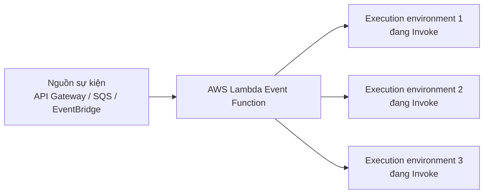
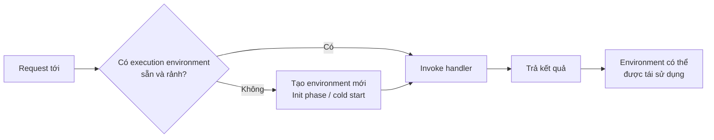
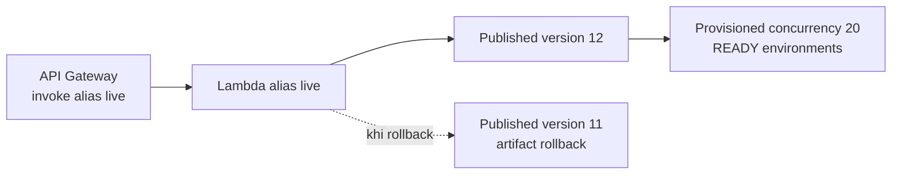
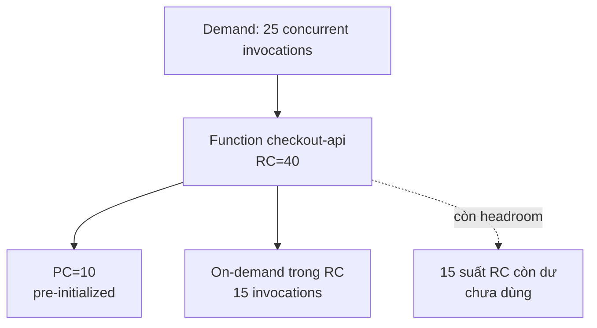
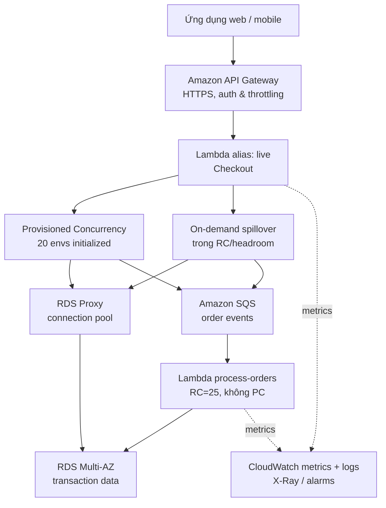
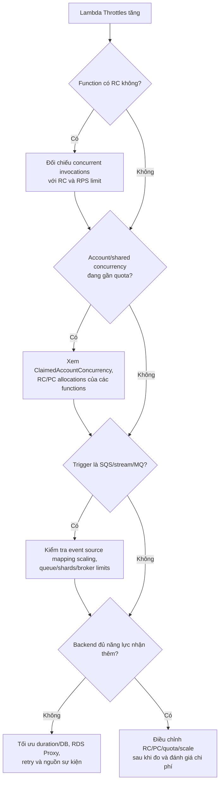

# Reserved concurrency và provisioned concurrency trong AWS Lambda

> **Chương:** Điện toán Lambda  
> **Module:** CLOUD_PROVIDERS_AWS  
> **Mục tiêu:** hiểu và chọn đúng hai cơ chế điều khiển concurrency của AWS Lambda, tính toán hạn mức từ lưu lượng thực tế, bảo vệ tài nguyên phụ thuộc, giảm cold start cho ứng dụng nhạy độ trễ, giám sát throttling và dự toán chi phí vận hành.
>
> **Phạm vi:** tập trung vào Lambda **Event Functions** với mô hình invocation thông thường, trong bối cảnh Region, IAM, VPC, API Gateway, SQS, DynamoDB/RDS, CloudWatch và triển khai theo version/alias. Một số chế độ compute mới có mô hình scaling riêng; không áp dụng máy móc thông số của Event Function cho mọi loại Lambda compute.

## 1. Bài toán: API phải nhanh nhưng database không được quá tải

Một doanh nghiệp bán hàng triển khai hai Lambda functions tại Region `ap-southeast-1`:

- **`checkout-api`:** nhận request từ Amazon API Gateway, đọc thông tin giỏ hàng và ghi đơn. Người dùng tương tác trực tiếp, kỳ vọng **p95 latency** thấp, kể cả sau vài phút lưu lượng thưa.
- **`process-orders`:** nhận batch message qua Amazon SQS, gọi một database có số lượng connections giới hạn. Một đợt khuyến mại có thể khiến queue tăng mạnh; nếu Lambda mở rộng không giới hạn, database bị quá tải.

Hai nhu cầu nghe giống nhau — “quản lý concurrency” — nhưng khác trọng tâm:

1. Với `process-orders`, muốn **khống chế trần số invocation chạy đồng thời** để bảo vệ downstream. Đây là trường hợp điển hình của **reserved concurrency**.
2. Với `checkout-api`, muốn **có sẵn execution environments đã khởi tạo**, giảm thời gian cold start ở đường request đồng bộ. Đây là trường hợp điển hình của **provisioned concurrency**.
3. Một function có thể cần **cả hai**: giữ trần concurrency để bảo vệ database, đồng thời dành một phần capacity đã warm cho traffic tương tác.

**Kết luận trước:** **reserved concurrency không phải “giữ máy warm”**; **provisioned concurrency không đồng nghĩa “không bao giờ throttle”**. Hai cơ chế giải quyết các vấn đề khác nhau và đều chịu ảnh hưởng của quota trong tài khoản/Region.

### 1.1. Những câu hỏi người học cần trả lời

Sau bài này, bạn sẽ trả lời được:

- Concurrency khác requests per second (RPS) như thế nào?
- Khi nào function dùng shared/unreserved concurrency?
- `reserved concurrency = 20` có nghĩa function luôn chạy 20 instances không?
- `provisioned concurrency = 10` sẽ ra sao khi có 25 request thực hiện đồng thời?
- Tại sao provisioned concurrency phải gắn với **published version hoặc alias**, không phải `$LATEST`?
- Tại sao function vẫn có cold starts hoặc throttles dù đã bật provisioned concurrency?
- Làm sao cân bằng độ trễ, an toàn cho RDS, giới hạn tài khoản và hóa đơn?
- Những metric CloudWatch nào giúp biết cấu hình đang thiếu hay lãng phí?

## 2. Concurrency là gì trong Lambda?

**Concurrency** là số **invocations đang thực thi đồng thời tại một thời điểm**. Với Lambda Event Function, mỗi execution environment đang xử lý một invocation; một environment có thể được **tái sử dụng** cho các invocations tuần tự sau đó.



Nếu có ba invocations đang chạy ở đúng thời điểm đang quan sát, **concurrency = 3**. Trong một phút function có thể xử lý hàng nghìn invocations nhờ mỗi environment xử lý nhiều request nối tiếp.

### 2.1. Công thức ước tính cơ bản

Với dòng request tương đối ổn định, quy tắc gần đúng thường dùng là:

\[
C \approx R \times D
\]

Trong đó:

- \(C\): concurrency cần để phục vụ tải trung bình.
- \(R\): số request mỗi giây, thường gọi RPS.
- \(D\): thời gian thực thi trung bình của một invocation tính bằng **giây**.

Ví dụ 1:

\[
100\ \text{request/giây} \times 0{,}2\ \text{giây/request}
=20\ \text{invocations đồng thời}
\]

Ví dụ 2: API có 500 RPS, thời gian thực thi trung bình 400 ms:

\[
C \approx 500 \times 0{,}4 = 200
\]

**Không nhầm 200 concurrency với 200 request/giây.** Với thời gian 400 ms, 200 execution environments có thể xử lý bình quân khoảng 500 RPS trong điều kiện ổn định và không bị giới hạn khác.

### 2.2. Công thức chỉ là điểm bắt đầu

Trong thực tế:

- Traffic có thể tăng đột biến theo từng giây; số RPS trung bình 5 phút có thể che peak.
- Duration có phân phối: p95/p99 chậm hơn average do DB, external API, timeout và retry.
- Một request tới API Gateway có thể fan out thành nhiều Lambda invocations ở các chức năng khác nhau.
- Số requests đồng bộ bị giới hạn thêm bởi **requests-per-second quota**, ngoài trần concurrency.
- Khi vừa nhận spike, Lambda còn có **function scaling rate** giới hạn tốc độ bổ sung execution environments.

Do đó sizing phải dựa trên **CloudWatch metrics, p95/p99 latency, load test và tải thực**, không chỉ lấy công thức trung bình rồi chốt số.

### 2.3. Concurrency và throughput không phải một

| Tình huống | RPS | Average duration | Concurrency ước tính |
|---|---:|---:|---:|
| API nhanh | 200 | 50 ms | 10 |
| API thường | 200 | 500 ms | 100 |
| API chậm do DB | 200 | 2 s | 400 |
| Background jobs | 20 | 10 s | 200 |

Cùng **200 RPS**, nếu database chậm làm duration tăng từ 50 ms lên 2 giây, concurrency cần tăng từ khoảng 10 lên 400. Vì thế **giảm duration** và tối ưu kết nối database có thể hiệu quả hơn chỉ tăng concurrency quota.

## 3. Execution environment, cold start và warm reuse

### 3.1. Vòng đời một invocation

Khi một Event Function cần environment mới, Lambda thực hiện **Init phase**: chuẩn bị runtime, tải code/libraries, chạy phần khởi tạo bên ngoài handler, thiết lập kết nối cần thiết. Sau đó Lambda chạy **Invoke phase** để xử lý event.



**Cold start** xảy ra khi Lambda phải khởi tạo environment mới. Thời gian khởi tạo còn tùy runtime, package size, dependency initialization, VPC/network dependencies, extensions và code nằm ngoài handler.

**Warm reuse** là việc sử dụng lại environment đã được khởi tạo, nhưng AWS **không cam kết giữ mãi** một environment nhàn rỗi. Lambda có thể recycle environments vì bảo trì, lỗi invocation hoặc thay đổi công suất.

### 3.2. Reserved và provisioned tác động chỗ nào?

- **Reserved concurrency (RC):** giới hạn và dành riêng *số suất concurrency* cho function, **không tạo sẵn từng environment warm**.
- **Provisioned concurrency (PC):** Lambda **tạo và khởi tạo trước** số execution environments đã yêu cầu, để các invocation dùng ngay khi capacity sẵn sàng.

Cả hai là **cơ chế concurrency control**, nhưng chỉ **PC** trực tiếp giải quyết cold start do thiếu môi trường đã warm. PC vẫn có thể gặp biến động init khi Lambda reset/recycle environment; không phải SLA tuyệt đối về độ trễ end-to-end.

## 4. Quota concurrency ở account và AWS Region

Lambda có **hạn mức concurrency theo account trong từng Region** cho Event Functions. Tài khoản thường có giá trị mặc định **1.000 concurrent executions/Region**, nhưng AWS có thể cấp quota khác; **phải kiểm tra Service Quotas và API thực tế của tài khoản**.

### 4.1. Shared/unreserved pool

Nếu một function không cấu hình reserved concurrency, nó sử dụng **unreserved concurrency pool** chung với những functions khác trong cùng account/Region. Một function có burst lớn có thể tiêu thụ pool, làm chức năng khác bị throttle.

Ví dụ giả định account quota 1.000:

```text
Account/Region concurrency quota: 1.000
├── Function A: reserved concurrency 300
├── Function B: reserved concurrency 200
└── Shared/unreserved pool còn 500
    ├── Function C (không RC)
    ├── Function D (không RC)
    └── các functions khác
```

Hai functions A/B đã giữ riêng tổng 500 units dù lúc này không có invocation. Pool còn 500 được chia cho những functions chưa có RC và cho phần sử dụng phù hợp khác theo quy tắc cấp phát.

**AWS yêu cầu giữ ít nhất 100 units unreserved** cho các functions không gán reserved concurrency. Vì vậy nếu quota là 1.000, không thể phân bổ toàn bộ 1.000 vào reserved concurrency; giới hạn phân bổ dành riêng thông thường là 900 trước khi xét các allocations khác.

### 4.2. Cấp quota lớn hơn có ảnh hưởng gì?

Nếu AWS nâng account limit từ 1.000 lên 2.000 concurrent executions, số units có thể dành cho reserved concurrency về nguyên tắc tăng lên tối đa 1.900, vẫn phải giữ **100 unreserved**. Tuy nhiên:

- Quota được cấp không có nghĩa code hoặc database chịu được tải đó.
- Function scaling rate và giới hạn RPS vẫn áp dụng.
- Một số nguồn sự kiện như Amazon MQ hay SQS có giới hạn concurrency riêng.
- Nếu nhiều functions đều cấu hình RC/PC, cần kiểm soát tổng allocations.

**Quota là mức trần hạ tầng được cấp**, không phải cam kết hiệu năng nghiệp vụ.

## 5. Reserved concurrency: giữ suất và đặt trần cho function

### 5.1. Định nghĩa chính xác

**Reserved concurrency** có hai tác dụng cùng lúc:

1. **Reservation:** suất concurrency được giữ **riêng cho function**. Các functions khác không dùng được phần suất này.
2. **Limit:** chính function **không thể vượt quá** mức RC đã đặt, dù account còn shared concurrency.

**Reserved concurrency áp dụng cho function ở mức tổng thể**, gồm `$LATEST`, các published versions và aliases. Nó **không phải một giới hạn RC riêng cho từng alias**.

Ví dụ đặt:

```text
Function: process-orders
Reserved concurrency: 30
```

Nếu có 25 invocations đồng thời, function có thể phục vụ trong trần 30 (miễn không vướng giới hạn khác). Nếu nhu cầu đột nhiên cần 38 invocations đồng thời, 8 invocations vượt trần có thể bị **throttle** hoặc được nguồn sự kiện xử lý theo cơ chế retry/queue phù hợp.

**Không có 30 machines đã warm ngay khi đặt RC=30.** Function vẫn có thể cold start khi cần tạo environment mới.

### 5.2. RC không phát sinh phí trực tiếp

AWS **không tính phụ phí riêng cho việc cấu hình reserved concurrency**. Bạn vẫn trả:

- Request charges nếu có.
- Compute duration và memory theo Lambda pricing.
- Các chi phí CloudWatch, VPC/NAT, RDS, SQS, KMS hoặc dịch vụ liên quan.

Vì RC tự nó không pre-initialize environments, không có khoản **pre-warmed capacity** riêng như PC.

### 5.3. Khi nào nên chọn RC?

| Bài toán | Vì sao RC hữu ích |
|---|---|
| Bảo vệ RDS khỏi quá nhiều kết nối | Giới hạn số Lambda invocations đồng thời có thể giữ DB connections |
| Không để batch jobs lấn API quan trọng | Dành riêng suất concurrency cho API hoặc giới hạn batch function |
| Kiểm soát chi phí/rủi ro burst | Đặt trần throughput tương đối, tránh scale quá nhanh vào service yếu |
| Cô lập functions quan trọng trong account | RC function A không bị function B chiếm hết reserved suất |
| Tạm ngừng một function | Có thể đặt RC = 0 để throttle các invocations mới |

**Cần thận trọng với RC=0:** nó **không vô hiệu hóa nguồn sự kiện** và cũng không đảm bảo mọi event được giữ mãi. Với sync request có thể trả throttle; với async/SQS/stream, behavior phụ thuộc cơ chế queue, retries, event age, DLQ và retention. Không dùng RC=0 thay cho quy trình dừng consumer được kiểm soát.

### 5.4. Thực tế RC là cả “sàn quyền sử dụng” lẫn “trần”

Cách mô tả RC là “minimum” trong tài liệu AWS nghĩa suất được **bảo vệ khỏi bị functions khác sử dụng**, không phải Lambda tự duy trì đúng số môi trường đang chạy.

Nếu function A có RC=50 nhưng không nhận request:

- Nó có thể có **0 invocation đang chạy**.
- Nó không tự có 50 môi trường warm.
- 50 suất vẫn bị trừ khỏi phần quota chia sẻ cho functions khác.

Do đó RC lớn hơn nhu cầu có thể tạo **lãng phí quota**, dù không tạo phí RC trực tiếp.

## 6. Provisioned concurrency: có execution environments đã khởi tạo

### 6.1. Định nghĩa chính xác

**Provisioned concurrency** là số execution environments được Lambda **khởi tạo trước và duy trì sẵn sàng** cho một **published function version** hoặc **alias**. Khi có request và môi trường provisioned còn rảnh, invocation có thể tránh phần cold start thông thường.

Ví dụ:

```text
Function: checkout-api
Published version: 12
Alias: live -> version 12
Provisioned concurrency của alias live: 20
```

Lambda cấp phát tối đa 20 execution environments đã khởi tạo để phục vụ invocation hướng tới alias `live`, sau khi allocation hoàn tất.

**Điều kiện không được bỏ qua:**

- PC **không cấu hình cho `$LATEST`**.
- Trigger phải gọi **đúng alias/version** có PC; gọi function không có qualifier có thể đi tới `$LATEST` và **không dùng PC**.
- Quá trình PC allocation **không tức thì**; trạng thái có thể `IN_PROGRESS` trước khi `READY`.
- PC gây **phí capacity theo thời gian được cấp phát**, kể cả khi không nhận request.
- PC không tự thay đổi giới hạn riêng của source event hoặc khắc phục lỗi database.

### 6.2. PC có “không bao giờ cold start” không?

PC được thiết kế để giảm mạnh cold start khi có đủ provisioned capacity, nhưng phát biểu **“đã bật PC = mọi request chắc chắn luôn nhanh”** là không chính xác:

- Traffic vượt PC có thể **spill over** sang on-demand capacity, nơi cold start có thể xảy ra.
- Lambda có thể reset/recycle provisioned environments sau lỗi hoặc trong bảo trì; hoạt động init có thể ảnh hưởng một số lần gọi.
- Provisioned capacity phải đạt trạng thái **READY** trước khi bạn kỳ vọng sử dụng.
- Request đi nhầm `$LATEST`/alias khác **không dùng allocation** của alias đã cấu hình.
- Dù không có cold start, handler vẫn có thể chậm vì RDS lock, DynamoDB throttling, API bên thứ ba, mạng hoặc serialization.

**Độ trễ end-to-end** vẫn cần kiểm thử và đo p95/p99 trên đường thực tế.

### 6.3. PC allocation phải chờ

Sau thao tác yêu cầu PC, Lambda chuẩn bị và khởi tạo environments. AWS mô tả việc tạo PC có thể cần thời gian chuẩn bị; lượng cấp phát lớn càng cần kế hoạch trước peak.

Ví dụ API trả:

```json
{
  "RequestedProvisionedConcurrentExecutions": 20,
  "AllocatedProvisionedConcurrentExecutions": 0,
  "Status": "IN_PROGRESS"
}
```

**Không chuyển production traffic ngay** vì request API đã nhận. Chờ `Status = READY` và `AllocatedProvisionedConcurrentExecutions` khớp với mức yêu cầu, rồi xác nhận invocation routing qua alias.

### 6.4. Phiên bản và alias

Một Lambda function có:

- `$LATEST`: code/config chưa publish, có thể chỉnh.
- Published versions như `10`, `11`, `12`: snapshot bất biến của code/config ở lần publish.
- Alias như `dev`, `staging`, `live`: tên ổn định trỏ tới published version, có thể dùng weighted routing.

Mô hình đề xuất:



**Sai lầm phổ biến:** cấu hình PC cho alias `live` nhưng API Gateway tích hợp với ARN **không qualifier**. API Gateway lúc đó có thể gọi `$LATEST` và không tận dụng PC; cần kiểm tra ARN thật của integration/permission.

## 7. So sánh trực diện reserved và provisioned concurrency

| Tiêu chí | **Reserved concurrency** | **Provisioned concurrency** |
|---|---|---|
| Mục tiêu chính | **Bảo vệ và giới hạn số invocation đồng thời** | **Giảm cold start bằng environments pre-initialized** |
| Phạm vi cấu hình | **Toàn function**, gồm versions/aliases | **Published version hoặc alias**, không phải `$LATEST` |
| Có giữ riêng quota? | Có, RC là suất dành cho function | Có, PC chiếm suất concurrency từ pool phù hợp |
| Có khởi tạo environment trước? | **Không** | **Có** |
| Có cold start? | **Có thể** | Thường giảm mạnh trong phần PC; có thể xuất hiện do spillover/reset |
| Nếu traffic vượt mức | Vượt **RC** → throttling | Vượt **PC** → có thể dùng on-demand; vượt RC/account/RPS → throttling |
| Chi phí riêng khi nhàn rỗi | **Không** | **Có**: phí provisioned capacity |
| Thường dùng | Protect DB, isolate functions, limit batch | Interactive API, mobile/web backend, latency-sensitive |
| Tăng giảm tự động | Quản lý cấu hình RC bằng IaC/automation riêng nếu cần | Application Auto Scaling với scheduled/target tracking |
| RC = 0 / PC = 0 | RC=0 chặn invocations | PC không được dùng như nút throttle; gỡ PC chỉ bỏ phần pre-warmed |

**Bảng tóm tắt:** nếu câu hỏi là “function không được vượt 30 invocations đồng thời” → **RC**. Nếu câu hỏi là “khi người dùng gọi phải có môi trường đã init cho 10 requests đầu” → **PC**.

## 8. Kết hợp RC và PC: đọc đúng mọi trạng thái

Một function có thể đồng thời có RC và PC. Khi đã đặt RC, **tổng PC được phân bổ cho các versions/aliases của function không được vượt RC**.

### 8.1. Ví dụ A — RC=40, PC=10

```text
Function checkout-api:
Reserved concurrency = 40
Provisioned concurrency (alias live) = 10

Demand (đồng thời) = 8:
  8 qua PC, còn 2 PC rảnh.

Demand = 25:
  10 có thể dùng PC.
  15 còn lại có thể chạy on-demand trong RC (có cold start).

Demand = 45:
  Chỉ tối đa 40 invocations đồng thời theo RC.
  5 invocations vượt giới hạn bị throttle hoặc xử lý retry tùy nguồn.
```



**Điểm dễ nhầm:** PC=10 **không cộng thêm 10 bên ngoài RC=40**. Nó nằm **trong** giới hạn RC, không tạo tổng 50.

### 8.2. Ví dụ B — RC=10, PC=10

Nếu PC của tất cả versions/aliases cộng lại bằng RC=10:

- Mười suất đã được dành cho provisioned concurrency.
- Traffic vượt PC không có RC còn lại để chạy on-demand.
- Invocations vượt trần có thể bị throttle.
- **`$LATEST`** không có phần capacity để thực thi nếu toàn bộ RC đã dùng cho PC, theo mô hình allocation của AWS.

Điều này hữu ích nếu muốn **chỉ chạy bằng capacity đã pre-warm**, nhưng dễ gây bất ngờ khi developer test `$LATEST` hoặc có spike vượt 10 đồng thời.

### 8.3. Ví dụ C — Chỉ có PC=20, không có RC

Function có PC=20 tại alias `live`, nhưng **không đặt reserved concurrency**:

- 20 environments được pre-initialize khi allocation READY.
- Khi traffic vượt 20, Lambda có thể dùng **on-demand/shared concurrency** còn khả dụng.
- Function có thể bị throttle nếu **account quota, scaling rate hoặc RPS limit** không đáp ứng.
- PC vẫn chiếm capacity allocation theo quy tắc của account và làm giảm pool còn lại cho functions khác.

**PC không tự đặt một trần concurrency cố định tại 20**. Nếu mục tiêu chính là bảo vệ database, đừng chỉ đặt PC=20 mà tưởng function không thể đạt 100 concurrent invocations.

### 8.4. Ví dụ D — Một function có hai aliases

Giả sử:

```text
Function: payment-handler
Reserved concurrency toàn function: 40
Alias live -> version 12: PC=25
Alias canary -> version 13: PC=5

Tổng PC đã phân bổ: 30
Headroom RC còn lại: 10
```

Điều kiện:

\[
PC_{\text{live}} + PC_{\text{canary}} \leq RC_{\text{function}}
\]

Nếu đổi canary sang 25 PC mà live vẫn 25, tổng 50 vượt RC=40; thao tác cấu hình sẽ không hợp lệ. Khi blue/green/weighted alias routing, cần tính **tất cả allocations** và cách traffic thực sự được chia.

### 8.5. Hạn mức RPS là một trục khác

Lambda Event Function có **requests-per-second limits**. AWS hiện mô tả hạn mức **10 requests/giây cho mỗi concurrency unit** trong các trường hợp synchronous invocation tương ứng, bao gồm giới hạn theo PC alias/version.

Ví dụ PC=20, function xử lý 2.000 requests/giây mà mỗi invocation cực nhanh (5 ms):

\[
R \times D = 2.000 \times 0{,}005 = 10\ \text{concurrency trung bình}
\]

Dù 10 concurrent nhỏ hơn PC=20, **giới hạn RPS tương ứng PC=20 chỉ khoảng 200 request/giây** ở điểm mà giới hạn đó áp dụng. Traffic vượt mức có thể spillover sang on-demand hoặc bị throttle theo những quotas khác.

**Không sizing PC chỉ từ C=R×D** khi function có thời gian cực ngắn/RPS rất cao; phải xét cả **RPS quota = 10 × allocated concurrency** và các giới hạn account/on-demand.

## 9. Throttling phụ thuộc invocation type và event source

### 9.1. Invocation đồng bộ

API Gateway, Lambda Invoke API hoặc client gọi function theo kiểu `RequestResponse` thường đợi kết quả:

- Khi vượt RC/account/RPS, Lambda có thể trả **`TooManyRequestsException` (HTTP 429)** ở API invocation.
- Tùy tích hợp API Gateway/ALB và mapping, client có thể thấy mã HTTP khác; cần đọc integration logs.
- **Client** hoặc upstream service chịu trách nhiệm retry theo policy thích hợp; dùng exponential backoff/jitter, tránh retry storm.
- Với các thao tác tạo đơn/thanh toán, retries phải đi kèm **idempotency key**.

RC/PC không tự sửa một API thiết kế không idempotent.

### 9.2. Invocation bất đồng bộ

Với `InvocationType=Event` từ các dịch vụ hỗ trợ async invocation:

- Lambda nhận event vào **hàng đợi nội bộ** rồi xử lý.
- Khi function code lỗi, Lambda có thể retry theo cấu hình (mặc định tối đa 2 lần retry cho function errors).
- Khi bị **throttle** hoặc lỗi hệ thống, Lambda có cơ chế backoff/retry trong thời gian event còn hợp lệ, theo giới hạn tuổi sự kiện và chính sách của nguồn.
- Có thể dùng **on-failure destination** hoặc DLQ để giữ record sau khi thất bại.

Vì vậy RC=0 không có nghĩa lập tức mất toàn bộ sự kiện; nhưng cũng không có nghĩa chúng được giữ mãi. Nếu queue backlog lớn, event có thể vượt maximum event age và bị loại bỏ theo chính sách.

### 9.3. SQS event source mapping

**Amazon SQS → Lambda** là mô hình Lambda **poll batches** từ queue, không giống một event async direct invoke đơn giản. Khi giảm RC:

- Số concurrent invocations có thể bị hạn chế.
- Message backlog và `ApproximateAgeOfOldestMessage` có thể tăng.
- Lambda poller có logic backoff/retry theo lỗi/throttling và SQS visibility timeout/redrive.
- Cần thiết kế DLQ, idempotent consumers và partial batch responses khi phù hợp.

Một SQS event source mapping có **MaximumConcurrency** riêng. Đây là giới hạn **theo nguồn sự kiện**, trong khi **reserved concurrency** là giới hạn **toàn function**.

| Cơ chế | Phạm vi | Mục đích |
|---|---|---|
| **Lambda reserved concurrency** | Toàn function | Trần concurrency của mọi invocations vào function |
| **SQS mapping MaximumConcurrency** | Một SQS event source mapping | Không cho một queue dùng quá nhiều concurrent invokes |
| **SQS event source mapping Provisioned Mode** | Pollers của SQS mapping | Giữ pollers sẵn, scale ingestion throughput |
| **Lambda provisioned concurrency** | Function version/alias | Giữ **execution environments** khởi tạo sẵn |

**Đặc biệt:** **SQS Provisioned Mode không phải Lambda Provisioned Concurrency**. Một cơ chế giữ **event pollers**, cơ chế kia giữ **execution environments**. Có thể có các điều kiện hỗ trợ/chi phí khác nhau.

Khi đặt `MaximumConcurrency` cho nhiều SQS mappings cùng gọi một function, AWS khuyến nghị **reserved concurrency của function ≥ tổng MaximumConcurrency** của những mappings đó; nếu không, throttling vẫn có thể xảy ra. Với FIFO queue, số message group IDs cũng giới hạn concurrency.

### 9.4. Streams và Amazon MQ

- **Kinesis/DynamoDB Streams:** mức song song phụ thuộc shards, batches, parallelization factor, source mapping và thứ tự dữ liệu; tăng RC không tự tạo nhiều shards.
- **Amazon MQ:** concurrency mapping có giới hạn riêng theo loại broker. Tài liệu AWS mô tả mặc định thấp hơn concurrency quota thông thường; RC/PC không bỏ qua giới hạn nguồn.
- **Synchronous APIs:** p95 latency thường quan trọng hơn background queue processing, nên PC hay được ưu tiên hơn.

**Không có thiết lập concurrency nào thay thế kiến thức về scaling behavior của event source cụ thể.**

## 10. Sizing reserved concurrency dựa trên downstream capacity

Giả sử `process-orders` đọc SQS và ghi RDS. Database có thể chấp nhận khoảng **60 active connections cho workload này**, sau khi đã tính phần dành cho app khác. Mỗi invocation có thể sử dụng **tối đa hai DB connections** trong code hiện tại.

Giới hạn sơ bộ:

\[
RC \leq \left\lfloor \frac{60\ \text{connections}}{2\ \text{connections/invocation}} \right\rfloor = 30
\]

Có thể chọn **RC=20–25** để giữ khoảng dự phòng, sau khi xác nhận connection pool và workload thực tế.

**Đây chỉ là mô hình giả định:** một warm Lambda environment có thể giữ connection nhàn rỗi trong nhiều lần gọi; số connections thực tế có thể không bằng số concurrent invocations nhân một hằng số. Cần quan sát:

- RDS `DatabaseConnections`, CPU, locks và latency.
- Số kết nối được tái sử dụng qua warm environments.
- Thời gian transaction, pool size và retry behavior.
- Kết nối tới secrets/KMS/VPC endpoints và giới hạn phía database.
- Khả năng dùng **Amazon RDS Proxy** để quản lý connection pooling/failover phù hợp.

### 10.1. RC là van điều tiết, không phải load balancer

Nếu function bị throttled khi tăng tải, RC đang hoạt động đúng vai trò đặt trần. Vấn đề cần trả lời là:

1. Downstream có thể chịu thêm tải không?
2. Có cần scale database/proxy trước khi tăng RC?
3. Có thể tối ưu duration hoặc batch size để xử lý cùng số event với RC thấp hơn không?
4. Queue retention/visibility timeout có đủ để chờ xử lý không?
5. Có cảnh báo backlog/oldest message age chưa?

Tăng RC từ 20 lên 200 chỉ vì metric `Throttles` tăng có thể biến **lỗi throttling dễ quản lý** thành **sự cố quá tải database**.

## 11. Sizing provisioned concurrency cho API nhạy độ trễ

### 11.1. Bắt đầu từ dữ liệu thực

Giả sử `checkout-api` có:

- Trung bình peak từ 9:00–11:00: 150 RPS.
- Average duration khi đã warm: 120 ms.
- p95 duration: 280 ms.
- Người dùng rất nhạy với cold start của Java runtime.
- Chỉ cần latency thấp trong 2 giờ/ngày, 5 ngày/tuần.

Ước tính concurrency trung bình tại peak:

\[
C \approx 150 \times 0{,}12 = 18
\]

Một điểm xuất phát là **PC ≈ 20** (có buffer), rồi kiểm tra thực tế qua metrics. AWS gợi ý **khoảng 10% buffer** trên nhu cầu concurrency thường thấy, nhưng đây là hướng dẫn chung, không phải con số đúng cho mọi ứng dụng.

Để chịu các spike, có thể:

- Đặt **RC=40** nhằm giữ headroom tới 40 nhưng vẫn bảo vệ RDS.
- Đặt **PC=20–25** trong giờ cao điểm.
- Chấp nhận spillover on-demand đối với requests vượt PC và thiết kế retry/latency SLO phù hợp.
- Nếu yêu cầu mọi request tại peak đều đạt latency nghiêm ngặt, tăng PC theo phân phối tải thực và đánh giá chi phí.

### 11.2. Đánh giá duration đúng cách

Với PC, không nên giả định app speedup ở cả **Invoke phase**. PC giảm phần initialization, không tự làm SQL query hoặc JSON serialization nhanh hơn. Đo:

- **Cold/warm init duration** trước khi bật PC.
- p50, p95, p99 latency của HTTP requests thực.
- `Duration` theo Lambda và time spent ở API Gateway/ALB.
- `ProvisionedConcurrencySpilloverInvocations` khi peak.
- `ProvisionedConcurrencyUtilization` để biết phân bổ có dư nhiều không.

### 11.3. Theo dõi RPS quota

Đối với short-lived requests, concurrency tính theo RPS×duration đôi khi thấp, nhưng **RPS limit 10×PC** có thể trở thành yếu tố giới hạn trước. Ví dụ workload 3.000 RPS với duration chỉ 10 ms:

\[
C_{\text{trung bình}} = 3.000 \times 0{,}01 = 30
\]

PC=35 gần đủ theo concurrency, nhưng mức RPS tương ứng chỉ khoảng **350 RPS** ở hạn mức 10×PC. Cần thiết kế PC/on-demand capacity và kiểm tra request-rate quotas; việc chỉ tăng PC lên 35 chưa bảo đảm phục vụ 3.000 RPS không spillover.

## 12. Kiến trúc mẫu: API latency thấp và hàng đợi ổn định



Các quyết định:

- **API Gateway:** xác thực, route và throttling ở entrypoint, không thay thế concurrency quota ở Lambda.
- **Alias `live`:** cố định integration vào một bản publish có PC, hỗ trợ deploy/rollback rõ ràng.
- **PC:** dành capacity warm cho đường request tương tác; điều chỉnh theo traffic.
- **RC của checkout:** hạn chế tổng load DB khi nhiều invocations tăng cùng lúc.
- **RDS Proxy:** tránh quá nhiều kết nối trực tiếp, hỗ trợ pooling; vẫn cần thiết kế retry, transaction và giới hạn DB.
- **SQS:** decouple xử lý background, hấp thụ burst khi worker bị RC giới hạn.
- **Worker RC:** bảo vệ RDS và giảm nguy cơ queue consumer chiếm hết pool của account.
- **CloudWatch:** quan sát p95 latency, errors, throttles, PC spillover, utilization và queue age.

**Tính sẵn sàng:** Lambda là dịch vụ theo Region có hạ tầng HA do AWS quản lý, nhưng VPC dependencies như NAT/VPC endpoint, RDS subnet groups, database failover, Route 53 và KMS keys vẫn phải được thiết kế phù hợp **nhiều AZ**. Không cho rằng bật PC/RC tạo thành kiến trúc multi-Region disaster recovery.

## 13. Cấu hình trên AWS Console và quy trình deploy an toàn

### 13.1. Cấu hình RC

Trong AWS Lambda console:

1. Chọn **Lambda Event Function** cần điều khiển concurrency.
2. Mở **Configuration → Concurrency**.
3. Trong **Reserved concurrency**, chọn **Reserve concurrency**.
4. Nhập mức concurrency phù hợp, ví dụ 40.
5. Lưu và kiểm tra metrics của toàn account sau khi reservation có hiệu lực.

**Không đặt RC quá cao theo thói quen** vì sẽ giữ suất mà function khác không dùng được.

### 13.2. Cấu hình PC

Quy trình khái niệm:

1. Tạo bản code/config đã qua test và **publish version**.
2. Tạo hoặc cập nhật **alias** như `live` trỏ version này.
3. Trong **Configuration → Concurrency → Provisioned concurrency**, thêm cấu hình cho **alias hoặc version**, không dùng `$LATEST`.
4. Chọn số lượng PC; bảo đảm không vượt RC của function nếu đã đặt RC và không vượt khả năng allocate trong account.
5. Theo dõi trạng thái allocation **`READY`** trước khi kỳ vọng traffic dùng warmed capacity.
6. Đảm bảo **API Gateway, event source mappings hoặc caller** invoke **alias/version đã được PC cấu hình**, không gọi function ARN trần.
7. Kiểm tra CloudWatch `ProvisionedConcurrencyInvocations`, spillover và latency.

### 13.3. Điều cần làm trước khi chuyển production traffic

- Kiểm tra function version mới sử dụng IAM role, secret, VPC, timeout và memory phù hợp.
- Test invoke qua **qualified ARN** để không rơi vào `$LATEST`.
- Kiểm tra PC allocation đã READY, KMS/secrets và init code không thất bại.
- Nếu dùng weighted alias traffic shifting, tính đủ PC cho cả bản đang chạy và bản mới.
- Bật alerts cho throttles, errors và p95 latency.
- Chuẩn bị rollback alias về version cũ và đảm bảo artifact cũ vẫn dùng được.
- Kiểm tra database schema backward compatible.
- Ước tính quota/cost khi PC của hai versions cùng tồn tại trong lúc triển khai.

## 14. AWS CLI: kiểm tra chỉ đọc

Tất cả lệnh trong mục này là **read-only**, không tạo hoặc thay đổi tài nguyên. Cần AWS CLI v2, quyền IAM đọc Lambda/CloudWatch/Application Auto Scaling và Region đúng.

### 14.1. Xem account concurrency quota

```bash
aws lambda get-account-settings \
  --region ap-southeast-1 \
  --query 'AccountLimit.{TotalConcurrency:ConcurrentExecutions,AllocatableUnreserved:UnreservedConcurrentExecutions}' \
  --output json
```

**Lưu ý ý nghĩa fields:** `AccountLimit.ConcurrentExecutions` là account-level quota. `AccountLimit.UnreservedConcurrentExecutions` phản ánh lượng concurrency còn có thể dành cho những phân bổ tương ứng, **không phải số invocation đang chạy**. Muốn quan sát traffic đang dùng, xem CloudWatch `ConcurrentExecutions` và `UnreservedConcurrentExecutions`.

### 14.2. Xem reserved concurrency của function

```bash
aws lambda get-function-concurrency \
  --region ap-southeast-1 \
  --function-name checkout-api \
  --output json
```

Khi có RC, kết quả chứa `ReservedConcurrentExecutions`. Nếu không có RC, API có thể trả object không chứa giá trị tương ứng; không tự suy rằng RC=0. **RC=0** là một cấu hình rõ ràng và có ý nghĩa throttling.

### 14.3. Liệt kê versions và aliases

```bash
aws lambda list-versions-by-function \
  --region ap-southeast-1 \
  --function-name checkout-api \
  --query 'Versions[].[Version,FunctionArn,LastModified]' \
  --output table

aws lambda list-aliases \
  --region ap-southeast-1 \
  --function-name checkout-api \
  --query 'Aliases[].[Name,FunctionVersion,AliasArn]' \
  --output table
```

Kiểm tra `live` hiện trỏ version nào, đặc biệt sau deploy/rollback.

### 14.4. Xem provisioned concurrency

```bash
aws lambda list-provisioned-concurrency-configs \
  --region ap-southeast-1 \
  --function-name checkout-api \
  --output json
```

Nếu biết alias:

```bash
aws lambda get-provisioned-concurrency-config \
  --region ap-southeast-1 \
  --function-name checkout-api \
  --qualifier live \
  --query '{Requested:RequestedProvisionedConcurrentExecutions,Allocated:AllocatedProvisionedConcurrentExecutions,Status:Status,Reason:StatusReason}' \
  --output json
```

Kỳ vọng `Status = READY` khi allocation hoàn tất. Nếu `IN_PROGRESS`, đừng cho rằng toàn bộ capacity đã warm. Nếu `FAILED`, đọc `StatusReason` rồi đối chiếu quotas, init code, runtime và IAM/KMS.

### 14.5. Xem cấu hình function và alias integration

```bash
aws lambda get-function-configuration \
  --region ap-southeast-1 \
  --function-name checkout-api \
  --query '{Runtime:Runtime,MemorySize:MemorySize,Timeout:Timeout,Role:Role,VpcConfig:VpcConfig,State:State}' \
  --output json

aws lambda get-alias \
  --region ap-southeast-1 \
  --function-name checkout-api \
  --name live \
  --output json
```

Với API Gateway hoặc SQS mapping, kiểm tra ARN trigger thực tế để bảo đảm gọi **alias `live`**. Không chỉ nhìn cái tên “live” trong console mà bỏ qua integration ARN.

### 14.6. Xem các SQS event source mappings

```bash
aws lambda list-event-source-mappings \
  --region ap-southeast-1 \
  --function-name process-orders \
  --query 'EventSourceMappings[].[UUID,EventSourceArn,State,ScalingConfig.MaximumConcurrency]' \
  --output table
```

Field `MaximumConcurrency` là **cấu hình của mapping**, không phải function RC hoặc PC. Với SQS Provisioned Mode, xem thêm JSON đầy đủ và các fields mapping được phiên bản API hiện hành hỗ trợ.

### 14.7. Xem Application Auto Scaling targets

```bash
aws application-autoscaling describe-scalable-targets \
  --region ap-southeast-1 \
  --service-namespace lambda \
  --scalable-dimension lambda:function:ProvisionedConcurrency \
  --output json

aws application-autoscaling describe-scaling-policies \
  --region ap-southeast-1 \
  --service-namespace lambda \
  --scalable-dimension lambda:function:ProvisionedConcurrency \
  --output json
```

Dùng để biết alias/version nào đang được managed PC scaling, min/max values và các target tracking policies. Nếu PC bị tự giảm sau khi admin tăng thủ công, hãy kiểm tra Application Auto Scaling trước.

## 15. Ví dụ lệnh cấu hình có thay đổi tài nguyên (chỉ để học)

**Các lệnh dưới đây có tác động thực và có thể gây throttling hoặc phát sinh phí; KHÔNG chạy trong production nếu chưa có change approval.** Chúng được đưa vào bài để người học hiểu API, không phải chỉ thị triển khai lên tài khoản thực.

### 15.1. Đặt, xóa hoặc tạm chặn reserved concurrency

```bash
# Đặt RC=40 cho toàn function
aws lambda put-function-concurrency \
  --region ap-southeast-1 \
  --function-name checkout-api \
  --reserved-concurrent-executions 40

# Tạm throttle function bằng RC=0 (ảnh hưởng invocations!)
aws lambda put-function-concurrency \
  --region ap-southeast-1 \
  --function-name checkout-api \
  --reserved-concurrent-executions 0

# Xóa cấu hình RC để function quay về shared pool (không phải RC=0)
aws lambda delete-function-concurrency \
  --region ap-southeast-1 \
  --function-name checkout-api
```

**Đặt RC=0 rồi xóa RC** là hai thao tác có tác dụng khác nhau. Khi xóa RC, function có thể scale theo shared pool và gây áp lực mới lên downstream.

### 15.2. Publish version và cấu hình provisioned concurrency

```bash
# Yêu cầu publish version mới sau khi đã kiểm thử code/config
aws lambda publish-version \
  --region ap-southeast-1 \
  --function-name checkout-api

# Giả sử alias live đã tồn tại và trỏ tới một published version.
# Tạo 20 PC trên alias live (có phí khi cấp phát).
aws lambda put-provisioned-concurrency-config \
  --region ap-southeast-1 \
  --function-name checkout-api \
  --qualifier live \
  --provisioned-concurrent-executions 20

# Khi cần gỡ PC, sẽ dừng phần phí capacity trong phạm vi cấu hình
# nhưng có thể làm tăng cold starts cho traffic về sau.
aws lambda delete-provisioned-concurrency-config \
  --region ap-southeast-1 \
  --function-name checkout-api \
  --qualifier live
```

Không tạo PC trên `$LATEST`. Nếu alias chưa tồn tại, phải tạo alias trỏ đúng published version theo quy trình release. Khi xóa PC, đánh giá latency sau thay đổi và không xóa bản image/source đang được traffic sử dụng.

### 15.3. Khai báo hạ tầng bằng IaC

Một ví dụ **AWS CloudFormation** minh họa nguyên tắc:

```yaml
Resources:
  CheckoutFunction:
    Type: AWS::Lambda::Function
    Properties:
      FunctionName: checkout-api
      Runtime: java21
      Handler: example.CheckoutHandler::handleRequest
      Role: arn:aws:iam::111122223333:role/checkout-lambda-role
      MemorySize: 1024
      Timeout: 15
      ReservedConcurrentExecutions: 40
      Code:
        S3Bucket: example-deploy-artifacts
        S3Key: checkout/build-123.zip

  CheckoutVersion:
    Type: AWS::Lambda::Version
    Properties:
      FunctionName: !Ref CheckoutFunction

  LiveAlias:
    Type: AWS::Lambda::Alias
    Properties:
      Name: live
      FunctionName: !Ref CheckoutFunction
      FunctionVersion: !GetAtt CheckoutVersion.Version
      ProvisionedConcurrencyConfig:
        ProvisionedConcurrentExecutions: 20
```

**Đây là sơ đồ template, không phải CloudFormation stack dùng ngay:** role ARN/S3 artifact chỉ là placeholders; function code phải thực sự tồn tại và handler tương thích. Trong pipeline, cần quản lý **resource identity của version mới** mỗi lần publish, kiểm tra permissions và alias traffic shifting; không giữ một Version resource cố định rồi hy vọng mọi code update tạo version mới tự động.

Khi dùng **AWS SAM**, có những cấu hình cao cấp như `AutoPublishAlias`, `ProvisionedConcurrencyConfig`; cần đối chiếu template spec đang dùng và cách SAM triển khai versions/aliases.

## 16. Application Auto Scaling cho provisioned concurrency

PC chạy cố định 24/7 có thể rất tốn chi phí nếu API chỉ đông vài giờ. **Application Auto Scaling** có thể quản lý PC theo lịch hoặc theo mức sử dụng.

### 16.1. Scheduled scaling

Một API phục vụ giờ hành chính:

| Thời gian minh họa | Nhu cầu | PC target |
|---|---|---:|
| 00:00–07:30 | Rất ít traffic | 2 |
| 07:30–09:00 | Bắt đầu có request | 10 |
| 09:00–18:00 | Giờ cao điểm | 25 |
| 18:00–24:00 | Traffic giảm | 3 |

**Lưu ý timezone của schedule:** Application Auto Scaling có trường timezone cho scheduled actions theo tính năng hiện hành; cần xác minh biểu thức cron và DST nếu tổ chức làm nhiều múi giờ. Không hard-code GMT+7 vào lịch mà không kiểm tra timezone setting thực.

Scheduled scale **phải chạy trước peak** để Lambda có thời gian allocate PC. Không nâng PC đúng giây đầu của chiến dịch rồi kỳ vọng ngay 100% warmed capacity.

### 16.2. Target tracking scaling

Có thể sử dụng metric **`LambdaProvisionedConcurrencyUtilization`** làm scaling policy target tracking. Ví dụ mục tiêu 70% utilization:

- Nếu utilization liên tục cao hơn mục tiêu, Application Auto Scaling tăng PC trong giới hạn.
- Nếu thấp kéo dài, hệ thống giảm PC để tiết kiệm.
- Các CloudWatch alarms được managed policy tạo/quản lý.
- Min/Max capacity phải phù hợp RC/account quota.

Đây không phải phản ứng tức thì cho spike ngắn vài giây; cần quan sát **scale-out latency** và lựa chọn buffer.

### 16.3. Yêu cầu cấu hình ban đầu

AWS khuyến nghị **đặt một mức PC ban đầu** trước khi dùng Application Auto Scaling quản lý PC. Sau đó mới đăng ký scaling target `lambda:function:ProvisionedConcurrency` và policy; nếu không, auto scaling có thể không quản lý ổn định theo tài liệu.

Một scalable target sử dụng resource ID dạng:

```text
function:checkout-api:live
```

Không dùng `function:checkout-api:$LATEST` vì PC không hỗ trợ `$LATEST`.

## 17. Metrics, alarms và định vị bottleneck

### 17.1. CloudWatch metrics chính

| Metric | Phạm vi/ý nghĩa | Cách thường đọc |
|---|---|---|
| **`ConcurrentExecutions`** | Số invocations đang chạy đồng thời | `Maximum` |
| **`UnreservedConcurrentExecutions`** | Số invocations đang tiêu thụ shared pool | `Maximum` |
| **`ClaimedAccountConcurrency`** | Số suất khả dụng đã bị claim bởi reserved/provisioned allocations và phần unreserved đang dùng | `Maximum` |
| **`Throttles`** | Invocation attempts bị throttle | `Sum` |
| **`Invocations`** | Tổng invocations | `Sum` |
| **`Duration`** | Thời gian xử lý của function | Average, p95/p99 khi có dữ liệu |
| **`Errors`** | Invocation kết thúc bằng lỗi | `Sum`, tính error rate |
| **`ProvisionedConcurrentExecutions`** | Số **provisioned environments đang xử lý invocation** | `Maximum`, khác số PC đã allocate |
| **`ProvisionedConcurrencyInvocations`** | Invocations chạy trên provisioned environments | `Sum` |
| **`ProvisionedConcurrencySpilloverInvocations`** | Invocations phải dùng on-demand sau khi PC không đủ | `Sum` |
| **`ProvisionedConcurrencyUtilization`** | Tỷ lệ PC đang bận | `Maximum` |
| **`ProvisionedConcurrencySpilloverInvocations`** + `Throttles` | Phân biệt thiếu warm capacity với vượt trần concurrency | Xem cùng alias/version và thời gian |

**Sai lầm phổ biến:** `ProvisionedConcurrentExecutions=5` không có nghĩa chỉ **allocate 5** nếu PC config=20. Nó thể hiện **số môi trường provisioned đang bận** trong khoảng đo; 15 còn lại có thể đang warm và rảnh.

### 17.2. ClaimedAccountConcurrency quan trọng ở đâu?

Metric `ConcurrentExecutions` đo execution thực tế, nhưng **không phản ánh đủ quota đã được giữ riêng nhưng chưa dùng**. AWS dùng khái niệm **ClaimedAccountConcurrency**:

\[
\text{ClaimedAccountConcurrency} =
\text{UnreservedConcurrentExecutions}+
\text{AllocatedConcurrency}
\]

Với allocated concurrency:

- Cộng **reserved concurrency** của các functions có RC.
- Cộng **PC của các functions không có RC**.
- **Không cộng đúp PC nằm trong RC** của cùng function.

Ví dụ account quota 1.000, function A RC=500 nhưng chỉ chạy 10 invocation; function B không RC có PC=200; functions shared còn chạy 100 on-demand. ClaimedAccountConcurrency xấp xỉ:

\[
500+200+100=800
\]

Trong khi **concurrent invocations thực tế** có thể thấp hơn nhiều. Nếu chỉ nhìn executions thấp mà nghĩ “account còn nhiều quota”, có thể đánh giá sai khả năng cấp phát thêm.

### 17.3. Mẫu cảnh báo

| Alarm | Khi nào xem xét | Phản ứng phù hợp |
|---|---|---|
| `Throttles > 0` trên API quan trọng | Bất kỳ throttling không mong muốn | Kiểm tra RC/account/RPS và caller retries |
| `ProvisionedConcurrencySpilloverInvocations` tăng | PC đang thấp so với traffic hoặc alias routing lỗi | So sánh `ConcurrentExecutions`, PC READY, alias |
| `ProvisionedConcurrencyUtilization` gần 100% kéo dài | Warm capacity sát trần | Tăng PC có kiểm soát nếu cost/quota cho phép |
| `ProvisionedConcurrencyUtilization` gần 0% kéo dài | Lãng phí capacity | Giảm PC hoặc schedule off-peak |
| `ClaimedAccountConcurrency` gần account quota | Allocations đã giữ hết sức chứa | Điều chỉnh RC/PC hoặc xin quota tăng |
| SQS `ApproximateAgeOfOldestMessage` cao | Consumer không theo kịp queue | Kiểm tra RC, function duration, DB và batch retries |
| RDS `DatabaseConnections` cao | Nhiều Lambda environments mở connection | Kiểm tra RC, RDS Proxy và pooling |
| API p95/p99 latency tăng | Không nhất thiết chỉ do cold start | Trace, Duration, Init duration, DB/network |

CloudWatch có độ trễ và granularity nhất định; nên quan sát kết hợp với application logs, AWS X-Ray/trace nếu triển khai và synthetic checks, không chỉ một metric.

### 17.4. Kiểm tra environment thực sự dùng PC

Trong code hoặc log debug được kiểm soát, Lambda cung cấp biến môi trường:

```text
AWS_LAMBDA_INITIALIZATION_TYPE = provisioned-concurrency
hoặc
AWS_LAMBDA_INITIALIZATION_TYPE = on-demand
```

Dùng để xác định kiểu initialization của execution environment. Giá trị này **không đổi trong vòng đời environment**. Không log toàn bộ environment variables khi điều tra vì có thể để lộ secrets.

Đối với init, có thể kiểm tra **Init Duration** trong logging/Telemetry API theo runtime và cấu hình log format; không nhầm init xảy ra **trước request** với total latency của request.

## 18. Chi phí: giá của “warm sẵn” là gì?

### 18.1. Reserved concurrency không có phí reservation

**RC=100** tự nó không tạo khoản phí “100 environments × giờ”. Nhưng chạy function thực tế vẫn phát sinh Lambda request/duration, logs và các dịch vụ khác.

### 18.2. PC có phí ngay cả khi không có request

Với **provisioned concurrency**, chi phí cần xét gồm:

1. **Provisioned concurrency capacity:** số environments × memory size (GB) × **số giây PC được bật/allocate**.
2. **Compute duration khi invoke:** số invocation × thời gian xử lý × memory GB, theo mức giá áp dụng cho PC executions.
3. **Request charges.**
4. **Initialization billing** hoặc các thành phần tính phí init theo tài liệu hiện hành.
5. **On-demand spillover:** phần requests vượt PC có thể phát sinh compute cost theo cách tính on-demand.
6. **Dịch vụ phụ thuộc:** API Gateway, VPC NAT/PrivateLink, CloudWatch Logs, RDS Proxy/RDS, KMS, SQS.

**Giá khác nhau theo Region, cấu trúc giá hiện hành và đặc tính runtime; không ghi cứng USD/GB-giây trong một bài học dài hạn.** Xem bảng giá AWS Lambda trước khi đưa vào dự toán.

### 18.3. Ví dụ usage PC giờ cao điểm

Giả sử:

- `checkout-api` sử dụng **1 GiB memory**.
- PC đặt **20 environments**.
- PC chỉ hoạt động **10 giờ/ngày**, trong 22 ngày làm việc.
- Bỏ qua chi phí request/duration và những ngày nghỉ để tính riêng **PC capacity**.

Số provisioned concurrency capacity GB-seconds:

\[
20\times1\text{ GiB}\times10\text{ giờ/ngày}\times22\text{ ngày}\times3.600
=15.840.000\ \text{GB-giây}
\]

Nếu bật 24 giờ/ngày trong 30 ngày:

\[
20\times1\times24\times30\times3.600
=51.840.000\ \text{GB-giây}
\]

Như vậy usage capacity 24/7 lớn hơn khoảng **3,27 lần** trong ví dụ này. Chi phí tiền tệ = GB-giây × đơn giá hiện hành, cộng request/duration và khoản liên quan.

**Không bật/tắt PC tùy tiện vào phút đầu chiến dịch:** PC allocation cần thời gian, và scheduled scaling phải có buffer trước peak.

### 18.4. Khi nào PC không kinh tế?

- Function chỉ chạy vài lần mỗi giờ, không có SLO nhạy cold start.
- Background worker có queue có thể chấp nhận độ trễ khởi tạo.
- Có thể giảm cold starts bằng tối ưu code, dependencies, memory hoặc **Lambda SnapStart** phù hợp.
- Latency thực tế chủ yếu nằm ở database/network, không nằm ở Init phase.
- Traffic không dự đoán được nhưng bùng lên rất lớn trong vài giây, PC cố định phải set quá cao mới che được mọi spike.

Ở những trường hợp này, **on-demand + RC phù hợp + tối ưu code/architecture** có thể hiệu quả hơn.

## 19. SnapStart và provisioned concurrency: lựa chọn thay thế

**Lambda SnapStart** là một cơ chế giảm startup latency bằng cách chuẩn bị snapshot của execution environment khi publish version, rồi restore nhanh khi cần chạy.

Theo tài liệu AWS cập nhật hiện hành, SnapStart hỗ trợ các runtime được chỉ định như **Java 11 trở lên, Python 3.12 trở lên và .NET 8 trở lên**, kèm điều kiện về deployment format, Region và các tính năng khác. Người học phải kiểm tra danh sách hỗ trợ mới nhất trước khi bật.

### 19.1. Vì sao không dùng cả PC và SnapStart trên cùng version?

AWS **không hỗ trợ đồng thời SnapStart và provisioned concurrency trên cùng function version**. Hai cách có trade-off khác nhau:

| Tiêu chí | Provisioned concurrency | SnapStart |
|---|---|---|
| Cơ chế | Duy trì môi trường đã init sẵn | Khởi tạo snapshot, restore nhanh khi cần |
| Hiệu ứng chính | Giảm cold start mạnh khi có warm allocation | Giảm startup latency của môi trường mới |
| Chi phí | Phí warm capacity theo thời gian và charges khi invoke | Giá/phí phụ thuộc runtime và cấu hình; không suy tất cả đều miễn phí |
| Phạm vi | Published version hoặc alias | Published versions và aliases trỏ tới versions được hỗ trợ |
| Tính tương thích | Không đồng thời với SnapStart cùng version | Không đồng thời với PC; có các giới hạn EFS/ephemeral storage và runtime |
| Mục tiêu | Strict low-latency API có tải tương đối rõ | Giảm cold start không duy trì số môi trường warm liên tục |

SnapStart có các điều kiện liên quan **uniqueness/random state, kết nối mở trước snapshot, lifecycle hooks và dữ liệu nhạy cảm**. Với Java, cần kiểm tra đúng các hướng dẫn AWS về khởi tạo sau restore; không coi restore snapshot là không có rủi ro.

### 19.2. Chọn giữa PC và SnapStart thế nào?

- Nếu p95/p99 yêu cầu cực thấp và traffic thường xuyên trong giờ cao điểm, **PC** đáng đánh giá.
- Nếu Java/Python/.NET runtime được hỗ trợ và mục tiêu là cải thiện cold start với chi phí capacity thấp hơn, **SnapStart** có thể là lựa chọn tốt.
- Nếu function không nhạy cold start, có thể không cần cả hai.
- Test với tải thật: backend DB, VPC networking và dependencies thường chi phối total latency sau khi tối ưu init.

## 20. Những lỗi vận hành phổ biến và cách điều tra

| Triệu chứng | Nguyên nhân khả dĩ | Kiểm tra đầu tiên |
|---|---|---|
| Bật RC=30 nhưng vẫn cold start | RC không pre-initialize environments | Xem init logs, đánh giá PC/SnapStart |
| PC=20 nhưng metrics không thấy PC invocations | API Gateway gọi `$LATEST` hoặc alias khác | So khớp integration/qualified function ARN |
| PC config đang `IN_PROGRESS` | Allocation chưa hoàn tất | Đợi READY, kiểm tra `StatusReason` |
| PC=10 nhưng traffic peak 25 concurrent và có cold starts | **Spillover** sang on-demand | `ProvisionedConcurrencySpilloverInvocations` |
| PC=RC=20, function bị throttle dù account còn capacity | Function bị chặn bởi RC, không mượn shared pool | Xem RC/PC config và `Throttles` |
| Function không RC nhưng PC đã chiếm nhiều account pool | PC allocation ảnh hưởng account concurrency | `ClaimedAccountConcurrency`, get-account-settings |
| Function rất nhanh vẫn bị throttle khi concurrency thấp | Giới hạn **10×concurrency RPS** có thể bị chạm | RPS, duration, request-rate quota |
| Đặt PC cho `$LATEST` bị từ chối | PC cần version/alias đã publish | Publish version, tạo alias |
| Chi phí tăng dù hầu như không có invocation | PC vẫn bị tính phí theo thời gian | PC configured hours, Cost Explorer |
| Update alias nhưng traffic vẫn thấy init | Allocation chưa READY, weight split, spillover, reset | Alias version/weights, PC metrics và logs |
| PC thay đổi ngoài dự kiến | Application Auto Scaling đang quản lý capacity | Scalable targets, scaling policies, scheduled actions |
| SQS backlog tăng sau RC giảm | Consumer bị giới hạn hoặc DB chậm | RC, source mapping max concurrency, queue age |
| SQS source mapping Provisioned Mode không làm cold start biến mất | Provisioned pollers **khác** provisioned execution environments | Mapping settings và Lambda PC |
| RDS vẫn quá nhiều connections dù RC thấp | Mỗi environment giữ nhiều connections, app retry/pool lỗi | RDS Proxy, DB metrics, connection management |
| Có PC nhưng p99 vẫn cao | Handler/dependency latency, retries hoặc spillover | X-Ray, DB/APIGW latency và `Duration` |
| RC=0 được dùng để tạm dừng nhưng event hết hạn | Source-specific retry/age/retention | Async event age, DLQ, SQS retention |
| SnapStart và PC không cấu hình chung được | Không tương thích trên cùng function version | Chọn một cơ chế, review runtime/Region |
| Giới hạn account đột ngột ảnh hưởng nhiều functions | RC/PC phân bổ quá nhiều | `ClaimedAccountConcurrency` và quota |

### 20.1. Cây quyết định khi thấy throttling



**Không tự động tăng tất cả quotas** khi thấy throttle: đôi khi throttling là lớp bảo vệ database đang quá tải và cần được giữ cho đến khi xử lý nguyên nhân gốc.

## 21. Những nhầm lẫn phổ biến

| Nhận định | Đúng hay sai? |
|---|---|
| “Reserved concurrency = 50 nghĩa có sẵn 50 Lambda environments warm.” | **Sai.** RC giữ suất và đặt trần; không pre-initialize. |
| “Provisioned concurrency = 20 đặt trần function ở 20.” | **Sai nếu không có RC.** Traffic vượt PC có thể spill sang on-demand. |
| “RC=40 và PC=10 nên function chạy tối đa 50 đồng thời.” | **Sai.** PC nằm trong RC, trần vẫn là 40. |
| “Bật PC cho `$LATEST` để mọi caller dùng được.” | **Sai.** PC chỉ cho published version/alias. |
| “Function có PC=20 luôn đảm bảo 100% requests không bao giờ cold start.” | **Không bảo đảm tuyệt đối.** Có spillover, reset và giai đoạn allocation. |
| “Reserved concurrency có phí theo giờ, còn provisioned concurrency miễn phí.” | **Sai ngược.** RC không có phụ phí reservation; PC có phí capacity khi bật. |
| “RPS và concurrency là cùng một chỉ số.” | **Sai.** Chúng liên quan qua duration, còn có RPS quota. |
| “Tăng RC luôn giảm latency.” | **Sai.** RC tăng trần, có thể khiến DB chậm hơn nếu quá tải. |
| “SQS Provisioned Mode làm Lambda function luôn warm.” | **Sai.** Poller provisioned khác Lambda PC. |
| “Nếu PC không đủ, tất cả requests lập tức bị throttle.” | **Không luôn đúng.** Có thể spill sang on-demand nếu RC/account/RPS còn capacity. |
| “Đặt RC bằng PC thì `$LATEST` vẫn có shared pool riêng.” | **Sai theo cơ chế allocation của Lambda.** RC đã bị PC chiếm hoàn toàn. |
| “Tăng PC trực tiếp làm API business logic nhanh hơn.” | **Sai.** Chủ yếu giảm init delay, không sửa SQL/API code. |
| “Đặt PC rồi có thể bỏ CloudWatch alerts.” | **Sai.** Vẫn cần theo dõi errors, throttles, spillover, latency và cost. |
| “PC và SnapStart nên bật cùng một function version để tốt nhất.” | **Sai.** Hai cơ chế không tương thích trên cùng version. |

## 22. Tình huống thực hành có đáp án

### Bài 1 — Concurrency từ RPS

Một API nhận **120 RPS**, invocation trung bình **250 ms**. Concurrency ước tính?

**Đáp án:** \(120 \times 0{,}25 = 30\). Đây là mức trung bình ước tính; cần buffer cho peak/duration tail.

### Bài 2 — Database limit

Database chỉ có thể dành **80 connections** cho worker; mỗi invocation có thể dùng **4 connections**. Nên bắt đầu đánh giá RC cao nhất cỡ bao nhiêu?

**Đáp án:** Tính sơ bộ \(80/4=20\). Cần buffer và đo connections thực tế; dùng RDS Proxy khi phù hợp.

### Bài 3 — RC miễn phí?

Một function có RC=100 nhưng cả ngày không nhận request. Có phí reserved concurrency riêng không?

**Đáp án:** **Không.** Tuy nhiên 100 units vẫn được giữ khỏi shared pool; chi phí Lambda invoke và các tài nguyên khác vẫn tính khi phát sinh.

### Bài 4 — PC nhàn rỗi

Một function có PC=25 trong 10 giờ, không nhận invocation. Có phát sinh phí PC không?

**Đáp án:** **Có.** Provisioned capacity được tính theo thời gian/memory được allocate dù không có request.

### Bài 5 — RC và PC kết hợp

Function có **RC=30, PC=10**, demand đạt **24 concurrent invocations**. Phân bổ khái niệm?

**Đáp án:** Tối đa 10 invocations có thể dùng provisioned environments; 14 có thể dùng on-demand trong 20 RC headroom. Có thể có cold starts ở spillover; không vượt RC=30.

### Bài 6 — Demand vượt RC

Function có **RC=30, PC=10**, demand **45 đồng thời**. Trần function là bao nhiêu?

**Đáp án:** **30** concurrent invocations; 15 invocation vượt trần có thể bị throttle hoặc xử lý retry/queue theo nguồn.

### Bài 7 — Không có RC

Function có **PC=15** tại alias `live` nhưng không có RC. Demand đạt 25 concurrent requests; 10 request vượt PC có nhất thiết throttle không?

**Đáp án:** **Không nhất thiết.** Có thể chạy on-demand trong shared pool nếu account/scaling/RPS còn sức chứa.

### Bài 8 — Alias bị cấu hình sai

PC=20 được gắn alias `live` nhưng API Gateway invoke function ARN không có `:live` và rơi vào `$LATEST`.

**Đáp án:** Requests không dùng PC đã provisioned. Sửa integration để invoke đúng qualified alias/version ARN sau khi test và điều chỉnh permissions.

### Bài 9 — Đặt PC lớn hơn RC

Một function có RC=50, PC live=30, PC canary=25. Hợp lệ không?

**Đáp án:** Không, vì tổng PC=55 vượt RC=50. Phải giảm PC hoặc tăng RC trong quota cho phép.

### Bài 10 — RC=0

Đội vận hành đặt RC=0 cho worker xử lý event async rồi cho rằng mọi event sẽ được giữ vô hạn.

**Đáp án:** Sai. Source-specific retries, event age và queue retention vẫn áp dụng. Cần DLQ/on-failure destination và runbook tạm dừng consumer an toàn.

### Bài 11 — SQS mapping vs function

Hai SQS queues cùng gọi một function; mapping A maximum concurrency=10, B=15, function RC=12.

**Đáp án:** Có nguy cơ throttling vì tổng mapping maxima=25 > RC=12. Phải phối hợp RC với mapping caps và DB capacity, không nhầm hai cấp cấu hình.

### Bài 12 — RPS vs concurrency

Function xử lý 1.000 RPS, mỗi request 10 ms. PC=20, nhưng thấy spillover dù concurrent average chỉ ~10.

**Đáp án:** Có thể chạm **RPS limit 10×PC ≈ 200 RPS**, không chỉ concurrency. Cần kiểm tra RPS quota, alias routing và overall scaling.

### Bài 13 — Phân biệt metrics

Cấu hình PC=40 nhưng `ProvisionedConcurrentExecutions` tối đa chỉ là 12. Có nghĩa chỉ provisioned 12 environments?

**Đáp án:** Không. Metric này phản ánh số environments provisioned **đang bận**, không phải số allocated. Xem `GetProvisionedConcurrencyConfig` để xác minh requested/allocated.

### Bài 14 — Cold start sau khi bật PC

PC đã READY, nhưng API Gateway đôi lúc vẫn chậm. Có thể do đâu?

**Đáp án:** Traffic spillover, invoke nhầm alias, RPS cap, Lambda reset hoặc backend/DB chậm. Kiểm tra `ProvisionedConcurrencySpilloverInvocations`, `AWS_LAMBDA_INITIALIZATION_TYPE` và traces trước khi tăng PC.

### Bài 15 — Chọn cơ chế cho API vs batch

Một API Java tương tác cần p99 thấp; một Lambda ETL nhận SQS có thể chờ trong queue và phải bảo vệ RDS.

**Đáp án:** API cân nhắc **PC** hoặc SnapStart phù hợp (kết hợp RC nếu cần trần). ETL cân nhắc **RC** và source mapping caps; PC không phải ưu tiên nếu cold start không gây tác động nghiệp vụ.

### Bài 16 — Scheduled PC

API đông từ 08:00; người vận hành lên lịch tăng PC đúng 08:00.

**Đáp án:** Nên tăng **trước** peak vì allocation cần thời gian. Kiểm tra timezone của scheduled actions, trạng thái READY và CloudWatch latency.

### Bài 17 — Ước tính usage

Function 2 GiB dùng PC=10 trong **6 giờ/ngày × 20 ngày**. Bao nhiêu GB-giây provisioned capacity?

**Đáp án:** \(10\times2\times6\times20\times3.600=8.640.000\) GB-giây, chưa tính request/duration và phụ phí.

### Bài 18 — Account quota

Account quota 1.000, function A RC=500, function B PC=200 không có RC, và C/D dùng 150 shared concurrent executions. ClaimedAccountConcurrency ước tính?

**Đáp án:** \(500+200+150=850\). Có thể khác concurrent invocations thực tế vì RC/PC capacity đã được giữ dù idle.

### Bài 19 — PC và SnapStart

Một Java Lambda version đã bật SnapStart, đội phát triển muốn thêm PC trên cùng version.

**Đáp án:** Không hỗ trợ cùng version. Chọn một giải pháp sau khi benchmark latency, compatibility và chi phí.

### Bài 20 — Quy trình release

Có version mới `13`, alias `live` đang có PC và trỏ version `12`. Team chuyển alias ngay trước khi xác minh allocation tương ứng.

**Đáp án:** Có thể xuất hiện cold start/spillover trong giai đoạn chuyển. Cần kiểm tra alias weighting, PC allocation READY, quota của các versions và rollback trước khi đưa traffic production.

## 23. Checklist trước khi đưa vào production

1. **Xác định mục tiêu:** cần trần concurrency, bảo vệ downstream hay giảm cold start?
2. **Đo tải:** RPS, average/p95 duration, peak concurrency, throttles, init duration và queue backlog.
3. **Kiểm tra quota:** account concurrency theo Region, tối thiểu 100 unreserved, function scaling rate và RPS limit.
4. **Reserved concurrency:** chọn RC đủ bảo vệ function và dependencies; không lấy hết unreserved pool.
5. **Provisioned concurrency:** chọn PC theo nhu cầu latency, buffer, traffic pattern và chi phí.
6. **Phạm vi qualifier:** luôn dùng published version/alias; xác minh nguồn sự kiện invoke đúng qualifier.
7. **Phối hợp RC/PC:** tổng PC versions/aliases không vượt RC; PC nằm trong RC, không cộng thêm ngoài.
8. **Trạng thái allocation:** chờ `READY` trước khi cutover; monitor `FAILED/IN_PROGRESS`.
9. **Sự kiện:** hiểu sync/async/SQS/stream behavior, retries, event age, DLQ và idempotency.
10. **Scaling:** dùng scheduled/target tracking PC, cân nhắc init trước peak và giới hạn min/max.
11. **Đường dữ liệu:** RDS Proxy, DB connections, VPC subnets, network endpoints, DynamoDB capacity và secrets.
12. **Bảo mật:** IAM least privilege cho deployment, Lambda execution role, KMS và resource-based invoke policy.
13. **Observability:** `ConcurrentExecutions`, `ClaimedAccountConcurrency`, `Throttles`, PC utilization/spillover, API latency và logs.
14. **Release:** image/artifact bất biến, aliases, weighted traffic, rollback và database backward compatibility.
15. **Chi phí:** PC GB-giây theo thời gian được bật, function duration/requests, spillover, logs và downstream.
16. **Thay thế:** benchmark **SnapStart** nếu runtime/mô hình hỗ trợ; không bật cùng PC trên một version.
17. **Diễn tập:** thử burst traffic, cắt RC, PC spillover và database throttling trong môi trường thử nghiệm.
18. **Đánh giá định kỳ:** giảm RC/PC không dùng, cập nhật quotas/giá/tính năng AWS và thay đổi SLO.

**Ghi nhớ cuối bài:** **Reserved concurrency** là **quyền sử dụng concurrency dành riêng kiêm trần tối đa** cho toàn Lambda function, không giữ môi trường warm và không có phụ phí reservation. **Provisioned concurrency** là **số môi trường đã init sẵn** cho version/alias, giúp giảm cold start nhưng có phí theo thời gian và không ngăn spillover nếu RC/account còn capacity. Thiết kế tốt phải xét **concurrency, RPS, duration, nguồn sự kiện, database, monitoring, availability và cost** cùng lúc.

## Tài liệu AWS tham khảo

- [Understanding Lambda Event Function scaling — AWS Lambda](https://docs.aws.amazon.com/lambda/latest/dg/lambda-concurrency.html)
- [Configuring reserved concurrency](https://docs.aws.amazon.com/lambda/latest/dg/configuration-concurrency.html)
- [Configuring provisioned concurrency](https://docs.aws.amazon.com/lambda/latest/dg/provisioned-concurrency.html)
- [Monitoring concurrency metrics](https://docs.aws.amazon.com/lambda/latest/dg/monitoring-concurrency.html)
- [Lambda scaling behavior and scaling rate](https://docs.aws.amazon.com/lambda/latest/dg/scaling-behavior.html)
- [Lambda quotas and requests-per-second limits](https://docs.aws.amazon.com/lambda/latest/dg/gettingstarted-limits.html)
- [Troubleshoot Lambda invocation issues](https://docs.aws.amazon.com/lambda/latest/dg/troubleshooting-invocation.html)
- [Lambda invocation retry behavior](https://docs.aws.amazon.com/lambda/latest/dg/invocation-retries.html)
- [Lambda asynchronous invocation error handling](https://docs.aws.amazon.com/lambda/latest/dg/invocation-async-error-handling.html)
- [SQS event source mapping scaling](https://docs.aws.amazon.com/lambda/latest/dg/services-sqs-scaling.html)
- [Using Lambda with SQS](https://docs.aws.amazon.com/lambda/latest/dg/with-sqs.html)
- [Improving startup performance with Lambda SnapStart](https://docs.aws.amazon.com/lambda/latest/dg/snapstart.html)
- [Application Auto Scaling for provisioned concurrency](https://docs.aws.amazon.com/lambda/latest/dg/provisioned-concurrency.html#managing-provisioned-concurency)
- [AWS Lambda pricing](https://aws.amazon.com/lambda/pricing/)
