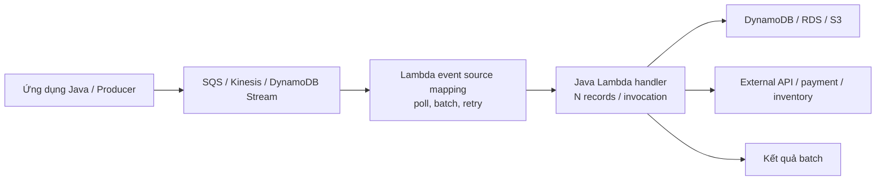
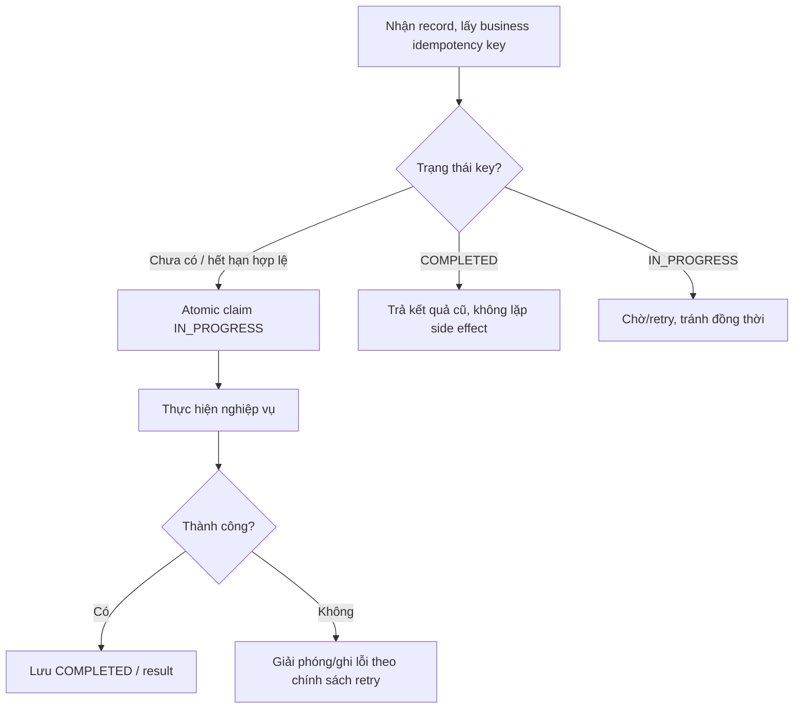

# Xử lý batch, partial failure và idempotency trên AWS Lambda

Một dịch vụ **Java Spring Boot** nhận đơn hàng rồi gửi sự kiện đến **Amazon SQS**. Một **AWS Lambda** đọc đồng thời 10 messages, ghi dữ liệu vào **Amazon DynamoDB**, cập nhật hệ thống tồn kho và ghi log. Trong 10 messages có 9 thành công, một message gọi API tồn kho bị timeout.

Nếu Lambda ném exception cho **toàn bộ batch**, cả 10 messages có thể xuất hiện lại sau **visibility timeout** của SQS; 9 messages đã xử lý thành công vẫn có nguy cơ được xử lý lần nữa. Nếu code nuốt exception và luôn trả thành công, message lỗi có thể bị xóa khỏi hàng đợi dù chưa hoàn thành nghiệp vụ. Nếu code trả đúng **partial batch failure response**, Lambda có thể chỉ đưa message lỗi về lại SQS để retry. Tuy vậy, ngay cả cơ chế partial failure **không bảo đảm exactly-once business processing**; cần thiết kế **idempotency**.

Bài học thuộc chương **Điện toán Lambda** của module **CLOUD_PROVIDERS_AWS**. Từ kiến thức IAM, VPC, SQS, DynamoDB, Kinesis, serverless và CloudWatch, bạn sẽ xây dựng một consumer Java chịu được retry, xử lý lỗi riêng từng record, giữ dữ liệu nhất quán, giám sát được và kiểm soát chi phí.

## 1. Mục tiêu học tập

Sau bài này, bạn có thể:

1. Phân biệt **batch**, **event source mapping**, **visibility timeout**, **retry**, **partial batch response** và **idempotency**.
2. Giải thích lỗi **một message** khác lỗi **cả invocation** khi Lambda đọc SQS.
3. Cấu hình `ReportBatchItemFailures` và trả `batchItemFailures` đúng cho **SQS Standard/FIFO**.
4. Hiểu khác biệt của **Kinesis Data Streams** và **DynamoDB Streams**: checkpoint theo `sequenceNumber`, xử lý suffix và `BisectBatchOnFunctionError`.
5. Viết **Java Lambda handler** trả kết quả thành công/từng record lỗi, và sử dụng Powertools Batch Processor khi phù hợp.
6. Thiết kế **idempotency key**, lưu trạng thái an toàn qua DynamoDB conditional writes hoặc Powertools Idempotency.
7. Phân biệt **SQS DLQ/redrive policy** và **stream on-failure destination** với Lambda asynchronous invocation DLQ.
8. Lựa chọn batch size, retry, visibility timeout, concurrency, logging và cảnh báo theo SLO.
9. Kiểm thử duplicate, poison message, lỗi timeout, lỗi hạ tầng và luồng rollback/replay.

## 2. Lambda nhận batch như thế nào?

**Event source mapping (ESM)** là tài nguyên AWS Lambda đọc/poll dữ liệu từ nguồn và gọi hàm. Với những nguồn như **SQS**, **Kinesis** hoặc **DynamoDB Streams**, Lambda có thể gom nhiều records vào một **event**, rồi gọi handler **một lần** cho toàn batch.



### 2.1. Từ vựng cốt lõi

| Khái niệm | Định nghĩa | Tác động |
|---|---|---|
| **Record/message** | Một phần tử trong batch | Đơn vị xử lý nghiệp vụ và idempotency |
| **Batch** | Nhiều records giao vào một invocation | Giảm overhead nhưng gom rủi ro lỗi nếu không có partial failure |
| **Event source mapping** | Cấu hình polling, kích thước batch, concurrency và xử lý lỗi | Chọn khả năng retry thực tế |
| **Invocation** | Một lần Lambda handler được gọi | Có timeout, memory, duration, logs và tính phí |
| **Partial batch response** | Danh sách record không thành công | Giảm retry không cần thiết tùy nguồn |
| **At-least-once** | Một event có thể được giao/xử lý nhiều lần | Phải chống side effects lặp |
| **Idempotency** | Nhiều lần gọi với cùng thao tác logic không gây tác dụng phụ thêm | An toàn khi retry/duplicate delivery |
| **Poison message** | Record có dữ liệu sai hoặc lỗi cố định, luôn thất bại | Cần quarantine/DLQ, không retry vô hạn |
| **Backpressure** | Giới hạn tốc độ consumer để downstream không quá tải | Cần cân đối concurrency, batch size và queue age |

### 2.2. Một batch có luôn đúng N records?

**Không.** `BatchSize` thường là **giá trị tối đa**; Lambda có thể nhận ít hơn vì hết messages, batch window, giới hạn payload, partitions/shards, cấu hình nguồn hoặc điều kiện vận hành.

Với **SQS Standard**, batch size có thể lên tới **10.000**, nhưng payload của một invocation vẫn bị giới hạn và metadata chiếm một phần dung lượng. Với **SQS FIFO**, batch size tối đa **10**. Đối với batch size SQS Standard lớn hơn 10, phải thiết lập batching window ít nhất 1 giây. Những giới hạn này thuộc ESM; không có nghĩa một hàm Java nên đọc 10.000 records vào RAM mặc định.

Nguồn: [Creating an SQS event source mapping](https://docs.aws.amazon.com/lambda/latest/dg/services-sqs-configure.html).

## 3. Mô hình giao nhận: tại sao Lambda phải chịu duplicate?

Giả sử một message chứa yêu cầu “xác nhận thanh toán cho order-123”.

```text
T0: Lambda nhận message order-123.
T1: Java handler ghi transaction vào DynamoDB thành công.
T2: Java handler gọi dịch vụ downstream thành công.
T3: Lambda hết timeout hoặc bị gián đoạn trước khi phản hồi batch thành công.
T4: SQS visibility timeout kết thúc.
T5: Message order-123 được giao lại.
```

Tại T5, xử lý lần hai có thể tạo **hai giao dịch**, gửi **hai email** hoặc trừ **hai lần tồn kho** nếu không có idempotency.

Điều kiện quan trọng:

- Lambda với SQS/streams có tính chất **at least once** trong xử lý thông thường; duplicated delivery có thể xảy ra **ngay cả khi code đã bật partial batch response**.
- **Exactly-once delivery** của toàn chuỗi SQS → Lambda → database → third-party API không được bảo đảm chỉ bằng một checkbox.
- SQS FIFO có **deduplication** và thứ tự trong phạm vi `MessageGroupId`, nhưng cơ chế deduplication tại hàng đợi có cửa sổ hữu hạn và **không thay** idempotency của side effects.
- Event ID, SQS `messageId`, stream `sequenceNumber` và **business operation ID** không nhất thiết là cùng một danh tính.

**Nguyên tắc:** đánh dấu “đã xử lý” ở **mức nghiệp vụ**, dựa trên khóa do producer/backend kiểm soát, có cơ chế xử lý các lần gọi song song.

## 4. SQS + Lambda: cơ chế polling, visibility và retry

Khi ESM đọc SQS:

1. Lambda poll queue và nhận một batch.
2. Các messages **vẫn ở trong queue nhưng tạm ẩn** trong visibility timeout.
3. ESM gọi Lambda handler bằng batch đã nhận.
4. Nếu batch thành công, Lambda **xóa messages** khỏi SQS.
5. Nếu handler thất bại, các messages **không được xóa** và có thể xuất hiện lại sau visibility timeout.
6. Sau số lần nhận thất bại theo SQS redrive policy, các messages có thể vào **dead-letter queue (DLQ)**.

### 4.1. Visibility timeout không phải function timeout

| Thông số | Đặt ở đâu? | Vai trò |
|---|---|---|
| `Timeout` | Lambda function | Giới hạn thời gian của một invocation |
| `VisibilityTimeout` | SQS source queue | Thời gian nhận một message mà consumer khác chưa thấy |
| `MaximumBatchingWindowInSeconds` | Lambda ESM | Chờ gom thêm messages trước invocation |
| `BatchSize` | Lambda ESM | Số messages tối đa mỗi invocation |
| `maxReceiveCount` | SQS redrive policy | Số lần receive trước khi chuyển sang DLQ theo chính sách |
| `MaximumConcurrency` | SQS ESM standard mode | Giới hạn invocations đồng thời của riêng source mapping |

**AWS khuyến nghị** đặt SQS `VisibilityTimeout` **ít nhất 6 lần Lambda function timeout**, cộng batch window khi có. Đây là **khuyến nghị vận hành để có dư địa retry/throttling**, không phải một đẳng thức luôn đúng cho mọi workload.

Ví dụ:

```text
Lambda timeout = 30 giây
Batch window   = 5 giây
Visibility timeout khởi điểm nên xem xét >= 6 × 30 + 5 = 185 giây
```

Hãy bổ sung nhu cầu thực tế và chọn retention/redrive phù hợp. Nếu visibility timeout quá ngắn, message có thể xuất hiện lại **khi invocation đầu còn đang xử lý**, tăng khả năng chạy song song cùng business operation. Nếu quá dài, retry sau lỗi có thể chậm và queue age tăng.

Nguồn: [Configure Lambda SQS event source mapping](https://docs.aws.amazon.com/lambda/latest/dg/services-sqs-configure.html).

### 4.2. SQS Standard và FIFO khác gì?

| Đặc tính | **Standard queue** | **FIFO queue** |
|---|---|---|
| Thứ tự | Không bảo đảm thứ tự tuyệt đối | Bảo đảm thứ tự theo **MessageGroupId** theo mô hình FIFO |
| Duplicate | Có thể giao lại | Có deduplication ở queue, nhưng Lambda processing vẫn cần idempotency |
| Batch size tối đa | 10.000 | 10 |
| Batching window | Có thể cấu hình | Không có batch window theo cấu hình được hỗ trợ |
| Partial failure | Báo mỗi `messageId` thất bại | **Dừng sau lỗi đầu tiên và báo cả records chưa xử lý** để bảo toàn thứ tự |
| Concurrency | Có thể scale rộng theo queue/ESM | Bị giới hạn bởi số `MessageGroupId` hoạt động cùng mapping/cấu hình |

**Một FIFO batch có thể chứa nhiều message groups**. Quy tắc an toàn đơn giản là **dừng xử lý batch tại lỗi đầu tiên**, báo lỗi cho record lỗi và mọi record chưa xử lý. Không nên tiếp tục side effects ở những records phía sau chỉ vì “chúng có message ID khác” khi không có kế hoạch giữ thứ tự hợp lệ.

## 5. Lỗi cả batch khi chưa bật partial response

Với một batch:

```text
Records:   M1   M2   M3   M4   M5
Kết quả:    ✓    ✓    ✗    ✓    ✓
```

Nếu handler **throw** sau M3:

- Lambda xem **invocation thất bại**.
- Các records chưa được xóa khỏi SQS (bao gồm M1/M2 đã có side effect).
- Khi visibility timeout hết, batch/messages có thể được giao lại, không nhất thiết với cùng cách chia batch ban đầu.
- Side effects của M1/M2 có nguy cơ bị lặp.

Nếu handler lại **catch mọi lỗi và trả thành công rỗng**:

- Lambda có thể xóa M3 dù M3 chưa xử lý xong.
- Đây là **mất công việc** hoặc **sai dữ liệu**, không phải xử lý lỗi thành công.

**Hướng đúng:** với SQS source mapping, bật `ReportBatchItemFailures`, xử lý từng message và **trả danh sách failed message IDs**; kết hợp idempotency và DLQ.

## 6. SQS partial batch response hoạt động thế nào?

Khi ESM có:

```text
FunctionResponseTypes = [ReportBatchItemFailures]
```

handler có thể trả:

```json
{
  "batchItemFailures": [
    { "itemIdentifier": "id-M3" }
  ]
}
```

Kết quả:

- `M1`, `M2`, `M4`, `M5` được xem là thành công và có thể được ESM xóa khỏi queue.
- `M3` được giữ lại để retry sau khi visibility timeout/logic retry cho phép.
- Lần xử lý tiếp theo có thể nằm trong **batch khác**, không nhất thiết giống batch ban đầu.

**Bắt buộc dùng đúng `messageId` của SQS**, không dùng business `orderId` hay receipt handle làm `itemIdentifier`. Đối với SQS response, `itemIdentifier` phải khớp một message ID trong batch được giao.

### 6.1. Điều kiện trả kết quả hợp lệ

| Handler output | Lambda diễn giải |
|---|---|
| `{"batchItemFailures": []}` | Cả batch thành công |
| Danh sách message IDs hợp lệ, thuộc batch | Những messages trong danh sách bị retry |
| `itemIdentifier` rỗng/null/không tồn tại | **Cả batch có thể bị coi là thất bại** |
| `itemIdentifier` không thuộc batch | **Cả batch thất bại** |
| Response không đúng schema/invalid JSON | **Cả batch thất bại** |
| Handler ném exception ra ngoài | **Cả batch thất bại**, ngay cả khi đã bật partial responses |

**Cực kỳ quan trọng:** nếu code trả `batchItemFailures` nhưng **ESM chưa bật `ReportBatchItemFailures`**, phản hồi này **không được xử lý như partial failure**; handler trả thành công có thể khiến messages lỗi bị xóa. Phải test cả **function code** và **ESM setting**.

### 6.2. Không giảm polling khi report lỗi

Theo AWS, khi bật SQS partial batch response, Lambda **không tự giảm tốc độ polling vì function invocations báo partial failures** như cơ chế backoff do lỗi cả invocation. Điều này giúp giữ throughput nếu một số messages lỗi, nhưng **cũng có thể gây retry storm** nếu mọi messages đều thất bại.

Vì thế cần DLQ/redrive, backpressure/concurrency limit, xử lý lỗi phân loại và circuit breaker cho downstream.

Nguồn: [Handling SQS errors and partial batch responses](https://docs.aws.amazon.com/lambda/latest/dg/services-sqs-errorhandling.html).

## 7. Java Lambda handler: partial failure cho SQS Standard

Ví dụ sử dụng **AWS Lambda Java runtime API** và `aws-lambda-java-events`. Java AWS SDK v2 dùng cho DynamoDB/S3 là dependency khác; không nhầm hai bộ thư viện.

```java
import com.amazonaws.services.lambda.runtime.Context;
import com.amazonaws.services.lambda.runtime.RequestHandler;
import com.amazonaws.services.lambda.runtime.events.SQSEvent;
import com.amazonaws.services.lambda.runtime.events.SQSBatchResponse;

import java.util.ArrayList;
import java.util.List;

public final class OrdersSqsHandler
        implements RequestHandler<SQSEvent, SQSBatchResponse> {

    @Override
    public SQSBatchResponse handleRequest(SQSEvent event, Context context) {
        List<SQSBatchResponse.BatchItemFailure> failures = new ArrayList<>();

        for (SQSEvent.SQSMessage message : event.getRecords()) {
            try {
                processOrderEvent(message.getBody());
            } catch (Exception exception) {
                // Log message ID và loại lỗi; không ghi payload nhạy cảm.
                context.getLogger().log(
                    "Failed messageId=" + message.getMessageId()
                    + " type=" + exception.getClass().getSimpleName()
                );
                failures.add(
                    new SQSBatchResponse.BatchItemFailure(message.getMessageId())
                );
            }
        }
        return new SQSBatchResponse(failures);
    }

    private void processOrderEvent(String body) {
        if (body == null || body.isBlank()) {
            throw new IllegalArgumentException("Empty body");
        }

        // TODO: deserialize, validate schema, apply business idempotency,
        // and perform a durable business operation.
        // KHÔNG coi log hoặc body.isBlank() là nghiệp vụ đã hoàn thành.
    }
}
```

**Điều kiện của ví dụ:**

- Thêm dependency `com.amazonaws:aws-lambda-java-core` và `com.amazonaws:aws-lambda-java-events` phiên bản tương thích với Java runtime đang dùng.
- Handler class được cấu hình trong Lambda; bundle đủ dependencies.
- Bật `ReportBatchItemFailures` trên event source mapping.
- `processOrderEvent` là **khung nghiệp vụ**, không phải xử lý đơn hàng production hoàn chỉnh.
- Không trả `failures` cho các records thành công; xử lý lỗi runtime mà không làm rò dữ liệu.
- Không tạo side effects sau khi đã đưa một message vào danh sách thất bại và giả định nó không thể bị retry.

### 7.1. Vì sao mỗi record phải có try/catch riêng?

Nếu `try/catch` bọc toàn bộ vòng lặp, exception của M3 có thể làm dừng việc kiểm tra M4/M5 ở Standard queue và kết quả trả thiếu thông tin. Ngược lại, nếu exception lọt khỏi handler, ESM đánh **cả batch thất bại**.

Với **Standard queue** và các record độc lập, cố gắng xử lý mỗi record rồi trả danh sách lỗi là hợp lý. Với **FIFO**, cần chính sách giữ thứ tự khác ở phần tiếp theo.

### 7.2. Không nuốt những lỗi làm cả tiến trình không đáng tin

Nếu có lỗi toàn cục khiến handler không thể bảo đảm kết quả từng record (ví dụ kết nối tới kho idempotency hoặc cấu hình bảo mật chung bị hỏng), việc **cho cả batch thất bại** có thể an toàn hơn đánh dấu success giả. Phân loại lỗi và bảo đảm không trả thành công khi chưa ghi bền vững nghiệp vụ.

## 8. Java handler cho FIFO: dừng sau lỗi đầu tiên

Để giữ thứ tự FIFO, handler nên ngừng xử lý khi phát hiện record lỗi và trả **record lỗi + tất cả records chưa xử lý** vào danh sách `batchItemFailures`.

```java
import com.amazonaws.services.lambda.runtime.Context;
import com.amazonaws.services.lambda.runtime.RequestHandler;
import com.amazonaws.services.lambda.runtime.events.SQSEvent;
import com.amazonaws.services.lambda.runtime.events.SQSBatchResponse;

import java.util.ArrayList;
import java.util.List;

public final class OrderedSqsHandler
        implements RequestHandler<SQSEvent, SQSBatchResponse> {

    @Override
    public SQSBatchResponse handleRequest(SQSEvent event, Context context) {
        List<SQSBatchResponse.BatchItemFailure> failures = new ArrayList<>();
        boolean stop = false;

        for (SQSEvent.SQSMessage message : event.getRecords()) {
            if (stop) {
                failures.add(
                    new SQSBatchResponse.BatchItemFailure(message.getMessageId())
                );
                continue;
            }

            try {
                processInOrder(message.getBody());
            } catch (Exception error) {
                stop = true;
                context.getLogger().log(
                    "FIFO processing stopped at " + message.getMessageId()
                );
                failures.add(
                    new SQSBatchResponse.BatchItemFailure(message.getMessageId())
                );
            }
        }
        return new SQSBatchResponse(failures);
    }

    private void processInOrder(String body) {
        // Validate, apply idempotency and perform one durable operation.
        if (body == null || body.isBlank()) {
            throw new IllegalArgumentException("Invalid message");
        }
    }
}
```

**Tại sao phải thêm các record chưa xử lý?** Nếu chỉ trả ID của record thất bại và không trả ID của các records phía sau, Lambda có thể coi các records phía sau **đã xử lý thành công**, dù bạn chưa hề gọi nghiệp vụ cho chúng, dẫn tới **mất dữ liệu**.

Ví dụ:

```text
FIFO batch: A1, A2, A3, A4
A1: success
A2: fail
A3, A4: chưa xử lý

Response:
{
  "batchItemFailures": [
    {"itemIdentifier": "A2"},
    {"itemIdentifier": "A3"},
    {"itemIdentifier": "A4"}
  ]
}
```

**Điều kiện bổ sung:** không tự ý chạy `parallelStream()` cho batch FIFO có thao tác phụ thuộc thứ tự. Song song hóa cần có mô hình partition/message group đúng, không được đảo sự kiện trong cùng `MessageGroupId`.

## 9. Stream batch khác SQS batch ở đâu?

Khi Lambda xử lý **Kinesis Data Streams** hoặc **DynamoDB Streams**, ESM tiêu thụ ordered stream records theo shard, duy trì **checkpoint**. Lỗi record có thể giữ checkpoint lại và gây chậm các records phía sau trên shard.

| Khác biệt | **SQS** | **Kinesis / DynamoDB Streams** |
|---|---|---|
| Đơn vị retry | Message xuất hiện lại trong queue | Records từ checkpoint/sequence trở đi |
| `itemIdentifier` | **SQS `messageId`** | **Record `sequenceNumber`** |
| Thành công một phần | Có thể xóa chính xác messages thành công | Tiến checkpoint đến vị trí phù hợp; **suffix** có thể bị xử lý lại |
| Thứ tự | FIFO theo MessageGroupId | Theo shard/partition logic và xử lý phù hợp |
| Record “độc” | SQS DLQ/redrive | Retry/age limit/bisect/on-failure destination |
| Metric chậm | SQS oldest message age | Lambda `IteratorAge`/stream lag và pipeline metrics |

**Không lấy code SQS báo `messageId` để dùng nguyên cho DynamoDB Stream**. Thay loại event, output type và định danh checkpoint.

### 9.1. Ví dụ checkpoint cho stream

Giả sử cùng một shard đưa batch:

```text
Sequence:  100   101   102   103   104
Kết quả:    ✓     ✓     ✗     ?     ?
```

Nếu record `102` thất bại và handler trả:

```json
{
  "batchItemFailures": [
    { "itemIdentifier": "102" }
  ]
}
```

Lambda có thể tiến checkpoint đến trước 102 rồi retry từ record 102 trở đi (theo cấu hình). **Records 103/104 trong phần sau cũng có thể bị phát lại**; đừng coi một response chứa số 102 là “retry riêng đúng một record” như SQS.

Nếu trả nhiều IDs, AWS sử dụng **sequence number nhỏ nhất** làm checkpoint. Vì vậy trong xử lý tuần tự, **báo record lỗi đầu tiên rồi dừng** là mô hình dễ hiểu, giữ thứ tự và giảm side effects lặp không cần thiết.

Nguồn: [DynamoDB Streams partial batch failure](https://docs.aws.amazon.com/lambda/latest/dg/services-ddb-batchfailurereporting.html), [Kinesis partial batch failure](https://docs.aws.amazon.com/lambda/latest/dg/services-kinesis-batchfailurereporting.html).

## 10. Java handler cho DynamoDB Streams

Ví dụ Java dùng `DynamodbEvent` và `StreamsEventResponse`:

```java
import com.amazonaws.services.lambda.runtime.Context;
import com.amazonaws.services.lambda.runtime.RequestHandler;
import com.amazonaws.services.lambda.runtime.events.DynamodbEvent;
import com.amazonaws.services.lambda.runtime.events.StreamsEventResponse;

import java.util.List;

public final class OrderChangesHandler
        implements RequestHandler<DynamodbEvent, StreamsEventResponse> {

    @Override
    public StreamsEventResponse handleRequest(
            DynamodbEvent event, Context context) {

        for (DynamodbEvent.DynamodbStreamRecord record : event.getRecords()) {
            String sequenceNumber = record.getDynamodb().getSequenceNumber();

            try {
                processChange(record);
            } catch (Exception error) {
                context.getLogger().log(
                    "Stream failure sequence=" + sequenceNumber
                );
                return new StreamsEventResponse(
                    List.of(new StreamsEventResponse.BatchItemFailure(
                        sequenceNumber
                    ))
                );
            }
        }

        return new StreamsEventResponse();
    }

    private void processChange(DynamodbEvent.DynamodbStreamRecord record) {
        // TODO: handle INSERT/MODIFY/REMOVE; use sequenceNumber/business ID
        // for idempotency of each actual side effect.
    }
}
```

Ví dụ trên dừng ở lỗi đầu và để stream ESM retry suffix theo checkpoint. Cần bật `ReportBatchItemFailures` trên stream ESM, tương tự SQS, nhưng semantics không giống SQS. Cần kiểm tra cả **event source type**, sequence number, retry/age settings và quyền IAM đọc stream.

### 10.1. BisectBatchOnFunctionError

ESM cho Kinesis/DynamoDB Streams có thể bật:

```text
BisectBatchOnFunctionError = true
```

Khi invocation không thành công, Lambda có thể **chia đôi batch** và retry các nửa để cô lập lỗi. Khi kết hợp với `ReportBatchItemFailures`, AWS dùng vị trí sequence number thất bại được báo để xác định phần cần retry theo semantics của stream.

Đây **không phải** cách sửa source record hỏng: lỗi vẫn cần được xử lý, giới hạn retry và nơi lưu record bị loại bỏ. Việc chia batch làm tăng số invocations/processing và có thể kéo dài thời gian xử lý dữ liệu của shard.

### 10.2. Retry limits/record age

Các tùy chọn quan trọng của stream ESM:

- `MaximumRetryAttempts`: giới hạn số lần retry đối với invocation errors.
- `MaximumRecordAgeInSeconds`: giới hạn tuổi record trước khi bị loại.
- `BisectBatchOnFunctionError`: hỗ trợ cô lập phần batch lỗi.
- `DestinationConfig.OnFailure`: lưu thông tin record/batch bị loại theo loại destination được hỗ trợ.
- `ParallelizationFactor`: tăng concurrency theo shard theo semantics hỗ trợ; cần bảo đảm thứ tự theo partition key và hiệu quả downstream.

**Đừng để mặc định retry vô hạn/tuổi record theo nguồn mà không hiểu retention và yêu cầu nghiệp vụ.** Một poison record có thể chặn tiến trình xử lý phía sau, khiến iterator age tăng và records mới bị trễ hoặc hết hạn.

Nguồn: [Kinesis ESM parameters](https://docs.aws.amazon.com/lambda/latest/dg/services-kinesis-parameters.html).

## 11. DLQ, on-failure destination và điều kiện đưa lỗi đi đâu

Ba khái niệm dễ nhầm:

| Cơ chế | Gắn với | Tác dụng |
|---|---|---|
| **SQS redrive policy + DLQ** | **Source SQS queue** | Chuyển messages đã được nhận thất bại quá `maxReceiveCount` sang DLQ |
| **On-failure destination của stream ESM** | Kinesis/DynamoDB Streams ESM | Ghi record/batch thất bại bị loại do retry/age limit tới destination được hỗ trợ |
| **Lambda asynchronous invocation DLQ / on-failure destination** | **Async invoke** (ví dụ certain direct async invokes) | Xử lý event thất bại theo cơ chế async invocation, **không thay SQS redrive policy** |

**SQS ESM gọi function theo cơ chế synchronous invocation nội bộ**; cấu hình Lambda async DLQ mặc định **không phải** nơi nhận messages lỗi từ một SQS trigger. Muốn quarantine, cấu hình **DLQ ở SQS source queue**.

### 11.1. Ví dụ redrive policy cho SQS

```json
{
  "deadLetterTargetArn": "arn:aws:sqs:ap-southeast-1:111122223333:orders-dlq",
  "maxReceiveCount": "5"
}
```

Giá trị `5` là ví dụ và phù hợp khuyến nghị AWS **ít nhất 5 lần nhận** để có cơ hội hồi phục từ lỗi tạm. Đánh giá thêm:

- Source queue và DLQ phải có loại Standard/FIFO tương thích.
- DLQ retention đủ dài để điều tra; SQS có semantics tuổi message khác nhau theo queue type.
- IAM/KMS policies phù hợp cho polling và thao tác DLQ.
- Có alarm khi DLQ có messages; **không coi đẩy sang DLQ là thành công nghiệp vụ**.
- Redrive trở lại source sau khi sửa dữ liệu/code, với idempotency vẫn bật.

### 11.2. Poison message so với lỗi tạm

| Loại lỗi | Ví dụ | Hướng xử lý |
|---|---|---|
| **Transient** | DB throttling, 503 downstream, network timeout | Retry có backoff/circuit breaker, tăng visibility phù hợp |
| **Permanent data error** | JSON thiếu trường bắt buộc, schema không được hỗ trợ | Quarantine/DLQ, sửa producer, không retry vô hạn |
| **Permission/configuration** | IAM AccessDenied, secret sai, KMS policy thiếu | Cảnh báo khẩn, sửa hạ tầng; retry có thể chỉ làm tăng backlog |
| **Resource capacity** | RDS connections cạn, concurrency throttling | Giảm ESM concurrency, batch size, tối ưu pool và autoscale |
| **Unknown outcome** | API payment timeout sau khi nhà cung cấp đã nhận lệnh | **Idempotency key** ở downstream + reconciliation, không tự gọi lại một cách mù quáng |

**Không đánh dấu lỗi dữ liệu vĩnh viễn là thành công chỉ để xóa khỏi queue**. Nếu nghiệp vụ cho phép loại bỏ, phải có trạng thái quarantine/audit và chính sách phê duyệt rõ ràng.

## 12. Idempotency nghĩa là gì ở mức nghiệp vụ?

Một thao tác `f` là **idempotent** nếu gọi lại với cùng ý nghĩa nghiệp vụ không tạo thêm side effects:

```text
f(f(x)) = f(x)    (về trạng thái nghiệp vụ quan sát được)
```

Trong xử lý đơn hàng:

- Message `orderId=ORD-123, operation=ReserveInventory` có thể xuất hiện nhiều lần.
- Chỉ một lần trừ tồn kho thành công nên được ghi nhận cho **operation ID** đó.
- Lần sau trả kết quả đã lưu hoặc “đã xử lý”, không trừ lần nữa.

**Idempotency không đồng nghĩa “bỏ qua mọi message có cùng customer ID”.** Khách hàng có thể mua nhiều lần hợp lệ. Khóa phải biểu diễn **đúng một operation**: ví dụ `tenantId + orderId + actionVersion` hoặc `paymentIntentId`.

### 12.1. Các loại khóa cần phân biệt

| Khóa | Dùng được khi nào? | Rủi ro |
|---|---|---|
| `SQS messageId` | Nhận diện message bản thân trong một batch/re-delivery | Producer có thể gửi lại cùng nghiệp vụ thành **message ID mới** |
| `Kinesis/DynamoDB sequenceNumber` | Định danh stream record khi retry checkpoint | Không nhận diện thao tác nghiệp vụ giữa nhiều nguồn/replays |
| `eventId` do producer phát | Tốt nếu producer bảo đảm ổn định và unique theo event | Producer tạo eventId mới khi retry nghiệp vụ sẽ không chống trùng |
| `tenantId:orderId:operation` | Thường phù hợp với một thao tác nghiệp vụ | Cần quy định version và trường hợp hợp lệ được xử lý lại |
| Hash toàn bộ JSON body | Có thể dùng cho event nhỏ/immutable | Metadata/timestamp/field order thay đổi làm hash khác |
| `customerId` | Thường **không đủ** | Có thể chặn các giao dịch khác nhau của cùng khách hàng |

### 12.2. Xác định khoảng thời gian idempotency

Dữ liệu chống trùng phải tồn tại đủ lâu cho:

- SQS retention + thời gian xử lý backlog/DLQ + lịch re-drive.
- Thời gian retry của producer, hệ thống thanh toán và reconciliation.
- Các đợt replay stream, tái nhập dữ liệu hoặc khôi phục sự cố.

**TTL 1 giờ** có thể đủ với một cache event ngắn nhưng **không đủ** cho nghiệp vụ thanh toán cần chống double charge sau nhiều ngày. Chọn TTL theo yêu cầu **business correctness**; có trường hợp cần record giữ lâu hoặc unique constraint vĩnh viễn.

## 13. DynamoDB conditional write: atomic idempotency cho một side effect

Một ví dụ đơn giản nhưng đúng bản chất là **ghi một kết quả nghiệp vụ mới vào DynamoDB một lần** nhờ `ConditionExpression`.

Giả sử bảng `OrderResults` có primary key `operationId`. Với cùng operation, hai Lambda invocations có thể chạy song song. Cả hai cố tạo item:

```text
PK = ORDER#ORD-123#ReserveInventory
status = RECORDED
```

**DynamoDB conditional put** bảo đảm chỉ một invocation có thể tạo item nếu key chưa tồn tại; invocation còn lại nhận `ConditionalCheckFailedException`. Khi xác minh record đã tồn tại mang đúng nghiệp vụ, caller có thể xem duplicate là thành công.

### 13.1. Java SDK v2 ví dụ atomic insert

```java
import java.time.Instant;
import java.util.Map;

import software.amazon.awssdk.services.dynamodb.DynamoDbClient;
import software.amazon.awssdk.services.dynamodb.model.AttributeValue;
import software.amazon.awssdk.services.dynamodb.model.ConditionalCheckFailedException;
import software.amazon.awssdk.services.dynamodb.model.PutItemRequest;

public final class OrderRecorder {
    private final DynamoDbClient ddb;
    private final String table;

    public OrderRecorder(DynamoDbClient ddb, String table) {
        this.ddb = ddb;
        this.table = table;
    }

    public void recordOnce(String operationId, String result) {
        String pk = "OP#" + operationId;

        PutItemRequest request = PutItemRequest.builder()
            .tableName(table)
            .item(Map.of(
                "operationId", AttributeValue.fromS(pk),
                "result", AttributeValue.fromS(result),
                "createdAt", AttributeValue.fromS(Instant.now().toString())
            ))
            .conditionExpression("attribute_not_exists(operationId)")
            .build();

        try {
            ddb.putItem(request);
        } catch (ConditionalCheckFailedException duplicate) {
            // Chỉ được coi là success nếu record đã có thật
            // tương ứng với cùng payload/operation mong đợi.
            // Production cần read & validate stored result.
            throw duplicate;
        }
    }
}
```

**Ví dụ chỉ minh họa atomic insert**, chưa phải một handler idempotency hoàn chỉnh: catch block cố ý **không nuốt** exception vì còn cần đọc record đã lưu và so sánh kết quả/tenant/payload. Khi production, có thể dùng `GetItem` (consistent read nếu cần), so sánh business fingerprint rồi trả kết quả cũ; nếu payload khác mà dùng cùng key phải báo **conflict**, không tự cho success.

**Ranh giới quan trọng:** atomic write phía DynamoDB **không tự làm atomic** cuộc gọi tới external payment API, S3 hoặc SQS. Nếu bạn ghi “DONE” trước khi gọi API rồi crash, lần retry có thể bỏ qua tác vụ chưa xong. Nếu gọi API trước rồi mới ghi “DONE”, crash ở giữa có thể khiến API bị gọi hai lần.

### 13.2. Cách tiếp cận khi có nhiều side effects

- Dùng **downstream idempotency key** nếu third-party API hỗ trợ, ví dụ payment provider chấp nhận một khóa ổn định và trả lại kết quả tương ứng.
- Dùng **DynamoDB transaction/conditional updates** khi tất cả dữ liệu nằm trong cùng phạm vi DynamoDB có thể giao dịch.
- Dùng **transactional outbox/inbox** khi cần phối hợp database + queue, lưu một “ý định phát event” cùng transaction rồi phát sau.
- Dùng **IN_PROGRESS / COMPLETED / FAILED** với lock/lease, timeout, expiry và reconciliation để tránh hai workers cùng thực hiện khi chưa rõ trạng thái.
- Dùng **Step Functions** hoặc workflow bền vững phù hợp cho tiến trình gồm nhiều bước, bù trừ và xử lý side effects — vẫn cần idempotency tại các bước riêng.

**Đừng tin rằng một DynamoDB lock là exactly-once end-to-end** nếu không xử lý trường hợp crash/timeout sau external side effect.

## 14. Powertools for AWS Lambda (Java): Batch Processor và Idempotency

AWS cung cấp **Powertools for AWS Lambda (Java)** để giảm boilerplate cho những mẫu retry/partial batch/idempotency.

### 14.1. Batch Processor hỗ trợ những gì?

- Nhận SQS, DynamoDB Streams, Kinesis event envelopes theo loại được hỗ trợ.
- Gọi handler cho từng record và phân loại success/failure.
- Sinh response `batchItemFailures`/`StreamsEventResponse` đúng schema.
- Hỗ trợ sync hoặc parallel processing theo API tương ứng.
- Hỗ trợ hooks log/metrics và tùy chọn điều khiển hành vi FIFO/order theo phiên bản.

Ví dụ khung Java tham khảo theo tài liệu Powertools:

```java
import com.amazonaws.services.lambda.runtime.Context;
import com.amazonaws.services.lambda.runtime.RequestHandler;
import com.amazonaws.services.lambda.runtime.events.SQSEvent;
import com.amazonaws.services.lambda.runtime.events.SQSBatchResponse;

import software.amazon.lambda.powertools.batch.BatchMessageHandlerBuilder;
import software.amazon.lambda.powertools.batch.handler.BatchMessageHandler;

public class OrdersBatchWithPowertools
        implements RequestHandler<SQSEvent, SQSBatchResponse> {

    private final BatchMessageHandler<SQSEvent, SQSBatchResponse> handler;

    public OrdersBatchWithPowertools() {
        handler = new BatchMessageHandlerBuilder()
            .withSqsBatchHandler()
            .buildWithMessageHandler(this::processOrder, OrderCommand.class);
    }

    @Override
    public SQSBatchResponse handleRequest(SQSEvent event, Context context) {
        return handler.processBatchInParallel(event, context);
    }

    private void processOrder(OrderCommand command, Context context) {
        // TODO: business validation + idempotent durable side effect.
    }

    public static class OrderCommand {
        public String operationId;
    }
}
```

**Chỉ dùng mô hình parallel cho SQS Standard khi các records độc lập.** Với FIFO/ordered streams, phải chọn đúng API/cấu hình xử lý có khả năng **preserve order/stop on first failure** theo phiên bản Powertools; không copy `processBatchInParallel` vào một FIFO handler mà không xem hướng dẫn.

Đoạn mã cần dependency Powertools Batch và Jackson/runtime events đúng version, plus lớp `OrderCommand` có cấu hình deserialize phù hợp. Đây là **ví dụ cấu trúc**, không phải toàn bộ ứng dụng có hiệu lực nghiệp vụ.

Nguồn: [Powertools Java Batch Processing](https://docs.aws.amazon.com/powertools/java/latest/utilities/batch/).

### 14.2. Idempotency utility

**Powertools Java Idempotency** hỗ trợ lưu trạng thái trong DynamoDB, tính idempotency key từ event hoặc subset, kiểm soát các cuộc gọi trùng và kết quả đã hoàn thành trong **cửa sổ thời gian**.

Luồng logic:



Có thể dùng annotation `@Idempotent` hoặc functional API, cùng `DynamoDBPersistenceStore`. Đối với batch event có nhiều records, nên áp dụng idempotency **theo một business record/operation**, không mặc định đánh dấu thành công cho **toàn batch** nếu từng record có thể partial fail.

**Cần hiểu trạng thái khi timeout:** Powertools cung cấp cơ chế để nhận biết `IN_PROGRESS` hết hạn/được phép retry; nhưng một side effect ở dịch vụ bên ngoài vẫn có thể đã hoàn tất trước khi Lambda timeout. Nên kết hợp downstream idempotency key hoặc reconciliation.

Nguồn: [Powertools Java Idempotency](https://docs.aws.amazon.com/powertools/java/latest/utilities/idempotency/).

## 15. Ba trạng thái và nguy cơ timeout giữa các bước

Một state machine đơn giản:

| Trạng thái | Ý nghĩa | Khi nhận lại cùng key |
|---|---|---|
| **ABSENT** | Chưa từng claim key hoặc record đã hết hạn | Có thể tạo claim atomically |
| **IN_PROGRESS** | Một invocation đang xử lý | Không chạy song song side effect; chờ/retry theo lease/timeout |
| **COMPLETED** | Nghiệp vụ đã commit và kết quả được ghi bền vững | Trả kết quả cũ hoặc xác nhận duplicate |
| **FAILED / RECONCILIATION** | Kết quả chưa chắc chắn, cần retry hoặc kiểm toán | Không giả định an toàn để replay nếu external outcome chưa rõ |

### 15.1. Failure windows

```text
A. Claim key -> crash trước side effect:
   Có thể retry sau khi lock hết hạn; chưa có side effect.

B. Claim key -> side effect thành công -> crash trước COMPLETED:
   Kết quả bên ngoài có thể đã thành công. Retry cần downstream idem key/reconcile.

C. COMPLETED -> Lambda response bị mất:
   Retry sau đó phải nhận ra COMPLETED và không lặp side effect.

D. Hai invocations đến cùng lúc:
   Chỉ một claim thành công; invocation còn lại không được tự làm lại.
```

Đây là lý do idempotency có phần **distributed systems**, không chỉ “if exists then return” trong một cache local.

**Không dùng biến static hoặc in-memory Set trong Java Lambda để lưu duy nhất idempotency state**: Lambda có thể tạo nhiều execution environments, scale ngang, restart hoặc mất state. Cache cục bộ có thể tối ưu tốc độ nhưng cần durable shared store hoặc idempotent storage operation làm điểm đúng sai.

## 16. Thiết kế concurrency và backpressure

### 16.1. SQS ESM scaling

SQS Standard ESM có thể tự tăng số concurrent invocations khi backlog lớn. Để bảo vệ downstream:

- Đặt **MaximumConcurrency** cho mapping trong chế độ scaling chuẩn.
- Đặt **reserved concurrency** cho function và so với **tổng giới hạn** của các SQS mappings dùng cùng function.
- Chọn batch size hợp lý theo CPU/memory/DB connections.
- Khi cần throughput cao và độ trễ thấp, xem xét **SQS provisioned mode** cho event pollers nếu tính năng/Region và ngân sách phù hợp; đây là lựa chọn **không dùng đồng thời** với ESM MaximumConcurrency.
- Nếu downstream lỗi toàn diện, giảm concurrency/circuit break và theo dõi queue age; không tăng invocations chỉ để queue nhìn ngắn hơn.

**Giới hạn ESM không thay quota concurrency của Lambda account/function**. Concurrency thực tế còn bị ảnh hưởng bởi nguồn, queue type, quotas, function reserved concurrency và từng chế độ event polling.

### 16.2. FIFO và message groups

Với FIFO, số **MessageGroupId hoạt động** giới hạn số groups có thể xử lý song song. Chỉ một group cho mọi đơn hàng có thể làm throughput thấp dù tăng concurrency limit. Chọn group key theo ranh giới ordering nghiệp vụ, ví dụ `tenantId:aggregateId`, không group tất cả vào một ID chỉ để đơn giản.

### 16.3. Ví dụ sizing

Giả sử:

- Đầu vào ổn định: 2.000 messages/giây.
- Trung bình xử lý một message: 20 ms CPU/IO tổng hợp.
- Batch size: 10; invocation duration thực tế khi xử lý tuần tự khoảng 200 ms (chưa tính cold start/overhead).
- Lý thuyết mỗi concurrent invocation xử lý khoảng 50 messages/giây.
- Công suất tối thiểu lý thuyết: `2.000 / 50 = 40` concurrent invocations.

**Đây chỉ là bài tính sơ bộ**. Thực tế phải xét p95/p99, throttling, downstream rate limits, mạng, cold starts, lock contention và phần trăm retries; nên chừa headroom, benchmark trên hệ thống thật. Nếu 40 Lambda instances tạo 40 × N kết nối RDS, có thể cần RDS Proxy hoặc giới hạn concurrency thấp hơn.

Nguồn: [Scaling for SQS event source mappings](https://docs.aws.amazon.com/lambda/latest/dg/services-sqs-scaling.html).

## 17. Thiết kế IAM, VPC, bảo mật và dữ liệu

### 17.1. Lambda execution role

Một consumer SQS thường cần quyền tối thiểu để ESM đọc queue:

- `sqs:ReceiveMessage`
- `sqs:DeleteMessage`
- `sqs:GetQueueAttributes`
- Các quyền KMS phù hợp nếu queue dùng SSE-KMS với customer-managed key.
- `logs:CreateLogGroup`, `logs:CreateLogStream`, `logs:PutLogEvents` cho CloudWatch Logs theo cấu hình.
- Quyền DynamoDB/S3/Secrets Manager/SNS theo chính các side effects nghiệp vụ.

AWS managed policy `AWSLambdaSQSQueueExecutionRole` cung cấp những quyền cơ bản cho SQS nhưng có thể rộng hơn phạm vi tài nguyên cần thiết; với production cân nhắc policy cụ thể ARN và tổ chức.

**IAM permissions của consumer không tự cấp quyền cho producer gửi `SendMessage`**. Phân tách role gửi và role xử lý theo least privilege.

### 17.2. Lambda trong VPC

Lambda có thể gọi AWS APIs ngoài VPC khi không attach vào VPC theo mô hình mặc định. Khi attach Lambda vào **private subnets** để gọi RDS/ElastiCache:

- Cần VPC route/SG/NACL tới database.
- Nếu gọi AWS APIs từ Lambda, cần **NAT hoặc VPC interface/gateway endpoints** phù hợp; không tự có Internet egress vì subnet private.
- KMS, STS, DynamoDB, S3, Secrets Manager có cơ chế VPC endpoints theo từng dịch vụ và kiến trúc.
- **Event source mapping đọc SQS** theo cơ chế Lambda quản lý; không nhất thiết đòi Lambda function VPC có SQS endpoint chỉ để nhận trigger. Nhưng **code trong function** tự gọi SQS API từ private subnet thì cần đường mạng AWS API phù hợp.

### 17.3. Dữ liệu nhạy cảm và schema validation

- Định nghĩa JSON schema/event version rõ, ví dụ `eventType`, `eventId`, `tenantId`, `occurredAt`.
- Validate kích thước, kiểu dữ liệu và whitelist hoạt động được phép.
- Không log raw payment payload, access token hoặc thông tin định danh nhạy cảm.
- Sử dụng KMS và TLS cho data at rest/in transit, điều kiện IAM least privilege.
- Quản lý secrets trong Secrets Manager/Parameter Store, không nhúng vào message body.
- Tránh message body chứa PII không cần thiết; dùng object reference S3 nếu payload lớn và có quyền kiểm soát.
- Không để một tenant có thể tự chọn idempotency key trùng với tenant khác.

## 18. Observability: đo message failures thay vì chỉ Lambda Errors

**Một invocation SQS có partial failure response hợp lệ có thể được Lambda xem là invocation thành công**. Vì thế metric Lambda `Errors` **không tự phản ánh** số messages trong batch xử lý thất bại.

### 18.1. Dashboard tối thiểu

| Chỉ số/tín hiệu | Mục đích |
|---|---|
| **SQS ApproximateAgeOfOldestMessage** | Backlog lâu, poison messages và downstream chậm |
| **SQS ApproximateNumberOfMessagesVisible** | Queue backlog chờ xử lý |
| **SQS ApproximateNumberOfMessagesNotVisible** | Messages đang bị ẩn/được xử lý |
| **SQS DLQ visible message count** | Có record bị đưa sang quarantine |
| **SQS NumberOfMessagesDeleted** | Những messages đã được xóa; biến động có thể gợi ý partial response lỗi |
| **Lambda Invocations/Errors/Duration/Throttles** | Sức khỏe invocation, runtime và account concurrency |
| **Business metrics: processed/failed/duplicate** | **Bắt buộc bổ sung** khi dùng partial response |
| **DynamoDB conditional check failures** | Duplicate claims hoặc data conflicts |
| **Kinesis/DDB Streams IteratorAge** | Độ trễ theo stream/checkpoint |
| **External API latency/5xx/rate limits** | Nút thắt, nguyên nhân retry storm |
| **CloudWatch Logs / X-Ray tracing** | Điều tra theo correlation ID, message ID, business ID |

**`NumberOfMessagesDeleted` không phải đếm chính xác số business operations thành công**. SQS và event sources có semantics metrics riêng; một thao tác xóa và một hành động nghiệp vụ không nhất thiết là 1:1 trong mọi điều kiện.

### 18.2. Structured logging theo record

Ví dụ cấu trúc log an toàn:

```json
{
  "level": "WARN",
  "event": "sqs_record_failed",
  "messageId": "id-M3",
  "operationId": "tenant-A:order-123:reserve",
  "errorType": "DownstreamTimeout",
  "retryable": true
}
```

Không ghi toàn message body, security token hoặc secrets. Kết hợp correlation IDs giữa producer, SQS message, Lambda và downstream.

### 18.3. Cảnh báo cần có

- `DLQ ApproximateNumberOfMessagesVisible > 0` trong cửa sổ đáng kể.
- Oldest message age tăng liên tục, backlog không giảm.
- Batch failure ratio hoặc record failure ratio cao hơn baseline.
- Lambda Throttles tăng, Duration p95 sát timeout.
- Function/system failure khiến toàn batch retry, trái kỳ vọng partial response.
- DynamoDB conflicts tăng bất thường hoặc `IN_PROGRESS` cũ vượt lease.
- Stream `IteratorAge` tăng kéo dài.
- Số processed messages ≠ số events mong đợi theo đối soát nghiệp vụ.

## 19. Chi phí, throughput và trade-offs

Một batch lớn thường giảm số invocations và overhead trên mỗi record. Nhưng batch quá lớn có thể:

- Tăng duration/memory, khiến Lambda timeout.
- Kéo dài thời gian giữ message và độ trễ end-to-end.
- Đòi tăng visibility timeout, làm retry lỗi chậm.
- Khi không dùng partial response, một record lỗi khiến nhiều records tốt bị retry.
- Tăng payload deserialize cost hoặc thổi bộ nhớ Java.
- Làm side effects xuống RDS/DynamoDB tăng đột biến.

Một batch quá nhỏ có thể tăng invocations/SQS polling overhead và chi phí trên mỗi record, đặc biệt Java cold starts/warm-up.

### 19.1. Mô hình chi phí

```text
Tổng chi phí xử lý batch trong kỳ ≈
    Lambda requests + GB-seconds / compute
  + SQS API requests / queue storage / DLQ
  + DynamoDB reads/writes cho idempotency state
  + CloudWatch logs/metrics/traces
  + NAT/VPC endpoints/data transfer khi có
  + downstream (RDS/S3/third-party API)
  + chi phí xử lý lại, poison messages và vận hành
```

Không suy ra tối ưu chi phí chỉ từ **Lambda invocation count**: nếu thiếu idempotency hoặc retry cả batch, chi phí nghiệp vụ có thể lớn hơn nhiều. **DynamoDB idempotency check** cũng có chi phí read/write, nhưng thường hợp lý khi bảo vệ các tác vụ quan trọng.

### 19.2. Ví dụ định lượng

Giả định một ngày có 100.000 messages, xử lý theo batch 10:

- Lý tưởng: khoảng **10.000 invocations** nếu mọi batch đủ 10.
- Nếu **10% batches** gặp đúng một record lỗi và không có partial response, khi retry một lần có thể xử lý lại khoảng **10.000 records** (1.000 batches × 10), trong đó nhiều records trước đó đã thành công.
- Nếu có partial response, lần retry dự kiến chỉ cần xử lý lại **khoảng 1.000 failed messages** trong giả định đơn giản.
- Số liệu thật có thể khác do batch re-grouping, visibility, concurrent duplicate deliveries, retries nhiều vòng và incomplete batches.

**Idempotency vẫn cần** trong cả hai trường hợp, vì partial response giảm retry thừa chứ không loại bỏ duplicates.

## 20. Quy trình triển khai an toàn

### Giai đoạn A — Thiết kế contract và idempotency

1. Xác định business operation duy nhất và **idempotency key**.
2. Định nghĩa schema, version, validation, retryable vs permanent errors.
3. Thiết kế atomic effect hoặc state machine/reconciliation nếu có external side effects.
4. Chọn TTL đủ dài cho retry, backlog, DLQ replay và tuân thủ.
5. Xác định consistency và ordering yêu cầu FIFO/streams.

### Giai đoạn B — Cấu hình event source

1. Tạo SQS source queue và DLQ/redrive policy nếu dùng SQS.
2. Chọn `BatchSize`, batch window và visibility timeout phù hợp Lambda timeout.
3. Tạo ESM cho queue/stream và **bật `FunctionResponseTypes=[ReportBatchItemFailures]`**.
4. Chọn `MaximumConcurrency` hoặc chế độ polling phù hợp, không vượt function quota.
5. Với streams, chọn `MaximumRetryAttempts`, `MaximumRecordAgeInSeconds`, bisection và on-failure destination nếu cần.
6. Cấp IAM least privilege, KMS/VPC network paths.

### Giai đoạn C — Triển khai Java handler

1. Deserialize và validate từng record.
2. Trích business key, kiểm tra/claim idempotency state.
3. Ghi kết quả bền vững, gọi downstream với idempotency nếu hỗ trợ.
4. Trả partial failure đúng identifier (**SQS messageId**, **stream sequenceNumber**).
5. Bảo đảm FIFO stop-on-first-error và streaming suffix semantics.
6. Structured logging/metrics, không log dữ liệu nhạy cảm.

### Giai đoạn D — Test trước production

- 100% success → batch response rỗng, messages được xóa/checkpoint tiến.
- Một record lỗi trong batch → chỉ retry đúng phần cần thiết theo từng nguồn.
- Unknown identifier/invalid JSON response → phát hiện lỗi toàn batch, báo alarm.
- Timeout ngay sau external side effect → retry không double charge/duplicate event.
- Hai invocations đồng thời cùng business key → chỉ một side effect.
- FIFO lỗi record giữa → records sau lỗi không bị đánh dấu success giả.
- DLQ/stream on-failure hoạt động; replay sau sửa vẫn idempotent.
- ESM config thật có `ReportBatchItemFailures`, không chỉ unit test handler.
- Downstream bị throttle hàng loạt → concurrency/backpressure không phá SLO.
- Quan sát/logging và alarm phát hiện được **record failures dù Lambda Errors bằng 0**.

## 21. AWS CLI và IaC ví dụ

### 21.1. AWS CLI chỉ đọc

Các tên, Region, ARN dưới đây là **ví dụ**. Chạy trong tài khoản có quyền `lambda:ListEventSourceMappings`, `lambda:GetEventSourceMapping`, `sqs:GetQueueAttributes` và các quyền đọc liên quan.

```bash
# Xem mappings của một function
aws lambda list-event-source-mappings \
  --function-name orders-batch-worker \
  --region ap-southeast-1 \
  --query 'EventSourceMappings[].{UUID:UUID,State:State,BatchSize:BatchSize,ResponseTypes:FunctionResponseTypes,Source:EventSourceArn}'

# Kiểm tra cấu hình mapping cụ thể
aws lambda get-event-source-mapping \
  --uuid 11111111-2222-4333-8444-555555555555 \
  --region ap-southeast-1

# Kiểm tra queue visibility timeout, retention, redrive policy
aws sqs get-queue-attributes \
  --queue-url https://sqs.ap-southeast-1.amazonaws.com/111122223333/orders-queue \
  --attribute-names VisibilityTimeout MessageRetentionPeriod RedrivePolicy \
  --region ap-southeast-1

# Kiểm tra Lambda timeout/memory/concurrency setting
aws lambda get-function-configuration \
  --function-name orders-batch-worker \
  --region ap-southeast-1 \
  --query '{Timeout:Timeout,Memory:MemorySize,Runtime:Runtime,State:State}'
```

Những lệnh này **không thay đổi tài nguyên AWS**. AWS CLI profile/credentials cần được cấu hình phù hợp; không log toàn bộ queue messages để debug.

### 21.2. CloudFormation fragment: bật partial batch

```yaml
# Ví dụ cấu hình, cần thay ARN/FunctionName/queue resource thật.
Resources:
  OrdersQueueEventSourceMapping:
    Type: AWS::Lambda::EventSourceMapping
    Properties:
      EventSourceArn: arn:aws:sqs:ap-southeast-1:111122223333:orders-queue
      FunctionName: orders-batch-worker
      BatchSize: 10
      MaximumBatchingWindowInSeconds: 1
      FunctionResponseTypes:
        - ReportBatchItemFailures
```

Với SQS FIFO, thường không cần/cấu hình batching window theo ví dụ Standard này. Tên queue/function trong ví dụ không phải tài nguyên thật. IaC thực tế cần bổ sung role, source queue policies, redrive policy, encryption, scaling và giám sát theo môi trường.

### 21.3. Lệnh update mapping (thay đổi thật, không chạy tùy tiện)

```bash
# CHỈ minh họa thao tác write, phải được phê duyệt và có rollback.
aws lambda update-event-source-mapping \
  --uuid 11111111-2222-4333-8444-555555555555 \
  --function-response-types ReportBatchItemFailures \
  --region ap-southeast-1
```

**Đọc lại** `get-event-source-mapping` sau thay đổi và test bằng một batch có record cố tình thất bại. Chỉ update handler code mà không bật config ESM **là lỗi nghiêm trọng có thể mất dữ liệu**.

## 22. Chẩn đoán tình huống thực tế

| Hiện tượng | Khả năng nguyên nhân | Cách xác minh |
|---|---|---|
| Message lỗi biến mất, không vào DLQ | Handler catch rồi trả success; ESM chưa bật partial responses | Kiểm tra code return và `FunctionResponseTypes` |
| 9 messages tốt bị xử lý lại vì 1 message lỗi | Handler throw nguyên batch | Dùng partial response + idempotency |
| FIFO message phía sau bị “nuốt” | Code dừng ở lỗi đầu nhưng không report records chưa xử lý | Report failed + unprocessed IDs |
| Stream xử lý lại records sau sequence lỗi | Checkpoint semantics của streams | Đây có thể là đúng thiết kế; phải idempotent |
| `Lambda Errors=0` nhưng SQS backlog tăng | Partial failures trả hợp lệ, lỗi record không tăng Errors | Business metric per record, queue age, DLQ |
| Message được xử lý đồng thời hai lần | Visibility quá ngắn, duplicate delivery, idempotency lock sai | So sánh duration/visibility, DynamoDB state và timestamps |
| DLQ tăng không ngừng | Poison messages, lỗi downstream hoặc IAM | Phân loại lỗi, xử lý source/destination, có redrive plan |
| Tăng Lambda concurrency nhưng DB sập | Downstream pool/connection limits, retry storm | Giảm MaximumConcurrency, batch size, RDS Proxy |
| Invalid `itemIdentifier` | Dùng orderId thay SQS messageId hoặc sai stream sequence | So sánh ID trong event input và response |
| 403 từ DynamoDB/KMS | Role thiếu `dynamodb:PutItem`/KMS rights | IAM policy, key policy, VPC endpoints |
| Java timeout sau ghi DB | Batch size lớn, GC/cold start/IO chậm | Duration/GC/downstream, chia nhỏ batch, idempotency |
| External API chạy hai lần dù đã lưu key | Marked DONE sai thời điểm hoặc API không dùng idem key | Reconciliation, transactional outbox/inbox, vendor support |
| Dữ liệu mất khi replay DLQ sau thời gian dài | Idempotency TTL hết hạn, schema/version drift | Contract versioning, retention policy và kiểm thử replay |

### 22.1. Trình tự điều tra

1. Xác định **nguồn**: SQS Standard/FIFO, Kinesis hay DynamoDB Streams?
2. Xác định **loại lỗi**: một record hay exception cả invocation?
3. Đọc **ESM configuration**: `ReportBatchItemFailures`, batch size, retry/age/concurrency?
4. Đối chiếu **response identifier** với record đầu vào.
5. Đọc **business idempotency state** và xác minh side effects đã commit hay chưa.
6. Kiểm tra **visibility/stream checkpoint**, DLQ/on-failure destination và tuổi backlog.
7. Đối chiếu **Lambda metrics + per-record metrics**, CloudWatch logs, IAM/network.
8. Khắc phục nguyên nhân; test replay canary trước khi redrive lượng lớn.

## 23. Bài thực hành

### Bài A — SQS Standard partial batch

Batch đầu vào gồm `m1,m2,m3,m4,m5`. `m2` và `m5` gặp transient error, còn các messages khác thành công.

**Yêu cầu:** viết output và giải thích hành vi.

**Đáp án:**

```json
{
  "batchItemFailures": [
    { "itemIdentifier": "m2" },
    { "itemIdentifier": "m5" }
  ]
}
```

Khi ESM bật `ReportBatchItemFailures`, messages thành công được xóa, còn m2/m5 có thể retry. **Không dùng business IDs** thay cho SQS message IDs.

### Bài B — FIFO có lỗi ở giữa batch

Một FIFO batch chứa A1, A2, A3, A4 cùng `MessageGroupId`; A2 lỗi.

**Đáp án:** xử lý A1 thành công, dừng ở A2, báo A2/A3/A4 failed/unprocessed. Không xử lý A3/A4 rồi coi FIFO vẫn đúng thứ tự.

### Bài C — DynamoDB Stream

Records có sequence `500,501,502,503`. Record 501 lỗi. Handler trả:

```json
{
  "batchItemFailures": [
    { "itemIdentifier": "501" }
  ]
}
```

**Câu hỏi:** 502/503 có thể bị retry không?

**Đáp án:** **Có**. Stream checkpoint dựa trên vị trí thất bại; records trong suffix có thể được phát lại. Vì vậy downstream side effects cần idempotency.

### Bài D — Payment double charge

Một Lambda gọi payment API thành công nhưng timeout trước khi lưu `COMPLETED` vào DynamoDB. Message được retry.

**Yêu cầu:** đề xuất thiết kế an toàn.

**Gợi ý:** gửi **một idempotency key cố định** cho payment provider nếu được hỗ trợ, lưu mapping provider transaction ID, reconciliation cho kết quả chưa biết; điều khiển `IN_PROGRESS` với lock expiry, không tạo payment mới tùy tiện khi gặp retry.

### Bài E — ESM chưa bật partial response

Developer viết handler trả `batchItemFailures` đúng, unit test xanh, nhưng sau khi deploy record lỗi biến mất.

**Đáp án:** kiểm tra `FunctionResponseTypes` trên ESM. Nếu chưa có `ReportBatchItemFailures`, Lambda không sử dụng response cho partial retry; function có thể được coi thành công và ESM xóa cả batch.

### Bài F — Chọn batch size và visibility

Function timeout 20 giây, SQS Standard batching window 3 giây, batch 10.

**Câu hỏi:** visibility timeout khởi điểm theo AWS nên khoảng bao nhiêu?

**Đáp án:** khuyến nghị **ít nhất `6×20 + 3 = 123 giây`** trước khi xét headroom, retry policy và nhu cầu thực tế. Không đặt 10 giây vì có thể tạo concurrent duplicate processing.

### Bài G — DLQ không phải nơi giải quyết nghiệp vụ

Một system có `maxReceiveCount=5`, batch item failure không bao giờ thành công. Sau 5 lần nhận, message vào DLQ.

**Câu hỏi:** dữ liệu đã được xử lý đúng chưa?

**Đáp án:** **Chưa**. DLQ là vùng cách ly, cần alarm, điều tra, sửa nguyên nhân và re-drive có kiểm soát. Business dashboard phải theo dõi unprocessed/reconciled events chứ không coi move-to-DLQ là success.

### Bài H — Tách lỗi transient/permanent

Cho bốn trường hợp: (1) HTTP 429, (2) JSON sai schema, (3) KMS `AccessDenied`, (4) external payment timeout.

**Gợi ý:** (1) retry/backoff/concurrency control; (2) quarantine/DLQ và sửa producer; (3) sửa IAM/key policy và báo alert, retry mù không giúp; (4) unknown outcome nên dùng provider idempotency key và reconciliation.

### Câu hỏi ôn tập

1. Vì sao SQS Standard Lambda có thể xử lý trùng message dù code có try/catch?
2. Điều gì xảy ra khi Lambda ném exception trong batch và không bật partial responses?
3. `ReportBatchItemFailures` được cấu hình ở đâu?
4. `itemIdentifier` của SQS nên là `messageId` hay `orderId`?
5. Với FIFO, tại sao phải báo cả records chưa xử lý sau lỗi?
6. Vì sao streams phải dùng sequence number thay messageId?
7. Stream trả một sequence number lỗi có thể khiến suffix bị retry không?
8. `BisectBatchOnFunctionError` có thay idempotency không?
9. SQS DLQ khác Lambda asynchronous invocation DLQ ra sao?
10. Visibility timeout liên hệ với function timeout thế nào?
11. Vì sao `Lambda Errors` có thể bằng 0 khi nhiều records lỗi?
12. SQS deduplication FIFO có phải exactly-once side effects không?
13. Một khóa `customerId` có đủ để idempotent mọi order không?
14. Vì sao ghi DynamoDB marker trước external API có thể gây mất nghiệp vụ?
15. Tại sao two simultaneous invocations cần atomic claim?
16. Powertools Batch Processor có thay việc xử lý nghiệp vụ/idempotency không?
17. Nguyên tắc chọn concurrency theo SLO của database là gì?
18. Vì sao không được log message body thanh toán tùy tiện?
19. DLQ có cần runbook replay không?
20. TTL của idempotency record nên dựa vào yếu tố nào?

**Đáp án nhanh:** (1) at-least-once và timeout/visibility; (2) cả batch có thể retry; (3) event source mapping; (4) messageId; (5) tránh mất records chưa chạy và giữ thứ tự; (6) checkpoint của stream; (7) có; (8) không; (9) SQS redrive ở source queue vs async invoke mechanism; (10) phải lớn hơn và có headroom, AWS khuyến nghị khoảng ≥6×timeout cộng batching window; (11) response partial vẫn là invocation thành công; (12) không; (13) không; (14) crash sau marker sẽ bỏ qua side effect chưa làm; (15) tránh hai side effects; (16) không, chỉ giảm boilerplate; (17) giới hạn để bảo vệ downstream chứ không chỉ giảm backlog; (18) dữ liệu nhạy cảm/tuân thủ; (19) có; (20) thời gian retry/backlog/replay và business correctness.

## 24. Checklist trước production

- [ ] Đã xác định chính xác nguồn SQS Standard/FIFO hoặc Kinesis/DynamoDB Streams.
- [ ] Có event schema/version và business idempotency key có phạm vi tenant/operation đúng.
- [ ] ESM thực sự bật `FunctionResponseTypes=[ReportBatchItemFailures]` khi handler dùng partial responses.
- [ ] SQS handler trả **messageId**, stream handler trả **sequenceNumber** đúng schema.
- [ ] Không nuốt lỗi và trả success nếu side effect nghiệp vụ chưa hoàn thành.
- [ ] Handler FIFO dừng ở lỗi đầu và báo records còn chưa xử lý.
- [ ] Stream checkpoint/retry suffix/bisection được hiểu rõ và test.
- [ ] Có DynamoDB conditional idempotency, Powertools hoặc phương án atomic tương đương.
- [ ] Đã xử lý duplicate invocation, concurrent claim, timeout và external API unknown outcome.
- [ ] Idempotency TTL đủ dài cho retry, retention, DLQ replay và business constraints.
- [ ] SQS visibility timeout phù hợp function timeout và batch window.
- [ ] Batch size, concurrency và downstream limits được load test.
- [ ] Có SQS DLQ/redrive policy hoặc stream on-failure destination phù hợp.
- [ ] Có cảnh báo queue age, DLQ, IteratorAge, Lambda Errors/Throttles và **per-record failure rate**.
- [ ] IAM/VPC/KMS/Secrets được cấu hình đúng chức năng, không dùng quyền rộng tùy tiện.
- [ ] Log không tiết lộ PII, raw payment messages hoặc credentials.
- [ ] Có thử record sai schema, partial failure, batch timeout, side effect rồi crash và replay.
- [ ] Chi phí Lambda/SQS/DynamoDB/CloudWatch/network đã được dự toán.
- [ ] Có SOP xử lý poison message và redrive có đối soát nghiệp vụ.

## 25. Tổng kết

**AWS Lambda xử lý batch giúp nâng throughput và giảm overhead**, nhưng đổi lại cần phân biệt lỗi **từng record** với lỗi **cả invocation**.

- Với **SQS**, bật `ReportBatchItemFailures` và trả **SQS message IDs** để chỉ những messages lỗi được retry. Với **FIFO**, dừng xử lý khi gặp lỗi và report cả records chưa được xử lý.
- Với **Kinesis/DynamoDB Streams**, partial response trả **sequence number** và ảnh hưởng **checkpoint**, vì thế các records phía sau có thể được retry.
- **Partial failure không phải exactly-once**: cần idempotency theo khóa nghiệp vụ, atomic state/conditional writes, và phối hợp với downstream idempotency/reconciliation.
- **DLQ, retry limits, visibility timeout, concurrency và observability** bảo đảm hệ thống không mắc kẹt với poison records, mất dữ liệu hoặc làm downstream quá tải.
- Với Java, bắt đầu bằng `aws-lambda-java-events` và handler rõ ràng, sau đó dùng **Powertools Batch Processor/Idempotency** khi cần chuẩn hóa các mẫu xử lý.

Khi kết hợp đúng các nguyên tắc trên với IAM, VPC, DynamoDB, SQS, CloudWatch và quản lý chi phí, một serverless consumer Java có thể **tự động mở rộng, xử lý lỗi có kiểm soát và an toàn khi nhận lại sự kiện**.

### Tài liệu AWS chính thức

1. [Using AWS Lambda with Amazon SQS](https://docs.aws.amazon.com/lambda/latest/dg/with-sqs.html)
2. [Create and configure an SQS event source mapping](https://docs.aws.amazon.com/lambda/latest/dg/services-sqs-configure.html)
3. [Handle errors for SQS event sources](https://docs.aws.amazon.com/lambda/latest/dg/services-sqs-errorhandling.html)
4. [SQS partial batch response — Java example](https://docs.aws.amazon.com/lambda/latest/dg/example_serverless_SQS_Lambda_batch_item_failures_section.html)
5. [Scale SQS event source mappings](https://docs.aws.amazon.com/lambda/latest/dg/services-sqs-scaling.html)
6. [DynamoDB Streams partial batch failures](https://docs.aws.amazon.com/lambda/latest/dg/services-ddb-batchfailurereporting.html)
7. [Kinesis Data Streams partial batch failures](https://docs.aws.amazon.com/lambda/latest/dg/services-kinesis-batchfailurereporting.html)
8. [Kinesis event source mapping parameters](https://docs.aws.amazon.com/lambda/latest/dg/services-kinesis-parameters.html)
9. [Lambda event source mappings overview](https://docs.aws.amazon.com/lambda/latest/dg/invocation-eventsourcemapping.html)
10. [Powertools for AWS Lambda (Java) — Batch Processing](https://docs.aws.amazon.com/powertools/java/latest/utilities/batch/)
11. [Powertools for AWS Lambda (Java) — Idempotency](https://docs.aws.amazon.com/powertools/java/latest/utilities/idempotency/)
12. [Prescriptive guidance: partial batch response best practices](https://docs.aws.amazon.com/prescriptive-guidance/latest/lambda-event-filtering-partial-batch-responses-for-sqs/best-practices-partial-batch-responses.html)
13. [Amazon SQS dead-letter queues](https://docs.aws.amazon.com/AWSSimpleQueueService/latest/SQSDeveloperGuide/sqs-dead-letter-queues.html)
14. [DynamoDB condition expressions](https://docs.aws.amazon.com/amazondynamodb/latest/developerguide/Expressions.ConditionExpressions.html)
15. [AWS Lambda pricing](https://aws.amazon.com/lambda/pricing/)
16. [Amazon SQS pricing](https://aws.amazon.com/sqs/pricing/)
