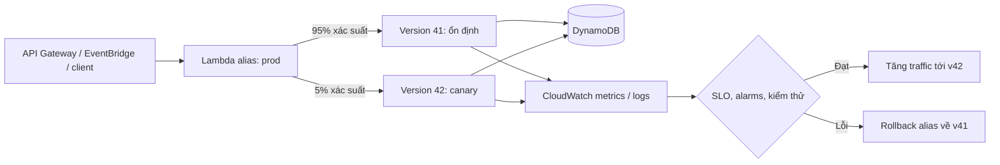
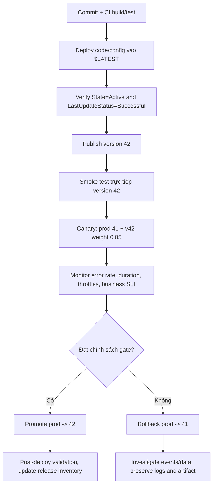
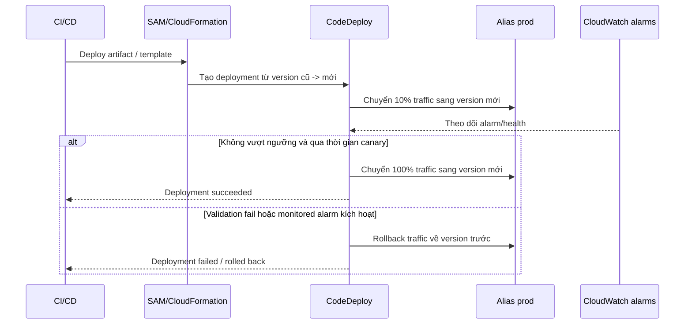
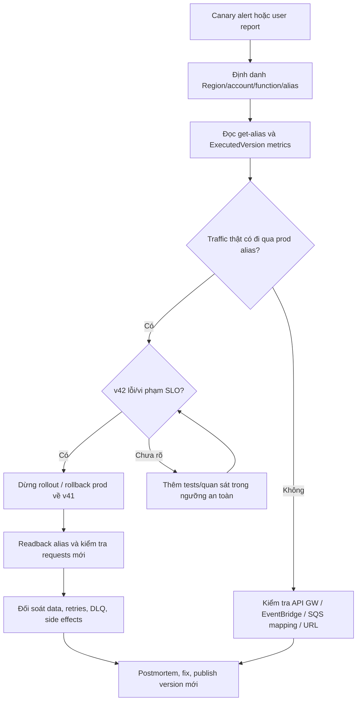

# Version, alias, canary và rollback Lambda

> **Chương:** Điện toán Lambda · **Mô-đun:** `CLOUD_PROVIDERS_AWS`

## 1. Bài toán: phát hành phiên bản Lambda mới mà vẫn bảo vệ người dùng

Một API đặt hàng dùng **AWS Lambda** để tạo đơn trong Amazon DynamoDB, gửi sự kiện qua Amazon EventBridge và ghi log tới CloudWatch. Nhóm phát triển chuẩn bị bản mới có cải thiện hiệu năng Java nhưng chưa chắc xử lý đúng tất cả đầu vào. Nếu thay mã của hàm đang phục vụ production và cho 100% người dùng chạy bản mới ngay, một lỗi hiếm có thể ảnh hưởng toàn bộ giao dịch.

**Lambda version** tạo ra một mốc phát hành có mã và phần lớn cấu hình được cố định; **alias** là tên ổn định như `prod` có thể chuyển từ version cũ sang version mới. Bằng cách cấu hình **weighted alias**, ta có thể gửi một phần nhỏ lời gọi tới version mới (*canary*), theo dõi lỗi/độ trễ rồi tăng tỷ lệ nếu kết quả tốt. Nếu xuất hiện sự cố, **rollback** điều hướng những lời gọi tiếp theo về version ổn định.



Đây là sơ đồ logic; `95%` và `5%` là **xác suất phân phối** từng invocation chứ không cam kết tỷ lệ chính xác ở mọi khoảng thời gian. Một rollback của alias **không hoàn tác dữ liệu đã ghi** ở DynamoDB, thông điệp đã gửi hay request đang thực thi; cần thiết kế dữ liệu và handler phù hợp với nhiều phiên bản cùng tồn tại.

Trong phạm vi mô-đun `CLOUD_PROVIDERS_AWS`, kỹ năng release Lambda liên quan đến **IAM, AWS Region, VPC, API Gateway/ALB, DynamoDB/RDS/SQS, CloudWatch, tính sẵn sàng, phục hồi, kiểm soát concurrency và chi phí**. Mục tiêu không chỉ là biết lệnh đổi alias mà còn xây được quy trình phát hành quan sát được, có kiểm thử và có đường quay lui thực sự.

**Sau bài học, người học có thể:**

1. Phân biệt `$LATEST`, published version, qualified ARN, unqualified ARN và alias.
2. Publish version và tạo/cập nhật alias bằng Console/AWS CLI, có thể dùng `RevisionId` tránh race condition.
3. Thiết kế weighted alias 95/5 → 90/10 → 100/0, biết giới hạn và độ dao động do lấy mẫu.
4. Dùng AWS SAM + CodeDeploy để tự động canary/linear deployment với CloudWatch alarms và validation hooks.
5. Quan sát traffic bằng `ExecutedVersion`, Logs/X-Ray, tính error rate và ra quyết định rollback.
6. Đảm bảo các nguồn kích hoạt thật sự gọi alias, hiểu quyền truy cập, retry, idempotency và tác động lên dữ liệu.
7. Kiểm soát cold starts/concurrency, version retention, chi phí và bảo mật trong quy trình phát hành.

## 2. Cơ sở: `$LATEST`, published version và alias

### 2.1. `$LATEST`: vùng cấu hình đang được chỉnh sửa

Khi cập nhật code hoặc các thuộc tính có thể chỉnh sửa của một Lambda function, thay đổi được áp dụng vào phiên bản **chưa publish**, gọi là `$LATEST`. Nếu client gọi function bằng **unqualified ARN** (ARN không kèm hậu tố version/alias), Lambda theo quy tắc thông thường sẽ invoke `$LATEST`.

```text
arn:aws:lambda:ap-southeast-1:111122223333:function:orders-handler
                                                      ^ unqualified

arn:aws:lambda:ap-southeast-1:111122223333:function:orders-handler:$LATEST
                                                      ^ unpublished
```

Không coi `$LATEST` là môi trường production ổn định: mọi update code/config mới có thể thay đổi ngay hành vi của invocations trỏ vào đó. Với production, hãy để **API Gateway, EventBridge rule, Lambda Function URL hoặc event source mapping** dùng **qualified reference** đến alias khi tích hợp hỗ trợ.

### 2.2. Published version: ảnh chụp bất biến của một lần phát hành

Khi **publish version**, Lambda tạo một số version tăng dần như `41`, `42` từ code và **phần lớn configuration** hiện tại của `$LATEST`.

| Thuộc tính | Với published version | Vì sao quan trọng khi rollback? |
| --- | --- | --- |
| **Code/handler/runtime** | Là một phần snapshot được publish. | Đổi alias về version cũ sẽ dùng lại code và handler tương ứng. |
| **Environment variables** | Được khóa theo version đã publish. | Có thể dùng cấu hình khác giữa hai versions, nhưng secret/endpoint ngoài vẫn có thể đổi theo thời gian. |
| **Memory, timeout, architecture** | Gắn với phiên bản. | Canary phải được đo hiệu năng với thông số thật. |
| **Layers, VPC config, DLQ, tracing, logging settings** | Nhiều thuộc tính được snapshot vào version. | Version cũ có thể khác network/behavior mới. |
| **Reserved concurrency** | Là cài đặt vận hành ở cấp function, không được snapshot trong published version. | Rollback code không tự trả toàn bộ giới hạn concurrency về trước. |
| **IAM policy ngoài, database schema, bucket policy** | Nằm ngoài version snapshot và có thể tiếp tục thay đổi. | Alias rollback **không rollback những tài nguyên này**. |

Lambda chỉ publish version mới khi code hoặc cấu hình thuộc tập điều kiện thay đổi kể từ phiên bản đã publish gần nhất; nếu không có thay đổi hợp lệ, không thể kỳ vọng gọi `publish-version` nhiều lần tạo ra các bản copy giống hệt. **Số version được publish không phải cùng một giá trị với release tag Git**: lưu map version ↔ Git SHA/build ID/artifact checksum trong pipeline.

Ví dụ ARN của một version:

```text
arn:aws:lambda:ap-southeast-1:111122223333:function:orders-handler:41
arn:aws:lambda:ap-southeast-1:111122223333:function:orders-handler:42
```

Published version chủ yếu bất biến về code/config, nhưng **Lambda service/runtime updates** hoặc các tài nguyên bên ngoài vẫn có thể thay đổi hành vi chạy thực tế. “Immutable” không có nghĩa môi trường AWS, credentials, secret version, DNS hay dữ liệu bên ngoài bị đóng băng vĩnh viễn.

### 2.3. Alias: tên ổn định trỏ tới version

Alias là một tham chiếu **có thể cập nhật**, ví dụ `dev`, `staging`, `prod` hoặc `live`:

```text
arn:aws:lambda:ap-southeast-1:111122223333:function:orders-handler:prod
```

Alias **không trỏ tới alias khác**, không trỏ tới `$LATEST` và phải trỏ tới **published version** của chính function đó. Tên alias không thể chỉ là chữ số như `42` để tránh nhầm với numeric version.

Ví dụ các trạng thái:

| Thời điểm | Alias `prod` | Hành vi |
| --- | --- | --- |
| Trước release | `41` | 100% calls qua alias dùng v41. |
| Canary | Base `41`, additional `42` trọng số `0.05` | V41 ~95%, v42 ~5% trên lượng call đủ lớn. |
| Promote | Base `42`, không có routing bổ sung | 100% calls mới qua alias dùng v42. |
| Rollback | Base `41`, không có routing bổ sung | Các calls mới qua alias quay về v41. |

**Điểm mấu chốt:** Nếu client vẫn gọi **unqualified function ARN**, thao tác đổi alias `prod` sẽ **không tác động lên client đó**. Phải kiểm tra từng nguồn kích hoạt và scope của permissions trước khi dựa vào alias cho release production.

### 2.4. So sánh nhanh

| Đối tượng | Được cập nhật trực tiếp? | ARN suffix | Phù hợp |
| --- | --- | --- | --- |
| `$LATEST` | Code/config được chỉnh sửa. | `:$LATEST` hoặc unqualified ARN. | Phát triển, build và kiểm thử trước publish. |
| Published version | Code và đa số config bất biến. | `:41`, `:42`. | Replay/rollback, traceability, chạy đúng bản. |
| Alias | Thay version đích/weights. | `:prod`, `:staging`. | Entry point ổn định, canary và rollback. |

## 3. Thiết kế luồng phát hành có phiên bản

Một quy trình tối thiểu:



### 3.1. Phạm vi của một “release”

Một release tốt không chỉ lưu số version của Lambda:

- Commit SHA, CI job/build ID, artifact checksum và dependency/SBOM.
- Runtime, handler, architecture, memory, timeout, layer version, VPC và environment variables.
- IAM execution role, access policies của API Gateway/SQS/EventBridge, Secrets Manager/KMS và quyền downstream.
- Alias base/additional versions, weights và chính sách traffic shift.
- CloudWatch dashboard/alarms, baseline error rate/latency, smoke tests và người duyệt.
- Schema tương thích dữ liệu, event formats, idempotency, rollback instructions.

**Nhiều version chạy đồng thời** trong canary, vì vậy API/database schema phải hỗ trợ cùng lúc v41 và v42. Ví dụ không xóa ngay một cột DynamoDB/RDS mà v41 còn cần đọc. Dùng quy trình **expand → migrate → contract** khi thay đổi schema để rollback không biến thành lỗi dữ liệu.

### 3.2. Những gì cần bảo vệ trước khi thay alias

1. Đảm bảo v41 thật sự là bản **known-good** và còn tồn tại trong Lambda.
2. Kiểm tra v42 đã được publish, ở trạng thái có thể invoke và vượt kiểm thử độc lập.
3. Xác nhận traffic thực tế đi qua alias `prod`, không gọi `$LATEST` hoặc version ARN hardcoded.
4. Kiểm tra role/DLQ compatibility của weighted routing (hai version phải cùng execution role và DLQ config).
5. Đánh giá concurrency, throughput, code/storage quota, downstream capacity và chi phí.
6. Chuẩn bị alarm threshold, cửa sổ quan sát đủ traffic, approval và rollback command.

Không đổi alias thủ công song song với một pipeline **CodeDeploy/SAM** đang quản lý cùng alias. Có thể tạo race condition hoặc drift; cần chọn **một cơ chế sở hữu trạng thái alias** và kiểm tra deployment đang diễn ra.

## 4. Quy trình tạo version và alias qua AWS CLI

Các lệnh sau minh họa chạy trên môi trường có **AWS CLI v2** như AWS CloudShell/Bash, trong một tài khoản lab đã được cấp quyền. **Lệnh update/publish/create là thao tác thay đổi tài nguyên thật**, có thể chuyển traffic và phát sinh phí. Không chạy nguyên văn trên production khi chưa có change approval. Giả sử function `orders-handler` đã tồn tại, có code/role hợp lệ và Region `ap-southeast-1`.

### 4.1. Đọc danh tính và trạng thái (chỉ đọc)

```bash
aws sts get-caller-identity

aws lambda get-function-configuration \
  --region ap-southeast-1 \
  --function-name orders-handler \
  --query '{Name:FunctionName,Version:Version,Runtime:Runtime,State:State,LastUpdateStatus:LastUpdateStatus,RevisionId:RevisionId,CodeSha256:CodeSha256}' \
  --output json

aws lambda list-versions-by-function \
  --region ap-southeast-1 \
  --function-name orders-handler \
  --query 'Versions[].{Version:Version,Description:Description,LastModified:LastModified,CodeSha256:CodeSha256}' \
  --output table

aws lambda list-aliases \
  --region ap-southeast-1 \
  --function-name orders-handler \
  --output json
```

Đặc biệt cần nhìn `State=Active` và `LastUpdateStatus=Successful` của phiên bản đang chuẩn bị publish. Nếu update code/config còn `InProgress`, hãy đợi hoàn thành bằng kiểm tra status hoặc waiter phù hợp, thay vì publish một snapshot chưa sẵn sàng.

### 4.2. Publish version từ `$LATEST`

Trong ví dụ, sau khi CI đưa artifact và cấu hình đã được kiểm thử lên `$LATEST`, dùng:

```bash
aws lambda publish-version \
  --region ap-southeast-1 \
  --function-name orders-handler \
  --description 'orders release git-a1b2c3d' \
  --output json
```

Kết quả có `Version` (ví dụ `42`), `FunctionArn`, `CodeSha256` và các trường configuration. **Không tự giả định version kế tiếp là 42**: dùng số thật AWS trả về. Trong CI/CD nhiều writers, dùng `--code-sha256` và/hoặc `--revision-id` lấy từ bước kiểm chứng để tránh publish nhầm code/config đã bị cập nhật bởi người khác.

Version mới không có nghĩa alias `prod` tự chuyển. Đây là đặc tính cho phép thử và duyệt release trước khi production nhận traffic.

### 4.3. Tạo alias ổn định ban đầu

Chỉ cần tạo alias một lần cho function; nếu `prod` đã tồn tại, **không gọi create-alias lần nữa**:

```bash
aws lambda create-alias \
  --region ap-southeast-1 \
  --function-name orders-handler \
  --name prod \
  --function-version 41 \
  --description 'Production traffic'
```

Nếu trước đó đã có alias, đọc lại:

```bash
aws lambda get-alias \
  --region ap-southeast-1 \
  --function-name orders-handler \
  --name prod \
  --query '{AliasArn:AliasArn,BaseVersion:FunctionVersion,Routing:RoutingConfig,RevisionId:RevisionId}' \
  --output json
```

`RevisionId` là mã thay đổi mỗi khi alias được cập nhật. Có thể dùng **optimistic concurrency** thông qua `--revision-id` khi update để tránh ghi đè một thay đổi alias diễn ra giữa lúc bạn đọc và ghi.

## 5. Weighted alias: canary thủ công với 5%, 10% và 100%

### 5.1. Cơ chế phân phối traffic

Một Lambda alias có **base version** và có thể khai báo thêm **một version khác** với tỷ lệ `AdditionalVersionWeights`. Với cấu hình:

```json
{
  "FunctionVersion": "41",
  "RoutingConfig": {
    "AdditionalVersionWeights": {
      "42": 0.05
    }
  }
}
```

Lambda định tuyến invocation qua alias với xác suất xấp xỉ **95% v41** và **5% v42**. Trọng số trong API/CLI dùng số thập phân **`0.05`**, không phải `5`. Alias chỉ hỗ trợ **tối đa hai published versions**, trong đó:

- Cả hai phải thuộc **cùng Lambda function**.
- Cả hai versions phải có **cùng execution role**.
- Cả hai versions phải có **cùng cấu hình dead-letter queue (DLQ)**, hoặc cả hai không có DLQ.
- Alias **không** được trỏ đến `$LATEST`.

Nếu v42 đổi IAM execution role hoặc DLQ so với v41, weighted alias có thể không cho phép tạo cấu hình. Khi cần thay đổi các thuộc tính đó, cân nhắc phát hành theo nhiều bước tương thích, hoặc kiến trúc phân luồng khác (ví dụ API Gateway/Step Functions) đã được review; không được gỡ bỏ bảo mật/DLQ chỉ để ép canary chạy.

### 5.2. Đặt 5% traffic vào v42

Trên Bash/CloudShell, AWS CLI hỗ trợ truyền routing config bằng JSON để tránh lỗi quote:

```bash
aws lambda update-alias \
  --region ap-southeast-1 \
  --function-name orders-handler \
  --name prod \
  --function-version 41 \
  --routing-config '{"AdditionalVersionWeights":{"42":0.05}}'
```

Đọc lại trạng thái và lưu `RevisionId`/deployment metadata:

```bash
aws lambda get-alias \
  --region ap-southeast-1 \
  --function-name orders-handler \
  --name prod \
  --query '{BaseVersion:FunctionVersion,Weights:RoutingConfig.AdditionalVersionWeights,RevisionId:RevisionId}' \
  --output json
```

Nếu đổi trọng số nhưng không theo dõi metrics theo **version thực thi**, một lỗi chỉ xuất hiện ở v42 có thể bị che bởi 95% requests thành công của v41. Với traffic nhỏ, số lượng invocation đến v42 có thể rất thấp; **5% là tỷ lệ kỳ vọng, không phải bảo đảm có đúng 5 lời gọi trong 100 lời gọi bất kỳ**.

### 5.3. Tăng canary lên 10%

Sau khi qua cửa kiểm thử và thu đủ bằng chứng:

```bash
aws lambda update-alias \
  --region ap-southeast-1 \
  --function-name orders-handler \
  --name prod \
  --function-version 41 \
  --routing-config '{"AdditionalVersionWeights":{"42":0.10}}'
```

Đặt **`--revision-id`** khi cập nhật trong môi trường nhiều người/pipeline để phát hiện thay đổi đồng thời. Một request update alias thành công không đồng nghĩa tất cả dashboard đã nhận telemetry ngay lập tức; cần tiếp tục theo dõi một khoảng thời gian thích hợp và xem kết quả theo **executed version**.

### 5.4. Promote 100% sang v42

Khi đã duyệt phát hành, đặt base version mới và **xóa routing bổ sung**:

```bash
aws lambda update-alias \
  --region ap-southeast-1 \
  --function-name orders-handler \
  --name prod \
  --function-version 42 \
  --routing-config '{"AdditionalVersionWeights":{}}'
```

Nếu chỉ thay `--function-version` nhưng vẫn giữ một routing config không mong muốn, bạn có thể tiếp tục chia traffic hoặc gặp lỗi cấu hình. Bởi vậy, sau **promote** hoặc **rollback**, luôn kiểm tra **`FunctionVersion` và `RoutingConfig` đều đúng**.

### 5.5. Rollback nhanh về v41

Khi error rate hoặc business metrics vượt ngưỡng, hướng traffic mới về bản ổn định:

```bash
aws lambda update-alias \
  --region ap-southeast-1 \
  --function-name orders-handler \
  --name prod \
  --function-version 41 \
  --routing-config '{"AdditionalVersionWeights":{}}'
```

**Đây là thao tác chuyển hướng traffic của alias, không phải hoàn tác code hoặc dữ liệu.** Invocations đã bắt đầu chạy v42 có thể tiếp tục hoàn thành; events đã xử lý và side effects vẫn tồn tại. Với async/stream/SQS, còn cần xem backlog/retries/DLQ và các record đã được v42 xử lý hoặc có nguy cơ chạy lại.

### 5.6. Vì sao canary thủ công chưa đủ cho production?

Quy trình tăng trọng số thủ công đòi hỏi người vận hành:

1. Đổi alias theo lịch.
2. Đo lỗi, timeout, throttles và latency theo version.
3. Xác nhận lượng traffic canary đủ để có kết luận.
4. Dừng rollout/rollback khi CloudWatch alarm và kiểm thử báo lỗi.
5. Ghi lại lịch sử, hành động, quyền, bằng chứng và post-deployment validation.

Nếu đội không giám sát liên tục, có thể không kịp phản ứng trước khi tăng 100%. Với production nên ưu tiên **AWS CodeDeploy** tích hợp **AWS SAM/CDK/CloudFormation** hoặc pipeline có alarm gates, rollback automation và ownership rõ ràng.

## 6. Kiểm chứng chính xác version nào đã được gọi

### 6.1. Phân biệt alias và executed version

Alias `prod` là điểm vào; thực thi có thể là v41 hoặc v42. Do đó, chỉ nhìn ARN `...:prod` trong cấu hình nguồn kích hoạt **không chứng minh request đã chạy ở version nào**.

Lambda cung cấp các dấu hiệu:

- **CloudWatch Logs:** bản ghi `START` thường có trường `Version: 41` hoặc `Version: 42` của invocation.
- **Synchronous Invoke API:** response header `x-amz-executed-version` chỉ version thực thi.
- **CloudWatch metrics:** dimension **`ExecutedVersion`** có thể dùng kết hợp `Resource` để lọc metrics của một version được gọi qua alias.
- **Application logs/traces:** nên ghi `awsRequestId`, app release ID, version và correlation ID theo cấu hình logger; không log bí mật.

Ví dụ log:

```text
START RequestId: example-req-001 Version: 42
... application log with traceId=example-trace-001 ...
END RequestId: example-req-001
REPORT RequestId: example-req-001 Duration: ...
```

Đây là cấu trúc minh họa, không phải một request ID hợp lệ thật. Các bản ghi runtime và định dạng log có thể thay đổi theo cấu hình JSON/plain text logging.

### 6.2. Invoke alias với AWS CLI

Từ một môi trường lab đã được cấp quyền `lambda:InvokeFunction` trên alias:

```bash
# --cli-binary-format cần thiết khi dùng AWS CLI v2 với raw JSON.
aws lambda invoke \
  --region ap-southeast-1 \
  --function-name orders-handler \
  --qualifier prod \
  --cli-binary-format raw-in-base64-out \
  --payload '{"action":"health-check","requestId":"lab-001"}' \
  --log-type Tail \
  --query '{StatusCode:StatusCode,FunctionError:FunctionError,ExecutedVersion:ExecutedVersion}' \
  --output json \
  response.json
```

`response.json` là tệp kết quả **do người học tạo khi chạy lệnh trong môi trường lab**, không phải file được tạo trong repository bài học. Tham số `--log-type Tail` áp dụng với invocation đồng bộ và trả một phần log đã Base64 trong trường `LogResult` nếu được yêu cầu. Output API `StatusCode=200` có thể chỉ cho biết **Invoke API chấp nhận và trả response**, **không** chứng minh function logic thành công; kiểm tra `FunctionError` và payload.

Nếu handler `orders-handler` không hỗ trợ input `{"action":"health-check"}`, đừng dùng lệnh làm smoke test trên production: yêu cầu phải là **event vô hại, được handler hỗ trợ**. Việc invoke có thể tạo side effect như ghi dữ liệu hoặc gửi email nếu event không được thiết kế đúng.

### 6.3. Metrics theo từng version

Trong CloudWatch namespace `AWS/Lambda`:

| Metric | Đo gì? | Quyết định trong canary |
| --- | --- | --- |
| `Invocations` | Số lần function được gọi. | Mẫu v42 đủ lớn chưa? |
| `Errors` | Invocation có lỗi xử lý hoặc runtime. | Tỷ lệ lỗi v42 so với v41. |
| `Duration` | Thời gian thực thi (xem statistic/percentiles). | v42 có tăng p95/p99 latency không? |
| `Throttles` | Invocation bị giới hạn do concurrency/quota. | Canary có làm dịch vụ thiếu capacity? |
| `ConcurrentExecutions` | Số executions đồng thời theo dimension hỗ trợ. | Có gần reserved/account concurrency không? |
| `IteratorAge` | Độ trễ xử lý records từ Kinesis/DynamoDB Streams (khi áp dụng). | Canary có làm stream chậm dần không? |
| `AsyncEventAge`, `DeadLetterErrors`, `DestinationDeliveryFailures` | Sức khỏe xử lý async khi có cấu hình tương ứng. | Có backlog, retry, không chuyển DLQ/destination thành công? |
| `ProvisionedConcurrencySpilloverInvocations` | Lời gọi vượt capacity warm provisioned theo cấu hình. | Có cold starts do canary hoặc phân phối không đều? |

Chọn dimension đúng:

| Dimension | Phạm vi |
| --- | --- |
| `FunctionName` | Tổng hợp toàn function (nhiều alias/versions). |
| `Resource` | Phạm vi version hoặc alias tương ứng. |
| **`ExecutedVersion`** | Version **đã thực thi** khi invocation qua alias; dùng để tách traffic v41/v42. |

**Một metric của toàn alias `prod` có thể che giấu lỗi v42**: nếu 5% traffic mới có lỗi 100%, error rate tổng xấp xỉ 5% (khi các assumptions phù hợp) còn metric riêng v42 là 100%. Cần cảnh báo theo executed version mới và business SLI, không chỉ tổng function.

### 6.4. Tránh báo động sai khi canary có ít traffic

Với trọng số 5% và API chỉ nhận 20 req/phút, kỳ vọng v42 khoảng **1 invocation/phút**. Một lỗi duy nhất tạo error rate 100% ở phút đó; ngược lại, không có lỗi trong một phút không đủ chứng minh an toàn. Cần:

- Xác định **số sample tối thiểu** hoặc thời gian quan sát trước khi promote.
- Dùng cả absolute Errors và error rate, không chia cho 0 Invocations.
- Theo dõi latency distribution/percentiles khi dữ liệu đủ nhiều.
- Thử **synthetic/smoke traffic** an toàn để phủ các nhánh quan trọng, không chỉ dựa vào traffic ngẫu nhiên.
- Có cảnh báo mức độ nghiêm trọng và quyết định rollback dựa trên rủi ro/impact của nghiệp vụ.

### 6.5. Application metrics và traces

Với Java handler, nên gắn request ID và trace ID vào log/trace để truy ngược API Gateway → Lambda → DynamoDB/RDS/SQS. AWS X-Ray hoặc OpenTelemetry có thể giúp phân biệt thời gian init, thời gian gọi downstream và xử lý Java. Bảo vệ log: không ghi access token, thông tin thanh toán hoặc request body nhạy cảm. Runtime updates và cold starts có thể khiến độ trễ v42 khác v41 dù logic tương tự, nên quan sát **init duration** khi có mặt trong logs/tracing và loại traffic hợp lý.

## 7. Rollback là một quy trình, không chỉ một lệnh

### 7.1. Phân loại rollback

| Sự cố | Đổi alias có xử lý đủ không? | Phần cần xử lý thêm |
| --- | --- | --- |
| v42 ném exception với input hiếm. | Thường có thể ngăn **calls mới** vào v42. | Kiểm tra events đã thất bại và retry. |
| v42 ghi sai dữ liệu DynamoDB. | **Không** hoàn tác dữ liệu. | Compensating transaction, audit, reconciliation và restore có kiểm soát. |
| v42 gửi trùng email/SQS events. | Không xóa các message đã gửi. | Idempotency keys, deduplication và quy trình xử lý trùng. |
| v42 đổi schema DB không tương thích v41. | Rollback có thể khiến v41 **không chạy được**. | Expand-contract, migration rollback/recovery an toàn. |
| v42 thay IAM role và DLQ. | Weighted alias có ràng buộc tương thích. | Tách bước thay policy/config, kiểm thử cả old/new; có thể cần phương án triển khai khác. |
| Source trigger vẫn gọi `$LATEST`. | Đổi alias **không có tác dụng**. | Sửa event source mapping/integration/permission dùng alias. |
| v42 bị throttles do tăng concurrency/cold start. | Có thể giảm ảnh hưởng bằng chuyển traffic. | Đánh giá provisioned/reserved concurrency và quota, downstream. |
| v42 đã bắt đầu chạy trước khi rollback. | **Không hủy mọi invocation đang thực thi**. | Theo dõi số lần gọi và side effects, xác minh drain/retry. |

### 7.2. Quy trình khẩn cấp khi canary xấu

1. **Xác nhận incident:** Error rate/latency v42, business SLI, `ExecutedVersion`, time window và release SHA.
2. **Xác định blast radius:** API Gateway? EventBridge? SQS/stream? Có bao nhiêu nguồn thực sự gọi alias?
3. **Ngăn gọi mới vào v42:** cập nhật alias về v41/clear routing (hoặc dừng deployment/CodeDeploy theo cơ chế sở hữu).
4. **Đọc lại alias:** `get-alias` xác nhận base version v41 và routing config rỗng.
5. **Xem traffic còn lại:** request đang chạy, async backlog, stream iterator age, queues/DLQ, downstream events; tránh coi rollback kết thúc toàn bộ sự cố.
6. **Kiểm chứng người dùng:** smoke tests an toàn, CloudWatch/ALB/API metrics, tỷ lệ lỗi mới giảm, business transactions bình thường.
7. **Bảo toàn bằng chứng:** CloudWatch logs/X-Ray, CloudTrail, CodeDeploy deployment ID, version metadata, incident timeline.
8. **Khắc phục nguyên nhân gốc:** tạo version mới đã sửa lỗi, không “chỉnh trực tiếp” published v42 rồi kỳ vọng giữ nguyên ARN.

### 7.3. Không rollback dữ liệu bằng cách xóa v42

Xóa published version `42` hoặc xóa code ở `$LATEST` không đảo ngược:

- EventBridge events đã phát, SQS messages đã gửi.
- DynamoDB/RDS records đã ghi.
- Lambda asynchronous retries đang chờ hoặc stream checkpoints đã tiến.
- Secrets/IAM permissions, infrastructure routes và external API side effects đã thay đổi.

Ngược lại, xóa sớm v42 có thể **làm mất khả năng điều tra hoặc reproducibility** của release. Trước khi xóa versions cũ, kiểm tra alias references, event source mappings, rollback retention, active incident và AWS code storage costs.

### 7.4. Giảm rủi ro bằng idempotency và compatibility

Ví dụ Lambda xử lý sự kiện `OrderCreated`. Khi version 42 ghi một đơn rồi timeout trước khi trả response, nguồn kích hoạt có thể **retry** cùng event. Nếu handler chỉ gọi `PutItem` không có điều kiện, có thể phát sinh side effects trùng.

Hướng thiết kế:

1. Có **event ID / idempotency key** ổn định, lưu trạng thái xử lý trong DynamoDB với conditional write hoặc mô hình deduplication được review.
2. Thao tác ngoài (payment/email/partner API) hỗ trợ idempotency token hoặc cơ chế đối soát.
3. Messages/DB schema hỗ trợ song song v41 và v42.
4. Mỗi version ghi log release ID và correlation ID; không log secrets.
5. Giữ event replay/dead-letter/reconciliation runbook đã kiểm thử.

Điều này quan trọng hơn rollback “trong 10 giây”: một lệnh alias chạy nhanh nhưng dữ liệu sai có thể mất nhiều giờ để phục hồi.

## 8. Tự động canary và rollback bằng AWS CodeDeploy + AWS SAM

Với hệ thống production, thao tác tăng trọng số theo thời gian và phản ứng với CloudWatch alarms nên có **một deployment controller** thay vì yêu cầu người trực màn hình liên tục. **AWS CodeDeploy** hỗ trợ Lambda deployments bằng alias routing, tích hợp **AWS Serverless Application Model (AWS SAM)** và có khả năng triển khai canary/linear/all-at-once cùng alarms và lifecycle hooks.

### 8.1. Các chiến lược traffic shift

| Chiến lược | Ví dụ cấu hình Lambda của CodeDeploy | Ý nghĩa |
| --- | --- | --- |
| **Canary** | `Canary10Percent5Minutes` | Chuyển 10% trước, sau khoảng 5 phút chuyển 90% còn lại nếu deployment tiếp tục. |
| **Canary** | `Canary10Percent10Minutes` | Cho 10% traffic vào bản mới trong khoảng 10 phút trước khi promote phần còn lại. |
| **Linear** | `Linear10PercentEvery1Minute` | Tăng thêm 10 điểm phần trăm mỗi phút đến 100%. |
| **Linear** | `Linear10PercentEvery10Minutes` | Tăng theo bước đều trong thời gian dài hơn. |
| **All-at-once** | `AllAtOnce` | Chuyển 100% ngay, không có cửa sổ canary trung gian. |

Đây là **tên `DeploymentPreference.Type` trong AWS SAM**, CodeDeploy có các tên deployment config tương ứng như `CodeDeployDefault.LambdaCanary10Percent10Minutes`. Đừng nhầm chúng với cấu hình **ECS canary** hoặc một tên schedule tự đặt chưa được tạo. Có thể tạo deployment configurations tùy chỉnh theo giới hạn CodeDeploy nếu quy trình yêu cầu.



**Rollback tự động chỉ xảy ra theo điều kiện đã cấu hình.** Không có alarm hoặc validation phù hợp, CodeDeploy có thể promote một version **có lỗi nghiệp vụ nhưng vẫn trả HTTP thành công**. Cần design monitoring và test hooks thật sự phủ chức năng quan trọng.

### 8.2. AWS SAM: cấu hình function, alias và deployment preference

Ví dụ rút gọn cho một **Lambda Java 21** đã có code artifact và handler, dành cho môi trường lab/thiết kế:

```yaml
AWSTemplateFormatVersion: '2010-09-09'
Transform: AWS::Serverless-2016-10-31
Description: Orders Lambda with versioned canary deployment

Resources:
  OrdersFunction:
    Type: AWS::Serverless::Function
    Properties:
      CodeUri: build/orders-lambda.jar
      Handler: com.example.orders.Handler::handleRequest
      Runtime: java21
      MemorySize: 1024
      Timeout: 20
      AutoPublishAlias: prod
      DeploymentPreference:
        Type: Canary10Percent10Minutes
        Alarms:
          - !Ref OrdersAliasErrorAlarm
      Policies:
        - AWSLambdaBasicExecutionRole

  OrdersAliasErrorAlarm:
    Type: AWS::CloudWatch::Alarm
    Properties:
      AlarmDescription: Roll back if prod alias reports errors
      Namespace: AWS/Lambda
      MetricName: Errors
      Statistic: Sum
      Period: 60
      EvaluationPeriods: 1
      Threshold: 1
      ComparisonOperator: GreaterThanOrEqualToThreshold
      TreatMissingData: notBreaching
      Dimensions:
        - Name: FunctionName
          Value: !Ref OrdersFunction
        - Name: Resource
          Value: !Sub '${OrdersFunction}:prod'
```

**Điều kiện để ví dụ hoạt động:** file `build/orders-lambda.jar` và handler là **đường dẫn/lớp minh họa**, phải thay bằng artifact Java Lambda đã được build, handler hợp lệ và IAM role policy cho downstream. Cấu hình này **không tự tạo API Gateway**; phải có event source/integration thật sự invoke alias `prod`. Khi dùng API Gateway, thêm sự kiện SAM hoặc khai báo API integration tương ứng có đủ invoke permissions.

Alarm trên **alias tổng** trong ví dụ rất đơn giản, có thể được dùng như một tín hiệu nhanh nhưng **chưa phải chiến lược canary production hoàn chỉnh**: một lỗi có thể do version cũ; ngược lại canary ít traffic có thể thiếu mẫu, và `TreatMissingData: notBreaching` có thể che sự cố không có traffic. Nên bổ sung alarm theo **`ExecutedVersion` của version mới**, metric math/error rate với minimum invocation count, độ trễ, throttles và business metric; khi cần trỏ tới version do SAM tạo tự động, kiểm tra generated CloudFormation resources và thiết kế tham chiếu/observability thích hợp.

**Lưu ý triển khai lần đầu:** CodeDeploy cần **version trước đó** để chuyển traffic. Theo hướng dẫn AWS SAM, lần phát hành đầu tiên có thể triển khai với `AutoPublishAlias` trước, rồi bật `DeploymentPreference` khi đã có baseline version. Không coi bản deploy đầu chưa có version cũ là canary thật sự.

### 8.3. CloudWatch alarms phải đánh giá đúng rủi ro

Các alarm nên bao gồm:

- Lambda `Errors` và error rate của **new executed version**.
- `Duration` p95/p99, `Throttles`, timeout, concurrency và provisioned concurrency spillover.
- API Gateway/ALB 5xx và end-to-end latency nếu Lambda là API backend.
- Business SLI: giao dịch thất bại, duplicate processing, mất đơn, DLQ count/queue age.
- Số lượng invocation canary tối thiểu hoặc synthetic tests để tránh “không có dữ liệu” bị hiểu là thành công.

Đặt threshold theo **SLO/benchmark** của sản phẩm, không sao chép một ngưỡng “1 error bất kỳ” cho mọi traffic profile. Một alarm chưa có quyền truy cập hoặc đang ở trạng thái thiếu dữ liệu cần được kiểm tra trước khi triển khai. Cần xác nhận CodeDeploy deployment group thực sự giám sát **đúng alarm ARNs**.

### 8.4. Validation hooks: PreTraffic và PostTraffic

AWS SAM `DeploymentPreference.Hooks` cho phép tham chiếu Lambda validation functions:

```yaml
# Ví dụ chèn vào DeploymentPreference của OrdersFunction
DeploymentPreference:
  Type: Canary10Percent10Minutes
  Alarms:
    - !Ref OrdersAliasErrorAlarm
  Hooks:
    PreTraffic: !Ref OrdersPreTrafficValidation
    PostTraffic: !Ref OrdersPostTrafficValidation
```

Đây là **đoạn cấu hình minh họa**, chưa có hai function validation được khai báo nên chưa phải template hoàn chỉnh. Validation hook được CodeDeploy gọi theo lifecycle và phải **báo trạng thái thành công/thất bại cho CodeDeploy** bằng API `PutLifecycleEventHookExecutionStatus` với quyền và identifiers tương ứng; chỉ return một object JSON như function business **không đủ** cho integration này. Hook có thể invoke version mới bằng event không gây side effect, kiểm tra schema/contract và health của dependency; không thực hiện giao dịch thanh toán thật trong smoke tests.

### 8.5. CodeDeploy rollback và ownership

CodeDeploy có thể dừng/rollback một deployment khi hook thất bại hoặc monitored alarm chuyển sang `ALARM` theo cấu hình auto rollback. Rollback về revision trước có thể được thực hiện bằng **deployment mới có deployment ID mới**, không phải “xóa lịch sử triển khai lỗi”. Khi sự cố:

1. Kiểm tra **CodeDeploy deployment status, events, alarms và validation hook logs**.
2. Phân biệt rollout đang tiếp tục, bị stop, rollback in progress và đã hoàn tất.
3. Tránh đồng thời gọi `aws lambda update-alias` trực tiếp trong khi CodeDeploy đang điều phối; nếu bắt buộc can thiệp khẩn cấp, cần quy trình takeover rõ ràng để không bị deployment tiếp theo ghi đè.
4. Đọc lại alias và xác minh traffic thực tế theo version sau khi rollback, không chỉ tin deployment status.
5. Giữ logs/alarms/deployment ID, mở incident review và sửa hook/alert rule nếu lỗi bị bỏ sót.

**AWS SAM không sửa được dữ liệu sai do v42 đã ghi.** Vẫn phải áp quy trình idempotency, replay/reconciliation, schema compatibility ở mục 7.

### 8.6. Khi nào chọn canary, linear hay all-at-once?

| Tình huống | Lựa chọn có thể hợp lý | Lý do |
| --- | --- | --- |
| API có đủ traffic, rủi ro release lớn. | Canary hoặc linear + alarms. | Phát hiện lỗi sớm, giảm blast radius. |
| API rất ít traffic. | Canary **kèm synthetic tests và thời gian đủ dài**. | Tỷ lệ nhỏ có thể không có invocation thật để đánh giá. |
| Backfill/job chạy theo batch hiếm. | Staging/replay test, chuyển alias có kiểm soát, có thể all-at-once. | Weighted routing có thể không chia được theo request nghiệp vụ đại diện. |
| Patch khẩn cấp cho lỗi nghiêm trọng. | Canh thời gian + risk decision, đôi khi all-at-once. | Cân nhắc rủi ro trì hoãn patch so với rủi ro release mới. |
| Thay schema/contract không tương thích. | Thay đổi nhiều bước trước khi canary. | Hai versions cùng chạy sẽ phá dữ liệu hoặc protocol. |

Không có một deployment type tối ưu cho mọi workload. Quyết định dựa trên traffic, tác động lỗi, độ nhạy dữ liệu, RTO/RPO, latency và khả năng quan sát.

## 9. Nguồn kích hoạt, qualified ARN và chính sách IAM

### 9.1. Phải hướng nguồn kích hoạt tới alias

AWS Lambda có thể được gọi bởi:

- **API Gateway** (HTTP API/REST API) với integration URI trỏ tới alias ARN.
- **Application Load Balancer** với Lambda target group/permission đúng alias khi được hỗ trợ.
- **Amazon EventBridge** rules/schedules hoặc services trực tiếp invoke function.
- **Event source mapping** của SQS/Kinesis/DynamoDB Streams/MSK và các nguồn poll được hỗ trợ.
- **Lambda Function URL** gắn với function hoặc alias theo tính năng.
- **AWS SDK/CLI** invocation dùng qualified ARN/`--qualifier`.

Nếu mapping hoặc rule dùng **function ARN không qualifier**, nó thường gọi `$LATEST`, bỏ qua canary/rollback của alias. Nếu nguồn dùng **numeric version ARN** cố định `:41`, nó cũng bỏ qua alias updates. Với event source mapping, cần xem giá trị `FunctionArn` của mapping; với EventBridge xem ARN target; với API Gateway kiểm tra integration URI/deployed stage.

### 9.2. Kiểm tra event source mappings (chỉ đọc)

```bash
aws lambda list-event-source-mappings \
  --region ap-southeast-1 \
  --function-name orders-handler \
  --query 'EventSourceMappings[].{UUID:UUID,State:State,FunctionArn:FunctionArn,Source:EventSourceArn}' \
  --output table
```

Đây chỉ kiểm tra **event source mappings**, không liệt kê hết các direct triggers như API Gateway, EventBridge rules hay Function URLs. Phải kiểm kê từng nguồn được cấu hình trong IaC, bảng cấu hình dịch vụ hoặc Console. Tạo/update mapping để trỏ alias là thao tác thay đổi production, cần quyền và review riêng.

### 9.3. Quyền invoke alias và resource-based policies

Lambda permissions có thể được cấp ở **function, version hoặc alias scope**. Ví dụ một EventBridge rule được phép gọi **duy nhất alias prod**:

```bash
# Đây là lệnh thay đổi resource-based policy, CHỈ minh họa.
aws lambda add-permission \
  --region ap-southeast-1 \
  --function-name orders-handler \
  --qualifier prod \
  --statement-id AllowOrdersRuleInvokeProd \
  --action lambda:InvokeFunction \
  --principal events.amazonaws.com \
  --source-arn arn:aws:events:ap-southeast-1:111122223333:rule/orders-rule
```

Account ID/rule ARN là placeholder. `--qualifier prod` cấp permission gắn với alias, không tự cho phép invoke trực tiếp `:41`, `:42` hay unqualified ARN theo cùng policy. Điều này giúp **giữ điểm vào ổn định** khi alias chuyển version.

**Bảo mật:** hạn chế `lambda:UpdateAlias`, `lambda:PublishVersion`, `lambda:UpdateFunctionCode` và quyền thay resource policies theo role phù hợp. Một người có quyền sửa alias `prod` có thể chuyển 100% traffic tới version khác dù code đã qua review. Dùng CloudTrail, pipeline approval, IAM least privilege và `RevisionId` chống cập nhật đè trong quy trình.

### 9.4. VPC và IAM execution role không tự đi theo alias name

Published versions ghi nhận nhiều cấu hình như execution role, VPC subnets/security groups và environment variables. Canaries có thể gặp lỗi khi:

- Version mới đổi VPC configuration nhưng private subnet thiếu NAT/VPC endpoints để gọi Secrets Manager/DynamoDB/S3.
- Role hoặc KMS key policy thiếu quyền; weighted routing còn yêu cầu cùng execution role giữa hai versions.
- Security groups làm RDS connection timeout; Lambda VPC networking ảnh hưởng khởi tạo và đường mạng theo kiến trúc.
- Một secret được rotate bên ngoài code snapshot và cả v41/v42 nhận giá trị hiện tại khác trước.

Đừng hiểu rollback code version là rollback toàn bộ hạ tầng. Khi release cần đổi IAM/VPC/secret schema, hãy dùng migration nhiều bước, kiểm thử tương thích và IaC versioning.

## 10. Canary với synchronous, asynchronous và stream events

### 10.1. Gọi đồng bộ

Ví dụ API Gateway → Lambda hoặc SDK invoke `RequestResponse`. Mỗi request được alias định tuyến tới version 41/42 theo trọng số; caller nhận kết quả hoặc lỗi trực tiếp. Khi v42 lỗi, chỉ một phần request sẽ thấy lỗi, nhưng impact còn tùy **request có side effect** và khả năng retry của client.

### 10.2. Gọi bất đồng bộ

Với asynchronous invocation (`InvocationType=Event`), Lambda nhận event vào queue nội bộ và xử lý/retry theo cấu hình; **caller nhận status chấp nhận event không có nghĩa handler đã chạy thành công**. Lambda có thể retry function errors, đồng thời event có thể trùng lặp. Khi đổi alias, những event đã nhận, đang xử lý hoặc chờ retry cần được điều tra theo **quy tắc nguồn và Lambda async handling**; không khẳng định toàn bộ queued events chắc chắn sẽ chuyển sang version cũ ngay sau rollback.

Nên có:

- `AsyncEventAge`, `AsyncEventsDropped`, `DeadLetterErrors`/destination delivery metrics và số retries.
- On-failure destinations hoặc DLQ theo use case, cùng cơ chế replay an toàn.
- Handler idempotent (DynamoDB conditional writes, partner API idempotency keys).
- Alarms cho queue age/backlog và business outcome, không chỉ Lambda `Errors`.

### 10.3. SQS và stream-based event source mappings

Với **SQS event source mapping**, Lambda poll các message và invoke target function/alias mà mapping tham chiếu; lỗi batch có thể làm message retry theo queue visibility timeout và redrive policy. Với **Kinesis/DynamoDB Streams**, lỗi batch có thể chặn shard và làm `IteratorAge` tăng. Các cơ chế này khác trực tiếp với việc client sync nhận HTTP 500.

Trong canary trên stream:

1. Kiểm tra nguồn, batch size/window, partial batch response và retry strategy.
2. Quan sát stream lag, DLQ/on-failure destination và duplicate-processing.
3. Không kỳ vọng 5% weighted routing tương đương **5% records** nếu một invocation chứa hàng trăm records; trọng số áp dụng theo **function invocations**, không chia từng record trong batch.
4. Đảm bảo v41/v42 tương thích event schema, partition ordering, idempotency.
5. Sau rollback, xác minh backlog và eventual processing thay vì chỉ metric `Errors` giảm.

### 10.4. Một bản canary tốt vẫn có thể hỏng dưới tải thật

Version mới có thể chạy tốt với payload nhỏ nhưng thất bại ở request lớn, concurrency spike, downstream quotas hoặc Java warmup. Lập test matrix gồm:

| Khía cạnh | Ví dụ kiểm thử |
| --- | --- |
| Input | Event hợp lệ, malformed, kích thước lớn, duplicate, thiếu field. |
| Concurrency | 1, 10, 100 concurrent calls theo quota lab và yêu cầu. |
| Dependencies | DynamoDB throttling, RDS timeout, Secrets Manager unavailable. |
| Runtime | Cold/warm starts, Java heap/GC, timeout, architecture/layer compatibility. |
| Business | Idempotency khi retry, transaction side effects và backward-compatible schema. |
| Recovery | Rollback alias, xử lý DLQ/queue backlog, application/data smoke tests. |

Đừng dùng canary như phương pháp duy nhất để tìm các bug đã có thể phát hiện bằng unit/integration/load tests trước production.

## 11. Concurrency, cold start và Java SnapStart trong lúc chuyển traffic

### 11.1. Concurrency là gì?

Lambda concurrency là số invocations thực thi **đồng thời**. Với tải ổn định, có thể ước lượng:

\[
\text{Concurrency xấp xỉ} \approx \text{Requests/giây} \times \text{Thời gian xử lý (giây)}
\]

Ví dụ function nhận 200 requests/giây, thời gian thực thi trung bình 0,2 giây thì mức concurrency trung bình có thể quanh **40** trong điều kiện giả định đơn giản. Đây không phải đảm bảo cho peaks, retries hoặc phân phối latency. Khi canary làm v42 chậm lên 1 giây so với v41, v42 có thể tiêu thụ nhiều concurrency hơn **tỷ lệ số request** mà nó nhận.

### 11.2. Reserved concurrency và provisioned concurrency

| Cơ chế | Phạm vi và vai trò | Tác động khi canary/rollback |
| --- | --- | --- |
| **Reserved concurrency** | Bảo đảm và giới hạn concurrency cho **function** theo quota, không phụ thuộc một published version riêng. | Tránh một function dùng hết concurrency toàn account, nhưng v41/v42 vẫn cạnh tranh trong phạm vi function. |
| **Provisioned concurrency** | Chuẩn bị sẵn execution environments cho **published version hoặc alias** để giảm cold starts. | Weighted alias có thể tăng nguy cơ **spillover** nếu provisioned capacity không đáp ứng phân phối traffic thật. |
| **On-demand concurrency** | Lambda tạo environments theo traffic và quota/scaling rules. | Có cold starts với những environments mới, đặc biệt ở version mới ít được warm. |

Reserved concurrency **không tự “làm nóng” runtime**. Provisioned concurrency có **phí bổ sung** và thường cần thời gian chuẩn bị trước khi sẵn sàng. Khi chuyển traffic, kiểm tra `ProvisionedConcurrencySpilloverInvocations`, `ProvisionedConcurrentExecutions`, `Throttles` và cold-start latency.

Lambda phân phối weighted alias theo **xác suất**, không chia chính xác tải vào các pool provisioned concurrency. Khi traffic nhỏ hoặc burst không đều, tỷ lệ thực tế có thể lệch nhiều; cần dự phòng nếu mục tiêu là tránh cold starts/spillover. Đặc biệt, đừng xóa provisioned configuration của v41 ngay khi v42 mới nhận 5% traffic: rollback cần v41 vẫn có khả năng phục vụ.

### 11.3. Java SnapStart và published versions

**Lambda SnapStart** giảm phần thời gian khởi tạo bằng snapshot của execution environment; trong những cấu hình hỗ trợ, SnapStart được tạo khi **publish version** và được sử dụng khi invoke **published version/alias**, không áp dụng cho `$LATEST` theo cách thông thường. Đây là khả năng đáng cân nhắc với Java handler có thời gian init dài.

Những điểm cần kiểm tra:

- Runtime/package architecture và Region có hỗ trợ SnapStart.
- SnapStart **không kết hợp với provisioned concurrency**, theo ràng buộc tính năng được AWS công bố.
- Với SnapStart, trạng thái snapshot có thể chứa **randomness, unique IDs, cached timestamps hoặc network connections** từ lúc init. Sau restore phải bảo đảm uniqueness/connection validity, không tin rằng tất cả sockets/credentials trước snapshot còn hợp lệ.
- Nếu published version ở trạng thái đang chuẩn bị snapshot, **không chuyển alias** trước khi nó sẵn sàng invoke.
- Khi rollback, kiểm tra version cũ còn Active và các snapshot/runtime dependencies có thể phục vụ; bản cũ không phải lúc nào cũng còn “ấm”.

Ví dụ đọc cấu hình SnapStart của version:

```bash
aws lambda get-function-configuration \
  --region ap-southeast-1 \
  --function-name orders-handler \
  --qualifier 42 \
  --query '{Version:Version,State:State,SnapStart:SnapStart,MemorySize:MemorySize,Runtime:Runtime,LastUpdateStatus:LastUpdateStatus}' \
  --output json
```

Không mặc định dùng SnapStart cho một function Java có yêu cầu EFS, provisioned concurrency hoặc đặc điểm không tương thích. Đối chiếu [Lambda SnapStart](https://docs.aws.amazon.com/lambda/latest/dg/snapstart.html) và kiểm thử uniqueness, KMS, DB reconnect, network/dữ liệu sau restore. Chi phí SnapStart có thể khác theo runtime/tính năng; xem bảng giá hiện hành.

### 11.4. Version cũ không tự giữ warm capacity vô hạn

Một version không được gọi trong thời gian dài có thể bị cold start hoặc cần phục hồi môi trường khi rollback. Nếu RTO của dịch vụ nhạy với latency:

1. Kiểm tra yêu cầu cold-start SLO ở từng alias/version.
2. Lập capacity cho version cũ trong rollout window nếu cần giữ đường rollback nhanh.
3. Phân tích runtime update, cache/connection initialization, IAM/VPC settings.
4. Test rollback từ traffic thật hoặc synthetic traffic được phép; không chỉ thử `get-alias`.
5. Cân nhắc chi phí provisioned concurrency/snapshot retention so với thiệt hại downtime.

## 12. Chẩn đoán: vì sao alias đã đổi mà khách vẫn thấy lỗi?

### 12.1. Bảng lỗi và nguyên nhân

| Triệu chứng | Nguyên nhân có thể | Bằng chứng nên xem |
| --- | --- | --- |
| Đã đổi `prod` sang v41 nhưng request mới vẫn chạy v42. | Source không dùng alias, CodeDeploy đang cập nhật lại alias, traffic/telemetry có độ trễ, request đã bắt đầu trước rollback. | `get-alias`, source integration ARN, CloudTrail, logs `START Version`, `ExecutedVersion`. |
| Weighted alias bị từ chối. | v41/v42 khác execution role hoặc DLQ, version chưa publish, routing JSON sai. | `get-function-configuration --qualifier` của cả hai, AWS error. |
| `UpdateAlias` bị `PreconditionFailedException`. | `RevisionId` không còn khớp vì có writer khác. | Đọc lại `get-alias`, so revision và xác định owner deployment. |
| Canary có đúng 0 invocations sau một phút. | Traffic quá ít; ngẫu nhiên chưa chọn v42; thực tế source dùng version khác. | Invocations per executed version, source ARN, tổng lượng traffic. |
| Canary v42 có p95 latency cao dù `Errors=0`. | Cold starts, Java init/GC, DynamoDB/RDS chậm, concurrency spillover. | Duration distributions, X-Ray, init logs, concurrency metrics, downstream latency. |
| CodeDeploy không tự rollback. | Chưa cấu hình alarms/hooks, alarm không vào `ALARM`, deployment controller không theo dõi đúng resource. | Deployment group, CloudWatch alarm state/dimensions, CodeDeploy events. |
| CodeDeploy rollback nhưng dữ liệu đã sai. | Rollback chỉ đổi version được gọi, không hoàn tác side effects. | DynamoDB audit/events, DLQ, trace IDs, business reconciliation. |
| Function URL/API Gateway trả 403 sau chuyển alias. | Integration/resource policy invoke alias chưa đúng, IAM/authorizer khác. | `get-policy --qualifier prod`, API integrations, CloudTrail và access logs. |
| Publish version không tạo bản mới. | `$LATEST` không có thay đổi publish-eligible kể từ lần publish trước. | `CodeSha256`, config, `list-versions-by-function`, CI artifact. |
| New version throttling, old version không. | Duration/concurrency tăng, provisioned spillover, quota, traffic variance. | `Throttles`, `ConcurrentExecutions`, provisioned metrics, release changes. |
| Async failures vẫn tăng sau rollback. | Retry queue, backlog, source records đã nhận/đang xử lý, downstream lỗi độc lập. | AsyncEventAge, SQS queue age, stream IteratorAge, DLQ, side effects. |
| Rollback version không thể gọi được. | Version đã bị xóa, runtime/snapshot state hoặc dependencies ngoài bị hỏng, quyền invoke sai. | `list-versions-by-function`, get config state, IAM/KMS/VPC, runtime logs. |

### 12.2. Runbook điều tra trước và sau rollback



**Phương pháp điều tra:**

1. **Xác minh nguồn:** account/Region/alias, API Gateway stage/integration ARN, EventBridge targets, Lambda URL, event source mappings.
2. **Đọc alias:** base version và additional weights, `RevisionId`. Kiểm tra CloudTrail `UpdateAlias`/CodeDeploy deployment timeline.
3. **Tách lỗi theo executed version:** `Invocations`, `Errors`, `Throttles`, `Duration`, X-Ray traces và request IDs.
4. **Xem log handler:** code exception, Java OOM/timeout, secrets, IAM AccessDenied, VPC DNS, DB downstream.
5. **Can thiệp qua owner duy nhất:** thao tác rollback trực tiếp hoặc CodeDeploy stop/redeploy theo chính sách.
6. **Xác nhận kết quả:** alias readback, synthetic test an toàn, metrics mới, business transaction success.
7. **Bảo toàn và đối soát:** logs/alarms/deployment ID, async DLQ, duplicate event, external side effects, phục hồi dữ liệu nếu cần.

### 12.3. Không nhầm API status với handler success

Với AWS Lambda `Invoke` đồng bộ, response `StatusCode=200` thông báo API invoke trả thành công ở mức giao thức, nhưng handler có thể ném exception; cần kiểm tra trường `FunctionError` và payload. Với `InvocationType=Event`, thường API trả `StatusCode=202` khi event được nhận để xử lý async; **đó không phải xác nhận transaction business đã thành công**. CloudWatch Lambda `Errors` và application-level metrics mới hỗ trợ đánh giá kết quả.

### 12.4. Xác nhận rollback qua tiêu chí đủ mạnh

| Bằng chứng | Cách kiểm tra | Chưa chứng minh điều gì? |
| --- | --- | --- |
| Alias `prod` base=41, routing rỗng. | `aws lambda get-alias`. | Source nào cũng gọi alias, hay mọi event đã xong. |
| `ExecutedVersion=42` giảm về không sau khi đổi. | CloudWatch metrics theo cửa sổ phù hợp. | Không còn request v42 đang chạy hoặc queue retries. |
| Smoke test version 41 thành công. | Invoke alias với event vô hại, kiểm tra response và effect. | Mọi request nghiệp vụ đều thành công. |
| Business 5xx/error rate về baseline. | Dashboard API + DB/SQS, logs/traces. | Không có bản ghi sai đã phát sinh trước đó. |
| DLQ/backlog được xử lý. | SQS/stream metrics và replay/reconciliation. | Mọi side effect đã được hoàn tác nếu không kiểm tra riêng. |

Mục tiêu của rollback là **ngăn tác động tiếp diễn và khôi phục dịch vụ**, không phải xóa dấu vết bản phát hành lỗi. Duy trì audit timeline để có thể giải thích chính xác lỗi xảy ra ở version nào, thời điểm nào và sự kiện nào cần đối soát.

## 13. Bảo mật, IAM và kiểm soát chi phí release

### 13.1. Phân tách quyền quản trị và quyền thực thi

| IAM principal | Cần được phép làm gì? | Không nên có mặc định |
| --- | --- | --- |
| **Developer** | Đọc configuration/logs lab, publish qua pipeline được kiểm soát. | `lambda:UpdateAlias` prod và `iam:PassRole` cho role bất kỳ. |
| **CI/CD deploy role** | Đưa artifact lên, publish version, cập nhật alias/CodeDeploy theo môi trường và approvals. | Admin toàn account, quyền thay IAM/KMS ngoài phạm vi release. |
| **CodeDeploy service role** | Điều phối deployment, kiểm soát traffic shift/rollback của alias và trạng thái alarms theo chính sách. | Quyền sửa các Lambda functions không thuộc ứng dụng. |
| **Lambda execution role** | Mã handler gọi DynamoDB/SQS/Secrets Manager/CloudWatch theo nhu cầu. | `lambda:UpdateAlias` hoặc quyền deploy chính nó. |
| **On-call incident role** | Đọc metrics/logs, được phép emergency stop/rollback theo runbook. | Quyền vô hạn, không có audit/approval khi sửa production. |
| **Source service** | Invoke **đúng alias** qua resource-based permission theo nguồn/ARN. | Invoke mọi version hoặc mọi function khi chỉ cần `prod`. |

Một policy phạm vi deployment có thể dùng IAM resource ARNs, condition keys và **tag-based access control** nếu được hỗ trợ. Những thao tác như `iam:PassRole` đặc biệt nhạy cảm: nếu CI có thể gắn một privileged execution role cho Lambda khác, least privilege của pipeline bị phá. Trong production cần tách **artifact build**, **approval**, **deploy**, **verify** và **emergency rollback**.

### 13.2. Secrets và bản phát hành có phiên bản

Environment variables được snapshot theo published version, nhưng **không nên đặt passwords/API keys thô** trực tiếp vào IaC template hoặc source repository. Dùng AWS Secrets Manager hoặc SSM Parameter Store SecureString với IAM/KMS:

- Cấp quyền đọc secret cụ thể cho execution role, không cấp `secretsmanager:*` trên `*`.
- Dùng TLS và VPC endpoints/NAT thích hợp cho Lambda trong private subnets.
- Với secret rotation, cân nhắc cả v41 và v42 sử dụng credential/schema nào trong cửa sổ canary/rollback.
- Không ghi secret value, request authorization header hoặc thông tin khách hàng vào CloudWatch Logs/traces.
- Nếu thay KMS key, resource policy hoặc IAM role trong cùng đợt, kiểm tra khả năng rollback version cũ **trước khi** loại bỏ quyền mà v41 cần.

**Một Lambda alias có thể rollback code nhưng không rollback secret rotation hoặc IAM policy được quản lý bên ngoài**. Cần kế hoạch phối hợp giữa application, IAM/security và data owner.

### 13.3. Audit và quản trị thay đổi

AWS CloudTrail có thể giúp xác minh những API calls như:

- `UpdateFunctionCode`, `UpdateFunctionConfiguration`, `PublishVersion`.
- `CreateAlias`, `UpdateAlias`, `DeleteAlias`.
- `AddPermission`/`RemovePermission`, thay đổi execution role IAM.
- CodeDeploy deployment configuration/rollout operations.

Lưu artifact ID, deployment ID, alias `RevisionId`, danh tính actor, timestamp, ticket/approval và quyết định rollback. Không chỉ lưu ảnh Console sau khi deploy: cần dữ liệu có thể truy vết **bản nào thật sự nhận traffic**.

### 13.4. Chi phí khi có nhiều versions và canary

| Khoản chi phí | Khi nào phát sinh | Hướng kiểm soát |
| --- | --- | --- |
| **Lambda requests và duration** | Cả v41/v42 đều xử lý traffic; invocations, memory và execution duration theo pricing. | Giảm lỗi/retry, tối ưu CPU/memory và thời gian xử lý; đo cost per request. |
| **Provisioned concurrency** | Giữ sẵn capacity cho version/alias để giảm cold start. | Cấp đúng nhu cầu/SLO, theo dõi spillover và thời gian sử dụng, dọn sau rollout. |
| **SnapStart** | Snapshot/cache/restore có thể có pricing khác theo runtime và cấu hình. | Kiểm tra tính tương thích và bảng giá theo Region; dọn versions không còn dùng. |
| **CloudWatch Logs/alarms/metrics** | Logs ingestion/storage, custom metrics, alarms và query scanning. | Log có cấu trúc, retention, cardinality và log level phù hợp. |
| **X-Ray/OpenTelemetry** | Trace collection/storage và collector infrastructure nếu dùng. | Sampling và chỉ thu spans có giá trị chẩn đoán. |
| **VPC networking** | Interface endpoints/NAT/traffic khi Lambda cần gọi API/DB. | Thiết kế endpoints phù hợp, tránh NAT không cần thiết. |
| **Code storage** | Published versions/layers dùng dung lượng Lambda code storage quota. | Kiểm kê version/layer cũ, giữ release/rollback window, dọn có approval. |
| **Downstream** | DynamoDB/RDS/SQS/third-party API xử lý thêm do canary, tests và retries. | Idempotency, retry limit, cache, capacity planning và test payload an toàn. |

Lambda versions có thể tích lũy code storage quota trong Region. **Không xóa hết versions cũ chỉ vì quota hoặc chi phí**, vì đó là những artifacts cần rollback. Dùng retention policy theo release inventory, yêu cầu pháp lý và khả năng build lại đúng artifact. Chi phí thực tế và quota thay đổi; xem [Lambda pricing](https://aws.amazon.com/lambda/pricing/) và [Service quotas](https://docs.aws.amazon.com/lambda/latest/dg/gettingstarted-limits.html) thay vì suy ra một con số áp dụng toàn cầu.

### 13.5. FinOps của canary không chỉ ở Lambda invocation

Nếu v42 làm request tăng duration từ 100 ms lên 2 giây, lượng concurrency và thời gian tính phí tăng dù chỉ nhận 5% request. Nếu v42 còn retry DynamoDB 10 lần, phí downstream cũng có thể tăng. Vì vậy, ngoài `Errors` hãy có:

1. Cost per successful transaction, compute duration và retries.
2. DynamoDB consumed capacity/RDS connection pool/SQS message volume.
3. Provisioned concurrency utilization/spillover và cold starts.
4. CloudWatch/X-Ray log/tracing volume.
5. Ước lượng chi phí khi rollback cần giữ đồng thời hai versions/capacity.

Một release “không có lỗi code” vẫn có thể thất bại về **hiệu năng, khả năng phục hồi hoặc chi phí**.

## 14. Bài tập thực hành và tình huống phỏng vấn

Các bài thực hành dưới đây có thể làm bằng kế hoạch/CLI minh họa nếu không có AWS lab. **Chỉ tạo/cập nhật tài nguyên thật trong account được cấp quyền, có ngân sách và yêu cầu phê duyệt phù hợp.**

### Bài tập 1 — Giải thích version và alias

Một Lambda `orders-handler` có:

```text
$LATEST -> code mới đang chỉnh sửa
version 41 -> release ổn định
version 42 -> release được kiểm thử
alias prod -> version 41
```

Trả lời:

1. Client gọi unqualified ARN sẽ chạy code nào theo hành vi thông thường?
2. Client gọi ARN `...:prod` sẽ chạy version nào?
3. Chỉnh `$LATEST` sau khi publish có thay code của v41/v42 không?
4. Alias có thể trỏ tới một alias khác hay tới `$LATEST` không?
5. Vì sao phải ghi release commit SHA và digest/artifact checksum ngoài số Lambda version?

### Bài tập 2 — Tạo weighted alias

Hãy viết CLI cho trạng thái:

```text
Trước: prod -> 41 (100%)
Bước 1: prod -> 41 (95%), 42 (5%)
Bước 2: prod -> 41 (90%), 42 (10%)
Bước 3: prod -> 42 (100%)
Rollback: prod -> 41 (100%)
```

Yêu cầu:

- Dùng `aws lambda update-alias` với JSON routing config đúng thập phân.
- Sau mỗi bước, dùng `get-alias` để xác minh base version, weights và `RevisionId`.
- Giải thích vì sao `0.05` không bảo đảm đúng 5 invokes cho mỗi 100 calls.
- Nếu một CI job khác thay alias giữa lúc bạn đọc và ghi, xử lý `RevisionId` thế nào?
- Nêu điều kiện về IAM execution role và DLQ của hai versions.

### Bài tập 3 — Cửa sổ canary ít traffic

Một API chỉ có **40 requests/giờ**, cấu hình canary 5% trong 10 phút.

1. Ước lượng kỳ vọng số request v42 nhận trong 10 phút.
2. Có thể khẳng định v42 an toàn nếu không ghi nhận error không?
3. Thiết kế synthetic tests vô hại/contract checks để có đủ tín hiệu.
4. Nêu cách theo dõi `ExecutedVersion`, `Errors`, `Duration` và minimum invocation count.
5. Khi nào nên kéo dài canary hoặc chuyển sang phương án staging/replay thay vì tăng lên 100% theo lịch?

**Gợi ý:** Kỳ vọng chỉ khoảng **0,33 invocation** tới v42 trong 10 phút nếu traffic đều và các giả định phù hợp. Nhiều cửa sổ có **0 invocation** v42, nên việc “0 errors” thiếu ý nghĩa.

### Bài tập 4 — Chọn CodeDeploy deployment type

Một hệ thống cần cho 10% traffic sang v42 trong 10 phút rồi mới quyết định toàn bộ traffic. Hãy:

1. Chọn `DeploymentPreference.Type` phù hợp trong AWS SAM.
2. Giải thích vai trò của `AutoPublishAlias`.
3. Viết một template fragment dùng `Alarms` và (tùy chọn) `Hooks`.
4. Nêu vì sao lần đầu deploy chưa có version ổn định có thể cần **hai bước**.
5. Chỉ ra alarm nào nên nhìn new executed version và vì sao alias tổng chưa đủ.
6. Mô tả CodeDeploy triển khai rollback khi hook không pass hoặc alarm breach, đồng thời vẫn phải điều tra dữ liệu.

### Bài tập 5 — IAM và nguồn kích hoạt

Trong một ứng dụng, API Gateway tích hợp unqualified Lambda ARN, còn EventBridge rule gọi alias `prod`. Khi đổi `prod` từ v41 sang v42:

1. Nguồn nào thay đổi version theo alias? Nguồn nào không?
2. Làm sao xác minh API Gateway integration và EventBridge rule target ARN?
3. Dùng `add-permission --qualifier prod` có ý nghĩa gì?
4. Vì sao IAM permission của caller và execution role Lambda không giống nhau?
5. Nếu v42 cần execution role khác v41, điều gì ngăn weighted alias 95/5?

### Bài tập 6 — SQS và rollback dữ liệu

Một SQS queue kích hoạt Lambda alias `prod` bằng batch size 10. v42 xử lý một batch, ghi 6 đơn vào DynamoDB rồi timeout. Một retry có thể xử lý lại records.

Hãy mô tả:

- Tại sao 5% **invocations** không bằng 5% messages?
- Điều gì xảy ra khi version đã xử lý 6 đơn nhưng invocation thất bại?
- Cần idempotency key, conditional write và partial batch response thế nào?
- Khi rollback alias, có tự xóa 6 đơn đã ghi không?
- Những metric và logs nào cần xem: queue age, Lambda `Errors`, DLQ, duplicate events, business outcomes?

### Bài tập 7 — Java SnapStart và provisioned concurrency

Hai phiên bản Java có:

| Version | Cold start | Memory | Concurrency |
| --- | --- | --- | --- |
| v41 | Đã có provisioned concurrency cho alias. | 1.024 MB | Traffic ổn định. |
| v42 | Runtime mới, init mất nhiều thời gian. | 1.024 MB | Canary 10%. |

Trả lời:

1. Vì sao v42 có thể có p95 latency cao dù không có Errors?
2. Provisioned concurrency và reserved concurrency khác nhau ở đâu?
3. Tại sao weighted routing có thể tạo provisioned spillover?
4. SnapStart phù hợp với Java khi nào và có thể chạy đồng thời với provisioned concurrency không?
5. Nếu init code tạo random ID/cache network connection, snapshot/restore cần lưu ý điều gì?
6. Đánh giá ảnh hưởng tới chi phí và khả năng rollback về v41.

### Bài tập 8 — Incident runbook đầy đủ

Trong canary 10%, v42 bắt đầu gửi duplicate payment requests tới đối tác. CloudWatch `Errors=0` vì handler trả thành công, nhưng business metric cảnh báo tăng double charge.

Viết runbook gồm:

1. Xác nhận release/version bằng `ExecutedVersion` và correlation ID.
2. Ai có quyền stop CodeDeploy/rollback alias? Phê duyệt và khẩn cấp ra sao?
3. Sau khi alias chuyển về v41, có thể còn v42 invocations/async retries không?
4. Làm sao đối soát duplicate payments, hoàn tiền và liên hệ đối tác an toàn?
5. Cần thêm business SLI, hooks và idempotency test nào để ngăn tái diễn?
6. Vì sao “không có Lambda Errors” là tín hiệu chưa đủ?

### Câu hỏi tự kiểm tra

1. `$LATEST` khác published version như thế nào?
2. Vì sao unqualified ARN có thể bỏ qua canary alias?
3. Lambda alias có thể route tới tối đa bao nhiêu published versions?
4. Hai versions cần chung execution role và DLQ để dùng weighted alias vì sao?
5. `AdditionalVersionWeights: 0.05` nghĩa là gì?
6. Cần xoá routing config khi promote/rollback toàn bộ traffic như thế nào?
7. Vì sao tỷ lệ canary 5% có thể biến động nhiều khi traffic thấp?
8. `ExecutedVersion` khác `Resource` trong CloudWatch Lambda metrics thế nào?
9. Khi `aws lambda invoke` trả StatusCode 200, handler có chắc thành công?
10. `Canary10Percent10Minutes` và `Linear10PercentEvery1Minute` khác nhau ra sao?
11. Tại sao `AutoPublishAlias` cần có trước `DeploymentPreference`?
12. Validation hooks của CodeDeploy phải báo kết quả bằng API nào?
13. Có nên sửa alias thủ công khi CodeDeploy đang quản lý traffic không?
14. Tại sao rollback alias không hoàn tác DynamoDB writes hoặc SQS messages?
15. SQS batch size 10 có nghĩa weighted alias 10% phân phối 1 record mỗi batch sang version mới không?
16. Khi nào cần theo dõi `IteratorAge` và `AsyncEventAge`?
17. Provisioned concurrency khác reserved concurrency như thế nào?
18. SnapStart được áp dụng vào `$LATEST` hay published versions?
19. Vì sao nên giữ code version cũ sau khi promote v42?
20. Những thay đổi nào ngoài Lambda code cần rollback/compensation riêng?

## 15. Tài liệu AWS chính thức để tra cứu

Các tính năng và giá AWS có thể thay đổi theo **Region, runtime, kiểu function, cách gọi và cấu hình deployment**. Trước khi áp dụng production, đối chiếu hướng dẫn chính thức và kiểm tra CLI/SDK versions.

### Lambda versions, aliases và invocation

- [AWS Lambda — Manage function versions](https://docs.aws.amazon.com/lambda/latest/dg/configuration-versions.html)
- [AWS Lambda — Create an alias](https://docs.aws.amazon.com/lambda/latest/dg/configuration-aliases.html)
- [AWS Lambda — Canary deployments using weighted aliases](https://docs.aws.amazon.com/lambda/latest/dg/configuring-alias-routing.html)
- [AWS Lambda — Aliases in event sources and permissions policies](https://docs.aws.amazon.com/lambda/latest/dg/using-aliases.html)
- [AWS Lambda — Invoke API](https://docs.aws.amazon.com/lambda/latest/api/API_Invoke.html)
- [AWS Lambda — PublishVersion API](https://docs.aws.amazon.com/lambda/latest/api/API_PublishVersion.html)
- [AWS Lambda — UpdateAlias API](https://docs.aws.amazon.com/lambda/latest/api/API_UpdateAlias.html)
- [AWS Lambda — Configure asynchronous invocation errors and retries](https://docs.aws.amazon.com/lambda/latest/dg/invocation-async-error-handling.html)
- [AWS Lambda — Event source mapping invocation processing](https://docs.aws.amazon.com/lambda/latest/dg/invocation-eventsourcemapping.html)

### CodeDeploy, AWS SAM và monitoring

- [AWS CodeDeploy — Lambda deployment configurations](https://docs.aws.amazon.com/codedeploy/latest/userguide/deployment-configurations.html)
- [AWS CodeDeploy — Deployments on the Lambda compute platform](https://docs.aws.amazon.com/codedeploy/latest/userguide/deployment-steps-lambda.html)
- [AWS CodeDeploy — Redeploy and roll back deployments](https://docs.aws.amazon.com/codedeploy/latest/userguide/deployments-rollback-and-redeploy.html)
- [AWS SAM — DeploymentPreference property](https://docs.aws.amazon.com/serverless-application-model/latest/developerguide/sam-property-function-deploymentpreference.html)
- [AWS SAM — Deploy serverless apps gradually](https://docs.aws.amazon.com/serverless-application-model/latest/developerguide/automating-updates-to-serverless-apps.html)
- [AWS Lambda — Viewing metrics, including ExecutedVersion](https://docs.aws.amazon.com/lambda/latest/dg/monitoring-metrics-view.html)
- [AWS Lambda — CloudWatch metrics reference](https://docs.aws.amazon.com/lambda/latest/dg/monitoring-metrics-types.html)
- [AWS Lambda — Troubleshoot deployment issues](https://docs.aws.amazon.com/lambda/latest/dg/troubleshooting-deployment.html)

### Performance, security và chi phí

- [AWS Lambda — Reserved and provisioned concurrency](https://docs.aws.amazon.com/lambda/latest/dg/lambda-concurrency.html)
- [AWS Lambda — SnapStart](https://docs.aws.amazon.com/lambda/latest/dg/snapstart.html)
- [AWS Lambda — Environment variables and Secrets Manager](https://docs.aws.amazon.com/lambda/latest/dg/configuration-envvars.html)
- [AWS Lambda — Function URLs](https://docs.aws.amazon.com/lambda/latest/dg/urls-configuration.html)
- [AWS Lambda — Pricing](https://aws.amazon.com/lambda/pricing/)
- [AWS Lambda — Quotas](https://docs.aws.amazon.com/lambda/latest/dg/gettingstarted-limits.html)

**Ghi nhớ:** `$LATEST` là vùng chỉnh sửa, **published version** là mốc code/cấu hình được cố định, và **alias** là điểm vào ổn định có thể định tuyến traffic. Canary an toàn cần **nguồn kích hoạt trỏ alias, monitoring theo `ExecutedVersion`, đủ sample, validation hooks/alarms, idempotency và kế hoạch xử lý dữ liệu**. Rollback alias giúp bảo vệ lời gọi tiếp theo nhưng không tự đảo ngược những tác động đã xảy ra; vì vậy phải thiết kế release và phục hồi như một quy trình đầy đủ, không chỉ là một lệnh CLI.
