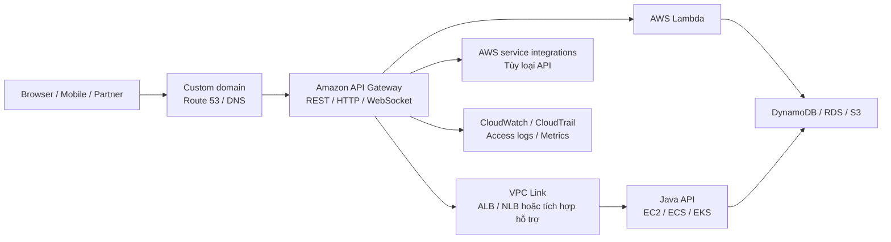
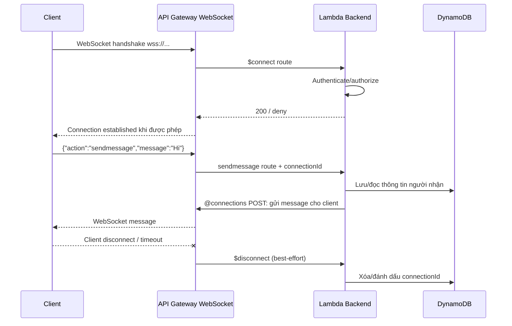
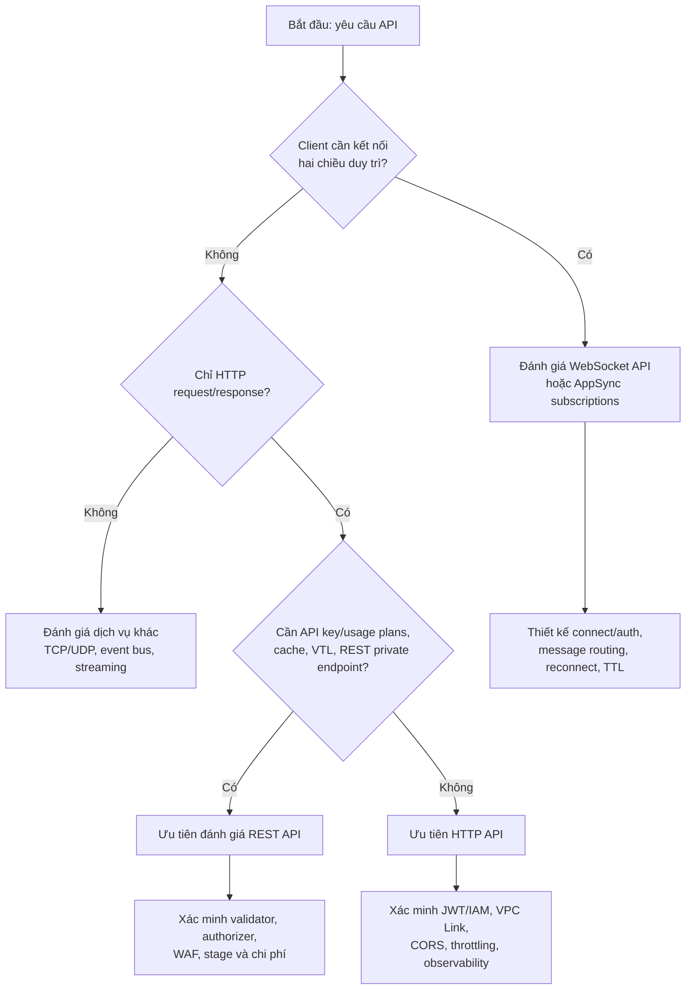
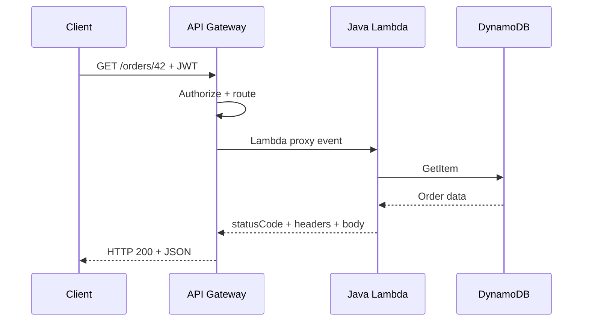
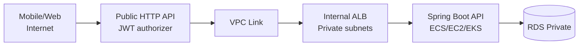
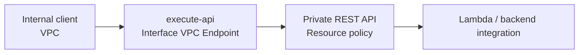
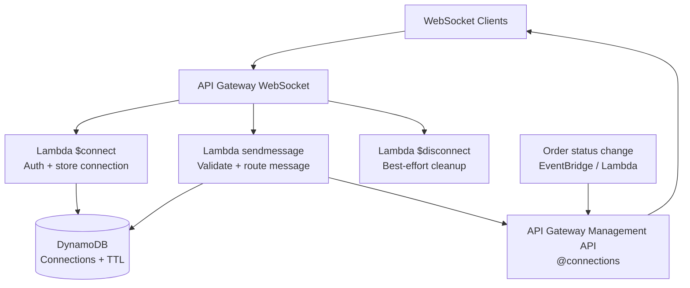

# Chọn REST API, HTTP API và WebSocket API

Khi xây dựng một hệ thống trên AWS, ứng dụng **Java Spring Boot**, AWS Lambda hoặc dịch vụ bên trong VPC thường cần một điểm vào ổn định cho browser, mobile app và hệ thống đối tác. **Amazon API Gateway** cung cấp dịch vụ quản lý API gồm ba loại chính: **REST API**, **HTTP API** và **WebSocket API**. Tên khá giống nhau nhưng khác biệt về giao thức, tích hợp backend, kiểm soát truy cập, cách triển khai, vận hành và chi phí.

Chọn sai loại API có thể khiến nhóm phải viết thêm nhiều thành phần để bù tính năng thiếu, hoặc trả thêm tiền/vận hành phức tạp cho tính năng không dùng đến. Bài này tập trung vào việc **ra quyết định có căn cứ**, rồi kiểm chứng bằng một số ví dụ cấu hình.

Bài thuộc chương **API Gateway và AppSync** của mô-đun **CLOUD_PROVIDERS_AWS**. Kiến thức liên kết Region/Availability Zone, IAM, VPC, EC2/ECS/EKS/Lambda, cơ sở dữ liệu, tích hợp AWS, giám sát, phục hồi và kiểm soát chi phí. **AWS AppSync** cũng xuất hiện trong phần lựa chọn kiến trúc để phân biệt GraphQL subscriptions với WebSocket API, nhưng trọng tâm vẫn là **ba loại API của API Gateway**.

## 1. Mục tiêu học tập

Sau bài học, bạn có thể:

1. Phân biệt **REST API**, **HTTP API** và **WebSocket API** theo loại kết nối, API route, backend, authorization và mô hình tính phí.
2. Chọn **REST API** khi cần các tính năng quản lý API nâng cao như usage plans, API keys, request validation, mapping templates, caching hoặc private REST endpoint.
3. Chọn **HTTP API** khi chủ yếu phục vụ các request HTTP(S), cần JWT/OIDC authorization hoặc proxy tới Lambda, ALB/NLB và muốn cấu hình đơn giản hơn.
4. Chọn **WebSocket API** cho kết nối hai chiều dài hạn, mô tả vòng đời `$connect`, route tùy chỉnh, `$disconnect` và API `@connections`.
5. Giải thích vì sao **API key không phải authentication**, và chọn IAM, JWT, Cognito hoặc Lambda authorizer thích hợp.
6. Phân biệt **private integration qua VPC Link** với **private REST API endpoint**.
7. Nhận diện khác biệt giữa **Lambda proxy payload format 1.0 và 2.0**, CORS, cache và CloudWatch logs.
8. Thiết kế cấu trúc API cho ứng dụng Java, kiểm tra bằng Console/CLI và xử lý lỗi 4XX/5XX, WebSocket connection, deployment.
9. Đặt giới hạn throttling, quan sát latency/usage và tính chi phí request/message/connection.
10. Giải thích khi nào nên dùng **AWS AppSync** hoặc một dịch vụ khác thay vì ép mọi tác vụ vào API Gateway.

## 2. Bức tranh tổng quan: API Gateway đứng ở đâu?

API Gateway thường là **entry point** phía trước nhiều loại backend:



**API Gateway không thay thế backend**: HTTP API/REST API nhận request, thực hiện chính sách ở gateway rồi chuyển tiếp đến integration được cấu hình. WebSocket API giữ trạng thái kết nối ở lớp gateway nhưng logic xử lý message và dữ liệu kết nối thường nằm tại Lambda/ứng dụng.

Các thành phần cơ bản:

| Khái niệm | Ý nghĩa | Ví dụ |
| --- | --- | --- |
| **API** | Tập hợp route/resource được triển khai | `orders-api` |
| **Route / Method** | Cách xác định xử lý request | `GET /orders` hoặc `$connect` |
| **Integration** | Backend nhận request | Lambda, HTTP endpoint, VPC Link |
| **Authorizer** | Xác minh danh tính/quyền truy cập ở gateway | JWT, Lambda, IAM |
| **Stage** | Tên/môi trường triển khai | `dev`, `prod`, hoặc `$default` |
| **Deployment** | Bản cấu hình API được công bố tại stage | Version cấu hình triển khai |
| **Custom domain** | Tên truy cập của khách hàng | `api.example.com` |
| **Throttling** | Giới hạn tốc độ request/kết nối | Rate và burst |
| **Access logs** | Ghi metadata request để vận hành | Status, latency, requestId |

**Ba loại API là ba loại tài nguyên API Gateway khác nhau**, không phải ba chế độ có thể chuyển đổi trực tiếp bằng một checkbox. Nếu thay REST API bằng HTTP API hoặc WebSocket API, phải xem xét route, payload, authentication, domain, logging và client tương thích rồi di chuyển có kiểm soát.

## 3. Chọn nhanh: ma trận REST API, HTTP API và WebSocket API

| Câu hỏi | **REST API** | **HTTP API** | **WebSocket API** |
| --- | --- | --- | --- |
| Giao thức client chính | HTTP/HTTPS | HTTP/HTTPS | WebSocket qua `wss://` hoặc `ws://` |
| Kiểu giao tiếp | Request → response | Request → response | Kết nối hai chiều, client/server gửi message |
| API Gateway tài nguyên | Resources + Methods | Routes theo method/path | Routes theo message và sự kiện kết nối |
| Lambda integration | Có | Có | Có |
| Backend HTTP | Có | Có | Có theo kiểu integration hỗ trợ |
| Built-in JWT/OIDC authorizer | Không theo kiểu JWT authorizer HTTP API; có Cognito user pool/Lambda | **Có** | Không có JWT authorizer tích hợp tương tự HTTP API |
| IAM authorization | Có | Có | Có trên `$connect` |
| Lambda authorizer | Có | Có | Có trên `$connect` |
| API keys + usage plans | **Có** | **Không** | Không theo mô hình REST usage plan |
| Stage caching do API Gateway quản lý | **Có** | **Không** | Không phù hợp mô hình cache response HTTP |
| Request validation/models nâng cao | **Có** | Không tương đương REST API | Không theo REST request validation |
| Mapping templates VTL đầy đủ | **Có** | Hỗ trợ parameter mapping đơn giản, không tương đương VTL REST | Có cơ chế mapping/integration riêng |
| Private API endpoint trong VPC | **Có**, REST Private endpoint | **Không** theo kiểu REST Private API | Không theo kiểu REST Private API |
| VPC Link tới backend riêng | Có | Có | Phụ thuộc kiểu integration, cần kiểm tra hỗ trợ |
| AWS WAF gắn trực tiếp API stage | REST API hỗ trợ | Không hỗ trợ trực tiếp theo mô hình REST stage | Không hỗ trợ trực tiếp theo mô hình REST stage |
| Kiểu phí chính | Requests + tính năng/tài nguyên bổ sung | Requests + data transfer/tính năng bổ sung | **Messages + connection minutes** |
| Tình huống điển hình | API đối tác, quản trị quota, transformation | Web/mobile HTTP API và Lambda proxy | Chat, bảng điều khiển live, collaboration |

**Quy tắc thực dụng:** Nếu chỉ cần HTTP request/response, **hãy đánh giá HTTP API trước**. Chỉ chọn REST API nếu có **yêu cầu cụ thể mà HTTP API chưa đáp ứng**. Nếu yêu cầu là **server chủ động gửi thông tin tới client trên một kết nối liên tục**, hãy đánh giá WebSocket API; cũng so sánh với **Server-Sent Events, polling hoặc AppSync subscriptions** tùy ứng dụng.

> **Phân biệt thuật ngữ:** “Thiết kế RESTful API” có thể triển khai trên **cả REST API lẫn HTTP API** của API Gateway. Tên sản phẩm **REST API** không có nghĩa HTTP API không được dùng cho HTTP REST endpoints.

## 4. REST API: khi cần kiểm soát API nâng cao

**API Gateway REST API** là sản phẩm lâu đời hơn với nhiều công cụ quản trị request, integration và traffic. Nó phù hợp khi cần một hoặc nhiều tính năng đặc thù.

### 4.1. Điểm mạnh nổi bật

- **API keys** kết hợp **usage plans** để nhận diện client ứng dụng và áp hạn mức/rate/quota theo mô hình hỗ trợ.
- **Request validation** dựa trên parameters hoặc models cho API.
- **Mapping templates** sử dụng **Velocity Template Language (VTL)** để chuyển đổi request/response phức tạp.
- **Stage caching** để giảm số lần gọi backend cho những response cache được.
- **Resource policies** giới hạn nguồn, principal, VPC/VPC endpoint tùy kiểu endpoint.
- **Private REST API** truy cập từ VPC qua interface endpoint khi cấu hình.
- Tích hợp **AWS WAF** trực tiếp ở REST API stage; các khả năng quan sát/xử lý traffic nâng cao theo dịch vụ.
- Endpoint types **Regional**, **Edge-optimized** và **Private** phù hợp những kịch bản riêng.

Dùng REST API không có nghĩa bạn buộc phải bật hết các tính năng này. Chọn REST API cần có **lý do chi phí/kinh doanh rõ** vì một số việc có thể thực hiện giản lược bằng HTTP API.

### 4.2. Ví dụ API đối tác B2B

Một ngân hàng cung cấp API `/v1/reports` cho nhiều đối tác:

- Mỗi đối tác có hạn mức request/ngày và rate/burst được quản lý.
- Cần xem usage theo API key.
- Cần chặn một số nguồn truy cập và áp WAF.
- Cần validate một số request trước khi gọi Lambda/backend.
- Có nhiều client legacy yêu cầu transformation body/header.

**REST API** là lựa chọn đáng xem xét vì usage plan, API key, request validation và mapping templates.

**Quan trọng:** API key chỉ dùng để **định danh/đo usage/throttling theo client**, **không phải cơ chế xác thực/ủy quyền an toàn**. Đối tác vẫn cần IAM, OAuth2/OIDC thông qua authorizer hoặc một cơ chế authentication đủ mạnh. Đừng cho phép truy cập dữ liệu nhạy cảm chỉ vì client gửi `x-api-key`.

### 4.3. Cấu hình theo resource + method

REST API định nghĩa resource tree:

```text
/
└── orders
    ├── GET     /orders
    ├── POST    /orders
    └── {orderId}
        ├── GET    /orders/{orderId}
        └── DELETE /orders/{orderId}
```

Mỗi method có thể được gán:

- Method request: tham số, authorization và request validator.
- Integration request: Lambda/HTTP/AWS service, mapping template nếu cần.
- Integration response/method response trong loại integration thích hợp.
- Deployment tới stage, stage variables/cache/logging/usage plan.

Sau khi thay đổi cấu hình REST API, **thường cần tạo deployment mới tới stage** để thay đổi được client thấy. Một sửa đổi trong giao diện chưa được deploy có thể chưa ảnh hưởng endpoint `prod`.

### 4.4. Regional, edge-optimized và Private

| Endpoint type REST API | Điểm chính | Khi nào dùng |
| --- | --- | --- |
| **Regional** | API ở một Region, client truy cập endpoint Regional | Ứng dụng cùng Region hoặc khi đặt CloudFront do bạn quản lý phía trước |
| **Edge-optimized** | Tối ưu truy cập toàn cầu với CloudFront distribution do API Gateway quản lý | Client phân tán toàn cầu, cần tính năng endpoint type này |
| **Private** | API chỉ truy cập qua **VPC interface endpoint** cho execute-api, kèm policy | API nội bộ theo phạm vi truy cập đã thiết kế |

**Regional không tự là private**. Một REST API Regional có default execute-api endpoint công khai trừ khi thiết lập giới hạn được hỗ trợ. **Private REST API** là một kiểu endpoint riêng, không phải chỉ đơn giản dùng VPC Link cho integration.

## 5. HTTP API: đơn giản, nhanh để xây dựng API HTTP

**API Gateway HTTP API** tập trung vào triển khai HTTP APIs với ít bước hơn và chi phí trên request thường thấp hơn REST API ở những mức giá/tình huống điển hình. Nó phù hợp với web/mobile APIs, Lambda proxy, backend HTTP private qua VPC Link và xác thực JWT từ OIDC/Cognito.

### 5.1. Những tính năng thường là đủ

- Route dạng `GET /orders`, `POST /orders`, `ANY /{proxy+}` hoặc `$default`.
- **Lambda proxy integration** và HTTP proxy integration.
- **Private integrations** tới dịch vụ trong VPC qua **VPC Link**, chẳng hạn ALB/NLB hoặc AWS Cloud Map theo tính năng hỗ trợ.
- **JWT authorizers** cho OAuth2/OIDC tokens, gồm issuer, audience và authorization scopes.
- **Lambda authorizers** nếu cần kiểm tra danh tính/phân quyền tùy biến.
- **AWS IAM authorization** cho một số clients dùng SigV4.
- **CORS** được quản lý trong HTTP API.
- Stage `$default` và tùy chọn **auto-deploy** thuận tiện cho vòng lặp phát triển.
- Custom domains, TLS và logging/CloudWatch metrics theo các khả năng hỗ trợ.

### 5.2. Những giới hạn cần nhớ

HTTP API **không có** một số tính năng REST API, ví dụ:

| Tính năng | HTTP API |
| --- | --- |
| **API keys + usage plans + quota theo API key** | Không hỗ trợ như REST API |
| **API Gateway stage cache** | Không hỗ trợ |
| **Mapping templates VTL đầy đủ và request validation models** | Không tương đương REST API |
| **REST Private API endpoint type** | Không hỗ trợ |
| **Tích hợp WAF trực tiếp vào API Gateway REST stage** | Không theo mô hình REST API |
| **REST API Edge-optimized endpoint type** | Không hỗ trợ |

HTTP API có **parameter mapping** cho header, query string và path theo các giới hạn dịch vụ; không nên kết luận HTTP API hoàn toàn không sửa request/response được.

Nếu phải caching nội dung HTTP, có thể cân nhắc **CloudFront** trước HTTP API, nhưng phải thiết kế cache key, TTL và quyền truy cập thật kỹ. Nếu phải dùng API keys/usage plans hoặc VTL request mapping phức tạp, xem lại REST API thay vì xây một hệ thống thay thế riêng.

### 5.3. Ví dụ phù hợp

Nhóm đang có Lambda Java 21 xử lý `GET /catalog` và `POST /catalog`, clients sử dụng JWT do Amazon Cognito hoặc IdP OIDC cấp.

Lựa chọn có thể là:

- API Gateway **HTTP API** với JWT authorizer.
- Lambda proxy integration **payload format version 2.0**.
- CORS giới hạn origin cho frontend (nếu browser truy cập từ miền khác).
- Access logs, CloudWatch metrics và limits.
- DynamoDB hoặc RDS làm data layer, IAM role tách khỏi authorizer.

Đừng dùng JWT authorizer **chỉ để kiểm tra có token**, mà cần xác định **issuer, audience, chữ ký, expiry và scopes** phù hợp route. Authorization của tài nguyên vẫn phải kiểm tra trong backend khi có phân quyền theo object/tenant.

## 6. WebSocket API: giao tiếp hai chiều thời gian thực

**WebSocket API** cung cấp điểm vào WebSocket được API Gateway quản lý. Client mở một kết nối `wss://` và giữ kết nối để **gửi/nhận messages** mà không tạo một HTTP request độc lập cho mỗi message.

Ứng dụng phù hợp:

- Chat hoặc collaborative editing.
- Dashboard đẩy trạng thái đơn hàng/tiến trình công việc.
- Thông báo real-time từ backend tới client.
- Thiết bị/client cần kênh nhận message hai chiều liên tục, với giới hạn dịch vụ phù hợp.

**Không cần WebSocket** chỉ vì frontend cập nhật mỗi 30 giây. HTTP API + polling hoặc **Server-Sent Events (SSE)** qua backend hỗ trợ đôi khi đơn giản hơn. Với GraphQL clients cần subscription, cân nhắc **AWS AppSync**.

### 6.1. Vòng đời kết nối



Sơ đồ minh họa một cách sử dụng backend Lambda. `$disconnect` không bảo đảm luôn được gọi; nếu xử lý hiện diện (*presence*), backend phải có **TTL, heartbeat hoặc dọn kết nối lỗi**.

### 6.2. Ba route đặc biệt

| Route key | Khi nào chạy? | Tác vụ |
| --- | --- | --- |
| **`$connect`** | Client mở kết nối WebSocket | Kiểm tra quyền, lưu session ban đầu |
| **`$disconnect`** | Khi đóng kết nối theo cơ chế thông báo | Dọn session, giải phóng mapping |
| **`$default`** | Không có route khớp hoặc thông điệp không chứa action theo cấu hình | Xử lý fallback/error |

Bạn có thể tạo **custom route** như `sendmessage` hoặc `subscribe`. API Gateway chọn route từ **route selection expression**, phổ biến là:

```text
$request.body.action
```

Khi client gửi:

```json
{
  "action": "sendmessage",
  "roomId": "support-42",
  "message": "Xin chào"
}
```

API Gateway chọn route `sendmessage` nếu đã được cấu hình; nếu không khớp, có thể đưa tới `$default`.

### 6.3. Authorization của WebSocket

WebSocket API Gateway hỗ trợ IAM hoặc Lambda authorizer trên **`$connect` route**. **Không có JWT authorizer dựng sẵn giống HTTP API** cho mọi WebSocket message.

Hệ quả:

1. Xác thực/ủy quyền trong handshake `$connect`.
2. Gắn user/tenant với **connectionId** ở backend (ví dụ DynamoDB).
3. **Kiểm tra quyền cho từng message/action nhạy cảm** ở backend; không tin dữ liệu `userId` do client gửi mà không đối chiếu.
4. Hạn chế quyền `execute-api:ManageConnections` cho thành phần gửi message.
5. Với browser, xem **Origin header** ở handshake và chính sách nguồn được phép. WebSocket không tuân cơ chế CORS preflight theo cách HTTP fetch thông thường.

Không đặt access token vào URL/query string nếu có phương án an toàn hơn; URL có thể xuất hiện trong logs. Browser WebSocket API có hạn chế tùy chỉnh HTTP headers trong handshake; thiết kế authentication phù hợp với đối tượng client và không log secrets.

### 6.4. Connection ID và server push

API Gateway quản lý connection, nhưng backend cần lưu **connectionId** nếu muốn gửi cho client về sau. Một thiết kế đơn giản:

```text
DynamoDB table: SocketConnections
  PK: connectionId
  userId
  roomId
  connectedAt
  expiresAt (TTL)
```

Khi Lambda xử lý một sự kiện (ví dụ đơn hàng chuyển trạng thái), backend tra kết nối của người nhận rồi gọi **API Gateway Management API**:

```text
POST https://{api-id}.execute-api.{region}.amazonaws.com/{stage}/@connections/{connectionId}
```

Trong AWS SDK for Java v2, dùng **`ApiGatewayManagementApiClient`** để gọi `PostToConnection`, với **endpointOverride** trỏ tới management API endpoint đúng API/stage hoặc custom domain được cấu hình. Quyền IAM có liên quan là `execute-api:ManageConnections` trên ARN phù hợp.

Nếu connection đã đóng, callback thường trả lỗi **`410 GoneException`**; ứng dụng nên dọn record cũ. Nếu backend gửi message **trước khi connection thiết lập hoàn tất**, cũng có thể gặp Gone; chờ lifecycle đúng thay vì push ngay trong `$connect` trước khi client đã kết nối.

### 6.5. Giới hạn và chiến lược bù

Các hạn mức phổ biến của API Gateway WebSocket API gồm:

- **Message payload tối đa 128 KiB**, và frame tối đa **32 KiB**; message lớn có thể phải chia frame hoặc dùng cơ chế khác.
- **Idle timeout khoảng 10 phút**, và **thời gian tối đa mỗi kết nối khoảng 2 giờ** theo hạn mức dịch vụ công bố.
- **Binary payload không được API Gateway WebSocket APIs xử lý trực tiếp** theo kiểu binary WebSocket; nếu cần gửi dữ liệu nhị phân, cân nhắc base64 hoặc lưu object ở S3 và gửi URL/quyền truy cập phù hợp.
- Giới hạn tốc độ kết nối mới, concurrent connections, integration timeout và quota khác theo account/Region.

Vì có timeout, client cần **reconnect với exponential backoff + jitter**, thiết kế **message IDs** để tránh xử lý trùng, và có cơ chế tải lại trạng thái bị lỡ qua HTTP API/database.

**WebSocket không tự bảo đảm giao hàng đúng-một-lần hay lưu lịch sử tin nhắn.** Đó là trách nhiệm của backend và dữ liệu bền vững.

## 7. Sơ đồ lựa chọn theo nhu cầu



Sơ đồ chỉ là **hướng đi ban đầu**. Cần xác minh thêm quotas, giới hạn integration, tính năng mới của AWS, compliance, giá Region và kiến trúc backend.

### 7.1. Tình huống thực tế

| Bài toán | Lựa chọn khởi đầu | Lý do |
| --- | --- | --- |
| Mobile API gọi Lambda bằng JWT | **HTTP API** | JWT authorizer, ít cấu hình |
| Đối tác B2B cần quota theo API key | **REST API** | Usage plan, API keys |
| REST backend Java Spring Boot sau internal ALB | **HTTP API** với VPC Link | HTTP routing tới backend private |
| API chỉ truy cập từ VPC qua interface endpoint | **Private REST API** | Private endpoint type, resource policy |
| Dịch vụ cần validation/mapping VTL cũ | **REST API** | Request validation/models và VTL |
| Chat app cần server đẩy tin bất kỳ lúc nào | **WebSocket API** | Connection dài hạn và callback `@connections` |
| GraphQL nhiều data sources và subscription | **AppSync** | Schema/GraphQL resolvers/subscriptions |
| Chỉ upload file lớn lên S3 | **Presigned S3 URL** + API xác thực | Tránh chuyển toàn bộ file qua API Gateway |
| Worker xử lý tác vụ dài theo event | **SQS/EventBridge/Step Functions + Lambda/ECS** | Tách request latency khỏi công việc dài |

## 8. Integration: API Gateway gọi backend bằng cách nào?

### 8.1. Lambda proxy

Với Lambda proxy integration, API Gateway chuyển request thành một **event payload**, Lambda xử lý và trả về một response theo hợp đồng integration.



**API Gateway authorization** quyết định yêu cầu có được vào backend hay không; **IAM execution role của Lambda** quyết định Lambda có được đọc DynamoDB/S3/RDS hay không. Đây là hai biên phân quyền khác nhau.

### 8.2. HTTP proxy integration tới Java backend

Nếu Java API chạy ở ALB/NLB:

- Với **HTTP API**, có thể dùng HTTP proxy integration hoặc **VPC Link private integration** tới ALB/NLB/Cloud Map theo kiểu tích hợp hỗ trợ.
- Với **REST API**, VPC Link/private integration cũng được hỗ trợ nhưng **kiểu VPC Link, phiên bản và loại backend tương thích** khác HTTP API; xác minh theo tài liệu đúng REST endpoint type.
- Với backend public HTTP(S), cần kiểm tra TLS, DNS, IP allowlisting, WAF và nguy cơ client đi vòng API Gateway.

**VPC Link cho API Gateway kết nối *tới backend* không làm API endpoint public trở thành private.** Nếu client không được phép vào API từ Internet, cần thiết kế endpoint private/resource policy hoặc lớp kiểm soát ingress tương đương.

### 8.3. AWS service integrations

Cả REST/HTTP API có các kiểu tích hợp tới dịch vụ AWS theo **khả năng của từng API**. REST API có integration kiểu AWS/AWS_PROXY với mapping templates; HTTP API hỗ trợ những **first-class AWS integrations** như SQS, EventBridge hoặc Step Functions trong cấu hình được hỗ trợ.

Nếu mục tiêu chỉ là nhận webhook rồi đưa message vào SQS, cân nhắc direct service integration thay vì luôn tạo Lambda trung gian. Nhưng phải kiểm tra:

- Service integration đó có hỗ trợ **loại API** đang dùng không?
- Có cần IAM role cho API Gateway gọi dịch vụ đích không?
- Cách biến đổi payload và trả response cho client là gì?
- Có cơ chế retry/idempotency, DLQ và monitoring không?

Không gắn một tên AWS service bất kỳ vào “HTTP API integration” rồi giả định nó hoạt động như Lambda proxy.

## 9. Lambda payload format 1.0 và 2.0

Một khác biệt quan trọng khi đổi REST API sang HTTP API là **hình dạng event**.

### 9.1. REST API Lambda proxy — payload 1.0

Đối với REST API Lambda proxy, event có các trường như:

```json
{
  "resource": "/orders/{id}",
  "path": "/orders/42",
  "httpMethod": "GET",
  "headers": {
    "accept": "application/json"
  },
  "pathParameters": {
    "id": "42"
  },
  "queryStringParameters": {
    "verbose": "true"
  },
  "requestContext": {
    "requestId": "example-request-id"
  },
  "body": null,
  "isBase64Encoded": false
}
```

Đây là **mẫu giản lược**; event thật có nhiều metadata, headers, identity/authorizer context và fields tùy cấu hình.

### 9.2. HTTP API Lambda proxy — payload 2.0

HTTP API khi dùng payload format **2.0** có hình dạng khác:

```json
{
  "version": "2.0",
  "routeKey": "GET /orders/{id}",
  "rawPath": "/orders/42",
  "rawQueryString": "verbose=true",
  "headers": {
    "accept": "application/json"
  },
  "pathParameters": {
    "id": "42"
  },
  "queryStringParameters": {
    "verbose": "true"
  },
  "requestContext": {
    "http": {
      "method": "GET",
      "path": "/orders/42"
    },
    "requestId": "example-request-id"
  },
  "isBase64Encoded": false
}
```

**Điểm dễ lỗi khi migrate:** `event.httpMethod` (REST proxy 1.0) không phải `event.requestContext.http.method` (HTTP API 2.0). Các điểm khác gồm cookies, multi-value headers/query parameters, path/base path mapping và cách cấu trúc authorizer context.

HTTP API có thể cấu hình **payload format 1.0 hoặc 2.0** với Lambda proxy integration theo yêu cầu compatibility. Vì vậy, đừng viết code suy diễn API type chỉ từ tên service; hãy kiểm tra cấu hình integration thật.

### 9.3. Java Lambda handler đơn giản

Ví dụ Java xử lý event theo **HTTP API 2.0**, dùng AWS Lambda Java Core `RequestHandler`. Code chỉ minh họa cấu trúc; trong dự án thực tế nên dùng model type, validation và JSON library phù hợp:

```java
package example;

import com.amazonaws.services.lambda.runtime.Context;
import com.amazonaws.services.lambda.runtime.RequestHandler;

import java.util.Map;

public final class OrdersHandler
        implements RequestHandler<Map<String, Object>, Map<String, Object>> {

    @Override
    public Map<String, Object> handleRequest(
            Map<String, Object> event, Context context) {

        Object requestContext = event.get("requestContext");
        String method = "";

        if (requestContext instanceof Map<?, ?> ctx) {
            Object http = ctx.get("http");
            if (http instanceof Map<?, ?> httpInfo) {
                method = String.valueOf(httpInfo.get("method"));
            }
        }

        if (!"GET".equals(method)) {
            return response(405, "{\"error\":\"method_not_allowed\"}");
        }

        return response(200, "{\"orders\":[{\"id\":\"42\"}]}");
    }

    private static Map<String, Object> response(int status, String body) {
        return Map.of(
            "statusCode", status,
            "headers", Map.of("content-type", "application/json"),
            "body", body,
            "isBase64Encoded", false
        );
    }
}
```

Dependency Maven theo phiên bản được hỗ trợ của `aws-lambda-java-core`; ví dụ không có file pom.xml vì đây là tài liệu, không phải repository mẫu đầy đủ.

**Không nên chỉ kiểm tra HTTP method để thực hiện các nghiệp vụ thực.** Backend còn phải kiểm tra route/path, input, danh tính, tenant ownership và xử lý lỗi. Khi dùng IAM/JWT ở gateway, backend có thể nhận claims/authorizer context nhưng vẫn phải kiểm tra quyền đối với resource cụ thể.

## 10. Authorization: khác biệt quan trọng giữa ba loại API

### 10.1. Các cơ chế phổ biến

| Phương án | REST API | HTTP API | WebSocket API |
| --- | --- | --- | --- |
| **AWS IAM / Signature Version 4** | Hỗ trợ method auth | Hỗ trợ route auth | Hỗ trợ trên `$connect` |
| **Lambda authorizer** | TOKEN/REQUEST phù hợp cấu hình | Request authorizer, payload format hỗ trợ | Chỉ ở `$connect` |
| **Cognito user pool authorizer** | Hỗ trợ tích hợp riêng | Dùng JWT authorizer với Cognito issuer | Không có tích hợp authorizer tương đương |
| **JWT/OIDC authorizer native** | Không cùng cơ chế built-in HTTP API JWT | **Có** | Không |
| **API key + usage plan** | **Có** | Không | Không như REST |
| **Application authorization** | Backend vẫn cần | Backend vẫn cần | Backend cần cho từng action/message |

### 10.2. HTTP API JWT authorizer

Với một Cognito User Pool/OIDC issuer, HTTP API JWT authorizer có:

- **Issuer URL** để xác minh token từ bên phát hành tin cậy.
- **Audience** mong đợi của ứng dụng/client.
- Có thể gắn **authorization scopes** cho routes.
- API Gateway kiểm tra chữ ký, algorithm, issuer, audience/client_id, thời hạn và các claims theo quy tắc.

Ví dụ:

```text
Route: GET /orders
Authorization: JWT
Issuer: https://cognito-idp.ap-southeast-1.amazonaws.com/ap-southeast-1_EXAMPLE
Audience: [my-api-client-id]
Scopes: [orders.read]
```

Đây là **cấu hình logic**, không phải token thật. Cần xác định **access token** và scopes theo IdP, không chấp nhận token không dành cho API. Với phân quyền theo `orderId`, backend vẫn phải kiểm tra user được phép đọc đơn hàng đó hay không — JWT hợp lệ **không đồng nghĩa** user được đọc mọi đơn hàng.

### 10.3. Lambda authorizer khi chính sách đặc thù

Lambda authorizer có thể cần khi:

- Client gửi token tự định nghĩa, mTLS identity hoặc scheme legacy.
- Cần kiểm tra kết hợp identity với cấu hình chính sách.
- Không thể dùng claims/scopes của JWT authorizer built-in.

Lưu ý:

- Lambda authorizer tăng thêm thời gian xử lý và có thể phát sinh chi phí Lambda.
- Authorization caching tùy API type/payload format và identity sources; kiểm tra **cache key** để không dùng nhầm quyết định của user/tenant khác.
- Tránh truy vấn DB đồng bộ nặng trên mọi request nếu có thể thiết kế token claims/policy đủ.
- Không nhầm một Lambda **authorizer** với Lambda **backend integration**; hai function có vai trò và quyền khác nhau.

### 10.4. IAM authorization

Với server-to-server nội bộ AWS, IAM authorization dùng **SigV4 signed requests**, phù hợp với IAM roles trên Lambda/EC2/ECS khi cần chính sách AWS cụ thể.

Cần kiểm tra:

- Quyền `execute-api:Invoke` trên API ARN/method/route.
- Bucket/DB downstream vẫn có chính sách riêng nếu backend gọi.
- Client thực sự ký request, không gửi “IAM role name” như một HTTP header tự định nghĩa.

## 11. Throttling, quota và API keys

### 11.1. Khác biệt giữa throttling và quota

- **Throttling**: giới hạn rate/burst request, thường trả `429 Too Many Requests` khi vượt ngưỡng.
- **Quota**: giới hạn tổng lượng sử dụng trên chu kỳ, thường theo client/usage plan khi dùng REST API.
- **Concurrency của Lambda**: số invocation backend chạy đồng thời, là một giới hạn khác.
- **Rate limiting nghiệp vụ**: có thể cần chặn ở user/tenant/IP hoặc action, không tự được API Gateway thay mặt đầy đủ.

REST API hỗ trợ **usage plans** kết hợp API keys; HTTP API vẫn có route/stage-level throttling theo hỗ trợ, nhưng không có usage plan cho API key.

### 11.2. Ví dụ giới hạn API đối tác

```text
Partner A:
  API key: nhận diện usage plan, không phải xác thực
  Throttling: 100 requests/second
  Burst: 200
  Quota: 100,000 requests/day
  Authorization: IAM hoặc authorizer phù hợp

Partner B:
  API key: key khác
  Quota: 20,000 requests/day
```

Tất cả giá trị là **ví dụ**, cần đối chiếu giới hạn account-level, stage/method and client-level của AWS. Throttling/quota tại API Gateway được mô tả là mục tiêu kiểm soát lưu lượng **best effort**, không phải hard limit có độ chính xác tuyệt đối cho hóa đơn hoặc nghiệp vụ giao dịch.

**Không dùng API key như mật khẩu.** API key có thể lộ khi đặt trong frontend/browser; một ứng dụng cần xác thực user vẫn phải có cơ chế auth thực sự.

### 11.3. Thực thi yêu cầu độ tin cậy

Client cần:

1. Xử lý `429` với **exponential backoff + jitter**.
2. Thiết kế retry có idempotency key cho thao tác ghi.
3. Không retry hàng loạt làm API Gateway/DB thêm quá tải.
4. Có phân biệt lỗi client `4XX` với lỗi backend `5XX` và timeout.
5. Theo dõi quota và cảnh báo trước khi làm hỏng trải nghiệm người dùng.

## 12. CORS cho browser HTTP và Origin của WebSocket

### 12.1. HTTP API CORS

Khi frontend `https://app.example.com` gọi `https://api.example.com` từ browser, cơ chế **CORS** liên quan origin của browser.

HTTP API có tính năng **CORS configuration** giúp quản lý:

- `Access-Control-Allow-Origin`.
- Allowed methods, headers và exposed headers.
- `Access-Control-Allow-Credentials` khi dùng cookies/credential mode phù hợp.
- Preflight `OPTIONS`.

Ví dụ cấu hình định hướng:

```text
Allowed origin: https://app.example.com
Allowed methods: GET, POST, OPTIONS
Allowed headers: content-type, authorization
Allow credentials: false (trừ khi thật sự cần)
```

**CORS không phải authentication/authorization.** Curl, mobile app hoặc server-to-server client không bị CORS của browser ngăn như frontend JavaScript. API vẫn phải xác thực user/tài nguyên.

### 12.2. REST API CORS

REST API cần cấu hình `OPTIONS`/preflight và CORS headers cho cả success/error responses theo kiểu integration/gateway responses phù hợp.

Nếu proxy Lambda trả 500 không có `Access-Control-Allow-Origin`, browser có thể báo lỗi CORS thay vì hiển thị lỗi HTTP gốc; cần kiểm tra cả API response và CORS.

### 12.3. WebSocket Origin

WebSocket handshake HTTP mang `Origin` ở nhiều browser clients, nhưng **không sử dụng CORS preflight bình thường của `fetch`**. Đừng nghĩ bật CORS trong HTTP API là tự bảo vệ WebSocket API.

Trong `$connect` Lambda authorizer/backend, kiểm tra Origin theo allowlist thích hợp và xác thực phiên/token. Origin header có thể bị giả khi client không phải browser; vì vậy **Origin không thay authorization**.

## 13. Networking: public endpoint, private REST API và VPC Link

Ba kịch bản cần phân biệt:

### 13.1. Public API → Public Lambda/HTTP integration

API có endpoint public, client truy cập Internet; Lambda backend có thể nằm ngoài VPC hoặc trong VPC tùy yêu cầu. Việc Lambda chạy trong VPC **không làm API Gateway endpoint tự private**.

### 13.2. Public API → Private backend qua VPC Link

Một HTTP API có thể public và tích hợp riêng tới backend Java chạy sau internal ALB trong VPC:



Đây là **private backend integration**, **không phải private client endpoint**. Lớp gateway vẫn có thể nhận request Internet nếu không có kiểm soát khác.

Yêu cầu:

- VPC Link được cấu hình đúng Region/account/subnets/security groups.
- ALB/NLB/Cloud Map integration đúng resource listener và kiểu API hỗ trợ.
- SG của ALB cho lưu lượng từ VPC Link ENIs/SG phù hợp.
- Route/VPC DNS, TLS tới backend và target group health chính xác.
- JWT/IAM authorizer, application authorization và logging.

### 13.3. Private REST API endpoint → VPC clients

Với REST API endpoint type **Private**, client trong VPC được phép truy cập qua **interface VPC endpoint (PrivateLink) cho execute-api**, với VPC endpoint policy/API resource policy và các điều kiện bảo mật liên quan.



**HTTP API không hỗ trợ Private REST API endpoint type này.** Nếu cần private client entrypoint thực sự, cân nhắc REST API Private hoặc phương án mạng khác đáp ứng yêu cầu. Không tạo HTTP API + VPC Link rồi gọi đó là “private HTTP API”.

### 13.4. Chọn đúng hướng bảo mật

| Yêu cầu | Cách xem xét |
| --- | --- |
| Backend là internal ALB | HTTP API + VPC Link |
| Client chỉ trong VPC, API không public | Private REST API + interface endpoint/resource policy |
| Client từ Internet nhưng backend private | Public API + VPC Link + auth |
| Client gọi từ EC2 có IAM role | IAM/SigV4 ở Gateway nếu phù hợp |
| Browser dùng JWT | HTTP API JWT authorizer hoặc giải pháp REST tương ứng |
| Giao thức TCP/UDP tùy chỉnh | Không đặt API Gateway HTTP/REST làm TCP proxy; xem NLB/Global Accelerator |

## 14. Stage, deployment và custom domain

### 14.1. REST API deployment

REST API thường có:

```text
API resource/method changes
       ↓
Create deployment
       ↓
Deploy to stage prod
       ↓
https://{api-id}.execute-api.{region}.amazonaws.com/prod/orders
```

Nếu quên deploy sau khi sửa route/integration, client vẫn có thể nhận phản hồi theo deployment trước.

### 14.2. HTTP API stages

HTTP API thường hỗ trợ **`$default` stage** và **auto-deploy**, giúp URL ngắn hơn:

```text
https://{api-id}.execute-api.{region}.amazonaws.com/orders
```

Nếu dùng stage `prod`, path có thể bao gồm `/prod/orders`. Cách xử lý base path mappings và HTTP API payload `rawPath` cần kiểm tra khi dùng custom domain/stage mapping.

### 14.3. WebSocket API stages

WebSocket client kết nối:

```text
wss://{api-id}.execute-api.{region}.amazonaws.com/prod
```

Thay đổi route/integration cần được **deploy đến stage** nếu auto deployment không bật. Kết nối đang mở cũng có vòng đời riêng; đổi deployment không có nghĩa mọi client đang kết nối sẽ tự tạo lại phiên.

### 14.4. Custom domain + TLS

Cả ba loại API có cơ chế custom domain theo hỗ trợ. Với Regional API, dùng certificate ACM trong Region phù hợp; với REST Edge-optimized endpoint, yêu cầu certificate theo Region tương ứng của CloudFront (**`us-east-1`**).

Với nhiều REST/HTTP APIs dưới cùng domain, có thể dùng base path/API mappings theo giới hạn và kiểu API hỗ trợ. Khi chuyển domain giữa hai loại API, cần kiểm tra routing mappings, DNS TTL, certificates, authorization, CORS và client caching.

## 15. Thực hành HTTP API: Java Lambda + JWT

Ví dụ thiết kế ứng dụng Java 21:

- Frontend SPA ở `https://app.example.com`.
- User đăng nhập qua Amazon Cognito/OIDC IdP.
- `GET /orders/{id}` đến Lambda Java.
- Lambda kiểm tra user có quyền trên `orderId`, đọc DynamoDB.

### 15.1. Console workflow

1. Vào [API Gateway Console](https://console.aws.amazon.com/apigateway/), chọn Region.
2. Chọn **Create API → HTTP API**.
3. Chọn Lambda integration với Java Lambda function đã tồn tại.
4. Tạo route `GET /orders/{id}`.
5. Cấu hình **JWT authorizer** với issuer, audience và scopes thích hợp; associate route.
6. Cấu hình CORS giới hạn frontend origin.
7. Dùng stage `$default` với auto-deploy cho sandbox hoặc stage `prod` với quy trình release production.
8. Bật access logging theo định dạng JSON, loại bỏ thông tin nhạy cảm.
9. Kiểm thử với token hợp lệ, token hết hạn và user không có quyền đọc order.
10. Kiểm tra CloudWatch metrics/logs, xử lý 401/403/429/500 trước khi đưa vào sử dụng thật.

**Nếu không có JWT token/IdP hợp lệ, đừng tạm bỏ authorizer trong production chỉ để test.** Dùng sandbox và mock/temporary authorized test user.

### 15.2. Ví dụ quy tắc route/auth

| Method/path | Authorization | Backend | Ghi chú |
| --- | --- | --- | --- |
| `GET /health` | Có thể public trong phạm vi cho phép | Lambda health | Không tiết lộ thông tin nội bộ |
| `GET /orders/{id}` | JWT + scope `orders.read` | Java Lambda | Check resource ownership |
| `POST /orders` | JWT + scope `orders.write` | Java Lambda | Idempotency key |
| `GET /admin/metrics` | IAM hoặc auth nghiêm ngặt hơn | Internal backend | Không mở public tùy tiện |

API Gateway authorizer không tự làm bài toán ownership. Với `GET /orders/42`, backend phải kiểm tra đơn hàng 42 thuộc tenant/user đang gọi.

## 16. AWS CLI: đọc cấu hình của ba loại API

Dùng AWS CLI v2, profile được cấp qua IAM Identity Center hoặc IAM role. Các lệnh **read-only**:

```bash
# Xác nhận account/role.
aws sts get-caller-identity --profile training

# Liệt kê REST APIs (control plane riêng).
aws apigateway get-rest-apis \
  --region ap-southeast-1 --profile training

# Liệt kê HTTP và WebSocket APIs (API Gateway v2 control plane).
aws apigatewayv2 get-apis \
  --region ap-southeast-1 --profile training

# Chỉ xem HTTP APIs từ kết quả v2.
aws apigatewayv2 get-apis \
  --query "Items[?ProtocolType=='HTTP'].{Name:Name,Id:ApiId,Endpoint:ApiEndpoint}" \
  --region ap-southeast-1 --profile training

# Chỉ xem WebSocket APIs từ kết quả v2.
aws apigatewayv2 get-apis \
  --query "Items[?ProtocolType=='WEBSOCKET'].{Name:Name,Id:ApiId,Endpoint:ApiEndpoint}" \
  --region ap-southeast-1 --profile training

# Xem routes của một HTTP/WebSocket API ID.
aws apigatewayv2 get-routes \
  --api-id a1b2c3d4 \
  --region ap-southeast-1 --profile training

# Xem integrations và stages của API v2.
aws apigatewayv2 get-integrations \
  --api-id a1b2c3d4 \
  --region ap-southeast-1 --profile training

aws apigatewayv2 get-stages \
  --api-id a1b2c3d4 \
  --region ap-southeast-1 --profile training
```

`ApiId` là placeholder. **API Gateway REST** dùng CLI namespace `apigateway`; **HTTP API và WebSocket API** dùng `apigatewayv2`. Sự phân biệt này phản ánh control plane API, không phải phiên bản HTTP protocol trên đường truyền.

### 16.1. Lệnh tạo HTTP API tối thiểu (sandbox được cấp quyền)

API Gateway v2 có cơ chế **quick create** với Lambda target:

```bash
# CÓ THAY ĐỔI AWS VÀ CÓ THỂ PHÁT SINH PHÍ.
# Thay Lambda ARN bằng function được phép và đã tồn tại.
aws apigatewayv2 create-api \
  --name demo-orders-http \
  --protocol-type HTTP \
  --target arn:aws:lambda:ap-southeast-1:123456789012:function:demo-orders-java \
  --region ap-southeast-1 \
  --profile training
```

Quick create giúp tạo các thành phần cơ bản như default route/integration/stage theo tính năng hỗ trợ, nhưng không tự bổ sung JWT authorizer, CORS và **quyền cho API Gateway invoke Lambda** trong mọi ngữ cảnh. Cần kiểm tra `aws lambda get-policy` và cấu hình resource-based permission `lambda:InvokeFunction` với source ARN **đủ hẹp**.

**Cảnh báo:** Lệnh trên chỉ để minh họa; tạo API public mặc định có thể mở bề mặt truy cập mới. Không chạy trong production nếu chưa cấu hình auth/throttling/logging.

### 16.2. Ghi nhận cấu hình REST API

```bash
# Thay REST_API_ID bằng ID được phép.
aws apigateway get-resources \
  --rest-api-id REST_API_ID \
  --region ap-southeast-1 --profile training

aws apigateway get-stages \
  --rest-api-id REST_API_ID \
  --region ap-southeast-1 --profile training
```

Nếu danh sách routes đúng trong Console nhưng client không gọi được route ở `prod`, soát deployment/stage trước khi thay backend.

## 17. Thực hành WebSocket: thiết kế chat thông báo đơn giản

### 17.1. Kiến trúc



Để triển khai:

1. Tạo WebSocket API với **route selection expression `$request.body.action`**.
2. Tạo `$connect`, `$disconnect`, `$default` và `sendmessage`.
3. Gắn Lambda integrations và cấp resource-based invocation permission phù hợp.
4. Bảo vệ `$connect` bằng IAM hoặc Lambda authorizer theo yêu cầu client.
5. Lưu **connectionId → userId/tenantId** sau khi xác thực, cùng timestamp/TTL.
6. Khi nhận `sendmessage`, xác định quyền gửi/room và người nhận trước khi gọi Management API.
7. Ghi nhận `410 Gone` và xóa các mapping không còn kết nối.
8. Deploy tới stage, cho client thử connect/send/reconnect và kiểm tra logs.

### 17.2. Kiểm thử từ client

Với công cụ client hỗ trợ WebSocket, dùng URL dạng:

```text
wss://a1b2c3d4.execute-api.ap-southeast-1.amazonaws.com/dev
```

Sau khi connect thành công, gửi payload:

```json
{
  "action": "sendmessage",
  "roomId": "demo-room",
  "message": "Chào bạn"
}
```

**Không kỳ vọng backend Lambda tự động gửi body trả về WebSocket client** theo mọi loại integration. Với các bài toán server push, gọi **`@connections` Management API** hoặc thiết kế route response/integration response theo cơ chế API Gateway hỗ trợ.

### 17.3. Mẫu handler Java cho các route

Với AWS Lambda Java Core, có thể xử lý WebSocket route dựa trên `requestContext.routeKey`:

```java
package example;

import com.amazonaws.services.lambda.runtime.Context;
import com.amazonaws.services.lambda.runtime.RequestHandler;
import java.util.Map;

public final class SocketRouteHandler
        implements RequestHandler<Map<String, Object>, Map<String, Object>> {

    @Override
    public Map<String, Object> handleRequest(
            Map<String, Object> event, Context context) {

        Object rawContext = event.get("requestContext");
        String routeKey = "$default";
        String connectionId = null;

        if (rawContext instanceof Map<?, ?> metadata) {
            Object route = metadata.get("routeKey");
            if (route != null) {
                routeKey = String.valueOf(route);
            }
            Object conn = metadata.get("connectionId");
            if (conn != null) {
                connectionId = String.valueOf(conn);
            }
        }

        switch (routeKey) {
            case "$connect":
                // Validate identity from a trusted authorizer/context.
                // Persist userId -> connectionId if allowed.
                return Map.of("statusCode", 200);
            case "$disconnect":
                // Best effort cleanup; TTL handles missed disconnects.
                return Map.of("statusCode", 200);
            case "sendmessage":
                // Validate body, authorization, and recipient.
                // Use ApiGatewayManagementApiClient postToConnection.
                return Map.of("statusCode", 200);
            default:
                context.getLogger().log(
                    "Unsupported route; conn=" + (connectionId != null)
                );
                return Map.of("statusCode", 400);
        }
    }
}
```

Đây là **skeleton minh họa**, không phải production chat server. Ví dụ trả 200 cho `$connect` **mà chưa xác thực**, nên chỉ sử dụng trong mô phỏng; khi đưa vào hệ thống thật, **bắt buộc cấu hình authorizer và kiểm tra quyền**. Triển khai gửi message cần AWS SDK v2 module `apigatewaymanagementapi`, cấu hình endpoint đúng và xử lý lỗi/retry.

### 17.4. Khi kết nối bị gián đoạn

Client nên:

- Nhận biết socket close/errors, reconnect có backoff.
- Xin/cập nhật token hợp lệ trước mỗi handshake.
- Gửi lại subscription state sau khi reconnect.
- Tải các sự kiện bị lỡ từ HTTP API hoặc kho dữ liệu.
- Dùng sequence number/message ID tránh double-apply.
- Không coi connectionId cũ còn hợp lệ mãi; backend cập nhật và dọn record.

## 18. Giám sát và logs theo từng API type

### 18.1. Các loại log

| Nguồn | Hữu ích để xem | Lưu ý |
| --- | --- | --- |
| **Access logs** | Request ID, status, route, latency, client metadata không nhạy cảm | Cấu hình stage/format theo API type |
| **Execution logs** | Chi tiết execution/integration của REST API khi hỗ trợ | REST API, khác HTTP API access logging |
| **CloudWatch Metrics** | Request count, latency, integration latency, 4XX/5XX, WebSocket connection/message metrics | Kiểm tra tên/dimensions và stage |
| **Lambda logs** | Exceptions, invocation timeout, downstream errors | App log có thể chứa PII nếu không kiểm soát |
| **CloudTrail** | Ai tạo/sửa API, stage, authorizer, resource policy | Quản trị, không thay access logs |
| **AWS WAF logs** | Block/allow/challenge trên nguồn được liên kết | Chỉ khi có WAF trong kiến trúc |
| **X-Ray/Tracing** | Thời gian backend và dependencies theo tích hợp được hỗ trợ | Hỗ trợ chi tiết khác nhau theo API type |

**HTTP API** không có cùng hệ thống execution logging/REST API stage cache như REST API; để debug HTTP API, ưu tiên **access logs + Lambda/backend logs + CloudWatch metrics**.

### 18.2. Gợi ý access log JSON

Một stage có thể xuất log JSON với các biến ngữ cảnh hỗ trợ:

```json
{
  "requestId": "$context.requestId",
  "ip": "$context.identity.sourceIp",
  "routeKey": "$context.routeKey",
  "status": "$context.status",
  "responseLatency": "$context.responseLatency",
  "integrationError": "$context.integrationErrorMessage"
}
```

Đây là **mẫu format tham khảo**. Các `$context` variables hợp lệ tùy **REST/HTTP/WebSocket API** và loại stage; cần kiểm tra biến cụ thể trước khi triển khai. Không log access token, Authorization, cookies, password, request body có dữ liệu cá nhân hoặc secrets.

### 18.3. Đọc nguyên nhân 4XX/5XX

| Lỗi | Nguyên nhân thường gặp | Cách kiểm tra |
| --- | --- | --- |
| **401** | Thiếu token/chưa xác thực | Authorization header/authorizer config |
| **403** | IAM/resource policy/authorizer deny | IAM SigV4, resource policy, identity/claims |
| **404** | Route sai, stage sai, backend trả Not Found | URL, route mapping, stage, integration status |
| **429** | Vượt throttling/quota hoặc quá tải theo chính sách | API Gateway limits, usage plan, client retry |
| **500/502** | Backend exception, Lambda proxy response sai schema, integration/config | Lambda logs, response format, integration |
| **504** | Integration timeout hoặc backend chậm | Latency, VPC networking, DB, backend logs |
| **WebSocket 410 Gone** | connectionId không còn khả dụng hoặc chưa thiết lập hoàn tất | Connection lifecycle, callback timing |
| **WebSocket disconnect thường xuyên** | Idle/lifetime timeout, client network, auth/reconnect | Thời gian kết nối, ping/pong/retry |

Một response 4XX/5XX không chỉ xuất phát từ API Gateway. Cần phân biệt **gateway response** và **integration/backend response** bằng logs, metrics và tracing.

## 19. Chi phí và kiểm soát tài nguyên

### 19.1. Mô hình tính phí

| API type | Thành phần chính của hóa đơn | Chi phí gián tiếp |
| --- | --- | --- |
| **REST API** | API calls (và dữ liệu), cache capacity nếu bật | Lambda, VPC Link, CloudWatch Logs, transfer |
| **HTTP API** | API calls (và dữ liệu) | Lambda, VPC Link, logs/metrics, transfer |
| **WebSocket API** | **Messages** và **connection minutes** | Lambda/backend, DynamoDB connection state, logs/transfer |
| **Cả ba** | Giá thay đổi theo Region/usage/quota | KMS, RDS/S3/SQS, WAF/CloudFront nếu dùng |

**Không áp một mức giá cố định cho tất cả Region.** Tham khảo [Amazon API Gateway pricing](https://aws.amazon.com/api-gateway/pricing/) và [AWS Pricing Calculator](https://calculator.aws/).

### 19.2. Bài toán ước lượng trên giấy

Giả sử hai lựa chọn cho ứng dụng:

**Ứng dụng A:** 10 triệu HTTP requests/tháng, backend Lambda trả JSON ngắn. Không cần API key, stage cache hay REST private endpoint.

- Tính request cost của **HTTP API** và **REST API** theo Region, bậc giá/tier hiện hành.
- Cộng chi phí Lambda invocations/duration, logs và data transfer.
- Nếu đưa CloudFront phía trước, chỉ tính mức cache hợp lệ theo security/data type; không giả định mọi request cache được.

**Ứng dụng B:** 20.000 WebSocket clients; mỗi client kết nối trung bình 30 phút/ngày, trao đổi 20 messages/ngày.

Số **connection minutes/tháng** sơ bộ (30 ngày):

\[
20{,}000 \times 30 \times 30 = 18{,}000{,}000\ \text{connection minutes}
\]

Số **messages/tháng** sơ bộ:

\[
20{,}000 \times 20 \times 30 = 12{,}000{,}000\ \text{messages}
\]

Đây chỉ là ví dụ khối lượng **logic**; cách AWS đếm/bill messages còn có giới hạn kích thước, làm tròn/đơn vị thông điệp và mức giá riêng. Nếu có fan-out tới nhiều clients, cần tính **messages gửi ra** và backend processing, không chỉ messages client gửi lên.

### 19.3. Khi HTTP API rẻ hơn chưa chắc toàn hệ thống rẻ hơn

Nếu HTTP API thiếu tính năng REST API mà bạn bắt buộc phải xây lại bằng:

- Lambda authorizer/request transformation ở mọi request.
- Cache ngoài (CloudFront/ElastiCache) phức tạp.
- Hệ thống quota/usage tracking riêng.

thì tổng chi phí xây dựng/vận hành có thể lớn hơn chênh lệch giá API calls. Chọn dịch vụ theo **TCO và yêu cầu bảo mật/tính năng**, không chỉ theo một con số trong bảng giá.

## 20. Bảo mật, phục hồi và vận hành production

### 20.1. Checklist bảo mật

- **AuthN/AuthZ**: IAM, JWT/Cognito hoặc Lambda authorizer; backend kiểm tra quyền sở hữu tài nguyên.
- **Least privilege**: chỉ cấp `execute-api:Invoke`/`ManageConnections` cho role thực sự cần, giới hạn theo API/stage/route.
- **HTTPS/WSS**: dùng TLS, kiểm tra custom domain/certificates, không mở `ws://` nếu policy đòi mã hóa.
- **API key**: không xem như mật khẩu, không hard-code vào frontend.
- **Resource policy/WAF**: dùng REST API features hoặc lớp tương đương khi kiến trúc yêu cầu; không giả định mọi API type hỗ trợ trực tiếp.
- **Data validation**: validate body/path/query, kích thước, định dạng và identity; với HTTP API cần validation ở backend/schema layer.
- **CORS/Origin**: browser CORS không thay auth; WebSocket Origin phải xác minh trong handshake theo nhu cầu.
- **Secrets**: lưu ở Secrets Manager/Parameter Store, không log raw credentials.
- **Observability**: CloudWatch access/app logs, alert 4XX/5XX, latency, client connection failures.
- **DDoS/Abuse**: throttling, WAF nếu hỗ trợ, API boundary và AWS Shield theo yêu cầu.

### 20.2. Checklist khả năng phục hồi

- API Gateway là dịch vụ Regional theo endpoint architecture; ứng dụng vẫn phụ thuộc **Lambda concurrency, EC2/ECS/EKS/ALB, DynamoDB/RDS** và các service đích.
- Với nhiều AZ, cần backend multi-AZ/ALB target health, RDS Multi-AZ hoặc replication được thiết kế.
- Retry với jitter và idempotency để tránh trùng đơn hàng/thanh toán.
- Với WebSocket, client reconnect, restore subscription, tải dữ liệu bị lỡ.
- Không xem WebSocket connectionId hay cache tại gateway là dữ liệu bền vững; lưu state ở DynamoDB/S3/RDS theo nhu cầu.
- Nếu yêu cầu phục hồi toàn Region, thiết kế API/domain failover multi-Region và bảo đảm data replication/RPO/RTO. API Gateway tự thân không đồng bộ database.

### 20.3. Thay đổi API có kiểm soát

- Quản lý OpenAPI/IaC và versions.
- Test compatibility trước khi thay auth mode, stage, payload format hoặc custom domain.
- Không xóa REST stage đang dùng chỉ vì đã tạo HTTP API mới.
- Giữ migration path cho client versions cũ.
- Dùng canary/staging/deployment chiến lược được hỗ trợ, cùng theo dõi lỗi.
- Khi chuyển WebSocket, chấp nhận client phải reconnect và điều chỉnh connection state.

## 21. Bài thực hành: chọn API type cho hệ thống bán hàng

### 21.1. Bối cảnh

Một hệ thống có bốn nhóm chức năng:

1. **Mobile Orders API**: `GET /orders/{id}`, `POST /orders` dùng JWT Cognito; backend Lambda Java, 5 triệu requests/tháng.
2. **Partner Reporting API**: đối tác cần quota theo key, kiểm soát request schemas và WAF; backend Java trên EC2/ALB.
3. **Live Order Dashboard**: nhân viên xem trạng thái đơn hàng theo thời gian thực, backend muốn chủ động gửi update.
4. **Internal Admin API**: chỉ workload trong một số VPC được phép gọi, không public endpoint.

### 21.2. Nhiệm vụ A — Chọn loại API

Điền:

| Chức năng | API type gợi ý | Lý do |
| --- | --- | --- |
| Mobile Orders API | **HTTP API** | JWT authorizer, Lambda proxy, request-response |
| Partner Reporting API | **REST API** | Usage plans, request validation, WAF |
| Live Order Dashboard | **WebSocket API** hoặc AppSync subscriptions nếu GraphQL | Server push, bidirectional |
| Internal Admin API | **Private REST API** | VPC interface endpoint, resource policy |

**Câu hỏi:** Nếu Partner Reporting bỏ yêu cầu quota/API key và body transformation, HTTP API có thể phù hợp hơn không? Trình bày tiêu chí chi phí và bảo mật quyết định.

### 21.3. Nhiệm vụ B — Phân biệt event payload

Cho backend Java đọc method từ:

```java
String method = (String) event.get("httpMethod");
```

Đổi tích hợp từ REST API Lambda proxy sang HTTP API payload 2.0. Hãy giải thích:

1. Vì sao `method` có thể trở thành `null`?
2. Trường nào chứa method trong HTTP API 2.0?
3. Những thay đổi nào khác về headers, cookies, path và authorizer context cần kiểm tra?
4. Có thể chọn payload format 1.0 cho HTTP API để giảm công chuyển đổi không? Có đánh đổi gì?

### 21.4. Nhiệm vụ C — Chọn kiến trúc VPC

Backend Spring Boot nằm sau internal ALB và chỉ cho traffic từ gateway:

1. Nếu client từ Internet, vì sao **HTTP API + VPC Link** phù hợp?
2. Nếu client chỉ được ở VPC và không chấp nhận một public API endpoint, vì sao VPC Link **chưa đủ**?
3. Security Group nào cần cho phép traffic giữa VPC Link và ALB?
4. Nếu REST API dùng Private endpoint, client gọi qua loại VPC endpoint nào?
5. Test nào cần có để phát hiện bypass backend nếu ALB vô tình public?

### 21.5. Nhiệm vụ D — WebSocket chat và bảo mật

Một dashboard có 2000 clients đồng thời kết nối, có `$connect`, `sendmessage`, `$disconnect`:

1. Gắn authorizer ở đâu để chặn kết nối không hợp lệ?
2. Sau khi `$connect` thành công, vì sao route `sendmessage` vẫn phải kiểm tra user/room permissions?
3. Lưu connectionId ở đâu và khi nào dọn?
4. Khi gọi `@connections` trả 410, nên xử lý thế nào?
5. Vì sao hệ thống cần retry/reconnect và tải dữ liệu bị lỡ?
6. Vì sao một WebSocket client không đủ thay thế database/chat history?
7. Với yêu cầu chỉ đọc trạng thái mỗi phút, HTTP polling/SSE có thể đơn giản hơn không?

### 21.6. Nhiệm vụ E — Chỉ đọc tài nguyên AWS đã có

Nếu được cấp quyền sandbox, chạy các lệnh đọc ở mục 16, ghi nhận:

```text
AWS Account / Region: ...
API type: REST / HTTP / WEBSOCKET
API name / ID (redacted): ...
Endpoint type / invoke URL: ...
Stages / auto-deploy: ...
Routes / resources / methods: ...
Integrations: Lambda / HTTP / VPC Link / AWS service
Payload format 1.0 or 2.0: ...
Authorizer type: JWT / Lambda / IAM / Cognito / None
CORS or WebSocket Origin controls: ...
Throttling / quota / usage plans: ...
Resource policy / WAF status: ...
Access logs / CloudWatch metrics: ...
Backend health / deployment state: ...
Estimated request/message/connection cost: ...
Owner / Reviewer / Date: ...
```

**Tiêu chí hoàn thành:** giải thích được vì sao mỗi API type phù hợp một nhóm nhu cầu; nhận diện đúng payload/auth/network boundaries; xây bảng vận hành chi phí; không thực hiện thao tác tạo API, thay authorizer, xóa stage hoặc phát sinh tài nguyên ngoài sandbox.

## 22. Câu hỏi tự kiểm tra

1. “RESTful API” và sản phẩm **API Gateway REST API** có cùng nghĩa không?
2. Tại sao một Java HTTP API đơn giản dùng Lambda + JWT thường nên đánh giá HTTP API trước?
3. Những tính năng nào khiến REST API phù hợp hơn HTTP API với đối tác B2B?
4. API key có phải là cơ chế authentication đủ bảo vệ dữ liệu tài khoản không?
5. HTTP API hỗ trợ built-in JWT authorizer; REST API hỗ trợ những loại authorizer tương ứng nào?
6. Tại sao Lambda proxy event 1.0 và 2.0 có thể khiến code backend đọc nhầm method?
7. Thay đổi REST API resource/method có luôn có hiệu lực ngay ở `prod` mà không deploy không?
8. HTTP API `$default` stage và auto-deploy có lợi ích gì?
9. VPC Link khác Private REST API endpoint thế nào?
10. HTTP API có dùng được với internal ALB để chạy Java API trong private subnets không?
11. CORS bảo vệ API khỏi curl hoặc server-to-server clients không?
12. WebSocket `$connect`, `$disconnect` và `$default` diễn ra trong trường hợp nào?
13. WebSocket route `sendmessage` được chọn từ phần nào của message JSON?
14. Vì sao WebSocket API không có JWT authorizer built-in tương đương HTTP API cho mọi message?
15. Khi nào backend dùng `@connections` và cần quyền IAM nào?
16. `410 GoneException` có thể xảy ra vì lý do gì?
17. WebSocket API có tự lưu lịch sử chat hoặc đảm bảo exactly-once delivery không?
18. Khi hệ thống cần GraphQL subscriptions, AppSync có lợi thế gì so với tự dựng WebSocket routes?
19. Cần những metric/log nào để phân biệt 401 do authorizer với 502 do Lambda proxy response?
20. Tại sao dùng một API Gateway endpoint không tự bảo đảm database có Multi-AZ/backup?
21. Throttling ở API Gateway và reserved concurrency của Lambda có cùng ý nghĩa không?
22. Chi phí WebSocket khác cách tính request của REST/HTTP API ra sao?

## 23. AppSync nằm ở đâu trong quyết định?

**AWS AppSync** là dịch vụ API cho **GraphQL** (và khả năng real-time theo mô hình dịch vụ) với schema, resolvers, data sources và subscriptions. Nó đặc biệt hữu ích khi nhiều client cần chọn fields khác nhau, hợp nhất nhiều nguồn dữ liệu hoặc subscription theo schema.

| Yêu cầu | Lựa chọn nên cân nhắc |
| --- | --- |
| REST endpoint đơn giản, ít quản trị | HTTP API |
| API đối tác cần quota/API key/validators | REST API |
| WebSocket protocol tùy biến cho chat/games | WebSocket API |
| GraphQL queries/mutations/subscriptions | AppSync |
| Truyền event nghiệp vụ giữa AWS services | EventBridge/SNS/SQS |
| Truyền object lớn | S3 presigned URLs |

Không ép một nhu cầu **GraphQL subscriptions** vào WebSocket route thủ công nếu AppSync đã cung cấp mô hình schema/resolver phù hợp. Ngược lại, nếu client có protocol WebSocket tự định nghĩa chứ không dùng GraphQL, API Gateway WebSocket API linh hoạt hơn về message routing.

## 24. Tài liệu AWS chính thức

- [Choose between REST APIs and HTTP APIs in API Gateway](https://docs.aws.amazon.com/apigateway/latest/developerguide/http-api-vs-rest.html).
- [REST APIs in Amazon API Gateway](https://docs.aws.amazon.com/apigateway/latest/developerguide/apigateway-rest-api.html).
- [Create an HTTP API](https://docs.aws.amazon.com/apigateway/latest/developerguide/http-api-develop.html).
- [Develop a WebSocket API in API Gateway](https://docs.aws.amazon.com/apigateway/latest/developerguide/apigateway-websocket-api-overview.html).
- [WebSocket routes and route selection](https://docs.aws.amazon.com/apigateway/latest/developerguide/apigateway-websocket-api-route-keys-connect-disconnect.html).
- [Use `@connections` to send WebSocket messages](https://docs.aws.amazon.com/apigateway/latest/developerguide/apigateway-how-to-call-websocket-api-connections.html).
- [WebSocket API quotas](https://docs.aws.amazon.com/apigateway/latest/developerguide/apigateway-execution-service-websocket-limits-table.html).
- [HTTP API Lambda payload format](https://docs.aws.amazon.com/apigateway/latest/developerguide/http-api-develop-integrations-lambda.html).
- [Control access to HTTP APIs with JWT authorizers](https://docs.aws.amazon.com/apigateway/latest/developerguide/http-api-jwt-authorizer.html).
- [Control access to HTTP APIs with Lambda authorizers](https://docs.aws.amazon.com/apigateway/latest/developerguide/http-api-lambda-authorizer.html).
- [Configure CORS for HTTP APIs](https://docs.aws.amazon.com/apigateway/latest/developerguide/http-api-cors.html).
- [Private integrations for HTTP APIs](https://docs.aws.amazon.com/apigateway/latest/developerguide/http-api-private-integration.html).
- [Private REST APIs in API Gateway](https://docs.aws.amazon.com/apigateway/latest/developerguide/apigateway-private-apis.html).
- [REST API usage plans and API keys](https://docs.aws.amazon.com/apigateway/latest/developerguide/api-gateway-api-usage-plans.html).
- [REST API caching](https://docs.aws.amazon.com/apigateway/latest/developerguide/api-gateway-caching.html).
- [Set up WebSocket integrations](https://docs.aws.amazon.com/apigateway/latest/developerguide/apigateway-websocket-api-integrations.html).
- [Access logging for HTTP APIs](https://docs.aws.amazon.com/apigateway/latest/developerguide/http-api-logging.html).
- [Amazon API Gateway pricing](https://aws.amazon.com/api-gateway/pricing/).
- [AWS AppSync overview](https://docs.aws.amazon.com/appsync/latest/devguide/what-is-appsync.html).

> **Ghi nhớ:** **HTTP API** là lựa chọn khởi đầu hợp lý cho đa số HTTP Lambda/Java proxy APIs đơn giản; **REST API** cần thiết khi có yêu cầu quản trị, transformation, quota, caching hoặc **Private REST API**; **WebSocket API** dành cho giao tiếp hai chiều dài hạn và server push. Cả ba cần thiết kế đúng **authentication, authorization, VPC/network boundaries, observability, phục hồi và chi phí**.
