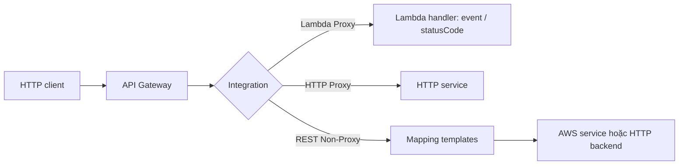
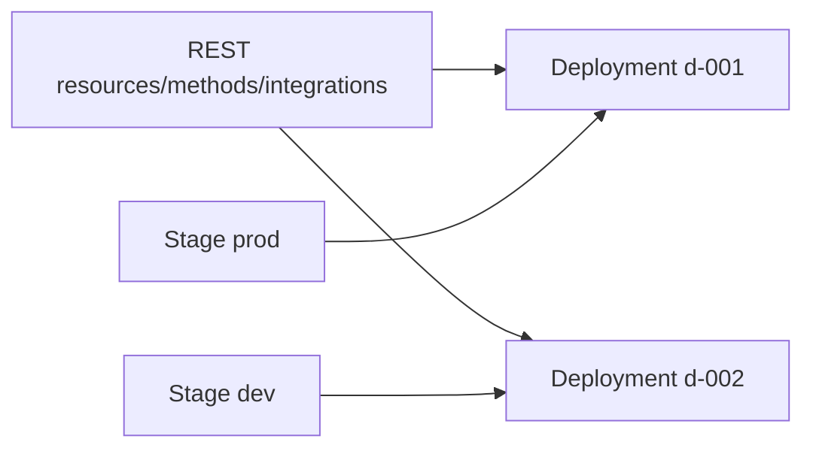
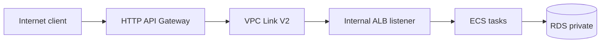
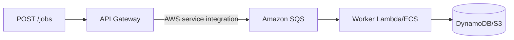
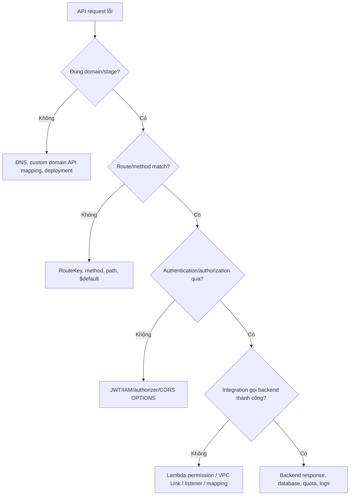

# Route, method, stage và tích hợp backend

## 1. Bối cảnh: API cho hệ thống bán hàng trên AWS

Một công ty cần công bố API đặt hàng cho web/mobile: `GET /orders/123` để đọc đơn, `POST /orders` để tạo đơn, `DELETE /orders/123` để hủy khi được phép. Backend gồm **AWS Lambda**, ứng dụng container trong **Amazon ECS** sau một **Application Load Balancer** nội bộ, cùng dữ liệu trên DynamoDB/RDS. Doanh nghiệp muốn có môi trường `dev` và `prod`, JWT authorization, HTTPS, log, giám sát độ trễ và kiểm soát lưu lượng. Nếu client gọi thẳng nhiều backend, mỗi backend phải tự giải quyết rất nhiều vấn đề ở ranh giới mạng và API.

**Amazon API Gateway** cung cấp một điểm vào được quản lý cho HTTP requests. Nó dùng **route/resource/method** để chọn request, **integration** để gọi backend, **deployment/stage** để phát hành cấu hình, và các tính năng xác thực, observability, throttling, domain mapping theo khả năng của từng API type.

Bài thuộc chương **API Gateway và AppSync** trong lộ trình **CLOUD_PROVIDERS_AWS**. Lộ trình khám phá Region/AZ, IAM, VPC, compute, storage, database, tích hợp và serverless, nhằm biết chọn dịch vụ, triển khai an toàn, giám sát, phục hồi và tối ưu chi phí. Trọng tâm trực tiếp là **Route, method, stage và tích hợp backend** trong API Gateway; cuối bài đối chiếu với schema/resolver của AppSync GraphQL.

Sau bài, bạn sẽ có thể phân biệt REST API và HTTP API, tạo method/route/stage, cấu hình Lambda proxy/HTTP proxy/VPC Link, đọc cấu hình qua CLI, hiểu IAM/Lambda invoke permission, xử lý CORS và 401/403/404/429/5xx, giám sát CloudWatch và đánh giá lựa chọn tích hợp thực tế.

## 2. API Gateway xử lý một request như thế nào?

```mermaid
flowchart LR
    C[Web / Mobile Client] -->|HTTPS| G[Amazon API Gateway]
    G --> R{Stage + Route/Method + Authorization}
    R -->|GET /orders/{id}| L[AWS Lambda]
    R -->|POST /orders| Q[SQS / Backend API]
    R -->|ANY /catalog/{proxy+}| V[VPC Link V2]
    V --> ALB[Internal ALB]
    ALB --> E[ECS tasks]
    L --> DB[(DynamoDB / RDS)]
    E --> DB
    G -. API metrics / access logs .-> CW[Amazon CloudWatch]
```

Luồng thông thường: client gửi request → API Gateway xác định stage → chọn route/method → kiểm tra authorizer/chính sách → gọi integration → backend xử lý → trả status, headers, body → API Gateway phản hồi client và ghi telemetry. Một thành phần khác có thể sinh lỗi tại từng bước.

| Thành phần | Trả lời câu hỏi | Ví dụ |
| --- | --- | --- |
| **API** | Tập hợp các HTTP endpoints thuộc sản phẩm nào? | REST API hoặc HTTP API `shop-orders` |
| **Resource/path** | Đường dẫn nào được phục vụ? | `/orders/{orderId}` |
| **Method** | HTTP method nào được nhận? | `GET`, `POST`, `DELETE` |
| **Route** (HTTP API) | Method và path nào chọn backend nào? | `GET /orders/{orderId}` |
| **Integration** | API Gateway chuyển request tới đâu? | Lambda ARN, public HTTP URL, VPC Link |
| **Deployment** | Bản chụp cấu hình nào đã phát hành? | Deployment revision cho stage |
| **Stage** | Môi trường/cấu hình API nào được gọi? | `dev`, `prod`, `$default` |
| **Custom domain/API mapping** | Hostname/path ánh xạ tới API/stage nào? | `api.example.com/orders` |

**Tạo route không đồng nghĩa tạo được API có thể gọi.** Cần có integration, stage/deployment phù hợp và đủ quyền gọi backend. Ngược lại, tạo Lambda function thành công cũng chưa tự công bố HTTP route.

## 3. REST API và HTTP API là hai sản phẩm khác nhau

| Tiêu chí | API Gateway REST API | API Gateway HTTP API |
| --- | --- | --- |
| Cách mô tả đường đi | Cây **Resources** và **Methods** | **Routes** gồm method + path |
| AWS CLI | `aws apigateway ...` | `aws apigatewayv2 ...` |
| Phát hành | Deployment snapshot, Stage trỏ deployment; thường cần **redeploy** | Stage/deployment, hỗ trợ **AutoDeploy** |
| `$default` stage/route | Không dùng đúng mô hình HTTP API | Có `$default` stage và `$default` route |
| Lambda proxy / HTTP proxy | Có | Có |
| Private backend integration | VPC Link, hiện có V2 hỗ trợ ALB/NLB | VPC Link V2 tới ALB/NLB/AWS Cloud Map |
| API key / usage plans | Có | Không theo cơ chế REST |
| Request validation/VTL body mapping | Có theo kiểu integration | Không có cùng bộ tính năng REST |
| Built-in JWT authorizer | Cơ chế IAM/Cognito/JWT tùy feature | Có JWT authorizer cho OAuth 2.0/OIDC |
| REST private API endpoint | Có | Không có private API endpoint theo mô hình REST; vẫn có private **integration** |
| WAF integration và cache stage | Có với REST API theo tính năng hỗ trợ | Không có cùng bộ WAF/stage cache như REST API |
| Execution logs, API Gateway X-Ray | Có | Không có cùng execution logs/X-Ray ở gateway; có access logs/metrics |
| Mức giá | Bộ tính năng rộng, cân nhắc giá request | Thường rẻ hơn cho HTTP use cases đơn giản |

**Khi chọn HTTP API:** client chỉ cần HTTP routes tới Lambda hoặc HTTP backends, JWT, CORS và chi phí đơn giản. **Khi chọn REST API:** cần API keys/usage plans, API request validation/transformations, WAF trực tiếp, REST private API, response caching hoặc quản trị triển khai chuyên biệt.

**Phân biệt:** **private API endpoint** là cách client tiếp cận API Gateway từ VPC theo khả năng REST API; **private integration** là cách API Gateway gọi backend private trong VPC. Một HTTP API có thể công khai cho client nhưng gọi **internal ALB** qua VPC Link.

## 4. HTTP API route: method, path và mức ưu tiên

HTTP API dùng **route key** gồm HTTP method và đường dẫn:

| Route key | Request phù hợp | Vai trò |
| --- | --- | --- |
| `GET /orders` | GET danh sách | Read/list |
| `POST /orders` | POST tạo đơn | Create |
| `GET /orders/{orderId}` | GET `/orders/123` | Path variable |
| `DELETE /orders/{orderId}` | DELETE `/orders/123` | Mutation cần ủy quyền |
| `ANY /catalog/{proxy+}` | Các method hợp lệ đến nhiều path con dưới catalog | Greedy proxy |
| `$default` | Request không khớp route cụ thể | Catch-all |

Với `GET /orders/{orderId}?include=items`, `orderId` là **path parameter**, còn `include=items` là **query string**. Header như `Authorization: Bearer ...` mang thông tin xác thực nếu sử dụng JWT. Payload format của integration quyết định backend đọc các trường này ở vị trí nào.

Thứ tự route matching của HTTP API: **khớp method + path cụ thể** → **khớp route có greedy `{proxy+}`** → **`$default` route**. Nếu route `GET /orders/{orderId}` có mặt, request GET một mã đơn sẽ không rơi vào `$default`. Nếu không có route nào phù hợp, API có thể trả 404.

```text
GET  /orders/123         -> GET /orders/{orderId}
POST /orders             -> POST /orders
GET  /catalog/books/7    -> ANY /catalog/{proxy+}
GET  /not-defined        -> $default route nếu được tạo
```

**`ANY /{proxy+}` không thay thế hoàn toàn `$default`.** Greedy variable đón các path con, còn `$default` đón request không match, kể cả những URL không thuộc greedy path. Với API nhạy cảm, nên khai báo method/route tường minh để kiểm soát quyền, input và log rõ ràng.

## 5. REST API: Resource + Method + Integration

REST API tổ chức cây resources, mỗi resource có thể có nhiều HTTP methods:

```text
REST API
└── / (root)
    ├── /orders
    │   ├── GET       -> Lambda listOrders
    │   ├── POST      -> Lambda createOrder
    │   └── /{orderId}
    │       ├── GET    -> Lambda getOrder
    │       └── DELETE -> Lambda cancelOrder
    └── /health
        └── GET       -> Lambda hoặc MOCK
```

REST **Method** có thể khai báo authorization, method request, parameters, request models/validation và integration. Nếu dùng **Lambda proxy**, phần lớn request đi tới handler và handler quyết định response. Nếu dùng **non-proxy**, API Gateway hỗ trợ request/response mapping (ví dụ VTL) và method/integration responses theo những điều kiện cấu hình.

Khi dùng **`ANY` method** hoặc resource `/{proxy+}`, backend có thể tự triển khai routing nhưng phải bảo đảm không mở những thao tác chưa cấp quyền. Một REST method `GET /orders` và một HTTP API route `GET /orders` phục vụ chức năng tương tự ở HTTP, nhưng khác **API quản trị và mô hình deployment**.

## 6. Integration type: nối backend theo cách nào?

| REST integration type | Backend | Tác dụng |
| --- | --- | --- |
| `AWS_PROXY` | Lambda invocation | Chuyển HTTP request thành Lambda proxy event; nhận response từ Lambda |
| `AWS` | AWS service/Lambda custom | Non-proxy, có thể dùng mapping templates và credentials |
| `HTTP_PROXY` | HTTP/HTTPS server | Forward request/response thuận tiện |
| `HTTP` | HTTP/HTTPS server | Non-proxy, tùy chỉnh request/response mapping |
| `MOCK` | Không gọi backend | Trả response mô phỏng cho test/điều kiện phù hợp |

**HTTP API** có bộ integration riêng: `AWS_PROXY` cho Lambda và các AWS service actions được hỗ trợ, `HTTP_PROXY` cho HTTP endpoints (public/private), cùng `payloadFormatVersion` hoặc `integrationSubtype` tùy target. **Đừng sao chép nguyên REST `MOCK`, custom VTL templates hoặc mọi AWS API action sang HTTP API**.



Chọn **proxy integration** nếu backend nắm API contract, muốn giảm mapping ở gateway. Chọn **REST non-proxy** khi phải chuyển đổi định dạng request/response hoặc gọi AWS actions theo contract riêng. Tăng tính linh hoạt có thể làm tăng rủi ro mapping trả sai HTTP status hoặc thất lạc headers.

## 7. Lambda proxy integration: hiểu event và response

**HTTP API Lambda proxy** dùng `payloadFormatVersion` **1.0** hoặc **2.0**. Với CLI/IaC, phải khai báo version phù hợp; không giả định event luôn giống REST API Lambda proxy.

| Thuộc tính | Payload 1.0 | Payload 2.0 |
| --- | --- | --- |
| Method | `httpMethod` | `requestContext.http.method` |
| Path | `path` | `rawPath`, `requestContext.http.path` |
| Query/headers trùng giá trị | Có các trường `multiValue...` | Có thể gộp các giá trị trong trường thông thường |
| Cookies | Thường ở headers/multi-values | Trường `cookies` hỗ trợ riêng |
| Response | Theo cấu trúc proxy 1.0 | Có thể suy luận một số response đơn giản, nhưng nên trả cấu trúc rõ |

Ví dụ một **HTTP API payload 2.0** rút gọn:

```json
{
  "version": "2.0",
  "routeKey": "GET /orders/{orderId}",
  "rawPath": "/orders/123",
  "rawQueryString": "include=items",
  "headers": { "content-type": "application/json" },
  "pathParameters": { "orderId": "123" },
  "queryStringParameters": { "include": "items" },
  "requestContext": {
    "stage": "$default",
    "http": { "method": "GET", "path": "/orders/123" }
  },
  "isBase64Encoded": false
}
```

Một Lambda Python minh họa trả status/body JSON, không truy cập dữ liệu thật:

```python
import json

def handler(event, context):
    order_id = (event.get("pathParameters") or {}).get("orderId")
    if not order_id or not order_id.isdigit():
        return {
            "statusCode": 400,
            "headers": {"content-type": "application/json"},
            "body": json.dumps({"error": "invalid_order_id"})
        }

    # Ví dụ học tập: thực tế cần authorization và truy vấn DB an toàn.
    return {
        "statusCode": 200,
        "headers": {"content-type": "application/json"},
        "body": json.dumps({"orderId": order_id, "status": "accepted"}),
        "isBase64Encoded": False
    }
```

Với payload 2.0 và **custom domain API mapping**, `rawPath` không chứa phần mapping prefix trong một số tình huống. Nếu backend cần biết toàn bộ path gồm API mapping, hãy đánh giá format **1.0** và trường `path` theo AWS docs.

**IAM hai lớp:** người triển khai API Gateway có quyền cấu hình gateway không đồng nghĩa API Gateway được phép gọi Lambda. Function cần **resource-based policy** cho principal `apigateway.amazonaws.com` với `source-arn` giới hạn đúng API/stage/method khi thích hợp; handler cần IAM **execution role** riêng nếu gọi DynamoDB/S3.

## 8. Deployment và stage: phát hành API đúng môi trường

**Deployment** là snapshot cấu hình API. **Stage** là tên môi trường/bản phát hành được client gọi, chẳng hạn `dev`, `staging` hoặc `prod`.

```text
API ID: abc123

HTTP API $default stage:
  https://abc123.execute-api.ap-southeast-1.amazonaws.com/orders/123

HTTP API dev stage:
  https://abc123.execute-api.ap-southeast-1.amazonaws.com/dev/orders/123

REST API prod stage:
  https://xyz987.execute-api.ap-southeast-1.amazonaws.com/prod/orders/123
```

ID/URL trong ví dụ là placeholder. Với **custom domain**, API mapping có thể thay/ẩn stage prefix.

### 8.1. REST API thường yêu cầu tạo deployment mới



Bạn thêm method `POST /orders` vào REST API, nhưng stage `prod` vẫn trỏ deployment cũ ⇒ request có thể 404. Cần tạo **deployment mới** và cập nhật stage. Đây là khác biệt quan trọng với HTTP API khi bật AutoDeploy.

### 8.2. HTTP API hỗ trợ AutoDeploy

**HTTP API stage** có thể dùng `AutoDeploy=true`; thay đổi API được tự động triển khai lên stage đó. Nếu AutoDeploy tắt, tạo deployment và gán stage thủ công. Production nên quản lý thay đổi qua CI/CD và IaC, không mặc định bật AutoDeploy cho mọi môi trường không cần phê duyệt.

**`$default` stage khác `$default` route:**

- **`$default` stage:** được dùng khi client không chỉ rõ stage trong URL; nằm ở API base path.
- **`$default` route:** bắt request không khớp các route khác.

Có `$default` stage **không buộc** phải có `$default` route. API Gateway chọn stage **trước** khi match route.

### 8.3. Stage variables và tách môi trường

REST API có thể dùng **stage variables** trong tích hợp tương ứng; đây là cấu hình, **không phải nơi giữ bí mật**. Stage `dev` trỏ cùng Lambda/DB production có thể gây rò rỉ dữ liệu dù URL khác. Khi yêu cầu cô lập cao, dùng các AWS accounts/services/resources tách biệt cho dev/prod, IAM và pipeline phù hợp.

## 9. Thực hành CLI: HTTP API route GET tới Lambda

Chuỗi ví dụ sau minh họa thứ tự **API → integration → route → stage → permission**. Tất cả ID/ARN đều là placeholder; **không thực thi trên production** nếu chưa review IAM/cost, có Lambda function và quyền AWS CLI thích hợp.

### 9.1. Tạo API và integration

```bash
aws sts get-caller-identity

aws apigatewayv2 create-api \
  --name shop-orders-http \
  --protocol-type HTTP \
  --region ap-southeast-1

# Thay API_ID_HERE bằng ApiId thực tế trả về.
aws apigatewayv2 create-integration \
  --api-id API_ID_HERE \
  --integration-type AWS_PROXY \
  --integration-uri 'arn:aws:lambda:ap-southeast-1:111122223333:function:get-order' \
  --integration-method POST \
  --payload-format-version 2.0 \
  --region ap-southeast-1
```

Lệnh `create-integration` trả về `IntegrationId`. **Integration-method POST** là phương thức API Gateway dùng gọi Lambda invocation, **không thay** client method GET của route.

### 9.2. Tạo route và `$default` stage

```bash
aws apigatewayv2 create-route \
  --api-id API_ID_HERE \
  --route-key 'GET /orders/{orderId}' \
  --target 'integrations/INTEGRATION_ID_HERE' \
  --region ap-southeast-1

aws apigatewayv2 create-stage \
  --api-id API_ID_HERE \
  --stage-name '$default' \
  --auto-deploy \
  --region ap-southeast-1
```

Nếu đã có stage/route cùng tên, không tạo trùng; kiểm tra trước rồi cập nhật phù hợp. Một số quy trình **quick create** có thể đã tạo sẵn `$default` stage.

### 9.3. Cấp quyền invoke Lambda cho API Gateway

```bash
aws lambda add-permission \
  --function-name get-order \
  --statement-id allow-api-gateway-get-order \
  --action lambda:InvokeFunction \
  --principal apigateway.amazonaws.com \
  --source-arn 'arn:aws:execute-api:ap-southeast-1:111122223333:API_ID_HERE/*/GET/orders/*' \
  --region ap-southeast-1
```

Kiểm tra lại ARN thật của API, stage và đường dẫn. Ví dụ dùng wildcard có giới hạn cho path parameter; production nên siết chặt `source-arn` theo API/stage/method/route khi có thể, thay vì cho phép mọi API gọi function. Nếu function dùng alias, hãy xét resource policy và invocation ARN tương ứng.

### 9.4. Đọc lại và thử HTTP request

```bash
aws apigatewayv2 get-api --api-id API_ID_HERE --region ap-southeast-1
aws apigatewayv2 get-routes --api-id API_ID_HERE --region ap-southeast-1
aws apigatewayv2 get-integrations --api-id API_ID_HERE --region ap-southeast-1
aws apigatewayv2 get-stages --api-id API_ID_HERE --region ap-southeast-1

curl -i 'https://API_ID_HERE.execute-api.ap-southeast-1.amazonaws.com/orders/123'
```

Nếu route cho kết quả lỗi, **không chỉ kiểm tra code Lambda**: stage, API mapping, route target, permission và payload 2.0 đều có thể là nguyên nhân. Bật access logs trong môi trường học tập để tìm request ID.

## 10. Thực hành riêng cho REST API: resource/method/deployment

**REST API dùng CLI `aws apigateway`** chứ không phải `apigatewayv2`.

```bash
aws apigateway create-rest-api \
  --name shop-orders-rest \
  --endpoint-configuration types=REGIONAL \
  --region ap-southeast-1

# Đọc root ResourceId của API mới tạo
aws apigateway get-resources \
  --rest-api-id REST_API_ID_HERE \
  --region ap-southeast-1

# Tạo path /orders
aws apigateway create-resource \
  --rest-api-id REST_API_ID_HERE \
  --parent-id ROOT_RESOURCE_ID_HERE \
  --path-part orders \
  --region ap-southeast-1

# NONE chỉ dành cho sandbox không chứa dữ liệu nhạy cảm
aws apigateway put-method \
  --rest-api-id REST_API_ID_HERE \
  --resource-id ORDERS_RESOURCE_ID_HERE \
  --http-method GET \
  --authorization-type NONE \
  --region ap-southeast-1
```

**Lưu ý bảo mật:** `--authorization-type NONE` không xác thực người gọi tại API Gateway. Chỉ dùng để học trên tài nguyên thử nghiệm; production phải cấu hình IAM/Cognito/Lambda authorizer hoặc cơ chế phù hợp và backend resource-level authorization.

Gắn Lambda proxy:

```bash
aws apigateway put-integration \
  --rest-api-id REST_API_ID_HERE \
  --resource-id ORDERS_RESOURCE_ID_HERE \
  --http-method GET \
  --type AWS_PROXY \
  --integration-http-method POST \
  --uri 'arn:aws:apigateway:ap-southeast-1:lambda:path/2015-03-31/functions/arn:aws:lambda:ap-southeast-1:111122223333:function:list-orders/invocations' \
  --region ap-southeast-1

# Sau khi cấp Lambda invoke permission cho REST API:
aws apigateway create-deployment \
  --rest-api-id REST_API_ID_HERE \
  --stage-name dev \
  --description 'Deploy GET orders' \
  --region ap-southeast-1
```

Đặc điểm dễ nhầm: REST Lambda proxy URI sử dụng **`arn:aws:apigateway:...:lambda:path/.../functions/.../invocations`**, không giống URI Lambda ARN được dùng trong HTTP API integration. REST method GET vẫn gọi Lambda invocation bằng POST ở tầng integration.

Invoke URL mẫu: `https://REST_API_ID_HERE.execute-api.ap-southeast-1.amazonaws.com/dev/orders`. Sau khi sửa method/integration, hãy tạo **deployment mới**; stage `dev` không tự nhận tất cả thay đổi như một HTTP API stage bật AutoDeploy.

## 11. HTTP backend công khai

Đối với backend đã có endpoint HTTPS, HTTP API có thể dùng `HTTP_PROXY`. Ví dụ:

```bash
aws apigatewayv2 create-integration \
  --api-id API_ID_HERE \
  --integration-type HTTP_PROXY \
  --integration-method ANY \
  --integration-uri 'https://backend.example.com/orders' \
  --payload-format-version 1.0 \
  --region ap-southeast-1
```

Sau đó gắn route vào `IntegrationId` trả về. Một public HTTP integration **không có nghĩa backend đã được bảo vệ**: backend cần kiểm soát request, authentication/TLS, giới hạn lưu lượng và bảo vệ dữ liệu. Không dùng header tĩnh dễ đoán thay cho cơ chế xác thực mạnh.

Với REST API, `HTTP_PROXY` chuyển tiếp HTTP/HTTPS tương đối trực tiếp; `HTTP` non-proxy hỗ trợ mapping khi client contract khác backend. Cần kiểm thử cách chuyển path, query, headers, body, encoding và status codes.

**Tránh vòng lặp proxy:** `backend.example.com` không được vô tình ánh xạ về cùng API Gateway endpoint khiến request chuyển tiếp vô hạn.

## 12. Private integration qua VPC Link

Khi một ECS service chỉ chạy sau **internal ALB**, API Gateway có thể công bố HTTPS endpoint nhưng chuyển request vào VPC mà không cần đưa ALB trực tiếp ra Internet.



### 12.1. HTTP API và VPC Link V2

HTTP API hỗ trợ private integrations qua VPC Link V2 tới **ALB/NLB listener** hoặc **AWS Cloud Map service** trong phạm vi hỗ trợ. VPC Link chọn VPC subnets/security groups; integration tham chiếu VPC Link ID và target ARN. Theo điều kiện AWS, các thành phần HTTP API/VPC Link/target thuộc **cùng AWS account** trong mô hình chuẩn; muốn liên thông account khác cần kiến trúc bổ sung.

```bash
aws apigatewayv2 create-vpc-link \
  --name orders-vpc-link \
  --subnet-ids subnet-11111111111111111 subnet-22222222222222222 \
  --security-group-ids sg-0123456789abcdef0 \
  --region ap-southeast-1

# Đợi VPC Link AVAILABLE, thay ID và ALB listener ARN thật.
aws apigatewayv2 create-integration \
  --api-id API_ID_HERE \
  --integration-type HTTP_PROXY \
  --integration-method ANY \
  --connection-type VPC_LINK \
  --connection-id VPC_LINK_ID_HERE \
  --integration-uri 'arn:aws:elasticloadbalancing:ap-southeast-1:111122223333:listener/app/orders-alb/LOAD_BALANCER_ID/LISTENER_ID' \
  --payload-format-version 1.0 \
  --region ap-southeast-1
```

Phải kiểm tra đúng **ALB listener ARN**, không phải chỉ ALB DNS name, target group ARN hay LoadBalancerArn trong cấu hình HTTP API VPC Link tương ứng. Đọc VPC Link status, network route/SG, ALB listener/healthy targets và backend logs.

### 12.2. Stage prefix trong private integration

API Gateway HTTP API private integration có thể đưa **stage name** vào path gửi backend: client gọi `/test/orders/123`, backend nhận `/test/orders/123`. Nếu backend chỉ nhận `/orders/123`, có thể cấu hình parameter mapping:

```text
overwrite:path = $request.path
```

Luôn kiểm tra ALB access logs và response của app trước khi đổi mapping; có backend cố ý dùng stage prefix.

### 12.3. REST API hỗ trợ VPC Link V2

Tài liệu cũ nói **REST VPC Link V1** chỉ tới NLB. AWS hiện hỗ trợ **VPC Link V2 cho REST APIs** với ALB/NLB và khuyến nghị V2 cho tích hợp mới; V1 là legacy. REST dùng API/CLI `put-integration` cùng `connection-type VPC_LINK`, `connection-id` và **integration target** theo cấu hình V2, không sao chép nguyên lệnh HTTP API.

**Private integration khác private API endpoint:** một REST Regional public API có thể gọi ALB private qua VPC Link; muốn **client chỉ gọi gateway từ VPC**, cần REST private API endpoint, interface VPC endpoint, resource policy và DNS phù hợp.

## 13. Tích hợp trực tiếp AWS services

Không phải request nào cũng cần Lambda. Ví dụ `POST /jobs` chỉ cần **đẩy message vào Amazon SQS**; phía sau có worker xử lý bất đồng bộ và ghi kết quả vào S3.



**REST API** `AWS` integration có thể gọi AWS service actions theo request/response mapping và IAM integration credentials. **HTTP API** hỗ trợ một tập **AWS service integration subtypes** cụ thể (ví dụ một số action SQS/Step Functions/EventBridge), không phải mọi action của mọi dịch vụ AWS. Đọc tài liệu action/subtype trước khi chọn.

Với mọi kiểu này:

- API phải có **authorization và input validation** cho request gây tác dụng phụ.
- IAM integration role/resource policy cần **least privilege**, chẳng hạn `sqs:SendMessage` chỉ vào một queue.
- Request phải có idempotency key/contract chống trùng lặp khi client retry.
- Một HTTP response `202 Accepted` chỉ cho biết request/job đã được tiếp nhận, **không bảo đảm xử lý đã hoàn tất**. Cần job status, DLQ, retry và observability.

## 14. Request validation, mapping và HTTP response

**API Gateway không tự biến một HTTP request hợp lệ về cú pháp thành một giao dịch nghiệp vụ hợp lệ.** Với `POST /orders`, cần phân biệt:

- **Protocol validation:** HTTP method, path, headers, content type, body size.
- **Contract validation:** JSON schema, bắt buộc có sản phẩm/số lượng, giá trị được phép.
- **Business validation:** khách hàng có quyền đặt hàng, sản phẩm còn tồn, giá hợp lệ, tránh xử lý trùng.

REST API hỗ trợ **request models/validators**, mapping templates theo VTL trong non-proxy integration và method/integration responses. HTTP API có **parameter mapping** cho những headers/query/path được hỗ trợ, nhưng không có cùng bộ **VTL body transformation** như REST API. Với HTTP API Lambda proxy, đặt logic validation trong handler hoặc thư viện ứng dụng; sử dụng OpenAPI/IaC để mô tả contract và kiểm thử.

### 14.1. Một API contract mẫu

| Endpoint | Success | Error quan trọng | Kiểm soát |
| --- | --- | --- | --- |
| `GET /orders/{orderId}` | `200` JSON | `400` ID sai, `403` không có quyền, `404` không tồn tại | JWT, object ownership |
| `POST /orders` | `201` JSON + Location | `400` payload sai, `409` xung đột | Idempotency key, validate payload |
| `DELETE /orders/{orderId}` | `204` hoặc status theo contract | `403`, `404`, `409` | Role/scope và trạng thái đơn |
| `POST /jobs` | `202` + job ID | `400`, `429`, `503` | Queue, DLQ và status endpoint |

### 14.2. Status code ở gateway và backend

| Mã | Ý nghĩa thường gặp | Nơi cần điều tra |
| --- | --- | --- |
| **200/201/202** | Thành công/đã tạo/đã nhận xử lý | Backend contract và trạng thái thực |
| **400** | Input hoặc format không hợp lệ | Request validation, handler |
| **401** | Thiếu hoặc sai thông tin xác thực | JWT/IAM/authorizer |
| **403** | Quyền không đủ hoặc policy chặn | Authorizer, resource policy, IAM, WAF |
| **404** | Stage/route/resource/backend object không có | API mapping, route key, backend |
| **409** | Trạng thái xung đột | Business logic/idempotency |
| **429** | Throttling hoặc quota | API Gateway hoặc backend limit |
| **500/502** | Lỗi gateway/integration/backend response | Lambda logs, response format, permission |
| **504** | Gateway chờ backend vượt timeout | IntegrationLatency, backend duration, network |

Đừng quy mọi `502` cho “Lambda chết”. Một response sai format trong Lambda proxy, thiếu permission hoặc backend HTTP không trả phản hồi hợp lệ đều cần kiểm tra theo log/metric. Tương tự, `404` có thể xảy ra **trước khi backend được gọi** do sai stage/route.

## 15. Authentication, authorization và CORS

### 15.1. Chọn cơ chế xác thực

| Cơ chế | HTTP API | REST API | Lưu ý |
| --- | --- | --- | --- |
| **AWS IAM/SigV4** | Có | Có | Service-to-service hoặc AWS identities |
| **JWT authorizer** | Có cho JWT OAuth/OIDC | Có các lựa chọn JWT/Cognito theo tính năng hiện hành | Kiểm tra issuer, audience, expiry và scopes |
| **Lambda authorizer** | Có | Có | Quy tắc tùy biến; kiểm soát cache/policy |
| **API keys + usage plans** | Không theo bộ tính năng REST | Có | Phục vụ quản lý usage; **không thay authentication mạnh** |
| **REST resource policy** | Không theo cùng khả năng REST | Có | Giới hạn sources/principals |
| **AWS WAF trực tiếp ở API Gateway stage** | Không theo cách REST | Có theo phạm vi hỗ trợ | Lọc traffic không mong muốn |

Ngay cả khi JWT đã được API Gateway xác nhận, handler vẫn phải kiểm tra **resource-level authorization**. Ví dụ token có scope `orders:read` chỉ cho phép đọc loại tài nguyên; ứng dụng phải xác minh user A **sở hữu hoặc được phép đọc đơn hàng 123**. Nếu bỏ kiểm tra này, người dùng có thể thay path variable và đọc dữ liệu của người khác.

**API key không phải password/identity authorization.** Dùng API key để nhận diện gói usage không đủ bảo vệ dữ liệu nhạy cảm. Không để IAM authorizer hay Lambda permissions ở chế độ wildcard toàn account khi chỉ cần một route.

### 15.2. CORS chỉ là cơ chế browser

Frontend `https://shop.example.com` gọi `https://api.example.com` là **cross-origin request**. Browser có thể gửi `OPTIONS` preflight để hỏi API có cho phép method và headers hay không.

```http
OPTIONS /orders HTTP/1.1
Origin: https://shop.example.com
Access-Control-Request-Method: POST
Access-Control-Request-Headers: authorization,content-type
```

HTTP API hỗ trợ **CORS configuration** cấp API. Khi bật CORS, API Gateway có thể trả preflight và thêm CORS headers theo cấu hình, đồng thời **bỏ qua các CORS headers backend trả về** trong những request CORS. Nếu dùng `$default` route có authorizer, có thể cần route `OPTIONS /{proxy+}` **không yêu cầu authorization** để preflight không bị chặn bởi catch-all route. Đối với REST API, cần cấu hình OPTIONS/method/integration response hoặc cơ chế CORS được console hỗ trợ, tùy proxy/non-proxy.

**CORS không phải firewall hay authentication.** Lệnh `curl` hoặc client server-to-server không bị giới hạn bởi CORS của browser. Dù CORS cấu hình chính xác, API vẫn cần JWT/IAM/authorizer và business checks.

### 15.3. Một số kiểm soát bổ sung

- Giới hạn permissions cho CI/CD và thao tác `iam:PassRole` khi tạo integrations.
- Dùng HTTPS, custom domain có ACM certificate hợp lệ và TLS tới HTTP backend khi thích hợp.
- Không log JWT/access tokens, credentials, cookie/session hay PII không cần thiết.
- Đặt throttling, WAF/edge controls nếu API type và kiến trúc hỗ trợ.
- Tách tài khoản/stages môi trường quan trọng, bảo vệ rollback/IaC state và secrets.

## 16. Custom domain, DNS và stage mapping

API Gateway cung cấp invoke URL có phần `execute-api`. Doanh nghiệp thường muốn dùng `https://api.example.com`.

```text
HTTP API + $default:
  https://abc123.execute-api.ap-southeast-1.amazonaws.com/orders/123

REST API + prod:
  https://xyz987.execute-api.ap-southeast-1.amazonaws.com/prod/orders/123

Custom domain + API mapping:
  https://api.example.com/orders/123
```

Các bước triển khai:

1. Tạo **custom domain** cho API Gateway endpoint type phù hợp.
2. Cấp/gắn **ACM certificate** cho hostname. Với edge-optimized REST custom domain, certificate có yêu cầu Region `us-east-1`; Regional endpoint cần certificate trong Region thích hợp.
3. Tạo **API mapping/base path mapping** tới đúng API và stage.
4. Tạo DNS Alias/CNAME theo DNS provider và target được hỗ trợ.
5. Kiểm tra TLS, hostname, stage, route key và authorizer; xác định môi trường nào đang nhận traffic.

**DNS đúng nhưng API vẫn 404** là điều có thể xảy ra: API mapping trỏ sai stage, stage chưa deploy hoặc route key không khớp. Không sửa DNS nếu `dig` đã chỉ đúng endpoint mà lỗi nằm ở mapping.

## 17. Observability: API Gateway, Lambda và HTTP backend

### 17.1. Access logs và request correlation

Với HTTP APIs và REST APIs, cấu hình **access logs ở stage** để điều tra request. Một JSON log format minh họa (kiểm tra biến context được hỗ trợ ở đúng API type):

```json
{
  "requestId": "$context.requestId",
  "routeKey": "$context.routeKey",
  "status": "$context.status",
  "responseLatency": "$context.responseLatency",
  "integrationLatency": "$context.integrationLatency",
  "integrationError": "$context.integrationErrorMessage"
}
```

REST API có thể dùng `$context.resourcePath`/`$context.httpMethod` tùy cấu hình; HTTP API dùng những biến route phù hợp. Đừng áp dụng một log template rồi giả định mọi trường đều có giá trị ở cả hai loại API. **RequestId** giúp nối log API Gateway với Lambda/application logs khi được truyền/ghi đúng.

**REST API** có execution logging và AWS X-Ray tracing ở gateway trong phạm vi hỗ trợ. **HTTP API** có access logs/CloudWatch metrics nhưng không có cùng bộ execution logs/X-Ray tracing ở gateway. Có thể instrument **Lambda, ECS backend** bằng X-Ray/OpenTelemetry để thấy luồng nghiệp vụ.

### 17.2. Chỉ số cần giám sát

| Chỉ số | Dùng để tìm |
| --- | --- |
| `Count` | Tổng request |
| `4XXError` và `5XXError` | Tỷ lệ lỗi client/gateway/backend |
| `Latency` | Độ trễ toàn request mà gateway quan sát |
| `IntegrationLatency` | Độ trễ tích hợp/backend |
| Throttling/HTTP `429` | Quota, bùng nổ requests, retry storm |
| Lambda `Errors`/`Duration`/`Throttles` | Lỗi function, timeout, concurrency |
| ALB `TargetResponseTime`, HTTP 5xx, target health | Backend ECS/ALB chậm hoặc lỗi |
| SQS backlog/age, Step Functions failure | Lỗi trong các workflows bất đồng bộ |

Nếu `IntegrationLatency` tăng rõ rệt, kiểm tra database/downstream/backend. Nếu `Latency` tăng nhưng integration latency thấp, điều tra authorization, gateway processing hoặc những bước khác. Với production, đặt **SLO về p95/p99, 5xx rate, 429 rate và availability**, quan sát từ client bằng synthetic requests chứ không chỉ CPU.

### 17.3. Bảo vệ log và tối ưu chi phí

CloudWatch ingestion/storage, các metrics chi tiết, traces và dashboards có thể phát sinh phí. Thiết lập retention, sampling phù hợp, IAM read permissions, tránh log nguyên body chứa PII hoặc bearer token. Tách logs theo stage để dễ xác định môi trường bị lỗi.

## 18. Throttling, retry và thiết kế bất đồng bộ

API Gateway, Lambda, ALB/ECS và database đều có quota/capacity **riêng**:

```text
Client
  -> API Gateway request rate/burst throttle
  -> Authorizer/Integration
  -> Lambda concurrency hoặc ECS/ALB healthy capacity
  -> Database connection limits / SQS throughput / external API quota
```

Tăng quota API Gateway không giải quyết việc RDS đã hết kết nối. Client nhận `429` có thể retry với **exponential backoff + jitter** và tôn trọng `Retry-After` khi được cung cấp, nhưng **POST có tác dụng phụ phải dùng idempotency key** để tránh đơn hàng bị tạo hai lần.

Với job chạy lâu, không nên giữ HTTP connection chờ đến khi backend hoàn tất nếu dễ vượt integration timeout. Một lựa chọn:

```mermaid
flowchart LR
    C[Client] -->|POST /jobs| API[API Gateway]
    API -->|AWS service integration hoặc Lambda| Q[SQS]
    Q --> W[Async Worker]
    W --> DB[(Job status database)]
    C -->|GET /jobs/{id}| API
```

Trả **202 Accepted + job ID** khi đã nhận việc; client theo dõi `GET /jobs/{id}`. Worker cần retry, DLQ, idempotency và telemetry. Kết hợp AWS Step Functions khi cần workflow nhiều bước, timeout/retry policies và trạng thái điều phối rõ ràng.

### 18.1. Tổng chi phí

| Hạng mục | Chi phí cần kiểm tra |
| --- | --- |
| API Gateway | Request/message/data transfer theo API type/Region |
| Lambda | Số lần gọi, thời gian/compute, concurrency và logs |
| ECS/ALB/VPC Link | Compute, load balancing, network, các tài nguyên VPC |
| CloudWatch/X-Ray | Logs, metrics, tracing và retention |
| WAF/Secrets/KMS | Phí dịch vụ bảo mật/phụ trợ |
| SQS/Step Functions/DB | Queue operations, workflows, compute/storage backend |

HTTP API thường có giá request tốt hơn REST API nếu không cần REST-specific features, nhưng **đơn giá request không phản ánh toàn bộ chi phí**. So chi phí trên mỗi request/job **thành công đạt SLO**, không chỉ giá gateway mỗi triệu requests.

## 19. Lỗi thường gặp và runbook

| Triệu chứng | Nguyên nhân khả dĩ | Bước kiểm tra |
| --- | --- | --- |
| HTTP API trả 404 ngay lập tức | Stage/route/method/custom-domain mapping sai | `get-routes`, `get-stages`, URL, mapping |
| REST API sửa method nhưng prod vẫn 404 | Chưa tạo deployment mới | `get-deployments`, `get-stage` |
| 401 từ gateway | JWT/authorizer thiếu hoặc sai token | Issuer, audience, token expiry/scope |
| 403 từ gateway | IAM authorization/resource policy/WAF/authorizer | Access logs, identity, explicit deny |
| 500/502 Lambda proxy | Resource-based invoke permission, payload/response format hoặc Lambda exception | Lambda function policy, logs, integration URI |
| 504 | Backend timeout/network chậm | IntegrationLatency, backend duration, route/SG |
| 429 | Gateway throttle/quota hoặc backend throttle | CloudWatch, retry storm, usage plan |
| Backend 404 với HTTP API private integration | Stage prefix bị thêm vào path | ALB logs, `overwrite:path = $request.path` |
| CORS preflight nhận 401/403 | `OPTIONS` bị `$default` authorizer hoặc CORS sai | Test Origin/Access-Control-Request-Method |
| API có DNS đúng nhưng HTTPS/mapping sai | ACM/domain mapping/stage | Cert, custom domain, API mapping |
| AppSync GraphQL lỗi field | Schema/resolver/data source khác HTTP route | AppSync logs, GraphQL errors |



### 19.1. Một số lệnh chỉ đọc để xác minh

```bash
aws sts get-caller-identity

# HTTP API
aws apigatewayv2 get-api --api-id API_ID_HERE --region ap-southeast-1
aws apigatewayv2 get-routes --api-id API_ID_HERE --region ap-southeast-1
aws apigatewayv2 get-integrations --api-id API_ID_HERE --region ap-southeast-1
aws apigatewayv2 get-stages --api-id API_ID_HERE --region ap-southeast-1

# REST API
aws apigateway get-resources --rest-api-id REST_API_ID_HERE --region ap-southeast-1
aws apigateway get-deployments --rest-api-id REST_API_ID_HERE --region ap-southeast-1
aws apigateway get-stage --rest-api-id REST_API_ID_HERE --stage-name prod --region ap-southeast-1

# Lambda permission
aws lambda get-policy --function-name get-order --region ap-southeast-1
```

Những lệnh trên không thay đổi tài nguyên, nhưng cần AWS credentials đúng tài khoản và quyền đọc. Khi phát hiện 502, không mở ALB public hoặc cấp `AdministratorAccess` để “sửa thử”: xác định tầng lỗi trước.

## 20. Đối chiếu với AWS AppSync GraphQL

**AWS AppSync** thường được dùng cung cấp **GraphQL APIs** theo schema, fields và resolvers. Nó **không sử dụng REST route key `GET /orders/{id}` như API Gateway**; GraphQL thường nhận query/mutation/subscription tại một endpoint và chọn resolver theo field.

| Khía cạnh | API Gateway REST/HTTP | AppSync GraphQL |
| --- | --- | --- |
| Cách chọn logic | HTTP method + path | Schema field như `Query.getOrder` |
| Client contract | Resource paths, HTTP status, headers/body | GraphQL schema, query/mutation/selection set |
| Backend | Lambda/HTTP/VPC Link/AWS service integration | Data source + unit/pipeline resolver, ví dụ Lambda/DynamoDB/HTTP |
| Phân môi trường | API Gateway stages/deployments | Quản lý schema/resolvers/endpoints và môi trường theo AppSync/IaC; không có stage tương đương 1:1 |
| Realtime | Cần WebSocket API hoặc giải pháp phù hợp | GraphQL subscriptions theo khả năng AppSync |

Ví dụ GraphQL schema minh họa:

```graphql
type Order {
  id: ID!
  status: String!
}

type Query {
  getOrder(id: ID!): Order
}

type Mutation {
  createOrder(id: ID!): Order
}
```

Client gửi:

```graphql
query {
  getOrder(id: "123") {
    id
    status
  }
}
```

Để hoạt động, AppSync cần **resolver** cho `Query.getOrder`, có thể là **unit resolver** hoặc **pipeline resolver** sử dụng **APPSYNC_JS** hay VTL theo cấu hình. Data source có thể là DynamoDB/Lambda/HTTP endpoint hoặc nguồn được hỗ trợ. AppSync GraphQL có thể gọi một API Gateway HTTP endpoint qua **HTTP data source**, nhưng vẫn phải cấu hình GraphQL schema/resolver và quyền truy cập.

**Chọn API Gateway** nếu contract HTTP resource/method và tích hợp nhiều HTTP backends là yêu cầu trung tâm. **Chọn AppSync GraphQL** nếu client cần đọc đúng các trường dữ liệu theo schema, hợp nhất nguồn dữ liệu và subscriptions theo phạm vi được hỗ trợ.

## 21. Các tình huống kiến trúc

### Tình huống A — Lambda API đơn hàng

Một đội nhỏ có Lambda functions `listOrders`, `getOrder` và `createOrder`, dữ liệu ở DynamoDB. Không cần REST API usage plans hay mapping VTL.

**Gợi ý:** HTTP API với routes cụ thể, Lambda proxy payload 2.0, JWT authorizer và Lambda resource-based invoke policy. Backend kiểm tra ownership, input validation và idempotency cho POST. Dùng `$default` stage ở sandbox, quản lý deployment/auto-deploy có kiểm soát ở production.

### Tình huống B — Container API trong private subnet

ECS service chỉ nhận request qua internal ALB, đối tác cần một public HTTPS endpoint có xác thực.

**Gợi ý:** HTTP API với VPC Link V2 trỏ **ALB listener ARN**; kiểm tra VPC subnets, SG, route, target health, stage prefix và TLS. Không đưa ALB trực tiếp ra Internet chỉ vì cần API Gateway.

### Tình huống C — API đối tác cần usage plans, WAF, validation

Đối tác được gán API keys để đo usage và throttle theo gói; gateway cần request validation, WAF, mapping riêng.

**Gợi ý:** REST API theo các tính năng được hỗ trợ. API key phục vụ usage **không thay JWT/IAM auth**. Tạo deployment mới và chỉ cập nhật stage prod sau khi kiểm thử.

### Tình huống D — Frontend muốn GraphQL và realtime

Web app cần lấy đơn hàng, user và ưu đãi trong selection set linh hoạt; muốn cập nhật trạng thái theo subscriptions.

**Gợi ý:** AppSync GraphQL với schema, resolver/data sources và authorization phù hợp. Nếu backend đã có HTTP APIs, AppSync HTTP resolver có thể tích hợp, không cần thay toàn bộ ứng dụng ngay lập tức.

## 22. Checklist production

1. Xác định **REST API hay HTTP API** theo tính năng thật, không chọn chỉ dựa trên tên.
2. Thiết kế method/path, request/response contract, versioning và route matching; hạn chế `ANY`/`$default` quá rộng.
3. Cấu hình **authorization** và business-level ownership checks cho mọi dữ liệu nhạy cảm.
4. Chọn integration đúng: Lambda proxy payload, public HTTP, AWS service subtype hoặc VPC Link.
5. Kiểm tra IAM resource-based Lambda invoke policy, backend IAM role và resource policies.
6. Với VPC Link: subnets, SG, listener ARN, private routing, healthy targets và stage path.
7. Quản lý **deployment/stage**: REST redeploy; HTTP AutoDeploy theo chính sách CI/CD.
8. Cấu hình custom domain/ACM certificate, DNS và API mapping đúng môi trường.
9. Kiểm thử CORS/OPTIONS, JWT, 4xx/5xx, throttling, 429 retry, timeout và idempotency.
10. Bật access logs/metrics/alarms, request ID correlation và bảo vệ log khỏi tokens/PII.
11. Tính chi phí gateway, compute, VPC, ALB, CloudWatch và backend, kiểm tra quotas.
12. Thử rollback, failover và khôi phục dữ liệu/backend theo RTO/RPO; route và stage không tự tạo DR.

## 23. Câu hỏi tự kiểm tra

**Câu 1.** HTTP API có `GET /orders/{orderId}` và `$default` route. Client gọi GET `/orders/123` thì route nào được ưu tiên?

**Gợi ý:** Route cụ thể `GET /orders/{orderId}`. `$default` là catch-all.

**Câu 2.** `$default` stage khác `$default` route như thế nào?

**Gợi ý:** Stage cho base URL không có stage prefix; route bắt request không có route match.

**Câu 3.** REST API mới thêm method POST nhưng `prod` vẫn 404?

**Gợi ý:** Kiểm tra deployment mới, stage pointer, resource/method và URL; REST không tự phát hành mọi thay đổi.

**Câu 4.** Lambda function chạy được khi gọi trực tiếp, nhưng HTTP API trả 500/502?

**Gợi ý:** Kiểm tra gateway route/integration, Lambda resource-based permission, payload format và response structure, logs/timeout.

**Câu 5.** Một HTTP API public có gọi được internal ALB mà không mở ALB ra Internet?

**Gợi ý:** Có, dùng private integration qua VPC Link V2, đúng listener ARN/SG/routes.

**Câu 6.** Vì sao backend nhận `/test/orders/123` thay vì `/orders/123` qua private integration?

**Gợi ý:** Stage prefix có thể đi tới backend; xem `overwrite:path = $request.path` theo docs và contract.

**Câu 7.** JWT authorizer đã pass, người dùng A có tự động được đọc mọi `orderId` không?

**Gợi ý:** Không; backend phải kiểm tra ownership/permissions của object.

**Câu 8.** HTTP API có thể dùng REST `MOCK` integration và VTL body templates y hệt?

**Gợi ý:** Không. Feature sets khác; cân nhắc REST hoặc xử lý transformation ở backend.

**Câu 9.** CORS browser cho phép origin nghĩa là API đã được bảo mật khỏi `curl` và bot?

**Gợi ý:** Không. CORS chỉ là browser behavior; cần authentication, IAM, throttling và bảo vệ dữ liệu.

**Câu 10.** AppSync GraphQL có cùng route/method/stage với API Gateway HTTP không?

**Gợi ý:** Không. AppSync dùng GraphQL schema, fields, resolvers và data sources; staging triển khai theo cách khác.

## 24. Ghi nhớ

**HTTP API** dùng route key gồm **method + path**, có `$default` route, `$default` stage và **AutoDeploy** khi bật. **REST API** tạo **resource + method + integration**, công bố thông qua **deployment snapshot → stage**; nhiều thay đổi cần redeploy. **Integration** quyết định backend là Lambda, HTTP endpoint, AWS service action hay private resource qua VPC Link.

Nhớ ranh giới trách nhiệm: **route chọn request; stage quyết định bản phát hành; authorization xác định quyền truy cập; integration kết nối backend; backend giữ business logic, dữ liệu và quyền chi tiết**. Giám sát phải bao gồm cả gateway và backend; kế hoạch production cần HTTPS, IAM tối thiểu, CORS chính xác, throttling, retries/idempotency, logs, costs và rollback.

**AppSync GraphQL** khác API Gateway ở việc dùng **schema, resolver và data source** thay HTTP resource/method làm contract chính. Chọn dịch vụ dựa trên client needs và integration/security requirements, không chỉ dựa trên tên “API”.

### Tài liệu AWS tham khảo

- [Amazon API Gateway — Choose between REST APIs and HTTP APIs](https://docs.aws.amazon.com/apigateway/latest/developerguide/http-api-vs-rest.html)
- [API Gateway — Create HTTP API routes](https://docs.aws.amazon.com/apigateway/latest/developerguide/http-api-develop-routes.html)
- [API Gateway — Develop HTTP APIs](https://docs.aws.amazon.com/apigateway/latest/developerguide/http-api-develop.html)
- [API Gateway — Stages for HTTP APIs](https://docs.aws.amazon.com/apigateway/latest/developerguide/http-api-stages.html)
- [API Gateway — Lambda proxy for HTTP APIs](https://docs.aws.amazon.com/apigateway/latest/developerguide/http-api-develop-integrations-lambda.html)
- [API Gateway — REST Lambda proxy integration](https://docs.aws.amazon.com/apigateway/latest/developerguide/set-up-lambda-proxy-integrations.html)
- [API Gateway — Integration types for REST APIs](https://docs.aws.amazon.com/apigateway/latest/developerguide/api-gateway-api-integration-types.html)
- [API Gateway — HTTP API private integrations](https://docs.aws.amazon.com/apigateway/latest/developerguide/http-api-develop-integrations-private.html)
- [API Gateway — REST private integrations and VPC Links V2](https://docs.aws.amazon.com/apigateway/latest/developerguide/private-integration.html)
- [API Gateway — Set up REST private integrations](https://docs.aws.amazon.com/apigateway/latest/developerguide/set-up-private-integration.html)
- [API Gateway — Configure CORS for HTTP APIs](https://docs.aws.amazon.com/apigateway/latest/developerguide/http-api-cors.html)
- [API Gateway — HTTP API access logs](https://docs.aws.amazon.com/apigateway/latest/developerguide/http-api-logging.html)
- [API Gateway — Monitor HTTP APIs](https://docs.aws.amazon.com/apigateway/latest/developerguide/http-api-monitor.html)
- [AWS AppSync — Resolver components](https://docs.aws.amazon.com/appsync/latest/devguide/resolver-components.html)
- [AWS AppSync — Attaching data sources](https://docs.aws.amazon.com/appsync/latest/devguide/attaching-a-data-source.html)
- [AWS AppSync — HTTP resolvers](https://docs.aws.amazon.com/appsync/latest/devguide/tutorial-http-resolvers-js.html)
- [Amazon API Gateway pricing](https://aws.amazon.com/api-gateway/pricing/)


