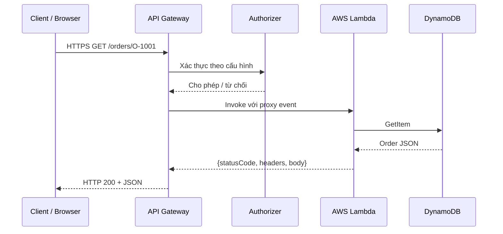
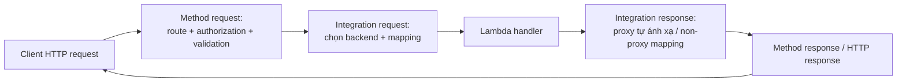

# Lambda proxy integration và ánh xạ request, response trong Amazon API Gateway

> **Chương:** API Gateway và AppSync  
> **Module:** `CLOUD_PROVIDERS_AWS`  
> **Bối cảnh:** Xây dựng một API HTTP cho ứng dụng Java/AWS Lambda theo kiến trúc an toàn, dễ giám sát, có khả năng phục hồi và kiểm soát chi phí. Bài học tập trung vào cách Amazon API Gateway chuyển HTTP request thành Lambda event, cách Lambda trả HTTP response và khi nào dùng mapping template. AWS AppSync được so sánh ở phần cuối để tránh nhầm giao thức REST/HTTP với GraphQL.

## Mục tiêu học tập

Sau bài này, người học có thể:

1. Phân biệt **HTTP API**, **REST API**, **Lambda proxy integration** và **Lambda non-proxy/custom integration** trong Amazon API Gateway.
2. Đọc và kiểm tra **event payload 1.0** và **payload 2.0**, bao gồm method, path, query string, headers, cookies, authorizer context, body và `isBase64Encoded`.
3. Tạo **Lambda proxy response** hợp lệ: `statusCode`, `headers`, `multiValueHeaders` (khi hỗ trợ), `cookies`, `body` và cờ mã hóa nhị phân.
4. Giải thích khi nào API Gateway tự ánh xạ event/response, khi nào **REST API non-proxy integration** cần VTL mapping template và integration/method response.
5. Phân biệt **parameter mapping của HTTP API**, VTL mapping của REST API và **resolver mapping của AppSync GraphQL**.
6. Viết handler Java trả về status code/JSON body đúng contract, kiểm soát lỗi 400/404/500, xử lý validation và không làm lộ thông tin nhạy cảm.
7. Phân tích CORS, Lambda invoke permission, IAM authorization, binary payload, stage/custom domain, timeout và throttling.
8. Dùng AWS CLI, `curl` và CloudWatch logs để kiểm tra integration, tái hiện lỗi `502 Bad Gateway` và xác minh request/response end-to-end.

## 1. API Gateway đứng ở đâu trong kiến trúc serverless?

**Amazon API Gateway** cung cấp điểm vào API cho client. Nó có thể tiếp nhận HTTP request, xác thực hoặc ủy quyền, áp dụng quota/throttling theo tính năng, điều hướng route rồi gọi backend như Lambda.

Một luồng phổ biến:



API Gateway **không phải** runtime của Lambda và không thay thế logic nghiệp vụ. Lambda cần tự xác thực input, thực thi business logic, xử lý lỗi và tạo response đúng định dạng.

### 1.1 Phân biệt các sản phẩm/tính năng

| Khái niệm | Mục tiêu | Điểm cần nhớ |
|---|---|---|
| **API Gateway REST API** | API nhiều tính năng quản lý request/response, mapping VTL, API key/usage plans, caching và những tính năng nâng cao | Có `Method request → Integration request → Integration response → Method response` |
| **API Gateway HTTP API** | HTTP API đơn giản, độ trễ và chi phí thường thấp hơn REST API cho use case được hỗ trợ | Lambda proxy `payloadFormatVersion 1.0/2.0`; cách cấu hình route/stage khác REST API |
| **Lambda proxy integration** | API Gateway chuyển HTTP request thành một Lambda event theo contract chuẩn | Backend quyết định status, headers, body; API Gateway ít biến đổi hơn |
| **Lambda non-proxy/custom integration** | Chủ động chuyển request/response qua mappings của REST API | Dùng VTL template/response mapping, có thể giấu contract HTTP khỏi Lambda |
| **HTTP proxy integration** | Chuyển tiếp đến một HTTP backend, không phải Lambda event | Không nhầm với Lambda proxy dù đều có chữ “proxy” |
| **AWS AppSync** | API GraphQL với schema/resolver, subscriptions/real-time theo tính năng | Lambda resolver nhận **GraphQL resolver context/payload**, không mặc nhiên nhận API Gateway proxy event |

### 1.2 Proxy là hợp đồng dữ liệu, không chỉ một nhãn trong Console

Khi cấu hình Lambda proxy:

- API Gateway tạo **event JSON theo phiên bản payload**.
- Lambda đọc event và trả **response envelope** phù hợp.
- API Gateway biến response envelope thành HTTP status, headers và body.
- Thông thường bạn không xây REST API integration response VTL riêng để đổi status code của Lambda proxy.
- Lỗi định dạng response có thể dẫn tới **`502 Bad Gateway`** dù handler đã trả về bình thường.

**Lưu ý:** `AWS_PROXY` là giá trị integration type trong API Gateway; nó không có nghĩa HTTP headers, binary, CORS hoặc permission được “chuyển nguyên xi” mà không có quy tắc.

## 2. Bốn bước từ HTTP request đến HTTP response

Trong REST API, luồng logic có thể được nhìn như sau:



Trong **proxy integration**, integration request/response được xử lý theo format chuẩn thay vì tự định nghĩa VTL đầy đủ. Trong **non-proxy REST integration**, bạn có thể cấu hình chi tiết hơn body/headers/status ở hai đầu.

Với **HTTP API**, cấu trúc resource/configuration khác REST API: bạn cấu hình routes, integrations, stages và optional parameter mappings, không mặc định có đầy đủ bốn màn hình method/integration như REST API.

### 2.1 Ví dụ một HTTP request

```http
GET /orders/O-1001?expand=items&expand=payments HTTP/1.1
Host: api.example.com
Accept: application/json
X-Correlation-Id: corr-123
Authorization: Bearer <access-token>
```

Đường đi:

1. API Gateway chọn route, ví dụ `GET /orders/{orderId}`.
2. Authorizer chạy nếu route yêu cầu; request thiếu quyền có thể bị chặn trước khi Lambda được invoke.
3. API Gateway tạo Lambda event với `pathParameters.orderId`, headers, query và requestContext.
4. Lambda đọc `orderId`, xác thực cú pháp, truy vấn dữ liệu rồi trả response envelope.
5. API Gateway trả status, headers và JSON cho client theo contract.

Không đưa token thật vào request ví dụ, CloudWatch log, tài liệu kiểm thử hoặc lệnh shell được lưu trong CI logs.

## 3. REST API Lambda proxy integration: payload format 1.0

REST API Lambda proxy dùng cấu trúc event **v1.0** với những trường như:

- `resource`: resource path được cấu hình trong API.
- `path`: request path.
- `httpMethod`: GET/POST/PUT/DELETE...
- `headers`, `multiValueHeaders`: HTTP headers.
- `queryStringParameters`, `multiValueQueryStringParameters`: query values.
- `pathParameters`: các biến path.
- `requestContext`: stage, request ID, identity/authorization và metadata.
- `stageVariables`: giá trị stage nếu có.
- `body`: chuỗi payload hoặc `null`.
- `isBase64Encoded`: thông báo body cần được giải mã Base64 hay không.

### 3.1 Event JSON minh họa

```json
{
  "resource": "/orders/{orderId}",
  "path": "/orders/O-1001",
  "httpMethod": "GET",
  "headers": {
    "accept": "application/json",
    "x-correlation-id": "corr-123"
  },
  "multiValueHeaders": {
    "accept": ["application/json"],
    "x-correlation-id": ["corr-123"]
  },
  "queryStringParameters": {
    "expand": "payments"
  },
  "multiValueQueryStringParameters": {
    "expand": ["items", "payments"]
  },
  "pathParameters": {
    "orderId": "O-1001"
  },
  "stageVariables": null,
  "requestContext": {
    "requestId": "rest-request-001",
    "stage": "prod",
    "resourcePath": "/orders/{orderId}"
  },
  "body": null,
  "isBase64Encoded": false
}
```

Đây là **mẫu rút gọn** để học contract; `requestContext` thực tế có nhiều fields và thay đổi theo loại authorizer, API/stage và tính năng. Đừng viết Java deserializer buộc tất cả các trường không cần thiết phải tồn tại.

### 3.2 Query trùng tên: ưu tiên multi-value khi cần giữ đủ giá trị

Request:

```text
GET /orders/O-1001?expand=items&expand=payments
```

Trong REST API proxy v1.0, `multiValueQueryStringParameters.expand` giữ **danh sách các giá trị**. `queryStringParameters.expand` chỉ chứa một giá trị đại diện; đừng dùng trường single-value nếu logic cần toàn bộ giá trị.

Tương tự, khi trả nhiều `Set-Cookie` hoặc headers trùng tên, phải dùng đúng cơ chế multi-value của payload 1.0 để tránh mất dữ liệu.

**Không giả định API Gateway giữ nguyên thứ tự tham số khi ánh xạ vào event.** Nếu chữ ký request hoặc business rule cần thứ tự bytes/encoded query string chính xác, phải thiết kế xử lý theo giao thức phù hợp.

### 3.3 Proxy resource `ANY /{proxy+}`

Trong REST API, `ANY` và greedy path `/{proxy+}` cho phép một Lambda nhận nhiều path/method. Ví dụ:

```text
GET    /orders/O-1001
POST   /orders
DELETE /orders/O-1001
GET    /orders/O-1001/items
```

Ưu điểm: ít cấu hình route, backend tự điều hướng. Đánh đổi: app phải tự phân tách paths, validate mọi input, kiểm soát authorization per route và logging. Không dùng `ANY /{proxy+}` để mặc nhiên cho phép mọi method/operation nhạy cảm.

## 4. HTTP API Lambda proxy: payload format 2.0

Khi tạo Lambda integration cho **HTTP API**, bạn cấu hình `payloadFormatVersion` là `1.0` hoặc `2.0`. Trong những workflow tạo API bằng Console, mặc định có thể là 2.0; khi tạo integration bằng AWS CLI/IaC nên **khai báo rõ** version.

Payload 2.0 khác REST API v1 và thường gọn hơn.

### 4.1 Các trường quan trọng của v2.0

| Trường | Vai trò |
|---|---|
| `version` | Thường là chuỗi `"2.0"` |
| `routeKey` | Route khớp, ví dụ `GET /orders/{orderId}` hoặc `$default` |
| `rawPath` | Path trong event; có lưu ý custom domain API mapping |
| `rawQueryString` | Dạng query string gần với request nguồn |
| `cookies` | Mảng giá trị Cookie của request khi có |
| `headers` | Map headers, tên header được chuẩn hóa lowercase |
| `queryStringParameters` | Map query; giá trị trùng tên được kết hợp với dấu phẩy |
| `pathParameters` | Named path variables |
| `requestContext.http.method` | HTTP method thực tế |
| `requestContext.http.path` | Path theo HTTP context |
| `requestContext.requestId` | Request ID của API Gateway |
| `requestContext.authorizer` | Thông tin authorizer khi cấu hình |
| `body` và `isBase64Encoded` | Dữ liệu request và thông tin Base64 |

### 4.2 Event v2.0 minh họa

```json
{
  "version": "2.0",
  "routeKey": "GET /orders/{orderId}",
  "rawPath": "/orders/O-1001",
  "rawQueryString": "expand=items&expand=payments",
  "headers": {
    "accept": "application/json",
    "host": "api.example.com",
    "x-correlation-id": "corr-123"
  },
  "queryStringParameters": {
    "expand": "items,payments"
  },
  "pathParameters": {
    "orderId": "O-1001"
  },
  "requestContext": {
    "accountId": "111122223333",
    "apiId": "a1b2c3d4",
    "requestId": "http-request-001",
    "stage": "$default",
    "http": {
      "method": "GET",
      "path": "/orders/O-1001",
      "protocol": "HTTP/1.1",
      "sourceIp": "192.0.2.10",
      "userAgent": "example-client"
    }
  },
  "body": null,
  "isBase64Encoded": false
}
```

Địa chỉ IP, IDs và domain đều là giá trị giả định. Tùy request, `cookies` hoặc các trường khác có thể không xuất hiện. Không dựa vào giá trị `routeKey` như HTTP method thực tế của `$default` route: đọc `requestContext.http.method` khi cần method gốc.

### 4.3 Bảng khác biệt v1.0 và v2.0

| Khía cạnh | Payload 1.0 | Payload 2.0 |
|---|---|---|
| HTTP method | `httpMethod` | `requestContext.http.method` |
| Path | `path`, `resource` | `rawPath`, `requestContext.http.path` |
| Route key | Không cùng cấu trúc `routeKey` v2 | `routeKey` |
| Multi-value headers | `multiValueHeaders` | Không có; giá trị trùng được gộp dấu phẩy |
| Multi-value query | `multiValueQueryStringParameters` | Không có; giá trị trùng được gộp dấu phẩy |
| Raw query | Không có field `rawQueryString` tương đương | `rawQueryString` |
| Cookies | Đọc từ headers | Có `cookies`; response hỗ trợ mảng cookies |
| Response envelope | Yêu cầu định dạng proxy response | Có thể suy luận khi trả JSON hợp lệ không có `statusCode` |
| Dùng custom domain API mapping | `path` có thể giúp đọc mapping path | `rawPath` **không gồm API mapping value** |

**Hai điểm dễ sai:**

1. HTTP API payload 2.0 **không có** `multiValueQueryStringParameters`. Nếu query param có thể chứa dấu phẩy trong chính giá trị, việc tự split chuỗi gộp bằng dấu phẩy không luôn tái dựng dữ liệu ban đầu. Cân nhắc `rawQueryString`/URL decoding đúng quy tắc hoặc chọn payload 1.0 khi cần preserve multiple values.
2. Khi dùng custom domain với API mappings (base path), `rawPath` v2.0 **không chứa API mapping prefix**. Nếu nghiệp vụ cần nguyên mapped path, xem xét payload 1.0 và `path` theo tài liệu.

### 4.4 Khi nào dùng 1.0 trên HTTP API?

HTTP API vẫn hỗ trợ payload 1.0. Nó hữu ích khi:

- Ứng dụng hiện tại đã xây theo REST-style `httpMethod` và `multiValue*`.
- Cần giữ duplicate query/header values thành mảng.
- Cần truy cập API mapping value của custom domain qua `path`.
- Muốn migrate REST API → HTTP API với ít thay đổi handler, sau khi xác minh các field còn khác.

**Không đổi 1.0 sang 2.0 mà không sửa handler và regression tests.** Chỉ một thay đổi payload version có thể làm Java code đọc `event.httpMethod` bị `null` rồi trả 500.

## 5. Lambda proxy response: API Gateway cần nhận gì?

Với **proxy integration**, Lambda được quyền chọn HTTP status và response body, nhưng phải tuân theo contract. Kết quả JSON Lambda trả về **không phải lúc nào cũng chính là body mà client nhận**.

### 5.1 Response format 1.0

```json
{
  "statusCode": 200,
  "headers": {
    "Content-Type": "application/json",
    "Cache-Control": "no-store",
    "X-Correlation-Id": "corr-123"
  },
  "multiValueHeaders": {
    "Set-Cookie": [
      "session=abc; Secure; HttpOnly; SameSite=Lax; Path=/",
      "theme=dark; Secure; SameSite=Lax; Path=/"
    ]
  },
  "isBase64Encoded": false,
  "body": "{\"orderId\":\"O-1001\",\"status\":\"PAID\"}"
}
```

`body` là **JSON string** chứa văn bản JSON đã serialize, **không** phải một JSON object trực tiếp trong response envelope.

API Gateway trả cho HTTP client đại ý:

```http
HTTP/1.1 200 OK
Content-Type: application/json
X-Correlation-Id: corr-123

{"orderId":"O-1001","status":"PAID"}
```

Cấu trúc v1.0 hỗ trợ `headers` và `multiValueHeaders`. Nếu cùng header được đưa vào cả hai, API Gateway có quy tắc merge và có thể ưu tiên giá trị từ multi-value headers; thực hành tốt là tránh định nghĩa trùng với kết quả không rõ ràng.

### 5.2 Response format 2.0

Ví dụ response explicit cho HTTP API v2:

```json
{
  "statusCode": 201,
  "headers": {
    "content-type": "application/json",
    "location": "/orders/O-1002"
  },
  "cookies": [
    "checkout=ok; Secure; HttpOnly; SameSite=Lax; Path=/"
  ],
  "isBase64Encoded": false,
  "body": "{\"orderId\":\"O-1002\",\"status\":\"CREATED\"}"
}
```

Ở payload 2.0, API Gateway biến mỗi phần tử `cookies[]` của response thành header **`set-cookie`** riêng. Đừng dùng dấu phẩy để ghép thủ công nhiều Set-Cookie values vào một header.

### 5.3 Vì sao format 2.0 đôi khi trả object không có `statusCode` vẫn chạy?

HTTP API payload 2.0 có cơ chế **inferred response**: nếu Lambda trả JSON hợp lệ **không có `statusCode`**, API Gateway có thể suy luận:

```json
{
  "statusCode": 200,
  "headers": {
    "content-type": "application/json"
  },
  "isBase64Encoded": false,
  "body": "{\"message\":\"hello\"}"
}
```

Ví dụ Lambda chỉ return:

```json
{
  "message": "hello"
}
```

thì HTTP API có thể chuyển thành 200 JSON response. Điều này **không áp dụng tương tự cho REST API proxy v1.0**.

Dù v2 cho phép inferred response, với API production nên **trả envelope explicit** khi phải kiểm soát status 201/400/404, headers, caching, binary hoặc cookies. Tránh để nghiệp vụ thay đổi status chỉ vì ai đó chỉnh kiểu return của handler.

### 5.4 Một bảng lỗi rất thường gặp

| Lambda trả | Proxy 1.0 | HTTP API proxy 2.0 |
|---|---|---|
| `{"statusCode":200,"body":"ok"}` | Hợp lệ | Hợp lệ |
| `{"statusCode":400,"body":"..."}` | Client nhận 400 nếu envelope hợp lệ | Client nhận 400 nếu envelope hợp lệ |
| `{"message":"ok"}` | **Không đúng** proxy response envelope, có thể 502 | Có thể suy luận HTTP 200 JSON |
| `{"statusCode":200,"body":{"id":1}}` | `body` sai kiểu: không phải string | Khi dùng explicit envelope, `body` phải theo contract |
| Java handler throw exception | Lỗi tích hợp, không phải HTTP 400 business tự động | Lỗi tích hợp, thường 5xx |
| Function timeout | API Gateway có thể trả gateway/integration error | API Gateway có thể trả gateway/integration error |

## 6. Status code: trả 400 khác với throw exception

Đây là lỗi thiết kế quan trọng nhất của nhiều Lambda HTTP handlers.

**Sai khi muốn thông báo client gửi dữ liệu không hợp lệ:**

```java
throw new IllegalArgumentException("orderId is invalid");
```

Nếu exception không được xử lý, Lambda invocation là **failure**; API Gateway thường trả lỗi tích hợp 5xx thay vì tự suy ra đây là HTTP 400.

**Đúng với proxy integration:**

```json
{
  "statusCode": 400,
  "headers": {
    "content-type": "application/json"
  },
  "body": "{\"code\":\"INVALID_ORDER_ID\",\"message\":\"orderId không hợp lệ\"}"
}
```

### 6.1 Phân loại lỗi

| Trường hợp | HTTP status thường phù hợp | Xử lý |
|---|---|---|
| Thiếu `orderId` hoặc JSON sai cú pháp | 400 | Validate, trả mã lỗi chuẩn |
| Chưa đăng nhập/không có token hợp lệ | 401 theo cơ chế auth | Authorizer/API Gateway hoặc backend |
| Đã xác thực nhưng không được phép xem đơn | 403 | Kiểm soát authorization theo người dùng/tenant |
| Đơn hàng không tồn tại | 404 | Không tiết lộ dữ liệu của tenant khác |
| Tạo đơn trùng idempotency key hoặc xung đột trạng thái | 409 | Trả error code nghiệp vụ |
| Rate limit | 429 | Throttling, client backoff có jitter |
| DB/API downstream lỗi tạm thời | 503 hoặc 500 theo contract | Retry có giới hạn, không lộ stack trace |
| Lambda response không đúng schema | 502 | Sửa contract serialization |
| Lambda timeout/integration timeout | 504 hoặc gateway error theo từng tích hợp | Điều tra latency, timeout và retries |

Không coi mọi HTTP 403 là do Lambda IAM, vì API Gateway có thể từ chối request trước khi gọi backend do authorizer, resource policy, API key hoặc endpoint setting. Trước khi sửa code, phân biệt **Gateway-generated** vs **Lambda-generated** status.

### 6.2 Không có HTTP status “tự hiểu” từ `errorMessage` ở proxy

Trong REST API **non-proxy Lambda custom integration**, API Gateway có thể dùng regex `selectionPattern` để map Lambda errors vào method response 400/500. Đó là cơ chế **khác**.

Với **Lambda proxy**, cách thông thường là handler bắt lỗi nghiệp vụ và trả `statusCode` thích hợp. Không cố dùng integration response selection pattern để map exception cho proxy như thể đó là non-proxy integration.

## 7. Java handler cho HTTP API payload 2.0

Ví dụ một Lambda Java phục vụ route `GET /orders/{orderId}`, đọc event 2.0, validate path parameter và trả JSON response envelope.

Ví dụ dùng:

- `aws-lambda-java-core` cho `RequestHandler`/`Context`.
- `com.fasterxml.jackson.core:jackson-databind` để serialize JSON (tránh tự nối chuỗi không escape).
- Java 21 runtime hoặc runtime phù hợp.
- Dữ liệu đơn hàng giả lập để tập trung vào **request/response contract**; hệ thống thực sẽ truy vấn DynamoDB/RDS qua IAM role.

### 7.1 Handler Java

```java
package example.api;

import com.amazonaws.services.lambda.runtime.Context;
import com.amazonaws.services.lambda.runtime.RequestHandler;
import com.fasterxml.jackson.core.JsonProcessingException;
import com.fasterxml.jackson.databind.ObjectMapper;
import java.util.LinkedHashMap;
import java.util.Map;

public final class GetOrderHandler
        implements RequestHandler<Map<String, Object>, Map<String, Object>> {

    private static final ObjectMapper JSON = new ObjectMapper();

    @Override
    public Map<String, Object> handleRequest(
            Map<String, Object> event, Context context) {

        if (event == null || !"2.0".equals(event.get("version"))) {
            return response(400, Map.of(
                "code", "UNSUPPORTED_EVENT",
                "message", "Expected HTTP API payload format 2.0"));
        }

        Map<String, Object> pathParameters = asMap(event.get("pathParameters"));
        String orderId = asString(pathParameters.get("orderId"));

        if (orderId == null || !orderId.matches("[A-Za-z0-9-]{1,64}")) {
            return response(400, Map.of(
                "code", "INVALID_ORDER_ID",
                "message", "orderId must contain 1-64 letters, digits or hyphens"));
        }

        Map<String, Object> requestContext = asMap(event.get("requestContext"));
        Map<String, Object> http = asMap(requestContext.get("http"));

        if (!"GET".equals(asString(http.get("method")))) {
            return response(405, Map.of(
                "code", "METHOD_NOT_ALLOWED",
                "message", "Only GET is supported"));
        }

        // Mock dữ liệu để minh họa hợp đồng API.
        if (!"O-1001".equals(orderId)) {
            return response(404, Map.of(
                "code", "ORDER_NOT_FOUND",
                "message", "Order not found"));
        }

        // Log request ID, không log Authorization header hoặc token.
        context.getLogger().log(
            "requestId=" + context.getAwsRequestId()
            + " orderId=" + orderId + "\n");

        Map<String, Object> order = Map.of(
            "orderId", orderId,
            "status", "PAID"
        );
        return response(200, order);
    }

    @SuppressWarnings("unchecked")
    private static Map<String, Object> asMap(Object value) {
        if (!(value instanceof Map<?, ?>)) {
            return Map.of();
        }
        return (Map<String, Object>) value;
    }

    private static String asString(Object value) {
        return value instanceof String ? (String) value : null;
    }

    private static Map<String, Object> response(int code, Object payload) {
        try {
            Map<String, Object> result = new LinkedHashMap<>();
            result.put("statusCode", code);
            result.put("headers", Map.of(
                "content-type", "application/json; charset=utf-8",
                "cache-control", "no-store"
            ));
            result.put("isBase64Encoded", false);
            result.put("body", JSON.writeValueAsString(payload));
            return result;
        } catch (JsonProcessingException e) {
            throw new IllegalStateException("Response serialization failed", e);
        }
    }
}
```

**Handler configuration:** `example.api.GetOrderHandler` vì class implements `RequestHandler`. Trường hợp handler theo method syntax `Class::method` cần declaration tương ứng.

Đoạn này là **mẫu contract**: chưa có xác thực danh tính/ủy quyền per-order, truy vấn DB thật, caching, tracing hoặc resilience policy; không triển khai nguyên xi lên API public production.

### 7.2 Vì sao trả `Map` chứ không trả raw JSON của đơn hàng?

`RequestHandler` serialize giá trị trả về thành Lambda result. Nếu trả trực tiếp:

```json
{"orderId":"O-1001","status":"PAID"}
```

thì với payload 2.0 HTTP API **có thể** suy ra 200 JSON, nhưng không thể hiện rõ status/headers. Với v1.0, kiểu trả đó sai proxy envelope. Việc **tạo response map** như ví dụ giúp kiểm soát contract, giảm lỗi khi handler dùng chung cho nhiều phiên bản.

### 7.3 Nếu muốn hỗ trợ payload 1.0 và 2.0 cùng code?

Tạo adapter phân biệt:

```text
if event.version == "2.0":
    method = event.requestContext.http.method
    path = event.rawPath
else:
    method = event.httpMethod
    path = event.path

normalize(method, path, pathParameters, query, headers, body)
    -> business handler
    -> explicit proxy response envelope
```

Đây là **pseudocode**, không phải Java compile được. Nếu cần duy trì duplicate query values, adapter không nên ép v1.0 `multiValueQueryStringParameters` thành một chuỗi duy nhất. Với v2, đọc `rawQueryString` theo quy tắc URL encoding và business contract.

### 7.4 Không dùng HTTP event từ API Gateway để gọi Lambda trực tiếp mà thiếu wrapper

Nếu thử Lambda trong AWS Console với:

```json
{"orderId":"O-1001"}
```

mà handler yêu cầu payload 2.0, nó sẽ trả `UNSUPPORTED_EVENT`. Lỗi nằm ở **test event shape**, không phải API Gateway hỏng.

Muốn unit test handler, tạo event v2.0 tối thiểu có `version`, `requestContext.http.method`, `pathParameters`; muốn integration test thật thì gọi URL qua API Gateway.

## 8. Request body, JSON parsing và Base64

### 8.1 `body` thường là một chuỗi

Với POST:

```http
POST /orders HTTP/1.1
Content-Type: application/json

{"sku":"P-01","quantity":2}
```

Lambda proxy event thường chứa:

```json
{
  "body": "{\"sku\":\"P-01\",\"quantity\":2}",
  "isBase64Encoded": false
}
```

**Sai:** Java code ép `body` trực tiếp thành `Map`. **Đúng:** đọc nó dưới dạng `String` và parse JSON bằng Jackson/Gson/JSON-B, validate schema/ràng buộc business.

### 8.2 Với binary payload

Nếu `isBase64Encoded=true`, body là Base64 text, cần decode thành bytes trước khi xử lý:

```java
import java.nio.charset.StandardCharsets;
import java.util.Base64;
import java.util.Map;

static byte[] requestBytes(Map<String, Object> event) {
    Object raw = event.get("body");
    if (!(raw instanceof String)) {
        return new byte[0];
    }
    String body = (String) raw;

    if (Boolean.TRUE.equals(event.get("isBase64Encoded"))) {
        return Base64.getDecoder().decode(body);
    }
    return body.getBytes(StandardCharsets.UTF_8);
}
```

Chỉ parse JSON khi content type phù hợp; với image/PDF/binary, lưu/truyền bytes thích hợp. Với REST API, **binary media types** và `Accept` header có thể ảnh hưởng hành vi chuyển đổi binary. HTTP API thường tự quyết định text/binary dựa trên content type và có `isBase64Encoded` tương ứng.

### 8.3 Trả binary response

Ví dụ Lambda trả ảnh PNG dưới dạng buffered proxy response:

```json
{
  "statusCode": 200,
  "headers": {
    "content-type": "image/png",
    "cache-control": "private, max-age=60"
  },
  "body": "iVBORw0KGgoAAAANSUhEUgAAAAEAAAAB...",
  "isBase64Encoded": true
}
```

`body` chỉ là Base64 minh họa, không phải dữ liệu ảnh đầy đủ. Trên REST API, cần **cấu hình binary media types tương thích**, có thể dùng `*/*` theo trường hợp và kiểm tra browser `Accept`. Nếu thiếu cấu hình, client có thể nhận Base64 text hoặc response sai.

**Tối ưu:** Với file lớn, cân nhắc trả **S3 pre-signed URL** hoặc dùng CloudFront thay vì đưa toàn bộ file qua Lambda + API Gateway; xem xét kích thước payload, base64 overhead, chi phí và bảo mật URL. API Gateway/Lambda có giới hạn payload và những hình thức **response streaming** được hỗ trợ có contract riêng; không áp dụng ví dụ buffered response cho streaming mà không điều chỉnh.

## 9. Lambda non-proxy integration: mapping template của REST API

Với **REST API Lambda custom integration** (`Integration type: AWS`, không phải `AWS_PROXY`), API Gateway không tự gửi toàn bộ HTTP request thành event chuẩn. Bạn phải thiết kế cách biến **method request** thành **integration request**.

Điều này hữu ích khi:

- API công khai cần ổn định dù format backend thay đổi.
- Chỉ muốn gửi đến Lambda một số trường đã chọn, không gửi cả headers/requestContext.
- Cần ánh xạ request headers/query/path/body theo contract riêng.
- Cần biến đổi response/error ở Gateway trước khi trả client.

Đánh đổi: cấu hình nhiều hơn, mapping VTL có thể khó test, version và bảo trì.

### 9.1 Request VTL: từ POST JSON sang Lambda payload gọn

Giả sử client:

```http
POST /orders/O-1001/confirm HTTP/1.1
Content-Type: application/json
X-Client-Version: 2

{"approved":true,"reason":"customer-request"}
```

Route của REST API có path variable `orderId`. Backend Lambda chỉ muốn nhận:

```json
{
  "orderId": "O-1001",
  "payload": {
    "approved": true,
    "reason": "customer-request"
  },
  "requestId": "api-request-abc"
}
```

Request mapping template `application/json` có thể được viết:

```velocity
{
  "orderId": "$util.escapeJavaScript($input.params('orderId')).replaceAll("\\'","'")",
  "payload": $input.json('$'),
  "requestId": "$context.requestId"
}
```

Giải thích:

- `$input.params('orderId')` đọc path/query/header parameter theo quy tắc tìm của VTL; khi tên trùng ở nhiều vị trí, cần hiểu thứ tự ưu tiên.
- `$util.escapeJavaScript(...)` giúp escape chuỗi được nhúng vào JSON. Theo tài liệu AWS, hàm này escape single quote thành `\'`, vốn không hợp lệ khi ở JSON string; vì vậy có thể cần `replaceAll("\\'","'")` như mẫu.
- `$input.json('$')` đưa toàn bộ JSON body vào cấu trúc JSON **không thêm một cặp dấu nháy**.
- `$context.requestId` do API Gateway cung cấp, hữu ích cho correlation.
- Template giả định **request body là JSON hợp lệ**. Nếu cho phép body rỗng, XML hoặc content type khác, phải thêm validation/mapping tương ứng.

**Cảnh báo:** Mapping templates không tự thay thế validation/authorization của Lambda. Có thể thêm request validator/JSON schema model ở REST API, nhưng backend vẫn phải validate input và giới hạn quyền theo identity.

### 9.2 Response VTL: đổi body backend thành public contract

Giả sử Lambda non-proxy trả:

```json
{
  "internalId": "db-998",
  "state": "CONFIRMED",
  "eventVersion": 2
}
```

API public muốn trả:

```json
{
  "orderId": "db-998",
  "status": "CONFIRMED"
}
```

Response mapping template `application/json`:

```velocity
{
  "orderId": "$util.escapeJavaScript($input.path('$.internalId')).replaceAll("\\'","'")",
  "status": "$util.escapeJavaScript($input.path('$.state')).replaceAll("\\'","'")"
}
```

Cần cấu hình **integration response + method response** cho HTTP 200, Content-Type và headers phù hợp. Trong non-proxy, Lambda có thể trả JSON business trực tiếp (không chứa `statusCode/body` envelope), vì API Gateway mapping đảm nhiệm việc tạo HTTP response.

### 9.3 Error mapping bằng `selectionPattern`

Khi Lambda non-proxy **throw exception**, API Gateway nhận standard Lambda error có field như `errorMessage`. Bạn có thể định nghĩa các integration responses với regex để ánh xạ lỗi:

| Backend error message | Regex example | HTTP status cấu hình |
|---|---|---|
| Bắt đầu bằng `ValidationError:` | `ValidationError:.*` | 400 |
| Bắt đầu bằng `OrderNotFound:` | `OrderNotFound:.*` | 404 |
| Các lỗi còn lại | Default integration response | 500 |

Từng status code phải có **method response** tương ứng trước khi cấu hình integration response. Regex là Java-style theo AWS và có thể bị ảnh hưởng bởi newline trong error message.

**Lưu ý quan trọng:** Với Lambda non-proxy, nếu chỉ cấu hình default integration response 200 mà không map lỗi, Lambda execution error có thể bị chuyển thành **HTTP 200**. Đây là lý do cần **thiết kế error mapping tường minh**; không dùng regex dựa vào stack trace nhạy cảm hoặc thông báo exception thiếu ổn định như một giao thức public API.

### 9.4 Các trường hợp pass-through và content type

REST API mapping template được liên kết theo MIME type như `application/json`. Nếu request có `Content-Type` khác, `passthroughBehavior` quyết định API Gateway chuyển nguyên body hoặc từ chối khi không có template phù hợp.

Đừng chỉ test `application/json` rồi giả định `application/json; charset=utf-8`, form-urlencoded hoặc binary luôn đi đúng mapping. Với API public, nên có contract content types và test rõ 415/400 cho định dạng không hỗ trợ.

### 9.5 Khi nào không nên dùng VTL?

Nếu backend đã nắm business HTTP contract, đội ngũ dễ kiểm thử Java hơn VTL, và không cần Gateway che giấu request schema, **Lambda proxy** thường đơn giản hơn.

Nếu công ty cần chuyển đổi nhiều payload/versions, định nghĩa upstream contract có chủ đích, hoặc tích hợp legacy backend, non-proxy mapping có thể giảm coupling nhưng tăng trách nhiệm test template và deployment.

## 10. HTTP API parameter mappings không phải REST API VTL

HTTP APIs có **parameter mappings** để điều chỉnh các phần được hỗ trợ của request/response, thường:

- Request: headers, query strings, path.
- Response: headers và status code theo integration/configuration hỗ trợ.
- Nguồn giá trị: request, response, context, stage variables, static values.

**Đây không phải cùng cơ chế VTL full-body mapping của REST API**. API Gateway HTTP API không cung cấp một trình VTL request/response body mapping tương đương REST API Lambda custom integration cho mọi Lambda proxy route.

### 10.1 Ví dụ cú pháp HTTP API parameter mapping

Ví dụ cấu hình dạng map theo tài liệu:

```json
{
  "overwrite:header.x-correlation-id": "$context.requestId",
  "append:querystring.source": "gateway"
}
```

Về response, mapping có thể có dạng:

```json
{
  "overwrite:header.x-api-version": "v2",
  "overwrite:statuscode": "200"
}
```

**Những cấu trúc trên là ví dụ cú pháp, không phải template cài thẳng cho mọi Lambda integration.** Phạm vi được hỗ trợ phụ thuộc loại HTTP API integration, cấu hình route và API version. Đặc biệt, `requestParameters` trong `AWS_PROXY` với **integrationSubtype** được dùng nhiều ở các **AWS service integrations** (ví dụ SQS/EventBridge); đừng sao chép chúng vào Lambda integration rồi giả định có thể sửa tự do nội dung event.

Muốn đổi toàn bộ body của HTTP API Lambda proxy, thực hành ổn định là xử lý trong Lambda handler/adapter hoặc dùng một kiến trúc mapping phù hợp, thay vì cố dùng VTL như trên REST API.

### 10.2 So sánh các kiểu mapping

| Trường hợp | Cách đổi request | Cách đổi response |
|---|---|---|
| REST API Lambda proxy | API Gateway tạo v1.0 event; Lambda tự parse | Lambda trả proxy envelope |
| HTTP API Lambda proxy 1.0 | API Gateway tạo v1.0 event | Lambda trả proxy envelope v1.0 |
| HTTP API Lambda proxy 2.0 | API Gateway tạo v2.0 event | Lambda trả envelope hoặc inferred response |
| REST API Lambda non-proxy | VTL request mapping + parameter mapping | Integration/method response + VTL/selection pattern |
| HTTP API HTTP/AWS service integration | Parameter mapping theo tính năng được hỗ trợ | Parameter mapping headers/status theo loại integration |
| AWS AppSync GraphQL Lambda resolver | GraphQL context/APPSYNC_JS/VTL resolver | GraphQL typed result/error mapping |

## 11. CORS: một lỗi mapping thường bị nhầm

**CORS** là chính sách bảo mật của browser cho request cross-origin. Một `curl` thành công không có nghĩa browser sẽ gọi API được.

### 11.1 REST API Lambda proxy

Với REST API proxy, Lambda thường phải trả CORS headers trong proxy response:

```json
{
  "statusCode": 200,
  "headers": {
    "access-control-allow-origin": "https://shop.example.com",
    "access-control-allow-credentials": "true",
    "content-type": "application/json"
  },
  "body": "{\"ok\":true}"
}
```

Ngoài response thực, browser có thể gửi **OPTIONS preflight**. Cần route `OPTIONS` phù hợp hoặc cấu hình CORS/Mock integration cho preflight. Các lỗi do Gateway tự tạo (authorizer, gateway response) có thể cần cấu hình CORS riêng, vì Lambda chưa được invoke để trả headers.

### 11.2 HTTP API CORS do API Gateway cấu hình

HTTP API có cấu hình CORS ở mức API: allowOrigins, allowMethods, allowHeaders, allowCredentials và maxAge. Khi bật, API Gateway có thể xử lý preflight và thêm CORS headers cho các response phù hợp.

**Quan trọng:** Với HTTP API khi cấu hình CORS, API Gateway **bỏ qua CORS headers do backend integration trả về**. Vì vậy sửa Java để thay `Access-Control-Allow-Origin` có thể không có tác dụng; phải xem cấu hình CORS của API.

Không dùng `Access-Control-Allow-Origin: *` cùng credentialed browser requests; chọn origins cụ thể và cấu hình credentials cho phù hợp. CORS **không** thay thế authentication/authorization hoặc chống CSRF cho cookie-based sessions.

### 11.3 Header/cookie/caching

- `Set-Cookie` có thể xuất hiện nhiều lần; payload 2.0 dùng `cookies[]`.
- `Cache-Control` không nên tùy tiện cho phép cache response chứa dữ liệu người dùng.
- `Vary: Origin` có thể quan trọng khi response cho nhiều allowed origins và qua CDN.
- `Authorization` header hoặc cookie chứa token không được log raw.
- CORS errors từ browser không tự chứng minh API có lỗi 500; kiểm tra network tab, `OPTIONS`, origin và response headers.

## 12. Authentication, authorization và thông tin trong `requestContext`

API Gateway có thể thực hiện bước auth **trước Lambda**, ví dụ:

- **IAM authorization** với SigV4.
- **JWT authorizer** cho HTTP API, dùng issuer/audience được cấu hình.
- **Lambda authorizer** cho REST/HTTP API, có mô hình event/cache riêng.
- **Cognito user pool authorizer** cho REST API khi hỗ trợ.

Khi auth thành công, API Gateway có thể thêm thông tin vào `requestContext.authorizer` hoặc các trường identity. Format phụ thuộc API type và authorizer.

### 12.1 Không tin client tự gửi `x-user-id`

Một request:

```http
GET /orders/O-1001 HTTP/1.1
X-User-Id: admin
```

không phải bằng chứng caller là admin. `x-user-id` là header **client có thể giả mạo** nếu backend tin nó trực tiếp.

**Nên:** dùng identity đã được xác thực từ authorizer context, kiểm tra tenant/order ownership trong Lambda hoặc backend authorization layer, và giới hạn truy cập bằng IAM/resource policy khi phù hợp.

**Không nên:** dùng `requestContext.requestId` như credential hay lấy `sourceIp` làm cơ chế xác thực duy nhất. Request ID phục vụ correlation, IP phục vụ quan sát/chính sách phù hợp, không chứng minh quyền nghiệp vụ.

### 12.2 Thông tin auth trong payload 1.0 và 2.0

- REST v1.0 có thể có `requestContext.authorizer.claims` hoặc `principalId`, tùy loại authorizer.
- HTTP v2.0 với JWT authorizer thường có `requestContext.authorizer.jwt.claims` và `scopes`.
- Lambda authorizer payload/context có shape khác theo `payloadFormatVersion` và cấu hình.
- `requestContext` có thể bổ sung fields theo thời gian; đừng kiểm tra strict schema khiến event hợp lệ bị từ chối chỉ vì AWS thêm field.

### 12.3 Quyền API Gateway invoke Lambda và execution role là hai thứ khác nhau

API Gateway gọi Lambda cần có quyền invoke phù hợp. Phổ biến là **resource-based policy trên Lambda** cho principal `apigateway.amazonaws.com` với `SourceArn` giới hạn API/stage/route.

Ngược lại, khi Java trong Lambda gọi DynamoDB/S3, nó dùng **Lambda execution role**:

```text
Client
  └→ API Gateway (được Lambda resource policy cho invoke)
          └→ Lambda execution role (code gọi DynamoDB/S3)
```

Đừng thêm `dynamodb:*` vào Lambda resource policy để “cho API Gateway đọc DB”; cũng đừng cấp `lambda:InvokeFunction` cho Lambda execution role chỉ để API Gateway gọi vào function.

## 13. AWS CLI: quan sát HTTP API và REST API (read-only)

Các tên API và function dưới đây **chỉ minh họa**. Dùng AWS CLI v2, đúng Account/Region và role được ủy quyền. Lệnh `get/list/describe` ở mục này **không thay đổi tài nguyên**.

### 13.1 Xác định Account và HTTP APIs

```bash
aws sts get-caller-identity

aws apigatewayv2 get-apis \
  --region ap-southeast-1 \
  --query 'Items[].{ApiId:ApiId,Name:Name,ProtocolType:ProtocolType,Endpoint:ApiEndpoint}' \
  --output table
```

`apigatewayv2` quản lý **HTTP APIs** (và WebSocket APIs), còn nhiều lệnh REST API dùng namespace `apigateway`. Đừng nhầm API IDs của hai loại.

### 13.2 Xem routes, integrations, stages của HTTP API

```bash
aws apigatewayv2 get-routes \
  --api-id a1b2c3d4 \
  --region ap-southeast-1 \
  --query 'Items[].{Id:RouteId,Key:RouteKey,Target:Target,Auth:AuthorizationType}' \
  --output table

aws apigatewayv2 get-integrations \
  --api-id a1b2c3d4 \
  --region ap-southeast-1 \
  --query 'Items[].{Id:IntegrationId,Type:IntegrationType,Uri:IntegrationUri,Payload:PayloadFormatVersion}' \
  --output table

aws apigatewayv2 get-stages \
  --api-id a1b2c3d4 \
  --region ap-southeast-1 \
  --query 'Items[].{Stage:StageName,AutoDeploy:AutoDeploy}' \
  --output table
```

Nếu integration type là `AWS_PROXY` và URI trỏ Lambda, hãy xem chính xác `PayloadFormatVersion` **1.0 hoặc 2.0** để chọn đúng Java parser.

### 13.3 Xem REST API methods/integration

```bash
aws apigateway get-rest-apis \
  --region ap-southeast-1 \
  --query 'items[].{Id:id,Name:name,Endpoint:endpointConfiguration.types}' \
  --output table

aws apigateway get-resources \
  --rest-api-id z9y8x7w6 \
  --region ap-southeast-1 \
  --query 'items[].{Id:id,Path:path,Methods:resourceMethods}' \
  --output json
```

Giả sử bạn đã biết **resource ID** và method thực tế:

```bash
aws apigateway get-integration \
  --rest-api-id z9y8x7w6 \
  --resource-id r1e2s3 \
  --http-method GET \
  --region ap-southeast-1 \
  --query '{Type:type,Uri:uri,RequestTemplates:requestTemplates,IntegrationResponses:integrationResponses}' \
  --output json
```

- `type=AWS_PROXY`: REST Lambda proxy.
- `type=AWS` cùng Lambda URI và mapping templates: Lambda custom/non-proxy.
- `type=HTTP_PROXY`: HTTP backend proxy, không phải Lambda event.
- Integration/Method API thay đổi không phải lúc nào cũng có hiệu lực cho client cho đến khi **deploy REST API stage** theo workflow.

### 13.4 Kiểm tra permission của Lambda

```bash
aws lambda get-policy \
  --function-name orders-api \
  --region ap-southeast-1 \
  --output json

aws lambda get-function-configuration \
  --function-name orders-api \
  --region ap-southeast-1 \
  --query '{Name:FunctionName,Runtime:Runtime,Handler:Handler,Timeout:Timeout,Memory:MemorySize,Role:Role,Version:Version}' \
  --output json
```

Resource-based policy của Lambda nên có `Principal=apigateway.amazonaws.com` và `Condition.AWS:SourceArn` phù hợp. Nếu API gọi function alias/version, kiểm tra policy đúng **qualifier** theo cách integration trỏ function.

## 14. Tạo HTTP API Lambda integration bằng CLI (thao tác thay đổi hạ tầng)

> **Cảnh báo:** Các lệnh sau tạo/thay đổi integration, route hoặc permission và có thể làm phát sinh chi phí. Chỉ chạy trên tài khoản **sandbox** hoặc trong quy trình thay đổi đã được phê duyệt. Thay mọi ID, ARN, stage và tên function bằng tài nguyên thật.

### 14.1 Tạo Lambda integration format 2.0

Giả định HTTP API `a1b2c3d4` và Lambda `orders-api` đã có:

```bash
aws apigatewayv2 create-integration \
  --api-id a1b2c3d4 \
  --integration-type AWS_PROXY \
  --integration-uri arn:aws:lambda:ap-southeast-1:111122223333:function:orders-api \
  --payload-format-version 2.0 \
  --region ap-southeast-1
```

Lệnh trả về `IntegrationId` (ví dụ `i1n2t3`). Khi tạo bằng API/CLI, **khai báo rõ payload format** để tránh handler v1/v2 không tương thích.

### 14.2 Gắn route vào integration

```bash
aws apigatewayv2 create-route \
  --api-id a1b2c3d4 \
  --route-key 'GET /orders/{orderId}' \
  --target 'integrations/i1n2t3' \
  --region ap-southeast-1
```

Một HTTP API có thể có route `$default`. Nó hữu ích cho fallback, nhưng route tường minh `GET /orders/{orderId}` giúp authorization, monitoring và contract rõ hơn.

### 14.3 Cấp invoke permission cho API Gateway

```bash
aws lambda add-permission \
  --function-name orders-api \
  --statement-id allow-orders-http-api \
  --principal apigateway.amazonaws.com \
  --action lambda:InvokeFunction \
  --source-arn 'arn:aws:execute-api:ap-southeast-1:111122223333:a1b2c3d4/*/GET/orders/*' \
  --region ap-southeast-1
```

**Nguyên tắc:** Giới hạn `SourceArn` theo API, stage, method và resource path khi có thể. Nếu integration trỏ alias `prod`, dùng qualifier/policy phù hợp; tài liệu AWS có các mẫu cho `$default` route và route cụ thể.

Lệnh `add-permission` không tạo Lambda execution role hoặc cấp quyền business. Nó chỉ cho phép principal gọi function trong phạm vi được khai báo.

### 14.4 Stage và deployment

Với HTTP API, nếu stage được cấu hình **AutoDeploy=true**, thay route/integration có thể tự deploy theo cơ chế HTTP API. Nếu không, phải tạo deployment/gắn stage theo workflow tương ứng.

**REST API** thường cần `create-deployment` khi thay method/integration mappings và muốn stage sử dụng thay đổi. Tránh test một deployment cũ rồi kết luận mapping template không hoạt động.

## 15. End-to-end testing bằng `curl` và Lambda test event

### 15.1 Kiểm tra thành công

```bash
curl -i \
  'https://a1b2c3d4.execute-api.ap-southeast-1.amazonaws.com/orders/O-1001' \
  -H 'Accept: application/json' \
  -H 'X-Correlation-Id: corr-123'
```

Kết quả mong đợi theo handler Java ở mục 7:

```http
HTTP/2 200
content-type: application/json; charset=utf-8
cache-control: no-store

{"orderId":"O-1001","status":"PAID"}
```

Nếu API yêu cầu JWT/IAM auth, request ví dụ này phải được bổ sung credential hợp lệ; kết quả có thể là 401/403 trước khi Lambda được gọi.

### 15.2 Kiểm tra invalid path parameter

```bash
curl -i \
  'https://a1b2c3d4.execute-api.ap-southeast-1.amazonaws.com/orders/invalid%20id'
```

Test cần xác nhận handler hoặc Gateway route decoding tạo lỗi **400** theo business contract, chứ không mặc nhiên trả 502/500. Path/URL encoding có thể được chuẩn hóa trong API Gateway; kiểm thử với client thật.

### 15.3 Kiểm tra 404

```bash
curl -i \
  'https://a1b2c3d4.execute-api.ap-southeast-1.amazonaws.com/orders/O-9999'
```

Handler ví dụ trả 404 với `ORDER_NOT_FOUND`, không tiết lộ order data. Trong ứng dụng nhiều tenant, phải kiểm tra authorization để tránh suy ra sự tồn tại đơn hàng của khách khác.

### 15.4 Kiểm tra preflight CORS

```bash
curl -i -X OPTIONS \
  'https://a1b2c3d4.execute-api.ap-southeast-1.amazonaws.com/orders/O-1001' \
  -H 'Origin: https://shop.example.com' \
  -H 'Access-Control-Request-Method: GET' \
  -H 'Access-Control-Request-Headers: authorization'
```

Để mô phỏng browser, kiểm tra `Access-Control-Allow-Origin`, `Allow-Methods` và `Allow-Headers` theo cấu hình. Nếu response thiếu CORS headers nhưng GET trực tiếp bằng `curl` thành công, lỗi là contract giữa browser và Gateway, không tự chứng minh Lambda không chạy.

### 15.5 Direct Lambda invocation không thay integration test

Bạn có thể gọi `aws lambda invoke` với event mock, nhưng việc đó **bỏ qua**:

- API Gateway route selection.
- API Gateway JWT/IAM authorizer và invoke permission.
- CORS/preflight.
- Custom domain API mapping, payload version trên integration.
- Binary handling và Gateway response serialization.

Nên kiểm thử cả **unit test handler**, **Lambda invoke mock** và **end-to-end request qua Gateway**.

## 16. CloudWatch logs, metrics và lỗi `502 Bad Gateway`

### 16.1 Trước tiên xác định 502 đến từ đâu

Một HTTP 502 có thể xuất hiện do:

- Lambda function trả response **không đúng proxy envelope**.
- Backend runtime crash/exception hoặc không được invoke thành công.
- Integration misconfiguration/permission.
- Một upstream HTTP integration trả 502 (khác Lambda proxy).
- Hạn chế, timeout hoặc network theo đường tích hợp.

Không nên “sửa” bằng cách đặt `statusCode=200` cho mọi trường hợp. Cần log tại cả **API Gateway** và **Lambda** để xác định lỗi.

### 16.2 HTTP API access log

Với HTTP API, cấu hình stage access logging tới CloudWatch, thêm những trường như:

```json
{
  "requestId": "$context.requestId",
  "routeKey": "$context.routeKey",
  "status": "$context.status",
  "integrationStatus": "$context.integration.status",
  "integrationErrorMessage": "$context.integrationErrorMessage",
  "responseLatency": "$context.responseLatency"
}
```

Đây là **mẫu log format expression**, không phải JSON event của Lambda. Phải cấu hình stage log destination, permissions và kiểm tra biến context được API type/Region hỗ trợ.

AWS gợi ý `$context.integrationErrorMessage` khi điều tra HTTP API Lambda integration errors. Có thể thêm `$context.error.message`/`$context.error.responseType` khi cần.

Không ghi `Authorization` header, nguyên request body, password, token hoặc PII vào access logs. Dùng `requestId` làm khóa tương quan giữa Gateway và Lambda/app logs theo cơ chế phù hợp.

### 16.3 Lambda log

```bash
aws logs tail /aws/lambda/orders-api \
  --region ap-southeast-1 \
  --since 30m \
  --format short
```

Hãy tìm:

- `START/END/REPORT` cho request ID tương ứng.
- Java exception và stack trace trong **log nội bộ**, không đưa ra client.
- Lambda `Duration`, `Init Duration` và timeout status.
- Các lỗi IAM, Secrets Manager, DynamoDB hoặc VPC networking.

Nếu Gateway trả 502 nhưng **Lambda log không có invocation**, trước tiên xem permission, route, integration URI, alias, stage và throttling; không nhất thiết do Java handler.

### 16.4 Metrics quan trọng

| Metric / dấu hiệu | Nguồn | Ý nghĩa |
|---|---|---|
| `4XXError` / `5XXError` | API Gateway (tùy API type) | Lỗi client/gateway/backend ở tầng HTTP |
| `Latency` | API Gateway | Tổng thời gian nhìn từ API Gateway |
| `IntegrationLatency` | API Gateway, theo tính năng/API type | Thời gian xử lý ở integration backend |
| `Count` | API Gateway | Số request |
| `Invocations` | Lambda | Số Lambda invocations |
| `Errors` | Lambda | Lỗi của runtime/handler |
| `Duration` | Lambda | Thời gian handler và runtime xử lý |
| `Throttles` | Lambda | Bị giới hạn concurrency/quota |
| `ConcurrentExecutions` | Lambda | Độ đồng thời của function |
| `Access logs requestId` | API Gateway | Correlation request |

**Ví dụ:** Gateway trả 400 do authorizer/missing route, nhưng Lambda `Invocations` không tăng. Đây không phải lỗi validation trong Java handler. Ngược lại, Lambda invocations tăng và function tự trả statusCode 400 hợp lệ, Lambda `Errors` có thể vẫn bằng 0 vì runtime kết thúc thành công.

### 16.5 Quy trình chẩn đoán 502

1. Đọc API **type**: REST hay HTTP? Integration có thực là `AWS_PROXY` tới Lambda?
2. Với HTTP API, kiểm tra `PayloadFormatVersion` 1.0/2.0.
3. Xem request ID, `integrationErrorMessage`, status ở access log.
4. Xem Lambda `START/REPORT` cùng thời điểm và logs của handler.
5. Kiểm tra Lambda trả `statusCode` là số và `body` là **string** khi dùng explicit envelope.
6. Kiểm tra Java serialization (Map/ObjectMapper), null fields, headers và Base64 flag.
7. Kiểm tra API Gateway → Lambda invoke permission, alias/qualifier, throttling, timeout.
8. Tạo test request nhỏ không chứa secret, xác nhận response end-to-end và lỗi không lặp lại.

## 17. Throttling, timeout, retry và kiểm soát chi phí

### 17.1 Request/response đồng bộ

API Gateway Lambda proxy integration cho HTTP request thông thường là **synchronous**: client chờ Gateway nhận phản hồi. Nếu timeout ở Gateway xảy ra trước Lambda timeout, caller có thể nhận lỗi dù Lambda vẫn đang xử lý hoặc đã ghi dữ liệu downstream.

Thiết kế phải:

- Giới hạn timeout ở API Gateway, Lambda và HTTP client/SDK theo hệ thống.
- Dùng **idempotency key** cho `POST /orders` nếu client có thể retry.
- Tránh response 500 khi nghiệp vụ đã commit nhưng bước trả response thất bại: lưu trạng thái vào DB để trả kết quả ổn định khi retry.
- Gắn request ID/trace ID cho chẩn đoán, không để nó là secret.
- Khi xử lý kéo dài, trả `202 Accepted` với job ID rồi xử lý qua SQS/Step Functions hoặc dịch vụ khác thay vì giữ HTTP connection quá lâu.

### 17.2 Throttling ở hai lớp

API Gateway có throttling/quotas theo API/stage/route và các tính năng phù hợp; Lambda có **reserved/account concurrency**, burst và RPS quotas. Một lớp chưa chạm giới hạn không có nghĩa lớp kia không throttle.

Ví dụ:

```text
API Gateway: 500 RPS được cho phép
Lambda timeout/latency trung bình: 1 giây
Lambda reserved concurrency: 100
Tải: 300 RPS → có thể tạo ~300 concurrency demand
```

Lambda có thể bị throttle dù API Gateway vẫn nhận requests. Client nhận lỗi; cần backoff, circuit breaker, giảm duration hoặc tăng concurrency có kiểm soát. Chỉ tăng quota mà không kiểm tra DynamoDB/RDS capacity có thể chuyển bottleneck sang database.

### 17.3 Các loại chi phí cần tính

| Thành phần | Nhóm chi phí |
|---|---|
| API Gateway HTTP/REST API | Số requests, data transfer, tính năng bổ sung theo loại API |
| Lambda | Invocation count, GB-second compute, provisioned concurrency/SnapStart nếu dùng |
| CloudWatch Logs | Ingestion, retention, queries/metrics |
| X-Ray / tracing | Tracing/storage/analysis theo cấu hình |
| Custom domain/Route 53/ACM | DNS, certificate/edge features theo biểu giá |
| WAF và các lớp an toàn | Khi loại API tích hợp WAF hoặc bảo vệ khác |
| DynamoDB/RDS/S3 | Backend reads/writes, storage và network |
| NAT Gateway/VPC endpoints | Khi Lambda/backend cần VPC egress hoặc private AWS APIs |

HTTP API thường có mức giá/độ phức tạp khác REST API, nhưng **không có loại API luôn tốt hơn trong mọi trường hợp**. So sánh nhu cầu caching, API keys/usage plans, request transformations, auth, private APIs và các tính năng thực sự cần trước khi chọn.

## 18. API Gateway mapping và AWS AppSync resolver mapping: có liên hệ gì?

Chương học bao gồm cả **API Gateway và AppSync**. Cả hai đều có thể sử dụng Lambda, nhưng contract hoàn toàn khác.

### 18.1 AppSync là GraphQL, không phải REST API proxy

GraphQL client có thể gửi:

```graphql
query GetOrder {
  getOrder(orderId: "O-1001") {
    orderId
    status
  }
}
```

AWS AppSync xác thực, lựa chọn field resolver (ví dụ `Query.getOrder`), gọi data source (Lambda hoặc DynamoDB) và tạo response theo GraphQL schema.

**Lambda resolver của AppSync không mặc nhiên nhận:**

```json
{
  "version": "2.0",
  "requestContext": {
    "http": {
      "method": "GET"
    }
  }
}
```

Thay vào đó, resolver có thể đưa **GraphQL arguments, identity, source, info** dưới dạng resolver context/payload.

### 18.2 VTL request mapping cho AppSync Lambda resolver

Đây là ví dụ **AppSync VTL** (không phải API Gateway VTL):

```json
{
  "version": "2018-05-29",
  "operation": "Invoke",
  "payload": {
    "field": "getOrder",
    "arguments": {
      "orderId": "O-1001"
    }
  }
}
```

Trong AppSync, template động tương ứng:

```velocity
{
  "version": "2018-05-29",
  "operation": "Invoke",
  "payload": {
    "field": "getOrder",
    "arguments": $util.toJson($ctx.arguments)
  }
}
```

Lambda nhận payload theo cơ chế resolver được cấu hình, không phải API Gateway requestContext.http. Response mapping template:

```velocity
#if($ctx.error)
  $util.error($ctx.error.message, $ctx.error.type)
#end
$util.toJson($ctx.result)
```

GraphQL `getOrder` phải khớp kiểu GraphQL được khai báo. Lambda resolver **không cần** trả `{"statusCode":200,"body":"..."}` kiểu API Gateway proxy, trừ khi bạn tự xây contract riêng và tự giải mã nó trong resolver.

### 18.3 APPSYNC_JS và Direct Lambda Resolver

AWS AppSync hiện ưu tiên tài liệu **`APPSYNC_JS` runtime** cho resolvers và functions. Ngoài VTL, có:

- **JavaScript resolvers** với `request(ctx)` và `response(ctx)` theo runtime APPSYNC_JS.
- **Direct Lambda resolvers** có thể không cần request/response VTL template, AppSync cung cấp default context và chuyển kết quả.
- **BatchInvoke** gọi Lambda với batch resolver payload; response phải tương ứng **số phần tử và thứ tự** của các item.

Nếu một bài hướng dẫn nói “mapping template” nhưng sử dụng `$ctx.arguments`, `$util.toJson` và `operation: Invoke`, đó có thể là **AppSync Lambda resolver mapping**, không phải API Gateway REST Integration Request.

### 18.4 Bảng đối chiếu

| Khía cạnh | API Gateway Lambda proxy | AppSync Lambda resolver |
|---|---|---|
| Giao thức API | HTTP/REST-style routes | GraphQL schema và fields |
| Input | HTTP event 1.0/2.0 | Resolver context/payload |
| Output | HTTP status/headers/body envelope | GraphQL typed field result/error |
| Mapping | Proxy contract; non-proxy REST VTL riêng | APPSYNC_JS/VTL/direct resolver |
| Trả lỗi nghiệp vụ | HTTP 4xx/5xx explicit | GraphQL errors và nullable fields theo schema |
| Batch | API tự thiết kế request/batch | Có `BatchInvoke` cho field resolvers |
| Khi chọn | Public REST API, webhook, HTTP endpoint | Client muốn query/mutation theo GraphQL, chọn fields và aggregation |

## 19. Tình huống tổng hợp: API quản lý đơn hàng Java

Giả sử một nhóm đang thiết kế:

- `GET /orders/{orderId}`: đọc đơn.
- `POST /orders`: tạo đơn.
- `GET /orders/{orderId}/receipt`: trả link hóa đơn PDF.
- Frontend SPA tại `https://shop.example.com`.
- Backend Lambda Java đọc DynamoDB/S3, có Cognito/JWT authentication.
- Các tác vụ tạo hóa đơn PDF nặng được đưa qua SQS/Step Functions.

### 19.1 Thiết kế contract

| Route | Event/input | Thành công | Lỗi nghiệp vụ |
|---|---|---|---|
| `GET /orders/{orderId}` | path orderId; JWT subject/tenant từ authorizer | 200 JSON order | 400/403/404 |
| `POST /orders` | JSON body + Idempotency-Key | 201 JSON order + Location | 400/409/429 |
| `GET /orders/{orderId}/receipt` | path orderId + identity | 200 JSON pre-signed URL hoặc redirect | 403/404/503 |

Phương án gợi ý: **HTTP API Lambda proxy 2.0** nếu các tính năng của HTTP API đủ nhu cầu. Không cần non-proxy VTL chỉ để map `orderId`; handler đọc `pathParameters`.

Nếu tổ chức cần transform backend legacy contract sâu, response selection patterns hoặc REST-specific features không có ở HTTP API, cân nhắc **REST API non-proxy** và kiểm thử mappings.

### 19.2 Security và observability

- JWT authorizer xác nhận token; **Lambda vẫn kiểm tra** người dùng có quyền đọc order tương ứng.
- Execution role chỉ cho `dynamodb:GetItem/PutItem` theo bảng và `s3:GetObject` theo prefix phù hợp.
- CORS giới hạn `https://shop.example.com`; không wildcard với credentialed calls.
- Không log Authorization, cookie, PII hoặc raw PDF payload.
- Trả `X-Correlation-Id` và ghi request IDs trong logs.
- CloudWatch alarms cho 5xx, latency p95/p99, Lambda errors/throttles, queue age.
- Rate limit/idempotency tránh duplicate orders và runaway downstream cost.

### 19.3 Giữ backward compatibility khi deploy

Với một API public, đổi API Gateway integration `PayloadFormatVersion` từ 1.0 → 2.0 **là thay đổi giao diện input của Lambda**. Deploy theo thứ tự:

1. Tạo tests cho event 1.0/2.0 và response envelope.
2. Phát hành Lambda version hỗ trợ format mới hoặc tạo integration riêng.
3. Thử staging route/custom domain; kiểm tra duplicate query, cookies, body, auth.
4. Triển khai canary/alias nếu phù hợp.
5. Quan sát lỗi 4xx/5xx và request IDs.
6. Chỉ bỏ adapter cũ khi đã xác nhận không còn API integration dùng 1.0.

Tương tự, đổi REST non-proxy request mapping template có thể ảnh hưởng backend input ngay cả khi Lambda code không đổi. Quản lý cả **API Gateway configuration và Lambda code** bằng IaC/version control, review và rollback nhất quán.

## 20. Bài tập và câu hỏi tự kiểm tra

**Bài 1 — Phân biệt API.** Một HTTP API dùng Lambda `AWS_PROXY` payload 2.0. Lambda handler Java chỉ đọc `event.get("httpMethod")`. Điều gì có thể xảy ra? Cần đọc field nào?

**Bài 2 — Response sai.** Lambda REST API proxy trả:

```json
{"statusCode":200,"body":{"message":"ok"}}
```

Vì sao client có thể nhận 502? Sửa response thế nào?

**Bài 3 — Inferred response.** Lambda trả object `{"message":"ok"}` không có `statusCode`. Khác biệt chính giữa REST API proxy v1.0 và HTTP API v2.0 là gì?

**Bài 4 — Duplicate query values.** Client gọi `?tag=java&tag=aws`. Ở payload 1.0, dùng field nào để giữ hai giá trị? Ở payload 2.0, có thể xảy ra chuyện gì khi giá trị thực chứa dấu phẩy?

**Bài 5 — Binary.** Lambda trả ảnh PNG bằng Base64 nhưng quên `isBase64Encoded=true`. Trên REST API còn phải kiểm tra cấu hình nào?

**Bài 6 — CORS.** Frontend gọi HTTP API và báo lỗi CORS. Team sửa Lambda để trả `Access-Control-Allow-Origin` nhưng không có tác dụng dù HTTP API đã bật cấu hình CORS. Vì sao?

**Bài 7 — Non-proxy.** Lambda custom integration trả exception `ValidationError: bad quantity`. Nếu không định nghĩa `selectionPattern` và method/integration response 400, điều gì có thể xảy ra?

**Bài 8 — IAM.** API Gateway trả `{"message":"Internal Server Error"}`, Lambda log không ghi invocation nào. Nên kiểm tra permission nào? Có cần tăng quyền DynamoDB của Lambda ngay không?

**Bài 9 — Custom domain.** HTTP API payload 2.0 dùng API mapping `/shop`. Vì sao handler đọc `rawPath` có thể không thấy `/shop`? Cách xử lý?

**Bài 10 — Status code.** Java handler catch invalid input và trả response 400 đúng format. CloudWatch Lambda `Errors` có tăng không? Tại sao?

**Bài 11 — AppSync.** Một AppSync GraphQL resolver dùng Lambda với `operation=Invoke`. Lambda có bắt buộc trả `statusCode`, `headers` và `body` như API Gateway proxy không?

**Bài 12 — Thiết kế API.** API tạo đơn có thể bị client retry khi timeout, Lambda đã ghi DynamoDB thành công nhưng không trả được response. Đề xuất hai phương án bảo vệ business correctness.

**Bài 13 — Debugging.** REST API đổi VTL template rồi test vẫn thấy event cũ. Ngoài Lambda code, cần kiểm tra bước triển khai nào?

**Bài 14 — HTTP parameter mapping.** Vì sao không thể sao chép REST VTL body mapping rồi coi nó là cấu hình chung cho HTTP API Lambda proxy?

<details>
<summary>Gợi ý đáp án</summary>

1. Payload 2.0 không dùng `httpMethod` ở top level; đọc `requestContext.http.method`.
2. Explicit proxy `body` phải là string; trả `"body":"{\"message\":\"ok\"}"`.
3. REST v1 cần proxy envelope; HTTP API v2 có thể suy luận 200/JSON khi không có `statusCode`.
4. V1: `multiValueQueryStringParameters.tag`. V2: `queryStringParameters` có thể gộp bằng dấu phẩy; cân nhắc `rawQueryString`/parser hoặc dùng 1.0.
5. Đặt `isBase64Encoded=true`, cấu hình binary media types/Accept trên REST API.
6. Khi bật HTTP API CORS, Gateway dùng CORS configuration và bỏ qua CORS response headers từ Lambda.
7. Backend error có thể bị trả 200 mặc định hoặc cấu hình response không khớp gây lỗi; map status tường minh.
8. Kiểm tra Lambda resource-based invoke policy cho `apigateway.amazonaws.com` và đúng `SourceArn`, integration URI/alias/stage. DynamoDB permission liên quan code runtime, không phải Gateway invoke.
9. `rawPath` v2 không gồm custom domain API mapping prefix; cân nhắc v1 `path` hoặc thiết kế route/path không phụ thuộc prefix.
10. Thông thường không: Lambda handler kết thúc thành công; HTTP 400 là business response, không phải Lambda runtime failure.
11. Không. AppSync Lambda resolver trả kết quả phù hợp GraphQL type/resolver mapping, không phải API Gateway HTTP response envelope.
12. Dùng idempotency key, conditional write/transaction và truy vấn trạng thái giao dịch sau retry; response có thể tra kết quả đã commit.
13. Kiểm tra **deploy REST API stage** và đúng stage/custom domain mapping, vì thay đổi integration có thể chưa được publish tới stage.
14. HTTP API có parameter mapping với phạm vi khác VTL REST custom integration; Lambda proxy event/response phải tuân theo payloadFormatVersion.

</details>

## 21. Checklist triển khai production

- [ ] Đã chọn rõ **REST API hay HTTP API** theo yêu cầu tính năng, chi phí và vận hành.
- [ ] Đã chọn **Lambda proxy** hay **REST non-proxy mapping** theo mức biến đổi payload cần thiết.
- [ ] Nếu HTTP API Lambda proxy, đã khóa `payloadFormatVersion` 1.0/2.0 và test adapter đúng.
- [ ] Handler kiểm tra method, path, query/header values, body, Base64 flag và schema đầu vào.
- [ ] Proxy response luôn trả status/body/headers đúng contract; body được JSON serialize thành **string**.
- [ ] Đã test duplicate query strings, multi-value headers và `cookies[]` khi áp dụng.
- [ ] Nếu cần binary, đã test Base64, Content-Type, REST binary media types và Accept.
- [ ] Đã phân biệt 400 business response với Lambda exception/integration 5xx.
- [ ] Nếu dùng non-proxy, đã test VTL request/response, content type, passthrough và `selectionPattern`.
- [ ] Đã kiểm tra IAM/Lambda resource-based policy `apigateway.amazonaws.com` và SourceArn đúng scope.
- [ ] Đã cấu hình JWT/IAM/Lambda authorizer và **authorization theo tenant/resource** trong backend.
- [ ] CORS đã được xử lý theo đúng loại API; không wildcard với credentialed calls.
- [ ] Custom domain/API mapping/stage/deployment được test bằng URL client thật.
- [ ] Đã bật access logs/request IDs và Lambda logs nhưng không chứa secret/PII.
- [ ] Đã cấu hình timeout, retries, idempotency keys, throttling và bảo vệ database/queue.
- [ ] Có unit tests cho v1/v2 events, integration tests qua Gateway và lỗi 400/404/502.
- [ ] Có IaC/versioning cho Gateway + Lambda, canary/rollback và theo dõi Cost Explorer/Budgets.
- [ ] Nếu dùng AppSync, đã tách biệt resolver GraphQL contract khỏi HTTP Lambda proxy contract.

## Tài liệu chính thức

- [Amazon API Gateway — Lambda proxy integration for REST APIs](https://docs.aws.amazon.com/apigateway/latest/developerguide/set-up-lambda-proxy-integrations.html)
- [Amazon API Gateway — Create Lambda proxy integrations for HTTP APIs](https://docs.aws.amazon.com/apigateway/latest/developerguide/http-api-develop-integrations-lambda.html)
- [Amazon API Gateway — Lambda proxy integration with proxy resources](https://docs.aws.amazon.com/apigateway/latest/developerguide/api-gateway-set-up-simple-proxy.html)
- [Amazon API Gateway — Tutorial: Lambda non-proxy integration](https://docs.aws.amazon.com/apigateway/latest/developerguide/getting-started-lambda-non-proxy-integration.html)
- [Amazon API Gateway — Data transformations for REST APIs](https://docs.aws.amazon.com/apigateway/latest/developerguide/rest-api-data-transformations.html)
- [Amazon API Gateway — Mapping template reference](https://docs.aws.amazon.com/apigateway/latest/developerguide/api-gateway-mapping-template-reference.html)
- [Amazon API Gateway — Handle Lambda integration errors](https://docs.aws.amazon.com/apigateway/latest/developerguide/handle-errors-in-lambda-integration.html)
- [Amazon API Gateway — Parameter mapping for HTTP APIs](https://docs.aws.amazon.com/apigateway/latest/developerguide/http-api-parameter-mapping.html)
- [Amazon API Gateway — Configure CORS for HTTP APIs](https://docs.aws.amazon.com/apigateway/latest/developerguide/http-api-cors.html)
- [Amazon API Gateway — CORS for REST APIs](https://docs.aws.amazon.com/apigateway/latest/developerguide/how-to-cors.html)
- [Amazon API Gateway — Troubleshoot HTTP API Lambda integrations](https://docs.aws.amazon.com/apigateway/latest/developerguide/http-api-troubleshooting-lambda.html)
- [Amazon API Gateway — Custom domain API mappings for HTTP APIs](https://docs.aws.amazon.com/apigateway/latest/developerguide/http-api-mappings.html)
- [AWS CLI — apigatewayv2 create-integration](https://docs.aws.amazon.com/cli/latest/reference/apigatewayv2/create-integration.html)
- [AWS Lambda — Resource-based policies](https://docs.aws.amazon.com/lambda/latest/dg/access-control-resource-based.html)
- [AWS AppSync — Lambda resolver mapping template reference](https://docs.aws.amazon.com/appsync/latest/devguide/resolver-mapping-template-reference-lambda.html)
- [AWS AppSync — Direct Lambda resolvers](https://docs.aws.amazon.com/appsync/latest/devguide/direct-lambda-reference.html)
- [AWS AppSync — Resolver mapping templates](https://docs.aws.amazon.com/appsync/latest/devguide/resolver-mapping-template-reference.html)

**Điểm cần ghi nhớ:** **Lambda proxy integration** làm API Gateway và Lambda thỏa thuận một **event/response contract**. REST API chủ yếu dùng **v1.0**; HTTP API hỗ trợ **1.0 và 2.0**, với khác biệt quan trọng ở method/path, query trùng, cookies và inferred response. **REST API non-proxy VTL** và **AppSync GraphQL resolver mapping** là những cơ chế khác, không hoán đổi cho nhau. Thiết kế API tốt phải kết hợp schema validation, status codes đúng, IAM, CORS, idempotency, logging, timeout và khả năng rollback.

