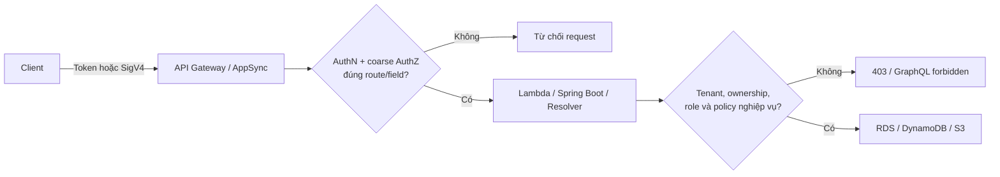
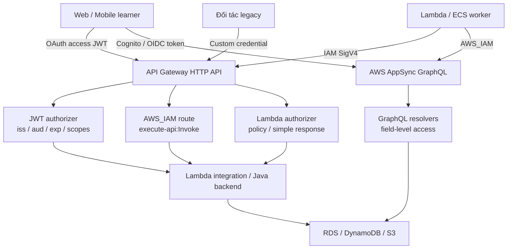
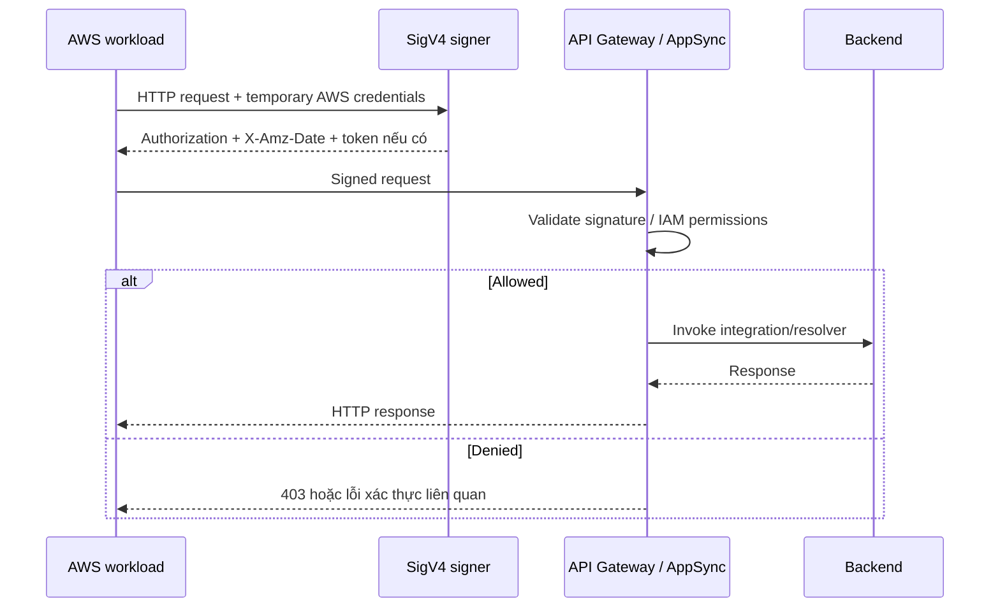
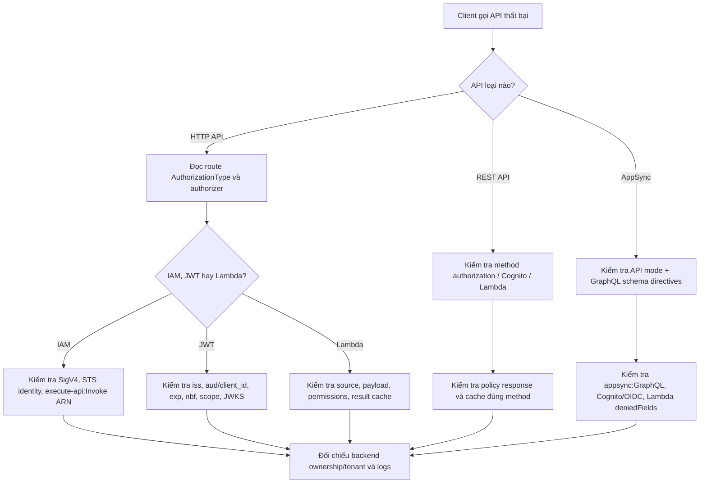

# IAM authorization, JWT authorizer và Lambda authorizer

> **Học phần:** CLOUD_PROVIDERS_AWS  
> **Chương:** API Gateway và AppSync  
> **Bài học:** IAM authorization, JWT authorizer và Lambda authorizer  
> **Bối cảnh:** Xây dựng API an toàn trên AWS, dùng IAM, Amazon Cognito, OAuth 2.0/OpenID Connect (OIDC), AWS Lambda và Amazon API Gateway hoặc AWS AppSync.

## 1. Tại sao một API cần nhiều cơ chế phân quyền?

Một nền tảng học Java/Spring Boot trên AWS cung cấp những API:

- Ứng dụng web/mobile của **học viên** gọi `GET /courses` và `POST /enrollments`.
- Một **Lambda xử lý báo cáo** ở backend gọi `POST /internal/reports`.
- Người quản trị dùng ứng dụng nội bộ để truy cập báo cáo có thông tin nhạy cảm.
- Frontend GraphQL đọc danh mục khóa học và cập nhật hồ sơ học viên qua **AWS AppSync**.
- Đối tác tích hợp với một hệ thống quyền riêng không dùng AWS IAM hoặc nhà cung cấp JWT tiêu chuẩn.

Cả năm trường hợp đều cần **xác thực danh tính** và **quyết định có được thực hiện hành động hay không**, nhưng không nhất thiết dùng cùng một phương án.

Các lựa chọn tiêu biểu:

1. **IAM authorization:** caller dùng danh tính IAM và ký yêu cầu bằng **AWS Signature Version 4 (SigV4)**; phù hợp giao tiếp service-to-service và workload AWS.
2. **JWT authorizer:** API Gateway **HTTP API** kiểm tra JWT do một identity provider phát hành, dựa trên chữ ký và các claims như issuer, audience, expiration và scope.
3. **Lambda authorizer:** một Lambda thực hiện logic phân quyền tùy biến, ví dụ đánh giá entitlement của đối tác, mapping tenant hoặc yêu cầu nội bộ.
4. **AppSync GraphQL:** dùng các **authorization modes riêng** như `AWS_IAM`, `AMAZON_COGNITO_USER_POOLS`, `OPENID_CONNECT` và `AWS_LAMBDA`, có thể phối hợp để giới hạn quyền theo schema field.

### Sau bài học, bạn có thể

- Phân biệt **authentication** và **authorization**, các thuật ngữ identity, role, claim, scope, policy.
- Chọn đúng authorizer khi triển khai **API Gateway HTTP API**, **REST API** hoặc **AppSync GraphQL**.
- Viết chính sách IAM cho `execute-api:Invoke` và `appsync:GraphQL` theo nguyên tắc quyền tối thiểu.
- Cấu hình JWT authorizer với `issuer`, `audience` và `authorizationScopes`.
- Tạo Lambda authorizer, hiểu payload v1.0/v2.0, simple response, policy response và cache key.
- Hiểu AppSync field-level authorization, multi-auth directives và Lambda `deniedFields`.
- Tổ chức backend Java/Spring Boot kiểm tra quyền truy cập **tới từng object/tenant**, thay vì chỉ tin vào việc request đã đi qua gateway.
- Kiểm thử phản hồi 401/403, latency, logging, chi phí và cách khắc phục các cấu hình bảo mật sai.

## 2. Hai lớp bảo mật: authentication và authorization

**Authentication (AuthN)** trả lời câu hỏi: *Caller là ai hoặc có danh tính nào?*

**Authorization (AuthZ)** trả lời câu hỏi: *Danh tính đã xác thực có được thực hiện hành động này trên tài nguyên này không?*

Ví dụ:

```text
Học viên A đã đăng nhập -> xác thực thành công (AuthN).
Học viên A yêu cầu xem điểm của học viên B ->
  phải từ chối nếu không có quyền (AuthZ),
  dù access token của A còn hạn và hợp lệ.
```

Một gateway authorizer có thể kiểm tra **route-level access**, nhưng một API nghiệp vụ vẫn cần **object-level authorization**:



Nếu chỉ kiểm tra token hợp lệ mà không kiểm tra quyền xem `reportId` thuộc tenant nào, API dễ mắc lỗi **Broken Object Level Authorization (BOLA/IDOR)**.

### 2.1. Những thuật ngữ cần biết

| Thuật ngữ | Ý nghĩa | Ví dụ |
|---|---|---|
| Principal | Chủ thể gọi API hoặc được AWS kiểm tra quyền. | IAM role, user, assumed-role session |
| Credential | Dữ liệu chứng minh danh tính. | Temporary AWS credentials, JWT |
| Claim | Dữ liệu bên trong JWT. | `iss`, `aud`, `sub`, `exp` |
| Scope | Quyền theo chuẩn OAuth, thường ở mức API operation. | `courses:read`, `enrollments:write` |
| IAM policy | Tập các statements Allow/Deny với action và resource. | `execute-api:Invoke` cho một route |
| Authorizer | Thành phần đánh giá request trước khi integration/resolver chạy. | JWT hoặc Lambda authorizer |
| Integration | Backend phía sau API Gateway. | Lambda, HTTP service, ALB/VPC Link |
| Resolver | Logic thực thi một field trong AppSync GraphQL. | Truy vấn DynamoDB, Lambda |

**API key không tương đương xác thực người dùng.** API Gateway usage plan/API key thường dùng nhận diện client và quản lý usage/throttling ở REST API, không phải một giải pháp xác thực/ủy quyền đầy đủ. AppSync `API_KEY` là một authorization mode cơ bản nhưng không chứng minh danh tính người dùng như OIDC/IAM.

## 3. Trước khi cấu hình: phân biệt HTTP API, REST API và AppSync

Các tên gọi rất giống nhau nhưng **không có cùng authorizer types**.

| Nền tảng | Cơ chế liên quan đến bài học | Điều phải nhớ |
|---|---|---|
| **API Gateway HTTP API (v2)** | `NONE`, `AWS_IAM`, `JWT`, `CUSTOM` (Lambda) | Có **native JWT authorizer** cấu hình issuer/audience/scopes. |
| **API Gateway REST API (v1)** | `NONE`, `AWS_IAM`, `COGNITO_USER_POOLS`, `CUSTOM` (Lambda) | Không có native authorizer type mang tên `JWT` như HTTP API; dùng Cognito User Pool hoặc Lambda authorizer khi phù hợp. |
| **AWS AppSync GraphQL API** | `AWS_IAM`, `AMAZON_COGNITO_USER_POOLS`, `OPENID_CONNECT`, `AWS_LAMBDA`, `API_KEY` | Quyết định theo **GraphQL schema fields/types** với authorization modes và directives; không dùng cấu hình route JWT của API Gateway. |

Một phần code CloudFormation `AWS::ApiGatewayV2::Authorizer` với `AuthorizerType: JWT` **chỉ thuộc HTTP API**; không được copy sang REST API `AWS::ApiGateway::Authorizer` hoặc sang AWS AppSync.

### 3.1. Mỗi nền tảng kiểm soát cấp nào?

- **HTTP API:** Authorization gắn với **route**, ví dụ `GET /courses` hoặc `POST /enrollments`.
- **REST API:** Authorization gắn với **method** dưới resource, ví dụ `GET` của `/courses/{id}`.
- **AppSync GraphQL:** Authorization gắn với **API authorization mode**, các **schema types/fields** và logic resolvers.

Với GraphQL, một HTTP request tới `/graphql` có thể chứa query yêu cầu nhiều fields; chỉ nhìn HTTP route mà không xem **schema field permissions** là chưa đủ.

## 4. Kiến trúc tham khảo cho nền tảng học trực tuyến



Đây là **sơ đồ khái niệm**: mỗi route của HTTP API có một kiểu authorization thích hợp; không có nghĩa một request nhất định bị tuần tự kiểm tra bởi cả ba authorizers của cùng route. Các hệ thống nội bộ cần xác định rõ **kiểu client** và **kiểu credential** được phép dùng trên từng route.

Ví dụ quy ước:

| API operation | Caller | Authorization gợi ý |
|---|---|---|
| `GET /courses` | Học viên đăng nhập | HTTP API JWT + scope `courses:read` |
| `POST /enrollments` | Học viên đăng nhập | HTTP API JWT + scope `enrollments:write`; backend kiểm tra user/tenant |
| `POST /internal/reports` | Lambda, ECS task role | HTTP API `AWS_IAM` + scoped `execute-api:Invoke` |
| `POST /partners/import` | Hệ thống partner có entitlement riêng | Lambda authorizer + kiểm tra ownership ở backend |
| `Query.myCourses` | Học viên GraphQL | AppSync `AMAZON_COGNITO_USER_POOLS` hoặc `OPENID_CONNECT` |
| `Query.internalMetrics` | Hệ thống AWS | AppSync `AWS_IAM` |

## 5. IAM authorization: cơ chế SigV4

Với **IAM authorization**, caller sử dụng một **IAM identity/role session** được cấp quyền, ký HTTP request bằng **AWS Signature Version 4**.

Luồng cơ bản:

1. Backend Lambda/EC2/ECS hoặc client có temporary AWS credentials của role.
2. AWS SDK hoặc signer tạo chữ ký cho HTTP request bằng credentials hiện có.
3. API Gateway hoặc AppSync kiểm tra chữ ký, xác định principal.
4. AWS đánh giá IAM permissions và những chính sách liên quan; request chỉ được thực thi khi có quyền hợp lệ.
5. Backend/resolver **vẫn** thực hiện business authorization nếu tài nguyên liên quan người dùng/tenant.



**Đừng nhầm SigV4 với JWT:** Header `Authorization` của SigV4 chứa thông tin chữ ký AWS, không phải `Bearer eyJ...`. JWT/OIDC authorizer không tự coi chữ ký AWS là access token.

### 5.1. IAM policy cho API Gateway

Với API Gateway, IAM action thường dùng để gọi một API method/route là:

```text
execute-api:Invoke
```

Ví dụ **least privilege**: chỉ cho một IAM role gọi HTTP route `POST /internal/reports` của API `abc123def4`, stage `prod` tại `ap-southeast-1`:

```json
{
  "Version": "2012-10-17",
  "Statement": [
    {
      "Sid": "InvokeInternalReportsOnly",
      "Effect": "Allow",
      "Action": "execute-api:Invoke",
      "Resource": "arn:aws:execute-api:ap-southeast-1:123456789012:abc123def4/prod/POST/internal/reports"
    }
  ]
}
```

Cấu trúc ARN:

```text
arn:aws:execute-api:{region}:{account}:{api-id}/{stage}/{method}/{resource-path}
```

Nếu stage là `$default` thì phần stage trong ARN phải đúng giá trị đó; không thay bằng `prod` theo thói quen. Cũng không cấp `Resource: "*"` nếu nhu cầu chỉ là một route.

**Lưu ý:** REST API có **resource policies**, IAM, VPC endpoint policies và các điều kiện khác cần xem xét khi áp dụng. **HTTP API hiện không hỗ trợ resource policies của API Gateway** theo tài liệu AWS; không hướng dẫn thêm REST resource policy vào HTTP API để chặn IP.

### 5.2. Bật IAM ở route của HTTP API

Trong API Gateway Console:

1. Chọn **HTTP API**.
2. Mở **Routes**, chọn route `POST /internal/reports`.
3. Mở phần **Authorization**.
4. Chọn kiểu **AWS_IAM**.
5. Lưu và xác minh route có authorization đúng; kiểm tra deployment/stage theo cấu hình API.

AWS CLI:

```bash
aws apigatewayv2 update-route \
  --api-id abc123def4 \
  --route-id route-id-from-console-or-list-routes \
  --authorization-type AWS_IAM \
  --region ap-southeast-1
```

Đây là **thao tác thay đổi quyền**, có thể khiến client cũ bị từ chối. Không bật IAM trên route Production trước khi xác nhận caller đã có cơ chế SigV4 signing và policy phù hợp.

### 5.3. IAM policy cho AppSync GraphQL

AppSync GraphQL có authorization mode `AWS_IAM`. Caller ký request tới GraphQL endpoint bằng SigV4 và cần action:

```text
appsync:GraphQL
```

Ví dụ policy chỉ cho phép truy vấn field `getCourse` của type `Query`:

```json
{
  "Version": "2012-10-17",
  "Statement": [
    {
      "Sid": "ReadGetCourseField",
      "Effect": "Allow",
      "Action": "appsync:GraphQL",
      "Resource": "arn:aws:appsync:ap-southeast-1:123456789012:apis/graphqlexample123/types/Query/fields/getCourse"
    }
  ]
}
```

AppSync sử dụng ARN field-level với cấu trúc `apis/{api-id}/types/{type}/fields/{field}`. Để cho phép nhiều operations có thể liệt kê đúng từng field hoặc dùng wildcard đã được cân nhắc.

**Khác biệt:** IAM action `appsync:GraphQL` **không phải** `execute-api:Invoke`. Không copy IAM policy API Gateway sang AppSync rồi mong có quyền.

### 5.4. Temporary credentials và IAM roles

Ưu tiên IAM roles thay vì IAM user access keys dài hạn:

| Workload | Cách lấy credentials |
|---|---|
| AWS Lambda | **Execution role** của function |
| ECS/Fargate | **Task role** của ECS task |
| Amazon EC2 | **Instance profile role** |
| Developer local | IAM Identity Center hoặc role được assume qua profile |
| Browser/mobile cần IAM | Amazon Cognito Identity Pools/federation phù hợp; **không nhúng IAM access key dài hạn** |

Nếu client không có danh tính IAM nhưng có OAuth/OIDC access token, **JWT authorizer** thường tự nhiên hơn. Không chuyển token web của người dùng thành một access key lưu trực tiếp trong trình duyệt.

## 6. JWT authorizer: native cho API Gateway HTTP API

**JWT** (*JSON Web Token*) là một cấu trúc token gồm ba phần Base64URL:

```text
base64url(header).base64url(payload).base64url(signature)
```

Nội dung token có thể đọc được sau decode; **JWT thường được ký, không tự được mã hóa bí mật**. Đừng đưa password, API key hoặc dữ liệu nhạy cảm vào claims chỉ vì token đã được ký.

### 6.1. Các claims quan trọng

Ví dụ **payload minh họa đã rút gọn**, không phải token hợp lệ để sử dụng:

```json
{
  "iss": "https://id.example.com/tenant-a",
  "sub": "user-17",
  "aud": "course-api",
  "exp": 1795000000,
  "nbf": 1794900000,
  "iat": 1794900000,
  "scope": "courses:read enrollments:write",
  "tenant_id": "school-01"
}
```

| Claim | Ý nghĩa | Kiểm tra |
|---|---|---|
| `iss` | Issuer đã phát hành JWT | Phải khớp issuer cấu hình |
| `aud` | Audience được token hướng tới | Phải khớp một audience của authorizer |
| `client_id` | OAuth client identifier | API Gateway dùng để so audience **chỉ khi token không có `aud`** |
| `exp` | Thời điểm hết hạn, giây Unix time | Token không được hết hạn |
| `nbf` | Chưa được sử dụng trước thời điểm nào | Thời gian hiện tại phải qua giới hạn |
| `iat` | Thời điểm token phát hành | Được kiểm tra theo quy tắc JWT authorizer |
| `sub` | Chủ thể của token | Xác định người dùng; không phải permissions list |
| `scope` hoặc `scp` | Các scopes được cấp | Có thể dùng route-level authorization |
| `kid` (header) | ID của khóa ký JWT | Phải tương ứng với khóa trong JWKS |

**JWT authorizer phải kiểm tra chữ ký**, không chỉ decode phần payload. Một attacker có thể tự tạo token giả chứa `"scope": "admin"`, nhưng chữ ký không hợp lệ phải bị từ chối.

### 6.2. Quy trình kiểm tra native của HTTP API

Theo tài liệu AWS, API Gateway HTTP API JWT authorizer:

1. Đọc token từ `identitySource`, thường là `$request.header.Authorization`.
2. Chấp nhận giá trị token hoặc giá trị có tiền tố `Bearer`.
3. Tìm public keys từ địa chỉ JWKS của issuer và kiểm tra chữ ký; tại thời điểm tài liệu này, JWT authorizer của HTTP API hỗ trợ **thuật toán ký dựa trên RSA**.
4. Kiểm tra `kid`, `iss`, `aud` (hoặc `client_id` khi không có `aud`), `exp`, `nbf` và `iat`.
5. Nếu route có `authorizationScopes`, token phải chứa **ít nhất một** scope trong danh sách đó.
6. Chỉ đưa request qua integration khi các điều kiện liên quan đều hợp lệ.

Public keys có thể được API Gateway cache **tới khoảng hai giờ theo best effort**. Khi identity provider xoay keys, duy trì thời gian overlap giữa old/new signing keys để tránh làm hỏng token hợp lệ đang lưu hành.

### 6.3. Access token hay ID token?

**Access token** thường được cấp cho một API/resource server và có scopes.

**ID token** thường nhằm chứng minh người dùng đã đăng nhập cho ứng dụng client, **không mặc định được thiết kế để gọi API**. Do không có cơ chế tiêu chuẩn duy nhất phân biệt mọi loại JWT access/ID tokens, AWS khuyên nên cấu hình **route scopes** khi dùng HTTP API JWT authorizer, trừ khi nghiệp vụ thực sự cần ID token.

Ví dụ:

```text
GET /courses            yêu cầu courses:read
POST /enrollments        yêu cầu enrollments:write
DELETE /admin/course/42  yêu cầu courses:admin
```

Nếu route cấu hình nhiều scopes, API Gateway chỉ yêu cầu **ít nhất một scope khớp**; muốn bắt buộc hai điều kiện đồng thời (ví dụ cả `tenant:school-01` và `courses:admin`), không được nghĩ một danh sách scopes tự tạo quan hệ AND. Đặt logic bổ sung ở backend, thiết kế scope riêng hoặc dùng Lambda authorizer khi cần.

### 6.4. JWT không xác nhận quyền sở hữu tài nguyên

Một token hợp lệ với `courses:read` không chứng minh học viên được đọc **mọi khóa học riêng tư** hoặc báo cáo của mọi tenant.

Ví dụ request:

```text
GET /students/user-999/grades
Authorization: Bearer <valid access token for user-17>
```

JWT authorizer có thể cho phép route vì token hợp lệ và có scope, nhưng backend phải đối chiếu:

- `sub=user-17` là ai?
- `user-17` có được phép đọc grade của `user-999` không?
- Tenant của grade có trùng với tenant của caller không?
- Có vai trò giảng viên/quản trị phù hợp không?

**Từ chối ở backend khi ownership không hợp lệ** dù JWT đã vượt qua gateway.

## 7. Cấu hình JWT authorizer trên HTTP API

### 7.1. Tạo identity provider / xác định issuer

Một JWT authorizer cần:

- **Issuer URL** của nhà cung cấp token đáng tin cậy.
- **Audience list** nhận diện API hoặc client được cho phép.
- Endpoint **JWKS** có public keys để API Gateway xác minh chữ ký.
- Quy trình phát **access token** cho client.
- Scopes được định nghĩa trong authorization server và được gán đúng cho token.

Ví dụ với Amazon Cognito User Pool, issuer thường có dạng:

```text
https://cognito-idp.ap-southeast-1.amazonaws.com/ap-southeast-1_EXAMPLE
```

Địa chỉ này chỉ là ví dụ; thay theo User Pool thật và kiểm tra token `iss`, `client_id`/`aud`. Với access token Cognito thường gặp `client_id`, còn ID token thường có `aud`. Audience cấu hình phải khớp loại token bạn mong dùng.

### 7.2. Console

1. Mở **API Gateway → chọn HTTP API → Authorization**.
2. Trong **Manage authorizers**, tạo **JWT authorizer**.
3. Nhập **Identity source** = `$request.header.Authorization`.
4. Nhập **Issuer** và các **Audiences** được phê duyệt.
5. Gán JWT authorizer vào route `GET /courses`.
6. Đặt authorization scope `courses:read` cho route.
7. Lưu và xác nhận deployment/stage đang dùng đã nhận cấu hình.
8. Thử với token hợp lệ, token không có scope, token sai audience và token hết hạn.

### 7.3. AWS CLI dùng JSON input

Tạo `jwt-authorizer.json` ở máy triển khai:

```json
{
  "ApiId": "abc123def4",
  "Name": "course-jwt",
  "AuthorizerType": "JWT",
  "IdentitySource": [
    "$request.header.Authorization"
  ],
  "JwtConfiguration": {
    "Audience": [
      "course-api"
    ],
    "Issuer": "https://id.example.com/tenant-a"
  }
}
```

Sau đó chạy:

```bash
aws apigatewayv2 create-authorizer \
  --cli-input-json file://jwt-authorizer.json \
  --region ap-southeast-1
```

Ghi lại `AuthorizerId` thật từ output. Gán authorizer cho route có ID đã xác định:

```bash
aws apigatewayv2 update-route \
  --api-id abc123def4 \
  --route-id route-id-from-list-routes \
  --authorization-type JWT \
  --authorizer-id authorizer-id-from-create \
  --authorization-scopes courses:read \
  --region ap-southeast-1
```

**Không giả định** `course-api` hoặc URL issuer là giá trị hợp lệ trong tài khoản của bạn; chúng phải khớp identity provider thực sự.

Đọc lại:

```bash
aws apigatewayv2 get-authorizers \
  --api-id abc123def4 \
  --region ap-southeast-1

aws apigatewayv2 get-routes \
  --api-id abc123def4 \
  --region ap-southeast-1
```

**Cẩn trọng:** Thay authorizer trên route có thể làm gián đoạn tất cả clients không có token/claims phù hợp. Hãy dùng staging và kế hoạch rollback.

## 8. Lambda authorizer: logic tùy biến trên API Gateway

**Lambda authorizer** cho API Gateway gọi một Lambda trước khi chạy backend integration. Lambda có thể xác minh **opaque token**, entitlement từ hệ thống riêng, tenant mapping hoặc policy khác mà JWT native authorizer không hỗ trợ.

### 8.1. Khi nào cần Lambda authorizer?

Ví dụ:

- Đối tác gửi token opaque cần tra cứu tại hệ thống IAM nội bộ.
- Route yêu cầu nhiều điều kiện nghiệp vụ kết hợp.
- Cần kiểm tra allowlist/denylist hoặc account status từ hệ thống riêng.
- Yêu cầu phân quyền dựa trên nhiều identity sources, ví dụ Authorization header và một thuộc tính request khác đã được chứng thực.

**Không sử dụng Lambda authorizer chỉ để tự viết lại RS256/JWKS validation** nếu native JWT authorizer của HTTP API đã đáp ứng yêu cầu. Tự viết bộ xác thực token không cần thiết làm tăng bề mặt lỗi bảo mật, latency và chi phí.

### 8.2. Payload HTTP API v1.0 và v2.0

HTTP API Lambda authorizer hỗ trợ:

| Payload version | Input nổi bật | Output cần trả |
|---|---|---|
| `1.0` | Có `methodArn`; cấu trúc tương thích với REST REQUEST format | **IAM policy response** gồm `principalId` và `policyDocument` |
| `2.0` | Có `routeArn`, `routeKey`, headers, requestContext | **Simple response** `isAuthorized` nếu bật simple responses; hoặc IAM policy response |

**Không nhầm** Lambda authorizer với Lambda **proxy integration**. Authorizer trả về *quyết định truy cập*; integration xử lý nghiệp vụ và trả `statusCode`/`body`.

Ví dụ HTTP API v2.0 authorizer request **rút gọn**:

```json
{
  "version": "2.0",
  "type": "REQUEST",
  "routeArn": "arn:aws:execute-api:ap-southeast-1:123456789012:abc123def4/prod/POST/partners/import",
  "routeKey": "POST /partners/import",
  "identitySource": [
    "Bearer sample-token"
  ],
  "headers": {
    "authorization": "Bearer sample-token"
  },
  "requestContext": {
    "apiId": "abc123def4",
    "stage": "prod"
  }
}
```

### 8.3. Simple response: allow/deny

Nếu tạo authorizer với `AuthorizerPayloadFormatVersion=2.0` và bật `EnableSimpleResponses=true`, Lambda có thể trả:

```json
{
  "isAuthorized": true,
  "context": {
    "partnerId": "partner-17",
    "plan": "standard"
  }
}
```

Để từ chối:

```json
{
  "isAuthorized": false,
  "context": {
    "reason": "not_entitled"
  }
}
```

**Không đặt secrets hoặc token thô vào context.** Context có thể được chuyển đến integration/access logs và chịu giới hạn định dạng/size. Ở v2.0, AWS cho phép các kiểu context theo tài liệu hiện hành; nên giữ dữ liệu tối thiểu như `partnerId` không nhạy cảm.

### 8.4. IAM policy response

Đối với logic cần **giới hạn theo route/method**, có thể yêu cầu authorizer trả IAM policy thay vì boolean đơn giản:

```json
{
  "principalId": "partner-17",
  "policyDocument": {
    "Version": "2012-10-17",
    "Statement": [
      {
        "Action": "execute-api:Invoke",
        "Effect": "Allow",
        "Resource": "arn:aws:execute-api:ap-southeast-1:123456789012:abc123def4/prod/POST/partners/import"
      }
    ]
  },
  "context": {
    "partnerId": "partner-17"
  }
}
```

Khi `AuthorizerPayloadFormatVersion=1.0`, phải trả policy với `principalId`. Đối với HTTP API 2.0 có thể trả IAM policy nếu simple responses không được sử dụng. Đối với **REST API Lambda authorizer**, response dựa trên IAM policy, không phải boolean `isAuthorized` kiểu HTTP API 2.0.

### 8.5. Identity sources và lỗi 401 trước Lambda

Một Lambda authorizer HTTP API có thể cấu hình identity sources:

```text
$request.header.Authorization
$request.querystring.tenant
$context.routeKey
```

Khi authorizer yêu cầu identity sources mà request thiếu giá trị, API Gateway có thể từ chối **401** trước khi gọi Lambda. Điều này tiết kiệm Lambda invocation nhưng cần kiểm tra đúng header/case và cách client gửi token.

**Không tin vào query parameter `tenant` như một bằng chứng danh tính.** Nếu dùng `tenant` trong cache key hoặc input, authorizer vẫn phải kiểm tra caller **được quyền hoạt động trong tenant đó**. Client có thể tự thay `tenant=school-02` nếu không được kiểm soát.

## 9. Rủi ro Lambda authorizer cache và cách xử lý

**Caching** giúp giảm thời gian gọi Lambda và chi phí, nhưng là điểm dễ tạo lỗi phân quyền.

### 9.1. HTTP API cache key dựa trên identity sources

Với HTTP API Lambda authorizer:

- Có thể cấu hình `AuthorizerResultTtlInSeconds` để cache kết quả; giá trị **0** vô hiệu hóa cache.
- Identity sources hình thành **cache key**.
- Khi bật **simple responses**, kết quả `isAuthorized: true` được dùng cho **mọi route trùng cache key** mà authorizer đang bảo vệ.
- Nếu cùng token gọi route A và B, nhưng cache key chỉ có token, quyết định Allow từ A có thể được dùng cho B khi chưa thực thi lại logic route-specific.

**Rủi ro ví dụ:**

```text
Token T được phép:
  GET /courses

Token T không được phép:
  DELETE /courses/42

Authorizer trả isAuthorized=true khi gọi GET.
Cache key = chỉ Authorization header.

DELETE /courses/42 cũng dùng authorizer và cùng token.
=> Có nguy cơ tái sử dụng quyết định allow của GET cho DELETE.
```

**Cách khắc phục:**

1. Nếu cần quyết định theo route, thêm **`$context.routeKey`** vào identity sources làm cache key.
2. Hoặc **tắt simple responses** và trả IAM policy có Resource giới hạn đúng ARN route/method.
3. Hoặc đặt `AuthorizerResultTtlInSeconds=0` để không cache, nếu cần.
4. Giữ backend object-level permission checks độc lập với cache gateway.

Ví dụ identity sources phù hợp hơn:

```json
{
  "IdentitySource": [
    "$request.header.Authorization",
    "$context.routeKey"
  ],
  "AuthorizerResultTtlInSeconds": 60
}
```

Với `routeKey` trong cache key, decision của `GET /courses` không tự áp cho `DELETE /courses/{id}`. Nhưng vẫn **chưa phân biệt từng object ID** nằm trong một route có path parameter. Nếu quyền thay đổi theo ID/tenant, cần policy response, tắt cache hoặc kiểm tra tại backend.

### 9.2. TTL tạo rủi ro quyền bị thu hồi trễ

Khi một partner bị khóa, kết quả Allow đã cache có thể vẫn tồn tại đến hết TTL. TTL dài phù hợp với quyền ổn định nhưng không phù hợp yêu cầu **thu hồi ngay**.

- Chọn TTL theo **độ biến động của quyền và mức chấp nhận rủi ro**.
- Đánh giá token expiry so với cache TTL.
- Thiết kế cơ chế thu hồi cụ thể (giảm TTL hoặc vô hiệu hóa cache).
- Không giả định đổi quyền trong database là toàn bộ gateway caches cập nhật ngay.

Với **REST API REQUEST authorizer**, cache cũng dùng identity sources; nếu token/keys đủ nhưng policy trả về chỉ Allow một method, request khác dùng cache có thể bị deny ngoài ý muốn. Cần chọn policy Resource/caching strategy phù hợp.

## 10. Triển khai HTTP API Lambda authorizer bằng CLI và Java

### 10.1. Cấu hình authorizer

Chuẩn bị AWS Lambda function `course-partner-authorizer` có execution role và đã được deploy.

File `lambda-authorizer.json` minh họa:

```json
{
  "ApiId": "abc123def4",
  "Name": "course-partner-auth",
  "AuthorizerType": "REQUEST",
  "IdentitySource": [
    "$request.header.Authorization",
    "$context.routeKey"
  ],
  "AuthorizerUri": "arn:aws:apigateway:ap-southeast-1:lambda:path/2015-03-31/functions/arn:aws:lambda:ap-southeast-1:123456789012:function:course-partner-authorizer/invocations",
  "AuthorizerPayloadFormatVersion": "2.0",
  "EnableSimpleResponses": true,
  "AuthorizerResultTtlInSeconds": 60
}
```

Tạo:

```bash
aws apigatewayv2 create-authorizer \
  --cli-input-json file://lambda-authorizer.json \
  --region ap-southeast-1
```

**Phải cấp quyền cho API Gateway invoke Lambda authorizer** bằng Lambda resource-based policy hoặc cơ chế IAM role authorizer tương ứng. Ví dụ:

```bash
aws lambda add-permission \
  --function-name course-partner-authorizer \
  --statement-id allow-apigateway-authorizer \
  --action lambda:InvokeFunction \
  --principal apigateway.amazonaws.com \
  --source-arn 'arn:aws:execute-api:ap-southeast-1:123456789012:abc123def4/authorizers/*' \
  --region ap-southeast-1
```

ARN ở trên chỉ là mẫu; kiểm tra chính xác source ARN đối với authorizer thực tế. Gán authorizer vào route đã tồn tại:

```bash
aws apigatewayv2 update-route \
  --api-id abc123def4 \
  --route-id route-id-for-partners-import \
  --authorization-type CUSTOM \
  --authorizer-id authorizer-id-from-create \
  --region ap-southeast-1
```

Nếu dùng API Gateway REST API, hãy tạo **REST Lambda authorizer** theo API `aws apigateway create-authorizer`, không dùng `apigatewayv2`.

### 10.2. Java Lambda authorizer cho sandbox

Ví dụ Java 17 sau minh họa **đúng request/response contract** của HTTP API authorizer v2.0. Để dễ thử nghiệm, nó so một **lab-only opaque token** với biến môi trường test, bằng phép so sánh không phụ thuộc thời điểm khác biệt byte. **Đây không phải cơ chế xác thực Production**; ứng dụng thật phải xác minh token bằng identity provider đáng tin cậy hoặc một entitlement/token service an toàn, kiểm tra expiry, issuer, tenant, quyền và audit.

```java
package com.example.authorizer;

import com.amazonaws.services.lambda.runtime.Context;
import com.amazonaws.services.lambda.runtime.RequestHandler;

import java.nio.charset.StandardCharsets;
import java.security.MessageDigest;
import java.util.Map;

public final class LabPartnerAuthorizer
        implements RequestHandler<Map<String, Object>, Map<String, Object>> {

    @Override
    public Map<String, Object> handleRequest(
            Map<String, Object> event, Context context) {

        String expected = System.getenv("LAB_ONLY_SHARED_TOKEN");
        String authorization = readAuthorization(event);

        String supplied = authorization.startsWith("Bearer ")
                ? authorization.substring("Bearer ".length()) : "";

        boolean allowed = expected != null
                && !expected.isBlank()
                && MessageDigest.isEqual(
                    expected.getBytes(StandardCharsets.UTF_8),
                    supplied.getBytes(StandardCharsets.UTF_8));

        // Không log token hoặc nội dung Authorization header.
        return Map.of(
            "isAuthorized", allowed,
            "context", Map.of("sandboxOnly", true));
    }

    @SuppressWarnings("unchecked")
    private static String readAuthorization(Map<String, Object> event) {
        Object rawHeaders = event.get("headers");
        if (!(rawHeaders instanceof Map<?, ?> headers)) {
            return "";
        }

        for (Map.Entry<?, ?> entry : headers.entrySet()) {
            if ("authorization".equalsIgnoreCase(
                    String.valueOf(entry.getKey()))) {
                return String.valueOf(entry.getValue());
            }
        }

        return "";
    }
}
```

Mã trên dùng dependency `com.amazonaws:aws-lambda-java-core` và **chỉ dành cho tài khoản sandbox**. Để học hành vi cache, bạn có thể thay việc xác minh token bằng quyền theo route/tenant từ một dữ liệu test có kiểm soát, nhưng phải làm rõ **cache key bao gồm route hay không**.

**Production checklist:** không lưu shared secret trong code, không dùng token tĩnh không hết hạn, ưu tiên JWT native nếu có thể, xác minh nguồn token/expiration/entitlement, dùng least privilege, bảo vệ logs và tập trung đánh giá authorization theo từng tenant/object.

### 10.3. Điều quan trọng với API Gateway event v2

Mã trên chỉ xử lý **authorizer event** có headers và trả:

```json
{
  "isAuthorized": true,
  "context": {
    "sandboxOnly": true
  }
}
```

**Không được** trả `{"statusCode":200,"body":"ok"}` từ authorizer rồi coi là hợp lệ; định dạng đó là của **Lambda proxy integration**, không phải authorizer.

## 11. API Gateway REST API Lambda authorizer: TOKEN và REQUEST

REST API hỗ trợ **Lambda TOKEN authorizer** và **Lambda REQUEST authorizer**.

### 11.1. TOKEN authorizer

- Đọc token từ một header được cấu hình.
- Có thể kiểm tra token bằng regex trước khi gọi Lambda theo cấu hình.
- Thường sử dụng IAM policy response.
- Caching theo token/header nguồn nếu bật.

Ví dụ event **rút gọn**:

```json
{
  "type": "TOKEN",
  "authorizationToken": "Bearer example-token",
  "methodArn": "arn:aws:execute-api:ap-southeast-1:123456789012:abc123def4/prod/GET/courses"
}
```

### 11.2. REQUEST authorizer

- Nhận nhiều phần của request: headers, query strings, context, stage variables.
- Phù hợp khi quyết định dựa trên một số đầu vào phối hợp.
- Khi bật cache, các identity sources phải hiện diện; thiếu giá trị bắt buộc có thể bị 401 trước Lambda.
- Cần thiết kế IAM policy `Resource` và cache đúng phạm vi method.

Ví dụ policy response REST API:

```json
{
  "principalId": "user-17",
  "policyDocument": {
    "Version": "2012-10-17",
    "Statement": [
      {
        "Action": "execute-api:Invoke",
        "Effect": "Allow",
        "Resource": "arn:aws:execute-api:ap-southeast-1:123456789012:abc123def4/prod/GET/courses"
      }
    ]
  },
  "context": {
    "userId": "user-17"
  }
}
```

**Khác HTTP API:** REST API cũng có **Cognito User Pools authorizer** riêng cho token Cognito. Nếu API đã là REST API, không nên ghi tài liệu "bật JWT authorizer type JWT" như HTTP API; cần dùng chức năng REST hỗ trợ hoặc cân nhắc di chuyển sang HTTP API nếu phù hợp chức năng và chi phí.

## 12. AWS AppSync: IAM, Cognito, OIDC và Lambda

AWS AppSync GraphQL API hỗ trợ các authorization modes:

| Mode | Cơ chế | Ví dụ caller |
|---|---|---|
| `AWS_IAM` | SigV4 + IAM policies `appsync:GraphQL` | Lambda/ECS backend |
| `AMAZON_COGNITO_USER_POOLS` | JWT từ Cognito User Pool | Học viên trên web/mobile |
| `OPENID_CONNECT` | Token từ OIDC-compliant identity provider | SSO doanh nghiệp |
| `AWS_LAMBDA` | Lambda trả quyết định và optional resolver context | Custom entitlements |
| `API_KEY` | Khóa API do AppSync cung cấp | Một số public/dev APIs không đòi user identity |

**AppSync không có cấu hình `JWT` authorizer giống HTTP API.** AppSync dùng **Cognito User Pools** hoặc **OPENID_CONNECT** để xử lý các token tương ứng. Không thể áp dụng nguyên một `AWS::ApiGatewayV2::Authorizer` vào GraphQL API.

### 12.1. AppSync authentication modes

Một GraphQL API có **default authorization mode** và có thể thêm **additional authorization modes**.

Ví dụ:

- Default: `AMAZON_COGNITO_USER_POOLS` cho học viên.
- Additional: `AWS_IAM` cho internal worker.
- Additional: `AWS_LAMBDA` cho đối tác dùng custom auth.

Có thể đặt các directives trên **types/fields** để quyết định mode nào được truy cập. AWS có ràng buộc khi dùng lại một số loại modes (ví dụ không thêm duplicate `AWS_IAM` hoặc `AWS_LAMBDA` như additional auth). Không giả định có thể gắn vô hạn authorizer Lambdas vào một AppSync API: **một AppSync GraphQL API chỉ sử dụng tối đa một Lambda authorization function**.

### 12.2. Field-level directives

Ví dụ GraphQL schema minh họa khi đã bật các modes cần thiết:

```graphql
type Course {
  id: ID!
  title: String!
}

type Query {
  # Học viên đăng nhập qua Cognito
  myCourses: [Course!]! @aws_cognito_user_pools

  # Service nội bộ ký SigV4
  internalReportStatus(id: ID!): String @aws_iam

  # Đối tác dùng custom Lambda authorization
  partnerCatalog: [Course!]! @aws_lambda
}

type Mutation {
  createCourse(title: String!): Course @aws_iam
}
```

**Quan trọng:** Directives xác định **authorization mode nào** có thể gọi field; chúng **không tự kiểm tra** `user-17` có sở hữu `course-42` hay không. Resolver/data access layer phải thực hiện fine-grained authorization.

Khi bật **additional authorization modes**, AppSync hỗ trợ `@aws_iam`, `@aws_cognito_user_pools`, `@aws_oidc`, `@aws_lambda` và `@aws_api_key` phù hợp. **Không dùng đồng thời `@aws_auth` với additional authorization modes**; `@aws_auth` có ngữ cảnh riêng cho Cognito-only authorization.

### 12.3. Cognito groups không thay thế ownership

Một user nằm trong group `Instructors` có thể được cho phép gọi mutation `createCourse`, nhưng khi sửa course đã có, backend vẫn phải kiểm tra:

- Instructor có thuộc tổ chức sở hữu course không?
- Course có bị khóa ở trạng thái published/archived không?
- User có bị thu hồi quyền tại tenant cụ thể không?
- Có cần audit trail hoặc approval không?

Nhóm Cognito, JWT claims, schema directives và resolver authorization bổ sung cho nhau, không thay thế nhau.

## 13. AWS AppSync Lambda authorizer

AppSync có cơ chế Lambda authorization riêng với request/response **khác API Gateway Lambda authorizer**.

### 13.1. Ví dụ event request

AppSync gửi đến Lambda một event chứa `authorizationToken` và `requestContext`. Ví dụ rút gọn:

```json
{
  "authorizationToken": "partner-token-placeholder",
  "requestContext": {
    "apiId": "graphqlexample123",
    "accountId": "123456789012",
    "requestId": "example-request-id",
    "queryString": "query MyPartnerCatalog { partnerCatalog { id title } }",
    "operationName": "MyPartnerCatalog",
    "variables": {}
  }
}
```

Authorizer phải kiểm tra token một cách đáng tin cậy và tránh ghi token/raw GraphQL variables chứa dữ liệu nhạy cảm vào log.

### 13.2. Response format AppSync

Ví dụ:

```json
{
  "isAuthorized": true,
  "resolverContext": {
    "partnerId": "partner-17",
    "tenantId": "school-01"
  },
  "deniedFields": [
    "Mutation.deleteCourse"
  ],
  "ttlOverride": 0
}
```

| Trường | Công dụng |
|---|---|
| `isAuthorized` | Quyết định allow/deny cho GraphQL request theo Lambda auth |
| `resolverContext` | Dữ liệu tối thiểu truyền vào resolvers (ví dụ tenantId đã được xác minh) |
| `deniedFields` | Các GraphQL fields cần deny dù request được authorize nói chung |
| `ttlOverride` | Điều chỉnh TTL cache response của authorizer cho request |

**Không nhầm:** API Gateway Lambda authorizer 2.0 simple response dùng `context`, trong khi AppSync Lambda authorizer dùng **`resolverContext`**. Chỉ copy `context` sang AppSync sẽ không có ý nghĩa tương đương.

AppSync có thể cache Lambda authorizer response **theo API ID và authorization token**. Một token có quyền thay đổi theo dữ liệu nghiệp vụ cần TTL ngắn hoặc `ttlOverride=0` khi phù hợp. AppSync có giới hạn response size để cache và số byte context; tra quota AWS hiện hành khi đưa metadata lớn vào resolver context.

### 13.3. Một số ràng buộc khi bật multi-auth

Nếu GraphQL API bật cả `AWS_LAMBDA` và `AWS_IAM`, theo tài liệu AWS **không sử dụng trực tiếp SigV4 signature làm Lambda authorization token**. Tương tự, khi kết hợp `AWS_LAMBDA` với `OPENID_CONNECT` hoặc `AMAZON_COGNITO_USER_POOLS`, không dùng nguyên OIDC token làm Lambda authorization token theo các ràng buộc được AWS nêu.

Thực tế nên **thiết kế token/luồng riêng cho từng authorization mode** thay vì ép một header vừa là SigV4 vừa là OAuth JWT vừa là Lambda opaque token.

### 13.4. Cho phép AppSync invoke authorizer Lambda

Cần resource-based permission thích hợp. Ví dụ cấp quyền theo AppSync GraphQL API cụ thể:

```bash
aws lambda add-permission \
  --function-name course-graphql-authorizer \
  --statement-id allow-appsync-graphql \
  --principal appsync.amazonaws.com \
  --action lambda:InvokeFunction \
  --source-arn arn:aws:appsync:ap-southeast-1:123456789012:apis/graphqlexample123 \
  --region ap-southeast-1
```

**Không gắn quyền `lambda:InvokeFunction` rộng cho mọi principal** nếu chỉ một AppSync API cần gọi Lambda. Tránh statement ID trùng khi triển khai lặp; dùng IaC hoặc kiểm tra permission trước khi thêm.

### 13.5. Datasource role là một lớp quyền khác

Khi AppSync resolver truy vấn DynamoDB/Lambda/S3 qua data sources, AppSync có thể dùng **service role của data source** với permissions AWS phù hợp.

**Phân biệt ba lớp:**

1. **Caller→AppSync authorization:** JWT/IAM/Lambda xác định caller được phép gọi field nào.
2. **AppSync→data source permission:** Service role hoặc resource policy cho AppSync truy cập DynamoDB/Lambda.
3. **Data source/resolver nghiệp vụ:** Kiểm tra tenant, ownership, điều kiện riêng của object.

Nếu caller đã được authorize gọi `getCourse(id)`, điều đó **không có nghĩa** nên cho resolver truy vấn toàn bộ records mà không có condition theo tenant.

## 14. Backend Java/Spring Boot: dùng identity đã được gateway xác minh

### 14.1. Claims đến Lambda integration của HTTP API

Với **HTTP API Lambda proxy integration (payload format 2.0)**, API Gateway có thể chuyển thông tin JWT authorizer dưới:

```text
requestContext.authorizer.jwt.claims
requestContext.authorizer.jwt.scopes
```

Ví dụ event **rút gọn**:

```json
{
  "requestContext": {
    "authorizer": {
      "jwt": {
        "claims": {
          "sub": "user-17",
          "tenant_id": "school-01"
        },
        "scopes": [
          "courses:read"
        ]
      }
    }
  },
  "pathParameters": {
    "id": "course-42"
  }
}
```

**Không đọc từ một header tự khai `X-User-Id` do client gửi rồi coi là danh tính đã xác thực**. Chỉ dùng identity được hệ thống authorization đáng tin cậy truyền qua integration context và bảo đảm không có đường gọi backend trực tiếp bỏ qua gateway.

### 14.2. Java Lambda proxy integration kiểm tra object-level access

Ví dụ Java 17 cho **Lambda integration**, không phải authorizer:

```java
package com.example.course;

import com.amazonaws.services.lambda.runtime.Context;
import com.amazonaws.services.lambda.runtime.RequestHandler;

import java.util.Map;

public final class CourseHandler
        implements RequestHandler<Map<String, Object>, Map<String, Object>> {

    @Override
    public Map<String, Object> handleRequest(
            Map<String, Object> event, Context context) {

        Map<?, ?> requestContext = child(event, "requestContext");
        Map<?, ?> authorizer = child(requestContext, "authorizer");
        Map<?, ?> jwt = child(authorizer, "jwt");
        Map<?, ?> claims = child(jwt, "claims");
        Map<?, ?> path = child(event, "pathParameters");

        String subject = value(claims, "sub");
        String tenant = value(claims, "tenant_id");
        String courseId = value(path, "id");

        if (subject.isBlank() || tenant.isBlank() || courseId.isBlank()) {
            return response(403, "{\"error\":\"Forbidden\"}");
        }

        // Ví dụ minh họa chỗ cần business authorization:
        // CourseRepository lấy course từ database theo courseId.
        // Chỉ trả khi course.tenantId == tenant và user có permission.
        // Không bỏ qua kiểm tra này chỉ vì gateway đã xác minh JWT.

        return response(200, "{\"message\":\"Identity received; check ownership in repository\"}");
    }

    private static Map<?, ?> child(Map<?, ?> map, String key) {
        Object result = map.get(key);
        return result instanceof Map<?, ?> m ? m : Map.of();
    }

    private static String value(Map<?, ?> map, String key) {
        Object value = map.get(key);
        return value == null ? "" : value.toString();
    }

    private static Map<String, Object> response(int code, String body) {
        return Map.of(
            "statusCode", code,
            "headers", Map.of("content-type", "application/json"),
            "body", body);
    }
}
```

**Rất quan trọng:** Handler trên **chưa triển khai business lookup**; phản hồi 200 chỉ là thông báo test và không tiết lộ dữ liệu course. **Không dùng handler này làm API Production trả dữ liệu thật**, vì phần `CourseRepository`/kiểm tra ownership là bước bắt buộc cần tự hiện thực.

Với Spring Boot chạy trên ECS/EC2 qua API Gateway HTTP integration, hãy thiết kế trust boundary rõ: API Gateway/VPC Link, security groups/private routing, request context hoặc xác thực token phía backend; không tự động tin vào một header identity mà client Internet cũng có thể giả mạo.

### 14.3. Nguyên tắc tenant isolation

Một API multi-tenant cần gắn quyền ở cả **request** và **truy vấn dữ liệu**:

```text
Principal: user-17
Verified tenant: school-01
Requested object: course-42
Database row: course-42 thuộc school-02
Kết quả: 403 / không tiết lộ dữ liệu
```

Một policy mẫu ở backend:

```text
ALLOW if:
  token verified by trusted authorizer
  AND user active
  AND user has course:read in verified tenant
  AND course.tenantId == verified tenant
else DENY
```

Cần tránh SQL queries không có tenant predicate nếu ứng dụng có dữ liệu của nhiều tổ chức. Không lấy `tenantId` tự khai trong query parameter rồi coi đó là quyền.

## 15. CloudFormation/IaC: khai báo authorization rõ ràng

Ví dụ **mảnh CloudFormation** cho HTTP API JWT authorizer:

```yaml
Resources:
  CourseJwtAuthorizer:
    Type: AWS::ApiGatewayV2::Authorizer
    Properties:
      ApiId: !Ref CourseHttpApi
      AuthorizerType: JWT
      Name: course-jwt
      IdentitySource:
        - '$request.header.Authorization'
      JwtConfiguration:
        Audience:
          - course-api
        Issuer: https://id.example.com/tenant-a

  CourseGetRoute:
    Type: AWS::ApiGatewayV2::Route
    Properties:
      ApiId: !Ref CourseHttpApi
      RouteKey: 'GET /courses'
      AuthorizationType: JWT
      AuthorizerId: !Ref CourseJwtAuthorizer
      AuthorizationScopes:
        - courses:read
      Target: !Join
        - ''
        - - 'integrations/'
          - !Ref CourseCoursesIntegration
```

Đây là **fragment**, chưa bao gồm `CourseHttpApi`, `CourseCoursesIntegration`, Lambda permissions, stage, deployment, logging và IAM roles. Chỉ dùng khi đã có đầy đủ tài nguyên tham chiếu. Đừng sửa thủ công route trong Console rồi bỏ qua IaC vì lần deploy kế tiếp có thể ghi đè.

### 15.1. Dùng policy mặc định từ chối

Trong thiết kế bảo mật:

1. Với routes cần bảo vệ, **không để AuthorizationType=NONE**.
2. Chỉ mở các public routes có chủ đích và review danh sách.
3. Dùng scope/ARN/field directives theo quyền tối thiểu.
4. Với custom authorizer, **fail closed** nếu token thiếu, signature sai, entitlement service lỗi hoặc không xác định được tenant.
5. Không dùng wildcard `*` cho tất cả methods, tenants và GraphQL fields nếu không cần.
6. Cân nhắc chặn đường tới backend trực tiếp bỏ qua API Gateway/ALB.

**Lưu ý:** CORS chỉ kiểm soát cách trình duyệt được phép đọc phản hồi cross-origin, **không phải cơ chế authentication/authorization**. Không bật `Access-Control-Allow-Origin: *` rồi tin rằng API đã được bảo vệ.

## 16. Kiểm thử ba mô hình

### 16.1. Ma trận test JWT authorizer

| Tình huống | Kỳ vọng | Vì sao |
|---|---|---|
| Không có `Authorization` | Bị từ chối | Thiếu identity |
| JWT hợp lệ, đúng issuer/audience, scope | Có thể qua gateway | JWT validation đạt |
| JWT hết hạn | Từ chối | `exp` sai |
| JWT đúng chữ ký nhưng sai issuer | Từ chối | `iss` không khớp |
| JWT đúng issuer nhưng sai audience | Từ chối | `aud`/`client_id` không khớp |
| JWT hợp lệ nhưng thiếu `courses:read` | Từ chối | Thiếu scope route |
| JWT sửa payload nhưng giữ signature cũ | Từ chối | Chữ ký sai |
| JWT hợp lệ cho user A, request object của user B | Backend từ chối | Object-level AuthZ |

Không cần tự tạo JWT giả bằng mã ký bảo mật trong lab; có thể dùng identity provider sandbox và công cụ token test có kiểm soát. Không log/access token thật vào terminal history, screenshot hoặc ticket.

### 16.2. Ma trận test IAM

| Trường hợp | Kỳ vọng |
|---|---|
| Role có `execute-api:Invoke` trên đúng route, SigV4 hợp lệ | Có thể qua gateway |
| Role không được phép route khác | Từ chối |
| SigV4 signature sai Region/service, credentials hết hạn | Từ chối |
| Gọi AppSync với `execute-api:Invoke` nhưng thiếu `appsync:GraphQL` | Từ chối |
| IAM role hợp lệ nhưng backend policy không cho đọc record tenant khác | Backend từ chối |
| Dùng JWT Bearer trên route yêu cầu AWS_IAM | Không thành công nếu không ký SigV4 |

### 16.3. Ma trận test Lambda authorizer

1. Thiếu identity source → bị từ chối trước khi Lambda (khi cấu hình yêu cầu source).
2. Token hợp lệ theo hệ thống tùy biến → authorizer Allow.
3. Token hết hạn/bị thu hồi/không hợp lệ → Deny, tránh log secret.
4. Cùng token nhưng gọi hai routes có quyền khác nhau → **không rò quyền do cache**.
5. Quyền bị thu hồi trong lúc kết quả Allow còn cache → xác định mức trễ cho phép và chính sách TTL.
6. Authorizer timeout/exception → phải fail closed theo hành vi gateway; có metrics/alert.
7. Route thiếu custom auth do cấu hình sai → test phát hiện trước Production.
8. Hệ thống đối tác thay đổi token hoặc issuer → có quy trình rotation và thử nghiệm tương thích.

### 16.4. Test bằng curl trong sandbox

Với API Gateway HTTP API có JWT authorizer, chuẩn bị access token **từ IdP sandbox** một cách an toàn. Ví dụ cú pháp:

```bash
# Chỉ minh họa: thiết lập ACCESS_TOKEN qua cơ chế an toàn phù hợp.
# Không điền token thực vào lệnh được commit hoặc chia sẻ log.
curl -sS -i \
  -H "Authorization: Bearer $ACCESS_TOKEN" \
  https://abc123def4.execute-api.ap-southeast-1.amazonaws.com/prod/courses
```

Với API Gateway route IAM, client phải **ký SigV4** bằng AWS SDK/HTTP signer. `curl` thuần không tự ký IAM request chỉ vì máy đã có AWS CLI. Hãy dùng AWS SDK hoặc một công cụ hỗ trợ SigV4 với temporary credentials mà **không in secret key**.

Với AppSync:

```bash
# Với Cognito/OIDC:
curl -sS \
  -H "Content-Type: application/json" \
  -H "Authorization: $ACCESS_TOKEN" \
  --data '{"query":"query { myCourses { id title } }"}' \
  https://example.appsync-api.ap-southeast-1.amazonaws.com/graphql
```

Đây là ví dụ; domain/AppSync API ID và token phải có thật. Với `AWS_IAM` cần SigV4 signing; với `AWS_LAMBDA` cần token riêng theo configuration của AppSync. Không dùng cùng một chữ ký/token cho mọi mode.

## 17. Quan sát, audit và troubleshooting

### 17.1. Ghi nhận những gì?

- **API Gateway access logs**: method/route, status, request ID, latency, integration status, thông tin authorizer không nhạy cảm.
- **Lambda authorizer logs**: số lần Allow/Deny, latency, mã lỗi và nguyên nhân ở mức phân loại; không log raw Authorization header.
- **CloudWatch metrics**: request count, `4XXError`, `5XXError`, latency, authorizer Lambda invocations/errors/throttles.
- **AppSync metrics/logs/X-Ray** theo cấu hình: request/error/latency, resolver failures, unauthorized fields.
- **CloudTrail management events**: ai sửa API routes, authorizer config, Lambda resource policy, IAM roles và AppSync authorization modes.
- **Identity provider logs**: token issuance, client credentials, groups/roles và key rotation.
- **Backend audit logs**: user/tenant đã được xác minh, object được yêu cầu, Allow/Deny ở mức nghiệp vụ, không ghi token thô.

Cần tạo correlation ID để liên hệ gateway request với Lambda integration/Java backend. Log policies không nên đưa tên/email/token nhạy cảm vào CloudWatch thiếu kiểm soát; gắn retention và IAM permission cho người xem log.

### 17.2. Phân loại lỗi 401, 403 và 5xx

| Triệu chứng | Nghi ngờ | Kiểm tra |
|---|---|---|
| 401 Unauthorized | Thiếu Authorization, identity source sai, token không hợp lệ/hết hạn | Header, issuer, audience, exp, token format |
| 403 Forbidden | Principal hợp lệ nhưng thiếu scope/IAM permission, Lambda Deny hoặc backend từ chối | Scope, action/resource ARN, policy, object ownership |
| 500/502 từ authorizer/integration | Lambda authorizer lỗi exception/timeout hoặc response sai schema, permission invoke thiếu | CloudWatch logs, add-permission, payload version, response contract |
| JWT phù hợp nhưng route vẫn 401/403 | Gán nhầm authorizer/route hoặc sai stage, `aud` ưu tiên hơn `client_id` | Get routes/authorizers, token claims |
| Lambda authorizer ít được gọi dù traffic lớn | Caching đang bật | TTL, identity sources, cache key |
| User được quyền route ngoài dự tính | Simple response cache token-only, policy wildcard hoặc backend thiếu AuthZ | `$context.routeKey`, policy ARNs, backend tests |
| AppSync một field bị Forbidden | Schema directive/mode, group policy, deniedFields hoặc resolver | AppSync schema, auth modes, Lambda response, field logs |
| AppSync IAM caller bị từ chối | Thiếu `appsync:GraphQL`, ARN field sai, signer sai | STS identity, policy, field ARN, SigV4 |
| HTTP API resource policy cấu hình không được | HTTP API chưa hỗ trợ resource policies | Dùng IAM/JWT/Lambda và networking phù hợp |
| JWT key rotation gây lỗi rải rác | JWKS cache và overlap không đủ | IdP key rotation timeline, `kid`, AWS key caching |
| AppSync Lambda token trùng kiểu OIDC/SigV4 | Ràng buộc multi-auth token của AppSync | Thiết kế token tách biệt theo mode |

Mã phản hồi thực tế có thể khác tùy authorization path, policy và integration. Đừng viết kiểm thử chỉ dựa trên việc "401 luôn là thiếu đăng nhập, 403 luôn là scope"; hãy xem request ID và logs để xác định lớp từ chối.

### 17.3. Quy trình debug theo lớp



**Khi đã xác định đúng lớp lỗi**, chỉ sửa quyền tương ứng. Không tăng quyền IAM lên `*:*` để chữa JWT expired, và không bật route authorization `NONE` để xử lý backend connection timeout.

## 18. Chi phí, latency và kiến trúc

### 18.1. So sánh overhead

| Cơ chế | Chi phí/latency cần tính | Đánh đổi |
|---|---|---|
| IAM SigV4 | Ký request ở client, đánh giá IAM tại AWS | Rất phù hợp workload AWS; client ngoài AWS cần quản lý signing/temporary creds |
| HTTP API native JWT | API Gateway kiểm tra JWT/JWKS, không cần Lambda tùy biến | Đơn giản, chi phí authorizer Lambda không phát sinh, nhưng logic claim/scope có giới hạn |
| Lambda authorizer | Lambda invocations/duration, cold start, logs, call tới entitlement store, cache | Linh hoạt nhưng tốn phí/latency và rủi ro cache/logic |
| AppSync IAM/OIDC/Cognito | Chi phí AppSync operations, IdP và resolver/datasource | Tích hợp GraphQL field-level rules; phải thiết kế schema đúng |
| AppSync Lambda | Lambda invocation, cache, resolver context và logging | Custom permissions, tăng trách nhiệm vận hành |

Các dịch vụ **API Gateway, AppSync, Lambda, Cognito, CloudWatch, DynamoDB/Secrets Manager** và data transfer đều có biểu phí riêng. Không kết luận Lambda authorizer miễn phí khi cache bật; TTL có thể không giải quyết tất cả cache misses, và service phía sau vẫn bị tính phí.

### 18.2. Mô hình tính chi phí minh họa

Giả sử HTTP API nhận **1.000.000 requests/tháng** và bạn chọn Lambda authorizer không cache:

```text
Authorizer Lambda invocations xấp xỉ
= 1.000.000 lần/tháng (nếu tất cả requests đều tới authorizer)

Lambda compute duration
= số invocations × billed duration × configured memory
```

Nếu bật cache, số authorizer invocations **có thể giảm** tùy mức lặp của token và cache key, nhưng điều đó cũng tăng rủi ro quyết định bị giữ cũ trong TTL. Không dùng tỷ lệ cache hit ước đoán làm hóa đơn; đo metrics thực.

Với IAM native/JWT native, không có **Lambda authorizer invocation riêng**; vẫn có request fees của API Gateway và bất kỳ backend Lambda nào được invoke.

### 18.3. Khi chọn giải pháp nào?

1. **Service-to-service trên AWS có IAM roles:** ưu tiên `AWS_IAM` nếu phù hợp mô hình và client có thể ký SigV4.
2. **Browser/mobile với OAuth/OIDC access token, HTTP API:** dùng **native JWT authorizer** nếu chỉ cần kiểm tra issuer/audience/scopes.
3. **Đối tác có token opaque / quyền tùy biến:** dùng **Lambda authorizer**, giới hạn cache và fail closed.
4. **GraphQL cần nhiều kiểu client:** dùng **AppSync multi-auth**, schema directives và resolver-level authorization.
5. **Yêu cầu Object Level Authorization cao:** đảm bảo business checks ở backend bất kể authorizer nào.
6. **REST API có tính năng riêng (usage plans, resource policies, features REST):** dùng các authorizer loại REST thực sự hỗ trợ, không copy HTTP API config.

## 19. Bài thực hành tổng hợp: Course Platform API

**Bối cảnh:** Nhóm xây dựng hệ thống quản lý khóa học với:

- HTTP API gồm `GET /courses`, `POST /enrollments`, `POST /internal/reports` và `POST /partners/import`.
- GraphQL AppSync có fields `myCourses`, `internalReportStatus`, `partnerCatalog`.
- Người dùng dùng Cognito/OIDC, Lambda nội bộ dùng IAM role, partner dùng opaque token.
- Backend Java/Spring Boot hoặc Lambda tích hợp với RDS/DynamoDB.

### 19.1. Nhiệm vụ

1. Vẽ kiến trúc callers → API Gateway/AppSync → authorizers → backend/data sources.
2. Lập bảng **mỗi route/mỗi GraphQL field dùng mode nào** và giải thích vì sao.
3. Viết IAM policy chỉ cho internal worker gọi `POST /internal/reports`, không mở toàn bộ API.
4. Viết IAM policy `appsync:GraphQL` chỉ cho `Query.internalReportStatus`.
5. Tạo JWT authorizer cho HTTP API với `issuer`, `audience` và scope `courses:read`; kiểm tra JWT sai issuer/audience/expiry/scope bị từ chối.
6. Tạo Lambda authorizer v2.0 cho `POST /partners/import` trong sandbox; chỉ dùng token test và cấu hình fail closed.
7. Cấu hình cache có `$context.routeKey` hoặc vô hiệu hóa cache, giải thích nguy cơ token-only cache.
8. So sánh REST API TOKEN/REQUEST authorizers với HTTP API simple responses; chỉ ra output schema khác.
9. Cấu hình AppSync GraphQL default Cognito + additional IAM/Lambda, thêm field directives phù hợp.
10. Giải thích `context` của API Gateway và `resolverContext`/`deniedFields` của AppSync.
11. Thiết kế business authorization: user trong tenant A không được đọc course/grade của tenant B.
12. Thu thập metrics CloudWatch, log request ID, audit changes, kiểm tra 401/403/5xx khi deploy.
13. So sánh IAM, native JWT và Lambda authorizer theo latency, chi phí, khả năng thu hồi quyền và bảo mật.
14. Viết checklist rollback khi đổi authorizer type/stage/GraphQL auth modes.

### 19.2. Tiêu chí đánh giá

Bài hoàn thành tốt nếu:

- Không nhầm `execute-api:Invoke` với `appsync:GraphQL`.
- Không gắn authorizer type `JWT` của HTTP API vào REST API hoặc AppSync.
- Hiểu token phải được **xác minh signature/issuer/audience/expiration**, không chỉ decode.
- Có scope-level protection và object-level authorization tách biệt.
- Biết IAM SigV4 là cơ chế ký request, không phải Bearer JWT.
- Không để simple-response cache vô tình nâng quyền sang route khác.
- Biết một AppSync API chỉ dùng một Lambda authorization function và có multi-auth constraints.
- Có negative tests, quyền IAM tối thiểu, giám sát và ước lượng chi phí.

### 19.3. Câu hỏi tự kiểm tra

**1. JWT access token có chữ ký hợp lệ thì mặc nhiên được xem mọi bản ghi trong database?**  
Không. Cần scope/role và object-level/tenant-level authorization.

**2. HTTP API IAM authorizer cần IAM action nào cho caller?**  
`execute-api:Invoke` trên ARN của route/method được phép.

**3. AppSync IAM authorization sử dụng action nào?**  
`appsync:GraphQL`, có thể giới hạn ARN đến root field cụ thể.

**4. API Gateway HTTP API có native JWT authorizer; REST API cũng có authorizer type `JWT` y hệt?**  
Không. REST dùng `COGNITO_USER_POOLS` hoặc Lambda authorizer và các lựa chọn REST phù hợp.

**5. Nếu token có cả `aud` và `client_id`, API Gateway JWT authorizer ưu tiên so claim nào?**  
`aud`. Chỉ dùng `client_id` khi không có `aud`.

**6. Route cấu hình hai scopes `courses:read` và `courses:admin` thì token cần có cả hai?**  
Không. HTTP API JWT route chỉ yêu cầu ít nhất một scope được cấu hình khớp.

**7. Lambda authorizer v2.0 simple response và AppSync Lambda authorizer đều dùng `context` như nhau?**  
Không. AppSync dùng `resolverContext`; HTTP API dùng `context`.

**8. Cache IAM policy Lambda authorizer bằng token-only có thể gây vấn đề gì?**  
Kết quả/policy bị dùng lại với request có route/resource khác; phải thiết kế cache key và policy Resource phù hợp.

**9. AppSync GraphQL chỉ cần IAM role của caller để truy cập DynamoDB?**  
Không. Cần lớp permission AppSync→data source và resolver business authorization.

**10. Tại sao API key không phải giải pháp xác thực người dùng đầy đủ?**  
API key thường nhận diện ứng dụng/client để quản lý usage, không chứng minh danh tính từng user hay quyền trên object.

**11. CORS có thay thế authorizer không?**  
Không. CORS là cơ chế trình duyệt, không ngăn cURL/server-side clients gọi endpoint.

**12. Có nên viết JWT verification bằng cách Base64-decode payload rồi tin vào `scope`?**  
Không. Phải xác minh signature/JWKS, issuer, audience, exp và các điều kiện.

## 20. Tổng kết và tài liệu tham khảo chính thức

Ba hướng authorization có vai trò bổ sung:

- **IAM/SigV4** phù hợp khi callers có **AWS IAM roles/temporary credentials**, nhất là workload service-to-service.
- **JWT authorizer của API Gateway HTTP API** phù hợp với **OIDC/OAuth access tokens**, issuer/audience và scopes, không phải viết Lambda để kiểm tra token phổ biến.
- **Lambda authorizer** phù hợp với **logic tùy biến**, nhưng cần kiểm soát cache key, TTL, IAM invoke permission và cơ chế fail closed.
- **AWS AppSync GraphQL** có những **authorization modes riêng** và schema directives để quản lý quyền theo field; vẫn cần resolver-level authorization và data-source IAM phù hợp.

Lựa chọn an toàn không dừng ở chỗ một request vượt qua authorizer. Mỗi hệ thống phải có quyền tối thiểu, kiểm tra người dùng/tenant sở hữu tài nguyên, HTTPS, logging không lộ token, test âm tính và giám sát chi phí/latency.

### Tài liệu AWS

- [API Gateway — IAM authorization for HTTP APIs](https://docs.aws.amazon.com/apigateway/latest/developerguide/http-api-access-control-iam.html)
- [API Gateway — IAM policies for invoking APIs](https://docs.aws.amazon.com/apigateway/latest/developerguide/api-gateway-control-access-using-iam-policies-to-invoke-api.html)
- [API Gateway — JWT authorizers for HTTP APIs](https://docs.aws.amazon.com/apigateway/latest/developerguide/http-api-jwt-authorizer.html)
- [API Gateway — Lambda authorizers for HTTP APIs](https://docs.aws.amazon.com/apigateway/latest/developerguide/http-api-lambda-authorizer.html)
- [API Gateway — Lambda TOKEN/REQUEST authorizers for REST APIs](https://docs.aws.amazon.com/apigateway/latest/developerguide/apigateway-use-lambda-authorizer.html)
- [API Gateway — Configure a Lambda authorizer](https://docs.aws.amazon.com/apigateway/latest/developerguide/configure-api-gateway-lambda-authorization.html)
- [API Gateway — Control access to REST APIs using Cognito User Pools](https://docs.aws.amazon.com/apigateway/latest/developerguide/apigateway-integrate-with-cognito.html)
- [API Gateway — HTTP API Lambda proxy payload format](https://docs.aws.amazon.com/apigateway/latest/developerguide/http-api-develop-integrations-lambda.html)
- [API Gateway — AWS::ApiGatewayV2::Authorizer (CloudFormation)](https://docs.aws.amazon.com/AWSCloudFormation/latest/TemplateReference/aws-resource-apigatewayv2-authorizer.html)
- [AWS AppSync — Configuring GraphQL authorization and multi-auth](https://docs.aws.amazon.com/appsync/latest/devguide/security-authz.html)
- [AWS AppSync — Fine-grained authorization using IAM](https://docs.aws.amazon.com/appsync/latest/devguide/security-authorization-use-cases.html)
- [AWS Lambda — Using resource-based policies to invoke functions](https://docs.aws.amazon.com/lambda/latest/dg/access-control-resource-based.html)
- [Amazon Cognito — Understanding user pool JWTs](https://docs.aws.amazon.com/cognito/latest/developerguide/amazon-cognito-user-pools-using-the-access-token.html)
- [AWS IAM — AWS Signature Version 4](https://docs.aws.amazon.com/IAM/latest/UserGuide/reference_sigv.html)
- [Amazon API Gateway — Monitoring APIs with CloudWatch](https://docs.aws.amazon.com/apigateway/latest/developerguide/monitoring-cloudwatch.html)
- [AWS AppSync — Monitoring](https://docs.aws.amazon.com/appsync/latest/devguide/monitoring.html)
- [AWS API Gateway Pricing](https://aws.amazon.com/api-gateway/pricing/)
- [AWS AppSync Pricing](https://aws.amazon.com/appsync/pricing/)

> **Lưu ý thực hành:** Các account IDs, ARNs, API IDs, issuer URLs, token payloads, IAM policies và routes trong bài chỉ là ví dụ. Không gửi JWT/secrets thật vào chat, log hoặc source code. Chỉ tạo/chỉnh authorizers trên tài khoản sandbox đã được cấp quyền, có kế hoạch rollback và kiểm chứng negative tests trước khi áp dụng Production.
