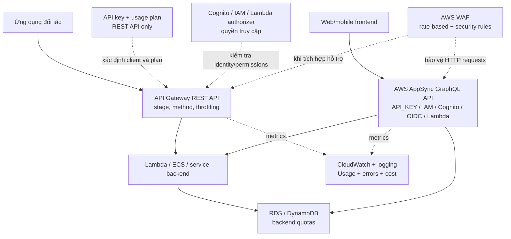
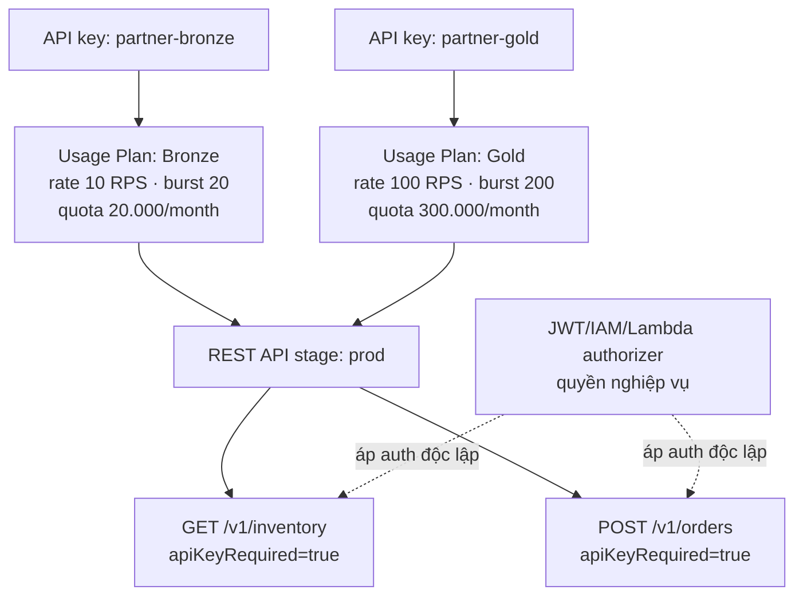
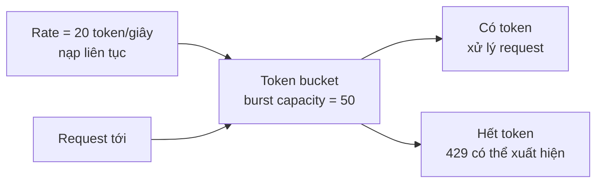
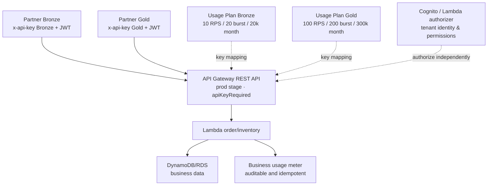

# API key, usage plan, throttling và quota trong API Gateway và AppSync

> **Chương:** API Gateway và AppSync  
> **Module:** CLOUD_PROVIDERS_AWS  
> **Mục tiêu:** phân biệt API key, cơ chế định danh/xác thực, usage plan, throttling và quota; cấu hình bảo vệ API theo khách hàng và theo quy mô hệ thống; hiểu giới hạn từng dịch vụ, cách giám sát, xử lý lỗi và dự toán chi phí.
>
> **Phạm vi:** Amazon API Gateway **REST API**, đối chiếu với **HTTP API/WebSocket API**, và **AWS AppSync GraphQL API**. Những ví dụ ID, tên miền, tài khoản, khóa và hạn mức khách hàng là giả định để học, không phải giá trị có thể triển khai trực tiếp.

## 1. Tình huống: hai API, ba khách hàng và một database

Một công ty cung cấp dịch vụ tra cứu tồn kho cho đối tác:

- **REST API:** `GET /v1/inventory` và `POST /v1/orders`, đi qua Amazon API Gateway tới AWS Lambda.
- **GraphQL API:** frontend nội bộ dùng AWS AppSync để đọc nhiều trường liên quan tồn kho từ DynamoDB hoặc Lambda resolvers.
- **Đối tác Bronze:** được dùng tối đa khoảng 10 request/giây trong giờ bình thường.
- **Đối tác Gold:** nhu cầu khoảng 100 request/giây với giới hạn sử dụng theo tháng.
- **Khách vãng lai:** chỉ xem dữ liệu công khai; không được đặt đơn hoặc đọc dữ liệu khách hàng khác.
- **Backend:** Lambda/RDS/DynamoDB có giới hạn concurrency, số kết nối và capacity; request tăng đột biến có thể gây quá tải hoặc tăng hóa đơn.

Đội phát triển muốn giải quyết bốn yêu cầu:

1. Biết **client nào** đang tiêu thụ API và phân chia gói dịch vụ.
2. Bảo đảm user chỉ truy cập **dữ liệu có quyền**.
3. Kiểm soát tốc độ request trong vài giây và số request theo tháng.
4. Tránh việc một đợt traffic tăng đột ngột làm sập backend hoặc khiến chi phí vượt kiểm soát.

Các chức năng này **không phải một**:

| Nhu cầu | Cơ chế điển hình | Câu hỏi nó trả lời |
|---|---|---|
| Nhận diện ứng dụng khách hàng để tính usage | **API key** của API Gateway REST + usage plan | Client có khóa hợp lệ thuộc plan nào? |
| Xác minh người dùng và quyền truy cập | **IAM, Cognito, JWT/OIDC, Lambda authorizer, ứng dụng** | Ai được đọc/sửa dữ liệu nào? |
| Giảm request burst/peak | **Throttling** và các tầng bảo vệ | Bắt đầu hạn chế tốc độ request lúc nào? |
| Hạn mức sử dụng trong kỳ | **Usage plan quota** hoặc business metering riêng | Một khách hàng đã gửi bao nhiêu request trong kỳ? |
| Bảo vệ GraphQL khỏi truy vấn đắt tiền | **AppSync service quotas, auth, AWS WAF, schema/resolver design** | Một GraphQL query tiêu thụ tài nguyên ra sao? |

**Tư duy chính:** API key không thay thế quyền truy cập; rate limit không đồng nghĩa quota; quota theo tháng không phải hợp đồng tính tiền chính xác; và giới hạn của **API Gateway REST** không tự động áp dụng cho **AppSync GraphQL**.

## 2. Sơ đồ tổng quan: API Gateway và AppSync bảo vệ điều gì?



Trong cả hai luồng, cần phân biệt **control plane** (IAM người quản trị tạo API/keys/plans) với **data plane** (request của khách gọi API). Cấp quyền `apigateway:GET` hay `appsync:ListApiKeys` cho administrator không tự cấp quyền gọi endpoint nghiệp vụ cho user cuối.

## 3. Ba khái niệm cốt lõi: API key, throttling và quota

### 3.1. API key là gì?

**API key** thường là một giá trị chuỗi mà client gửi trong HTTP header `x-api-key`. Ý nghĩa của khóa **phụ thuộc sản phẩm AWS**:

- Trong **API Gateway REST API**, API key là **client identifier** được dùng với **usage plan** để theo dõi và áp throttling/quota cho client. **AWS khuyến nghị không dùng nó thay cho authentication hoặc authorization.**
- Trong **AWS AppSync GraphQL API**, `API_KEY` là một **authorization mode** do AppSync hỗ trợ để mở truy cập theo key; phù hợp dev/test hoặc dữ liệu công khai, nhưng **không đại diện cho một user được xác thực mạnh** và không có usage plan kiểu API Gateway.

Đừng suy luận rằng vì cả hai gửi header `x-api-key` nên có thể dùng **cùng cơ chế quản lý plan/limit**.

### 3.2. Throttling là gì?

**Throttling** là hành động hệ thống từ chối hoặc trì hoãn một phần lưu lượng khi tốc độ request vượt ngưỡng mục tiêu. Trong API Gateway, cơ chế dựa trên **token bucket**:

- `rate`: tốc độ nạp token ổn định, thường đo **requests/giây (RPS)**.
- `burst`: dung lượng tối đa của bucket, cho phép phục vụ một đợt request ngắn vượt tốc độ bình thường.
- Khi không đủ token, client có thể nhận **HTTP 429 Too Many Requests**.

**Rate không phải số request đồng thời**, và **burst không phải quota theo ngày**.

### 3.3. Quota là gì?

Trong **API Gateway REST usage plan**, quota là số request mục tiêu cho **một API key** trong chu kỳ **DAY, WEEK hoặc MONTH**. Quota khác throttling:

| Thuộc tính | Throttling | Quota |
|---|---|---|
| Đơn vị chính | Request/giây và burst tokens | Tổng request trong ngày/tuần/tháng |
| Mục tiêu | Bảo vệ trước peak/surge | Phân bổ lượng sử dụng trong kỳ |
| Ví dụ | 20 RPS, burst 50 | 100.000 request/tháng |
| Khi vượt | Có thể trả 429 | Có thể trả 429 khi quota bị áp |
| Chính xác tuyệt đối? | **Không** — best effort | **Không** — best effort |
| Thay thế quyền truy cập? | Không | Không |

**Quota của usage plan không phải giới hạn tài chính cứng.** AWS nói rõ usage plan throttling/quota là **best effort**; trong một số trường hợp thực tế có thể vượt những con số đã cấu hình. Đối với yêu cầu hợp đồng như “không tính phí sau đúng request thứ 100.000”, phải có **metering/entitlement ở tầng ứng dụng** với cơ chế đối soát độc lập.

## 4. REST API, HTTP API, WebSocket API và AppSync khác nhau ở đâu?

Trước khi viết một dòng cấu hình, phải chọn đúng loại API.

| Khả năng | **API Gateway REST API** | **API Gateway HTTP API** | **API Gateway WebSocket API** | **AppSync GraphQL API** |
|---|---|---|---|---|
| API key + **usage plan** kiểu REST | **Có** | **Không** | Không dùng mô hình REST usage plan | **Không** |
| API key gửi `x-api-key` | **Có**, khi method yêu cầu | Không có tính năng REST API key/usage plan | Không theo cơ chế REST usage plan | **Có**, khi bật `API_KEY` auth |
| Request throttling | Account, stage/method, usage plan | Account + stage/route | Quota kết nối/message, stage/route theo hỗ trợ | Service quotas + WAF/query design |
| Quota per client per DAY/WEEK/MONTH | **Usage plan**, best effort | Không có tính năng plan tương đương | Không có tính năng plan tương đương | Không có API Gateway usage plan |
| Identity/auth | IAM, Cognito, Lambda authorizer, resource policy | JWT/IAM/Lambda authorizer | IAM/Lambda authorizer và integration | API_KEY, IAM, Cognito, OIDC, Lambda |
| Loại workload | REST API cần quản lý khách hàng/plan | HTTP endpoint đơn giản, tối ưu overhead/chi phí | Kết nối 2 chiều kéo dài | GraphQL queries, mutations, subscriptions |

**Lưu ý:** API Gateway **HTTP API** vẫn có **stage/route throttling** và account-level throttling. Nói HTTP API “không có API key” **không đồng nghĩa không có rate limiting**; chỉ là không có **per-client usage plan/API key feature** của REST API.

**Phạm vi AppSync:** chương này tập trung vào **GraphQL API**. AWS AppSync còn có các dòng sản phẩm **Event APIs** với quotas và tính năng riêng; không lấy mọi con số của GraphQL API áp cho Event API.

## 5. API key trong API Gateway REST API

### 5.1. Cách key tham gia xử lý request

Một API key có:

- **Name**: tên quản trị để nhận diện khách hàng/ứng dụng; name không phải key dùng truyền trên mạng.
- **Value**: chuỗi key thực tế gửi trong `x-api-key`.
- **Enabled/disabled** và metadata liên quan.
- Liên kết với một hoặc nhiều **usage plans** phù hợp.

API Gateway REST cho phép tạo key hoặc nhập key, thường có giá trị **20–128 ký tự**; giá trị key phải **duy nhất** theo quy tắc của dịch vụ. Dùng key do API Gateway tạo thường đơn giản và ít rủi ro hơn tự nghĩ chuỗi dễ đoán.

**Không in key thật trong tài liệu, log, repository, ticket hoặc ảnh chụp màn hình.** Dù AWS khuyên không dùng key như bí mật để chứng minh danh tính, người khác chiếm key vẫn có thể **tiêu thụ quota của khách hàng** và gọi những method chỉ yêu cầu key.

### 5.2. Nguồn lấy API key: HEADER hoặc AUTHORIZER

REST API Gateway hỗ trợ **hai API key sources**:

| `apiKeySource` | Cách hoạt động | Khi nào dùng |
|---|---|---|
| **HEADER** | API Gateway đọc giá trị header `X-API-Key` từ request | Đối tác truyền key trực tiếp |
| **AUTHORIZER** | Lambda authorizer trả `usageIdentifierKey` để API Gateway xác định key sử dụng | Muốn suy key từ identity đã được xác thực, thay vì để client gửi key rõ ràng |

Với `AUTHORIZER`, cần cấu hình REST API authorizer đúng dạng và trả về key value hợp lệ gắn usage plan. Đây **không phải** việc tự động chuyển `Authorization: Bearer ...` thành một usage plan; authorizer phải thực hiện mapping đúng.

**Tách chức năng:** Lambda authorizer có thể kiểm tra quyền của user, đồng thời trả `usageIdentifierKey` để chọn quota của khách hàng. **Usage plan chỉ đo/chặn theo client**, không thay thế logic phân quyền trong authorizer.

### 5.3. Method phải bật API Key Required

Tạo API key và usage plan **chưa đủ** để method bị kiểm soát bằng key. Trong **REST API method request**, phải bật:

```text
API Key Required = true
```

Ví dụ:

| Method | API Key Required | Authorization |
|---|---|---|
| `GET /v1/catalog` | `true` | Cognito/IAM/Lambda authorizer theo yêu cầu |
| `GET /v1/status` | `false` | Có thể public hoặc auth tùy thiết kế |
| `POST /v1/orders` | `true` | Authorization nghiệp vụ bắt buộc |

Sau khi thay method configuration, **deploy/redeploy REST API stage** nếu cần để thiết lập có hiệu lực ở stage.

Nếu `apiKeyRequired=false`, method **không dùng API key/usage plan để kiểm soát request**, dù stage đã được gắn vào usage plan. Đây là nguyên nhân thường gặp khiến thiết lập plan “không có tác dụng”.

### 5.4. Tại sao API key không nên dùng làm authorization?

Một key thường gắn với **ứng dụng khách hàng**, không phải từng người dùng. Nếu đội ngũ dùng **một key cho cả doanh nghiệp đối tác**, mọi user có key đó có thể gọi những method yêu cầu key trong stage tương ứng.

Nếu một usage plan chứa nhiều API stages, key thuộc plan có thể được chấp nhận trên các APIs/stages mà plan liên kết. AWS khuyên **không dùng API key để kiểm soát quyền đọc/sửa dữ liệu**.

Các lựa chọn thích hợp:

- **Amazon Cognito User Pools/JWT/OIDC** để định danh người dùng.
- **AWS IAM** và SigV4 cho workload-to-workload trong AWS.
- **Lambda authorizer** cho logic xác thực/phân quyền tùy chỉnh.
- **Backend authorization** để kiểm tra quyền theo từng đơn hàng, tenant, người dùng và resource.

**Một request hợp lệ thường cần cả hai:** JWT/IAM xác nhận quyền **và** API key để áp plan usage, chứ không phải hai cơ chế thay thế nhau.

## 6. Usage plan: mối quan hệ giữa client key, API stage và method

### 6.1. Usage plan chứa những gì?

Một **usage plan** của API Gateway REST API kết hợp:

1. **API stages:** một hoặc nhiều cặp `REST API ID + stage name`.
2. **API keys:** một hoặc nhiều keys được liên kết với plan.
3. **Throttle settings:** rate và burst mặc định hoặc overrides ở mức method.
4. **Quota:** số request mục tiêu trong DAY/WEEK/MONTH.



Giá trị trong sơ đồ chỉ **minh họa gói kinh doanh**, không phải quota mặc định AWS.

### 6.2. Quy tắc liên kết key với plans

AWS quy định:

- **Một key có thể liên kết với nhiều usage plans**, tùy stage.
- **Một plan có thể chứa nhiều API stages**.
- Nhưng **một API key chỉ được gắn với một usage plan cho một API stage cụ thể**.

Điều này giúp tránh việc cùng một key trên cùng stage đồng thời chịu hai plan mâu thuẫn. Nếu muốn Bronze và Gold trên cùng `prod` stage, tạo **hai keys khác nhau** hoặc quy hoạch mapping phù hợp.

### 6.3. Usage được cộng dồn ở phạm vi nào?

**Throttling và quota của usage plan được tính cho từng API key và cộng dồn qua tất cả API stages trong cùng plan.**

Ví dụ một key Bronze có quota 20.000 requests/tháng trong plan gồm:

- `inventory-api/prod`.
- `orders-api/prod`.

Khách hàng đã gọi inventory 12.000 request và orders 8.000 request thì tổng usage tương ứng khoảng **20.000** trong plan. Không được hiểu mỗi stage có quota 20.000 độc lập nếu cùng key và cùng plan.

**Method-level throttling override** trong plan có thể khác theo API/stage/method, nhưng **period quota** của plan vẫn là quota ở mức key/plan, không phải mỗi HTTP method có một quota tháng riêng trong cùng plan.

### 6.4. Bảng ví dụ hai gói

| Thuộc tính | Bronze | Gold |
|---|---:|---:|
| Rate target | 10 RPS | 100 RPS |
| Burst target | 20 | 200 |
| Monthly quota target | 20.000 requests | 300.000 requests |
| REST stages | `inventory-api/prod`, `orders-api/prod` | Cùng stages |
| Auth nghiệp vụ | JWT/IAM/authorizer | JWT/IAM/authorizer |
| Đối tượng | Đối tác ít traffic | Đối tác lưu lượng cao |

**Nhắc lại:** Gold quota 300.000 **không hứa chắc request 300.001 bị chặn đúng tuyệt đối**. Đây là target best effort. Nếu dùng để xuất hóa đơn trả tiền, cần **đo usage độc lập, audit và đối soát**.

## 7. Token bucket: hiểu đúng rate và burst

### 7.1. Hình dung chiếc xô token

API Gateway dùng một dạng **token bucket** để điều tiết request:



Ví dụ cấu hình **rate=20 RPS**, **burst=50**:

- Khi vắng traffic, bucket có thể tích lũy tối đa khoảng 50 tokens.
- Nếu 30 requests đến cùng một lúc sau khi bucket đầy, về mặt mô hình chúng có thể được chấp nhận dù tốc độ tức thời cao hơn 20 RPS.
- Nếu client liên tục gửi 100 RPS trong nhiều giây, bucket cạn nhanh; API Gateway bắt đầu throttle.

**Không tính “burst 50” thành 50 kết nối đồng thời**. Concurrency phụ thuộc duration ở backend và số request đang xử lý; token bucket điều tiết **tốc độ request**, không tự đóng kết nối database khi quá nhiều requests đang chạy.

### 7.2. Ví dụ định lượng

Giả sử bắt đầu với 50 tokens, server nạp 20 token mỗi giây, client gửi đều 100 requests/giây:

\[
\text{Mức rút ròng} \approx 100-20=80\ \text{token/giây}
\]

Thời gian tiêu hết 50 token khởi đầu ở mô hình lý tưởng:

\[
t \approx \frac{50}{80}=0{,}625\ \text{giây}
\]

Sau đó chỉ khoảng 20 RPS được phép tiến qua trong điều kiện ổn định, các request vượt ngưỡng có thể nhận 429.

**Chỉ là mô hình lý thuyết.** API Gateway áp throttling **best effort**, thuật toán phân tán và cách thống kê thực tế có thể khác; không lấy 0,625 giây làm SLA hoặc tiêu chí billing.

### 7.3. Tốc độ RPS không phải số invocations đồng thời

Nếu API nhận 20 RPS, Lambda chạy trung bình 0,4 giây:

\[
C \approx \text{RPS}\times\text{Duration}
=20\times0{,}4=8
\]

Backend có thể cần khoảng **8 concurrent invocations** lúc tải ổn định. Nhưng request duration tăng lên 2 giây do RDS chậm:

\[
C \approx 20\times2=40
\]

**API Gateway rate=20 RPS không bảo đảm Lambda concurrency luôn ≤ 8.** Muốn bảo vệ số concurrent executions cần kiểm tra **Lambda reserved concurrency**, RDS Proxy, ECS scaling hoặc trần của backend phù hợp.

## 8. Thứ tự các tầng throttling trong API Gateway

### 8.1. API Gateway REST API

Theo tài liệu AWS, các thiết lập throttling mục tiêu được xét theo thứ tự:

1. **Per-client/per-method throttle trong usage plan** cho API stage.
2. **Per-method throttling** được đặt tại API stage.
3. **Account-level throttling** theo AWS account/Region.
4. **AWS Regional throttling** ở mức dịch vụ.

Những tầng giới hạn không được vượt mức trần AWS tương ứng. Vì vậy một plan Gold rate=200 RPS **không tự bảo đảm 200 RPS** nếu account-level quota đã bị các APIs khác tiêu thụ.

### 8.2. Mặc định account-level quota

Theo AWS General Reference hiện hành, API Gateway account-level throttling mặc định ở nhiều Region là:

- **Steady-state rate:** khoảng **10.000 requests/giây**.
- **Burst bucket:** tối đa khoảng **5.000 requests** theo cơ chế dịch vụ.

Quota này áp dụng cho **tổng REST, HTTP, WebSocket và callback requests** trong cùng account/Region theo quy định của AWS. **Một số Region hoặc account có giá trị thấp hơn**, và burst capacity được AWS điều chỉnh theo account-level rate quota; cần xem **Service Quotas/quota thực tế** thay vì hard-code 10.000/5.000 vào thiết kế.

**Điểm dễ nhầm:** đây là **quota của tài khoản/Region**, không phải “mỗi REST API mặc định có 10.000 RPS tách biệt”.

### 8.3. API Gateway HTTP API

HTTP API không có REST usage plan, nhưng có:

- Account-level throttling.
- **Stage-level default route settings**.
- **Route-level throttling** với `ThrottlingRateLimit` và `ThrottlingBurstLimit` theo cấu hình hỗ trợ.

HTTP API cần **per-user/per-tenant billing** thì phải xây cơ chế quản lý khách hàng riêng (ví dụ Cognito/JWT authorizer + metering ở ứng dụng/DynamoDB) hoặc chọn REST API nếu usage plan là yêu cầu quan trọng. Không có nút chuyển REST usage plan sang HTTP API mà giữ nguyên mô hình.

### 8.4. WebSocket API

WebSocket có các giới hạn liên quan **số kết nối mới/giây, connection duration, message rate/payload và route throttling** theo tài liệu riêng. WebSocket connection tồn tại dài có semantics khác request HTTP đồng bộ. Không dùng “100 RPS” để suy ra được 100 kết nối đồng thời trong WebSocket.

## 9. Quota theo kỳ: điều khiển mức sử dụng, không phải ngân sách cứng

### 9.1. Kỳ quota

REST usage plans hỗ trợ quota periods:

| `period` | Diễn giải |
|---|---|
| `DAY` | Mục tiêu số request trong ngày |
| `WEEK` | Mục tiêu số request trong tuần |
| `MONTH` | Mục tiêu số request trong tháng |

API Gateway reset usage theo kỳ do dịch vụ quản lý. Khi hiển thị cho khách hàng toàn cầu, nên quy định rõ **múi giờ và cách tính chu kỳ trong hợp đồng**, đừng tự động hiểu “đầu ngày tại Việt Nam” đồng nghĩa kỳ usage của AWS.

### 9.2. Ví dụ kế hoạch theo tháng

Khách Gold có:

- Quota target **300.000 requests/tháng**.
- Rate target **100 RPS**, burst target 200.

Tại thời điểm quan sát, plan ghi nhận:

```text
GET /v1/inventory: 180.000 requests
POST /v1/orders: 110.000 requests
Tổng key trong usage plan: 290.000 requests
Còn khoảng: 10.000 requests
```

Số 10.000 là **ước tính từ usage plan**, không phải cam kết tuyệt đối backend sẽ từ chối đúng 10.001 request tiếp theo. Vì việc đếm/phân phối có độ trễ, khách có thể vượt con số một chút.

### 9.3. Quota usage plan không thay hệ thống tính phí

Nếu công ty muốn bán gói API trả tiền theo số lượng request:

1. Dùng API Gateway usage plan để **điều tiết sơ bộ** và hỗ trợ phân tầng dịch vụ.
2. Ghi usage theo client/tenant ở một **nguồn dữ liệu authoritative**.
3. Hỗ trợ **deduplication/idempotency** để retry request không bị tính sai khi nghiệp vụ yêu cầu.
4. Có quy tắc xử lý request bị lỗi, timeout, cache hit và request bị throttle.
5. Dùng counters/transactions có tính nhất quán theo yêu cầu hợp đồng.
6. Đối soát usage logs, backend metrics và hệ thống billing.
7. Thiết lập **AWS Budgets, Cost Anomaly Detection** và cảnh báo sớm.

AWS khuyến nghị không coi usage plan quota/throttling là một cơ chế khống chế **chi phí tối đa cứng** hoặc chặn truy cập bảo mật.

## 10. Quy trình thiết lập một REST API usage plan đúng cách

Giả sử một REST API có ID `a1b2c3d4e` và stage `prod`, method `GET /v1/inventory` gọi Lambda.

### 10.1. Thiết kế trước khi cấu hình

Xác định:

- Khách nào cần plan riêng, ví dụ Bronze/Gold?
- Mỗi plan có những **REST API stages** nào?
- Những methods nào cần `apiKeyRequired=true`?
- Authorization ở method là IAM, Cognito hay Lambda authorizer?
- RPS/burst và quota có hợp lý với Lambda/RDS?
- Có cần từng method có throttle override khác nhau không?
- Khi khách vượt quota, UX/API client sẽ retry/backoff hay hướng dẫn nâng gói?
- Có quy trình phát hành, đổi key, khóa key bị lộ và giám sát usage không?

### 10.2. Các bước trên AWS Console

1. **Tạo và deploy REST API** với stage `prod`.
2. Với những methods tính usage, bật **API Key Required** trong **Method request**, cấu hình authorization riêng rồi redeploy stage.
3. Tạo **API key** cho khách hàng; ưu tiên key do API Gateway tạo.
4. Vào **Usage plans → Create usage plan**; nhập rate, burst và quota target.
5. Thêm **API stage** `a1b2c3d4e/prod` vào plan.
6. Liên kết **API key** vào plan.
7. Test bằng HTTP request với key hợp lệ, thiếu key và key vô hiệu.
8. Đo `Count`, 4XX/429, usage theo key, downstream latency.
9. Cập nhật runbook rotate/revoke key và cảnh báo phí.

**Quan trọng:** việc thêm key vào usage plan **có thể mất vài phút để propagate**. Không kết luận cấu hình sai chỉ vì request đầu tiên ngay sau khi liên kết key nhận 403.

### 10.3. Cấu hình minh họa

Đây là **mô hình JSON khái niệm**, không phải payload gửi thẳng đến một API AWS duy nhất:

```json
{
  "restApiStage": "a1b2c3d4e/prod",
  "method": {
    "httpMethod": "GET",
    "resourcePath": "/v1/inventory",
    "apiKeyRequired": true,
    "authorization": "COGNITO_USER_POOLS"
  },
  "usagePlanBronze": {
    "name": "partner-bronze",
    "throttle": {
      "rateLimit": 10,
      "burstLimit": 20
    },
    "quota": {
      "limit": 20000,
      "period": "MONTH"
    }
  }
}
```

Mô hình trên chỉ thể hiện các tham số cần cấu hình ở **các resource khác nhau**: REST method, stage, usage plan, API key. Việc thực thi dùng Console, CloudFormation, CDK, Terraform hoặc API tương ứng.

### 10.4. Ví dụ gọi REST API

```bash
# Đối tác cần dùng key, đồng thời cần JWT nếu method cấu hình authorizer.
# API_KEY và ACCESS_TOKEN là environment variables do môi trường kiểm thử cung cấp.
curl --request GET \
  --url "https://a1b2c3d4e.execute-api.ap-southeast-1.amazonaws.com/prod/v1/inventory" \
  --header "x-api-key: $API_KEY" \
  --header "Authorization: Bearer $ACCESS_TOKEN"
```

**Lưu ý:** placeholder ID không phải endpoint thật. Không viết API key thật trong command shell history của terminal dùng chung; đọc credentials từ một source bí mật được quản lý và bảo vệ quyền truy cập.

Nếu chỉ có key mà thiếu JWT hợp lệ, method vẫn có thể bị từ chối — **đó là hành vi đúng** khi authorization được cấu hình độc lập.

## 11. AppSync API_KEY: cùng header, khác ý nghĩa

### 11.1. API_KEY là một authorization mode của GraphQL

AWS AppSync GraphQL API hỗ trợ các authorization modes như:

- **`API_KEY`**.
- **`AWS_IAM`** với SigV4.
- **`AMAZON_COGNITO_USER_POOLS`**.
- **`OPENID_CONNECT`**.
- **`AWS_LAMBDA`**.

Một GraphQL API có thể cấu hình **default authorization mode** và các **additional authorization modes** trong điều kiện hỗ trợ. Schema directives cho phép xác định field/object được truy cập bằng mode nào.

Ví dụ:

```graphql
type Product @aws_api_key {
  id: ID!
  name: String!
  price: Float
}

type Order @aws_cognito_user_pools {
  id: ID!
  customerId: ID!
  total: Float!
}

type Query {
  products: [Product!]! @aws_api_key
  myOrders: [Order!]! @aws_cognito_user_pools
}

schema {
  query: Query
}
```

**Đây chỉ là ví dụ sơ đồ schema.** Khi triển khai cần thiết lập default/extra auth modes, directives nhất quán với schema đầy đủ, resolver logic và dữ liệu có quyền. Không mặc định mọi field/object đều được bảo vệ chỉ vì thêm một directive ở field khác.

### 11.2. API key AppSync có thời hạn

Với GraphQL `API_KEY`, AppSync:

- Cho phép tạo/rotate API keys.
- Hỗ trợ thời hạn key **tối đa 365 ngày** cho mỗi lần thiết lập theo tài liệu hiện hành.
- Có thể gia hạn expiry thêm trong phạm vi được dịch vụ hỗ trợ.
- Mặc định khi tạo bằng một số API/CLI là khoảng **7 ngày**, nếu không đặt expiry phù hợp.
- Client gửi key trong header `x-api-key`.

**API_KEY được AWS khuyến nghị cho development hoặc API an toàn khi công khai.** Không dùng một public key được nhúng trong JavaScript/mobile app để khẳng định người dùng hiện tại được phép xem đơn hàng riêng tư.

### 11.3. AppSync không sử dụng API Gateway REST usage plans

AWS AppSync **không có mô hình usage plan Bronze/Gold gắn API keys** giống API Gateway REST. Nếu muốn:

- Giới hạn theo user/tenant.
- Gói 10.000 query/tháng cho một khách hàng.
- Chính sách invoice chính xác.
- Quyền khác nhau cho những trường GraphQL nhạy cảm.

Thì cần kết hợp **identity auth** (Cognito/OIDC/IAM/Lambda), **business metering** trong resolver/data source hoặc service phù hợp, và các lớp WAF/quota. Không thiết kế một AppSync GraphQL API rồi kỳ vọng `aws apigateway create-usage-plan` áp dụng trực tiếp.

### 11.4. Ví dụ gọi AppSync GraphQL API

```bash
# APPSYNC_KEY và endpoint được cung cấp qua biến môi trường bảo vệ.
curl --request POST \
  --url "https://EXAMPLE.appsync-api.ap-southeast-1.amazonaws.com/graphql" \
  --header "Content-Type: application/json" \
  --header "x-api-key: $APPSYNC_KEY" \
  --data '{"query":"query { products { id name price } }"}'
```

**Đừng chỉ nhìn HTTP 200 để kết luận GraphQL thành công.** Một GraphQL response có thể trả HTTP 200 **kèm `errors` array** do resolver/authorization/partial results. Quan sát cả HTTP status, GraphQL errors, latency và request token usage.

## 12. Throttling và quota trong AppSync GraphQL

### 12.1. Request tokens khác requests per second

AWS AppSync GraphQL dùng **request tokens/giây** như một quota tài nguyên theo account/Region, chứ không đơn giản chỉ đếm mỗi GraphQL query như một request có chi phí xử lý bằng nhau.

Theo tài liệu AWS hiện hành:

- Một request tiêu thụ đến **1.500 KB-seconds** tài nguyên xử lý có thể được phân bổ **1 request token**.
- Request dùng nhiều hơn sẽ tiêu thụ **nhiều tokens**, làm tròn lên theo công thức tài nguyên.
- Ví dụ AWS nêu request tiêu thụ **3.350 KB-seconds** được tính **3 tokens**.
- Quota mặc định GraphQL request tokens theo account/Region là **10.000 tokens/giây** tại nhiều Region, gồm `ap-southeast-1`, và **5.000 tokens/giây** ở một số Region khác.

**Đây không phải giới hạn 10.000 GraphQL requests/giây bảo đảm tuyệt đối.** Nếu mỗi request trung bình tiêu thụ 2 tokens, quota 10.000 tokens/giây chỉ tương ứng khoảng 5.000 requests/giây theo mô hình trung bình.

### 12.2. Ví dụ tính năng lực AppSync

| Workload | Tokens / request | Quota 10.000 tokens/s cho phép xấp xỉ |
|---|---:|---:|
| Query đơn giản | 1 | 10.000 req/s |
| Query phức tạp vừa | 2 | 5.000 req/s |
| Query nặng | 5 | 2.000 req/s |
| Query rất nặng | 10 | 1.000 req/s |

Số liệu chỉ minh họa để hiểu **token budget**; throughput thực có thêm quotas khác, latency downstream, concurrent connections, resolver capacity và network limits.

**Mỗi GraphQL request không nhất thiết ngang nhau.** Một query lấy 10 field có caching/batching tốt có thể nhẹ hơn query lồng nhiều cấp, gọi nhiều resolvers tuần tự hoặc trả kết quả rất lớn.

### 12.3. Làm sao biết request tiêu thụ nhiều tokens?

AppSync cung cấp:

- CloudWatch metric **`TokensConsumed`**.
- Response header **`x-amzn-appsync-TokensConsumed`** cho số tokens của request khi được cung cấp.
- Metrics `Requests`, `4XXError`, `5XXError` và `Latency`.
- Enhanced metrics theo resolver/data source/operation khi bật và có chi phí phù hợp.

Ví dụ request có header:

```text
x-amzn-appsync-TokensConsumed: 3
```

Điều đó cho thấy request này tiêu thụ ba tokens theo cách AppSync tính, **không đồng nghĩa khách hàng bị tính tiền ba request** trong mọi mô hình pricing. **Quota tokens** và **đơn vị billing** cần được đọc tách biệt trong bảng giá AWS.

### 12.4. Hạn chế GraphQL query quá đắt

Các biện pháp thường hữu ích:

1. Thiết kế schema có **pagination**, tránh trả danh sách vô hạn.
2. Tránh resolver fan-out kiểu **N+1**, dùng **batching** khi data source và resolver hỗ trợ.
3. Cân nhắc **caching** cho public/read-heavy fields phù hợp tính nhất quán.
4. Thiết lập **query depth/resolver count limits** khi tính năng/mô hình API hỗ trợ.
5. Dùng auth theo field, không cho public key gọi mutations nhạy cảm.
6. Đặt quota/capacity trên DynamoDB/Lambda/RDS và theo dõi downstream throttles.
7. Dùng **AWS WAF** cho web ACL rules, abuse patterns và rate-based controls.

**Tăng AppSync request-token quota không sửa một truy vấn GraphQL kém hiệu quả.** Đôi khi phải tối ưu schema/resolver trước rồi mới xin tăng quota.

## 13. AWS WAF: kiểm soát traffic theo IP và mẫu request

### 13.1. AWS WAF giải quyết phần nào?

AWS WAF có thể được gắn với các tài nguyên API được hỗ trợ, bao gồm **API Gateway REST API** ở phạm vi Regional tương ứng và **AppSync GraphQL API**, để:

- Chặn bot, request patterns nguy hiểm, SQLi/XSS attempts.
- Chặn/cho phép traffic theo địa lý, IP, headers hoặc các điều kiện khác.
- Đặt **rate-based rules** để xử lý client gửi quá nhiều request trong cửa sổ quan sát.
- Theo dõi sampled requests và CloudWatch metrics.

**AWS WAF không thay usage plan theo key.** Rate-based rule thường tổng hợp theo **client IP** hoặc khóa aggregation được hỗ trợ. Một IP NAT có thể đại diện cho hàng nghìn users; một user có thể thay IP. Vì vậy rate limit theo IP cần cân nhắc sai số và công bằng.

### 13.2. WAF với AppSync

Theo AWS, với GraphQL APIs tích hợp WAF, **WAF rules được đánh giá trước** các cơ chế authorization như API key, IAM, Cognito hoặc OIDC.

Ví dụ:

- WAF chặn request từ IP gửi traffic bất thường.
- Request còn lại mới tiếp tục được AppSync kiểm tra `API_KEY` hoặc JWT/IAM.
- Resolver xử lý query và truy cập DynamoDB/Lambda theo role/service config.

**Lưu ý:** WAF kiểm tra HTTP request, nhưng không tự hiểu toàn bộ semantic của GraphQL schema để xác định một user được phép xem mọi record. Cần authorization ở schema/resolver/business logic.

### 13.3. WAF không phải trần số tiền chắc chắn

Rate-based rules cũng có **cửa sổ đo đạc và propagation**, không nên coi là một cơ chế metering chính xác đến từng request cho hợp đồng trả tiền. Nó là lớp bảo vệ trước traffic abuse, thường bổ sung thay vì thay thế:

- Identity auth.
- AppSync/API Gateway service throttling.
- Downstream quotas.
- AWS Budgets, anomaly alerts.
- Tenant-aware usage accounting.

## 14. Thiết kế an toàn cho ba nhóm khách hàng

### 14.1. REST API đối tác trả tiền



Mô hình này phân chia:

- **API key:** xác định khách hàng theo plan, throttling/quota.
- **JWT/IAM:** xác thực user/workload và quyền tương ứng.
- **Lambda:** kiểm tra tenant ID, resource ownership và rules nghiệp vụ.
- **Usage meter:** ghi usage có thể đối soát cho billing.
- **CloudWatch/WAF:** giám sát lạm dụng và health.

Một key không nên dùng chung cho nhiều khách hàng không liên quan vì **quota và audit bị trộn lẫn**.

### 14.2. GraphQL public catalog

Một ứng dụng dùng AppSync để cung cấp **sản phẩm công khai**, nhưng đơn hàng là dữ liệu riêng:

- Public product queries có thể dùng `API_KEY` nếu đã đánh giá rủi ro công khai.
- `myOrders`, `updateOrder` yêu cầu Cognito/IAM/authorizer phù hợp.
- WAF bảo vệ khỏi traffic abuse; field-level auth tránh lộ private fields.
- AppSync TokensConsumed được giám sát để phát hiện query đắt.
- Resolver/data sources xử lý pagination, batching và tenant authorization.
- Nếu cần gói Gold/Bronze chính xác, xây metering/entitlement riêng, **không gọi REST usage plan cho AppSync**.

### 14.3. Tránh bảo mật chỉ dựa trên key nhúng trong frontend

Một SPA/web/mobile client có thể bị phân tích và lộ API key đã nhúng. Nếu một key cho phép gọi mutations thay đổi thông tin khách hàng:

- Kẻ tấn công có thể tái sử dụng key.
- Không biết user thực hiện mutation là ai.
- Không có quyền phân tách theo từng người dùng.
- Một key bị lộ có thể khiến usage quota nhanh chóng bị tiêu thụ hết.

Dùng **Cognito/JWT/OIDC/IAM/Lambda authorizer** cho dữ liệu và hành động nhạy cảm. API key là phụ trợ cho public API hoặc per-client usage, không phải identity token cá nhân.

## 15. Phản hồi lỗi: 403, 429 và GraphQL errors

### 15.1. API Gateway REST API

| Triệu chứng | Khả năng nguyên nhân | Bước chẩn đoán |
|---|---|---|
| **403 Forbidden** khi thiếu `x-api-key` | Method `apiKeyRequired=true` nhưng không có key hợp lệ | Kiểm tra header, enabled key, plan/stage association |
| **403 Forbidden** dù key có vẻ đúng | Key bị disable/sai value, key chưa gắn plan, chưa propagate, caller auth khác thất bại | Kiểm tra method, usage plan, key ID và authorizer |
| **401 Unauthorized** | Không có/invalid token theo cơ chế auth | Kiểm tra JWT/IAM/Lambda authorizer và expired token |
| **429 Too Many Requests** | Usage plan rate/burst/quota, stage/account/Regional throttle | So sánh traffic, usage và CloudWatch |
| **500/502/504** | Backend/integration lỗi hoặc timeout | Kiểm tra Lambda logs, integration latency và gateway responses |
| **Không nhận 429 dù đã đặt quota** | Method chưa require key, request đi stage khác, best-effort delay | Kiểm tra mapping method/stage/key/usage |
| **429 dù plan còn quota tháng** | Rate/burst/account limit hết trước quota | Đối chiếu tầng throttling và traffic peak |

**Không có quy tắc “mọi 403 là API key sai”.** 403 có thể đến từ resource policy, IAM authorizer, WAF/custom responses hoặc các cơ chế khác. Xem response type, access logs và CloudTrail/configuration context.

### 15.2. AppSync GraphQL

Một AppSync API có thể từ chối request vì:

- API key hết hạn/không hợp lệ hoặc sai auth mode.
- JWT/IAM signature không hợp lệ.
- Field/object bị từ chối theo auth directives.
- Vượt AppSync request-token quota hoặc quota khác.
- Query sai schema hoặc request body không hợp lệ.
- Resolver/data source bị throttled/lỗi.

**Một GraphQL response HTTP 200 có thể kèm `errors` array**; lỗi request-level có thể có HTTP 4xx/5xx tùy trường hợp. Đừng ép tất cả GraphQL errors thành “AppSync throttle 429”; cần đọc **HTTP status, response body, CloudWatch 4XX/5XX, TokensConsumed và resolver logs**.

### 15.3. Retry đúng khi nhận 429

Client nên:

1. Phân biệt 429 với 401/403 — **không retry vô hạn** khi credentials sai.
2. Tôn trọng `Retry-After` **nếu response có cung cấp**.
3. Dùng **exponential backoff với jitter**, có max attempts/time budget.
4. Tránh tất cả clients retry vào cùng một thời điểm.
5. Dùng idempotency key cho mutations/POST tạo đơn thanh toán.
6. Với workloads có thể trì hoãn, cân nhắc SQS hoặc queue để tách traffic spike khỏi backend.
7. Ghi lại request ID/correlation ID để điều tra; không log API key/token thật.

```text
retryDelay = min(maxDelay, baseDelay * 2^attempt)
actualDelay = random(0, retryDelay)  # full jitter
```

Đây là giả mã; SDK AWS có retry mechanisms sẵn cho nhiều trường hợp. Retry phải có **giới hạn**, đặc biệt khi upstream API Gateway đang bảo vệ downstream quá tải.

## 16. CloudWatch, access logs và kiểm toán

### 16.1. API Gateway metrics

Trong namespace **`AWS/ApiGateway`** có những metrics như:

| Metric | Cách đọc | Mục đích |
|---|---|---|
| **`Count`** | Tổng requests | Theo dõi traffic |
| **`4XXError`** | Tổng client/gateway errors | Phát hiện 403/429 tăng |
| **`5XXError`** | Lỗi server/integration | Phát hiện backend lỗi |
| **`Latency`** | Thời gian từ request nhận đến response | Độ trễ API end-to-end bên trong Gateway |
| **`IntegrationLatency`** | Thời gian API Gateway giao tiếp backend | Tách chậm backend khỏi Gateway overhead |
| **`CacheHitCount / CacheMissCount`** | Khi API cache được bật ở mô hình hỗ trợ | Tối ưu cache/chi phí backend |

**Chú ý:** `4XXError` bao gồm nhiều lỗi khác nhau, không phải metric “số request bị throttle” thuần. Muốn biết 429 cần kết hợp **access logs** có `status`, gateway response type và API key ID theo cấu hình log.

Detailed CloudWatch metrics theo method có thể **phát sinh phí riêng**; chỉ bật chi tiết phù hợp nhu cầu.

### 16.2. Không log key value

Với REST API access logs, có thể cân nhắc các trường:

```text
requestId
requestTime
httpMethod
resourcePath
status
responseLatency
integrationLatency
apiKeyId  # ID, không phải raw key value
```

**Không ghi `x-api-key` raw**, `Authorization` headers hoặc query chứa secrets vào logs. Nếu cần per-customer reporting, ánh xạ **key ID → tenant** trong hệ thống an toàn, cấp quyền đọc log theo least privilege.

### 16.3. AppSync metrics

Trong namespace **`AWS/AppSync`** thường có:

| Metric | Mục đích |
|---|---|
| **`Requests`** | Số GraphQL query/mutation requests |
| **`TokensConsumed`** | Quota resource tokens đã dùng |
| **`4XXError`** | Client errors/throttling/invalid auth và các trường hợp khác |
| **`5XXError`** | Lỗi phía service/processing |
| **`Latency`** | Thời gian xử lý API bên trong AppSync |
| **Enhanced metrics** | Phân tích theo operation, data source, resolver nếu bật |

Theo tài liệu AWS, AppSync có thể cung cấp `x-amzn-appsync-TokensConsumed` trong response để chẩn đoán riêng query. Log field-level quá chi tiết có thể chứa dữ liệu nhạy cảm và tăng phí/size; chọn logging level phù hợp.

### 16.4. CloudTrail và quản trị key

**CloudTrail** ghi các hoạt động quản trị như tạo/sửa/xóa API key, usage plan, API/stage và các chính sách tùy loại event/setting. Nó **không thay cho access logs của từng request người dùng**.

Theo dõi các thay đổi bất thường:

- Tạo key mới ngoài quy trình.
- Tắt `apiKeyRequired`.
- Gỡ một stage khỏi usage plan.
- Tăng rate/burst/quota lên mức không phù hợp.
- Tắt WAF/authorizer hoặc đổi AppSync auth mode.
- Thay IAM permissions/roles ảnh hưởng backend.

Dùng IAM least privilege và approval/alert cho các API quản trị có tác động tới bảo mật, chi phí và chất lượng dịch vụ.

## 17. AWS CLI: kiểm tra API Gateway REST usage plans (chỉ đọc)

Các ví dụ chỉ truy vấn, **không tạo, sửa hoặc lộ giá trị API key**. Cần AWS CLI v2 và quyền read-only đúng dịch vụ/Region. Các IDs minh họa phải thay bằng IDs thật; không dùng trên production để thu thập thông tin khách hàng nếu không được phép.

### 17.1. Liệt kê REST APIs

```bash
aws apigateway get-rest-apis \
  --region ap-southeast-1 \
  --query 'items[].[id,name,apiKeySource]' \
  --output table
```

`apiKeySource` là `HEADER` hoặc `AUTHORIZER`. Với API type khác, dùng namespace `apigatewayv2` — **đừng suy từ danh sách REST API** rằng HTTP API/AppSync chưa tồn tại.

### 17.2. Liệt kê usage plans

```bash
aws apigateway get-usage-plans \
  --region ap-southeast-1 \
  --query 'items[].[id,name,throttle.rateLimit,throttle.burstLimit,quota.limit,quota.period]' \
  --output table
```

Kết quả giúp kiểm tra plan, rate/burst, quota period; một số fields có thể rỗng nếu không cấu hình hoặc chưa có data.

### 17.3. Xem stage association và method overrides

```bash
aws apigateway get-usage-plan \
  --region ap-southeast-1 \
  --usage-plan-id PLAN_ID \
  --output json
```

Chú ý `apiStages[]`, `throttle`, `quota`; trong `apiStages[].throttle` có thể có các method-level overrides. Không coi `rateLimit` mặc định là “mỗi method đều có rate đó độc lập hoàn toàn”.

### 17.4. Xem keys được gắn vào plan mà không hiện key value

```bash
aws apigateway get-usage-plan-keys \
  --region ap-southeast-1 \
  --usage-plan-id PLAN_ID \
  --query 'items[].[id,name,type]' \
  --output table
```

**Không dùng `--include-values` hoặc query field `value`** trong báo cáo/chia sẻ không cần thiết. Key ID có thể dùng để đối chiếu logs và usage mà không phát tán raw key.

### 17.5. Kiểm tra method có require key không

```bash
aws apigateway get-method \
  --region ap-southeast-1 \
  --rest-api-id REST_API_ID \
  --resource-id RESOURCE_ID \
  --http-method GET \
  --query '{ApiKeyRequired:apiKeyRequired,Authorization:authorizationType}' \
  --output json
```

Muốn tìm resource ID, dùng:

```bash
aws apigateway get-resources \
  --region ap-southeast-1 \
  --rest-api-id REST_API_ID \
  --query 'items[].[id,path]' \
  --output table
```

Sau khi method được sửa, cần xác minh **đã deploy revision mới tới đúng stage**; cấu hình resource chưa deploy không nhất thiết là cấu hình client đang gọi.

### 17.6. Xem usage đã ghi nhận theo kỳ

```bash
aws apigateway get-usage \
  --region ap-southeast-1 \
  --usage-plan-id PLAN_ID \
  --start-date 2026-11-01 \
  --end-date 2026-11-20 \
  --output json
```

Dữ liệu từ `get-usage` dùng cho vận hành/đối chiếu, không thay ledger billing có yêu cầu chính xác tuyệt đối. Với nhiều khách hàng, lọc đúng **key ID** và khoảng ngày để tránh xử lý thông tin không cần thiết. Quota là best effort nên có độ trễ.

### 17.7. Kiểm tra API Gateway HTTP API throttling

```bash
aws apigatewayv2 get-stages \
  --region ap-southeast-1 \
  --api-id HTTP_API_ID \
  --query 'Items[].[StageName,DefaultRouteSettings,RouteSettings]' \
  --output json
```

Xem `ThrottlingRateLimit` và `ThrottlingBurstLimit` trong default/route settings. Đây là cách điều khiển traffic của **HTTP API**, không phải REST usage plan keyed per customer.

## 18. AWS CLI: kiểm tra AppSync GraphQL và quota (chỉ đọc)

### 18.1. Liệt kê GraphQL APIs

```bash
aws appsync list-graphql-apis \
  --region ap-southeast-1 \
  --query 'graphqlApis[].[name,apiId,authenticationType]' \
  --output table
```

### 18.2. Xem auth mode và cấu hình API

```bash
aws appsync get-graphql-api \
  --region ap-southeast-1 \
  --api-id GRAPHQL_API_ID \
  --query 'graphqlApi.{Name:name,ApiId:apiId,DefaultAuth:authenticationType,AdditionalAuth:additionalAuthenticationProviders}' \
  --output json
```

Một API có `API_KEY` ở default hoặc additional auth không chứng minh dữ liệu riêng tư đã được bảo vệ. Cần xem schema directives, resolver authorization và data source permissions.

### 18.3. Xem expiry của AppSync keys mà không in raw key

```bash
aws appsync list-api-keys \
  --region ap-southeast-1 \
  --api-id GRAPHQL_API_ID \
  --query 'apiKeys[].[description,expires,deletes]' \
  --output table
```

**Cảnh báo:** AppSync API key ID trong API response có thể chính là giá trị dùng để invoke. Ví dụ chủ ý **không chọn field `id`**. `expires` và `deletes` thường là Unix epoch seconds; cần chuyển về thời gian thực trước khi thông báo gia hạn.

Nếu API không dùng API_KEY mode, lệnh có thể không trả keys hoặc kết quả trống; điều đó không có nghĩa API bị lỗi.

### 18.4. Xem request-token quotas

```bash
aws service-quotas list-service-quotas \
  --region ap-southeast-1 \
  --service-code appsync \
  --query 'Quotas[].[QuotaName,Value,Adjustable]' \
  --output table
```

Cần lọc đúng **GraphQL APIs – Rate of request tokens** khi xem kết quả. Quota có thể thay đổi theo Region và yêu cầu tăng đã được duyệt; đừng dựa hoàn toàn vào con số ở bảng học.

### 18.5. Kiểm tra CloudWatch metrics

Trên CloudWatch, xem:

- `AWS/AppSync`: `Requests`, `TokensConsumed`, `4XXError`, `5XXError`, `Latency`.
- `AWS/ApiGateway`: `Count`, `4XXError`, `5XXError`, `Latency`, `IntegrationLatency`.
- `AWS/Lambda`: `Invocations`, `Errors`, `Throttles`, `ConcurrentExecutions`.
- `AWS/DynamoDB`: read/write throttling, consumed capacity theo bảng.
- **AWS WAF:** allowed/blocked/count metrics theo Web ACL/rule.

**Sự cố liên tầng thường xuất hiện đồng thời.** Ví dụ GraphQL `5XXError` tăng và Lambda `Throttles` tăng có thể là lỗi downstream Lambda concurrency, không nhất thiết AppSync request-token quota.

## 19. Ví dụ quy trình IaC và thay đổi cấu hình

> **Phần này diễn giải thay đổi có tác động thật.** Tạo key/plan, bật require API key, thay auth hoặc quota có thể gây 403/429, gián đoạn đối tác hoặc phí phát sinh. Chỉ triển khai sau khi đã xác nhận môi trường lab/change approval.

### 19.1. Cấu hình REST resources qua IaC

Các tài nguyên CloudFormation thường liên quan:

| Tài nguyên | Ý nghĩa |
|---|---|
| `AWS::ApiGateway::RestApi` | REST API |
| `AWS::ApiGateway::Resource` | Đường dẫn resource |
| `AWS::ApiGateway::Method` | HTTP method, `ApiKeyRequired`, `AuthorizationType` |
| `AWS::ApiGateway::Deployment` | Đóng băng cấu hình deploy |
| `AWS::ApiGateway::Stage` | Stage nhận traffic |
| `AWS::ApiGateway::ApiKey` | Key gắn tên/mode, có thể do AWS tạo value |
| `AWS::ApiGateway::UsagePlan` | API stages, throttle, quota |
| `AWS::ApiGateway::UsagePlanKey` | Liên kết API key với usage plan |

Ví dụ mô phỏng một số properties, **không phải template hoàn chỉnh**:

```yaml
# Phần tham chiếu cho một REST API đã có Deployment và Stage.
# Các logical IDs UsagePlan, ApiKey, RestApiStage là minh họa.
UsagePlan:
  Type: AWS::ApiGateway::UsagePlan
  Properties:
    UsagePlanName: bronze
    ApiStages:
      - ApiId: !Ref RestApi
        Stage: prod
    Throttle:
      RateLimit: 10
      BurstLimit: 20
    Quota:
      Limit: 20000
      Period: MONTH

ApiKey:
  Type: AWS::ApiGateway::ApiKey
  Properties:
    Name: partner-bronze
    Enabled: true
    GenerateDistinctId: true

UsagePlanKey:
  Type: AWS::ApiGateway::UsagePlanKey
  Properties:
    KeyId: !Ref ApiKey
    KeyType: API_KEY
    UsagePlanId: !Ref UsagePlan
```

**Lưu ý:** ngoài tài nguyên minh họa, method phải đặt `ApiKeyRequired: true` và AuthorizationType phù hợp, RestApi/Deployment/Stage phải tồn tại đúng dependency, template cần đảm bảo thứ tự CloudFormation và không còn sử dụng thuộc tính lỗi thời theo version tài liệu. Dùng `GenerateDistinctId` cần kiểm tra hỗ trợ hiện hành khi triển khai; **không đem snippet này chạy nguyên vẹn**.

### 19.2. Versioning cấu hình và rotation

Quy trình key rotation nên có:

1. Xác định khách nào đang dùng key cũ và deadline.
2. Tạo key mới, gắn đúng usage plan, đợi propagation.
3. Cấp key mới qua kênh an toàn, cho phép giai đoạn **overlap** phù hợp.
4. Theo dõi usage theo key ID cũ/mới, kiểm tra method auth vẫn hoạt động.
5. Vô hiệu hóa key cũ sau khi khách đã chuyển và thời gian rollback đủ.
6. Thu hồi nếu bị lộ; điều tra access logs, cost và quyền dữ liệu.
7. Với AppSync, tạo/gia hạn key và thay key client theo lịch expiry; tránh key công khai quyền quá rộng.

**Không rotate key như đổi JWT signing key**: API key không phải cơ chế user authentication có claims; cần kiểm soát identity/token riêng.

## 20. Chi phí và kiểm soát rủi ro tài chính

### 20.1. Các khoản phải tính

| Lớp | Ví dụ chi phí |
|---|---|
| **API Gateway REST/HTTP** | Requests theo cấu trúc giá tương ứng, data transfer, cache REST nếu bật |
| **API Gateway WebSocket** | Messages và connection minutes theo bảng giá |
| **AWS AppSync GraphQL** | Query/mutation operations, realtime updates/connection minutes và tính năng hỗ trợ |
| **AWS WAF** | Web ACL, rule groups, requests, optional advanced features |
| **Lambda** | Requests, execution duration, memory, provisioned concurrency nếu dùng |
| **DynamoDB/RDS** | Storage, reads/writes/capacity hoặc instance/database resources |
| **CloudWatch** | Logs ingestion/retention, detailed metrics, alarms |
| **VPC/network** | NAT, endpoints, cross-AZ data transfer tùy kiến trúc |

**Không tính AppSync request-token quota như thể token đó chắc chắn cũng là đơn vị tính tiền của API.** Quota token đo tài nguyên, còn phí AppSync cần đọc bảng giá theo loại operation/tính năng.

### 20.2. Vì sao quota 100.000/tháng không khóa hóa đơn?

- Usage plan là best effort; một lượng request có thể vượt target.
- API methods không yêu cầu key hoặc API khác vẫn có thể nhận traffic.
- AWS billing gồm traffic API khác, Lambda, RDS, WAF và logs.
- Một request GraphQL nặng có thể tốn nhiều resolver executions dù chỉ là một query operation.
- Retry storms, cache miss, error requests và integration costs có thể tăng ngay cả khi tổng request không vượt mức dự kiến.

Để quản trị rủi ro:

1. Đặt API Gateway usage plans/Stage throttles phù hợp.
2. Dùng AWS WAF trước abuse traffic ở nguồn.
3. Đặt Lambda reserved concurrency và database capacity đúng mức.
4. Thiết lập **AWS Budgets** và **Cost Anomaly Detection**.
5. Thêm application-specific hard quota/billing policy khi hợp đồng đòi hỏi.
6. Đánh giá số 4xx/5xx, queue backlog và RDS metrics.
7. Xem dữ liệu **Cost Explorer/CUR** theo Region, usage type và tags.

## 21. Bài tập tình huống có đáp án

### Bài 1 — Chọn API type

Một công ty bắt buộc cung cấp **API key riêng cho từng đối tác** và quota theo tháng bằng tính năng có sẵn trong API Gateway. Nên chọn REST API hay HTTP API?

**Đáp án:** **REST API** vì nó có API key + usage plan. HTTP API không cung cấp usage plan keyed per client; nếu chọn HTTP API phải tự phát triển metering/rate control phù hợp.

### Bài 2 — Bật key nhưng không có tác dụng

Team tạo key và usage plan Bronze, gắn stage `prod`, nhưng client không gửi key vẫn gọi được `GET /v1/items`.

**Đáp án:** Kiểm tra `apiKeyRequired=true` ở **method**, sau đó deploy/redeploy REST API stage. Chỉ tạo plan không tự buộc mọi method phải có key.

### Bài 3 — API key có phải quyền user?

Một khách hàng có Bronze key, developer cho phép truy vấn dữ liệu mọi user vì “key hợp lệ”.

**Đáp án:** Không an toàn. API key chỉ xác định client cho usage plan; cần Cognito/JWT/IAM/Lambda authorizer và kiểm tra tenant/resource ownership.

### Bài 4 — Rate và burst

Plan có `rate=20 RPS`, `burst=50`. Sau một thời gian không có request, client gửi nhanh 35 requests.

**Đáp án:** Theo mô hình token bucket, có thể phục vụ burst ngắn từ tokens đã tích lũy; 20 RPS là tốc độ lâu dài. Không được xem 50 là 50 request/tháng.

### Bài 5 — Quota theo plan có hai stages

Một key có quota 20.000/tháng trong một plan chứa Inventory và Orders stages. Khách đã gọi 12.000 requests Inventory và 8.000 Orders.

**Đáp án:** Usage tổng khoảng **20.000** trong key/plan, không phải mỗi API stage được 20.000 riêng.

### Bài 6 — Quota bị vượt

Plan đặt 100.000/tháng nhưng logs ghi nhận 100.020 requests trước khi chặn.

**Đáp án:** Có thể xảy ra vì quota là **best effort**, không phải hard limit. Nếu phải áp giới hạn hợp đồng chính xác, cần application business metering riêng.

### Bài 7 — 429 dù chưa hết quota tháng

Khách gửi 200 RPS nhưng plan rate 20 RPS, quota tháng mới dùng 5%.

**Đáp án:** Bị throttle theo **rate/burst**, dù quota kỳ chưa hết. Cần kiểm tra tốc độ, burst và retry.

### Bài 8 — 403 với key mới

API key mới gắn plan, vừa cập nhật xong client nhận 403 vài phút.

**Đáp án:** Kiểm tra key value, enabled status, stage association, method và **thời gian propagation**. Đồng thời kiểm tra authorization khác, không mặc định mọi 403 chỉ do key.

### Bài 9 — Account quota chung

Ba REST APIs đều gửi 5.000 RPS trong cùng account/Region; mỗi usage plan đặt rate 6.000 RPS. Có bảo đảm tổng 15.000 RPS không throttle không?

**Đáp án:** Không. **Account-level throttling** áp chung toàn account/Region; các tầng thấp không vượt các giới hạn trên. Cần xem Service Quotas thực tế.

### Bài 10 — HTTP API vẫn có throttle?

Một nhóm chọn HTTP API vì đơn giản và tuyên bố HTTP API không thể throttle request.

**Đáp án:** Sai. HTTP API có account-level và route/stage throttling, nhưng không có REST API usage plan keyed per client.

### Bài 11 — AppSync API_KEY vs API Gateway key

Frontend dùng AppSync GraphQL API có `x-api-key` và cần gói 10.000 queries/tháng cho một tenant. Có thể gắn AWS::ApiGateway::UsagePlan vào AppSync không?

**Đáp án:** Không. AppSync `API_KEY` là auth mode riêng, không dùng REST usage plans. Cần user/tenant auth, custom usage metering và WAF/service quotas.

### Bài 12 — AppSync key bị lộ

AppSync dùng key trong JavaScript client cho `mutation deleteOrder`; key bị sao chép.

**Đáp án:** Key nhúng frontend không chứng minh user identity. Mutation nhạy cảm phải dùng Cognito/IAM/OIDC/Lambda authorizer và kiểm tra quyền theo record/tenant. Rotate key và kiểm tra logs.

### Bài 13 — AppSync token math

GraphQL API có quota 10.000 tokens/giây. Mỗi request tiêu thụ trung bình 5 tokens. Năng lực ước tính ở mức token budget?

**Đáp án:** \(10.000/5 \approx 2.000\) requests/giây, còn bị giới hạn thêm bởi downstream, connections và quotas khác.

### Bài 14 — Query GraphQL quá nặng

Một query trả danh sách lớn, gọi nhiều resolvers và `TokensConsumed` tăng mạnh. Có nên chỉ xin tăng token quota?

**Đáp án:** Chưa đủ. Cần pagination, batching, caching, giới hạn query complexity/depth và tối ưu resolver/data source trước; mới xét quota.

### Bài 15 — AWS WAF rate limit theo IP

Một doanh nghiệp có 500 nhân viên chung một public NAT IP và WAF rate-based rule giới hạn theo client IP. Nhiều nhân viên bị block dù không ai lạm dụng.

**Đáp án:** IP không đồng nghĩa một user. Cần thiết kế aggregation key/rate rule phù hợp, allowlist khi hợp lý, auth/tenant-aware controls, đánh giá false positives.

### Bài 16 — Retry 429

Client nhận HTTP 429 rồi retry 100 lần/giây ngay lập tức, làm hệ thống lỗi nặng hơn.

**Đáp án:** Dùng **exponential backoff + jitter**, Retry-After nếu có, giới hạn retry/time budget và idempotency cho write operations.

### Bài 17 — Rate limit có bảo vệ DB connections?

API Gateway giới hạn 50 RPS, nhưng Lambda mỗi request mất 4 giây khi RDS chậm. Concurrency ước tính?

**Đáp án:** \(50\times4=200\) concurrent invocations ở trạng thái ổn định. Rate limit không đồng nghĩa trần 50 DB connections; cần Lambda RC, RDS Proxy, pool và capacity planning.

### Bài 18 — 4XXError tăng

API Gateway CloudWatch `4XXError` tăng. Có kết luận tất cả là usage-plan throttles không?

**Đáp án:** Không. 4XX gồm các loại lỗi client khác nhau: 401/403/429, validation... Xem access logs có status/response type và auth/key metadata **không lộ raw key**.

### Bài 19 — Gọi AppSync thành công?

HTTP 200 trả GraphQL body `{"data":{"products":null},"errors":[...]}`. Có nên xem request hoàn toàn thành công không?

**Đáp án:** Không. GraphQL có thể trả HTTP 200 cùng `errors`; cần kiểm tra body/field errors và resolver logs, không chỉ HTTP code.

### Bài 20 — Usage plan là hóa đơn?

Team muốn dùng API Gateway `get-usage` làm số liệu duy nhất để tính tiền chính xác cho hợp đồng B2B.

**Đáp án:** Không nên vì usage plan best effort và có độ trễ. Dùng một hệ thống usage metering có thể audit/đối soát, nêu quy tắc request tính phí và idempotency.

### Bài 21 — AppSync request token quota theo Region

Một ứng dụng tại `ap-southeast-1` có request-token limit được quota tăng riêng, nhóm dùng con số mặc định 10.000 tokens/s trong tài liệu để kết luận không thể xử lý hơn.

**Đáp án:** Phải kiểm tra **Service Quotas/limits thực tế của account/Region**. Giá trị mặc định không phải giới hạn cố định cho mọi tài khoản.

### Bài 22 — Cấp quyền IAM sai

Một developer có quyền tạo usage plan và API keys nên cho rằng user cuối cũng tự có quyền đọc mọi đơn hàng.

**Đáp án:** Sai. **Control-plane IAM** không thay thế **data-plane auth/authorization**. Cần identity token, authorizer và backend permission kiểm tra từng user/tenant.

## 22. Checklist thiết kế production

1. **Loại API:** REST API có usage plan; HTTP API không có REST per-client plan; AppSync GraphQL dùng auth/quota riêng.
2. **Định danh:** quyết định key quản lý theo partner/app hay user identity; không dùng raw key như chứng minh quyền cá nhân.
3. **REST method:** bật `apiKeyRequired` đúng resource/method và deploy đúng stage.
4. **Usage plan:** gắn API stages, key và rate/burst/quota; hiểu usage cộng dồn theo key trong plan.
5. **Authorization:** dùng IAM, Cognito/JWT/OIDC, Lambda authorizer và logic tenant-level.
6. **Throttling:** chọn rate/burst có số đo thực tế; hiểu token bucket và thứ tự account/Regional quotas.
7. **Quota:** ghi rõ kỳ DAY/WEEK/MONTH, best-effort nature và quy tắc user-facing.
8. **GraphQL:** quản lý API_KEY expiry, additional auth modes, field-level auth và query complexity.
9. **AppSync tokens:** kiểm tra request-token quota per account/Region, metric TokensConsumed và downstream capacity.
10. **Bảo vệ traffic:** WAF rate-based/managed rules, chống false positives sau NAT/shared IP.
11. **Backend:** Lambda concurrency, RDS/DynamoDB capacity, queues và thời gian xử lý.
12. **Xử lý lỗi:** phân biệt 401/403/429 và GraphQL errors; client backoff+jitter, idempotency.
13. **Observability:** API Gateway Count/4XX/5XX/Latency, AppSync Requests/TokensConsumed/Errors, access logs không lộ keys.
14. **Security:** rotate/revoke key, kiểm soát IAM management APIs, token storage, CloudTrail.
15. **Billing:** có ledger/metering độc lập nếu cần giới hạn hoặc thanh toán chính xác.
16. **Chi phí:** API request pricing, WAF, Lambda, AppSync, RDS, CloudWatch và VPC; bật AWS Budgets/anomaly alert.
17. **Thử nghiệm:** giả lập burst, thiếu key, key sai, JWT hết hạn, quota vượt, resolver chậm và source retries.
18. **Vận hành:** kiểm tra quota thực tế, lịch sử thay đổi và cập nhật tài liệu AWS theo Region/tính năng.

**Ghi nhớ cuối bài:** **API Gateway REST API key** dùng để xác định client cho **usage plan**, chứ không phải chứng thực quyền truy cập; **throttling** kiểm soát tốc độ và burst, trong khi **quota** đo mức sử dụng theo kỳ nhưng đều là **best effort**. **AppSync API_KEY** là một GraphQL authorization mode riêng, còn khả năng chịu tải AppSync chịu **request-token quotas** và các giới hạn downstream. Hệ thống an toàn cần phối hợp **authentication/authorization, rate protection, per-tenant accounting, giám sát và kiểm soát chi phí** thay vì chỉ dựa vào một API key.

## Tài liệu AWS tham khảo

- [Usage plans and API keys for REST APIs in API Gateway](https://docs.aws.amazon.com/apigateway/latest/developerguide/api-gateway-api-usage-plans.html)
- [Set up API keys for REST APIs](https://docs.aws.amazon.com/apigateway/latest/developerguide/api-gateway-setup-api-keys.html)
- [Choose an API key source](https://docs.aws.amazon.com/apigateway/latest/developerguide/api-gateway-api-key-source.html)
- [Create usage plans for REST APIs](https://docs.aws.amazon.com/apigateway/latest/developerguide/api-gateway-create-usage-plans.html)
- [Maintain and monitor a usage plan](https://docs.aws.amazon.com/apigateway/latest/developerguide/api-gateway-usage-plan-manage-usage.html)
- [Throttle requests to REST APIs](https://docs.aws.amazon.com/apigateway/latest/developerguide/api-gateway-request-throttling.html)
- [Throttle requests to HTTP APIs](https://docs.aws.amazon.com/apigateway/latest/developerguide/http-api-throttling.html)
- [Choose between REST APIs and HTTP APIs](https://docs.aws.amazon.com/apigateway/latest/developerguide/http-api-vs-rest.html)
- [Amazon API Gateway quotas](https://docs.aws.amazon.com/apigateway/latest/developerguide/limits.html)
- [API Gateway metrics and dimensions](https://docs.aws.amazon.com/apigateway/latest/developerguide/api-gateway-metrics-and-dimensions.html)
- [AppSync GraphQL authorization types](https://docs.aws.amazon.com/appsync/latest/devguide/security-authz.html)
- [AWS AppSync API key API reference](https://docs.aws.amazon.com/appsync/latest/APIReference/API_ApiKey.html)
- [AWS AppSync endpoints and quotas](https://docs.aws.amazon.com/general/latest/gr/appsync.html)
- [Using CloudWatch to monitor AWS AppSync](https://docs.aws.amazon.com/appsync/latest/devguide/monitoring.html)
- [AWS WAF integration with AppSync](https://docs.aws.amazon.com/appsync/latest/devguide/WAF-Integration.html)
- [Security best practices for AWS AppSync](https://docs.aws.amazon.com/appsync/latest/devguide/best-practices.html)
- [Amazon API Gateway pricing](https://aws.amazon.com/api-gateway/pricing/)
- [AWS AppSync pricing](https://aws.amazon.com/appsync/pricing/)
