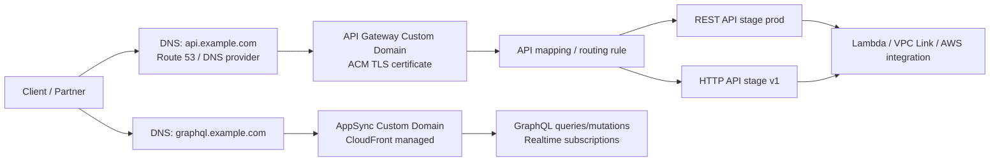
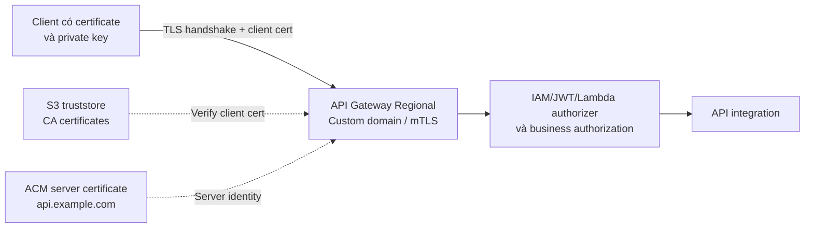
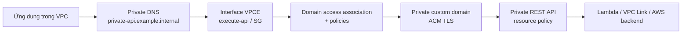
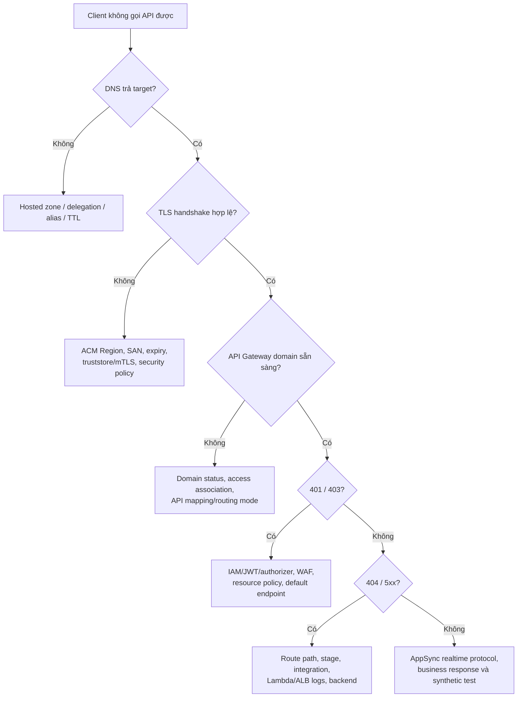

# Custom domain, certificate và endpoint API

## Mục tiêu học tập

Sau bài học, bạn có thể:

1. Phân biệt URL `execute-api` mặc định, **custom domain**, **API mapping**, **routing rule** và **DNS record** khi công bố API trên Amazon API Gateway.
2. Chọn đúng **Regional**, **edge-optimized** hoặc **private endpoint** theo loại API; hiểu vì sao REST, HTTP, WebSocket và AWS AppSync có hỗ trợ khác nhau.
3. Chuẩn bị **AWS Certificate Manager (ACM) certificate** đúng tên miền và Region, xác thực quyền sở hữu qua DNS, cấu hình HTTPS/TLS và lên kế hoạch gia hạn/đổi certificate.
4. Cấu hình **Route 53 alias A/AAAA** hoặc DNS tại nhà cung cấp khác, hiểu khác biệt giữa **hosted zone của mình** và **hosted zone ID do AWS cung cấp cho API endpoint**.
5. Dùng **API mappings/base path mappings** cho version, stage hoặc nhiều API trên một domain; phân biệt với routing rules mới được API Gateway hỗ trợ.
6. Thiết lập **custom domain cho AppSync** dùng chung hostname cho GraphQL HTTPS và real-time WebSocket; biết yêu cầu certificate **ACM tại us-east-1**.
7. Hiểu **mTLS**, **private custom domain**, mặc định `execute-api`, ủy quyền IAM/JWT/Lambda authorizer, API resource policy, WAF và những giới hạn bảo mật của DNS/TLS.
8. Thực hành qua AWS CLI, kiểm chứng bằng `curl`/DNS, chẩn đoán lỗi 403/404/502/TLS và xem xét giám sát, khả dụng, chi phí.

## 1. Bài toán: URL API phải dễ nhớ, an toàn và có thể thay đổi backend

Giả sử một cửa hàng triển khai Java API bằng **API Gateway → Lambda**, đồng thời xây dựng API GraphQL cho giao diện thời gian thực bằng **AWS AppSync**. Trong giai đoạn thử nghiệm, API Gateway trả một URL kiểu:

```text
https://a1b2c3d4e5.execute-api.ap-southeast-1.amazonaws.com/prod/orders
```

AppSync lại có endpoint riêng cho GraphQL và subscriptions:

```text
https://a1b2c3d4e5.appsync-api.ap-southeast-1.amazonaws.com/graphql
wss://a1b2c3d4e5.appsync-realtime-api.ap-southeast-1.amazonaws.com/graphql
```

Các URL mặc định dùng được nhưng khó ghi nhớ, lộ cấu trúc stage/ID của dịch vụ và không phù hợp hợp đồng tích hợp API dài hạn. Doanh nghiệp muốn:

- Khách hàng gọi REST/HTTP API qua `https://api.example.com/v1/orders`.
- Ứng dụng GraphQL gọi `https://graphql.example.com/graphql` và `wss://graphql.example.com/graphql/realtime`.
- Certificate HTTPS được quản lý, có khả năng gia hạn và giám sát.
- Có thể chuyển stage/backend mà không buộc đối tác đổi hostname.
- Chặn những đường vào không mong muốn, quản lý xác thực/ủy quyền và phân biệt public API với private API.

**Custom domain** cung cấp hostname thuộc quyền quản lý của bạn; **certificate** chứng minh danh tính tên miền và bảo vệ TLS; **DNS** đưa client đến endpoint được AWS cấp; **API mapping hoặc routing rule** đưa request từ domain đó tới API/stage tương ứng.

> **Ghi nhớ sớm:** DNS và certificate không tạo quyền truy cập ứng dụng. Một API có HTTPS hợp lệ vẫn có thể lộ dữ liệu nếu route không có authorizer, IAM/resource policy hoặc kiểm soát truy cập đúng.

### Sơ đồ đường đi



Sơ đồ minh họa hai **dịch vụ khác nhau**, không phải AppSync là một stage của API Gateway. Một domain tùy chỉnh cho API Gateway **không tự ánh xạ** sang AppSync.

## 2. Phân biệt API endpoint mặc định và custom domain

| Khái niệm | Ví dụ | Ai quản lý? |
| --- | --- | --- |
| **Default invoke URL** | `https://a1b2c3d4e5.execute-api.ap-southeast-1.amazonaws.com/prod/orders` | API Gateway cấp hostname và API ID; stage/path phụ thuộc API type. |
| **Custom domain hostname** | `api.example.com` | Bạn sở hữu tên miền và tạo cấu hình custom domain. |
| **Custom domain target** | `d-abc123.execute-api.ap-southeast-1.amazonaws.com` | API Gateway cấp đích để cấu hình DNS. |
| **ACM certificate** | Certificate chứa SAN `api.example.com` | Bạn yêu cầu/import, chứng minh quyền sở hữu, gắn vào custom domain. |
| **API mapping** | `v1` → HTTP API `abc123`, stage `prod` | API Gateway định tuyến prefix URL tới API/stage. |
| **DNS alias** | `api.example.com` → API Gateway Regional target | Route 53 hoặc DNS provider định hướng tên miền. |
| **API integration** | Route `GET /orders` → Lambda/ALB | API Gateway gửi request tới backend. |

Ví dụ sau khi cấu hình:

```text
Client gọi: https://api.example.com/v1/orders/42
DNS: api.example.com → Regional API Gateway target
TLS: API Gateway trình certificate hợp lệ cho api.example.com
Mapping: /v1 → API abc123, stage prod
Route trong API: GET /orders/{id}
Backend: Lambda orders-handler → dữ liệu
```

**Đường dẫn `v1` ở custom domain là mapping key**; nó không nhất thiết là tên stage trong nội bộ. Việc bỏ prefix mapping có thể khiến backend nhận path khác với khi gọi URL `execute-api` mặc định.

### REST, HTTP và WebSocket API: không dùng chung mọi quy tắc

| API type | Default endpoint | Custom domain | Lưu ý |
| --- | --- | --- | --- |
| **REST API** (API Gateway v1) | `https://{api-id}.execute-api.{region}.amazonaws.com/{stage}/...` | **Regional**, **edge-optimized**, hoặc **private custom domain** cho private REST API. | Có stage deployments, usage plans/API keys, REST features; edge-optimized sử dụng CloudFront do API Gateway quản lý. |
| **HTTP API** (API Gateway v2) | `https://{api-id}.execute-api.{region}.amazonaws.com/{stage}/...`; `$default` stage có thể không lộ trong URL. | **Regional custom domain**. | Chi phí/tính năng khác REST; dùng `apigatewayv2` CLI và API mappings. |
| **WebSocket API** (API Gateway v2) | `wss://{api-id}.execute-api.{region}.amazonaws.com/{stage}` | **Regional custom domain**. | Kết nối lâu dài, route selection và callback URL; không giống HTTP API. |
| **AWS AppSync GraphQL** | `https://...appsync-api.../graphql` và `wss://...appsync-realtime-api.../graphql` | AppSync-managed custom domain cho GraphQL và realtime. | Cần ACM certificate ở `us-east-1`; dùng AppSync domain association, không dùng API Gateway API mapping. |

Các ví dụ URL dùng dấu ngoặc nhọn để chỉ biến thay thế; giá trị API ID và Region phải lấy từ account thật. **API endpoint type** (REGIONAL/EDGE/PRIVATE) là lựa chọn hạ tầng, còn **REST/HTTP/WebSocket/GraphQL** là kiểu giao diện/giao thức. Hai chiều này không đồng nghĩa.

## 3. Endpoint types: Regional, edge-optimized và private

### 3.1. Regional endpoint

Regional custom domain thường là lựa chọn tốt khi:

- Client chủ yếu gọi API từ cùng Region hoặc bạn **tự đặt CloudFront** phía trước để tùy chỉnh caching, WAF, TLS và multi-Region routing.
- Bạn dùng **HTTP API** hoặc WebSocket API.
- Cần **mTLS** với REST/HTTP public API khi đáp ứng điều kiện.
- Muốn quản lý API Gateway endpoint và certificate trong cùng Region.

Ví dụ `api.example.com` cho một HTTP API tại Singapore cần **ACM certificate ở `ap-southeast-1`**, không lấy ARN của certificate ở Tokyo hay N. Virginia.

### 3.2. Edge-optimized endpoint cho REST API

Một **edge-optimized custom domain** của REST API dựa trên phân phối **Amazon CloudFront do API Gateway quản lý**. Yêu cầu certificate **ACM tại `us-east-1`** (N. Virginia), dù REST API đặt ở Region khác.

| Hạng mục | REST Regional | REST Edge-optimized |
| --- | --- | --- |
| Chặng client tới API | Regional API Gateway endpoint. | CloudFront edge do API Gateway quản lý chuyển về API Region. |
| ACM certificate | **Cùng Region** với Regional custom domain/API. | **`us-east-1`**. |
| DNS alias target | `RegionalDomainName` + `RegionalHostedZoneId`. | `DistributionDomainName` + `DistributionHostedZoneId`. |
| Giám sát/thay đổi | Quản lý trực tiếp endpoint Regional. | Tính đến thời gian phân phối cấu hình qua CloudFront. |
| Loại API hỗ trợ | REST/HTTP; WebSocket theo hỗ trợ Regional riêng. | **REST API**, không áp cho HTTP/WebSocket API. |

Không nhầm edge-optimized custom domain với việc bạn **tự tạo CloudFront distribution** phía trước Regional API; hai mô hình có cách quản lý cache/certificate/DNS và chi phí khác nhau.

### 3.3. Private custom domain cho private REST API

**Private REST API** được truy cập qua **interface VPC endpoint** dành cho `execute-api`. AWS hỗ trợ **private custom domain** cho REST API với các điều kiện riêng:

- Tạo custom domain endpoint type **PRIVATE**, với certificate và resource policy thích hợp.
- Cấp **domain name access association** cho VPC endpoint được phép sử dụng domain.
- Thiết kế **resource policy của private domain** và **resource policy của private API** để kiểm soát principal/VPC endpoint phù hợp.
- Thiết lập DNS/private hosted zone và đường truy cập trong VPC hoặc mạng kết nối hợp lệ; client không tự truy cập được chỉ vì domain có certificate.

Private custom domain có thể cần thời gian provisioning/association trước khi dùng. Một tên private custom domain có thể tồn tại trong nhiều account với điều kiện phạm vi, nhưng **không thể coi cơ chế namespace/policy giống public domain**.

**Giới hạn quan trọng:** mTLS của API Gateway **không được hỗ trợ cho private APIs** theo tài liệu REST/HTTP mTLS. Private custom domain không biến HTTP API thành private REST API.

## 4. ACM certificate: đúng tên, Region, chuỗi tin cậy

**AWS Certificate Manager (ACM)** có thể cấp public certificate khi bạn kiểm soát tên miền. Certificate dùng cho API Gateway/AppSync phải chứa **tên mà client thực sự truy cập**, trong Common Name/SAN theo cách được TLS xác minh.

Ví dụ:

| Client URL | Certificate phù hợp | Không đủ |
| --- | --- | --- |
| `https://api.example.com` | SAN `api.example.com` hoặc `*.example.com`. | Cert chỉ có `www.example.com`. |
| `https://payments.api.example.com` | SAN `payments.api.example.com` hoặc `*.api.example.com`. | `*.example.com` **không** phủ nhiều cấp tên. |
| `https://example.com` | SAN `example.com`. | `*.example.com` không phủ zone apex. |
| `https://graphql.example.com` (AppSync) | ACM certificate ở `us-east-1` chứa `graphql.example.com`. | Certificate cùng tên nhưng chỉ có ở `ap-southeast-1`. |

### 4.1. Quy tắc certificate theo dịch vụ

| Endpoint | ACM Region cần dùng | Ghi chú |
| --- | --- | --- |
| API Gateway **REST Regional** | **Region của API/custom domain**, ví dụ `ap-southeast-1`. | Regional endpoint gắn cert tại Region đó. |
| API Gateway **HTTP/WebSocket Regional** | **Region của API**, ví dụ `ap-southeast-1`. | Tạo domain qua `apigatewayv2`. |
| API Gateway **REST edge-optimized** | **`us-east-1`**. | Vì domain được phục vụ qua CloudFront do API Gateway quản lý. |
| API Gateway **private REST custom domain** | **Region của private API/domain**, theo hướng dẫn private domain. | Cần thêm resource policy/access association. |
| **AppSync custom domain** | **`us-east-1`**. | AppSync tạo CloudFront distribution và dùng certificate ở N. Virginia. |

### 4.2. Cấp certificate bằng DNS validation

Chạy ở **Region đúng mục tiêu**, ví dụ cho API Gateway Regional ở Singapore:

```bash
aws sts get-caller-identity

aws acm request-certificate \
  --domain-name api.example.com \
  --validation-method DNS \
  --region ap-southeast-1
```

AWS trả `CertificateArn`. Dùng ARN đó để xem **DomainValidationOptions**:

```bash
aws acm describe-certificate \
  --certificate-arn "arn:aws:acm:ap-southeast-1:111122223333:certificate/<real-cert-id>" \
  --region ap-southeast-1 \
  --query 'Certificate.{Status:Status,Names:SubjectAlternativeNames,Validation:DomainValidationOptions}'
```

ACM cung cấp một **CNAME record** để xác minh bạn sở hữu domain. Hãy tạo đúng record trong **public DNS zone** (hoặc DNS provider đang authoritative), rồi kiểm tra certificate đạt `ISSUED` trước khi gắn vào endpoint.

**DNS validation record là CNAME chứng minh sở hữu; nó không phải API endpoint record**. Hai record dùng cho **hai mục đích khác nhau**: xác minh certificate và đưa request đến API.

Với AWS-issued public certificate đủ điều kiện, ACM có thể tự gia hạn nếu duy trì DNS validation record và điều kiện sử dụng. Với **imported certificate** hoặc private certificate, cần kế hoạch renew/rotate riêng.

### 4.3. Một số bẫy phổ biến với certificate

- Request certificate đúng tên nhưng **sai Region** → API Gateway/AppSync không chọn được ARN đó.
- Xóa DNS validation CNAME sau khi `ISSUED` → có thể gây rủi ro cho **gia hạn tự động**.
- Dùng wildcard `*.example.com` cho `a.b.example.com` → TLS hostname mismatch.
- Gắn cert imported đã hết hạn hoặc thiếu intermediate chain → client TLS error.
- Dùng private CA certificate trong public API nhưng client không trust CA → TLS handshake/validation thất bại.
- Nhầm certificate dành cho **client mTLS** với certificate **server TLS** mà API Gateway trình cho client.

### 4.4. TLS security policy

API Gateway cho phép chọn **minimum TLS version và cipher/security policy** theo loại custom domain. `TLS_1_2` là lựa chọn thông dụng, và tài liệu mới còn có những **TLS 1.3 security policies** cho một số REST custom domains. Không nên kết luận “API Gateway chỉ có đúng TLS 1.2” hoặc tự bật một policy không được API type/endpoint hỗ trợ.

Ví dụ HTTP API custom domain chỉ hỗ trợ chính sách tối thiểu `TLS_1_2` trong giao diện tương ứng. Với REST endpoint, tra bảng security policies, cipher suites, endpoint type và yêu cầu mTLS trước khi thay đổi.

## 5. API mappings: một hostname, nhiều API/stage

**API mapping** liên kết đường dẫn của custom domain với một API và stage. Ví dụ:

```text
https://api.example.com/           → HTTP API "homepage", stage $default
https://api.example.com/v1/        → REST API "orders-v1", stage prod
https://api.example.com/v2/        → HTTP API "orders-v2", stage prod
```

Một domain Regional có thể ánh xạ **REST API và HTTP API** theo những điều kiện được API Gateway hỗ trợ; không có nghĩa bạn trộn WebSocket/AppSync vào cùng quy tắc mapping đó.

### 5.1. API mapping key không phải stage path

| URL viewer | Mapping key | API/stage | Path gửi vào route của API |
| --- | --- | --- | --- |
| `/v1/orders/42` | `v1` | orders REST, stage `prod` | `/orders/42` |
| `/v2/orders/42` | `v2` | orders HTTP, stage `prod` | `/orders/42` |
| `/health` | empty/root mapping | health API, stage `$default` | `/health` |

Custom domain routing **bỏ phần mapping key** trước khi đưa request tới API đã ánh xạ. Mỗi stage vẫn có deployment/integration và authorizer riêng. API mapping không tự chặn người gọi qua execute-api endpoint.

### 5.2. Longest matching prefix

Với multi-level API mappings ở Regional domain và security policy phù hợp, API Gateway chọn **mapping có prefix khớp dài nhất**. Ví dụ:

```text
Mapping A: /orders       → API A
Mapping B: /orders/v2    → API B

GET /orders/v2/items → API B; route nhận /items
GET /orders/list     → API A; route nhận /list
```

Đừng suy ra đây là một wildcard reverse proxy xử lý mọi routing logic: mapping có quy tắc ký tự/prefix và số lượng giới hạn, cần kiểm tra các path chồng lấn, host headers và cách backend nhận path.

### 5.3. Routing rules mới và routing mode

API Gateway hiện có **routing rules** cho một số custom domains, bên cạnh **API mappings/base path mappings**. Có các routing modes:

| Routing mode | Ý nghĩa |
| --- | --- |
| `API_MAPPING_ONLY` | Chỉ dùng API mappings; cách quen thuộc cho HTTP/REST. |
| `ROUTING_RULE_ONLY` | Dùng routing rules, không phân luồng qua API mappings. |
| `ROUTING_RULE_THEN_API_MAPPING` | Thử routing rules trước, rồi API mappings khi thích hợp. |

Trong **AWS CLI `apigateway` (REST/v1)**, những giá trị tương đương được gọi là `BASE_PATH_MAPPING_ONLY`, `ROUTING_RULE_ONLY` và `ROUTING_RULE_THEN_BASE_PATH_MAPPING`. Đừng copy nguyên enum của `apigatewayv2` sang `apigateway`.

**Bài thực hành chọn `API_MAPPING_ONLY`** để có đường CLI rõ ràng, dễ kiểm tra. Routing rules hữu ích khi cần điều kiện nâng cao, nhưng phải review hành vi ưu tiên và giới hạn theo loại domain/API.

## 6. Route 53 và DNS: record nào trỏ đi đâu?

Tạo custom domain/certificate mới chỉ chuẩn bị **endpoint TLS**. Bạn còn phải đưa hostname vào DNS.

### 6.1. Regional API Gateway domain

API Gateway trả các trường như:

```text
RegionalDomainName = d-abc123.execute-api.ap-southeast-1.amazonaws.com
RegionalHostedZoneId = <AWS-owned-hosted-zone-id>
```

Trong **public hosted zone `example.com`** của bạn, tạo:

```text
Name: api.example.com
Type: A
Alias: YES
Alias DNSName: d-abc123.execute-api.ap-southeast-1.amazonaws.com
Alias HostedZoneId: RegionalHostedZoneId nhận từ API Gateway
```

Tùy hỗ trợ IPv6, có thể tạo thêm **AAAA alias** tương ứng. Nếu dùng nhà cung cấp DNS không hỗ trợ alias, với **subdomain** như `api.example.com` có thể dùng **CNAME** trỏ tới endpoint AWS trả về; **zone apex** không dùng CNAME thông thường theo DNS chuẩn.

**Đừng nhầm hai hosted zone ID**: record được tạo trong **hosted zone của domain bạn sở hữu**, nhưng trường `AliasTarget.HostedZoneId` phải là **hosted zone ID của target API Gateway**, không phải của hosted zone `example.com`.

### 6.2. Edge-optimized REST domain

API Gateway trả:

```text
DistributionDomainName  = <generated-distribution>.cloudfront.net
DistributionHostedZoneId = <AWS-CloudFront-hosted-zone-id>
```

Tạo Route 53 alias tới distribution domain name đó. Không gắn DNS thẳng vào API ID Regional target khi bạn đã tạo một **edge-optimized custom domain** vì đường TLS/mapping được cấu hình tại CloudFront endpoint do API Gateway quản lý.

### 6.3. Private custom domain

Private custom domain cần DNS thích hợp **trong VPC/private hosted zone** và đường tới **interface VPC endpoint** được phép truy cập domain. Thiết kế domain access association, endpoint policy và private API/domain resource policy đi cùng nhau. Không kỳ vọng public A record sẽ biến PRIVATE endpoint thành API có thể gọi từ Internet.

### 6.4. DNS propagation và TTL

DNS resolver của client có thể cache record tới khi hết TTL. Khi đổi endpoint/certificate:

1. Chuẩn bị API/stage/certificate mới và kiểm thử.
2. Giảm TTL trước khi đổi record nếu quy trình DNS phù hợp.
3. Chuyển alias/CNAME theo kế hoạch.
4. Giám sát errors/latency theo cả domain cũ và mới trong cửa sổ TTL.
5. Chỉ xóa mapping/endpoint cũ sau khi đã quan sát ổn định.

**DNS không xác minh API có trả business response đúng.** Route 53 alias còn phụ thuộc vào health check/failover policy bạn cấu hình; muốn active-active multi-Region cần thiết kế Route 53/Global Accelerator/CloudFront và dữ liệu phía sau riêng.

## 7. AppSync custom domain: GraphQL và real-time dùng chung hostname

AWS AppSync tự cấp hai URL endpoint:

```text
HTTPS GraphQL:
https://<api-id>.appsync-api.ap-southeast-1.amazonaws.com/graphql

Realtime WebSocket:
wss://<api-id>.appsync-realtime-api.ap-southeast-1.amazonaws.com/graphql
```

Khi tạo **AppSync custom domain** như `graphql.example.com`, client có thể dùng:

```text
GraphQL HTTPS:
https://graphql.example.com/graphql

Realtime WebSocket:
wss://graphql.example.com/graphql/realtime
```

**Khác biệt cần nhớ:** AppSync tạo **CloudFront distribution do dịch vụ quản lý** cho custom domain, vì vậy **ACM certificate phải ở `us-east-1`**. Điều này đúng ngay cả khi GraphQL API và data sources nằm trong `ap-southeast-1`.

### 7.1. Triển khai AppSync bằng CLI

Giả sử đã xác minh DNS ownership và có certificate ở `us-east-1` với trạng thái `ISSUED`:

```bash
# Domain và ARN certificate là giá trị minh họa
aws appsync create-domain-name \
  --domain-name graphql.example.com \
  --certificate-arn arn:aws:acm:us-east-1:111122223333:certificate/<appsync-cert-id> \
  --description "GraphQL and realtime API endpoint" \
  --region ap-southeast-1
```

Sau đó liên kết đúng **GraphQL API ID**:

```bash
aws appsync associate-api \
  --domain-name graphql.example.com \
  --api-id "<real-appsync-api-id>" \
  --region ap-southeast-1
```

Kiểm tra:

```bash
aws appsync get-domain-name \
  --domain-name graphql.example.com \
  --region ap-southeast-1 \
  --query 'domainNameConfig.{Domain:domainName,Target:appsyncDomainName,TargetZoneId:hostedZoneId,Certificate:certificateArn}'

aws appsync get-api-association \
  --domain-name graphql.example.com \
  --region ap-southeast-1
```

Tạo Route 53 alias `graphql.example.com` tới **`appsyncDomainName` và `hostedZoneId` AppSync trả về**, chờ domain association `SUCCESS` và DNS propagation. Hãy dùng chính **target AppSync trả về**; không trỏ `graphql.example.com` trực tiếp vào một trong hai endpoint mặc định.

### 7.2. AppSync authentication không đổi vì custom domain

Tạo custom domain **không chuyển `AWS_IAM` thành `API_KEY`**, không loại bỏ Cognito/OIDC/Lambda authorization và không cấp quyền mới tới data source. Các **authorization modes** vẫn được cấu hình trên GraphQL API.

Ứng dụng dùng subscriptions cần:

- Gọi đúng WebSocket URL có hậu tố `/graphql/realtime`.
- Gửi headers/token/`SigV4` hoặc auth parameters theo AppSync real-time protocol và loại auth đã cấu hình.
- Kiểm soát reconnect/retry, hạn dùng token, connection lifecycle và giới hạn quota.

Một GraphQL HTTPS query trả `200` **không chứng minh WebSocket subscription đã hoạt động**. Cần kiểm thử cả handshake realtime và nhận sự kiện.

### 7.3. Giới hạn quan trọng

- AppSync custom domain **không có API Gateway API mapping** cho nhiều REST/HTTP stages; AppSync dùng **API association**.
- Private AppSync APIs **không thể gắn custom domain** theo điều kiện AppSync API association hiện hành.
- Custom domain AppSync dùng TLS **1.2 hoặc 1.3** theo tài liệu dịch vụ, không nên áp dụng máy móc chính sách TLS của API Gateway HTTP API.
- Wildcard hostname được hỗ trợ với certificate tương ứng, nhưng cần xem xung đột tên miền và phạm vi tài khoản.

## 8. Bảo mật trên custom domain: phân lớp đầy đủ

Một custom domain giải quyết **hostname và TLS**, chưa giải quyết **ai được invoke API**. Cần thiết kế lớp quyền theo API type:

| Lớp | API Gateway | AppSync |
| --- | --- | --- |
| **Transport/TLS** | ACM certificate, TLS policy, mTLS khi được hỗ trợ. | ACM certificate ở us-east-1, AppSync managed endpoint. |
| **Authentication** | IAM `AWS_IAM`, JWT authorizer (HTTP), Lambda authorizer, Cognito authorizer (REST) tùy API. | `AWS_IAM`, Cognito, OIDC, Lambda auth, API key theo cấu hình. |
| **Authorization** | Route/method policies, authorizer context, backend checks. | GraphQL schema directives, field-level/data source resolvers và backend auth. |
| **Resource policy** | REST API resource policy, private domain policy/VPCE associations trong trường hợp hỗ trợ. | IAM permissions, GraphQL auth modes và data source policies. |
| **Abuse protection** | Throttling, quota theo tính năng, AWS WAF ở REST API stage hoặc CloudFront theo mô hình. | AWS WAF AppSync association khi áp dụng, request limits. |
| **Observability** | Access logs, execution logs, CloudWatch metrics, traces. | CloudWatch logs, metrics, X-Ray theo cấu hình. |

### 8.1. Khi nào tắt default execute-api endpoint?

Sau khi custom domain đã được kiểm chứng, có thể **disable default `execute-api` endpoint** để client không dễ bỏ qua luồng truy cập mong muốn:

- REST API: `DisableExecuteApiEndpoint=true`, sau đó cần **redeploy stage hoặc cập nhật stage** để áp dụng.
- HTTP API: `DisableExecuteApiEndpoint=true`; cần deployment trừ khi stage bật **auto-deploy**.

Client vẫn có thể kết nối tới hostname `execute-api` nhưng nhận `403 Forbidden` ở endpoint đã bị disable. Đây là một **guardrail cho tên miền**, không thay thế xác thực JWT/IAM, resource policy hoặc network boundary.

### 8.2. Khi nào dùng mTLS?

**Mutual TLS (mTLS)** yêu cầu **client trình certificate** được CA trong truststore của server tin cậy, ngoài certificate mà API Gateway trình cho client. Thường phù hợp tích hợp B2B, dịch vụ nội bộ có PKI hoặc đối tác máy-máy.

- API Gateway hỗ trợ mTLS trên **Regional public custom domain REST/HTTP API** với security policy phù hợp (`TLS_1_2` là cấu hình thông dụng).
- Truststore là tập CA certificates được đặt trong **S3**, được chỉ định qua `TruststoreUri`; quản lý phiên bản và vòng đời CA.
- Nếu dùng imported hoặc private CA ACM certificate làm **server certificate** trong trường hợp mTLS, có thể cần **ownership verification certificate** do ACM cấp.
- **Không hỗ trợ mTLS cho private APIs**, và mTLS là cơ chế xác thực client tại TLS layer, không thay thế phân quyền endpoint/tenant.

**Không đưa private key của khách hàng/đối tác vào S3 truststore.** Truststore chứa CA certificates/public certificates để xác minh client, còn client private key phải được giữ an toàn ở phía client.

## 9. Lab AWS CLI: HTTP API Regional custom domain

Lab minh họa công bố một **HTTP API đã tồn tại** dưới URL `https://api.example.com/v1/orders`. Phần này **không tự tạo Lambda/route mới**, nhằm tập trung vào custom domain, certificate, mapping và DNS.

### 9.1. Điều kiện đầu vào

```text
Account (ví dụ):      111122223333
Region:               ap-southeast-1
HTTP API ID (ví dụ):  a1b2c3d4
Stage đã triển khai:  prod
Domain thuộc sở hữu: api.example.com
ACM certificate:      ISSUED tại ap-southeast-1
Route 53 hosted zone: example.com (public)
```

**Các ID/ARN trong bài không phải giá trị thật.** Mọi lệnh tạo/thay đổi tài nguyên chỉ được chạy trên account/hosted zone lab của bạn khi đã được cấp quyền. API Gateway requests, Route 53 hosted zone/queries, certificate và backend có thể phát sinh chi phí.

### 9.2. Xác nhận account, API, stage và certificate

```bash
aws sts get-caller-identity

aws apigatewayv2 get-api \
  --api-id a1b2c3d4 \
  --region ap-southeast-1 \
  --query '{Name:Name,Id:ApiId,Protocol:ProtocolType,DefaultDisabled:DisableExecuteApiEndpoint,Endpoint:ApiEndpoint}'

aws apigatewayv2 get-stages \
  --api-id a1b2c3d4 \
  --region ap-southeast-1 \
  --query 'Items[].{Stage:StageName,AutoDeploy:AutoDeploy,Deployment:DeploymentId}'

aws acm describe-certificate \
  --certificate-arn "arn:aws:acm:ap-southeast-1:111122223333:certificate/<real-cert-id>" \
  --region ap-southeast-1 \
  --query 'Certificate.{Status:Status,Domains:SubjectAlternativeNames,NotAfter:NotAfter}'
```

Chỉ tiếp tục khi `ProtocolType=HTTP`, stage cần ánh xạ đã tồn tại, cert ở trạng thái `ISSUED` và SAN bao gồm `api.example.com`.

### 9.3. Tạo Regional custom domain

```bash
aws apigatewayv2 create-domain-name \
  --domain-name api.example.com \
  --domain-name-configurations \
    CertificateArn=arn:aws:acm:ap-southeast-1:111122223333:certificate/<real-cert-id>,EndpointType=REGIONAL,SecurityPolicy=TLS_1_2 \
  --routing-mode API_MAPPING_ONLY \
  --region ap-southeast-1
```

`--routing-mode API_MAPPING_ONLY` bảo đảm lab dùng API mapping, không phải routing rules mới. Đợi domain hoàn thành quá trình provisioning; chưa có mapping và DNS thì người dùng chưa gọi API bằng domain được.

Xem domain target mà AWS cấp:

```bash
aws apigatewayv2 get-domain-name \
  --domain-name api.example.com \
  --region ap-southeast-1 \
  --query 'DomainNameConfigurations[].{Target:ApiGatewayDomainName,TargetHostedZoneId:HostedZoneId,Status:DomainNameStatus,Cert:CertificateArn}'
```

Ví dụ kết quả **minh họa**:

```json
[
  {
    "Target": "d-abc123.execute-api.ap-southeast-1.amazonaws.com",
    "TargetHostedZoneId": "ZEXAMPLEAWSTARGETID",
    "Status": "AVAILABLE",
    "Cert": "arn:aws:acm:ap-southeast-1:111122223333:certificate/EXAMPLE"
  }
]
```

**Không sao chép `ZEXAMPLEAWSTARGETID` vào cấu hình thật.** Hosted zone ID khác nhau theo target/Region và phải lấy từ output chính xác.

### 9.4. Ánh xạ prefix `v1` tới API/stage

```bash
aws apigatewayv2 create-api-mapping \
  --domain-name api.example.com \
  --api-mapping-key v1 \
  --api-id a1b2c3d4 \
  --stage prod \
  --region ap-southeast-1
```

Kiểm tra:

```bash
aws apigatewayv2 get-api-mappings \
  --domain-name api.example.com \
  --region ap-southeast-1
```

Nếu API có route `GET /orders`, URL qua domain là `https://api.example.com/v1/orders`. Prefix `v1` bị xử lý tại mapping, không tự đi vào route path.

Nếu muốn ánh xạ **root** thì bỏ tham số `--api-mapping-key` trong `create-api-mapping`; phải tránh hai root mappings trùng nhau trên cùng domain.

### 9.5. Tạo Route 53 alias A record

Từ `get-domain-name`, lấy:

```text
Target: d-abc123.execute-api.ap-southeast-1.amazonaws.com
TargetHostedZoneId: ZEXAMPLEAWSTARGETID
```

Lưu file `route53-api-alias.json` trên máy lab:

```json
{
  "Comment": "Map api.example.com to API Gateway Regional custom domain",
  "Changes": [
    {
      "Action": "UPSERT",
      "ResourceRecordSet": {
        "Name": "api.example.com.",
        "Type": "A",
        "AliasTarget": {
          "HostedZoneId": "ZEXAMPLEAWSTARGETID",
          "DNSName": "d-abc123.execute-api.ap-southeast-1.amazonaws.com.",
          "EvaluateTargetHealth": false
        }
      }
    }
  ]
}
```

Thay **cả hai** giá trị target bằng output thực tế. `EvaluateTargetHealth=false` là ví dụ dành cho một API Gateway target; chiến lược DNS failover/health check riêng phải được thiết kế nếu có nhiều vùng.

Tìm **hosted zone của chính domain `example.com`** (không phải TargetHostedZoneId):

```bash
aws route53 list-hosted-zones-by-name \
  --dns-name example.com \
  --query 'HostedZones[].{Id:Id,Name:Name,Private:Config.PrivateZone}'
```

Xác minh hosted zone đúng account và là **public**. Sau đó:

```bash
aws route53 change-resource-record-sets \
  --hosted-zone-id ZEXAMPLEYOURPUBLICZONE \
  --change-batch file://route53-api-alias.json
```

Ghi nhận `ChangeInfo.Id`, kiểm tra `INSYNC` khi cần. Có thể thêm `AAAA` alias nếu endpoint/IP address type và kiến trúc IPv6 của bạn hỗ trợ; không tự tạo AAAA khi chưa xác minh.

### 9.6. Kiểm tra DNS, TLS và API thật

```bash
# Truy vấn DNS; trên Windows có thể dùng nslookup thay cho dig
dig api.example.com

# Kiểm tra HTTP response headers, TLS và thời gian
curl --verbose "https://api.example.com/v1/orders"

# Thử invoke URL mặc định để đối chiếu nếu chưa bị disable
curl --verbose "https://a1b2c3d4.execute-api.ap-southeast-1.amazonaws.com/prod/orders"
```

**Kết quả không nhất thiết là HTTP 200.** API có JWT/IAM authorizer, missing route hoặc backend chưa sẵn sàng có thể trả 401/403/404/5xx. Mục tiêu của lab là chứng minh **đúng hostname/certificate, DNS, API mapping và đường gọi đến route**, đồng thời kiểm tra quyền của caller theo thiết kế.

Nếu muốn xác minh TLS bằng công cụ hỗ trợ:

```bash
openssl s_client -connect api.example.com:443 \
  -servername api.example.com \
  -showcerts
```

Lưu ý `openssl s_client` không đánh giá business response; hãy xem certificate SAN, chain, TLS version và các lỗi xác thực chứng chỉ.

### 9.7. Dọn dẹp đúng scope

Nếu domain chỉ phục vụ lab và đã xác nhận không có khách hàng:

1. Xóa mapping lab bằng `delete-api-mapping` với ID lấy từ `get-api-mappings`.
2. Xóa **chỉ** Route 53 record `api.example.com` do lab tạo, dùng `DELETE` cùng nội dung hiện tại của record.
3. Xóa custom domain bằng `apigatewayv2 delete-domain-name` sau khi không còn mapping.
4. Chỉ xóa certificate nếu **không còn được dịch vụ nào dùng**, và không ảnh hưởng DNS validation/gia hạn khác.

**Không xóa HTTP API/Lambda/hosted zone có sẵn** chỉ vì đã xong bài lab. Các tài nguyên này không do các bước trên tạo.

## 10. REST API custom domain: CLI v1 và sự khác biệt

Với một **REST API**, AWS CLI namespace thường dùng là `aws apigateway`, không phải `apigatewayv2`. Ví dụ tạo **Regional** custom domain:

```bash
aws apigateway create-domain-name \
  --domain-name rest.example.com \
  --regional-certificate-arn "arn:aws:acm:ap-southeast-1:111122223333:certificate/<real-cert-id>" \
  --endpoint-configuration types=REGIONAL \
  --security-policy TLS_1_2 \
  --routing-mode BASE_PATH_MAPPING_ONLY \
  --region ap-southeast-1
```

Ánh xạ REST API/stage:

```bash
aws apigateway create-base-path-mapping \
  --domain-name rest.example.com \
  --base-path v1 \
  --rest-api-id "<real-rest-api-id>" \
  --stage prod \
  --region ap-southeast-1
```

Đọc cấu hình:

```bash
aws apigateway get-domain-name \
  --domain-name rest.example.com \
  --region ap-southeast-1 \
  --query '{Target:regionalDomainName,TargetHostedZoneId:regionalHostedZoneId,EndpointType:endpointConfiguration.types,RoutingMode:routingMode}'

aws apigateway get-base-path-mappings \
  --domain-name rest.example.com \
  --region ap-southeast-1
```

Nếu chọn **edge-optimized**, tạo với `--certificate-arn` tại **`us-east-1`** và `--endpoint-configuration types=EDGE`, rồi dùng `distributionDomainName`/`distributionHostedZoneId` làm DNS target. Đây là đường khác với `regionalDomainName` và thường cần thêm thời gian provisioning.

### REST API có thể tắt default invoke URL

Sau khi custom domain đã hoạt động và được kiểm chứng:

```bash
aws apigateway update-rest-api \
  --rest-api-id "<real-rest-api-id>" \
  --patch-operations op=replace,path=/disableExecuteApiEndpoint,value='True' \
  --region ap-southeast-1
```

**Cần redeploy REST stage hoặc cập nhật stage** để setting phát huy hiệu lực:

```bash
aws apigateway create-deployment \
  --rest-api-id "<real-rest-api-id>" \
  --stage-name prod \
  --region ap-southeast-1
```

Lệnh deploy sẽ thay deployment của stage thật; chỉ thực hiện sau khi đã review API configuration, stage variables và quy trình release. Việc tắt default endpoint ảnh hưởng **tất cả stages** của REST API tương ứng, không phải chỉ một stage.

Với HTTP API:

```bash
aws apigatewayv2 update-api \
  --api-id a1b2c3d4 \
  --disable-execute-api-endpoint \
  --region ap-southeast-1
```

Nếu HTTP stage có `AutoDeploy=true`, thay đổi được triển khai tự động; nếu không, cần tạo deployment phù hợp. **Đừng tắt default endpoint trước khi xác nhận custom domain đang phục vụ**; nếu không client tích hợp cũ có thể mất đường gọi.

## 11. mTLS: xác minh client certificate ở custom domain

Đối với một số tích hợp B2B, JWT/API key có thể chưa đủ nếu tổ chức yêu cầu **mutual TLS** ngay tại kết nối. API Gateway cho phép thiết lập trên **Regional public REST/HTTP custom domain** phù hợp.

### 11.1. Hai phía của mTLS



- **Server certificate trong ACM** chứng minh hostname mà client đang gọi.
- **Client certificate** chứng minh danh tính máy/người gọi theo chuỗi CA được truststore chấp nhận.
- **S3 truststore** chứa CA certificates để API Gateway xác minh client.
- **Authorization của API** vẫn phải xét client nào được gọi **route/tenant/resource nào**. Client có certificate hợp lệ không mặc định có quyền `DELETE /customers`.

### 11.2. Chuẩn bị truststore và cấu hình

Giả sử upload file `truststore.pem` chứa **public CA certificate chain** vào S3 bucket private do nhóm bảo mật quản lý:

```text
s3://company-api-mtls-truststore/certs/truststore.pem
```

Nên bật versioning, kiểm soát người được thay truststore và xem vòng đời/rotation CA. Không upload private keys của client vào truststore.

Ví dụ cấu hình **HTTP API custom domain** với mTLS:

```bash
aws apigatewayv2 create-domain-name \
  --domain-name partner-api.example.com \
  --domain-name-configurations \
    CertificateArn=arn:aws:acm:ap-southeast-1:111122223333:certificate/<real-cert-id>,EndpointType=REGIONAL,SecurityPolicy=TLS_1_2 \
  --mutual-tls-authentication \
    TruststoreUri=s3://company-api-mtls-truststore/certs/truststore.pem \
  --routing-mode API_MAPPING_ONLY \
  --region ap-southeast-1
```

Ví dụ chỉ có tác dụng khi bucket/truststore/certificate đã được chuẩn bị hợp lệ, API Gateway đọc được truststore và quyền IAM cho phép cấu hình domain.

Với **imported/private CA server certificate**, có thể cần `OwnershipVerificationCertificateArn` để chứng minh bạn kiểm soát hostname. Xem response `TruststoreWarnings` và domain status để phát hiện certificate không hợp lệ hoặc đang xử lý.

### 11.3. Kiểm thử client mTLS

```bash
# Chỉ dùng trên máy test có certificate và private key ĐƯỢC PHÉP dùng
curl --verbose \
  --cert client.crt \
  --key client.key \
  "https://partner-api.example.com/v1/status"
```

Thử cả:

- Client **không có certificate** → TLS handshake phải bị từ chối theo mTLS policy.
- Client có certificate **hết hạn/không thuộc CA tin cậy** → không được vào route.
- Client có certificate hợp lệ nhưng **không có quyền API** → có thể nhận 401/403 từ authorizer.
- Client có certificate và quyền phù hợp → request tới backend, đánh giá business response.

Không đưa file `client.key` vào repository hay gửi qua email/ticket; dùng vault/HSM và quy trình phân phối certificate an toàn.

## 12. Private custom domain: đường truy cập và bảo vệ đa lớp

Một **private REST API** trong VPC được gọi qua interface **execute-api VPC endpoint**. Khi thêm private custom domain, phải thiết lập **nhiều loại tài nguyên độc lập**:

| Thành phần | Vai trò |
| --- | --- |
| Private REST API | Cung cấp routes/methods và backend integrations. |
| Private custom domain | Tên miền và ACM certificate phục vụ client riêng. |
| Domain resource policy | Quy định principal/nguồn nào được truy cập domain. |
| Domain management policy | Quy định nguồn/đối tác nào được tạo **domain name access association** khi cần. |
| Domain name access association | Gắn domain tới VPC endpoint được cho phép. |
| REST API resource policy | Kiểm soát ai/VPC endpoint nào được invoke private API. |
| Interface VPC endpoint policy | Lọc `execute-api` requests tại endpoint. |
| Private DNS/Route 53 PHZ | Giải hostname thành đường tới endpoint trong VPC. |
| Security Group/NACL/route | Cho client thực sự thiết lập TLS tới interface endpoint. |

### 12.1. Một request private API đi như thế nào?



**Một policy đúng vẫn chưa đủ** nếu client không resolve được private DNS hoặc SG của VPCE không cho cổng 443. Ngược lại, DNS có IP hợp lệ không đồng nghĩa request được domain/API policies cho phép.

### 12.2. Không đồng nhất private domain với public endpoint

- Không dùng public API Gateway Regional alias record để thay thế VPC endpoint association.
- Không bỏ domain/API resource policies chỉ vì endpoint đã nằm trong VPC.
- Không quảng bá một private DNS name qua public zone rồi kỳ vọng người dùng Internet truy cập được.
- Không dùng mTLS trên private API theo cách dành cho Regional public REST/HTTP.

Private custom domain có API riêng để quản lý domain name access association, resource policy và ARN; khi triển khai bằng CloudFormation/Terraform cần chọn các resource/attributes tương ứng, không copy toàn bộ mẫu `apigatewayv2 create-domain-name` của HTTP API công khai.

## 13. Thay certificate, đổi domain hoặc chuyển API stage an toàn

Một hệ thống production thường cần **rotate certificate**, thay backend hoặc đổi đường dẫn `/v1` sang `/v2` mà không gián đoạn khách hàng.

### 13.1. Certificate rotation

1. **Kiểm kê:** xem hostname, SAN, certificate ARN/Region, ngày hết hạn, API type và endpoint type.
2. **Chuẩn bị:** tạo/import certificate mới cùng **Region đúng với endpoint**, xác minh DNS ownership, kiểm tra `ISSUED` và chain.
3. **Thử nghiệm:** dùng một tên thử nghiệm hoặc staging domain để xác minh certificate và TLS policy.
4. **Cập nhật:** thay certificate ARN ở API Gateway/AppSync domain theo API/console tương ứng, theo dõi domain `UPDATING`/`AVAILABLE`.
5. **Quan sát:** kiểm tra handshake, HTTP response, latency và các clients dùng certificate pinning nếu có.
6. **Thu hồi certificate cũ** chỉ khi không còn dịch vụ nào sử dụng; giữ DNS validation records cần thiết cho cert hiện tại.

Với **edge-optimized REST API** và **AppSync custom domain**, certificate ở `us-east-1` vì có CloudFront quản lý. Với **Regional API Gateway**, certificate thuộc Region API. **Đổi certificate ARN không giống đổi A/CNAME record DNS**: TLS được cấu hình tại endpoint đích, còn DNS chỉ chỉ về endpoint.

### 13.2. Đổi API stage bằng mapping

Ví dụ hiện tại:

```text
api.example.com/v1 → HTTP API abc123, stage prod
```

Để chuyển sang API mới:

1. Tạo/trình bày API/stage mới và kiểm thử qua một staging domain hoặc invoke endpoint.
2. Cấu hình authorizers, scopes, rate limits và integrations trên API mới giống mức bảo vệ mong muốn.
3. Cập nhật API mapping từ API cũ sang API mới bằng `update-api-mapping` phù hợp; cân nhắc route/path compatibility.
4. Theo dõi API Gateway access logs, error rate, backend traces và số request theo mapping.
5. Giữ phiên bản cũ có khả năng rollback trong khoảng thay đổi đã thỏa thuận.

Nếu bạn chỉ thay **API mapping** mà giữ nguyên custom domain target, **không nhất thiết phải đổi DNS**. Đây là lý do nên tách hostname ổn định khỏi API ID/stage triển khai.

### 13.3. Multi-Region và disaster recovery

Một custom domain của API Gateway theo Region thường trỏ tới endpoint Regional cụ thể. Nếu dịch vụ cần chịu lỗi toàn Region, hãy thiết kế thêm:

- **Hai API deployments** tại hai Regions, cấu hình routing/auth tương đồng.
- **ACM certificates ở từng Region** cho Regional custom domains (cùng hostname có thể cần cert ở mỗi Region).
- **DNS failover/latency routing** qua Route 53 hoặc lớp global phù hợp, kiểm soát TTL và health checks.
- **Data replication/failover** cho RDS/DynamoDB/S3/Secrets/KMS keys theo yêu cầu RPO/RTO.
- Xử lý **idempotency**, phiên đăng nhập/token, connection draining và khả năng reconnect của client.

**DNS failover không tự sao chép database hoặc biến stateful WebSocket connection thành session không gián đoạn.** Realtime clients cần reconnect, resubscribe và đồng bộ trạng thái sau chuyển Region.

### 13.4. Infrastructure as Code và drift

Với doanh nghiệp vận hành nhiều môi trường, nên quản lý:

- Certificate issuance/validation, ARN Region và lifecycle qua Terraform/CloudFormation/CDK/SAM theo chính sách.
- API domain resources, API mappings/routing rules, custom domain routing mode, DNS aliases, private VPCE associations.
- API auth/JWT audiences, WAF associations, CloudWatch logs, stage deployment và tagging.
- Các đầu vào thay đổi theo account như domain name, hosted zone ID, Region, stage, API ID dưới dạng parameters thay vì hardcode.

Lưu ý: không mọi tài nguyên domain/private association đều được hỗ trợ giống nhau giữa REST, HTTP, WebSocket, AppSync và các IaC providers. Hãy kiểm tra provider/service version hiện hành trước khi nâng cấp hạ tầng.

## 14. Giám sát, bảo mật và chi phí

### 14.1. Metrics và logs cần theo dõi

| Nguồn | Tín hiệu | Ý nghĩa |
| --- | --- | --- |
| **API Gateway CloudWatch** | `Count`, `4XXError`, `5XXError`, `Latency`, `IntegrationLatency` khi API type hỗ trợ. | Phát hiện lỗi request, độ trễ API hoặc backend. |
| **Access logs** | Request ID, route, stage, status, source IP, authorizer context được cho phép. | Xác định caller/path/backend trong incident. |
| **Execution logs** (REST khi bật) | Integration/authorizer diagnostic. | Hữu ích khi 403/502 nhưng phải tránh log thông tin nhạy cảm. |
| **AWS AppSync** | GraphQL requests, latency, error metrics, resolver logs, subscription connections/messages theo tính năng. | Tách lỗi resolver với lỗi subscription/auth. |
| **AWS Certificate Manager** | Certificate `ISSUED`, ngày hết hạn, trạng thái renewal. | Cảnh báo rủi ro TLS và certificate không còn hợp lệ. |
| **Route 53/CloudWatch Synthetics** | DNS response, HTTP probe, TLS handshake, endpoint failover. | Kiểm thử end-to-end từ góc nhìn client. |
| **CloudTrail** | Tạo/sửa domain, mapping, certificate, API association. | Điều tra thay đổi ngoài quy trình. |
| **AWS WAF/authorizer logs** | Requests bị chặn, lỗi xác thực/quyền. | Phân biệt lỗi policy với backend. |

CloudWatch API Gateway metrics có thể cần bật một số **detailed metrics** tại stage hoặc cấu hình riêng, tùy REST/HTTP API. Không tự kết luận “không có datapoint nghĩa là không có lỗi”; kiểm tra cấu hình metrics và quyền gửi logs.

### 14.2. Bảo mật khi triển khai

1. Bắt buộc HTTPS và đặt TLS security policy theo client compatibility/bảo mật; không mở HTTP không cần thiết.
2. Chỉ cấp quyền IAM cần thiết cho `apigateway:*DomainName`, `apigatewayv2:*DomainName`, AppSync domain operations, Route 53 và ACM; tách deployment role với runtime/backend role.
3. Bảo vệ **DNS hosted zone** và **ACM certificate management** bằng IAM least privilege, MFA, review change và CloudTrail.
4. Không để API key, token hoặc thông tin cá nhân trong URL path/query nếu có thể tránh; chúng có thể xuất hiện trong logs.
5. Không coi **API key** của REST API là authentication đủ mạnh cho dữ liệu nhạy cảm; nó thường dùng cho usage plan/quota, không thay thế IAM/JWT.
6. Sử dụng authorizer/Scopes/RBAC/business authorization trong backend; tránh chỉ xác thực ở domain rồi tin tất cả routes.
7. Nếu dùng private REST API, kiểm tra **VPCE policy, domain policy, API resource policy, SG/NACL và DNS** như một hệ thống thống nhất.
8. Nếu dùng mTLS, quản lý thời hạn/revocation của client certificates và cập nhật truststore; một certificate hợp lệ về TLS không tự mang business role.

### 14.3. Chi phí

| Thành phần | Khoản phí có thể phát sinh |
| --- | --- |
| **API Gateway REST API** | API requests, data transfer, caching/usage theo loại API và bảng giá. |
| **API Gateway HTTP API** | HTTP API requests, data transfer, features sử dụng. |
| **API Gateway WebSocket API** | Messages và connection minutes theo mô hình tính phí. |
| **AppSync** | GraphQL queries/mutations, real-time connections/messages, caching và tính năng thêm theo dịch vụ. |
| **ACM certificate** | AWS public certificates có cơ chế giá theo loại/chính sách; imported/private CA và các tính năng có phí riêng. |
| **Route 53** | Hosted zones, DNS queries, health checks và domain registration. |
| **CloudFront/WAF** | Edge-optimized hoặc custom CDN/WAF theo cơ chế dịch vụ/usage. |
| **CloudWatch/CloudTrail** | Logs, detailed metrics, alarms và audit/data events. |
| **Backend** | Lambda duration/requests, VPC Link/ALB/NLB, RDS, DynamoDB, transfer và dữ liệu. |

Không đưa một giá USD cố định cho mọi Region vì **biểu giá thay đổi theo dịch vụ, Region, lưu lượng và thời điểm**. Dùng AWS Pricing Calculator, Cost Explorer, Budgets và logs để ước lượng đúng workload.

**Tối ưu đúng chỗ:** API Gateway HTTP API có thể có biểu giá rẻ hơn REST API cho nhiều trường hợp, nhưng không hỗ trợ giống nhau toàn bộ usage plans, API keys, API caching hoặc private API. Chọn loại API theo **tính năng cần**, không chỉ số request trên bảng giá.

## 15. Troubleshooting: phân biệt lỗi DNS, TLS, routing và authorization

| Triệu chứng | Nguyên nhân khả dĩ | Kiểm tra ưu tiên |
| --- | --- | --- |
| `NXDOMAIN` khi gọi `api.example.com` | Chưa có record đúng DNS zone, authoritative nameservers sai. | `dig/nslookup`, Route 53 record và NS delegation. |
| DNS resolve về endpoint cũ | TTL cache, alias chưa đổi, tạo record ở zone không authoritative. | DNS chain, `change-resource-record-sets` status, TTL, resolver cache. |
| TLS hostname mismatch | Cert không có SAN đúng hostname; wildcard chỉ phủ một cấp. | ACM SAN, custom domain certificate ARN và SNI. |
| Certificate không hiện trong API Gateway console | ACM cert ở **Region sai** hoặc chưa `ISSUED`. | REST edge/AppSync: `us-east-1`; Regional: cùng Region. |
| Domain tạo rồi vẫn chưa phục vụ | Domain `UPDATING`/`PENDING...`; provisioning/propagation chưa xong. | `get-domain-name`, status, certificate, association, DNS. |
| HTTP 403 từ default `execute-api` | Default endpoint đã disable hoặc thiếu auth/resource permissions. | `DisableExecuteApiEndpoint` và stage deployment, IAM/JWT/authorizer. |
| Custom domain 403 còn default endpoint 200 | API mapping/routing rule, domain policy hoặc auth theo hostname khác. | RoutingMode, mapping, REST resource policy, authorizer và WAF. |
| HTTP 404/`Missing Authentication Token` từ REST API | Sai path/stage/mapping, route/method chưa deploy hoặc bị strip prefix không như dự tính. | Mapping key, stage, resource/method, deployment, access logs. |
| HTTP 502/504 từ API Gateway | Lambda/backend lỗi, integration response sai, timeout, VPC Link/ALB target không khỏe. | `IntegrationLatency`, logs, Lambda/ALB/network. |
| HTTP API route chạy ở invoke URL nhưng không qua domain | Chưa tạo API mapping hoặc domain ở `ROUTING_RULE_ONLY`. | `get-api-mappings` và `get-domain-name.RoutingMode`. |
| REST base path mapping tạo không thành công | Dùng nhầm `apigatewayv2` API ID/CLI hoặc routing mode; path trùng. | `create-base-path-mapping` với REST API ID và mode `BASE_PATH_MAPPING_ONLY`. |
| Private API không thể kết nối | Sai private DNS, thiếu domain access association, VPCE SG/resource policy. | Endpoint ENI/SG, domain/API policies, hosted zone và source VPC. |
| mTLS handshake thất bại | Client cert thiếu/hết hạn, không tin CA, truststore invalid. | Client cert chain, truststore S3, truststore warnings, TLS policy. |
| AppSync GraphQL HTTP chạy nhưng subscription fail | Realtime dùng `/graphql/realtime`, auth handshake/token hoặc protocol sai. | WebSocket URL, connection init, AppSync auth, logs. |
| AppSync custom domain cert không attach | Certificate không ở `us-east-1`, validation chưa xong hoặc permission CloudFront thiếu. | ACM ARN/Region/`ISSUED`, AppSync domain association status. |
| Sau certificate rotation có TLS error | Client pinning, cert chain hoặc domain vẫn `UPDATING`. | TLS probe từ nhiều mạng, ACM status, propagation. |

### Sơ đồ điều tra



### Cách kiểm tra để không nhầm nguyên nhân

**DNS đúng chưa?** `dig api.example.com` và kiểm tra authoritative record. **TLS đúng chưa?** `curl -v` hoặc `openssl s_client` có SNI/chain. **Mapping đúng chưa?** `get-api-mappings` hoặc `get-base-path-mappings`. **API có auth không?** Thử request với token/credentials hợp lệ, xem access log. **Backend có xử lý được?** So sánh response qua invoke URL/mapping và integration logs.

Không khắc phục lỗi 403 bằng cách **tắt authorizer**, mở wildcard resource policy hoặc tắt mTLS trên production. Những việc này có thể biến sự cố cấu hình thành sự cố bảo mật.

## 16. Bài tập tình huống thiết kế

**Bối cảnh:** một doanh nghiệp xây dựng nền tảng đặt hàng với ba API:

- **REST API v1**: partner integration có usage plans, đặt tại `ap-southeast-1`.
- **HTTP API v2**: gọi Lambda Java, xác thực JWT, đặt tại Singapore.
- **AppSync GraphQL API**: có subscriptions nhận trạng thái đơn hàng thời gian thực.

Tên miền công ty `example.com` quản lý tại Route 53. Đối tác muốn `https://api.example.com/v1` và ứng dụng di động muốn `https://api.example.com/v2`; giao diện GraphQL dùng `graphql.example.com`. Một số đối tác yêu cầu client certificates.

### Yêu cầu

1. Chọn loại **custom domain endpoint** cho REST v1 và HTTP v2 để chia sẻ `api.example.com`.
2. Liệt kê **ACM certificates và Regions** cần cấp cho `api.example.com` và `graphql.example.com`.
3. Đề xuất hai **API mapping keys** và giải thích path chuyển vào backend.
4. Chỉ ra các Route 53 alias records, khác biệt giữa hosted zone của bạn và target HostedZoneId.
5. Đề xuất mTLS cho đối tác mà không chặn toàn bộ người dùng mobile không có client certificate.
6. Tắt default `execute-api` cho API public sau khi chuyển sang domain; nêu bước redeploy tương ứng.
7. Thiết kế AppSync custom domain cho cả query/mutation và subscription; thử cả HTTPS/WSS.
8. Viết checklist lỗi 403/404/TLS và kế hoạch certificate renewal/migration.
9. Lập khung giám sát error rate, latency, certificate expiry và chi phí.

### Một phương án giải

**Kiến trúc:** dùng **Regional API Gateway custom domain** `api.example.com` tại `ap-southeast-1`, vì có thể map cả REST API và HTTP API bằng hai mapping `v1` và `v2`. Dùng **ACM certificate Singapore** chứa `api.example.com`. Tạo REST Regional API và HTTP API stages/authorizers riêng.

**Routing:** `/v1/orders` → REST stage prod route `/orders`; `/v2/orders` → HTTP stage prod route `/orders`. Dùng `API_MAPPING_ONLY`/`BASE_PATH_MAPPING_ONLY` đúng CLI và kiểm tra longest prefix behavior nếu thêm subpaths.

**DNS:** Route 53 alias `api.example.com` tới **RegionalDomainName + RegionalHostedZoneId** của API Gateway. Với AppSync, cấp **ACM certificate `us-east-1`** cho `graphql.example.com`, tạo AppSync domain + association, alias tới **appsyncDomainName + hostedZoneId** do AppSync trả.

**mTLS:** nếu một nhóm đối tác cần client certificate còn mobile app chỉ có JWT, nên cân nhắc **domain riêng** như `partner-api.example.com` (Regional mTLS) và `api.example.com` cho app công khai; không bật mTLS toàn bộ hostname làm hỏng client không có certificate. Backend vẫn xác thực/ủy quyền đối tác.

**Bảo mật:** JWT/IAM/Lambda authorizer trên routes thích hợp, REST API resource policy khi cần, WAF/rate controls phù hợp; tắt default execute-api sau khi confirm domain với thông báo migration. AppSync tiếp tục dùng auth modes và field permissions hiện có.

**Vận hành:** kiểm thử TLS/HTTP/WSS từ client thực, giám sát CloudWatch/API access logs/AppSync, đánh giá phiên bản certificate/ACM, TTL/cache và chi phí theo dịch vụ.

## 17. Những sai lầm thường gặp

**Sai lầm 1: “Có DNS CNAME là API đã có HTTPS an toàn.”** Không. Endpoint phải có ACM certificate đúng tên/Region; ứng dụng vẫn cần authentication và authorization.

**Sai lầm 2: “Mọi certificate dùng cho API Gateway đều phải ở us-east-1.”** Không. **REST edge-optimized** dùng `us-east-1`; **Regional** dùng Region của API.

**Sai lầm 3: “Certificate AppSync đặt cùng Region với GraphQL API là đủ.”** Không. AppSync custom domain dựa trên managed CloudFront, yêu cầu certificate ở **`us-east-1`**.

**Sai lầm 4: “HTTP API có edge-optimized custom domain giống REST.”** Không. HTTP API dùng **Regional custom domain**.

**Sai lầm 5: “API mapping key chính là tên stage.”** Không. `v1` có thể map tới stage `prod`, prefix được API Gateway xử lý.

**Sai lầm 6: “Routing rules mới luôn chạy song song với API mappings.”** Không. Chúng phụ thuộc **RoutingMode** và có thứ tự ưu tiên riêng.

**Sai lầm 7: “`BASE_PATH_MAPPING_ONLY` là tham số đúng cho apigatewayv2.”** Không. API Gateway v2 dùng `API_MAPPING_ONLY`; v1 dùng `BASE_PATH_MAPPING_ONLY`.

**Sai lầm 8: “Route 53 AliasTarget.HostedZoneId phải là ID hosted zone example.com.”** Không. Đây là **hosted zone ID của endpoint AWS đích**; record mới được tạo trong hosted zone của `example.com`.

**Sai lầm 9: “Tắt default execute-api là thay thế JWT/IAM.”** Không. Nó chỉ chặn lối invoke mặc định; còn bảo mật routes/backend phải giữ.

**Sai lầm 10: “Private custom domain là API public có một DNS record private.”** Không. Cần **PRIVATE REST API**, interface VPCE, access association và các policies.

**Sai lầm 11: “mTLS đồng nghĩa client được quyền mọi operation.”** Không. mTLS xác minh client certificate; vẫn cần kiểm soát quyền nghiệp vụ.

**Sai lầm 12: “AppSync GraphQL và realtime subscriptions dùng cùng một URL path.”** Không hoàn toàn. Custom domain thường có `/graphql` cho HTTPS và `/graphql/realtime` cho WSS.

**Sai lầm 13: “Đổi certificate không cần kiểm tra DNS validation hoặc certificate chain.”** Không. ACM, SAN, CA trust, renewal và cấu hình endpoint phải nhất quán.

**Sai lầm 14: “DNS failover chuyển được luôn dữ liệu và kết nối WebSocket đang mở.”** Không. Ứng dụng cần reconnect, resubscribe, retry và data replication.

## 18. Câu hỏi tự kiểm tra

**Câu 1.** Regional HTTP API ở Singapore dùng certificate ở Region nào?

**Đáp án:** `ap-southeast-1`, cùng Region với API/custom domain.

**Câu 2.** REST API ở Singapore có edge-optimized custom domain cần ACM certificate ở đâu?

**Đáp án:** `us-east-1`, vì API Gateway tạo CloudFront distribution cho edge-optimized domain.

**Câu 3.** AppSync GraphQL API ở Singapore dùng custom domain cần certificate ở đâu và WSS path nào?

**Đáp án:** Certificate ở `us-east-1`; realtime WebSocket dùng `wss://graphql.example.com/graphql/realtime`.

**Câu 4.** Cùng hostname `api.example.com` có thể ánh xạ REST v1 và HTTP v2 được không?

**Đáp án:** Có với **Regional custom domain** cùng Region và API mappings được hỗ trợ, ví dụ `v1` → REST stage prod; `v2` → HTTP stage prod.

**Câu 5.** API mapping `v1` đến stage `prod` nhận URL `/v1/orders` thì route của API thường thấy path gì?

**Đáp án:** `/orders` sau khi prefix `v1` bị API Gateway xử lý.

**Câu 6.** Tại sao Route 53 alias cần target hosted zone ID của API Gateway?

**Đáp án:** Vì `AliasTarget.HostedZoneId` xác định **hosted zone đích của AWS service**; record được viết trong hosted zone bạn sở hữu nhưng không dùng zone ID đó làm target zone ID.

**Câu 7.** Sau khi disable execute-api, client gọi default URL nhận gì?

**Đáp án:** Thường `403 Forbidden` sau khi setting có hiệu lực và stage được triển khai theo API type.

**Câu 8.** Có thể dùng mTLS cho private API không?

**Đáp án:** Không theo hỗ trợ mTLS của API Gateway REST/HTTP hiện hành; mTLS dành cho **Regional public custom domain** phù hợp.

**Câu 9.** Certificate `*.example.com` có hợp lệ cho `payments.api.example.com` không?

**Đáp án:** Không. Wildcard một cấp `*.example.com` không phủ hai cấp `payments.api.example.com`.

**Câu 10.** AppSync GraphQL query chạy qua custom domain nhưng subscription không kết nối; cần xem gì?

**Đáp án:** WSS endpoint `/graphql/realtime`, protocol/auth handshake, token hết hạn, DNS/CloudFront association và logs AppSync.

## Tài liệu AWS chính thức

- [API Gateway — Custom domain names for public REST APIs](https://docs.aws.amazon.com/apigateway/latest/developerguide/how-to-custom-domains.html)
- [API Gateway — Regional custom domain names](https://docs.aws.amazon.com/apigateway/latest/developerguide/apigateway-regional-api-custom-domain-create.html)
- [API Gateway — Edge-optimized custom domain names](https://docs.aws.amazon.com/apigateway/latest/developerguide/how-to-edge-optimized-custom-domain-name.html)
- [API Gateway — HTTP API custom domain names](https://docs.aws.amazon.com/apigateway/latest/developerguide/http-api-custom-domain-names.html)
- [API Gateway — Set the routing mode](https://docs.aws.amazon.com/apigateway/latest/developerguide/set-routing-mode.html)
- [API Gateway — API mappings for custom domain](https://docs.aws.amazon.com/apigateway/latest/developerguide/http-api-mappings.html)
- [API Gateway — Private custom domain names](https://docs.aws.amazon.com/apigateway/latest/developerguide/apigateway-private-custom-domains.html)
- [API Gateway — REST mutual TLS](https://docs.aws.amazon.com/apigateway/latest/developerguide/rest-api-mutual-tls.html)
- [API Gateway — HTTP mutual TLS](https://docs.aws.amazon.com/apigateway/latest/developerguide/http-api-mutual-tls.html)
- [API Gateway — Disable default endpoint for REST APIs](https://docs.aws.amazon.com/apigateway/latest/developerguide/rest-api-disable-default-endpoint.html)
- [API Gateway — Disable default endpoint for HTTP APIs](https://docs.aws.amazon.com/apigateway/latest/developerguide/http-api-disable-default-endpoint.html)
- [AWS AppSync — Configuring custom domain names for GraphQL and real-time APIs](https://docs.aws.amazon.com/appsync/latest/devguide/custom-domain-name.html)
- [AWS AppSync CLI — create-domain-name](https://docs.aws.amazon.com/cli/latest/reference/appsync/create-domain-name.html)
- [AWS AppSync CLI — associate-api](https://docs.aws.amazon.com/cli/latest/reference/appsync/associate-api.html)
- [AWS CLI — API Gateway v2 create-domain-name](https://docs.aws.amazon.com/cli/latest/reference/apigatewayv2/create-domain-name.html)
- [AWS CLI — API Gateway v2 create-api-mapping](https://docs.aws.amazon.com/cli/latest/reference/apigatewayv2/create-api-mapping.html)
- [AWS CLI — REST create-base-path-mapping](https://docs.aws.amazon.com/cli/latest/reference/apigateway/create-base-path-mapping.html)
- [AWS Certificate Manager — DNS validation](https://docs.aws.amazon.com/acm/latest/userguide/dns-validation.html)
- [Amazon Route 53 — Routing traffic to API Gateway](https://docs.aws.amazon.com/Route53/latest/DeveloperGuide/routing-to-api-gateway.html)
- [Amazon API Gateway pricing](https://aws.amazon.com/api-gateway/pricing/)
- [AWS AppSync pricing](https://aws.amazon.com/appsync/pricing/)

**Ghi nhớ:** Một endpoint API chuyên nghiệp là sự kết hợp của **DNS → TLS certificate đúng tên/Region → custom domain → mapping/routing → API stage/GraphQL API → authorizer → backend**. Với **API Gateway Regional**, ACM certificate nằm ở cùng Region; với **REST edge-optimized** và **AppSync custom domain**, certificate ở **`us-east-1`**. Hãy kiểm chứng cả đường gọi mặc định và custom domain, bảo vệ private API bằng VPCE/policies, kiểm thử HTTPS/WSS, giám sát certificate/latency/errors và lên kế hoạch chuyển đổi/rollback trước khi đưa ra production.
