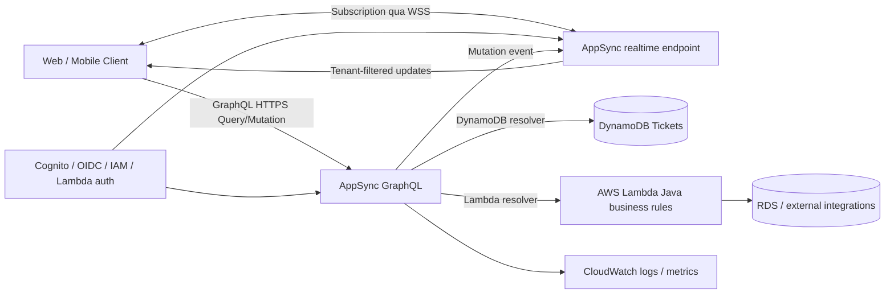
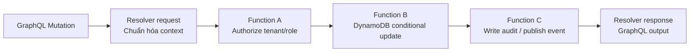
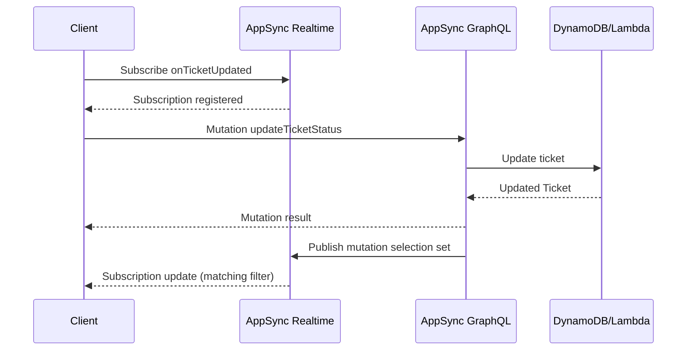

# AppSync GraphQL, resolver và subscription

Một doanh nghiệp xây dựng hệ thống theo dõi đơn hàng. Ứng dụng web cần đọc trạng thái mới nhất, cập nhật thông tin và **nhận thông báo ngay khi trạng thái thay đổi** mà không phải liên tục gọi REST API. Dữ liệu ở **Amazon DynamoDB**, một số quy tắc nghiệp vụ nằm trong **AWS Lambda Java**, còn người dùng đăng nhập bằng **Amazon Cognito**.

Với **AWS AppSync GraphQL**, ta có thể cung cấp một schema thống nhất cho **Query**, **Mutation** và **Subscription**:

- **Query:** đọc dữ liệu, ví dụ `getTicket(id: ...)`.
- **Mutation:** thay đổi dữ liệu, ví dụ `updateTicketStatus(...)`.
- **Subscription:** giữ một kết nối WebSocket để nhận bản cập nhật từ các mutation đã được chỉ định trong schema.

Tuy nhiên, có GraphQL schema chưa đủ để ứng dụng chạy đúng: mỗi field cần cơ chế **resolver** tương ứng, các **data sources** phải có IAM permissions, subscription phải bảo vệ **tenant boundary**, và việc cập nhật trực tiếp DynamoDB bên ngoài mutation không tự động phát notification GraphQL.

Bài học thuộc chương **API Gateway và AppSync** của module **CLOUD_PROVIDERS_AWS**, kết nối kiến thức Region/AZ, IAM, VPC, Lambda, DynamoDB, API design, giám sát, khả năng phục hồi và kiểm soát chi phí. Trọng tâm là **AppSync GraphQL, resolver và subscription**, đồng thời chỉ ra khi nào nên chọn API Gateway hoặc AppSync Events.

## 1. Mục tiêu học tập

Sau bài này, bạn có thể:

1. Phân biệt **GraphQL schema**, **Query**, **Mutation**, **Subscription**, **resolver** và **data source**.
2. Giải thích kiến trúc AWS AppSync GraphQL, đường HTTP và WebSocket, cùng ranh giới với API Gateway/AppSync Events.
3. Tạo schema GraphQL có type, input, enum, non-null, resolver phù hợp và subscription trigger qua `@aws_subscribe`.
4. Viết **APPSYNC_JS unit resolver** truy vấn/ghi DynamoDB và resolver gọi Lambda Java.
5. Mô tả **pipeline resolver**, `ctx.args`, `ctx.identity`, `ctx.stash`, `ctx.prev.result` và cơ chế xử lý lỗi.
6. Phân biệt **subscription basic filtering** với **enhanced filtering**, triển khai lọc server-side dựa trên danh tính đã được xác thực.
7. Thiết kế bảo mật đa tenant với Cognito, IAM, OIDC hoặc Lambda authorizer, least privilege và field-level controls.
8. Chẩn đoán lỗi GraphQL, 403/401, dữ liệu null, WebSocket reconnect, subscription thiếu thông báo và N+1 resolver calls.
9. Theo dõi CloudWatch, log, chi phí query/realtime và kiểm thử end-to-end trong quy trình CI/CD.

## 2. AWS AppSync GraphQL là gì?

**AWS AppSync** là dịch vụ quản lý cung cấp API **GraphQL** kết nối nhiều nguồn dữ liệu và hỗ trợ cập nhật realtime. Thay vì tạo nhiều REST routes để client tự kết hợp các phản hồi, ứng dụng có thể yêu cầu **đúng các fields** cần thiết thông qua một GraphQL endpoint.

Ví dụ khi hiển thị ticket:

```graphql
query GetTicket($id: ID!) {
  getTicket(id: $id) {
    id
    title
    status
    updatedAt
  }
}
```

Client xác định **selection set** `id/title/status/updatedAt`; resolver và data source lấy dữ liệu, AppSync định hình phản hồi theo schema.

### 2.1. Những thành phần quan trọng

| Thành phần | Vai trò | Ví dụ |
|---|---|---|
| **GraphQL API** | Endpoint và cấu hình bảo mật, schema, resolvers | `https://<api-id>.appsync-api.<region>.amazonaws.com/graphql` |
| **Schema** | Hợp đồng các types và operations | `type Query`, `type Mutation`, `type Subscription` |
| **Resolver** | Xử lý field theo request/response, gọi data source | `Query.getTicket` |
| **Data source** | Backend được AppSync gọi | DynamoDB, Lambda, HTTP, RDS, OpenSearch, NONE, EventBridge… |
| **Unit resolver** | Một resolver làm việc với một data source | `GetItem` từ DynamoDB |
| **Pipeline resolver** | Chạy chuỗi AppSync functions tuần tự | Authorize → Load → Transform |
| **APPSYNC_JS** | JavaScript runtime có tính năng giới hạn được AWS cung cấp | `request(ctx)` / `response(ctx)` |
| **VTL** | Ngôn ngữ mapping template legacy còn được hỗ trợ | `$ctx.args.id` trong VTL |
| **Realtime endpoint** | Kết nối WebSocket cho GraphQL subscriptions | Client subscribe và nhận updates |
| **Authorization mode** | Cách xác thực/ủy quyền request | Cognito User Pools, IAM, OIDC, API key, Lambda |

**APPSYNC_JS không phải Node.js đầy đủ.** Resolver không tự cài NPM packages tùy ý, mở socket, thực hiện fetch HTTP trực tiếp hoặc dùng mọi Node.js APIs. Muốn gọi bên ngoài dùng **data source** tương ứng, hoặc Lambda khi cần logic phức tạp.

### 2.2. AWS AppSync có gì khác API Gateway?

| Nhu cầu | AppSync GraphQL | Amazon API Gateway |
|---|---|---|
| Client chọn trường dữ liệu cần lấy | **Năng lực GraphQL cốt lõi** | REST/HTTP có thể thiết kế response riêng, không mặc định GraphQL |
| Kết hợp DynamoDB/Lambda/RDS… vào một schema | Resolver và data source/pipeline | Tích hợp HTTP/Lambda/AWS services tùy API type |
| Real-time nhận thay đổi qua GraphQL subscription | **Có** | WebSocket API cần thiết kế routes/connect/disconnect và fan-out |
| API HTTP REST có OpenAPI, proxy, routing path/method | Không phải mục tiêu chính | **Thường phù hợp hơn** |
| Client là mobile/web với dữ liệu quan hệ nhiều màn hình | Thường phù hợp | Cần tự ghép nhiều endpoints hoặc BFF |
| Tương thích backend Java REST có sẵn | Có thể kết nối qua HTTP/Lambda data source | Thường là lựa chọn trực tiếp và đơn giản |
| Bảo mật IAM/OIDC/Cognito/custom authorization | Có, với semantics riêng | Có, theo loại Gateway và authorizer |
| Realtime Pub/Sub không cần GraphQL schema | **AppSync Events** là lựa chọn riêng | WebSocket API tùy chỉnh có thể phù hợp |

**Không chọn GraphQL chỉ để “dùng công nghệ mới”.** REST vẫn tốt cho endpoints đơn giản, upload/download binary, webhook và API có tài nguyên/caching semantics rõ. GraphQL hữu ích khi client muốn hợp nhất dữ liệu và đặc biệt khi cần subscriptions gắn với mutations.

### 2.3. AppSync GraphQL khác AppSync Events

Từ **13/03/2025**, AWS cung cấp **AppSync Events** cho Pub/Sub dựa trên WebSocket với mô hình channel/events riêng. Đừng nhầm:

- **AppSync GraphQL subscriptions:** khai báo trong GraphQL schema, thông báo liên quan đến các mutation được chỉ định bằng `@aws_subscribe`; client dùng GraphQL realtime protocol.
- **AppSync Events:** kênh realtime publish/subscribe dành cho event-driven interactions mà **không bắt buộc có GraphQL Query/Mutation**; API, endpoint và cơ chế định giá riêng.

Nếu nghiệp vụ chỉ cần broadcast tín hiệu cảm biến, chat channels hoặc push events mà không cần GraphQL data schema, hãy so sánh AppSync Events. Bài này tập trung vào **GraphQL**.

Nguồn: [What is AWS AppSync](https://docs.aws.amazon.com/appsync/latest/devguide/) và [GraphQL subscriptions](https://docs.aws.amazon.com/appsync/latest/devguide/aws-appsync-real-time-data.html).

## 3. Kiến trúc tổng quan cho ứng dụng Java và realtime

Giả sử ứng dụng hỗ trợ nhiều doanh nghiệp (**tenants**), mỗi ticket thuộc đúng một `tenantId`.



Các kết nối có bản chất khác nhau:

1. **HTTPS Query/Mutation:** AppSync nhận request, xác thực người gọi, xét schema/authorization, chạy resolver rồi trả data/errors.
2. **WebSocket Subscription:** client đăng ký subscription, AppSync kiểm tra quyền và giữ connection; khi mutation tương ứng được gọi thành công, AppSync có thể gửi sự kiện đến subscribers phù hợp.
3. **AppSync → data source:** AppSync sử dụng IAM service role/credentials và mô hình tích hợp của data source. Quyền của user GraphQL **không tự trở thành IAM credentials** để gọi DynamoDB.
4. **Java Lambda → RDS/HTTP service:** Lambda có execution role, VPC/network, secrets và timeout riêng; đây là một chặng độc lập.

**Quan trọng:** DynamoDB Streams hoặc Lambda ghi trực tiếp bảng Tickets **không tự phát GraphQL subscription event**. Nếu muốn cập nhật client từ nguồn ngoài, cần một luồng tích hợp chủ động kích hoạt mutation hoặc phương án realtime khác (ví dụ AppSync Events), với quyền và idempotency phù hợp.

## 4. GraphQL schema: hợp đồng dữ liệu trước resolver

Schema dùng **GraphQL Schema Definition Language (SDL)**. Các types cơ bản: `ID`, `String`, `Int`, `Float`, `Boolean`; AppSync có scalars bổ sung như `AWSDateTime`, `AWSJSON`, `AWSEmail`, `AWSURL`.

### 4.1. Ví dụ schema hệ thống ticket đa tenant

```graphql
enum TicketStatus {
  OPEN
  IN_PROGRESS
  RESOLVED
}

type Ticket {
  id: ID!
  tenantId: ID!
  title: String!
  status: TicketStatus!
  updatedAt: AWSDateTime!
}

input CreateTicketInput {
  title: String!
}

type Query {
  getTicket(id: ID!): Ticket
}

type Mutation {
  createTicket(input: CreateTicketInput!): Ticket!
  updateTicketStatus(id: ID!, status: TicketStatus!): Ticket!
}

type Subscription {
  onTicketUpdated(tenantId: ID!): Ticket
    @aws_subscribe(mutations: ["updateTicketStatus"])
}

schema {
  query: Query
  mutation: Mutation
  subscription: Subscription
}
```

**Giả định của ví dụ:** default authorization mode là **Amazon Cognito User Pools**; JWT của user chứa claim `custom:tenant_id` đã được tổ chức quản lý và có giá trị đáng tin cậy. **Tenant ID không được lấy từ tham số client để tự cấp quyền**.

### 4.2. Đọc ngữ nghĩa schema

| Cú pháp | Ý nghĩa |
|---|---|
| `id: ID!` | Bắt buộc có ID, không được trả `null` ở field đó |
| `getTicket(id: ID!): Ticket` | Cho phép không tìm thấy ticket → trả `null` |
| `createTicket(...): Ticket!` | Mutation phải trả object Ticket, không được `null` nếu thành công theo GraphQL |
| `[Ticket!]!` | Danh sách không null, từng phần tử cũng không null |
| `input` | Dữ liệu gửi vào mutation, không phải output object type |
| `enum TicketStatus` | Giới hạn một tập giá trị hợp lệ |
| `@aws_subscribe(mutations: [...])` | Đăng ký subscription được kích hoạt bởi mutation chỉ định |

### 4.3. Không nhầm schema validation với business authorization

GraphQL kiểm tra type/arguments trước resolver, nhưng schema **không tự thực hiện** quy tắc:

- User tenant A không được đọc ticket tenant B.
- Người xem chỉ được `getTicket`, không được `updateTicketStatus`.
- Chỉ người phụ trách ticket được chuyển sang `RESOLVED`.
- Trạng thái chỉ được chuyển theo trình tự hợp lệ.

Các quy tắc này phải thực thi trong resolver/Lambda/backends và xác thực theo danh tính. GraphQL không phải lớp bảo mật thay thế IAM hoặc chính sách tenant-level.

## 5. Query, Mutation và Subscription ở phía client

### 5.1. Query

```graphql
query GetTicket($id: ID!) {
  getTicket(id: $id) {
    id
    title
    status
    updatedAt
  }
}
```

Variables:

```json
{
  "id": "ticket-123"
}
```

Một GraphQL HTTP request thông thường là **POST** tới `/graphql` với JSON `query`/`variables`. AppSync dùng authorization mode đã cấu hình (ví dụ Cognito JWT trong `Authorization` header) để xác thực.

### 5.2. Mutation

```graphql
mutation UpdateTicketStatus($id: ID!, $status: TicketStatus!) {
  updateTicketStatus(id: $id, status: $status) {
    id
    tenantId
    title
    status
    updatedAt
  }
}
```

Variables:

```json
{
  "id": "ticket-123",
  "status": "RESOLVED"
}
```

**Tại sao mutation lại chọn cả `tenantId`?** Với GraphQL subscription của AppSync, các field được gửi tới subscriber dựa trên **mutation selection set**. Nếu subscription muốn nhận `tenantId` hoặc `updatedAt` nhưng mutation không chọn field đó, subscriber có thể nhận `null` hoặc lỗi non-null tương ứng. Vì vậy mutation chọn đủ fields cần cho các subscription và enhanced filters.

**Chỉ gửi mutation khi resolver thực sự ghi thành công**: một mutation được cấu hình `NONE` giả lập không bảo đảm thay đổi database. Tránh dùng một mutation trống chỉ để phát thông báo mà không rõ nguồn dữ liệu và quyền.

### 5.3. Subscription

```graphql
subscription OnTicketUpdated($tenantId: ID!) {
  onTicketUpdated(tenantId: $tenantId) {
    id
    tenantId
    status
    updatedAt
  }
}
```

Variables:

```json
{
  "tenantId": "tenant-a"
}
```

Subscription **không tự trả danh sách ticket lịch sử**. Client thường gọi Query lấy snapshot, sau đó Subscribe để nhận thay đổi. Cần xử lý race giữa snapshot và subscription setup, reconnect và đồng bộ lại dữ liệu theo `updatedAt`/version.

## 6. Data source: AppSync gọi backend nào?

| Data source | Thao tác điển hình | Khi phù hợp |
|---|---|---|
| **DynamoDB** | `GetItem`, `PutItem`, `UpdateItem`, `Query` | Key-value/document, truy vấn hiệu quả theo partition/index |
| **AWS Lambda** | `Invoke` hoặc `BatchInvoke` | Logic Java phức tạp, API/legacy integration, validation nhiều bước |
| **HTTP endpoint** | HTTP request mapping tới hệ thống được phép | Backend REST sẵn có, dịch vụ HTTP nội bộ qua cơ chế mạng hỗ trợ |
| **Amazon RDS** | Data source qua cơ chế được hỗ trợ, thường Aurora/Data API | Ứng dụng cần SQL và khả năng quản lý transaction |
| **Amazon OpenSearch Service** | Full-text/search use cases | Search/phân tích dữ liệu chuyên biệt |
| **EventBridge** | Gửi events vào event bus | Bất đồng bộ, tách read/write và workflow |
| **NONE** | Không gọi backend, xử lý payload tại AppSync | Authorization/transform, mutation phát thông tin mô phỏng |
| **Amazon Bedrock** | AI inference trong API khi tích hợp phù hợp | Sinh nội dung/AI features theo policy |

**Chọn data source theo yêu cầu truy vấn và giao dịch**, không dùng Lambda cho mọi field nếu DynamoDB resolver trực tiếp có thể giải quyết an toàn, rẻ và ít độ trễ hơn.

**Không dùng `Scan` toàn bộ DynamoDB table làm “list all” production mặc định**. Query theo partition key/GSI với pagination, giới hạn trả dữ liệu, tránh đơn vị đọc tăng và lộ dữ liệu tenant khác.

## 7. APPSYNC_JS resolver: request/response

Một **unit resolver** được gắn vào field, chọn một data source và viết hai functions:

```javascript
export function request(ctx) {
  // Trả request object được AppSync gửi tới data source.
}

export function response(ctx) {
  // Biến kết quả data source thành kết quả GraphQL.
}
```

### 7.1. Resolver context

| Biến | Nội dung |
|---|---|
| `ctx.args` hoặc `ctx.arguments` | Input arguments của GraphQL field |
| `ctx.identity` | Identity đã xác thực; shape phụ thuộc auth mode |
| `ctx.info` | Thông tin field và schema |
| `ctx.source` | Object cha khi resolve nested fields |
| `ctx.result` | Kết quả data source ở response handler |
| `ctx.error` | Thông tin lỗi data source nếu có |
| `ctx.stash` | Truyền state trong một lần pipeline resolver |
| `ctx.prev.result` | Kết quả của bước trước trong pipeline |
| `util.error(...)` | Dừng resolution và tạo field error |
| `util.appendError(...)` | Gắn lỗi nhưng không bắt buộc dừng toàn bộ handler |
| `util.unauthorized()` | Từ chối field vì không được phép |

**Không dùng `ctx.identity.username` mà không xác định auth mode.** Ví dụ user pools thường có `sub` và `claims`; IAM có `userArn/accountId`; API key không cung cấp user identity. Khi cần tenant identity, dựa vào claim đã được **issuer/authorizer tin cậy** và được hệ thống quản lý.

### 7.2. APPSYNC_JS runtime không phải Java runtime

JavaScript resolver chạy bên trong AppSync. **Code Java server** nên đặt ở AWS Lambda/HTTP backend nếu cần thư viện Java, DB connection hoặc nghiệp vụ đòi runtime đầy đủ. Không import AWS SDK for Java vào APPSYNC_JS resolver.

Nguồn: [AppSync JavaScript resolver overview](https://docs.aws.amazon.com/appsync/latest/devguide/resolver-reference-overview-js.html), [Resolver context reference](https://docs.aws.amazon.com/appsync/latest/devguide/resolver-context-reference-js.html).

## 8. Unit resolver: đọc DynamoDB an toàn theo tenant

Giả sử bảng DynamoDB `Tickets` có composite primary key:

```text
Partition key: pk (String) = TENANT#<tenantId>
Sort key:      sk (String) = TICKET#<ticketId>

Các attributes khác: id, tenantId, title, status, updatedAt
```

Với schema `Query.getTicket(id: ID!)`, resolver phải **lấy tenantId từ JWT**, không nhận trực tiếp từ `ctx.args`.

### 8.1. APPSYNC_JS resolver cho `Query.getTicket`

```javascript
import { util } from '@aws-appsync/utils';
import * as ddb from '@aws-appsync/utils/dynamodb';

function tenantFromIdentity(ctx) {
  const claims = ctx.identity && ctx.identity.claims;
  const tenantId = claims && claims['custom:tenant_id'];
  if (!tenantId) {
    util.unauthorized();
  }
  return tenantId;
}

export function request(ctx) {
  const tenantId = tenantFromIdentity(ctx);
  const ticketId = ctx.args.id;

  return ddb.get({
    key: {
      pk: 'TENANT#' + tenantId,
      sk: 'TICKET#' + ticketId
    }
  });
}

export function response(ctx) {
  if (ctx.error) {
    util.error(ctx.error.message, ctx.error.type);
  }
  return ctx.result; // null nếu không tìm thấy ticket
}
```

**Điều kiện để chạy:**

- Đã tạo data source DynamoDB trỏ tới bảng `Tickets` đúng Region.
- Data source service role được cấp tối thiểu `dynamodb:GetItem` trên bảng.
- API dùng Cognito auth/authorization phù hợp để `ctx.identity.claims` tồn tại.
- Code đúng kiểu `APPSYNC_JS` và `@aws-appsync/utils/dynamodb`.
- Key ở database khớp mô hình `pk/sk`.
- Query có thể trả `null` khi không tìm thấy, phù hợp `Ticket` nullable.

**Điểm bảo mật:** vì key được tạo từ tenant **đã xác thực**, request của tenant A không thể dùng `id` để đọc object trong partition tenant B. Không tin `tenantId` do client tự gửi nếu chưa so sánh với identity.

## 9. Unit resolver: tạo ticket trong DynamoDB

Mutation `createTicket(input: ...)` có thể viết trực tiếp bằng `ddb.put`:

```javascript
import { util } from '@aws-appsync/utils';
import * as ddb from '@aws-appsync/utils/dynamodb';

export function request(ctx) {
  const claims = ctx.identity && ctx.identity.claims;
  const tenantId = claims && claims['custom:tenant_id'];
  if (!tenantId) {
    util.unauthorized();
  }

  const id = util.autoId();
  const now = util.time.nowISO8601();
  const title = ctx.args.input.title;

  if (!title || title.length > 160) {
    util.error('Invalid ticket title', 'BadRequest');
  }

  const item = {
    pk: 'TENANT#' + tenantId,
    sk: 'TICKET#' + id,
    id,
    tenantId,
    title,
    status: 'OPEN',
    updatedAt: now
  };

  return ddb.put({
    key: { pk: item.pk, sk: item.sk },
    item,
    condition: { pk: { attributeExists: false } }
  });
}

export function response(ctx) {
  if (ctx.error) {
    util.error(ctx.error.message, ctx.error.type);
  }
  return ctx.result;
}
```

**Giải thích:**

- `util.autoId()` tạo ID mới; business operation cần idempotency riêng nếu client retry sau timeout.
- `tenantId` do JWT claim quyết định; không cho client tạo ticket tenant khác.
- `ddb.put` ghi data; condition tránh vô tình ghi đè một key đã tồn tại.
- `ctx.result` của DynamoDB resolver được đưa về GraphQL type; cần kiểm tra returned item phù hợp schema.
- Trong production phải kiểm tra độ dài/Unicode, quyền tạo ticket, quotas/rate limits và auditing.

**Không coi validation title ở trên là đủ**: còn phải kiểm tra schema version, nội dung nguy hiểm, các trường chỉ admin được phép sửa và giới hạn request size. Nếu nhiều thao tác trên nhiều tables cần transaction, cân nhắc DynamoDB transaction hoặc Lambda.

### 9.1. Vấn đề idempotency

Một client có thể gửi `createTicket` hai lần vì không nhận được response lần đầu. `util.autoId()` mỗi lần sinh ID mới nên sẽ tạo **hai ticket**. Nếu nghiệp vụ yêu cầu “mỗi request ID chỉ tạo một ticket”, hãy dùng `clientRequestId` do client tạo có phạm vi tenant và DynamoDB conditional write theo idempotency key, hoặc lưu kết quả đã xử lý.

## 10. Mutation cập nhật: khi nào nên dùng Lambda Java?

`updateTicketStatus(id, status)` có thể cần:

- Kiểm tra user có quyền cập nhật ticket trong tenant.
- Ràng buộc trạng thái: `OPEN → IN_PROGRESS → RESOLVED`, không cho `RESOLVED → OPEN` nếu quy trình không cho.
- Ghi event audit, cập nhật DynamoDB và gửi thông báo hệ thống ngoài.
- Tránh hai updates đồng thời làm mất thay đổi (optimistic concurrency).
- Đảm bảo idempotency khi request bị retry.

Có thể làm một phần bằng DynamoDB conditional `UpdateItem` và resolver. Khi logic nhiều bước/tích hợp hệ thống khác, **Lambda Java** là lựa chọn hợp lý.

### 10.1. APPSYNC_JS resolver gọi Lambda

Gắn Lambda data source vào `Mutation.updateTicketStatus`:

```javascript
import { util } from '@aws-appsync/utils';

export function request(ctx) {
  const claims = ctx.identity && ctx.identity.claims;
  const tenantId = claims && claims['custom:tenant_id'];
  const userId = ctx.identity && ctx.identity.sub;

  if (!tenantId || !userId) {
    util.unauthorized();
  }

  return {
    operation: 'Invoke',
    payload: {
      operation: 'updateTicketStatus',
      tenantId,
      userId,
      id: ctx.args.id,
      status: ctx.args.status
    }
  };
}

export function response(ctx) {
  if (ctx.error) {
    util.error(ctx.error.message, ctx.error.type);
  }
  return ctx.result;
}
```

**Không nhận `tenantId` hoặc `userId` từ GraphQL args làm nguồn tin cậy.** AppSync lấy identity đã xác thực và tạo payload backend. Lambda vẫn cần **defense in depth**: kiểm tra permission nghiệp vụ và ownership trước khi cập nhật.

### 10.2. Java Lambda handler minh họa ranh giới trách nhiệm

```java
import com.amazonaws.services.lambda.runtime.Context;
import com.amazonaws.services.lambda.runtime.RequestHandler;
import java.time.Instant;
import java.util.Map;

public final class TicketStatusHandler
        implements RequestHandler<Map<String, Object>, Map<String, Object>> {

    @Override
    public Map<String, Object> handleRequest(
            Map<String, Object> event, Context context) {

        String tenantId = (String) event.get("tenantId");
        String userId = (String) event.get("userId");
        String ticketId = (String) event.get("id");
        String nextStatus = (String) event.get("status");

        if (tenantId == null || userId == null || ticketId == null) {
            throw new IllegalArgumentException("Missing identity or ticket ID");
        }

        // Production:
        // 1. Verify ticket belongs to tenant and actor may update it.
        // 2. Validate allowed status transitions.
        // 3. Execute atomic update with expectedVersion/condition.
        // 4. Persist audit, handle idempotency and downstream side effects.
        // 5. Return the complete updated Ticket object.

        return Map.of(
            "id", ticketId,
            "tenantId", tenantId,
            "title", "DEMO ONLY - NOT PERSISTED",
            "status", nextStatus,
            "updatedAt", Instant.now().toString()
        );
    }
}
```

**Cảnh báo:** handler trên trả **giá trị mô phỏng**, không ghi database; chỉ dùng giải thích contract giữa resolver và Lambda. Nếu dùng nó làm mutation production, subscription có thể phát “ticket đã cập nhật” dù **DynamoDB chưa thay đổi**, gây sai dữ liệu. Hãy thực hiện bước cập nhật có điều kiện thật và return item đã commit.

Với Lambda data source, AppSync dùng service role/quyền để invoke Lambda; **Lambda execution role** lại cấp quyền DynamoDB/RDS/KMS riêng. Người gọi GraphQL không được cấp trực tiếp `lambda:InvokeFunction` nếu kiến trúc không yêu cầu.

Nguồn: [JavaScript resolver Lambda data source](https://docs.aws.amazon.com/appsync/latest/devguide/resolver-reference-lambda-js.html).

## 11. Unit resolver, pipeline resolver và N+1

### 11.1. Unit resolver

Chỉ gọi **một data source** cho một field, ví dụ:

```text
Query.getTicket
  → APPSYNC_JS request
  → DynamoDB GetItem
  → APPSYNC_JS response
  → GraphQL Ticket
```

Phù hợp cho `GetItem`, `PutItem`, `Query` đơn giản khi logic quyền có thể thực hiện trong resolver và data source IAM role được cấp tối thiểu.

### 11.2. Pipeline resolver

Một pipeline có thể:



Các functions được chạy theo thứ tự; `ctx.stash` có thể mang dữ liệu qua các bước, còn `ctx.prev.result` chứa kết quả của bước trước.

**Lưu ý atomicity:** việc gọi nhiều data sources tuần tự trong pipeline **không tạo distributed transaction**. Nếu DynamoDB update thành công nhưng audit Lambda thất bại, database đã thay đổi. Cần thiết kế retry/outbox/idempotency hoặc saga khi nghiệp vụ yêu cầu tính nhất quán mạnh.

### 11.3. N+1 query problem

Ví dụ client lấy 100 tickets, mỗi ticket yêu cầu `owner{displayName}`. Nếu nested field resolver gọi Lambda/DynamoDB một lần cho từng ticket, sẽ có **100 lần gọi bổ sung** bên cạnh truy vấn danh sách ban đầu.

Các biện pháp:

- Thiết kế data model/GSI theo access pattern.
- Dùng **Lambda `BatchInvoke`** nếu phù hợp; Lambda nhận nhiều payload và trả **cùng số lượng kết quả theo đúng thứ tự**.
- Dùng denormalization hoặc batch get trong phạm vi phù hợp.
- Chỉ resolve fields được client yêu cầu và phân trang.
- Đo resolver-level latency/calls trước khi tối ưu; caching theo user/tenant identity khi dữ liệu private.

**Không lẫn Lambda BatchInvoke của AppSync với Lambda SQS event source mapping**: chúng có schema, retry và mục tiêu khác nhau.

## 12. Subscription GraphQL: sự kiện được kích hoạt khi nào?

AppSync GraphQL subscriptions thường được **kích hoạt bởi mutation** được chỉ định bằng directive `@aws_subscribe`.

Ví dụ từ schema:

```graphql
type Subscription {
  onTicketUpdated(tenantId: ID!): Ticket
    @aws_subscribe(mutations: ["updateTicketStatus"])
}
```

Khi client đăng ký `onTicketUpdated` và một caller thực hiện thành công `updateTicketStatus`, AppSync có thể gửi payload đến subscribers được phép và thỏa filters.

### 12.1. Luồng subscription



**Không mặc định subscription chạy lại Query hoặc đọc DynamoDB để làm mới object.** Payload realtime gắn với **kết quả và selection set của mutation**, có thể có `null` ở field subscriber đòi hỏi nhưng mutation không chọn.

### 12.2. Quy tắc selection set cực kỳ quan trọng

Để subscription:

```graphql
subscription {
  onTicketUpdated(tenantId: "tenant-a") {
    id
    tenantId
    status
    updatedAt
  }
}
```

nhận đủ dữ liệu, mutation nguồn nên chọn ít nhất:

```graphql
mutation {
  updateTicketStatus(id: "ticket-123", status: RESOLVED) {
    id
    tenantId
    status
    updatedAt
  }
}
```

Nếu mutation chỉ chọn `id` và `status`, các trường `tenantId` hoặc `updatedAt` có thể thành `null` trong subscription, thậm chí tạo GraphQL error nếu schema đánh dấu non-null. Đây là lỗi rất hay gặp: **backend đã cập nhật, WebSocket vẫn kết nối, nhưng payload không đủ fields**.

Không phải mọi thay đổi trong DynamoDB đều phát event. Một worker ghi thẳng database không đi qua AppSync mutation **không trigger** subscription theo `@aws_subscribe`.

Nguồn: [Using subscriptions for real-time data](https://docs.aws.amazon.com/appsync/latest/devguide/aws-appsync-real-time-data.html).

## 13. Basic subscription filtering và rủi ro bảo mật tenant

### 13.1. Basic filter dùng client arguments

Schema:

```graphql
onTicketUpdated(tenantId: ID!): Ticket
  @aws_subscribe(mutations: ["updateTicketStatus"])
```

Client gọi `onTicketUpdated(tenantId: "tenant-a")`; AppSync có thể lọc notifications theo giá trị trường tương ứng trong mutation result.

**Nhưng client kiểm soát input.** Nếu user tenant B cố đăng ký `tenantId="tenant-a"` và hệ thống không kiểm tra tenant membership, basic filter **không tự biến thành authorization**. Đây là lỗi bảo mật đa tenant, có thể lộ cập nhật realtime dù Query/Mutation đã được bảo vệ.

Cần thực thi **quyền subscribe**, không chỉ lọc sự kiện.

### 13.2. Enhanced filtering ở server

AppSync hỗ trợ **enhanced subscription filtering** thông qua subscription resolver sử dụng:

```javascript
extensions.setSubscriptionFilter(
  util.transform.toSubscriptionFilter(filter)
);
```

Trong enhanced filtering, luật lọc được thiết lập tại backend, có thể dựa trên `ctx.identity`/`ctx.args` và nhiều điều kiện. Khi bật enhanced filtering, **backend rules ưu tiên thay basic subscription arguments**; không dùng đồng thời hai cơ chế với kỳ vọng chúng tự AND vào nhau. Nếu một required subscription argument phải ảnh hưởng filter, cần đưa nó vào rule của enhanced filter.

### 13.3. Ví dụ resolver chỉ cho tenant đã xác thực

Với subscription field `onTicketUpdated`, gắn **NONE data source** và APPSYNC_JS resolver:

```javascript
import { util, extensions } from '@aws-appsync/utils';

export function request(ctx) {
  return { payload: null };
}

export function response(ctx) {
  const claims = ctx.identity && ctx.identity.claims;
  const authenticatedTenant = claims && claims['custom:tenant_id'];

  if (!authenticatedTenant || ctx.args.tenantId !== authenticatedTenant) {
    util.unauthorized();
  }

  const filter = {
    tenantId: { eq: authenticatedTenant }
  };

  extensions.setSubscriptionFilter(
    util.transform.toSubscriptionFilter(filter)
  );
  return null;
}
```

**Giải thích:** kết nối subscribe của user tenant B không thể tự chọn argument tenant A. Filter của AppSync được hình thành từ tenant claim do Cognito cung cấp, và chỉ chuyển notification có `tenantId` tương ứng.

**Điều kiện quan trọng:**

- AppSync API phải dùng auth mode cho phép lấy Cognito claims đáng tin cậy; `API_KEY` không cung cấp user identity.
- Subscription field phải gắn resolver đúng; `extensions.setSubscriptionFilter` chỉ có thể sử dụng trong **response handler của subscription resolver**.
- Client phải được phép subscribe theo schema/authorization modes; resolver là lớp kiểm tra bổ sung.
- Mutation phải return `tenantId` trong **selection set** để filter kiểm tra dữ liệu; nếu field không có, sự kiện có thể bị lọc ra hoặc không có thông tin cần thiết.
- **Subscription không tự xác minh lại tenant quyền sau mỗi event**. Nếu membership thay đổi trong lúc kết nối tồn tại, cần cơ chế reauthorization/reconnect/invalidation phù hợp với yêu cầu bảo mật.

Nguồn: [Enhanced subscription filtering](https://docs.aws.amazon.com/appsync/latest/devguide/aws-appsync-real-time-enhanced-filtering.html).

## 14. Enhanced filter nâng cao: nhóm, trạng thái và ưu tiên

Ngoài lọc tenant, có thể thêm điều kiện nghiệp vụ:

```javascript
const filter = {
  tenantId: { eq: authenticatedTenant },
  status: { in: ['IN_PROGRESS', 'RESOLVED'] }
};

extensions.setSubscriptionFilter(
  util.transform.toSubscriptionFilter(filter)
);
```

Đây là **logic minh họa**, được đặt trong `response(ctx)` của subscription resolver sau khi đã xác thực tenant. Các điều kiện trong filter kết hợp theo ngữ nghĩa AppSync supported operators; nếu nhiều nhánh OR, dùng cấu trúc `or` như tài liệu, không tự suy diễn mọi điều kiện JSON đều là JavaScript expression.

Ví dụ sự kiện từ tenant A trạng thái `OPEN` sẽ không được gửi qua filter này, còn `IN_PROGRESS`/`RESOLVED` có thể được gửi.

**Không dùng filter thay permission check cho Mutation:** caller không được phép sửa ticket tenant khác vẫn phải bị từ chối trong `updateTicketStatus`. Filter chỉ quyết định **ai được nhận bản cập nhật**; nó không sửa dữ liệu và không bảo vệ Query/Mutation.

### 14.1. Giới hạn subscription arguments

Khi không dùng enhanced filter, subscription arguments do client gửi có thể là bộ lọc cơ bản. Khi đã bật enhanced filter, nếu cần giữ ràng buộc từ argument bắt buộc như `tenantId`, phải **đưa nó vào enhanced filter**. Trong ví dụ, ta xác minh argument bằng identity rồi tạo filter từ identity.

### 14.2. Loại bỏ subscription khi quyền bị thu hồi

AWS AppSync có **subscription invalidation** extensions trên mutation resolver theo cơ chế và giới hạn được hỗ trợ. Cách dùng phụ thuộc thiết kế, nhưng cần nhận thức:

- Xóa người dùng khỏi group hoặc thu hồi entitlement **không luôn cắt ngay một kết nối WebSocket đang tồn tại** theo mọi auth mode/token lifecycle.
- Token refresh, disconnect và subscription invalidation là các hành vi phải thiết kế và test riêng.
- Không dựa vào TTL JWT đơn lẻ để bảo đảm thu hồi ngay một subscription nhạy cảm.

Nguồn: [AppSync resolver extensions](https://docs.aws.amazon.com/appsync/latest/devguide/extensions-js.html).

## 15. WebSocket realtime: connection, reconnect và đồng bộ trạng thái

GraphQL subscriptions dùng kết nối **WebSocket** được AppSync quản lý. Client library có thể tự xử lý handshake, auth, keep-alive, subscribe/unsubscribe và reconnect, nhưng ứng dụng phải xác minh cách thư viện đó hoạt động với auth mode đang dùng.

### 15.1. Không nhầm URL HTTPS với realtime endpoint

Một GraphQL API có endpoint HTTPS cho Query/Mutation và endpoint realtime tương ứng cho WebSocket. Client sử dụng protocol AppSync hỗ trợ, cùng thông tin authorization thích hợp.

**Không thay URL từ `https://` thành `wss://` rồi tự cho rằng websocket GraphQL tiêu chuẩn nào cũng tương thích.** AppSync realtime sử dụng thông điệp/handshake/authentication theo giao thức riêng được tài liệu/SDK mô tả. Ưu tiên thư viện client chính thức hoặc thư viện tương thích AppSync protocol.

### 15.2. Lifecycle điển hình

```text
Application start
   ↓
Authenticate user (Cognito/OIDC/IAM/custom)
   ↓
Open AppSync realtime WebSocket
   ↓
Register onTicketUpdated subscription
   ↓
Receive updates / keep-alive
   ↓
Network drop / app background
   ↓
Reconnect + reauthenticate if necessary
   ↓
Re-register subscription
   ↓
Reconcile missed updates via Query
```

**Subscription không phải durable queue.** Nếu client offline trong 5 phút, không mặc định được phát bù toàn bộ notification đã bỏ lỡ. Với dữ liệu quan trọng, dùng Query lấy state mới nhất sau reconnect và có thể dùng `updatedAt`/version/pagination để đối soát.

### 15.3. Vấn đề auth khi WebSocket sống lâu

- Credentials/token có thể hết hạn; cần refresh và reconnect/subscribe lại theo hành vi của client SDK.
- CORS và cookies liên quan đến browser/API auth không đồng nhất hoàn toàn với WebSocket handshake.
- Trình duyệt/mobile có thể dừng hoạt động nền, mất Wi-Fi hoặc đổi mạng.
- Một user có thể mở nhiều tabs/thiết bị; số connection minutes và outbound messages có thể tăng.
- Phải hạn chế lượng subscriptions mỗi user/connection theo quotas và chi phí.
- Không log raw authorization headers, cookies hoặc WebSocket connection tokens.

## 16. Authorization: năm chế độ và field-level access

AppSync GraphQL hỗ trợ năm authentication/authorization modes chủ yếu:

| Mode | Đặc tính | Khi nào phù hợp |
|---|---|---|
| **API_KEY** | API key được gửi trong request; không đại diện danh tính người dùng | Prototype/public data có kiểm soát, không thích hợp cho dữ liệu tenant private |
| **AWS_IAM** | AWS Signature Version 4, principal IAM | Backend services, workloads AWS, automation |
| **AMAZON_COGNITO_USER_POOLS** | JWT users/groups | Web/mobile đăng nhập |
| **OPENID_CONNECT** | JWT của OIDC-compliant identity provider | Hệ thống đã dùng IdP tổ chức |
| **AWS_LAMBDA** | Lambda authorizer tùy chỉnh | Logic auth đặc biệt, kiểm tra token/entitlement theo yêu cầu |

Có thể cấu hình **default auth mode** và các **additional auth modes** theo giới hạn được hỗ trợ, rồi chỉ định field/object type bằng directives như `@aws_iam`, `@aws_cognito_user_pools`, `@aws_api_key` và `@aws_oidc`.

### 16.1. Field-level authorization

Ví dụ kiến trúc: default mode Cognito cho user thao tác Query/Mutation/Subscription, thêm IAM cho một field nội bộ chuyên dành cho backend. Cần cấu hình schema directives và IAM `appsync:GraphQL` resource ARNs đúng field.

**Không chỉ đổi thêm `@aws_iam` trên field rồi cho rằng user dùng Cognito không thể nhìn thấy nested fields.** Với nhiều auth modes, cần kiểm tra cả parent/object types, nested fields, subscriptions và response redaction; thực tế enforcement chịu ảnh hưởng directives và authorization context.

### 16.2. IAM role của resolver/data source

AppSync Data source được cấp role/service permissions để:

- `dynamodb:GetItem`/`PutItem`/`UpdateItem` trên đúng table/index.
- `lambda:InvokeFunction` trên đúng Lambda ARN.
- Các hành động HTTP/RDS/Bedrock/EventBridge theo tích hợp được dùng.

Cần **least privilege** cả hai phía: caller chỉ được GraphQL operation được phép; AppSync data source chỉ được gọi AWS resources cần thiết. Quyền IAM của user gọi GraphQL **không thay thế** data source role.

### 16.3. Tenant isolation không tự có vì dùng Cognito

Một JWT được xác thực vẫn có thể là **người dùng ác ý**. Không để:

- Client chọn `tenantId` bất kỳ rồi truy vấn DynamoDB partition khác.
- Subscription filter chỉ dựa trên `ctx.args.tenantId` mà không so sánh identity.
- Cập nhật tenantId/owner từ GraphQL input tùy ý.
- Response nested field của ticket trả ra secret, PII hoặc dữ liệu tenant khác.
- Resolver caching dùng chung key giữa hai tenants.

**Defense in depth**: tenant từ trusted claims, query key có tenant prefix, IAM data source giới hạn, authorization trong resolver/Lambda, CI tests bằng nhiều tenant.

Nguồn: [AppSync authentication and authorization](https://docs.aws.amazon.com/appsync/latest/devguide/security-authz.html).

## 17. Bảo mật GraphQL ngoài authentication

### 17.1. Query depth, resolver count và độ phức tạp

GraphQL client có thể yêu cầu fields lồng nhiều lớp. Một query hợp lệ về cú pháp nhưng có thể tạo hàng trăm resolver calls và chi phí downstream lớn.

Biện pháp:

- Cấu hình **query depth** và **resolver count** limits theo nhu cầu thực tế.
- Phân trang và giới hạn page size; không để user `limit=100000`.
- Dùng query/pipeline hiệu quả theo access pattern, tránh N+1.
- Dùng throttling/WAF, review quotas và rate controls.
- Đo `TokensConsumed`/Latency/Requests để phát hiện query bất thường.
- Chỉ bật introspection khi phù hợp chính sách; tắt introspection ở production có thể giảm lộ schema nhưng **không thay** auth/validation.

### 17.2. API key không phải session người dùng

API key có thể được chia sẻ/lộ khi nhúng frontend. **Không bảo vệ private ticket data bằng API_KEY thuần** rồi chỉ lọc trong client UI. Định danh user/tenant cần được xác thực bằng IAM, Cognito, OIDC hoặc Lambda authorizer phù hợp.

### 17.3. Dữ liệu nhạy cảm và mã hóa

- HTTPS/WSS cho client–AppSync.
- KMS encryption, DynamoDB/S3/RDS encryption at rest theo chính sách.
- IAM least privilege cho Lambda và data sources.
- Không ghi raw JWT, API keys, secrets hoặc PII vào GraphQL error details/logs.
- Kiểm tra CORS, CSP, client storage và token refresh.
- Không dựa vào `__typename` hoặc schema names như “private” để tạo ranh giới bảo mật.

### 17.4. AppSync Private APIs

Theo tài liệu hiện hành, AppSync hỗ trợ **Private APIs** và sử dụng qua VPC với cơ chế phù hợp. Tính năng private API phải đánh giá **tính tương thích với GraphQL realtime/subscription, DNS, endpoint type, auth mode và môi trường client**, không mặc định mọi mô hình mạng/app đều hoạt động giống API public.

Nguồn: [AppSync configuration and settings](https://docs.aws.amazon.com/appsync/latest/devguide/configuration-and-settings.html).

## 18. GraphQL errors, nullability và data consistency

### 18.1. HTTP 200 vẫn có thể chứa errors

GraphQL response có thể có cả `data` và `errors`:

```json
{
  "data": {
    "getTicket": null
  },
  "errors": [
    {
      "message": "Unauthorized",
      "path": ["getTicket"],
      "errorType": "Unauthorized"
    }
  ]
}
```

Không chỉ quan sát HTTP 200 để kết luận API thành công. Client cần kiểm tra **GraphQL errors**, cấu trúc field và business outcome.

### 18.2. Null bubbling với non-null fields

Nếu schema khai báo:

```graphql
type Ticket {
  id: ID!
  title: String!
}
```

nhưng resolver trả object thiếu `title`, GraphQL có thể tạo lỗi non-null và trả `null` ở đối tượng cha theo quy tắc propagation. Subscription còn dễ mắc lỗi này do **mutation selection set** thiếu field subscriber muốn nhận.

### 18.3. DynamoDB consistency và concurrency

- DynamoDB `GetItem` thường sử dụng **eventually consistent read** trừ khi bật consistent read theo khả năng data source.
- Cập nhật cùng ticket cần **optimistic concurrency** (`version`, conditional update), tránh request cuối ghi đè dữ liệu không mong muốn.
- Sự kiện subscription có thể đến chậm, mất khi reconnect hoặc xuất hiện theo nhiều route; client cần đối soát theo `updatedAt`/version.
- Đừng xem subscription notification như thông điệp bắt buộc giao **exactly once**.

### 18.4. Khi dùng GraphQL mutation để “trigger event”

Mutation phải trả kết quả mô tả **trạng thái nghiệp vụ đã được ghi nhận/commit**, không phát thông báo thành công từ một Lambda asynchronous call không có kết quả bền vững. Nếu xử lý lâu, thiết kế trạng thái `PENDING` và kết quả bất đồng bộ rõ ràng.

## 19. Caching, pagination và performance

### 19.1. AppSync resolver caching

AppSync có thể dùng **server-side caching** cho những queries/resolvers phù hợp. Mục tiêu giảm read load và latency, nhưng:

- Không cache mutation có side effects.
- Cache key phải phân biệt **tenant/user/arguments** khi dữ liệu private.
- TTL cần phản ánh độ mới dữ liệu và điều kiện consistency.
- Cache không tự invalidate mọi record khi mutation ghi DynamoDB.
- Cache instance và metrics có phí riêng; đo trước khi quyết định.

Ví dụ `getTicket(id)` cần cache key bao gồm **tenant identity + id**, không chỉ `id` nếu IDs có thể trùng giữa tenants và người dùng có quyền khác nhau.

### 19.2. Pagination

Danh sách ticket nhiều nghìn bản ghi cần `limit` và `nextToken`:

```graphql
type TicketConnection {
  items: [Ticket!]!
  nextToken: String
}

type Query {
  listTickets(limit: Int, nextToken: String): TicketConnection!
}
```

DynamoDB `Query` theo `pk = TENANT#<tenantId>` cùng sort key và pagination; không dùng `Scan` toàn bảng để làm pagination đa tenant.

Client coi `nextToken` là opaque, không tự chỉnh. Khi dùng backend pagination, phải kiểm tra token nguồn/lược đồ có phù hợp với request/filter hiện tại và tránh dùng token của tenant khác khi API yêu cầu ràng buộc chặt.

### 19.3. Đo “đúng bottleneck”

Một GraphQL request chậm có thể do:

- N+1 nested resolvers.
- DynamoDB Scan, thiếu GSI hoặc hot partition.
- Lambda cold start/VPC/RDS connection pool.
- Lồng nhiều fields và xử lý serialization lớn.
- Downstream HTTP bị throttle.
- Cache disabled/miss hoặc cache key quá phân mảnh.

Dùng resolver-level metrics/logs/X-Ray trước khi tăng tài nguyên. Một API GraphQL có thể đọc nhiều data sources trong một request, nên quan sát tổng latency **và latency từng resolver**.

## 20. Realtime scale và chi phí

### 20.1. Các thành phần chi phí

- **GraphQL Query/Data Modification Operations**.
- **Realtime updates** đã phát tới subscribers; message sizes theo bậc tính phí được AWS công bố.
- **WebSocket connection minutes**.
- **DynamoDB RCU/WCU/Storage**, Lambda invocations/duration, RDS, OpenSearch, Bedrock… theo data source.
- **AppSync caching** nếu provision dedicated cache.
- **CloudWatch Logs, enhanced metrics, X-Ray, WAF**, AWS data transfer và các tính năng khác.

Theo trang AWS AppSync pricing tại thời điểm biên soạn, **GraphQL API operations** có giá tham khảo **4 USD/1 triệu operations**, **realtime updates 2 USD/1 triệu**, **connection minutes 0,08 USD/1 triệu phút** trong ví dụ biểu giá công bố; **không phải báo giá cho mọi Region/account**. Giá, gói miễn phí, khuyến mại, bậc payload và data transfer phải được kiểm tra lại khi lập ngân sách.

Nguồn: [AWS AppSync pricing](https://aws.amazon.com/appsync/pricing/).

### 20.2. Ví dụ ước tính tải

Giả sử:

- 1.000 khách hàng đồng thời mở dashboard trong 60 phút.
- Mỗi khách hàng được gửi trung bình 200 cập nhật trong giờ.
- Có 10.000 mutations từ backend trong giờ.

Ước lượng:

```text
Kết nối: 1.000 × 60 = 60.000 connection-minutes
Realtime messages: 1.000 × 200 = 200.000 outbound updates
Mutations: 10.000 data modification operations
```

Đây là phép tính **khối lượng** chưa nhân đơn giá hoặc payload-billing units; trong thực tế subscription setup, WebSocket operations, retry/reconnect, data transfer và Lambda/DynamoDB charges có thể bổ sung. **Một mutation có thể phát nhiều messages** nếu nhiều subscribers phù hợp.

### 20.3. Các cách tiết kiệm an toàn

- Chỉ subscribe những types/status mà user cần, không broadcast toàn tenant nếu không cần.
- Gửi event payload vừa đủ; query chi tiết chỉ khi cần.
- Tránh mở nhiều WebSocket connections trùng trong cùng tab/app nếu client library cho phép dùng chung.
- Bật cache có chọn lọc cho dữ liệu read-heavy không nhạy cảm hoặc có tenant-aware key.
- Dùng DynamoDB `Query` theo key/GSI thay Scan.
- Không gọi Lambda cho mọi nested field khi data source trực tiếp hoặc `BatchInvoke` đủ.
- Có alarms cho fan-out, latency/5xx và chi phí.

**Không tối ưu bằng cách bỏ tenant filtering**; fan-out ít chính xác làm vừa tăng chi phí vừa gây lộ dữ liệu.

## 21. Monitoring và logging AppSync

### 21.1. CloudWatch metrics

AppSync cung cấp metrics như:

| Metric | Giúp trả lời |
|---|---|
| `Requests` | Có bao nhiêu GraphQL requests |
| `4XXError` | Auth/validation/client failures có tăng? |
| `5XXError` | Lỗi phía dịch vụ/tích hợp? |
| `Latency` | Thời gian đáp ứng GraphQL API |
| `TokensConsumed` | Tài nguyên xử lý GraphQL query theo mô hình dịch vụ |
| Connection attempts/active connections | Realtime clients có kết nối được không |
| Subscription registration errors | Có lỗi khi subscribe không |
| Realtime outbound messages | Fan-out và cost có tăng bất thường |
| Resolver-level latency/errors | Field/data source nào chậm hoặc lỗi |

Tên metrics/dimensions và chế độ enhanced metrics thay đổi theo cấu hình; kiểm tra AWS documentation trước khi tạo alarm. **Đừng chỉ quan sát HTTP status** vì GraphQL field-level errors có thể được phản ánh trong body.

### 21.2. CloudWatch Logs và X-Ray

Bật **request-level** và **field-level logs** có chọn lọc:

- Request logs: operation summary, headers và GraphQL documents theo mức logging.
- Field logs: resolver mapping, data source errors, timing và field context.
- AWS X-Ray (nếu được hỗ trợ/cấu hình): phân tích thời gian qua các thành phần.
- CloudTrail: audit thay đổi GraphQL schema, resolver, data source và cấu hình API.

**Cảnh báo quyền riêng tư:** verbose logs có thể chứa request headers, JWT hoặc input nhạy cảm. Không bật logging toàn bộ payload dài hạn trong production nếu chưa có chính sách che dữ liệu/retention/IAM.

Nguồn: [Monitor AppSync GraphQL APIs](https://docs.aws.amazon.com/appsync/latest/devguide/monitoring.html).

## 22. Quy trình triển khai từng giai đoạn

### Giai đoạn A — Thiết kế domain và schema

1. Xác định nhu cầu Query/Mutation/Subscription và truy vấn thực tế từ web/mobile.
2. Thiết kế schema với types rõ, input fields tối thiểu, nullable và non-null có chủ đích.
3. Xác định tenant boundary, user claims, field-level authorization và audit.
4. Xác định access patterns cho DynamoDB và nhu cầu Lambda/HTTP/RDS.
5. Định nghĩa trạng thái, version/idempotency và contract subscription payload.

### Giai đoạn B — Tạo API/data sources

1. Tạo AppSync GraphQL API với auth mode đáng tin cậy.
2. Tạo DynamoDB table/indexes và Lambda backend theo mô hình nghiệp vụ.
3. Cấp AppSync data source role tối thiểu; Lambda execution role tối thiểu.
4. Gắn APPSYNC_JS unit/pipeline resolvers đúng `typeName.fieldName`.
5. Bật logging/metrics cần thiết theo phạm vi và quyền CloudWatch.

### Giai đoạn C — Subscription và bảo mật

1. Định nghĩa `@aws_subscribe` trỏ đúng mutation.
2. Kiểm tra mutation trả đủ selection set mà subscription/filter cần.
3. Gắn subscription resolver nếu dùng enhanced filtering.
4. Trích tenant từ JWT/caller identity, không tin argument ngoài.
5. Kiểm tra unauthenticated, khác tenant, same tenant và membership thay đổi.
6. Test reconnect và state reconciliation qua Query.

### Giai đoạn D — Vận hành

1. Dùng IaC/CI review schema, resolver code và IAM policies.
2. Kiểm tra profile/quota: query depth, resolver count, data source latency.
3. Load test cả HTTPS requests lẫn WebSocket fan-out, đừng chỉ test Query.
4. Diễn tập DynamoDB throttle, Lambda timeout, client disconnect và schema migration.
5. Theo dõi CloudWatch GraphQL errors, connection metrics, realtime usage, costs.
6. Triển khai versioning/schema evolution bảo đảm client cũ còn tương thích khi cần.

## 23. AWS CLI và HTTP ví dụ để kiểm tra (chỉ đọc)

Các lệnh dưới đây **chỉ đọc AWS metadata**, dùng account/Region/API IDs được phép. Đừng chạy vào môi trường không có quyền. Không cung cấp credentials thật trong tài liệu/ticket.

### 23.1. Đọc cấu hình AppSync

```bash
# Danh sách GraphQL APIs
aws appsync list-graphql-apis \
  --region ap-southeast-1 \
  --query 'graphqlApis[].{Id:apiId,Name:name,Auth:authenticationType}'

# Cấu hình API giả định; thay apiId thật
aws appsync get-graphql-api \
  --api-id EXAMPLE_API_ID \
  --region ap-southeast-1

# Liệt kê data sources
aws appsync list-data-sources \
  --api-id EXAMPLE_API_ID \
  --region ap-southeast-1

# Liệt kê resolvers trên type Query
aws appsync list-resolvers \
  --api-id EXAMPLE_API_ID \
  --type-name Query \
  --region ap-southeast-1

# Liệt kê resolvers trên type Subscription
aws appsync list-resolvers \
  --api-id EXAMPLE_API_ID \
  --type-name Subscription \
  --region ap-southeast-1
```

Các lệnh này không tạo/sửa API. Nếu `list-resolvers` không thấy resolver của một field, kiểm tra schema/`typeName`/`fieldName`; không tự kết luận AppSync tự kết nối DynamoDB chỉ vì field tồn tại.

### 23.2. Gửi GraphQL Query qua HTTPS

```bash
# JWT_EXAMPLE không phải token hợp lệ; thay bằng JWT test được cấp phép.
# Tránh copy command có JWT thật vào shell history hoặc logs công cộng.
curl -sS -X POST \
  "https://EXAMPLE_API_ID.appsync-api.ap-southeast-1.amazonaws.com/graphql" \
  -H "Content-Type: application/json" \
  -H "Authorization: JWT_EXAMPLE" \
  --data '{"query":"query GetTicket($id:ID!){getTicket(id:$id){id title status}}","variables":{"id":"ticket-123"}}'
```

**Lưu ý:** URL và JWT trong ví dụ là placeholders, không hoạt động nếu copy nguyên. Response có thể có cả `data` và `errors`; cần đọc body, không chỉ HTTP code. Với AWS_IAM auth, request phải được **SigV4 signed**, không dùng JWT header đơn giản.

### 23.3. Test resolver bằng công cụ AppSync

AWS AppSync có khả năng **EvaluateCode** với mock context để kiểm tra APPSYNC_JS request/response handlers trong môi trường thử, bên cạnh integration test gọi data source thật. Mock context phải có đúng shape `ctx.identity`/`ctx.args`/`ctx.result` mà unit resolver mong đợi.

Điều kiện nghiệm thu quan trọng: unit test resolver **không thay thế** kiểm tra end-to-end với Cognito, DynamoDB IAM, WebSocket, selection sets và multi-tenant permissions.

## 24. Chẩn đoán sự cố phổ biến

| Dấu hiệu | Khả năng nguyên nhân | Bước kiểm tra |
|---|---|---|
| `401/403` GraphQL | JWT/authorization mode sai, IAM SigV4 thiếu, schema directive không đúng | API auth config, token issuer/audience, CloudWatch logs |
| GraphQL HTTP 200 nhưng `errors` tồn tại | Resolver/field error, schema validation/null bubbling | Đọc body `data/errors/path`, field logs |
| `getTicket` trả null với ID có thật | Partition tenant sai, key/GSI sai, read consistency | So sánh tenant claim, pk/sk, data source |
| Query toàn bảng gây latency lớn | DynamoDB Scan/N+1, giới hạn pagination | Thiết kế `Query`/index, BatchInvoke, limit |
| Mutation success nhưng DB không đổi | NONE resolver/Java Lambda stub, sai data source, cache/config | Kiểm tra write commit và backend logs |
| Subscription connect được nhưng không có update | Directive trỏ sai mutation, mutation không được gọi, filter không khớp | Schema, data flow, enhanced filter, test 1 mutation |
| Subscription trả `null` ở fields bắt buộc | Mutation selection set thiếu fields | Bổ sung fields trong mutation selection set |
| Tenant B nhận update tenant A | Basic filter dùng client args, thiếu authorization tại subscription | Identity-derived enhanced filter và tests |
| Subscription mất update khi mạng gián đoạn | WebSocket disconnect, không có durable replay | Reconnect, re-subscribe, Query reconciliation |
| Subscription từ chối sau khi JWT hết hạn | Token/connection lifecycle không được refresh | Client auth flow, refresh/reconnect |
| AppSync báo data source `AccessDenied` | IAM service role của data source thiếu quyền | Data source role, DynamoDB table/Lambda ARN |
| Lambda lỗi timeout | Cold start, RDS connection, downstream API | Lambda logs/traces, timeout, VPC/SG, DB |
| Thay GraphQL schema làm client cũ lỗi | Field removed/nullable changed, resolver bị xóa | Schema compatibility, deploy strategy/versioning |
| Realtime cost tăng đột biến | Connection minutes/fan-out lớn | Active connections, subscriptions, messages, payload size |

### 24.1. Thứ tự điều tra hợp lý

1. **Request type:** Query, Mutation hay Subscription?
2. **Auth mode:** Cognito, IAM, API key, OIDC hay Lambda authorizer?
3. **Schema/type:** operation/field/selection set có đúng không?
4. **Resolver mapping:** gắn đúng field và data source? `ctx.args`/`ctx.identity`/`ctx.result` có hình dạng dự kiến?
5. **Backend IAM/network:** DynamoDB/Lambda/HTTP có quyền và connectivity?
6. **Subscription-specific:** directive, mutation selection set, WebSocket, filter và payload?
7. **Observability:** CloudWatch logs, GraphQL errors, resolver-level metrics?
8. **Cost/scale:** fan-out, N+1, query depth và data source throttling?

Đừng mở quyền IAM hoặc tắt auth để “sửa 403” trước khi biết request đang bị từ chối tại lớp nào.

## 25. Bài tập thực hành

### Bài A — Chọn AppSync hay API Gateway

Một service Java có API REST `POST /invoices` và webhook thanh toán, không cần client chọn fields/realtime. Một ứng dụng mobile cần ghép ticket + assignee + comment và nhận thay đổi realtime.

**Gợi ý:** với REST/webhook hiện có, **API Gateway** thường đơn giản và phù hợp. Với mobile cần GraphQL schema và subscription, **AppSync GraphQL** đáng cân nhắc. Không nhất thiết chuyển toàn bộ endpoints sang GraphQL.

### Bài B — Tại sao subscription nhận null?

Subscription:

```graphql
subscription {
  onTicketUpdated(tenantId: "tenant-a") {
    id
    status
    updatedAt
  }
}
```

Mutation:

```graphql
mutation {
  updateTicketStatus(id: "ticket-1", status: RESOLVED) {
    id
    status
  }
}
```

**Câu hỏi:** vì sao `updatedAt` null/lỗi?

**Đáp án:** mutation selection set không chọn `updatedAt`. AppSync gửi dữ liệu đến subscription dựa trên mutation selection set; thêm field tương ứng vào mutation selection set.

### Bài C — Lộ thông tin tenant

Tenant B tự gọi `onTicketUpdated(tenantId: "tenant-a")` và nhận sự kiện tenant A. Team dự định chỉ sửa frontend để ẩn lựa chọn tenant.

**Đáp án:** **không đủ**. Cần authorization ở server: claim từ Cognito/IdP, kiểm tra membership và enhanced subscription filter dựa trên trusted identity, test request giả mạo từ tenant khác.

### Bài D — DynamoDB update nhưng không nhận notification

Batch Java Lambda ghi trực tiếp DynamoDB table Tickets. Browser đang subscribe `onTicketUpdated`.

**Đáp án:** GraphQL `@aws_subscribe` chỉ gắn với mutation do AppSync xử lý. Ghi thẳng DB không trigger mutation. Muốn publish cần gọi AppSync mutation thích hợp qua IAM/authorized channel, hoặc dùng AppSync Events/thiết kế event pipeline khác.

### Bài E — N+1

`listTickets` trả 200 objects; mỗi `assignee` nested resolver gọi Lambda riêng để lấy tên. Query time tăng mạnh.

**Gợi ý:** đo resolver-level metrics, thiết kế batch get/denormalization, cân nhắc Lambda `BatchInvoke` cùng danh sách response **bằng số lượng và thứ tự** input, đặt page size và cache phù hợp tenant.

### Bài F — IAM bị nhầm

Role của developer có `dynamodb:GetItem` trên Tickets, nhưng request `Query.getTicket` qua AppSync vẫn `Unauthorized`.

**Đáp án:** IAM quyền DynamoDB không phải quyền gọi GraphQL field. Cần đúng AppSync API authorization mode (AWS_IAM yêu cầu `appsync:GraphQL` + SigV4; Cognito cần JWT phù hợp). Data source service role lại cần `dynamodb:GetItem` riêng.

### Bài G — Subscription không là queue

Ứng dụng mobile mất mạng 10 phút. Sau reconnect, team yêu cầu AppSync tự gửi lại đủ 200 events đã bỏ lỡ.

**Đáp án:** GraphQL subscriptions **không mặc định có durable replay**. Ứng dụng phải re-subscribe và Query lấy snapshot/changes theo version hoặc dùng nguồn dữ liệu/event log bền vững khác.

### Bài H — Tính fan-out cost

1.000 clients mỗi người nhận 50 messages/giờ, có 100 mutations/giờ.

**Đáp án:** khoảng **50.000 outbound realtime messages/giờ**, không phải 100. Cần tính connection-minutes, bậc payload/5KB, operations, data source và logging theo giá/Region thật.

### Câu hỏi ôn tập

1. GraphQL Query và Mutation khác nhau về mục tiêu gì?
2. Resolver gắn với một type/field hay với DynamoDB table nói chung?
3. `APPSYNC_JS` có chạy đầy đủ Node.js/NPM libraries không?
4. `ctx.identity` có cùng shape ở Cognito và IAM không?
5. Khi nào unit resolver đơn giản hơn pipeline resolver?
6. Vì sao không dùng DynamoDB Scan cho danh sách ticket theo tenant?
7. Đầu ra `ctx.result` phải phù hợp điều gì?
8. Vì sao HTTP 200 không bảo đảm GraphQL response không có lỗi?
9. `@aws_subscribe` gắn subscription với thành phần nào?
10. Mutation selection set ảnh hưởng subscription payload thế nào?
11. Basic filtering chỉ dùng client args có phải authorization tenant đủ mạnh không?
12. Enhanced filter được cấu hình qua utility nào và ở đâu?
13. Nếu user logout, một WebSocket subscription cũ có luôn bị thu hồi ngay không?
14. Có cần AppSync GraphQL subscription để dùng AppSync Events không?
15. Vì sao Lambda BatchInvoke giảm N+1 nhưng phải trả kết quả theo thứ tự?
16. API_KEY có xác thực user cá nhân không?
17. IAM role của AppSync data source khác quyền người dùng GraphQL thế nào?
18. Cache key thiếu tenant identity có thể gây gì?
19. Client offline 5 phút có nhận tự động mọi GraphQL notification đã bỏ lỡ không?
20. Các thành phần chi phí chính của AppSync GraphQL realtime là gì?

**Đáp án tóm tắt:** (1) đọc dữ liệu vs thay đổi trạng thái; (2) type/field; (3) không; (4) không; (5) một data source và logic đơn giản; (6) tốn read capacity/latency, có nguy cơ lộ dữ liệu; (7) GraphQL schema type; (8) errors có thể nằm trong response body; (9) mutation; (10) chỉ fields được mutation chọn mới có dữ liệu cho subscription; (11) không; (12) `extensions.setSubscriptionFilter` trong response của subscription resolver; (13) không mặc định trong mọi trường hợp; (14) không, đây là API events riêng; (15) map đúng item/result; (16) không; (17) một bên cho AppSync gọi backend, bên kia cho caller gọi GraphQL; (18) rò dữ liệu giữa tenants; (19) không; (20) GraphQL operations, realtime messages, connection minutes, backend/cache/logs/data transfer.

## 26. Checklist production

- [ ] Có schema rõ Query/Mutation/Subscription, non-null và versioning hợp lý.
- [ ] Mọi field quan trọng đã gắn resolver hoặc có hành vi rõ ràng; data source permissions đúng.
- [ ] Dùng APPSYNC_JS đúng runtime, không giả định có toàn bộ Node.js APIs.
- [ ] DynamoDB access patterns, partition keys, GSI và pagination được kiểm tra.
- [ ] Mutation có idempotency/conditional update khi cần, không trả success giả trước commit.
- [ ] Lambda Java handler thực hiện đúng nghiệp vụ, không dùng stub trong production.
- [ ] Có phân quyền theo tenant/role ở Query, Mutation và Subscription.
- [ ] Tenant từ trusted identity, không từ client-controlled arguments đơn thuần.
- [ ] Subscription directive đúng mutation, mutation selection set có đủ fields.
- [ ] Enhanced filtering được test với nhiều tenants và cases authorization failed.
- [ ] WebSocket reconnect, token refresh, re-subscription và Query reconciliation đã được thử.
- [ ] Không lẫn GraphQL subscriptions với AppSync Events hoặc API Gateway WebSocket routes.
- [ ] API key không dùng làm user authentication cho dữ liệu private.
- [ ] IAM data source roles, Lambda execution roles, DynamoDB/KMS permissions least privilege.
- [ ] Query depth/resolver count/rate limits được đặt phù hợp workload.
- [ ] N+1/BatchInvoke, cache keys và pagination được benchmark thực tế.
- [ ] GraphQL response body `errors` và non-null propagation được xử lý ở client.
- [ ] Logs/metrics/X-Ray/CloudTrail đủ để điều tra, không lộ JWT/PII.
- [ ] Theo dõi realtime fan-out, connection-minutes, payload size và backend charges.
- [ ] IaC/schema migration có kiểm thử backward compatibility và phương án rollback.
- [ ] Có dashboard 4xx/5xx, latency, subscription errors, backend throttling và cost alarms.

## 27. Tổng kết

**AWS AppSync GraphQL** cung cấp một hợp đồng dữ liệu thống nhất bằng **schema**. **Resolvers** là lớp thực thi Query/Mutation qua DynamoDB, Lambda Java, HTTP và các data sources; **subscriptions** sử dụng WebSocket để đẩy thay đổi khi mutation được chỉ định bằng `@aws_subscribe` diễn ra.

Các bài học cốt lõi:

- Chọn **unit resolver** cho thao tác đơn giản, **pipeline resolver** cho nhiều bước cần kiểm soát, **Lambda Java** cho logic backend phức tạp.
- Không giả định GraphQL schema đã tự triển khai **authorization**; tenant isolation cần trusted identity, giới hạn truy vấn và kiểm tra server-side.
- Mutation phải **trả đủ selection set** cho subscription; ghi trực tiếp database không tự kích hoạt `@aws_subscribe`.
- **Basic filter** dựa trên argument của client không đủ bảo vệ đa tenant. **Enhanced filter** với `ctx.identity` và `extensions.setSubscriptionFilter` giúp đưa điều kiện nhận sự kiện vào backend.
- WebSocket có thể disconnect; cần reconnect, re-subscribe và đối soát state, không xem subscription là durable queue.
- Đo **resolver performance, N+1, lỗi GraphQL body, realtime messages, connection minutes, backend cost** trước khi mở rộng.

Kết hợp AppSync với **IAM/Cognito, VPC, Lambda, DynamoDB, CloudWatch** và kiến trúc đa AZ/khôi phục phù hợp giúp ứng dụng Java trên AWS cung cấp API truy vấn linh hoạt, cập nhật realtime và bảo mật có thể kiểm chứng.

### Tài liệu AWS chính thức

1. [What is AWS AppSync?](https://docs.aws.amazon.com/appsync/latest/devguide/)
2. [AppSync GraphQL resolvers](https://docs.aws.amazon.com/appsync/latest/devguide/resolver-components.html)
3. [APPSYNC_JS resolvers overview](https://docs.aws.amazon.com/appsync/latest/devguide/resolver-reference-overview-js.html)
4. [AppSync JavaScript context object](https://docs.aws.amazon.com/appsync/latest/devguide/resolver-context-reference-js.html)
5. [DynamoDB JavaScript resolver functions](https://docs.aws.amazon.com/appsync/latest/devguide/js-resolver-reference-dynamodb.html)
6. [DynamoDB JavaScript resolver tutorial](https://docs.aws.amazon.com/appsync/latest/devguide/tutorial-dynamodb-resolvers-js.html)
7. [Lambda JavaScript resolver functions](https://docs.aws.amazon.com/appsync/latest/devguide/resolver-reference-lambda-js.html)
8. [Using subscriptions for real-time data](https://docs.aws.amazon.com/appsync/latest/devguide/aws-appsync-real-time-data.html)
9. [Enhanced subscription filtering](https://docs.aws.amazon.com/appsync/latest/devguide/aws-appsync-real-time-enhanced-filtering.html)
10. [AppSync extensions](https://docs.aws.amazon.com/appsync/latest/devguide/extensions-js.html)
11. [Configuring authentication and authorization](https://docs.aws.amazon.com/appsync/latest/devguide/security-authz.html)
12. [Authorization use cases](https://docs.aws.amazon.com/appsync/latest/devguide/security-authorization-use-cases.html)
13. [AppSync configuration and settings](https://docs.aws.amazon.com/appsync/latest/devguide/configuration-and-settings.html)
14. [AppSync monitoring with CloudWatch](https://docs.aws.amazon.com/appsync/latest/devguide/monitoring.html)
15. [Testing JavaScript resolvers](https://docs.aws.amazon.com/appsync/latest/devguide/test-debug-resolvers-js.html)
16. [AppSync GraphQL and Events pricing](https://aws.amazon.com/appsync/pricing/)
17. [AWS Lambda Java runtimes](https://docs.aws.amazon.com/lambda/latest/dg/lambda-java.html)
18. [GraphQL specification](https://spec.graphql.org/)
