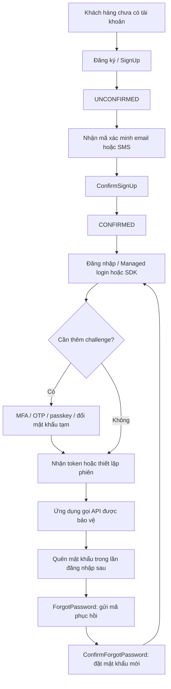
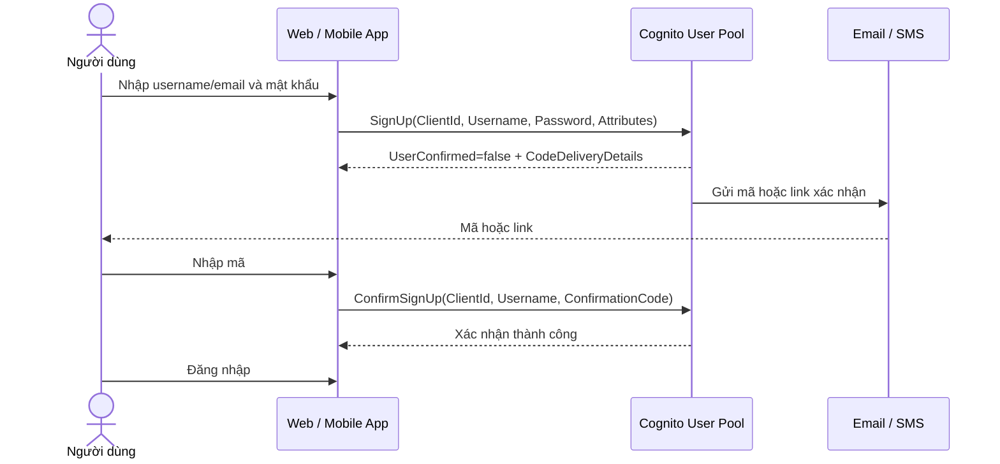
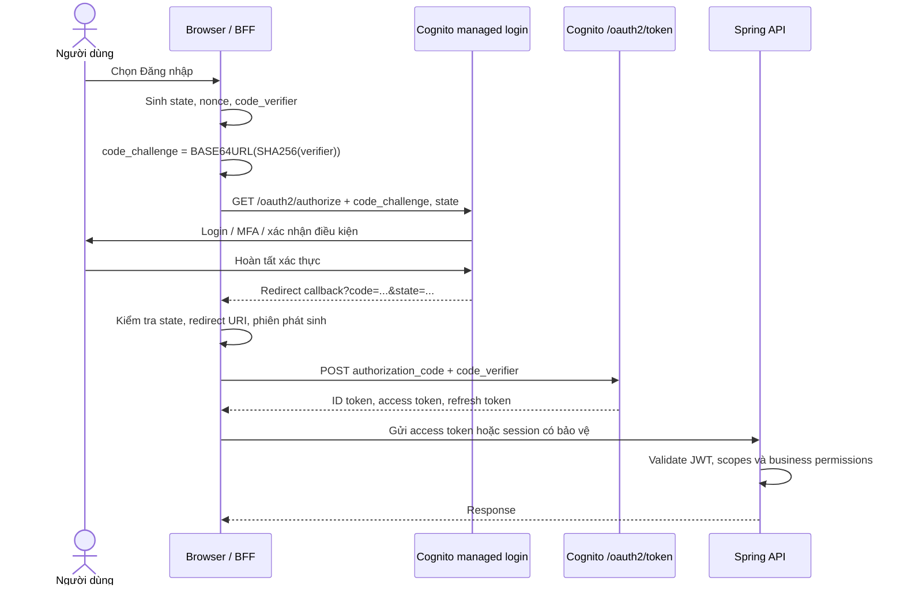
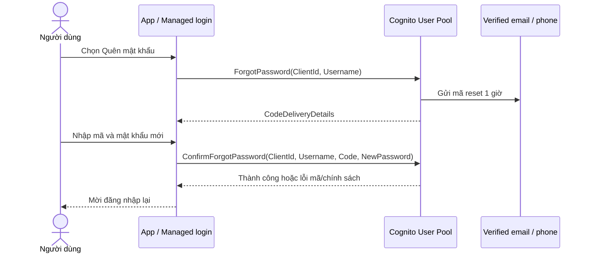
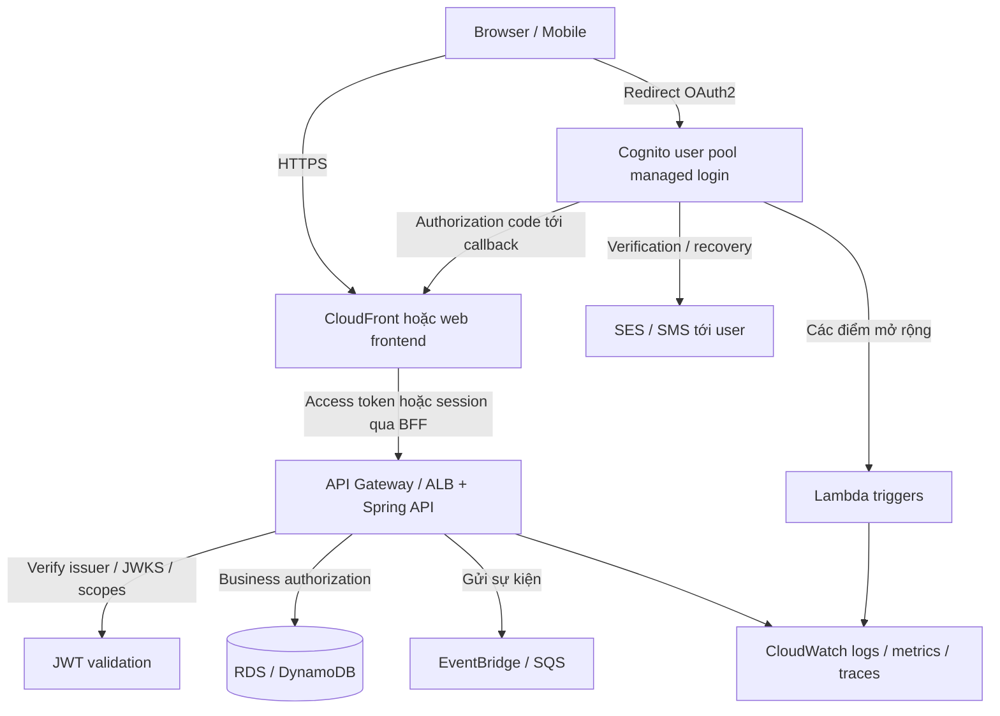
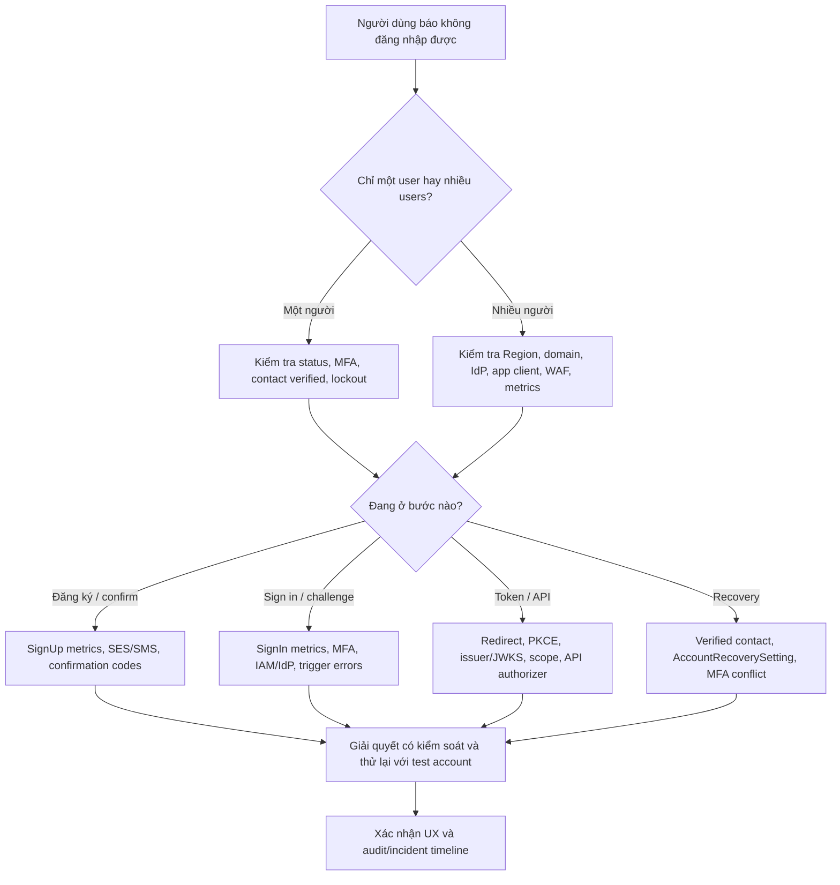

# Đăng ký, xác minh, đăng nhập và khôi phục tài khoản

> **Chương:** Danh tính ứng dụng với Cognito · **Mô-đun:** `CLOUD_PROVIDERS_AWS`

## 1. Bài toán: quản lý toàn bộ vòng đời tài khoản người dùng

Một ứng dụng thương mại điện tử chạy Spring Boot trên Amazon ECS hoặc AWS Lambda cần cho khách hàng **đăng ký, xác minh email, đăng nhập, đổi mật khẩu, đặt lại mật khẩu và đăng xuất**. Nếu tự viết hệ thống lưu mật khẩu, gửi mã OTP, quản lý phiên đăng nhập và xử lý gian lận, nhóm phát triển phải chịu trách nhiệm lớn về bảo mật, khả năng mở rộng và vận hành.

**Amazon Cognito user pools** cung cấp một dịch vụ danh bạ và xác thực người dùng được AWS quản lý. Cognito có thể lưu hồ sơ người dùng, kiểm tra mật khẩu, điều phối các bước xác minh, hỗ trợ MFA/passkeys theo cấu hình, cấp **ID token, access token và refresh token**, và liên kết với các identity providers (IdPs). Ứng dụng vẫn phải quyết định **người dùng được phép làm gì** trong nghiệp vụ, bảo vệ API, xử lý dữ liệu cá nhân và xây trải nghiệm xử lý lỗi.

Ví dụ hành trình người dùng:



Sơ đồ khái quát trường hợp **tài khoản nội bộ có mật khẩu**. Đăng nhập bằng social/SAML/OIDC federation hoặc passkey/passwordless có thể không đi qua tất cả các bước và có chính sách khôi phục khác. **Xác minh email** chứng minh quyền kiểm soát một địa chỉ tại thời điểm xác minh, **không tự chứng minh danh tính pháp lý** của người dùng.

Trong mô-đun `CLOUD_PROVIDERS_AWS`, bài này kết nối **IAM, Region/AZ, VPC, API Gateway, ALB, Lambda, ECS, DynamoDB/RDS, SES/SNS, CloudWatch, bảo mật, khả năng phục hồi và chi phí**. Cognito là **dịch vụ danh tính ứng dụng**, khác với IAM role cho workload và khác đăng nhập quản trị AWS bằng IAM Identity Center.

**Sau bài học, người học có thể:**

1. Phân biệt Cognito user pool, app client, domain, managed login, identity pool, IAM và token.
2. Thiết kế **self-service sign-up** và account confirmation bằng email/SMS mà không lưu mật khẩu hoặc OTP trong database tự xây.
3. Giải thích khác nhau giữa **xác nhận tài khoản**, **xác minh thuộc tính email/số điện thoại** và **MFA**.
4. Chọn đăng nhập bằng **managed login + OAuth 2.0 Authorization Code/PKCE** hoặc custom UI/SDK phù hợp.
5. Phân biệt trạng thái `UNCONFIRMED`, `CONFIRMED`, `FORCE_CHANGE_PASSWORD`, `RESET_REQUIRED` và `EXTERNAL_PROVIDER`.
6. Thực hiện luồng **ForgotPassword → ConfirmForgotPassword**, thiết kế recovery contact và đường xử lý khi người dùng mất kênh liên lạc.
7. Bảo vệ JWT, session, IAM policies, email/SMS delivery, rate limits, chống liệt kê tài khoản và abuse.
8. Xây runbook giám sát, khắc phục lỗi và dự toán chi phí cho các luồng danh tính.

## 2. Các thành phần Cognito cần hiểu trước

### 2.1. User pool, app client và domain

| Thành phần | Vai trò | Ví dụ minh họa |
| --- | --- | --- |
| **User pool** | Danh bạ người dùng, password/MFA policies, attributes, sign-up/sign-in, token issuer và user status. | `ap-southeast-1_Example123`. |
| **App client** | Cấu hình một ứng dụng truy cập user pool: client ID, có/không có secret, auth flows, OAuth grants/scopes và token expiration. | `shop-web-public`, `shop-bff-confidential`. |
| **User pool domain** | Địa chỉ HTTPS của managed login/OAuth endpoints, có thể là Cognito prefix hoặc custom domain. | `https://shop-login.auth.ap-southeast-1.amazoncognito.com`. |
| **Managed login** | Các trang Cognito quản lý cho sign-up, sign-in, confirmation, forgot password và federation. | Form đăng nhập và trang nhập mã được Cognito cung cấp. |
| **User attributes** | `sub`, `email`, `email_verified`, `phone_number` và custom attributes được định nghĩa. | `sub` làm khóa ổn định để liên kết hồ sơ nghiệp vụ. |
| **Groups / OAuth scopes** | Thông tin hỗ trợ phân quyền qua claims và token. | `orders.read`, `orders.write`. |
| **Lambda triggers** | Điểm mở rộng các giai đoạn như pre sign-up, custom message, post confirmation, pre token generation. | Kiểm tra điều kiện đăng ký, tạo hồ sơ khách hàng. |

Một user pool nằm trong **một AWS Region** và có issuer riêng. Client ở nhiều AZ có thể dùng chung user pool. **User pools không tự trở thành bản sao dữ liệu đa Region cho DR**; nếu hệ thống cần kiến trúc multi-Region hoặc di chuyển người dùng, phải thiết kế riêng user migration/failover, domain và token issuer.

### 2.2. User pools khác identity pools và IAM Identity Center

| Dịch vụ | Người dùng/đối tượng | Kết quả chính |
| --- | --- | --- |
| **Cognito user pool** | Khách hàng, nhân viên sử dụng **ứng dụng**; local hoặc federated identities. | User profile và JWTs để đăng nhập/gọi API. |
| **Cognito identity pool** | Người dùng đã được xác thực hoặc guest cần **AWS credentials tạm thời** trong use case được hỗ trợ. | Federation tới IAM roles và STS credentials có giới hạn. |
| **AWS IAM** | AWS roles/users/service principals. | Policy cho phép thao tác trên tài nguyên AWS. |
| **IAM Identity Center** | Workforce access và liên kết IdP để truy cập AWS accounts/business applications. | SSO và cấp quyền công việc. |

Một **Cognito access token không tự là AWS access key**. Nếu app backend cần ghi S3/DynamoDB, thường backend dùng **IAM execution/task role**, còn token Cognito chứng minh user identity và app kiểm tra quyền nghiệp vụ. Nếu browser/mobile cần truy cập trực tiếp một số AWS APIs qua temporary credentials, đánh giá identity pool cùng IAM roles, scope chặt và các rủi ro phù hợp.

### 2.3. Feature plans và cách chọn trải nghiệm

User pools có các **feature plans Lite, Essentials và Plus** với khả năng khác nhau. Tại thời điểm tài liệu AWS được đối chiếu, **managed login** hiện đại có trong Essentials/Plus, trong khi **classic hosted UI** có khả năng ở Lite. Tính năng như passwordless/passkeys, MFA qua email, threat protection và các trải nghiệm tùy chỉnh có thể phụ thuộc plan.

Không giả định một user pool vừa tạo có sẵn mọi phương thức đăng nhập hoặc một bảng giá cố định giữa Regions. Trước khi chọn plan hãy so sánh: **MAU (monthly active users)**, loại đăng nhập, hỗ trợ branding/managed login, OTP/MFA, threat protection, email/SMS delivery và nhu cầu tích hợp doanh nghiệp. Nguồn tham khảo: [User pool feature plans](https://docs.aws.amazon.com/cognito/latest/developerguide/cognito-sign-in-feature-plans.html) và [Cognito Pricing](https://aws.amazon.com/cognito/pricing/).

### 2.4. Client public và confidential

| Loại app client | Secret | Ví dụ | Gợi ý sử dụng |
| --- | --- | --- | --- |
| **Public client** | **Không có client secret** | Browser SPA, mobile app, desktop app. | OAuth authorization code + **PKCE**; đừng nhúng secret vào mã frontend. |
| **Confidential client** | Có client secret được giữ ở backend an toàn. | Spring Boot BFF/server-side web application. | OIDC library giữ secret server-side, session cookie an toàn. |

Nếu một app client được tạo **với secret**, các Cognito user-pools APIs như `SignUp`, `ForgotPassword` và một số auth flows có thể yêu cầu **`SECRET_HASH`**; thuật toán HMAC-SHA256 được áp dụng theo tài liệu AWS. Không cố nhúng secret vào JavaScript hoặc ứng dụng mobile để “sửa” lỗi `SecretHash does not match`; hãy dùng **public client không secret** ở frontend hoặc thực hiện request qua backend confidential.

## 3. Thiết kế hồ sơ, tên đăng nhập và trạng thái người dùng

### 3.1. Username, email và `sub`

Khi tạo user pool, người quản trị chọn các lựa chọn **sign-in identifiers**: username, email, phone number hoặc alias cho phép đăng nhập bằng nhiều giá trị, theo cấu hình được hỗ trợ. Những lựa chọn nền tảng có thể khó hoặc không thể thay đổi trực tiếp sau khi user pool đã có người dùng; cần quyết định trước khi production.

| Thuộc tính | Mục đích | Có nên dùng làm khóa hồ sơ nghiệp vụ? |
| --- | --- | --- |
| `sub` | Định danh người dùng riêng trong user pool, được cấp bởi Cognito. | **Nên** dùng cùng user pool issuer, ổn định hơn email/phone. |
| `email` | Địa chỉ email liên lạc hoặc sign-in. | **Không** dùng làm khóa chính bất biến, vì email có thể thay đổi. |
| `phone_number` | Số điện thoại thường ở định dạng E.164 (ví dụ `+84901234567`). | **Không**, vì có thể thay đổi/tái cấp. |
| `preferred_username` | Tên hiển thị/alias theo cấu hình. | **Không** cho identity key lâu dài. |
| `email_verified` / `phone_number_verified` | Đánh dấu đã xác minh quyền kiểm soát contact. | Kiểm tra trước khi tin vào kênh liên lạc. |

**Khóa liên kết** ở backend có thể là (`issuer`, `sub`) thay vì email đơn lẻ. Hai user pools khác nhau có thể cùng xuất `sub` theo định dạng tương tự; dùng issuer để bảo đảm namespace. Nếu cấu hình federation/social linking, kiểm tra user linking strategy trước khi tạo hồ sơ trùng lặp.

### 3.2. Trạng thái tài khoản Cognito

| `UserStatus` | Ý nghĩa thường gặp | UX/backend nên làm |
| --- | --- | --- |
| `UNCONFIRMED` | Self-registration đã tạo account nhưng chưa hoàn tất xác nhận. | Mời nhập mã hoặc resend với chống spam. |
| `CONFIRMED` | Tài khoản đã được xác nhận theo luồng áp dụng. | Cho đăng nhập nếu không bị disabled/chặn bởi chính sách khác. |
| `FORCE_CHANGE_PASSWORD` | Admin-created user có temporary password, cần thiết lập mật khẩu mới khi sign-in. | Xử lý challenge `NEW_PASSWORD_REQUIRED` an toàn. |
| `RESET_REQUIRED` | User phải đặt lại mật khẩu trước khi tiếp tục sign-in. | Hướng dẫn Forgot Password/administrator recovery theo policy. |
| `EXTERNAL_PROVIDER` | User record liên kết với external IdP. | Đăng nhập/khôi phục qua IdP phù hợp, không giả định có local password. |

**Đừng đồng nhất `UserStatus=CONFIRMED` với `Enabled=true` hoặc “đã qua MFA”.** User có thể bị disabled, bị rate-limited hay không đủ các điều kiện phân quyền dù trạng thái confirmed. Ngoài ra `email_verified=true` không đồng nghĩa người dùng đã qua kiểm tra danh tính KYC.

### 3.3. Required attributes và thay đổi contact

User pool có thể yêu cầu `email`, `phone_number` hoặc custom attributes; trường bắt buộc phải được cung cấp trong sign-up theo policy. Hãy chỉ thu thập những thuộc tính thật sự phục vụ nghiệp vụ, tránh tăng rủi ro dữ liệu cá nhân.

Nếu một người thay email/phone:

1. Dùng API có access token hợp lệ như `UpdateUserAttributes` và gửi mã xác minh tới **contact mới** theo user pool settings.
2. Gọi `VerifyUserAttribute` với mã và access token để đánh dấu verified.
3. Cấu hình `AttributesRequireVerificationBeforeUpdate` phù hợp, để tránh đưa contact chưa verified thành kênh sign-in/recovery chính.
4. Có thể thông báo về sự thay đổi cho kênh cũ theo policy, phòng chiếm đoạt tài khoản.

Một người đã xác minh email A **không tự được coi đã xác minh email B** chỉ vì họ có access token. Các thủ tục thay đổi tài khoản cần xác thực và kiểm soát rủi ro tương xứng.

## 4. Đăng ký tài khoản: `SignUp`, mã xác minh và xác nhận

### 4.1. Self-service registration có được phép không?

Khi bật **self-registration**, người dùng có thể tự tạo tài khoản qua managed login hoặc user-pools `SignUp` API. Nếu ứng dụng chỉ dành cho nhân viên/đối tác được mời, có thể **tắt self-registration** và dùng `AdminCreateUser`/mời người dùng theo quy trình nội bộ.

Chọn phương án cần xem xét **phòng gian lận, yêu cầu xác thực email, cost của OTP và giới hạn abuse**. Không để người lạ tạo hàng nghìn tài khoản nếu ứng dụng cần whitelist/approval.

### 4.2. Luồng đăng ký tiêu chuẩn



Khi dùng xác minh email/SMS theo luồng này, Cognito gửi **mã xác nhận có hiệu lực 24 giờ**. `SignUp` có thể trả account `UNCONFIRMED` và thông tin `CodeDeliveryDetails` mô tả **kênh nhận mã**, không trả mã OTP thô cho frontend theo cách thông thường.

Một số user pools có **pre-sign-up Lambda trigger** tự xác nhận người dùng hoặc auto-verify attribute theo policy, nên kết quả có thể là `UserConfirmed=true`. Điều này chỉ phù hợp khi **đã có cơ chế tin cậy để xác minh danh tính/contact**; đừng auto-confirm mọi request từ Internet nếu mục tiêu là chống đăng ký giả.

### 4.3. Phân biệt confirmation và verification

| Khái niệm | Câu hỏi | API / trạng thái |
| --- | --- | --- |
| **Account confirmation** | User được phép hoàn tất đăng ký/đăng nhập chưa? | `ConfirmSignUp`, `UNCONFIRMED → CONFIRMED`. |
| **Email verification** | User kiểm soát địa chỉ email cụ thể chưa? | `email_verified=true`, `VerifyUserAttribute` khi cập nhật email. |
| **Phone verification** | User kiểm soát số điện thoại cụ thể chưa? | `phone_number_verified=true`. |
| **MFA** | Ở lần sign-in này user có hoàn tất yếu tố xác thực bổ sung không? | Các challenge như `SMS_MFA`, `SOFTWARE_TOKEN_MFA` theo cấu hình. |

**Đăng ký có cả email và phone:** Cognito thường **xác minh một contact** trong quá trình confirmation theo cấu hình ưu tiên delivery. Nếu ứng dụng cần xác minh **cả hai**, hướng dẫn user đăng nhập rồi gọi `GetUserAttributeVerificationCode` và `VerifyUserAttribute` cho kênh còn lại. Đừng tưởng rằng account confirmed thì cả email và phone đều verified.

### 4.4. Khi mã không tới hoặc đã hết hạn

Các nguyên nhân thường gặp:

- Người dùng nhập sai địa chỉ, email nằm trong spam hoặc SMS bị chặn theo quốc gia/nhà mạng.
- AWS account/Region đang dùng **Cognito default email** với giới hạn gửi thấp hoặc **SNS SMS sandbox**, chưa cấu hình origination registration theo quy định.
- `CodeMismatchException`: mã nhập không đúng.
- `ExpiredCodeException`: mã hết hạn hoặc không còn hiệu lực.
- `LimitExceededException`, `TooManyRequestsException`: gặp giới hạn gửi mã hoặc API throttling.
- User đã confirmed, bị disabled, hoặc client ID/secret hash không khớp.

Nút **Gửi lại mã** nên gọi `ResendConfirmationCode` sau một khoảng cooldown, đồng thời áp **rate limit theo account/IP/device**. Không gửi email/SMS mỗi lần người dùng refresh trang; không lưu hoặc log mã trong analytics và request tracing.

### 4.5. Hành trình xác nhận trong managed login

Managed login cung cấp các trang để người dùng đăng ký, nhập mã, resend và xác nhận email qua link khi tính năng được bật. Tùy cấu hình user pool/app client, giao diện đi qua các paths:

```text
/signup
/confirm
/resendcode
/confirmUser
```

Các URL này nằm dưới **user pool domain**, thường có navigation/routing và query parameters do Cognito quản lý. **Không tự ghép link confirmation hay sửa tham số bảo mật**; dùng đường dẫn và OAuth integration theo tài liệu [Managed login endpoints](https://docs.aws.amazon.com/cognito/latest/developerguide/managed-login-endpoints.html). Với custom UI, ứng dụng tự tạo form nhưng Cognito vẫn xử lý mã và trạng thái xác nhận.

## 5. Ví dụ custom sign-up bằng AWS SDK for Java 2.x

Giả sử ứng dụng Spring Boot/BFF có **public app client không secret** cho custom authentication và cần form đăng ký tự xây. Ví dụ sau dùng **AWS SDK for Java 2.x**; trong ứng dụng thực tế, nên dùng service bean, cấu hình dependency injection, validation, centralized error mapping và test thay vì đặt tất cả logic ở controller.

### 5.1. Mẫu Java: đăng ký, xác nhận và gửi lại mã

```java
import software.amazon.awssdk.regions.Region;
import software.amazon.awssdk.services.cognitoidentityprovider.CognitoIdentityProviderClient;
import software.amazon.awssdk.services.cognitoidentityprovider.model.AttributeType;
import software.amazon.awssdk.services.cognitoidentityprovider.model.SignUpRequest;
import software.amazon.awssdk.services.cognitoidentityprovider.model.SignUpResponse;
import software.amazon.awssdk.services.cognitoidentityprovider.model.ConfirmSignUpRequest;
import software.amazon.awssdk.services.cognitoidentityprovider.model.ResendConfirmationCodeRequest;

public final class CognitoRegistrationService implements AutoCloseable {
    private final CognitoIdentityProviderClient cognito;
    private final String clientId;

    public CognitoRegistrationService(String clientId) {
        this.clientId = clientId; // Lấy từ cấu hình deployment, không hard-code.
        this.cognito = CognitoIdentityProviderClient.builder()
                .region(Region.AP_SOUTHEAST_1)
                .build();
    }

    // password được truyền từ input qua HTTPS;
    // KHÔNG ghi password hoặc code vào log.
    public boolean signUp(String username, String email, String password) {
        SignUpResponse response = cognito.signUp(SignUpRequest.builder()
                .clientId(clientId)
                .username(username)
                .password(password)
                .userAttributes(AttributeType.builder()
                        .name("email")
                        .value(email)
                        .build())
                .build());
        return response.userConfirmed();
    }

    public void confirmSignUp(String username, String code) {
        cognito.confirmSignUp(ConfirmSignUpRequest.builder()
                .clientId(clientId)
                .username(username)
                .confirmationCode(code)
                .build());
    }

    public void resendConfirmationCode(String username) {
        cognito.resendConfirmationCode(
                ResendConfirmationCodeRequest.builder()
                        .clientId(clientId)
                        .username(username)
                        .build());
    }

    @Override
    public void close() {
        cognito.close();
    }
}
```

**Điều kiện chạy:** project có dependency `software.amazon.awssdk:cognitoidentityprovider`, đúng Java version, kết nối HTTPS tới Cognito service endpoint và app client đã cho phép self-sign-up. Nếu dùng **confidential app client có secret**, cần tính và gửi `SecretHash` trong các request phù hợp; ví dụ trên cố ý chỉ minh họa **client không secret**.

Lời gọi `SignUp` trong SDK có thể được thực hiện từ một backend có AWS credentials, nhưng bản thân operation thường được thiết kế cho flow người dùng không phải admin IAM. Phân biệt quyền cần cho `AdminCreateUser`/`AdminConfirmSignUp` với `SignUp`/`ConfirmSignUp`. Không gán admin IAM permissions cho frontend hoặc ứng dụng mobile.

### 5.2. Kiểm tra dữ liệu và xử lý lỗi đúng UX

Ở tầng ứng dụng:

1. Kiểm tra format email/phone, input length và password policy **trước khi gọi Cognito** để hướng dẫn UX; Cognito vẫn thực thi quy tắc cuối cùng.
2. Không tự trim/biến đổi password hoặc âm thầm thay đổi chữ hoa/chữ thường của username nếu user pool không định nghĩa như vậy.
3. Tránh log `Password`, `ConfirmationCode` và toàn bộ SDK request object.
4. Dịch exception như `InvalidPasswordException`, `UsernameExistsException`, `CodeMismatchException`, `ExpiredCodeException` và `TooManyRequestsException` sang thông báo vừa đủ để người dùng sửa lỗi.
5. Áp rate limiting, WAF/anti-bot nếu cần; không để API resend mã thành một công cụ spam email/SMS.
6. Với luồng bảo mật cần chống **user enumeration**, cân nhắc phản hồi chung không tiết lộ sự tồn tại email, theo thiết kế anti-enumeration của Cognito.

**Ví dụ API response ở BFF:**

```json
{
  "status": "CONFIRMATION_REQUIRED",
  "message": "Nếu địa chỉ hợp lệ và cần xác minh, hướng dẫn đã được gửi.",
  "nextStep": "ENTER_CONFIRMATION_CODE"
}
```

Đây là JSON **do ứng dụng tự thiết kế**, không phải cấu trúc response nguyên bản của `SignUp`. Không hiển thị confirmation code trong response. Khi `SignUpResponse.userConfirmed()==true`, app có thể chuyển sang luồng đăng nhập mà không cần màn nhập mã.

### 5.3. Admin-created users khác self-sign-up thế nào?

Nếu tổ chức tạo tài khoản nội bộ qua `AdminCreateUser`, Cognito có thể gửi invitation/temporary password. User được đặt trạng thái `FORCE_CHANGE_PASSWORD` và khi sign-in phải hoàn tất challenge `NEW_PASSWORD_REQUIRED` để đặt mật khẩu riêng. Nó **không giống** self-sign-up chờ `ConfirmSignUp`.

Phương án này phù hợp với hệ thống chỉ cho nhân viên/đối tác được mời, nhưng cần kiểm soát:

- IAM permission của backend quản trị, approval và audit qua CloudTrail.
- Xác minh email/phone khi có giá trị contact được nhập từ bên thứ ba.
- Thời hạn temporary password, luồng phát lại invitation và không ghi password ra logs.
- Người dùng có thể cần hỗ trợ account recovery ngay cả sau khi đã đổi mật khẩu.

## 6. Đăng nhập bằng Cognito managed login và OAuth 2.0/OIDC

### 6.1. Vì sao ưu tiên managed login cho nhiều ứng dụng?

**Managed login** để Cognito xử lý các màn hình nhập mật khẩu/MFA/passkey, liên kết tài khoản và recovery theo tính năng được bật. Ứng dụng vẫn kiểm soát brand/domain, callback, session handling và authorization của API. Cách này giảm nhu cầu tự viết giao diện xử lý các challenge phức tạp và giúp giảm nguy cơ vô tình log password ở backend.

Với browser SPA, mobile app hoặc BFF, luồng phổ biến là **OAuth 2.0 Authorization Code Grant với PKCE**. Không dùng **Implicit Grant** cho ứng dụng mới khi authorization code + PKCE khả dụng, vì implicit đưa token qua front-channel và khó kiểm soát an toàn hơn.

### 6.2. Authorization Code + PKCE



Các bước bảo mật:

1. Tạo **`state` đủ ngẫu nhiên** để ràng buộc redirect response với yêu cầu login và chống CSRF.
2. Nếu ứng dụng dùng ID token/OIDC, sử dụng **`nonce`** theo OIDC library/flow để chống token replay hoặc nhầm phiên theo ràng buộc tương ứng.
3. Sinh **`code_verifier` ngẫu nhiên mạnh**, từ đó tính `code_challenge = base64url(SHA256(code_verifier))` (không có dấu `=` padding); gửi `code_challenge_method=S256`.
4. Redirect URI phải là URL **được đăng ký chính xác** trong app client; HTTPS cho production, ngoại lệ localhost khi được hỗ trợ và cần cho development.
5. Sau callback, so khớp `state`, kiểm tra lỗi OAuth, đổi authorization code tại **token endpoint** cùng `code_verifier`.
6. Xác thực JWT và session; **không để refresh token trong localStorage không được bảo vệ** hoặc log query strings/codes.

### 6.3. Ví dụ request authorize

```text
GET https://shop-login.auth.ap-southeast-1.amazoncognito.com/oauth2/authorize
  ?response_type=code
  &client_id=example_public_app_client_id
  &redirect_uri=https%3A%2F%2Fshop.example.com%2Fauth%2Fcallback
  &scope=openid%20email%20profile
  &state=<cryptographically-random-state>
  &nonce=<cryptographically-random-nonce>
  &code_challenge=<base64url-sha256-verifier>
  &code_challenge_method=S256
```

Đây là mẫu **nhiều dòng để đọc**, không phải URL có thể gọi nguyên văn. Host domain, app client ID, callback URL, scopes và các giá trị ngẫu nhiên phải thuộc cấu hình thật. Không đưa `code_verifier` lên URL authorize; giữ an toàn cho tới bước token exchange.

Sau khi user hoàn tất đăng nhập, Cognito trả về `code` tới callback. Ứng dụng đổi code bằng request:

```http
POST /oauth2/token HTTP/1.1
Host: shop-login.auth.ap-southeast-1.amazoncognito.com
Content-Type: application/x-www-form-urlencoded

grant_type=authorization_code&client_id=example_public_app_client_id&code=<one-time-code>&redirect_uri=https%3A%2F%2Fshop.example.com%2Fauth%2Fcallback&code_verifier=<original-code-verifier>
```

Với confidential client, token endpoint còn yêu cầu client authentication phù hợp (client secret/HTTP Basic hoặc phương thức được hỗ trợ). Dùng **OIDC/OAuth library** thay vì tự ghép HTTP form và JWT parser trong ứng dụng production. `code` ngắn hạn, dùng một lần; dùng lại có thể thất bại.

### 6.4. Session và cookie trong một Spring Boot BFF

Nếu frontend chỉ cần session do server quản lý, **Backend-for-Frontend (BFF)** là một lựa chọn:

1. BFF xử lý OAuth callback, giữ access/refresh tokens trên **server-side session store** được bảo vệ.
2. Browser chỉ giữ cookie session có `Secure`, `HttpOnly`, `SameSite` phù hợp với domain và redirect.
3. BFF gọi API nội bộ theo quyền người dùng hoặc chuyển access token có kiểm soát.
4. CSRF defense vẫn cần thiết cho cookie-authenticated state-changing requests, đặc biệt khi dùng cross-site flows.
5. Logout phải xóa session app và thực hiện Cognito logout/token revocation theo semantics thực tế; xóa cookie đơn thuần không nhất thiết vô hiệu hóa token đã cấp.

Nếu xây SPA trực tiếp dùng access token, cân nhắc OIDC client library, token chỉ giữ trong memory khi khả thi, refresh token rotation và các rủi ro XSS. **Đừng dùng ID token để cấp quyền gọi API** nếu API được thiết kế chấp nhận access token. Điều này được giải thích ở mục 8.

### 6.5. Managed login và federation

User pool có thể liên kết **social login** và IdPs doanh nghiệp dùng **SAML/OIDC**. Khi đó Cognito vẫn có thể phát token tới ứng dụng qua OAuth/OIDC, nhưng:

- Đăng nhập/khôi phục mật khẩu ở external IdP được quản lý theo policy của **IdP gốc**, không nhất thiết dùng `ForgotPassword` của local Cognito user.
- Mapping các thuộc tính như email và `email_verified` cần được cấu hình cẩn thận; không mặc định mọi assertion từ bên ngoài đều đáng tin cho nghiệp vụ.
- Nếu một người vừa có local user vừa có social identity, hãy thiết kế **account linking** để tránh tạo hai hồ sơ đặt hàng hoặc gộp sai tài khoản.
- Khi IdP gặp sự cố, user không thể tự khôi phục qua Cognito local password nếu không có local credentials hợp lệ.

## 7. Custom sign-in với Cognito SDK: password, OTP, MFA và challenges

### 7.1. Các authentication flows quan trọng

Khi không dùng managed login mà tự xây form, ứng dụng làm việc với **`InitiateAuth`/`RespondToAuthChallenge`** hoặc các API quản trị tương ứng. App client phải **cho phép authentication flow** mà ứng dụng yêu cầu.

| `AuthFlow` | Chức năng | Ghi chú |
| --- | --- | --- |
| `USER_AUTH` | **Choice-based authentication**: server trả những lựa chọn có sẵn như password, email/SMS OTP, WebAuthn passkey tùy cấu hình. | App client cần `ALLOW_USER_AUTH`; passwordless/passkeys đòi feature plan/tùy chọn tương thích. |
| `USER_SRP_AUTH` | Xác thực password bằng **Secure Remote Password (SRP)**. | Client cần thư viện thực hiện phép toán SRP và challenge; không phải chỉ gửi password thô. |
| `USER_PASSWORD_AUTH` | Gửi username/password qua request bảo vệ bởi TLS để Cognito xác thực. | Cần `ALLOW_USER_PASSWORD_AUTH`; cân nhắc rủi ro khi ứng dụng xử lý plaintext password. |
| `ADMIN_USER_PASSWORD_AUTH` | Server có IAM credentials thực hiện admin auth. | Không dùng trong browser/mobile; đòi quyền IAM quản trị tương ứng. |
| `CUSTOM_AUTH` | Flow xác thực do Lambda triggers điều phối. | Tăng độ phức tạp bảo mật và vận hành; không tự tương thích managed login. |
| `REFRESH_TOKEN_AUTH` | Một số client-based refresh flows khi không bật refresh token rotation. | Với rotation, dùng API/phương thức refresh được hỗ trợ (ví dụ `GetTokensFromRefreshToken`). |

**Không đồng nhất `USER_AUTH` với OAuth `authorization_code`.** Một bên là cách gọi **user-pools API** để xác thực, bên kia là **OAuth 2.0 grant** tại hosted authorization/token endpoints. Cả hai có thể cấp JWTs nhưng điều kiện, khả năng federation và cách quản lý session khác nhau.

### 7.2. Luồng challenge-response

Khi Cognito cần thêm bước, `InitiateAuth` không trả tokens ngay mà trả:

```json
{
  "ChallengeName": "SELECT_CHALLENGE",
  "AvailableChallenges": ["PASSWORD", "EMAIL_OTP"],
  "Session": "<opaque-authentication-session>"
}
```

Đây là **mẫu khái niệm**; các trường/challenges thực tế phụ thuộc user pool, app client, user, feature plan và response của Cognito. Ứng dụng:

1. Hiển thị phương thức có trong `AvailableChallenges` (không tự hiển thị một method user không được phép).
2. Thu thập dữ liệu tương ứng, ví dụ mật khẩu hoặc mã email OTP.
3. Gọi `RespondToAuthChallenge` với `ChallengeName`, `ChallengeResponses` và **`Session`** được Cognito cấp.
4. Nếu nhận một challenge mới, tiếp tục vòng lặp cho đến khi có `AuthenticationResult` hoặc lỗi.
5. Khi có tokens, chỉ coi login hoàn tất sau khi session, token validation và yêu cầu ứng dụng được đáp ứng.

Ví dụ request logic cho một challenge yêu cầu password:

```json
{
  "ClientId": "example_public_client_id",
  "ChallengeName": "PASSWORD",
  "Session": "<session-returned-by-cognito>",
  "ChallengeResponses": {
    "USERNAME": "customer@example.com",
    "PASSWORD": "<user-entered-password>"
  }
}
```

**Không chạy ví dụ với dữ liệu nhạy cảm thật trong shell history hoặc gửi JSON vào logs.** Với client secret, còn có `SECRET_HASH`. `Session` là giá trị opaque, có hạn dùng và thường chỉ được sử dụng theo vòng challenge; không tái sử dụng từ phiên đăng nhập khác.

### 7.3. Các challenge hay gặp

| `ChallengeName` | Ý nghĩa | UX |
| --- | --- | --- |
| `PASSWORD_VERIFIER` | Bước kiểm chứng trong SRP. | SDK/library thực hiện challenge proof. |
| `SELECT_CHALLENGE` | User có thể chọn một phương thức trong danh sách được trả về. | Chọn password/passkey/OTP phù hợp. |
| `PASSWORD` | Cần password trong choice-based flow. | Thu password trên giao diện bảo vệ. |
| `SMS_OTP` / `EMAIL_OTP` | **Passwordless first factor** dùng mã OTP. | Nhập mã từ kênh xác minh. |
| `WEB_AUTHN` | Xác thực bằng passkey/security key. | Trình duyệt/thiết bị thực hiện WebAuthn. |
| `SMS_MFA` / `SOFTWARE_TOKEN_MFA` | **Second-factor challenge** sau first factor. | Nhập SMS code hoặc TOTP. |
| `MFA_SETUP` | User cần thiết lập yếu tố MFA. | Đăng ký TOTP hoặc kênh hỗ trợ rồi hoàn tất challenge. |
| `NEW_PASSWORD_REQUIRED` | Admin-created user phải đặt mật khẩu riêng. | Form tạo mật khẩu mới theo policy. |

Tên challenge và các khóa trong `ChallengeResponses` **khác nhau theo challenge**; xem tài liệu [InitiateAuth](https://docs.aws.amazon.com/cognito-user-identity-pools/latest/APIReference/API_InitiateAuth.html) và [RespondToAuthChallenge](https://docs.aws.amazon.com/cognito-user-identity-pools/latest/APIReference/API_RespondToAuthChallenge.html) khi hiện thực.

### 7.4. Username/password flow không được phép bỏ qua MFA

Giả sử user pool yêu cầu MFA. Sau khi password đúng, Cognito vẫn có thể trả `SMS_MFA` hoặc `SOFTWARE_TOKEN_MFA`; ứng dụng **không được đánh dấu login thành công trước khi hoàn tất challenge**. Đừng tự tạo session ứng dụng chỉ vì HTTP `InitiateAuth` trả `200`.

Với `NEW_PASSWORD_REQUIRED`, phải thu mật khẩu mới rồi đáp ứng challenge theo session thay vì chỉ gọi `ForgotPassword`. Nếu account bị `RESET_REQUIRED` do admin reset, theo hướng dẫn flow phục hồi tương ứng.

### 7.5. Passkey, passwordless và MFA không phải cùng một thứ

- **Passwordless OTP** (email/SMS) là một phương thức *first factor* theo choice-based flow, không đồng nghĩa đã thực hiện **MFA**.
- **MFA** yêu cầu yếu tố bổ sung sau mật khẩu, ví dụ TOTP/SMS/email theo cấu hình và plan được hỗ trợ.
- **Passkey (WebAuthn)** dùng public-key credential và có thể sử dụng xác minh người dùng trên thiết bị; ở cấu hình `MULTI_FACTOR_WITH_USER_VERIFICATION` được hỗ trợ, passkey có user verification có thể thỏa yêu cầu MFA theo cơ chế Cognito, nhưng **không phải yếu tố thứ hai thêm vào sau password**.
- User pools yêu cầu MFA có các ràng buộc với one-time password first factors; không bật `MFA required` rồi kỳ vọng mọi phương thức passwordless vẫn hoạt động.

Đối với ứng dụng mới, ưu tiên **managed login** xử lý các tương tác phức tạp này nếu plan và UX cho phép, thay vì tự viết đầy đủ WebAuthn/MFA ceremony.

## 8. Tokens: phân biệt ID, access, refresh và bảo vệ Spring API

### 8.1. Ba loại token trong Cognito

| Token | Mục đích | Có dùng làm Bearer token cho API nghiệp vụ? |
| --- | --- | --- |
| **ID token** | Thông tin identity của user dành cho ứng dụng OIDC, các claims như `sub`, `email`, `aud`. | **Không nên**, nếu API được thiết kế xác thực bằng access token. |
| **Access token** | Quyền gọi API và các scopes/claims; có `token_use=access` và `client_id`. | **Có**, sau khi validate và kiểm tra authorization. |
| **Refresh token** | Đổi lấy access/ID tokens mới khi phiên còn hợp lệ; thường sống lâu hơn. | **Không** gửi tới resource API làm Bearer token; lưu an toàn và hạn chế rò rỉ. |

JWT thường có ba phần `header.payload.signature`. Nội dung payload được **Base64URL-encoded, không phải encrypted**: người có token có thể đọc claims. Vì vậy không đưa bí mật vào custom claims và không dựa vào việc “payload nhìn rối” để bảo vệ dữ liệu.

### 8.2. Claims phải kiểm tra

Một protected Spring Boot API nên xác minh tối thiểu:

1. **Chữ ký JWT** bằng public keys từ JWKS của đúng Cognito user pool, xét `kid` và key rotation.
2. **`iss`** đúng issuer/user pool/Region dự kiến.
3. **`exp`, `nbf`** và thời gian theo phép kiểm hợp lệ (clock skew nhỏ có kiểm soát).
4. **`token_use=access`** khi API chấp nhận access tokens.
5. **App client `client_id`** được phép gọi API; ID token dùng `aud` cho client, còn access token có `client_id` và có thể có `aud` **nếu đã bind tới resource server**.
6. **Scopes/roles/business authorization** cho endpoint; không chỉ dựa vào token hợp lệ để cho đọc dữ liệu người khác.
7. **Thu hồi và session policy:** JWT offline validation không tự biết token vừa bị revoke; access token có thể tiếp tục hợp lệ về mặt chữ ký cho tới expiry nếu hệ thống không có cơ chế bổ sung.

Issuer URL (ví dụ):

```text
https://cognito-idp.ap-southeast-1.amazonaws.com/ap-southeast-1_Example123
```

JWKS:

```text
https://cognito-idp.ap-southeast-1.amazonaws.com/ap-southeast-1_Example123/.well-known/jwks.json
```

**Issuer không phải URL của hosted login domain.** Ví dụ user pool issuer có host `cognito-idp...amazonaws.com`, còn OAuth authorization/token endpoints có thể ở `shop-login.auth...amazoncognito.com` hoặc custom domain. Nhầm hai địa chỉ gây lỗi JWT validation.

### 8.3. Cấu hình Spring Security Resource Server

Với Spring Boot dùng Spring Security OAuth2 Resource Server, cấu hình (giá trị là **placeholder**):

```yaml
spring:
  security:
    oauth2:
      resourceserver:
        jwt:
          issuer-uri: https://cognito-idp.ap-southeast-1.amazonaws.com/ap-southeast-1_Example123
```

`issuer-uri` giúp Spring cấu hình discovery/JWKS và kiểm tra issuer theo khả năng framework. Để bảo vệ API dùng Cognito **access token**, cần thêm validation `token_use=access` và `client_id` phù hợp khi ứng dụng yêu cầu giới hạn một hoặc nhiều app clients. Đây là ví dụ cấu hình Java có kiểm tra những claims đó:

```java
import org.springframework.beans.factory.annotation.Value;
import org.springframework.context.annotation.Bean;
import org.springframework.context.annotation.Configuration;
import org.springframework.security.config.Customizer;
import org.springframework.security.config.annotation.web.builders.HttpSecurity;
import org.springframework.security.oauth2.core.OAuth2Error;
import org.springframework.security.oauth2.core.OAuth2TokenValidator;
import org.springframework.security.oauth2.core.OAuth2TokenValidatorResult;
import org.springframework.security.oauth2.core.DelegatingOAuth2TokenValidator;
import org.springframework.security.oauth2.jwt.Jwt;
import org.springframework.security.oauth2.jwt.JwtDecoder;
import org.springframework.security.oauth2.jwt.JwtValidators;
import org.springframework.security.oauth2.jwt.NimbusJwtDecoder;
import org.springframework.security.web.SecurityFilterChain;

@Configuration
public class ApiJwtSecurityConfig {
    @Bean
    JwtDecoder jwtDecoder(
            @Value("${security.cognito.issuer}") String issuer,
            @Value("${security.cognito.client-id}") String clientId) {

        NimbusJwtDecoder decoder = NimbusJwtDecoder.withIssuerLocation(issuer).build();
        OAuth2TokenValidator<Jwt> defaultChecks =
                JwtValidators.createDefaultWithIssuer(issuer);

        OAuth2TokenValidator<Jwt> cognitoAccessTokenChecks = jwt -> {
            boolean correctType = "access".equals(jwt.getClaimAsString("token_use"));
            boolean correctClient = clientId.equals(jwt.getClaimAsString("client_id"));
            if (!correctType || !correctClient) {
                return OAuth2TokenValidatorResult.failure(
                        new OAuth2Error("invalid_token",
                                "Wrong token type or Cognito app client", null));
            }
            return OAuth2TokenValidatorResult.success();
        };

        decoder.setJwtValidator(new DelegatingOAuth2TokenValidator<>(
                defaultChecks, cognitoAccessTokenChecks));
        return decoder;
    }

    @Bean
    SecurityFilterChain securityFilterChain(HttpSecurity http) throws Exception {
        return http.authorizeHttpRequests(auth -> auth
                .requestMatchers("/health").permitAll()
                .requestMatchers("/api/orders/**").hasAuthority("SCOPE_orders.read")
                .anyRequest().authenticated())
            .oauth2ResourceServer(oauth -> oauth.jwt(Customizer.withDefaults()))
            .build();
    }
}
```

Mẫu này cần các dependencies Spring Security tương ứng, cấu hình `security.cognito.issuer`/`client-id` và token có scope `orders.read` đã được cấp bởi resource server/app client. **Đây là ví dụ khung**, phải kiểm tra phiên bản Spring Security thực tế, `HttpSecurity` CSRF/session policy, CORS và scope converter trước production. Nếu API phục vụ **nhiều app clients** hợp lệ, thay kiểm tra `client_id` đơn bằng một allowlist có review. Với access token có resource binding `aud`, còn phải xác minh audience cho API cụ thể theo chính sách.

### 8.4. Authorization cho dữ liệu riêng của khách hàng

Một token hợp lệ có `sub=customer-A` và scope `orders.read` không cho phép xem đơn của `customer-B`. Ở tầng repository/business logic phải kiểm tra ownership:

```text
GET /api/orders/123
    ↓
JWT hợp lệ + scope orders.read
    ↓
Lấy order 123 từ database
    ↓
Kiểm tra order.ownerSub == jwt.sub trong đúng issuer
    ↓
Chỉ sau đó trả dữ liệu
```

Đừng dùng email string như một “quyền truy cập” duy nhất, vì email có thể đổi; cũng không tin `userId` do frontend gửi trong request body mà không đối chiếu identity đã xác thực. Với multi-tenant app, còn phải kiểm tra tenant membership/role theo dữ liệu đáng tin.

### 8.5. Refresh token, sign-out và thu hồi phiên

Refresh token lifetime và access/ID token lifetime được cấu hình trong app client theo giới hạn dịch vụ. Khi hết hạn access token:

- OIDC client với managed login có thể dùng `grant_type=refresh_token` tại token endpoint theo điều kiện app client.
- Với SDK custom flow và **refresh token rotation**, dùng cơ chế được hỗ trợ như `GetTokensFromRefreshToken`, không giả định `REFRESH_TOKEN_AUTH` vẫn hợp lệ trong mọi cấu hình.
- Khi sign-out, xóa session phía app, revoke refresh tokens hoặc global sign-out theo policy. **JWT đã phát có thể tiếp tục vượt qua kiểm tra chữ ký offline đến khi hết hạn** nếu API không kiểm tra trạng thái revoke thêm.
- Dùng access token lifetime ngắn phù hợp rủi ro, bảo vệ refresh token qua cookie server-side/secure storage và cảnh báo khi refresh bất thường.

Không ghi token vào URL query string, analytics, request logs hoặc nơi có thể bị ứng dụng khác đọc. Nếu có BFF, tách session cookie khỏi access token để giảm bề mặt lộ qua browser JavaScript.

## 9. Đăng nhập an toàn: MFA, passkeys, OTP và chống tấn công mật khẩu

### 9.1. MFA policy là quyết định thiết kế

Amazon Cognito cho phép cấu hình MFA ở mức user pool, thường là **OFF, OPTIONAL hoặc ON/required** theo khả năng và UX tương ứng. Khi bật MFA, người dùng có thể được yêu cầu thiết lập yếu tố trước khi đăng nhập thành công. Những lựa chọn phổ biến:

| Phương thức | Trải nghiệm | Điều kiện/rủi ro |
| --- | --- | --- |
| **TOTP / software authenticator** | App xác thực tạo mã ngắn hạn. | Cần quy trình setup, backup/recovery; không phụ thuộc SMS delivery. |
| **SMS MFA** | Nhận mã qua số điện thoại. | Phí, sandbox/registration, SIM swap, sóng/roaming và quy tắc không dùng cùng kênh để reset password. |
| **Email MFA** | Nhận mã qua email. | Yêu cầu plan Essentials/Plus và **Amazon SES sending config** theo tài liệu AWS; không dùng chính email đó cho password recovery khi là preferred MFA. |
| **Passkey/WebAuthn** | Xác thực bằng khóa trên thiết bị/security key. | Có yêu cầu feature plan, domain, WebAuthn configuration; passkey có user verification có thể đáp ứng MFA theo mô hình riêng. |
| **Email/SMS passwordless OTP** | Đăng nhập không cần nhập password. | Là first factor, không tự là MFA; cấu hình `USER_AUTH` và MFA required có tương tác/ràng buộc. |

**MFA required có thể không tương thích một số kiểu passwordless OTP.** Trước khi chọn “mọi người dùng đều bắt buộc MFA”, hãy kiểm tra phương thức bạn muốn triển khai (đặc biệt `EMAIL_OTP`, `SMS_OTP`, `WEB_AUTHN`) theo [MFA settings](https://docs.aws.amazon.com/cognito/latest/developerguide/user-pool-settings-mfa.html). Không đánh đổi yêu cầu xác thực mạnh chỉ để làm một UX mockup hoạt động.

### 9.2. Quy trình thiết lập TOTP

Trong custom UI, Cognito có các API như:

1. `AssociateSoftwareToken`: tạo thông tin dùng để đăng ký ứng dụng xác thực theo challenge session/access token thích hợp.
2. `VerifySoftwareToken`: kiểm tra TOTP do authenticator tạo.
3. `SetUserMFAPreference` hoặc `AdminSetUserMFAPreference`: thiết lập MFA preference theo quyền và chính sách.
4. `RespondToAuthChallenge`: tiếp tục authentication flow nếu user đang ở trạng thái `MFA_SETUP`.

Không log **TOTP secret** hoặc hiển thị lại sau khi enrollment hoàn tất; nếu hiện QR code thì phải ở trang HTTPS/session an toàn. Có runbook khi người dùng mất thiết bị MFA và quy trình hỗ trợ có xác minh bổ sung để chống social engineering.

### 9.3. Tấn công brute force và thông báo đăng nhập

Cognito có các biện pháp lockout theo lần nhập password sai. Sau nhiều lần thất bại, hệ thống tăng thời gian chờ, có thể trả thông điệp như `Password attempts exceeded`. **Không xem một giá trị đếm/độ trễ cố định là quota vĩnh viễn**, vì cơ chế có thể thay đổi.

Ứng dụng cần:

- Rate limit ở BFF/API Gateway/WAF trên các endpoint đăng nhập/OTP/reset.
- Thông báo lỗi theo cách không tiết lộ user tồn tại hay không.
- Exponential backoff cho client trước `TooManyRequestsException` và không retry vô hạn.
- Giám sát credential stuffing, bot signup, MFA bypass và bất thường theo network/user behavior.
- Dùng **threat protection** nếu plan và dữ liệu cho phép, đồng thời bảo vệ quyền xem những signals nhạy cảm.
- Không ghi nguyên password, OTP, refresh token hoặc `Session` challenge vào centralized logs.

### 9.4. Account takeover liên quan thay email và reset

Một kẻ lấy được phiên đăng nhập có thể cố đổi email sang địa chỉ của chúng rồi dùng “Quên mật khẩu” để chiếm tài khoản lâu dài. Phòng vệ gồm:

1. Yêu cầu xác minh **contact mới** trước khi dùng nó làm kênh sign-in/recovery (`AttributesRequireVerificationBeforeUpdate`).
2. Step-up authentication khi đổi contact hoặc tắt MFA, nếu chính sách yêu cầu.
3. Gửi cảnh báo đến kênh cũ sau thay đổi nhạy cảm, không chứa mật khẩu/mã.
4. Giới hạn quyền admin có thể ép `email_verified=true`/`phone_number_verified=true` mà không chứng minh sở hữu thực tế.
5. Audit và thông báo khi nhiều recovery attempts hoặc đổi contact bất thường.

**Mã OTP chỉ xác minh quyền truy cập một kênh tại thời điểm đó**, không tự chứng minh tất cả hành vi nghiệp vụ của người dùng là hợp pháp.

## 10. Khôi phục tài khoản: `ForgotPassword` và `ConfirmForgotPassword`

### 10.1. Phân biệt quên mật khẩu, đổi mật khẩu và tài khoản bị buộc reset

| Trường hợp | Người dùng có phiên hợp lệ? | API hoặc quy trình |
| --- | --- | --- |
| **Quên mật khẩu** | Thường **không**. | `ForgotPassword` gửi mã; `ConfirmForgotPassword` đặt mật khẩu mới. |
| **Đổi mật khẩu** | **Có**, dùng access token hợp lệ. | `ChangePassword` với mật khẩu hiện tại và mật khẩu mới. |
| **Admin reset** | Admin có quyền IAM quản trị. | `AdminResetUserPassword` gửi mã và đổi state `RESET_REQUIRED`. |
| **Admin set password** | Admin thực hiện theo policy kiểm soát. | `AdminSetUserPassword` để đặt temporary hoặc permanent password khi phù hợp. |
| **Mất toàn bộ kênh recovery** | Không thể chứng minh qua verified email/phone. | Support/admin recovery với identity proofing bổ sung và audit. |
| **Federated login** | Tùy IdP. | Khôi phục tại **external identity provider**, không giả định có local Cognito password. |

**Cognito không có API để đọc lại mật khẩu cũ.** Dịch vụ lưu password hashes theo cơ chế bảo vệ, không lưu password plaintext cho người quản trị truy xuất. Khi quên mật khẩu, phải **đặt lại**, không gửi password hiện tại qua email.

### 10.2. Luồng self-service password recovery



Mã khôi phục từ `ForgotPassword` có hiệu lực **1 giờ**, khác với mã **xác nhận đăng ký 24 giờ** ở mục 4. Không nhầm mã reset password với access token hoặc với mã MFA.

Trong managed login, người dùng có thể dùng các trang `/forgotPassword` và `/confirmforgotPassword` theo luồng dẫn hướng. Trong custom UI, ứng dụng phải gửi API calls và cung cấp giao diện nhập mã/mật khẩu mới, xử lý lỗi và cooldown resend.

### 10.3. Cấu hình kênh recovery theo thứ tự ưu tiên

User pool parameter `AccountRecoverySetting` cho phép chọn các kênh xác minh đã được verified:

```json
{
  "AccountRecoverySetting": {
    "RecoveryMechanisms": [
      { "Name": "verified_email", "Priority": 1 },
      { "Name": "verified_phone_number", "Priority": 2 }
    ]
  }
}
```

`Priority=1` cao hơn `2`. Cognito chọn **một kênh hợp lệ** để gửi mã theo cấu hình và trạng thái user, không gửi đồng loạt cả hai chỉ vì cả hai đều có.

Nếu tổ chức yêu cầu **admin-only recovery**:

```json
{
  "AccountRecoverySetting": {
    "RecoveryMechanisms": [
      { "Name": "admin_only", "Priority": 1 }
    ]
  }
}
```

`admin_only` **không được kết hợp cùng các phương thức khác** trong cùng cấu hình. Các JSON ở đây là **một phần của CreateUserPool/UpdateUserPool configuration**, không phải body của `ForgotPassword` request.

### 10.4. Bẫy thiết kế: không dùng cùng kênh cho MFA và password reset

Theo Cognito account recovery behavior:

- Nếu user dùng **SMS là preferred MFA**, hệ thống **không dùng SMS** của user đó để gửi mã reset password.
- Nếu user dùng **email là preferred MFA**, hệ thống **không dùng email** đó để gửi mã reset password.
- Nếu user chỉ có một email đã verified và dùng email MFA, họ **có thể không còn self-service recovery** nếu không có verified phone để dự phòng.
- Nếu user chỉ có SMS MFA và không có verified email, kịch bản tương tự có thể xảy ra.

Vì vậy, khi dùng SMS/email MFA nên có **kênh recovery khác** đã verified hoặc một **admin-support recovery process** có kiểm tra danh tính phù hợp. Nếu user pool chọn xác minh email khi đăng ký, hãy chủ động đề nghị xác minh thêm phone khi nghiệp vụ cần. Không bất ngờ đánh dấu verified cho contact mới mà chưa chứng minh quyền sở hữu.

### 10.5. Không có kênh recovery hợp lệ

`ForgotPassword` có thể trả `InvalidParameterException` nếu user không có email hoặc phone verified đủ điều kiện, tùy các biện pháp chống liệt kê tài khoản. Để xử lý an toàn:

1. Ở giao diện công khai, trả thông báo chung như “Nếu tài khoản đủ điều kiện, hướng dẫn sẽ được gửi”; không xác nhận account tồn tại.
2. Hướng user tới kênh hỗ trợ đã được xác thực, không công khai địa chỉ email/phone.
3. Support kiểm tra identity theo quy trình chính thức, audit thao tác và principle of least privilege.
4. Dùng `AdminResetUserPassword` hoặc cập nhật verified contact bằng API quản trị **chỉ sau khi xác minh quyền sở hữu**.
5. Thông báo/ghi nhận thay đổi nhạy cảm, hạn chế người nội bộ có thể override verified flags.

Đặt lại mật khẩu có thể không tự tạo một session mới; sau reset nên **yêu cầu đăng nhập lại**, cân nhắc thu hồi các refresh tokens/sessions đang tồn tại theo yêu cầu rủi ro và kiểm tra cơ chế revoke hiện hành.

### 10.6. Java SDK: yêu cầu và xác nhận reset

Ví dụ code minh họa với **public app client không secret**, cùng `CognitoIdentityProviderClient` ở mục 5:

```java
import software.amazon.awssdk.services.cognitoidentityprovider.CognitoIdentityProviderClient;
import software.amazon.awssdk.services.cognitoidentityprovider.model.ForgotPasswordRequest;
import software.amazon.awssdk.services.cognitoidentityprovider.model.ConfirmForgotPasswordRequest;

public final class PasswordRecoveryService {
    private final CognitoIdentityProviderClient cognito;
    private final String clientId;

    public PasswordRecoveryService(CognitoIdentityProviderClient cognito,
                                   String clientId) {
        this.cognito = cognito;
        this.clientId = clientId;
    }

    public void requestReset(String username) {
        cognito.forgotPassword(ForgotPasswordRequest.builder()
                .clientId(clientId)
                .username(username)
                .build());
    }

    public void confirmReset(String username, String oneTimeCode,
                             String newPassword) {
        cognito.confirmForgotPassword(ConfirmForgotPasswordRequest.builder()
                .clientId(clientId)
                .username(username)
                .confirmationCode(oneTimeCode)
                .password(newPassword)
                .build());
    }
}
```

Chú ý bảo mật:

- Phải nhận `oneTimeCode`/`newPassword` qua TLS từ **người dùng**, không hard-code vào source/test logs.
- Với app client có secret cần bổ sung `secretHash` theo API contract, không chuyển client secret sang browser.
- `ConfirmForgotPassword` thực thi password policy; xử lý `CodeMismatchException`, `ExpiredCodeException`, `InvalidPasswordException`, `LimitExceededException` và các trường hợp account không đủ điều kiện.
- Hãy mask user identifiers trong observability, không ghi request chứa password/code hoặc hiển thị exception stack trace thô cho người dùng.
- UX nên có cooldown resend và thông báo chung để chống enumeration/abuse.

### 10.7. Một bài tập tình huống phục hồi

Khách hàng A đăng ký bằng email, sau đó bật email MFA nhưng **không thêm số điện thoại**. Một tháng sau họ quên mật khẩu. Bất kể `AccountRecoverySetting` đặt email priority 1, kênh email MFA có thể **không được dùng để reset**. Cách xử lý đúng là có phương án verified phone dự phòng ngay từ onboarding hoặc quy trình hỗ trợ admin có identity proofing; **không tự ý tắt MFA/xác minh email** chỉ để reset cho xong.

## 11. Bảo mật toàn diện vòng đời danh tính

### 11.1. Threat model theo từng màn hình

| Màn hình/luồng | Tấn công hoặc rủi ro | Kiểm soát cần thiết |
| --- | --- | --- |
| **Đăng ký** | Bot tạo hàng loạt accounts, email/SMS spam, account enumeration. | WAF/rate limits, anti-bot, CAPTCHA khi phù hợp, giới hạn resend, xác minh contact. |
| **Xác minh** | Dò mã OTP, lấy mã từ logs, phishing hoặc click link giả. | TTL/cooldown, lockouts, không log mã, HTTPS, email branding đúng domain. |
| **Đăng nhập** | Credential stuffing, brute force, phishing, session fixation. | MFA/passkeys, lockouts, threat protection, state/PKCE, session rotation và rate limit. |
| **Token/session** | XSS đánh cắp token, token replay, chấp nhận ID token thay access token. | BFF/secure cookies, signature/issuer/type/scope checks, short token life và revoke strategy. |
| **Đổi contact** | Account takeover sau khi đổi email/phone. | Xác minh contact mới, step-up auth, thông báo thay đổi, logging/audit. |
| **Quên mật khẩu** | Enumeration, lạm dụng SMS, đánh cắp kênh reset, brute-force code. | Generic response, verified contact, yếu tố khác MFA, rate limiting và admin fallback. |
| **Support recovery** | Social engineering nhân viên, admin override verified flags. | Identity proofing có nhiều bằng chứng, least privilege, approvals và audit trail. |
| **Federation** | Gộp nhầm identities hoặc tin IdP assertion không được kiểm tra. | Signature/trust, issuer/audience, attribute mapping, linking process có proof. |

**Cognito quản lý dịch vụ xác thực, không quản lý authorization nghiệp vụ của bạn.** Spring API vẫn phải kiểm tra owner của đơn hàng, tenant membership, role/permissions, anti-CSRF khi dùng cookies và các yêu cầu bảo vệ dữ liệu.

### 11.2. Chống user enumeration

**User enumeration** xảy ra khi kẻ tấn công phân biệt email đã đăng ký và chưa đăng ký bằng thông báo/response timing. Cognito có thiết lập app client `PreventUserExistenceErrors=ENABLED` để giảm tiết lộ thông tin qua một số authentication và recovery APIs. Tuy nhiên:

- Không phải **mọi API/luồng** đều có response giống nhau; `SignUp` có thể vẫn trả `UsernameExistsException` tùy tình huống.
- Application/BFF nên dùng **thông báo chung** cho email chưa rõ tồn tại hay không trong luồng Forgot Password.
- Cần hạn chế response timing variations, rate-limit và có abuse monitoring; không tự tiết lộ email/phone đầy đủ trong thông báo delivery.
- Nếu user hợp lệ nhập sai mật khẩu, app không nên cho biết “tài khoản tồn tại, chỉ password sai” theo cách dễ tự động quét.

Ví dụ thông báo:

```text
Yêu cầu đã được ghi nhận.
Nếu tài khoản đủ điều kiện, bạn sẽ nhận được hướng dẫn qua kênh đã đăng ký.
```

Đó là **mẫu UX**, không phải khẳng định email nhất định đã được gửi. Cần thống nhất cách ứng dụng xử lý `UserNotFoundException`, `NotAuthorizedException` và throttling phù hợp với yêu cầu hỗ trợ người dùng thật.

### 11.3. Password policies và giới hạn retry

User pool có thể cấu hình:

- Độ dài tối thiểu và loại ký tự bắt buộc; khuyến khích passphrase dài thay vì password yếu.
- Temporary password validity cho admin-created users.
- Chống dùng lại password ở feature tiers được hỗ trợ.
- MFA/threat protection/rate limits theo rủi ro.

**Không yêu cầu “đổi password mỗi 30 ngày” một cách máy móc** nếu chưa có policy/risk rationale; Cognito không tự hết hạn password thường chỉ vì tồn tại lâu. Khi người dùng quên password, không hiển thị mật khẩu cũ và không lưu nó ở ứng dụng.

Đối với mã confirmation và recovery, Cognito có giới hạn request và cơ chế lockout. Client nên dùng **exponential backoff + jitter**, không chạy retry song song hàng trăm request khi gặp `TooManyRequestsException`. Cần phân biệt retry lỗi mạng tạm thời với lỗi mật khẩu/mã sai do người dùng, vốn không nên retry tự động.

### 11.4. Frontend, API và cookie security

Một số quy tắc:

1. Frontend dùng **TLS/HTTPS**, CSP và phòng XSS.
2. Browser SPA/mobile là **public client**, không nhúng Cognito client secret.
3. Với BFF, session cookie có `Secure`, `HttpOnly`, `SameSite` phù hợp, chống CSRF ở state-changing endpoints.
4. JWT decoder chọn đúng JWKS theo `kid` và kiểm tra chữ ký, issuer, expiration, token type, client/app scopes.
5. Không dựa vào `email_verified` để cấp mọi quyền: nó chứng minh contact, không chứng minh account owner của một tài nguyên.
6. Backend truy cập DynamoDB/RDS bằng **IAM role/service credentials** riêng thay vì coi Cognito JWT là AWS access key.
7. Secrets Manager/KMS/IAM cấp đúng quyền tối thiểu cho confidential client secret và Lambda triggers.
8. Không log password, confirmation/recovery codes, access/refresh tokens, session identifiers hay user PII không cần thiết.

### 11.5. AWS WAF, threat protection và fraud monitoring

AWS WAF có thể được tích hợp với Cognito user pool cho các request được bảo vệ theo tính năng hỗ trợ. Nó giúp lọc bot/request bất thường và bổ sung rate-based controls, nhưng **không thay chính sách xác thực hoặc account recovery**. Cognito threat protection ở những feature plans thích hợp có thể đánh giá rủi ro đăng nhập và phản ứng theo cấu hình; kiểm tra kế hoạch phí, quyền truy cập dữ liệu và khả năng hỗ trợ từng auth flow.

Tạo cảnh báo khi:

- Sign-up/confirmation/resend tăng bất thường theo IP, Region hoặc giờ.
- `ForgotPassword` tăng mạnh hoặc tỷ lệ reset code sai cao.
- Nhiều sign-in thất bại, bị lockout, MFA challenges không hoàn tất.
- User thay email/phone/MFA ngay trước hoạt động nhạy cảm.
- Có spike trong AWS SES/SMS spend hoặc quota rejections.

Không dùng log IP/geo đơn thuần để tự động kết luận user gian lận; dùng quy trình rà soát, false-positive handling và chính sách quyền riêng tư.

## 12. Mở rộng quy trình bằng Cognito Lambda triggers

Khi tính năng có sẵn chưa đủ, Cognito user pool có thể invoke **AWS Lambda triggers** ở các thời điểm đăng ký, xác thực và phát token. Các triggers là điểm mở rộng **bên trong luồng nhạy cảm**: nếu trigger chậm/lỗi, người dùng có thể không đăng ký hoặc đăng nhập được. Cần thiết kế timeout, IAM permissions, logging, retry behavior và chi phí phù hợp.

### 12.1. Những trigger thường dùng

| Trigger | Khi nào chạy? | Ví dụ sử dụng an toàn |
| --- | --- | --- |
| **Pre sign-up** | Trước Cognito chấp nhận registration. | Kiểm tra allowlist/domain/anti-abuse, không auto-confirm bừa bãi. |
| **Custom message** | Khi Cognito chuẩn bị gửi verification/invitation/MFA/recovery message. | Localize nội dung email/SMS, thêm brand và hướng dẫn. |
| **Post confirmation** | Sau confirmation và một số event reset được hỗ trợ. | Tạo hồ sơ người dùng trong DB, gửi welcome notification idempotently. |
| **Pre authentication / Post authentication** | Trước hoặc sau sign-in thành công theo flow hỗ trợ. | Kiểm tra trạng thái khách hàng, audit metadata không nhạy cảm. |
| **Define/Create/Verify auth challenge** | Trong custom authentication flow. | Thực hiện logic xác thực riêng khi đã có security review. |
| **Pre token generation** | Trước khi Cognito phát token theo version/triggers. | Thêm claims/scopes cần thiết, lấy dữ liệu authorization đáng tin. |
| **User migration** | Khi Cognito xác thực người dùng chưa có trong user pool theo policy. | Chuyển từ hệ thống danh tính cũ có kiểm soát. |
| **Custom email/SMS sender** | Khi dùng provider gửi tùy chỉnh được hỗ trợ. | Tích hợp dịch vụ gửi thông báo theo yêu cầu đặc biệt. |

### 12.2. Pre sign-up validation: lợi ích và bẫy

Một pre-sign-up trigger có thể kiểm tra một attribute **đáng tin** (ví dụ invitation token do backend tạo) trước khi cho tạo tài khoản. Nhưng:

- Email domain do user tự nhập **không tự chứng minh email thuộc người đó**.
- Nếu auto-confirm dựa vào `email.endsWith("@example.com")` mà không có xác minh thực tế, kẻ tấn công có thể đăng ký bằng địa chỉ công ty không thuộc họ.
- Trigger phải áp policy cho đúng loại request `PreSignUp_SignUp`, `PreSignUp_AdminCreateUser` hoặc federation theo semantics được hỗ trợ.
- Response từ trigger chỉ nên auto-confirm/auto-verify khi có bằng chứng và review.

### 12.3. Custom message: không làm mất mã xác minh

Khi tùy chỉnh email/SMS confirmation hoặc recovery bằng Custom Message Lambda, Cognito cung cấp **placeholder mã** như `{####}` theo event. Ứng dụng cần giữ **code parameter** trong message đúng định dạng để người dùng có thể xác minh, thay vì tự sinh mã khác không được Cognito chấp nhận.

Ví dụ nội dung ở mức khái niệm:

```text
Chào bạn!
Mã xác minh cho tài khoản của bạn: {####}
Không chia sẻ mã với người khác. Nếu không yêu cầu, hãy bỏ qua thư này.
```

Thông điệp cần rõ thời hạn, nguồn gửi và không yêu cầu người dùng tiết lộ password. Custom sender/SES có giới hạn message size và quyền gửi riêng; hãy kiểm thử bản tiếng Việt có dấu với email và SMS trước triển khai.

### 12.4. Post confirmation và idempotency

Giả sử ứng dụng muốn tạo record trong DynamoDB:

```text
PK: USER#<cognito-sub>
email: verified contact theo policy
createdAt: timestamp từ backend
status: ACTIVE
```

**Không giả định PostConfirmation chỉ chạy một lần cho mỗi user hoặc chỉ khi đăng ký.** Cognito có thể invoke trigger sau `ConfirmSignUp`, `AdminConfirmSignUp` và `ConfirmForgotPassword` tùy cấu hình/tính năng. Nếu trigger tạo bản ghi mới mỗi lần, có thể tạo duplicate profile sau password reset.

Thiết kế:

- Dùng `sub` làm khóa user cùng issuer.
- Dùng conditional write/idempotency để không tạo duplicate khi trigger chạy lặp.
- Chỉ gửi welcome email khi xác định **lần xác nhận đăng ký đầu tiên**, không phải mỗi password reset.
- Tránh chặn sign-in vì hệ thống analytics/marketing tạm thời không sẵn; tách việc không cần đồng bộ ra EventBridge/SQS theo thiết kế.
- Bảo vệ Lambda execution role và downstream permissions đúng phạm vi.

### 12.5. Pre token generation không thay authorization nghiệp vụ

Pre Token Generation trigger có thể bổ sung claims hoặc scopes theo điều kiện được hỗ trợ. Nhưng:

1. Claim phải được tính từ **nguồn dữ liệu đáng tin**, không lấy nguyên user input rồi gán `isAdmin=true`.
2. API vẫn phải kiểm tra token signature/issuer/type/client ID và authorization theo resource owner.
3. Token claims có thể **cũ** sau khi quyền user thay đổi cho tới khi token được cấp lại/hết hạn; đánh giá nhu cầu revoke/step-up phù hợp.
4. Giới hạn kích thước JWT và số lượng claims; không nhét toàn bộ thông tin đơn hàng/công ty vào token.
5. Triggers cần theo dõi logs/metrics và có kế hoạch rollback khi một bản Lambda trigger mới phá đăng nhập.

### 12.6. Quan sát và phát hành triggers an toàn

Với triggers chạy Lambda, theo dõi `Errors`, `Duration`, `Throttles`, timeout, memory và downstream network. Nếu một pre-auth trigger thất bại, người dùng có thể nhận lỗi đăng nhập dù username/password đúng. Khi phát hành trigger:

- Dùng **Lambda versions/aliases** cho production khi kết nối hỗ trợ, smoke test trước khi chuyển.
- Giữ IAM invocation permission cho đúng user pool principal và source ARN.
- Đặt CloudWatch alarms và hệ thống quan sát từ góc nhìn **login success rate**.
- Không log đầy đủ Cognito trigger event chứa PII hoặc secret/session fields.
- Có khả năng rollback nhanh phiên bản trigger, đồng thời xem dữ liệu ngoài đã bị tác động.

## 13. Kiến trúc tham khảo: Cognito + Spring Boot + API Gateway

### 13.1. Mô hình frontend + managed login + protected API

Giả sử ứng dụng bán hàng có frontend SPA hoặc Spring Boot BFF, backend Spring API chạy ECS private subnets và dữ liệu đơn hàng trong RDS/DynamoDB:



Trong sơ đồ:

- **Cognito** chứng minh người dùng đã xác thực và cấp tokens.
- **Frontend/BFF** xử lý OAuth redirect/callback, session/CSRF/PKCE.
- **API Gateway/ALB** nhận request API theo cấu hình; có thể dùng authorizer hoặc chuyển vào Spring để validate JWT.
- **Spring API** xác minh scope và ownership nghiệp vụ, rồi gọi database bằng credentials/role riêng.
- **CloudWatch** giám sát login metrics, errors ở API và Lambda triggers; SES/SMS có delivery constraints/chi phí riêng.

### 13.2. API Gateway JWT authorizer so với tự validate ở Spring

| Phương án | Điểm mạnh | Điều kiện cần |
| --- | --- | --- |
| **API Gateway HTTP API JWT authorizer** | Kiểm tra issuer/audience và scopes trước khi forward request tới backend. | Dùng access token đúng audience/app client config; backend vẫn kiểm tra ownership/tenant. |
| **API Gateway REST API Cognito user pool authorizer** | Tích hợp Cognito theo mô hình REST API được hỗ trợ. | Quy tắc token/source/scopes có thể khác HTTP API; cần kiểm thử. |
| **Spring Security Resource Server** | Tập trung authorization theo route/method/business logic, kiểm soát claim validators. | Dùng JWKS/issuer đúng, validate `token_use`, `client_id`/`aud`, scopes, cache keys và xử lý outage. |
| **ALB authentication action** | ALB tích hợp OIDC/Cognito user sign-in với application web. | Backend hiểu security headers/session do ALB cung cấp, verify signed claims phù hợp; không coi header do client tự gửi là đáng tin. |

**Defense in depth:** Authorizer ở gateway có thể chặn token giả trước khi tới backend, nhưng Spring API vẫn phải xác minh dữ liệu theo `sub`/tenant/permission. Nếu chỉ route API nội bộ và Spring thực hiện validation, cần hạn chế SG/network để người dùng không đi vòng qua kiểm soát đã thiết kế.

### 13.3. Kiểm tra cấu hình user pool bằng AWS CLI (chỉ đọc)

Lệnh minh họa dùng user pool ID giả định `ap-southeast-1_Example123`. Các thao tác mô tả cần AWS IAM credentials với quyền đọc config; **không sử dụng mã xác minh/mật khẩu hay token người dùng**:

```bash
aws sts get-caller-identity

# Đọc policy và kênh xác minh/khôi phục (không liệt kê người dùng).
aws cognito-idp describe-user-pool \
  --region ap-southeast-1 \
  --user-pool-id ap-southeast-1_Example123 \
  --query 'UserPool.{Id:Id,Name:Name,MfaConfiguration:MfaConfiguration,AutoVerifiedAttributes:AutoVerifiedAttributes,AccountRecoverySetting:AccountRecoverySetting,Policies:Policies,UserPoolTier:UserPoolTier}' \
  --output json

# Đọc app client config ở phạm vi các trường cần kiểm tra.
aws cognito-idp describe-user-pool-client \
  --region ap-southeast-1 \
  --user-pool-id ap-southeast-1_Example123 \
  --client-id example_public_app_client_id \
  --query 'UserPoolClient.{ClientId:ClientId,ExplicitAuthFlows:ExplicitAuthFlows,AllowedOAuthFlows:AllowedOAuthFlows,AllowedOAuthScopes:AllowedOAuthScopes,CallbackURLs:CallbackURLs,PreventUserExistenceErrors:PreventUserExistenceErrors,RefreshTokenValidity:RefreshTokenValidity}' \
  --output json
```

**Tại sao phải query trường?** API `DescribeUserPoolClient` có thể trả cả **ClientSecret** khi app client confidential; đừng ghi toàn bộ response vào logs/ticket nếu không cần. Với public client, client secret không tồn tại. Không bật `--debug` khi yêu cầu Cognito credentials/tokens, vì HTTP traces có thể chứa dữ liệu nhạy cảm.

Kiểm tra domain/managed login theo Console hoặc APIs tương ứng; đừng kết luận thiếu domain chỉ từ `DescribeUserPoolClient`. Khi tạo user pool/app client thật, nên dùng **Infrastructure as Code** có change review và secret management phù hợp.

### 13.4. Private VPC và Cognito API — phân biệt AWS PrivateLink và hosted login

Đây là một ràng buộc kiến trúc quan trọng vì Cognito đã hỗ trợ **VPC interface endpoints (AWS PrivateLink)** cho một số luồng SDK/REST API:

| Luồng | Có dùng Cognito user pool VPC endpoint không? | Chú ý |
| --- | --- | --- |
| **SDK/REST API `cognito-idp`** trong user pool **không gắn domain** | Có, theo điều kiện hỗ trợ và endpoint policies. | Endpoint service `com.amazonaws.<region>.cognito-idp`, SG TCP 443, Private DNS. |
| **Managed login, classic hosted UI, OAuth `/authorize` và `/token` theo domain** | **Không** qua VPC endpoint. | Đi qua public domain/HTTPS; nếu backend private subnet cần gọi token endpoint, phải có đường public egress phù hợp. |
| **User pool đã gắn domain để dùng managed login** | Theo tài liệu AWS hiện hành, **không tương thích với PrivateLink cho user pool này**. | Không giả định có thể vừa yêu cầu managed login vừa khóa mọi Cognito API calls qua một VPC endpoint của cùng user pool. |
| **Cognito identity pool APIs** | Có PrivateLink theo điều kiện hỗ trợ. | Service `com.amazonaws.<region>.cognito-identity`, cơ chế IAM/STS có các lưu ý riêng. |

Đối với Spring Boot backend private subnet dùng managed login, token exchange tại `/oauth2/token` có thể cần egress qua NAT/proxy được bảo vệ hoặc một frontend/BFF đặt ở môi trường có network phù hợp. Nếu chỉ dùng SDK APIs nội bộ và **không tạo user pool domain**, PrivateLink là một phương án để tránh Internet egress. Đừng triển khai endpoint theo hướng dẫn cũ rồi kết luận sẽ chạy được mọi OAuth/OIDC flows.

Nguồn xác minh: [Amazon Cognito VPC interface endpoints](https://docs.aws.amazon.com/cognito/latest/developerguide/vpc-interface-endpoints.html). Chính sách routing/Private DNS phải theo **user pool có hoặc không có domain**, Region và nhu cầu quản lý/đăng nhập thực tế.

### 13.5. Phân tách môi trường dev/staging/prod

Không nên sử dụng chung một **production user pool** cho mọi bài test gửi email/SMS nếu có nguy cơ làm nhiễm dữ liệu và spam khách hàng. Một thiết kế thực dụng:

- User pool riêng cho **dev**, **staging** và **production** khi có yêu cầu tách dữ liệu/permissions; mỗi pool có issuer, app clients và có thể domain khác nhau.
- Chính sách mật khẩu/MFA/callback URLs/WAF và email templates nhất quán qua IaC với override theo môi trường.
- Không dùng production refresh tokens để thử staging API; backend nên validate đúng issuer và app client.
- Tránh callback whitelist quá rộng hoặc bật redirect tới domain do người dùng nhập.
- Test user fixtures có email/phone được phép, không gửi verification SMS thật hàng loạt.
- Khi thay user pool, hiểu rằng `sub`/issuer có thể thay đổi; không copy dữ liệu user bằng thao tác đơn giản và mong token từ pool cũ tự tương thích.

## 14. Quan sát, xử lý lỗi và kiểm soát chi phí

### 14.1. CloudWatch metrics của Cognito

User pool phát metrics trong namespace `AWS/Cognito`; usage/quota metrics có ở `AWS/Usage`. Những chỉ số hữu ích:

| Metric | Ý nghĩa | Hướng điều tra |
| --- | --- | --- |
| `SignUpSuccesses` | Tín hiệu thành công/thất bại của registration requests. | Tỷ lệ đăng ký thất bại tăng do validation, email delivery, bot hay quota? |
| `SignUpThrottles` | Số sign-up requests bị throttled. | Bot traffic, retry storm, user creation quota. |
| `SignInSuccesses` | Sign-in requests phát token thành công; **không gồm token refresh**. | Tỷ lệ sign-in giảm sau đổi app client, MFA policy hoặc IdP. |
| `SignInThrottles` | Authentication requests bị throttled. | Credential stuffing, tăng load hoặc quota. |
| `TokenRefreshSuccesses` | Tín hiệu refresh tokens. | App sessions bị lỗi refresh, changes token policy. |
| `TokenRefreshThrottles` | Refresh requests bị throttled. | Đồng loạt refresh/bug retry loop. |
| `FederationSuccesses` / `FederationThrottles` | Khả năng federation sign-in. | IdP outage, callback mapping, provider throttling. |
| `CallCount` / `ThrottleCount` trong `AWS/Usage` | API calls/limits theo nhóm quota ở account/Region. | Capacity planning, phát hiện sát quota. |

**Chọn đúng statistic:** Theo tài liệu AWS, `SignInSuccesses` và `SignUpSuccesses` là chỉ số dạng 0/1 cho request; `Average` thể hiện tỷ lệ thành công trong mẫu, `Sum` đếm thành công và `SampleCount` đếm số request. **Không coi Sum là tổng số lần thử.** Nếu không có datapoints, không tự suy tỷ lệ thành công 100%.

Một số metrics chỉ hiển thị khi gần đây có activity; metrics không có datapoints trong khoảng hai tuần có thể không xuất hiện trong `list-metrics`. Kiểm tra bằng `get-metric-data` khi cần và đúng dimensions `UserPool`, `UserPoolClient`; không kết luận dịch vụ ngừng phát metrics chỉ vì một mục biến mất trong Console.

### 14.2. Audit logs, message delivery và risk events

| Nguồn | Có thể cho biết | Giới hạn |
| --- | --- | --- |
| **AWS CloudTrail** | API actions lên Cognito user pools/app clients, người sửa cấu hình và một số activity. | Không phải log full nội dung password/token; không nên dùng như application tracing. |
| **CloudWatch Logs** | Logs từ Lambda triggers, application/BFF, Cognito log exports được cấu hình. | Phải bật/configure; có phí, PII/retention. |
| **Cognito user notification error logs** | Thông tin lỗi gửi email/SMS khi cấu hình log delivery. | Không giống khẳng định “người dùng đã mở email”. |
| **Threat protection user-auth events** | Chi tiết risk/sign-in activity khi tính năng/plan được bật. | Có điều kiện hỗ trợ, phí và yêu cầu quản trị dữ liệu. |
| **SES/SMS metrics** | Gửi/thất bại/bounce/complaint/SMS delivery theo dịch vụ. | Những trạng thái này chưa chứng minh user nhận hoặc đọc mã. |
| **App-level metrics** | Tỷ lệ user hoàn tất sign-up, reset, onboarding và sessions. | Cần thiết kế chống lộ dữ liệu/không log secrets. |

Cognito có khả năng **xuất user notification ERROR logs** tới CloudWatch Logs và user authentication events của threat protection tới các đích được hỗ trợ. Điều kiện export không giống “mỗi user-pool operation đều tự có một log stream”. Xem [Exporting Cognito logs](https://docs.aws.amazon.com/cognito/latest/developerguide/exporting-quotas-and-usage.html).

### 14.3. Những cảnh báo nên tạo

- `SignInSuccesses` Average giảm trong một cửa sổ có đủ lượng request; tương quan `SignInThrottles`.
- `SignUpThrottles` hoặc `CallCount/ThrottleCount` tăng bất thường.
- Email/SMS delivery failures khiến người dùng không thể xác nhận/khôi phục.
- Lambda pre-sign-up/custom-message/pre-auth trigger errors hoặc latency tăng.
- Token refresh failures tăng đột ngột sau thay đổi app client policy.
- CloudWatch logs ingestion bị mất hoặc SES quota vượt ngưỡng.
- Chi phí SMS/SES hoặc MAU vượt ngân sách kỳ vọng.

Cảnh báo cần owner, incident runbook, thời gian aggregation phù hợp và tránh false alarm khi traffic thấp. Synthetic journeys **đăng ký → xác minh → login → quên mật khẩu** nên dùng test identities/sandbox và hạn chế gửi thông điệp thật, không tự tạo user production liên tục gây chi phí/abuse.

### 14.4. Bảng chẩn đoán sự cố

| Hiện tượng | Nguyên nhân thường gặp | Hướng kiểm tra |
| --- | --- | --- |
| `SignUp` báo `UsernameExistsException` | Username/email alias đã được sử dụng theo sign-in identifiers của pool. | Kiểm tra policy, hướng người dùng tới login/recovery mà không tiết lộ thông tin quá mức. |
| `SignUp` báo `InvalidPasswordException` | Password không thỏa policy của user pool. | Đọc password policy; hiển thị tiêu chí chung, không log password. |
| Account ở `UNCONFIRMED` quá lâu | Không nhập mã, mã thất lạc, delivery quota, email/SMS cấu hình sai. | `ResendConfirmationCode` có cooldown; SES/SNS, Cognito notification logs. |
| `ConfirmSignUp` báo `CodeMismatchException` | Nhập sai confirmation code. | Cho nhập lại; không tự thử ngẫu nhiên; dùng thông báo rõ ràng. |
| `ConfirmSignUp` báo `ExpiredCodeException` | Mã đăng ký đã hết hạn hoặc không còn hợp lệ. | Resend code theo policy; mã này thường có hiệu lực 24 giờ. |
| Đăng ký thành công nhưng không có mã | SES quota/identity, SNS sandbox, phí/registration SMS, template bị lỗi. | Email/SMS sending settings, log delivery errors, IAM/SES region. |
| `InitiateAuth` bị `UserNotConfirmedException` | Account chưa confirm. | Dẫn tới màn xác minh, không cố bỏ qua trạng thái. |
| `InitiateAuth` báo `NotAuthorizedException` | Sai credentials, app client secret hash, user disabled hoặc sai flow theo trường hợp. | Xác nhận client ID/flow/status; không log password hoặc trả phân tích nhạy cảm cho user. |
| `USER_AUTH` không có `EMAIL_OTP`/`WEB_AUTHN` | Feature plan, `ALLOW_USER_AUTH`, thiết lập factors/user và MFA policy không phù hợp. | Đọc client ExplicitAuthFlows, plan và authentication settings. |
| `RespondToAuthChallenge` lỗi session | Session hết hạn, tái sử dụng hoặc thiếu tham số `Session`/`USERNAME`. | Khởi động lại auth flow; không replay session từ user khác. |
| User login password đúng nhưng bị `NEW_PASSWORD_REQUIRED` | Account admin-created với temporary password. | Hướng tới form đặt password mới và respond-to-challenge. |
| OAuth callback báo `redirect_mismatch` hoặc `invalid_request` | Callback URI chưa whitelist/chưa khớp; client ID, grant, scopes sai. | So sánh đúng URL, scheme, port, path và app client allowed flows. |
| Token exchange báo `invalid_grant` | Code đã dùng/hết hạn, sai `code_verifier` hoặc redirect URI. | Kiểm tra PKCE `S256`, state/session, callback; không in code vào logs. |
| Spring API trả 401 dù frontend đã login | Dùng ID token thay access token, sai issuer/JWKS, token expired, client_id mismatch. | Kiểm tra `token_use`, `iss`, `exp`, `client_id`/`aud`, JWKS cache. |
| Spring API trả 403 với access token hợp lệ | Thiếu scope/role, route authorization hoặc ownership check từ chối. | Đọc scopes, authorities converter, tenant/owner policy; không cấp toàn quyền để thử. |
| `ForgotPassword` không gửi được mã | Không có verified contact phù hợp, recovery là `admin_only` hoặc kênh đang dùng cho MFA. | Đọc `AccountRecoverySetting`, verified attrs, MFA preference, hỗ trợ admin. |
| `ConfirmForgotPassword` báo mã hết hạn | Mã reset vượt thời hạn 1 giờ hoặc bị thay thế/không hợp lệ. | Request reset mới, tránh retry code cũ. |
| `TooManyRequestsException` / `LimitExceededException` | Rate quota, abuse, resend loop hoặc giới hạn SES/SMS. | Backoff, CloudWatch `AWS/Usage`/Cognito, tăng quota có chủ đích. |
| Lambda trigger gây sign-up/login 5xx | Trigger timeout/exception, IAM/KMS/DB network hoặc response sai contract. | CloudWatch Logs của trigger, `Errors`, `Duration`, rollback trigger version. |
| Social user quên password, ForgotPassword không có tác dụng | Mật khẩu được IdP bên ngoài quản lý. | Hướng user tới IdP và quy trình liên kết tài khoản đã được hỗ trợ. |
| Ứng dụng trong VPC gọi OAuth token endpoint timeout | Network không đến user pool **domain endpoint**; PrivateLink không phục vụ OAuth domain. | NAT/proxy/public egress, DNS/SG, hỗ trợ PrivateLink theo loại flow. |
| User đặt lại password nhưng vẫn có phiên trên thiết bị khác | Refresh/access token lifecycle và cách app xử lý logout/revocation. | Kiểm tra session revoke/global sign-out, access token lifetime và nguồn session. |

**Phân biệt lỗi dịch vụ và lỗi nghiệp vụ:** HTTP thành công của `ForgotPassword` không chứng minh email đã tới inbox; HTTP thành công của `InitiateAuth` có thể chỉ là response yêu cầu thêm challenge, không phải người dùng đã login; JWT hợp lệ không chứng minh user được xem order của người khác.

### 14.5. Runbook xử lý “không ai đăng nhập được”



Thực hiện theo thứ tự:

1. **Xác định blast radius:** một user, một app client, một IdP, một Region hay tất cả users; ghi mốc thời gian và release gần nhất.
2. **Xác định bước lỗi:** sign-up, code delivery, confirmation, password/MFA challenge, OAuth callback, token exchange hoặc API authorization.
3. **Thu bằng chứng không nhạy cảm:** `SignInSuccesses`, `SignInThrottles`, CloudTrail configuration changes, SES/SMS delivery errors, Lambda trigger logs (đã redacted).
4. **Kiểm tra cấu hình đọc-only:** user pool, app client ExplicitAuthFlows, callback URL, recovery methods, MFA plan, domain/PrivateLink.
5. **Sửa thay đổi nhỏ nhất:** khôi phục IAM/domain/callback, rollback trigger, khắc phục email/SMS hoặc hướng user qua verified recovery; không vô hiệu hóa MFA cho toàn pool để xử lý một user.
6. **Xác minh đầy đủ:** thử bằng test identity theo flow hợp lệ từ browser/mobile, kiểm tra login xong API truy cập tài nguyên đúng quyền.
7. **Theo dõi và kết luận:** xác nhận metrics/phản hồi người dùng trở về baseline, ghi impact, root cause, thay đổi bảo mật và phương án phòng tái diễn.

### 14.6. Chi phí của hệ thống Cognito

| Thành phần | Nguyên nhân chi phí | Cách quản lý |
| --- | --- | --- |
| **User pool MAU** | Monthly active users; đơn giá và phạm vi tính tùy **Lite/Essentials/Plus**. | Ước lượng active users theo tháng và feature tier; không đồng nhất số account đã tạo với MAU. |
| **Federated MAU** | OIDC/SAML federation có cách tính phí có thể khác local user. | So bảng giá cho workforce/social user và số active users thực tế. |
| **M2M/API usage** | Các grant/token operations và quota add-ons theo plan. | Chỉ dùng M2M khi cần; cache tokens và định cỡ quotas đúng. |
| **Email qua SES** | Verification, invitations, recovery và MFA email với SES configuration. | Template phù hợp, cooldown, bounce/complaint monitoring, chống spam. |
| **SMS** | Gửi verification/MFA/recovery theo quốc gia, routing và yêu cầu đăng ký. | Khuyến khích email/TOTP/passkey khi phù hợp, chống bot, theo dõi SMS spend. |
| **Lambda triggers** | Invocations/duration, logs, downstream và network. | Trigger ngắn, idempotent, không gọi API không cần thiết. |
| **CloudWatch/CloudTrail/log export** | Ingestion, storage, query và retention. | Phân loại logs, redact PII, chọn retention có compliance review. |
| **AWS WAF/threat protection** | Web ACL/rules/requests và khả năng threat protection theo feature plan. | Kiểm tra plan/Region, hiệu quả false positives và chi phí. |
| **PrivateLink/NAT/egress** | Interface endpoint giờ/dữ liệu, NAT giờ/dữ liệu, outbound connectivity. | Chọn theo Cognito SDK vs hosted domain, không đặt endpoints không dùng được. |

**Không có một mức USD/người dùng cố định cho mọi kiến trúc.** Theo dõi MAU, SMS/SES, WAF, Lambda/CloudWatch và quy mô callback/token requests riêng. Đối với ứng dụng onboarding có nhiều khách đăng ký chưa xác minh, **chi phí SMS và abuse** có thể phát sinh ngay cả khi số khách đăng nhập thành công thấp.

### 14.7. Độ tin cậy và khả năng phục hồi

User pool là tài nguyên **cấp Region**. Cognito do AWS quản lý nhưng ứng dụng vẫn có thể mất đăng nhập khi:

- User pool domain/OAuth callback sai hoặc Internet/DNS path không hoạt động.
- External IdP, SES/SMS, Lambda trigger hoặc KMS/Secrets Manager gặp sự cố.
- App client bị xóa/rotate secret không đồng bộ.
- IAM/WAF policy chặn người dùng hợp lệ.
- Một Region gặp sự cố ảnh hưởng issuer/domain/khả năng xác thực.

**Không giả định đổi Region là đủ để khôi phục Cognito.** JWT issuer, user pool IDs, `sub`, token keys, client IDs và custom domain mapping không tự tương thích với pool khác. Nếu có RTO/RPO multi-Region, phải thiết kế identity replication/migration, user consent/credentials, recovery channels, token invalidation và thử nghiệm DR riêng.

Trong trường hợp dịch vụ API đang hoạt động nhưng Cognito tạm không cho login mới, những sessions/access tokens đã cấp còn hợp lệ có thể vẫn dùng được nếu backend có JWKS keys cache và policy tương thích. Tuy nhiên không mặc định hệ thống **luôn** duy trì login hoặc refresh mới khi Cognito unavailable. Lập kế hoạch graceful degradation theo độ nhạy nghiệp vụ và bảo mật.

## 15. Bài tập thực hành và tình huống đánh giá

### Bài tập 1 — Chọn kiến trúc danh tính cho hai loại ứng dụng

Hai nhóm có nhu cầu:

1. **Cửa hàng công khai:** SPA React, Spring Boot API, khách hàng tự đăng ký, xác minh email, có social login và quên mật khẩu.
2. **Ứng dụng nhân viên:** Chỉ người được mời mới có thể vào, tổ chức đã có SAML IdP và yêu cầu step-up authentication.

Hãy đề xuất với từng ứng dụng:

- Cognito user pool, app client public/confidential, domain/managed login hay custom UI.
- Cho phép self-registration hay admin invitations?
- OAuth authorization code + PKCE hoặc IdP federation theo flow nào?
- Dùng access token hay ID token khi gọi API?
- User pool khác IAM Identity Center và identity pool ở điểm nào?
- Ai quản lý recovery: Cognito local password, công ty/IdP hay support admin?

**Đầu ra:** sơ đồ đăng nhập, bảng thành phần và ba rủi ro bảo mật lớn nhất. Không dùng app client secret trong browser.

### Bài tập 2 — Đăng ký và xác nhận email

Trong **user pool lab được phép**, cấu hình self-registration và verification bằng email. Nếu không có tài khoản AWS lab, mô tả API requests/expected responses trên giấy:

1. Chọn email làm contact và sign-in identifier (hoặc username alias phù hợp).
2. Tạo một **public app client không secret**, bật flow tương thích và cấu hình email delivery.
3. Gọi `SignUp` với username, email, mật khẩu đáp ứng password policy.
4. Kiểm tra response `UserConfirmed`, `CodeDeliveryDetails` và trạng thái tài khoản.
5. Nhập mã người dùng nhận được vào `ConfirmSignUp`; xác minh trạng thái `CONFIRMED` và `email_verified`.
6. Thử mã sai, mã hết hạn (có thể giả lập), mã resend và kiểm tra UX xử lý.
7. Nếu email/SMS không tới, nêu ít nhất năm nguyên nhân không liên quan đến việc “AWS mất dữ liệu”.

**Tiêu chí đạt:** không tạo tài khoản rác, không ghi password/OTP ra logs, không dùng production identity, hiểu confirmation khác verification. Dọn tài nguyên/tài khoản test theo quy định sau lab.

### Bài tập 3 — Managed login, PKCE và backend authorization

Giả sử app client cho phép `authorization_code` và callback `https://shop.example.com/auth/callback`. Hãy:

1. Sinh một `state`, `nonce` và `code_verifier` bằng cryptographic random.
2. Tính `code_challenge=S256` (Base64URL SHA-256 của verifier) và lập authorize URL có client ID, redirect URI, scopes.
3. Mô tả cách ứng dụng xác minh `state` khi callback và đổi code tại token endpoint.
4. Chỉ ra token nào dùng để hiển thị profile, token nào dùng làm Bearer token cho `GET /api/orders`.
5. Liệt kê ít nhất sáu checks cho Spring JWT validation.
6. Nêu cách bảo vệ refresh token qua BFF session cookie và xử lý sign-out.
7. Thử tình huống callback URI bị thay bằng `https://attacker.example/callback`, giải thích vì sao không được phép.

**Tiêu chí đạt:** không dùng implicit grant, không bỏ qua PKCE/state, không lưu refresh token ở log/localStorage không được bảo vệ, API vẫn kiểm tra ownership.

### Bài tập 4 — Tách trạng thái account và MFA challenge

Cho năm người dùng:

| Người dùng | Trạng thái | Hành động tiếp theo |
| --- | --- | --- |
| A | `UNCONFIRMED`, mã email đã gửi | ? |
| B | `CONFIRMED`, sign-in yêu cầu `SOFTWARE_TOKEN_MFA` | ? |
| C | `FORCE_CHANGE_PASSWORD` từ AdminCreateUser | ? |
| D | `RESET_REQUIRED` từ admin reset | ? |
| E | `EXTERNAL_PROVIDER`, đăng nhập qua SAML IdP | ? |

Hãy điền hành động đúng cho từng người và giải thích:

- Vì sao A chưa thể dùng mật khẩu để hoàn tất login theo flow thông thường?
- Vì sao B chưa được cấp app session đầy đủ chỉ vì password đúng?
- Khi nào phải xử lý `NEW_PASSWORD_REQUIRED`?
- Người dùng E nên phục hồi mật khẩu ở đâu?
- `CONFIRMED` và `email_verified=true` có chứng minh đã qua MFA hoặc được xem đơn hàng không?

### Bài tập 5 — Account recovery trong hệ thống có MFA

User pool có:

```json
{
  "AccountRecoverySetting": {
    "RecoveryMechanisms": [
      { "Name": "verified_email", "Priority": 1 },
      { "Name": "verified_phone_number", "Priority": 2 }
    ]
  }
}
```

Hãy phân tích ba trường hợp:

1. User A có email verified, TOTP MFA, không có phone.
2. User B có email verified, email MFA (preferred), không có phone.
3. User C có email verified và phone verified, SMS MFA (preferred).

Với mỗi người, Cognito có thể chọn kênh nào để reset password? Ai cần hỗ trợ admin? Sau đó viết quy trình `ForgotPassword → ConfirmForgotPassword → sign in`, nêu TTL **1 giờ** của mã khôi phục và so sánh TTL **24 giờ** của mã confirmation. Giải thích vì sao không được “bật `email_verified=true` bằng admin” mà chưa xác minh người dùng thực sự kiểm soát email.

### Bài tập 6 — Java Spring API chấp nhận JWT sai loại

Ứng dụng `orders-api` cấu hình Spring Security chỉ kiểm tra chữ ký và `exp` nhưng **không kiểm tra `token_use`, issuer/user pool, client ID và scope**. Một frontend gửi ID token khi gọi `/api/orders/123`.

Hãy:

1. Nêu nguy cơ khi ID token bị chấp nhận như access token.
2. Bổ sung checks `iss`, `exp`, `token_use`, `client_id` hoặc `aud` phù hợp và scope `orders.read`.
3. Giải thích vì sao `sub` cần được đối chiếu với `order.ownerSub` trước khi trả dữ liệu.
4. Thiết kế test cases: token hết hạn, sai chữ ký, sai app client, sai issuer, ID token, thiếu scope, đúng token nhưng khác owner.
5. Nêu điều gì xảy ra với access token đã ký hợp lệ nhưng refresh token vừa bị revoke, và cách xử lý khi nghiệp vụ yêu cầu vô hiệu hóa tức thì.

### Bài tập 7 — Thiết kế chống bot và chống liệt kê tài khoản

Một kẻ tấn công tự động gọi `SignUp` và `ForgotPassword` hàng nghìn lần để kiểm tra email nào có tài khoản, đồng thời gây chi phí SMS:

- Đề xuất response chung, app client `PreventUserExistenceErrors`, WAF/anti-bot, rate limit và cooldown.
- Mô tả các trường hợp `SignUp` có thể vẫn tiết lộ username tồn tại; bổ sung ứng dụng tự xử lý thay vì coi một toggle là đủ.
- Nêu metrics/alarms như `SignUpThrottles`, `SignInThrottles`, `CallCount`, SES/SMS cost.
- Thiết kế kênh thông báo lỗi giúp người dùng thật tự phục hồi nhưng không cung cấp API enumeration tiện lợi.
- Xác định quy tắc lưu log, ẩn PII/OTP/password và giới hạn quyền truy cập logs.

### Bài tập 8 — Cognito + Lambda trigger + downstream database

Nhóm ứng dụng cấu hình **Post Confirmation** trigger để tạo hồ sơ khách hàng trong DynamoDB, nhưng sau một lần reset mật khẩu người dùng xuất hiện **hai hồ sơ**.

1. Vì sao Post Confirmation có thể được gọi trong những trường hợp khác nhau, không chỉ ngay sau đăng ký?
2. Dùng (`issuer`, `sub`) và conditional write/idempotency thế nào?
3. Làm sao tránh gửi welcome email nhiều lần khi trigger chạy lại?
4. Nếu DynamoDB timeout, có nên chặn toàn bộ sign-up/login? So sánh synchronous bắt buộc với xử lý async bằng SQS/EventBridge.
5. Viết runbook rollback trigger version, theo dõi CloudWatch `Errors` và đối soát records đã bị tạo trùng.

### Bài tập 9 — VPC PrivateLink và OAuth domain

Một Spring Boot BFF chạy trong private subnet **không có NAT**, dùng Cognito **managed login** và cần đổi `authorization_code` ở `/oauth2/token`. Nhóm vận hành tạo VPC endpoint `com.amazonaws.ap-southeast-1.cognito-idp` nhưng BFF vẫn không gọi được token endpoint.

Hãy trả lời:

1. Vì sao managed login/OAuth endpoints **không đi qua Cognito user pool PrivateLink**?
2. User pool có domain được gán ảnh hưởng gì tới khả năng PrivateLink theo tài liệu AWS hiện hành?
3. Những phương án network/architecture nào hợp lý để BFF hoàn thành token exchange qua HTTPS?
4. Khi nào SDK-only flow có thể phù hợp với PrivateLink?
5. Vì sao không nên mở mọi outbound/Inbound security groups chỉ để chữa lỗi này?

### Bài tập 10 — Thiết kế runbook và ngân sách

Đội vận hành có 100.000 người đăng ký nhưng số người đăng nhập hàng tháng thay đổi. Cùng lúc:

- SMTP/SES gặp quota, mã xác minh gửi chậm.
- SMS spend tăng đột biến.
- Lambda pre-auth trigger mới khiến `SignInSuccesses` giảm mạnh.
- Bản Spring API mới trả 401 do sai Cognito issuer.

Lập:

1. Dashboard tách `AWS/Cognito`, `AWS/Usage`, SES/SMS metrics, Lambda trigger errors và API 401/403.
2. Mốc thời gian và thứ tự chẩn đoán từng lỗi, phân biệt user-facing incident với quota/chi phí.
3. Phương án rollback trigger/app/config có approvals và audit.
4. Dự toán chi phí MAU theo Lite/Essentials/Plus, SMS/SES, WAF, Lambda/CloudWatch và VPC egress.
5. Chỉ số xác nhận phục hồi: login completion, confirmation delivery, reset flow success, API authorization và business transaction errors.

### Câu hỏi tự kiểm tra

1. Cognito user pool khác Cognito identity pool và IAM Identity Center ra sao?
2. User pool, app client và domain dùng cho việc gì?
3. Tại sao browser/mobile không nên lưu client secret?
4. `sub` khác `email` ở điểm nào khi liên kết với database nghiệp vụ?
5. `UNCONFIRMED` khác `CONFIRMED` thế nào?
6. Xác nhận tài khoản có tự làm cả email và phone verified không?
7. Mã `ConfirmSignUp` thông thường có hiệu lực bao lâu?
8. `ResendConfirmationCode` khác `ForgotPassword` ở mục đích gì?
9. Khi nào dùng `AdminCreateUser` thay vì self-sign-up?
10. Vì sao `NEW_PASSWORD_REQUIRED` khác luồng self-service reset?
11. OAuth Authorization Code + PKCE giúp bảo vệ nguy cơ nào?
12. `state` và `nonce` có nhiệm vụ gì trong OIDC flow?
13. Access token, ID token và refresh token khác nhau như thế nào?
14. Vì sao API phải kiểm tra `token_use=access`?
15. `iss` và JWKS URL của Cognito user pool khác domain managed login ra sao?
16. `USER_AUTH` và `USER_SRP_AUTH` khác nhau ra sao?
17. Passwordless email OTP có tự đồng nghĩa user đã hoàn tất MFA không?
18. Vì sao SMS MFA có thể khiến user không được reset mật khẩu bằng SMS?
19. Mã `ForgotPassword` thông thường có hiệu lực bao lâu?
20. `admin_only` trong AccountRecoverySetting có thể kết hợp `verified_email` không?
21. Vì sao user federation có thể không dùng Cognito local `ForgotPassword`?
22. `PreventUserExistenceErrors` có bảo đảm không còn user enumeration ở mọi API không?
23. Vì sao Post Confirmation trigger phải thiết kế idempotent?
24. CloudWatch `SignInSuccesses` có tính cả token refresh không?
25. Vì sao Cognito user pool có hosted domain không thể mặc định sử dụng PrivateLink cho OAuth token exchange?
26. Vì sao một JWT hợp lệ chưa đủ để người dùng A xem dữ liệu riêng của người dùng B?

## 16. Tài liệu AWS chính thức để tra cứu

Các tính năng Cognito thay đổi theo **Region, user pool plan, app client, domain, giao thức OAuth và phiên bản SDK**. Khi hiện thực, nên kiểm tra tài liệu chính thức trước khi áp dụng một cấu hình production:

### Tổng quan, sign-up và xác minh

- [Amazon Cognito user pools — User Guide](https://docs.aws.amazon.com/cognito/latest/developerguide/cognito-user-pools.html)
- [Amazon Cognito — User pool feature plans](https://docs.aws.amazon.com/cognito/latest/developerguide/cognito-sign-in-feature-plans.html)
- [Amazon Cognito — Application-specific settings with app clients](https://docs.aws.amazon.com/cognito/latest/developerguide/user-pool-settings-client-apps.html)
- [Amazon Cognito — Signing up and confirming users](https://docs.aws.amazon.com/cognito/latest/developerguide/signing-up-users-in-your-app.html)
- [Amazon Cognito — Creating user accounts as administrator](https://docs.aws.amazon.com/cognito/latest/developerguide/how-to-create-user-accounts.html)
- [Amazon Cognito — Managed login endpoints](https://docs.aws.amazon.com/cognito/latest/developerguide/managed-login-endpoints.html)
- [Amazon Cognito — Email sending configuration](https://docs.aws.amazon.com/cognito/latest/developerguide/user-pool-email.html)
- [Amazon Cognito — SMS message settings](https://docs.aws.amazon.com/cognito/latest/developerguide/user-pool-sms-settings.html)

### Authentication, OAuth, MFA và tokens

- [Amazon Cognito — Authentication with user pools](https://docs.aws.amazon.com/cognito/latest/developerguide/authentication.html)
- [Amazon Cognito — Implement authentication flows](https://docs.aws.amazon.com/cognito/latest/developerguide/authentication-implement.html)
- [Amazon Cognito — Choice-based sign-in through SDK](https://docs.aws.amazon.com/cognito/latest/developerguide/authentication-flows-selection-sdk.html)
- [Amazon Cognito — OAuth authorization endpoint](https://docs.aws.amazon.com/cognito/latest/developerguide/authorization-endpoint.html)
- [Amazon Cognito — OAuth token endpoint](https://docs.aws.amazon.com/cognito/latest/developerguide/token-endpoint.html)
- [Amazon Cognito — PKCE in authorization code grant](https://docs.aws.amazon.com/cognito/latest/developerguide/using-pkce-in-authorization-code.html)
- [Amazon Cognito — MFA settings](https://docs.aws.amazon.com/cognito/latest/developerguide/user-pool-settings-mfa.html)
- [Amazon Cognito — SMS and email message MFA](https://docs.aws.amazon.com/cognito/latest/developerguide/user-pool-settings-mfa-sms-email-message.html)
- [Amazon Cognito — Verifying JSON Web Tokens](https://docs.aws.amazon.com/cognito/latest/developerguide/amazon-cognito-user-pools-using-tokens-verifying-a-jwt.html)
- [Amazon Cognito — User pool JWT claims](https://docs.aws.amazon.com/cognito/latest/developerguide/amazon-cognito-user-pools-using-the-access-token.html)
- [Amazon Cognito — InitiateAuth API](https://docs.aws.amazon.com/cognito-user-identity-pools/latest/APIReference/API_InitiateAuth.html)
- [Amazon Cognito — RespondToAuthChallenge API](https://docs.aws.amazon.com/cognito-user-identity-pools/latest/APIReference/API_RespondToAuthChallenge.html)

### Recovery, bảo mật và Lambda triggers

- [Amazon Cognito — Passwords, recovery and password policies](https://docs.aws.amazon.com/cognito/latest/developerguide/managing-users-passwords.html)
- [Amazon Cognito — ForgotPassword API](https://docs.aws.amazon.com/cognito-user-identity-pools/latest/APIReference/API_ForgotPassword.html)
- [Amazon Cognito — Prevent user existence error responses](https://docs.aws.amazon.com/cognito/latest/developerguide/cognito-user-pool-managing-errors.html)
- [Amazon Cognito — Manage account attributes](https://docs.aws.amazon.com/cognito/latest/developerguide/how-to-manage-user-accounts.html)
- [Amazon Cognito — Lambda triggers overview](https://docs.aws.amazon.com/cognito/latest/developerguide/cognito-user-pools-working-with-lambda-triggers.html)
- [Amazon Cognito — Pre sign-up Lambda trigger](https://docs.aws.amazon.com/cognito/latest/developerguide/user-pool-lambda-pre-sign-up.html)
- [Amazon Cognito — Custom message Lambda trigger](https://docs.aws.amazon.com/cognito/latest/developerguide/user-pool-lambda-custom-message.html)
- [Amazon Cognito — Post confirmation Lambda trigger](https://docs.aws.amazon.com/cognito/latest/developerguide/user-pool-lambda-post-confirmation.html)
- [Amazon Cognito — Threat protection](https://docs.aws.amazon.com/cognito/latest/developerguide/cognito-user-pool-settings-threat-protection.html)

### Monitoring, networking, quotas và chi phí

- [Amazon Cognito — User pool metrics in CloudWatch](https://docs.aws.amazon.com/cognito/latest/developerguide/metrics-for-cognito-user-pools.html)
- [Amazon Cognito — Logging and monitoring](https://docs.aws.amazon.com/cognito/latest/developerguide/monitoring.html)
- [Amazon Cognito — Exporting user-pool activity/delivery logs](https://docs.aws.amazon.com/cognito/latest/developerguide/exporting-quotas-and-usage.html)
- [Amazon Cognito — CloudTrail logging](https://docs.aws.amazon.com/cognito/latest/developerguide/logging-using-cloudtrail.html)
- [Amazon Cognito — PrivateLink / VPC interface endpoints](https://docs.aws.amazon.com/cognito/latest/developerguide/vpc-interface-endpoints.html)
- [Amazon Cognito — Service quotas](https://docs.aws.amazon.com/cognito/latest/developerguide/quotas.html)
- [Amazon Cognito — Monitoring and managing costs](https://docs.aws.amazon.com/cognito/latest/developerguide/tracking-cost.html)
- [Amazon Cognito — Pricing](https://aws.amazon.com/cognito/pricing/)

**Ghi nhớ:** Một luồng danh tính đáng tin cậy gồm **đăng ký có kiểm soát → xác minh contact → hoàn tất authentication/MFA → cấp token đúng loại → API xác thực và phân quyền → khôi phục qua verified channel khác MFA khi cần**. Cognito xử lý nhiều bước khó của dịch vụ danh tính, nhưng ứng dụng vẫn phải bảo vệ session, API, dữ liệu người dùng, chống lạm dụng, giám sát và kế hoạch phục hồi; **một mã OTP đúng hoặc JWT hợp lệ không tự trao quyền truy cập mọi tài nguyên**.
