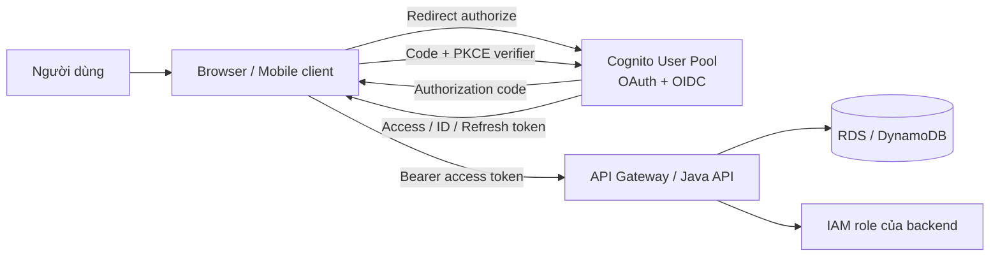
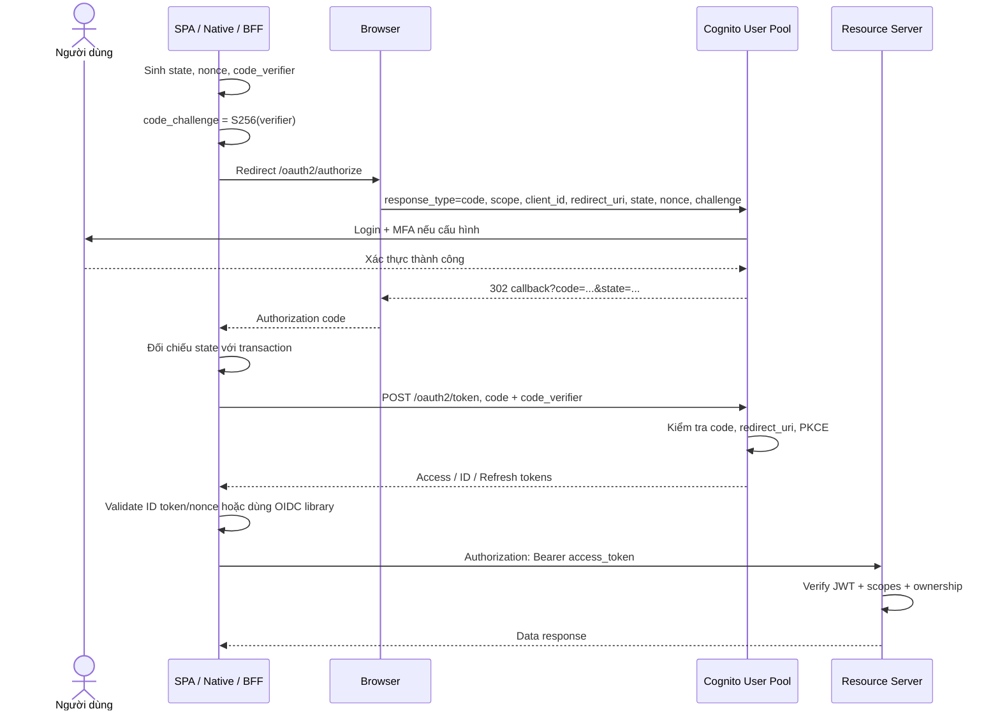
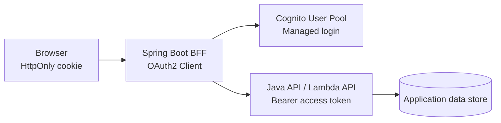
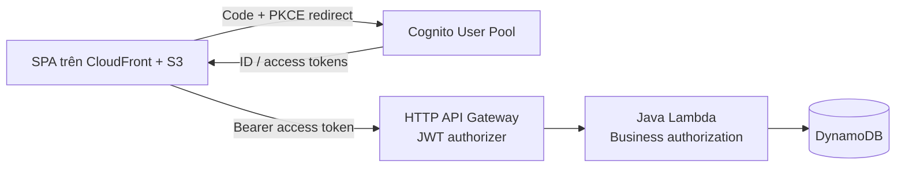
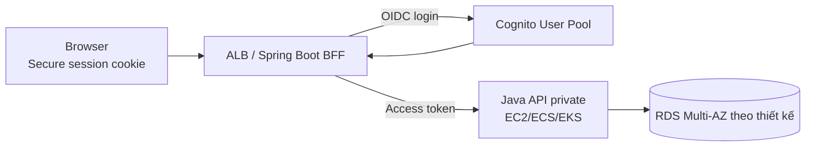

# OAuth 2.0, OpenID Connect và authorization code với PKCE

Trong một ứng dụng web hoặc mobile, việc **người dùng đăng nhập thành công**, **ứng dụng có quyền gọi API** và **client trao đổi token an toàn** là ba vấn đề liên quan nhưng không đồng nhất. **OAuth 2.0** mô tả cơ chế cấp quyền truy cập có giới hạn; **OpenID Connect (OIDC)** bổ sung lớp xác thực danh tính; **Authorization Code Grant kết hợp PKCE** bảo vệ quá trình chuyển từ đăng nhập trên trình duyệt sang token dùng để gọi API. **Amazon Cognito User Pools** cung cấp các khả năng này cho ứng dụng chạy trên AWS.

Bài thuộc chương **Danh tính ứng dụng với Cognito** của module **CLOUD_PROVIDERS_AWS**. Nội dung liên hệ trực tiếp đến IAM, VPC, API Gateway, Lambda, Java Spring Boot, lưu trữ/cơ sở dữ liệu, bảo mật, giám sát và phục hồi. Mục tiêu không phải học thuộc một URL đăng nhập mà là hiểu cách xây dựng, kiểm tra và vận hành **luồng danh tính an toàn** từ người dùng tới dữ liệu nghiệp vụ.

> **Phạm vi:** Bài tập trung vào **Cognito User Pools** và đăng nhập người dùng. **Cognito Identity Pools** (cấp AWS credentials tạm thời) và **IAM Identity Center** (SSO cho lực lượng lao động) là các dịch vụ khác, chỉ được nhắc đến để tránh nhầm. Tên domain, IDs, token và secret trong ví dụ đều là giá trị giả định.

## 1. Mục tiêu học tập

Sau bài học, bạn có thể:

1. Phân biệt **OAuth 2.0 authorization** với **OIDC authentication** và nêu vai trò client, authorization server, resource server, user agent.
2. Phân biệt **ID token**, **access token**, **refresh token** và **authorization code**.
3. Vẽ được luồng **Authorization Code + PKCE S256** từ authorize redirect đến token exchange và gọi API.
4. Tạo `code_verifier` ngẫu nhiên an toàn, tính `code_challenge` và phân biệt `state` với `nonce`.
5. Cấu hình **Cognito User Pool**, App Client, managed login/domain, callback/logout URLs, OAuth code grant và scopes.
6. Giải thích vì sao SPA/native app là **public client**, không được giữ client secret; khi nào nên dùng **BFF/confidential client**.
7. Sử dụng Cognito authorize/token endpoints đúng phương thức, tham số, URL encoding và redirect URI.
8. Thiết lập mẫu đăng nhập bằng **Spring Security OAuth2 Client** và bảo vệ Java API bằng **JWT Resource Server**.
9. Xác minh chữ ký JWT/JWKS, issuer, thời hạn, `token_use`, client ID/audience và scopes, đồng thời kiểm tra phân quyền theo tài nguyên.
10. Sử dụng Cognito JWT trong **API Gateway HTTP API JWT authorizer** có kiểm soát.
11. Xử lý các lỗi phổ biến: redirect mismatch, invalid grant, thiếu PKCE, login loop, token sai loại và refresh/logout.
12. Lập checklist về MFA, bảo mật phiên, IAM, giám sát, phục hồi và chi phí.

## 2. Những vai trò trong OAuth 2.0

| Vai trò | Chức năng | Trong kiến trúc AWS |
| --- | --- | --- |
| **Resource owner** | Người dùng sở hữu tài nguyên/quyền truy cập | Khách hàng/nhân viên dùng ứng dụng |
| **Client** | Ứng dụng yêu cầu quyền | SPA React, ứng dụng native, Spring Boot BFF |
| **Authorization server** | Xác thực và cấp code/token | Cognito User Pool |
| **Identity provider (IdP)** | Nhà cung cấp danh tính dùng để đăng nhập | Cognito native, Google, Microsoft Entra, SAML |
| **User agent** | Trình duyệt tham gia chuyển hướng | Browser hoặc system browser trên mobile |
| **Resource server** | API xác minh access token, phục vụ dữ liệu | API Gateway + Lambda, Spring Boot API trong VPC |



**Cognito User Pool phát hành token người dùng; IAM role của backend cấp quyền thực thi AWS APIs.** Một access token Cognito không phải AWS access key và không tự cho frontend quyền gọi S3, DynamoDB hoặc EC2 SDK. Nếu browser thực sự cần credentials tạm thời để truy cập AWS trực tiếp, hãy nghiên cứu **Cognito Identity Pool** và chính sách IAM tách biệt.

## 3. OAuth 2.0 không đồng nghĩa đăng nhập OIDC

### 3.1. OAuth 2.0: ủy quyền

OAuth 2.0 được thiết kế để client nhận **quyền truy cập có giới hạn** tới tài nguyên mà không cần biết mật khẩu của user. Kết quả quan trọng là **access token**. Phạm vi `scope`, thời hạn và những kiểm tra resource server quyết định access token được dùng thế nào.

Ví dụ một app nhận scope `orders/read` cho phép gọi API đọc đơn hàng. Scope đó **không chứng minh** mọi đơn hàng đều thuộc người dùng; kiểm tra `tenantId` và quyền trên `orderId` vẫn phải diễn ra ở backend.

### 3.2. OpenID Connect: xác thực trên OAuth 2.0

**OIDC** thêm lớp xác thực danh tính, sử dụng scope `openid` và **ID token** có các claims:

- `iss` — nguồn phát hành token.
- `sub` — mã định danh chủ thể trong issuer.
- `aud` — ứng dụng nhận token (với Cognito ID token thường là App Client ID).
- `exp` và `iat` — thời điểm hết hạn/phát hành.
- `auth_time`, `nonce` — khi có trong flow/context.
- `email`, `email_verified` hoặc claims profile khác nếu được phát hành.

**Không dùng email làm khóa định danh bất biến.** Email có thể được thay đổi hoặc tái sử dụng. Định danh ổn định cho nghiệp vụ thường dựa trên cặp `iss` và `sub`, cộng với chính sách quản lý account/federation.

### 3.3. Bốn thông tin rất hay bị nhầm

| Thông tin | Dùng để | Không nên dùng để |
| --- | --- | --- |
| **Authorization code** | Đổi một lần tại token endpoint | Gọi API nghiệp vụ |
| **ID token** | Client xác minh danh tính người dùng trong OIDC | Thay thế access token để cấp quyền gọi API |
| **Access token** | Gửi `Authorization: Bearer` tới resource server | Dùng như session credential dài hạn/refresh token |
| **Refresh token** | Lấy access/ID token mới theo flow hỗ trợ | Gửi cho backend API nghiệp vụ hoặc đưa vào URL |

Cognito access token/ID token là **JWT** có header, payload và chữ ký; refresh token thường là **opaque string**. **Chỉ Base64-decode JWT không phải kiểm tra tính hợp lệ của token.**

### 3.4. Scope `openid` và custom scopes

Ví dụ authorization request:

```text
scope=openid email profile orders/read
```

- `openid`: yêu cầu OIDC; cần khi app muốn nhận ID token.
- `email`, `profile`: yêu cầu claims tương ứng theo chính sách provider.
- `orders/read`: ví dụ custom scope từ Cognito resource server.
- App Client chỉ được xin scope đã được cấu hình cho phép.
- Scope cấp quyền ở mức **loại hành động**; không tự cho phép user đọc dữ liệu của tenant khác.

## 4. Các thành phần cần cấu hình trong Cognito

### 4.1. User Pool

**Cognito User Pool** quản lý người dùng ứng dụng và OIDC/OAuth server, bao gồm:

- Native users và các thuộc tính account.
- Managed login/hosted UI, trang đăng nhập/đăng xuất.
- MFA, email verification, account recovery, các cơ chế bảo vệ đăng nhập theo cấu hình/tier.
- Federation với social IdPs, OIDC hoặc SAML providers.
- App Clients, custom resource servers/scopes, token validity, refresh token configuration.
- OIDC discovery và JWKS để backend xác minh chữ ký.

User Pool **không chứa toàn bộ dữ liệu ứng dụng** như đơn hàng, giao dịch hoặc quy tắc cấp quyền riêng cho mỗi record. Sử dụng RDS/DynamoDB/ứng dụng để thực thi những chính sách đó.

### 4.2. App Client

Một User Pool có nhiều App Clients phục vụ các ứng dụng có độ tin cậy khác nhau.

| Kiểu client | Ví dụ | Client secret | Grant gợi ý |
| --- | --- | --- | --- |
| **Public SPA** | React/Vue ở browser | **Không** | Authorization Code + PKCE |
| **Public native** | Android/iOS | **Không** | Authorization Code + PKCE |
| **Confidential web/BFF** | Spring Boot server-side login | Có thể giữ secret ở server | Authorization Code + client auth + PKCE khi áp dụng |
| **Machine-to-machine** | Scheduled batch service | Có thể giữ secret ở server | Client Credentials, **không phải user login** |

Không bao giờ đóng gói client secret trong JS bundle, app mobile, public Git repository hoặc URL. **Nếu người dùng có thể lấy được secret từ phần mềm mình tải về, đó không phải bí mật.**

### 4.3. Domain và managed login

App Client muốn dùng authorize endpoint cần User Pool có **domain**:

```text
Cognito managed login domain:
https://training-login.auth.ap-southeast-1.amazoncognito.com

Custom login domain, nếu được cấu hình:
https://login.example.com

OIDC issuer (khác login domain):
https://cognito-idp.ap-southeast-1.amazonaws.com/ap-southeast-1_EXAMPLE
```

**OIDC issuer là User Pool URL**, không phải login domain. Nếu cấu hình Java JWT validator dùng `https://login.example.com` làm issuer trong khi Cognito JWT chứa URL `cognito-idp`, việc xác minh issuer sẽ thất bại.

### 4.4. User Pool, Identity Pool, IAM Identity Center

| Dịch vụ | Nhu cầu |
| --- | --- |
| **Cognito User Pool** | Đăng nhập app, phát hành OIDC/OAuth JWT |
| **Cognito Identity Pool** | Cấp temporary AWS credentials cho app đã xác thực/guest theo IAM roles |
| **IAM Identity Center** | Workforce SSO và quyền vào AWS accounts/enterprise applications |

Một mobile app chỉ gọi Java API có thể chỉ cần **User Pool + JWT authorization ở API**, không nhất thiết cần Identity Pool.

## 5. Tại sao Authorization Code + PKCE được ưu tiên?

Authorization Code Grant **không đưa access token thẳng vào URL redirect**. Sau khi người dùng đăng nhập, Cognito cấp **code ngắn hạn, dùng một lần** cho client. Client đổi code lấy tokens bằng request sau đó.

**PKCE (Proof Key for Code Exchange)** bảo vệ code bằng cách yêu cầu client chứng minh mình sở hữu một giá trị bí mật ngẫu nhiên đã được tạo trước khi đăng nhập.

### 5.1. Luồng end-to-end



**Với BFF:** bước code exchange và giữ tokens thực hiện trên server; browser giữ session cookie. **Với SPA:** browser thực hiện OAuth transaction qua thư viện OIDC được tin cậy. PKCE có ý nghĩa trong cả hai, nhưng cách lưu state/verifier/token khác nhau.

### 5.2. Vì sao không dùng implicit flow?

Implicit flow hoặc các giải pháp cũ trả access token qua redirect URL/fragment khó kiểm soát rủi ro rò rỉ, phát hành và tương thích hiện đại. Với SPA/native, **Authorization Code + PKCE S256** là lựa chọn được ưu tiên.

PKCE bảo vệ chống **authorization code interception/injection** ở bước đổi code; **không tự chặn XSS**, redirect URI độc hại, session fixation hay lạm dụng access token đã bị đánh cắp. Cần những lớp bảo vệ khác.

## 6. PKCE S256, state và nonce

### 6.1. code_verifier và code_challenge

Client sinh `code_verifier` ngẫu nhiên, khó đoán (RFC 7636 yêu cầu độ dài **43–128 ký tự**). Một cách triển khai phổ biến là tạo **32 byte CSPRNG** rồi mã hóa Base64URL không padding, cho kết quả dài khoảng 43 ký tự.

Với `code_challenge_method=S256`:

\[
\mathrm{code\_challenge}
=\mathrm{BASE64URL\_NO\_PADDING}
(\mathrm{SHA256}(\mathrm{ASCII}(\mathrm{code\_verifier})))
\]

Gửi **challenge** ở authorization request; giữ **verifier** cho token exchange. **Không gửi verifier trong URL** hoặc lưu vào telemetry.

```text
Authorization request:
  code_challenge=SHA256_VERIFIER_BASE64URL
  code_challenge_method=S256

Token request:
  code_verifier=ORIGINAL_RANDOM_SECRET
```

### 6.2. Java 17+: tạo verifier/challenge đúng

```java
package example;

import java.nio.charset.StandardCharsets;
import java.security.MessageDigest;
import java.security.SecureRandom;
import java.util.Base64;

public final class PkceExample {
    private static final SecureRandom RANDOM = new SecureRandom();

    private PkceExample() {}

    public static String randomValue() {
        byte[] bytes = new byte[32];
        RANDOM.nextBytes(bytes);
        return Base64.getUrlEncoder().withoutPadding().encodeToString(bytes);
    }

    public static String challengeS256(String verifier) throws Exception {
        byte[] hash = MessageDigest.getInstance("SHA-256")
            .digest(verifier.getBytes(StandardCharsets.US_ASCII));
        return Base64.getUrlEncoder().withoutPadding().encodeToString(hash);
    }

    public static void main(String[] args) throws Exception {
        String codeVerifier = randomValue();
        String codeChallenge = challengeS256(codeVerifier);
        String state = randomValue();
        String nonce = randomValue();

        // Chỉ xuất challenge trong ví dụ local.
        // Không log verifier/state/nonce/token tại production.
        System.out.println("challenge=" + codeChallenge);
        System.out.println("method=S256");

        // Ứng dụng thật lưu bộ ba verifier/state/nonce theo
        // authorization transaction trong session bảo vệ.
        if (codeVerifier.isEmpty() || state.isEmpty() || nonce.isEmpty()) {
            throw new IllegalStateException("Unexpected empty value");
        }
    }
}
```

Đoạn Java mô tả **phép biến đổi PKCE**, không phải một OAuth client đã hoàn chỉnh. Trong ứng dụng thực tế, dùng thư viện OIDC/OAuth được duy trì để xử lý URL encoding, redirect, state, nonce, token exchange và validation.

### 6.3. State và nonce không thay thế PKCE

| Giá trị | Dùng ở đâu? | Vai trò |
| --- | --- | --- |
| **`code_verifier`** | Body token request | Chứng minh sở hữu code |
| **`code_challenge`** | Authorize request | Cam kết hash của verifier |
| **`code_challenge_method=S256`** | Authorize request | Chọn phép biến đổi SHA-256 |
| **`state`** | Authorize request và callback | Ràng buộc callback với giao dịch đăng nhập, chống login CSRF |
| **`nonce`** | OIDC authorize request/ID token khi có | Ràng buộc ID token với một authentication transaction |
| **`code`** | Callback và token request | Mã ngắn hạn, chỉ dùng một lần |

Sinh **state, nonce và verifier độc lập** bằng CSPRNG. Lưu chúng theo **authorization transaction**, không dùng một biến global chung cho tất cả người dùng hoặc tất cả tabs đăng nhập.

Nếu nhận callback có `state` không đúng, **dừng luồng**. Không đổi code rồi mới kiểm tra state.

## 7. Cognito endpoints: authorize, token và discovery

### 7.1. Hai URL quan trọng

Giả sử Cognito domain prefix `training-login` và User Pool ID `ap-southeast-1_EXAMPLE`:

```text
Authorize:
https://training-login.auth.ap-southeast-1.amazoncognito.com/oauth2/authorize

Token:
https://training-login.auth.ap-southeast-1.amazoncognito.com/oauth2/token

OIDC issuer:
https://cognito-idp.ap-southeast-1.amazonaws.com/ap-southeast-1_EXAMPLE

OIDC discovery:
https://cognito-idp.ap-southeast-1.amazonaws.com/ap-southeast-1_EXAMPLE/.well-known/openid-configuration

JWKS:
https://cognito-idp.ap-southeast-1.amazonaws.com/ap-southeast-1_EXAMPLE/.well-known/jwks.json
```

Ngoài ra có các endpoint `/oauth2/userInfo`, `/logout` và các endpoint khác theo tài liệu Cognito. Với **custom login domain**, authorize/token/logout URL đổi host, nhưng **issuer vẫn là User Pool issuer**.

### 7.2. Authorize request

```text
GET /oauth2/authorize?response_type=code
  &client_id=EXAMPLE_PUBLIC_CLIENT_ID
  &redirect_uri=https%3A%2F%2Fapp.example.com%2Fcallback
  &scope=openid%20email%20profile
  &state=STATE_RANDOM
  &nonce=NONCE_RANDOM
  &code_challenge=CHALLENGE_S256_BASE64URL
  &code_challenge_method=S256
```

Đây là **sơ đồ tham số nhiều dòng**, không phải URL có thể paste nguyên. Trình duyệt cần được điều hướng tới URL HTTPS hợp lệ với query params được encode đúng.

Ý nghĩa:

- `response_type=code`: dùng Authorization Code Grant.
- `client_id`: đúng App Client đã đăng ký.
- `redirect_uri`: URI callback chính xác trong allowlist.
- `scope=openid ...`: yêu cầu OIDC + thông tin/quyền.
- `state`: phải được kiểm tra khi callback quay về.
- `nonce`: kiểm tra khi validate ID token theo flow thư viện.
- `code_challenge` và `S256`: khóa code exchange vào client khởi tạo.

### 7.3. Callback

Sau login, Cognito redirect tới:

```text
https://app.example.com/callback?code=AUTH_CODE&state=STATE_RANDOM
```

Ứng dụng cần:

1. Nếu callback có `error`, xử lý lỗi và kết thúc giao dịch.
2. Kiểm tra `state` so với transaction lưu trước khi redirect.
3. Lấy **verifier của chính transaction này**.
4. Đổi code lấy token ngay; code có tuổi thọ ngắn và dùng một lần.
5. Xác minh ID token (và nonce nếu đã gửi), lưu session/token theo mô hình.
6. Xóa code và thông tin tạm khỏi history/URL khi phù hợp.

Callback **không phải chỗ để đưa access token hoặc client secret vào query**.

### 7.4. Token exchange cho public client

Token endpoint nhận `POST` với `Content-Type: application/x-www-form-urlencoded`:

```http
POST /oauth2/token HTTP/1.1
Host: training-login.auth.ap-southeast-1.amazoncognito.com
Content-Type: application/x-www-form-urlencoded

grant_type=authorization_code&
client_id=EXAMPLE_PUBLIC_CLIENT_ID&
code=AUTH_CODE&
redirect_uri=https%3A%2F%2Fapp.example.com%2Fcallback&
code_verifier=ORIGINAL_SECRET_VERIFIER
```

Body trên được trình bày tách dòng cho người đọc; ứng dụng gửi dưới dạng **form-urlencoded hợp lệ**. `redirect_uri` phải khớp URI đã dùng ở authorize request và được đăng ký với App Client.

Ví dụ curl chỉ nhằm hiểu API:

```bash
# KHÔNG đặt code/verifier thật vào script chia sẻ hoặc shell history.
curl -sS -X POST \
  "https://training-login.auth.ap-southeast-1.amazoncognito.com/oauth2/token" \
  -H "Content-Type: application/x-www-form-urlencoded" \
  --data-urlencode "grant_type=authorization_code" \
  --data-urlencode "client_id=EXAMPLE_PUBLIC_CLIENT_ID" \
  --data-urlencode "code=AUTH_CODE" \
  --data-urlencode "redirect_uri=https://app.example.com/callback" \
  --data-urlencode "code_verifier=ORIGINAL_SECRET_VERIFIER"
```

Với **confidential client**, token request còn phải xác thực client (ví dụ HTTP Basic với client ID/secret) theo cấu hình. **Không đưa secret vào browser/native app**.

### 7.5. Token response

```json
{
  "access_token": "ACCESS_TOKEN_REDACTED",
  "id_token": "ID_TOKEN_REDACTED",
  "refresh_token": "REFRESH_TOKEN_REDACTED",
  "token_type": "Bearer",
  "expires_in": 3600
}
```

Giá trị `3600` chỉ minh họa, **không cam kết TTL của mọi App Client**. Dùng giá trị response và `exp`/cấu hình thực tế. Không log hoặc chia sẻ token thật.

## 8. Cấu hình User Pool và App Client trên Console

### 8.1. Chuẩn bị

1. Truy cập [Amazon Cognito Console](https://console.aws.amazon.com/cognito/), chọn đúng AWS account và Region.
2. Chọn hoặc tạo **User Pool**; quyết định email/username sign-in, MFA và account recovery.
3. Xác định Cognito native users hay external OIDC/SAML/social IdP.
4. Cấu hình **managed login domain** hoặc custom domain được quản lý.
5. Xác nhận User Pool ID và issuer URL để tích hợp backend.

Nếu User Pool được dùng trong production, đừng thay MFA/IdP/account recovery chỉ để thử một bài học.

### 8.2. SPA/native public App Client

1. Trong User Pool, chọn **App clients / Applications**, tạo client kiểu SPA/native phù hợp.
2. **Không tạo/giữ client secret** cho client chạy ở browser/mobile.
3. Bật **Authorization Code Grant** (`code`).
4. Cấu hình callback URLs chính xác, ví dụ `https://app.example.com/callback`.
5. Cấu hình allowed sign-out URLs, ví dụ `https://app.example.com/signed-out`.
6. Cho phép `openid`, `email`, `profile` hoặc custom scopes cần thiết.
7. Chọn IdPs được phép và managed login settings.
8. Cấu hình token validity/refresh rotation theo security requirements.
9. Ở client application, sử dụng **PKCE S256** với state/nonce.
10. Kiểm thử login/logout và callback trên sandbox trước khi cấp quyền người dùng thật.

**Không dùng wildcard redirect linh hoạt hoặc callback tới domain không kiểm soát.** Ngoại lệ `http://localhost` chỉ dành cho local development trong điều kiện được provider cho phép; production dùng HTTPS.

### 8.3. Server-side Java BFF client

Với Spring Boot BFF có thể giữ secret:

- Tạo **confidential client** với secret giữ trên server.
- Đặt callback như `https://app.example.com/login/oauth2/code/cognito`.
- Sử dụng Authorization Code Grant và PKCE phù hợp.
- Không đưa client secret vào JS, APK, public YAML hoặc Git.
- Giữ tokens ở server, cho browser dùng HttpOnly/Secure session cookie.
- Bảo vệ CSRF và giới hạn session lifetime.

### 8.4. External IdP federation

Nếu người dùng đăng nhập qua Google, Microsoft hoặc SAML IdP:

- Cognito có thể redirect tiếp tới IdP và nhận assertion/token từ IdP.
- App Client vẫn tương tác với **Cognito User Pool** như OIDC issuer.
- Mapping user attributes và account linking phải được thiết kế.
- Logout Cognito **không luôn logout mọi session** ở external IdP.
- Chính sách MFA có thể phụ thuộc vị trí thực hiện xác thực; đừng mặc định bật MFA ở Cognito đồng nghĩa luôn có hai yếu tố ở mọi external IdP.

## 9. AWS CLI: kiểm tra cấu hình read-only

Dùng AWS CLI v2 với IAM Identity Center/role được cấp quyền; các lệnh dưới đây **không tạo hạ tầng mới**.

```bash
# Xác minh danh tính trước khi xem tài nguyên.
aws sts get-caller-identity --profile training

aws cognito-idp describe-user-pool \
  --user-pool-id ap-southeast-1_EXAMPLE \
  --region ap-southeast-1 --profile training

aws cognito-idp list-user-pool-clients \
  --user-pool-id ap-southeast-1_EXAMPLE \
  --region ap-southeast-1 --profile training

aws cognito-idp describe-user-pool-client \
  --user-pool-id ap-southeast-1_EXAMPLE \
  --client-id EXAMPLE_PUBLIC_CLIENT_ID \
  --region ap-southeast-1 --profile training
```

**Quan trọng:** `describe-user-pool-client` đối với confidential client có thể trả `ClientSecret`. Không chia sẻ nguyên response; redact trước khi đưa vào ticket, chat hoặc log.

Kiểm tra:

| Trường | Ý nghĩa |
| --- | --- |
| `AllowedOAuthFlowsUserPoolClient` | Cho phép app client dùng OAuth flows |
| `AllowedOAuthFlows` | Có `code` hay không |
| `AllowedOAuthScopes` | Scopes được client phép yêu cầu |
| `CallbackURLs` | URI callback allowlist |
| `LogoutURLs` | URI đăng xuất allowlist |
| `SupportedIdentityProviders` | IdPs được dùng với client |
| `ClientSecret` | Nếu có, đây là credential nhạy cảm; không đưa vào báo cáo |
| `AccessTokenValidity` / `IdTokenValidity` | TTL của JWT |
| `RefreshTokenValidity` | TTL refresh token |

### 9.1. Lệnh tạo App Client minh họa — có tác động

```bash
# Chỉ thực hiện trong sandbox được phê duyệt.
aws cognito-idp create-user-pool-client \
  --user-pool-id ap-southeast-1_EXAMPLE \
  --client-name spa-pkce-demo \
  --no-generate-secret \
  --allowed-o-auth-flows-user-pool-client \
  --allowed-o-auth-flows code \
  --allowed-o-auth-scopes openid email profile \
  --supported-identity-providers COGNITO \
  --callback-urls "http://localhost:8080/callback" \
  --logout-urls "http://localhost:8080/signed-out" \
  --region ap-southeast-1 --profile training
```

Tạo client **không tự tạo domain, tài khoản người dùng hoặc trang callback** cho frontend. Sử dụng URI `localhost` trong ví dụ này chỉ cho local development; production phải chuyển sang HTTPS và callback đăng ký phù hợp.

## 10. Java Spring Boot BFF: OAuth2 Login đúng vai trò

### 10.1. BFF là gì?

**Backend-for-Frontend (BFF)** giúp browser không phải quản lý access/refresh tokens trực tiếp:



BFF làm OAuth client và giữ tokens trong session phía server. Browser chỉ gửi session cookie, giúp giảm bề mặt token bị đọc trực tiếp bởi JavaScript. Đổi lại, BFF phải bảo vệ CSRF/cookie, session store, scaling và logout.

### 10.2. Dependencies

Spring Boot 3.x/Java 17+ thường cần:

- `spring-boot-starter-security`.
- `spring-boot-starter-oauth2-client`.
- `spring-boot-starter-web` hoặc lựa chọn WebFlux phù hợp.
- Spring Session và Redis/DB session store khi cần đa instance.
- Test framework cho login callback, CSRF và session lifecycle.

### 10.3. application.yml minh họa

```yaml
spring:
  security:
    oauth2:
      client:
        registration:
          cognito:
            client-id: ${COGNITO_CLIENT_ID}
            client-secret: ${COGNITO_CLIENT_SECRET}
            authorization-grant-type: authorization_code
            redirect-uri: "{baseUrl}/login/oauth2/code/{registrationId}"
            scope:
              - openid
              - email
              - profile
        provider:
          cognito:
            issuer-uri: https://cognito-idp.ap-southeast-1.amazonaws.com/ap-southeast-1_EXAMPLE

server:
  forward-headers-strategy: framework
  servlet:
    session:
      cookie:
        http-only: true
        secure: true
        same-site: lax
```

Ví dụ dành cho **confidential BFF client**. Secret chỉ được nạp ở server qua secret management, **không commit giá trị thật**. URI `issuer-uri` phải là **User Pool issuer**, không phải `amazoncognito.com` login domain.

Với ứng dụng sau ALB/CloudFront, `forward-headers-strategy` phải đi cùng cấu hình **trusted proxy**. Không tin các `X-Forwarded-*` do client Internet tự tạo, nếu không attacker có thể ảnh hưởng redirect URL.

### 10.4. Spring Security filter chain

```java
package example.security;

import org.springframework.context.annotation.Bean;
import org.springframework.context.annotation.Configuration;
import org.springframework.security.config.Customizer;
import org.springframework.security.config.annotation.web.builders.HttpSecurity;
import org.springframework.security.web.SecurityFilterChain;

@Configuration
public class WebSecurityConfiguration {

    @Bean
    SecurityFilterChain webSecurity(HttpSecurity http) throws Exception {
        return http
            .authorizeHttpRequests(auth -> auth
                .requestMatchers("/health", "/public/**").permitAll()
                .anyRequest().authenticated()
            )
            .oauth2Login(Customizer.withDefaults())
            // Giữ cơ chế CSRF protection của Spring Security cho web session.
            .build();
    }
}
```

Đoạn code dựa trên Spring Security được hỗ trợ và chỉ là **khung bảo mật cơ bản**. Trong thực tế cần xử lý logout, auth failures, session fixation, session store, scopes và quyền ứng dụng.

**Kiểm tra thực tế PKCE:** `authorization-grant-type=authorization_code` không chứng minh mọi version của thư viện OIDC và mọi kiểu client đã phát `code_challenge`. Xem authorize request trong sandbox hoặc cấu hình OAuth2 customization theo thư viện để chắc chắn **S256 được dùng**.

## 11. Java Resource Server: kiểm tra JWT từ Cognito

Spring Boot backend/API không cần redirect user đến trang login ở mỗi request. Nó nhận:

```http
GET /orders/42 HTTP/1.1
Host: api.example.com
Authorization: Bearer ACCESS_TOKEN
```

Resource server phải kiểm tra:

1. Chữ ký JWT bằng **public key JWKS** của đúng User Pool.
2. `iss` khớp **issuer allowlist**.
3. `exp`/`nbf` (nếu có), `iat` và clock skew hợp lý.
4. **`token_use=access`**, không phải `id`.
5. App client được phép: `client_id`/`aud` theo định dạng Cognito token và resource binding thực tế.
6. `scope`/roles cho route.
7. Business authorization trên `orderId`, `tenantId` và identity đã xác minh.

### 11.1. Những claim cần nhận diện

| Claim | ID token | Access token | Lưu ý |
| --- | --- | --- | --- |
| `iss` | Có | Có | Phải đúng User Pool issuer |
| `sub` | Có | Có | Chủ thể, dùng cùng issuer |
| `aud` | Thường là App Client ID | Có thể có khi token gắn resource audience | Không mặc định coi access token giống ID token |
| `client_id` | Không cùng vai trò | Thường có | Kiểm soát app client được phép gọi API |
| `token_use` | `id` | `access` | Phân biệt đúng loại token |
| `scope` | Không phải quyền API chính | Các scopes đã cấp | Dùng cho route authorization |
| `cognito:groups` | Có thể có | Có thể có | RBAC bổ sung |
| `exp` | Có | Có | Từ chối token hết hạn |

ID token và access token Cognito có thể dùng **khác signing keys** trong JWKS. Validator tìm public key theo `kid` header và kiểm tra thuật toán cho phép. Không hard-code một khóa cho mọi token hoặc bỏ signature check.

### 11.2. Spring Security JWT Resource Server

Ví dụ Spring Boot 3.x với `spring-boot-starter-oauth2-resource-server`. Properties:

```properties
app.cognito.issuer=https://cognito-idp.ap-southeast-1.amazonaws.com/ap-southeast-1_EXAMPLE
app.cognito.client-id=EXAMPLE_PUBLIC_CLIENT_ID
```

Java configuration:

```java
package example.security;

import org.springframework.beans.factory.annotation.Value;
import org.springframework.context.annotation.Bean;
import org.springframework.context.annotation.Configuration;
import org.springframework.security.config.Customizer;
import org.springframework.security.config.annotation.web.builders.HttpSecurity;
import org.springframework.security.oauth2.core.OAuth2Error;
import org.springframework.security.oauth2.core.OAuth2TokenValidator;
import org.springframework.security.oauth2.core.OAuth2TokenValidatorResult;
import org.springframework.security.oauth2.core.DelegatingOAuth2TokenValidator;
import org.springframework.security.oauth2.jwt.Jwt;
import org.springframework.security.oauth2.jwt.JwtDecoder;
import org.springframework.security.oauth2.jwt.JwtValidators;
import org.springframework.security.oauth2.jwt.NimbusJwtDecoder;
import org.springframework.security.web.SecurityFilterChain;

@Configuration
public class CognitoResourceServerSecurity {

    @Bean
    JwtDecoder jwtDecoder(
            @Value("${app.cognito.issuer}") String issuer,
            @Value("${app.cognito.client-id}") String clientId) {

        NimbusJwtDecoder decoder = NimbusJwtDecoder
            .withJwkSetUri(issuer + "/.well-known/jwks.json")
            .build();

        OAuth2TokenValidator<Jwt> tokenUseAndClient = jwt -> {
            boolean isAccess = "access".equals(
                jwt.getClaimAsString("token_use"));
            boolean isAllowedClient = clientId.equals(
                jwt.getClaimAsString("client_id"));
            if (isAccess && isAllowedClient) {
                return OAuth2TokenValidatorResult.success();
            }
            return OAuth2TokenValidatorResult.failure(
                new OAuth2Error("invalid_token",
                    "Token type or client is not authorized", null)
            );
        };

        decoder.setJwtValidator(new DelegatingOAuth2TokenValidator<>(
            JwtValidators.createDefaultWithIssuer(issuer),
            tokenUseAndClient
        ));
        return decoder;
    }

    @Bean
    SecurityFilterChain securityFilterChain(HttpSecurity http)
            throws Exception {
        return http
            .authorizeHttpRequests(auth -> auth
                .requestMatchers("/health").permitAll()
                .requestMatchers("/orders/**")
                    .hasAuthority("SCOPE_orders/read")
                .anyRequest().authenticated()
            )
            .oauth2ResourceServer(oauth ->
                oauth.jwt(Customizer.withDefaults())
            )
            .build();
    }
}
```

**Quan trọng:**

- `JwtValidators.createDefaultWithIssuer` kiểm tra các yêu cầu JWT thông dụng/issuer; custom validator kiểm tra thêm `token_use` và `client_id`.
- Code minh họa cho **một** app client ID. Nếu nhiều clients, cần allowlist được review và/hoặc xác minh audience của API nếu token được ràng buộc resource.
- Spring Security thường map `scope` thành authorities `SCOPE_...`, nhưng phải đối chiếu claim/token thật và custom converter nếu cần.
- Kiểm tra **authorization theo tài nguyên** trong service/repository: scope `orders/read` **không tự cho quyền đọc đơn hàng của người khác**.
- Ví dụ Bearer API không trình bày đầy đủ CSRF cho một ứng dụng đồng thời dùng cookie auth; cần xét cụ thể thay vì tắt mặc định.
- Đừng lấy JWKS URI từ một token hoặc header người dùng tự khai; nó phải dựa trên **issuer tin cậy do ứng dụng cấu hình**.

## 12. API Gateway HTTP API JWT Authorizer

Nếu Java API được công bố qua API Gateway HTTP API, có thể để **JWT authorizer** kiểm tra token trước khi integration chạy.

### 12.1. Cấu hình logic

```text
HTTP API:
  GET /orders/{id}
    Authorization: JWT
    Issuer:
      https://cognito-idp.ap-southeast-1.amazonaws.com/ap-southeast-1_EXAMPLE
    Audience:
      EXAMPLE_PUBLIC_CLIENT_ID
    Required scopes:
      orders/read
    Integration:
      Java Lambda hoặc VPC Link tới ALB/Java backend
```

**Điểm tinh tế:** JWT authorizer của HTTP API đánh giá `aud` khi có, nếu không có thì `client_id` theo quy tắc dịch vụ. Đối với Cognito access token, `client_id` thường là dấu hiệu client; không suy luận token từ ID token.

HTTP API JWT authorizer **không kiểm tra mọi custom claim** theo nhu cầu ứng dụng, trong đó có tình huống cần ép `token_use=access`. Dùng **required authorization scopes** trên routes và/hoặc kiểm tra token_use/backend authorizer theo yêu cầu bảo mật.

### 12.2. Scopes và phân quyền theo record

Ví dụ Cognito resource server identifier `orders` có scopes `read`, `write`:

| Route | Scope | Kiểm tra nghiệp vụ |
| --- | --- | --- |
| `GET /orders` | `orders/read` | Lọc theo tenant/user |
| `GET /orders/{id}` | `orders/read` | Kiểm tra chủ sở hữu |
| `POST /orders` | `orders/write` | Validation + idempotency |
| `DELETE /orders/{id}` | Scope riêng hoặc quyền write | Kiểm soát nghiệp vụ và audit |
| `GET /health` | Có thể không cần JWT theo thiết kế | Không tiết lộ secrets |

**Scope không thay IAM role:** Java Lambda backend dùng execution role để đọc DynamoDB; access token xác định client/user và phạm vi gọi route. Hai lớp phải đúng cùng lúc.

### 12.3. Cognito groups và custom claims

Cognito groups có thể tạo claim `cognito:groups`. Nó hỗ trợ RBAC như `support`, `sales`, `admin`, nhưng không tự cấp quyền mọi đơn hàng. Một điều kiện truy cập tốt hơn:

```text
Allow GET /orders/{id} if:
  JWT signature and issuer valid
  AND token_use == access
  AND scope includes orders/read
  AND user's tenantId == order.tenantId
  AND user has an allowed business role.
```

Không tin `tenantId` từ URL/body nếu không đối chiếu principal đã xác minh.

## 13. Bảo vệ tokens ở SPA, mobile và BFF

### 13.1. Browser SPA

SPA có mã JavaScript không thể giữ client secret. Dùng **OAuth/OIDC library** có PKCE và Web Crypto API:

- CSPRNG cho verifier/state/nonce.
- Full-page redirect tới Cognito managed login.
- Kiểm tra state trước code exchange.
- Token storage giảm nguy cơ XSS; ưu tiên tránh refresh token dài hạn trong `localStorage`.
- CSP, output escaping, dependency hygiene, chống third-party script injection.
- Xóa query code khỏi browser history khi hoàn thành callback.
- Không log `Authorization` header/refresh tokens.

Nếu rủi ro token exfiltration quá cao, đánh giá **BFF** để browser không cần giữ tokens.

### 13.2. Mobile native

- Dùng **system browser/auth session** thay vì thu mật khẩu trong WebView không kiểm soát.
- Code grant + PKCE S256; không có client secret.
- Redirect URI dùng universal/app link hoặc loopback tùy nền tảng.
- Chống deep-link interception, giữ state theo auth transaction.
- Lưu refresh credentials vào **Keychain/Keystore** hoặc secure storage tương đương.
- Thiết kế reconnect, app restart, logout và rotation.
- Không chia sẻ tokens qua logs, clipboard hoặc intents không bảo vệ.

### 13.3. BFF

- Giữ access/refresh tokens **server-side**.
- Browser chỉ có `HttpOnly`, `Secure`, `SameSite` cookie.
- Dùng CSRF protection cho state-changing actions.
- Session storage phải phù hợp đa AZ/Auto Scaling.
- Có session timeout, rotation và logout.
- Không truyền refresh token xuống browser chỉ để “tiện gọi API”.

BFF giảm một số rủi ro nhưng tăng trách nhiệm vận hành session và backend.

## 14. Refresh token rotation, logout và vòng đời phiên

### 14.1. Token expiry không đồng nghĩa session expiry

Ba loại thời hạn:

| Thành phần | Được quản lý bởi | Ý nghĩa |
| --- | --- | --- |
| **Access/ID token `exp`** | Cognito App Client | JWT còn hiệu lực bao lâu |
| **Refresh token validity** | Cognito/flow | Có thể xin token mới tới khi hết hạn/revoked |
| **Browser/BFF session** | Managed login/ứng dụng | Cookie/session có lifecycle riêng |

Không giả định một access token hết hạn làm browser logout ngay, hoặc logout khỏi BFF tự chấm dứt mọi phiên IdP.

### 14.2. Refresh token rotation

Cognito hỗ trợ **refresh token rotation** cho app client trong những cấu hình được hỗ trợ:

- Khi refresh, có thể trả refresh token mới.
- Client phải lưu token mới an toàn và xử lý grace/race conditions.
- Tránh các refresh requests đồng thời trên cùng token.
- Khi dùng rotation, **không dùng authentication flow `REFRESH_TOKEN_AUTH`** không tương thích với rotation.
- Dùng grant/SDK flow được Cognito hỗ trợ cho app client được cấu hình.

Nếu refresh token bị lộ, rotation/revocation làm giảm cửa sổ rủi ro nhưng không thay storage bảo mật, MFA và monitoring.

### 14.3. Logout

Đăng xuất đúng thường gồm:

1. Xóa/vô hiệu session của ứng dụng.
2. Thu hồi refresh token hoặc sử dụng sign-out API theo flow khi thích hợp.
3. Kết thúc session managed login bằng `/logout` nếu cần.
4. Với external IdP, xem cách logout phiên upstream riêng.
5. Với action nhạy cảm, cân nhắc cơ chế revocation/session tracking server-side.

URL minh họa:

```text
https://training-login.auth.ap-southeast-1.amazoncognito.com/logout
  ?client_id=EXAMPLE_PUBLIC_CLIENT_ID
  &logout_uri=https%3A%2F%2Fapp.example.com%2Fsigned-out
```

`logout_uri` phải nằm trong allowlist. URL trên chỉ nhằm hiển thị cấu trúc; ghép/encode chính xác khi triển khai.

**Không cam kết rằng revoke refresh token sẽ lập tức làm mọi access JWT đã cấp trước đó bị từ chối ở tất cả resource servers.** Một API chỉ xác minh chữ ký/expiry có thể vẫn cho phép JWT cũ tới khi hết hạn. Cần access-token TTL thích hợp và các biện pháp bổ sung cho tài nguyên nhạy cảm.

## 15. IAM, Cognito Identity Pools và resource permissions

Cognito User Pool token giúp ứng dụng biết user/client và scopes. Để backend Java gọi AWS services:

- Lambda dùng **execution role**.
- ECS Task dùng **task role**.
- EKS workload dùng **Pod Identity/IRSA** theo compute hỗ trợ.
- EC2 dùng **instance profile IAM role**.

Ví dụ Java API nhận JWT rồi gọi S3 đọc `reports/tenant-42/...`: **IAM role** cho phép s3:GetObject lên prefix được phép, còn **backend phải giới hạn tenant/user** dựa vào token đã xác minh.

Nếu ứng dụng mobile cần trực tiếp upload S3, hai phương án:

1. **Backend presigned URL**: backend xác thực user, kiểm tra quyền file, tạo URL có TTL và key giới hạn.
2. **Cognito Identity Pool**: cấp temporary AWS credentials thông qua IAM role có policy/conditions chặt chẽ.

Không truyền Cognito User Pool access token trực tiếp tới AWS SDK và hy vọng nó tự được hiểu như IAM credentials.

## 16. Threat model và checklist bảo mật

| Rủi ro | Nguyên nhân | Cách giảm thiểu |
| --- | --- | --- |
| Authorization code bị đánh cắp | Deep link/callback bị chiếm | PKCE S256, redirect URI an toàn |
| Login CSRF | Callback không ràng buộc request trước | Random `state` và transaction storage |
| ID token replay | Không so nonce/transaction | OIDC `nonce` và validation phù hợp |
| Client secret lộ | Đặt secret trong SPA/mobile | Public client không có secret |
| Open redirect | Cho callback động tới domain tùy ý | Allowlist URI chính xác |
| XSS lấy token | Token lưu vào JS-readable storage | BFF nếu phù hợp, CSP, chống XSS |
| JWT forgery | Base64-decode mà không verify signature | JWKS signature + algorithm + issuer |
| JWT từ User Pool khác | Không kiểm tra `iss` | Chỉ tin issuer cấu hình |
| ID token dùng làm access token | Không kiểm tra `token_use` | Chỉ chấp nhận `access` ở resource server |
| Overbroad scopes | Cấp mọi scopes cho tất cả clients | Least-privilege scope/client design |
| Broken object authorization | Chỉ kiểm tra scope, không kiểm tra tenant | Resource-level permissions |
| Refresh token leak | Logs/LocalStorage/trace | Secure storage, rotation, redaction |
| Replay authorization code | Callback bị xử lý hai lần | Code one-time, transaction state và idempotent callback |
| Redirect URI HTTP production | Token/code lộ đường truyền | HTTPS, localhost ngoại lệ dev |
| Signing key rotation | Cache JWKS mãi | Tự cập nhật JWKS theo `kid` |
| Credential stuffing | Mật khẩu bị lộ | MFA/threat protection/rate controls |
| External IdP logout nhầm | Chỉ xóa cookie local | Thiết kế logout theo từng IdP |
| Clock skew | Máy chủ sai giờ | NTP và skew hợp lý |

**Không tắt xác minh chữ ký JWT, không bỏ PKCE/state, không mở callback wildcard** để làm một lỗi đăng nhập có vẻ “biến mất”. Các thao tác đó phá ranh giới bảo mật.

### 16.1. MFA không phải PKCE

- **MFA**: bảo vệ bước chứng minh danh tính người dùng.
- **PKCE**: bảo vệ việc đổi **authorization code**.
- **HTTPS**: bảo vệ truyền thông.
- **state/nonce**: liên kết các bước trong OIDC transaction.
- **JWT validation + authorization**: bảo vệ resource server.

Một hệ thống cần phối hợp các lớp, không dùng một lớp thay toàn bộ những lớp còn lại.

## 17. Sơ đồ triển khai trong AWS

### 17.1. SPA + API Gateway HTTP API + Lambda



**Bảo vệ cần kiểm tra:** Cognito domain, callback URI, code verifier/state, JWT scopes ở gateway, ownership tại Lambda, IAM execution role và CloudWatch logs redacted.

### 17.2. Spring Boot BFF + private Java API



**Bảo vệ cần kiểm tra:** session store/CSRF, trusted proxy headers, TLS, RDS SG, backup, data authorization và khả năng phục hồi đa AZ.

### 17.3. Những hiểu nhầm về mạng

- API nằm trong VPC **không làm JWT tự được xác minh**.
- Cognito User Pool OAuth URLs là endpoints qua HTTPS; backend cần truy cập discovery/JWKS/token services theo architecture.
- HTTP API JWT authorizer kiểm tra JWT ở gateway; backend vẫn nên có authorization logic cho từng record.
- Route 53/CloudFront/ALB không thay thế OIDC identity validation.
- IAM role của Lambda không có nghĩa người dùng đã được cấp quyền xem mọi dữ liệu do Lambda đọc được.

## 18. Troubleshooting Cognito OAuth/OIDC PKCE

| Triệu chứng | Nguyên nhân có thể | Cách xác minh |
| --- | --- | --- |
| Authorize lỗi | Domain, client ID, flow hoặc scope sai | App Client settings, domain, URL encoding |
| Redirect bị từ chối | Callback URI không trong allowlist | Scheme, host, port, path đúng tuyệt đối |
| Không có authorization code | `response_type` không phải `code` | Flow và lỗi callback |
| Token endpoint `invalid_grant` | Code hết hạn/đã dùng, verifier hoặc redirect URI sai | Tạo giao dịch mới, đối chiếu tham số |
| PKCE mismatch | Base64 thường thay vì Base64URL, có padding, verifier thay đổi | S256 code, transaction store |
| Callback `state` sai | Session mất, nhiều tabs, CSRF | Lưu state theo transaction và cookie/session |
| `nonce` mismatch | ID token không thuộc login transaction | OIDC library nonce validation |
| Java BFF login loop | Session cookie không giữ hoặc proxy scheme sai | Secure/SameSite/trusted proxy, session store |
| API trả 401 | Token hết hạn, sai issuer, ID token thay access token | JWT claims, JWKS, `token_use` |
| API trả 403 | JWT đúng nhưng thiếu scope hoặc quyền dữ liệu | JWT `scope`, tenant/resource ownership |
| JWKS `kid` không tìm được | JWKS cache cũ, sai User Pool | Discovery/JWKS đúng issuer, key rotation |
| Access token có client_id nhưng không có aud | Backend giả định ID/access token cùng claims | Validator tách loại token |
| SPA gọi API bị CORS | CORS API Gateway/backend sai | Allowed origins/headers/methods; không thay auth |
| Native app không nhận callback | Redirect scheme/app links chưa đăng ký đúng | OS deep link/universal link và callback |
| Lấy S3 thất bại dù có Cognito JWT | JWT không phải IAM credentials | Backend IAM/presigned URL/Identity Pool |
| Logout rồi vẫn đăng nhập lại không cần password | Cognito/external IdP session còn hoạt động | Logout các lớp, expected SSO behavior |
| Refresh thất bại sau khi bật rotation | Client dùng flow cũ hoặc refresh token race | App Client rotation settings, SDK flow |

### 18.1. Chẩn đoán theo lớp

1. **Account/Region:** User Pool/App Client đúng môi trường?
2. **Domain & OAuth settings:** managed login, redirect/logout URLs, `code` grant, allowed scopes?
3. **Authorize request:** state, nonce, challenge S256, redirect_uri encoding?
4. **Callback:** error hay code; state có khớp?
5. **Token request:** verifier, one-time code, client auth, redirect URI?
6. **JWT:** issuer, JWKS, chữ ký, expiry, `token_use`, client ID/aud, scopes?
7. **API:** Bearer token, authorizer settings, resource ownership và backend IAM?
8. **Session:** cookies, CSRF, refresh rotation, logout external IdP?
9. **Operations:** logs, metrics, quotas, MFA failures, mạng và chi phí?

**Không ghi nguyên authorization code, access token, refresh token hoặc client secret vào ticket khi điều tra.** Dùng request IDs, loại lỗi, thời điểm, issuer/client ID đã redact.

## 19. Monitoring, quota và chi phí

### 19.1. Nguồn quan sát

| Dịch vụ | Tín hiệu | Mục đích |
| --- | --- | --- |
| **Cognito/CloudTrail** | Thay đổi User Pool, App Clients, auth operations được hỗ trợ | Kiểm toán cấu hình và hành vi |
| **CloudWatch** | Metrics, logs/sự kiện hỗ trợ và cảnh báo | Login/token failures, bất thường |
| **API Gateway** | 401/403/429/5XX, latency, request ID | Xác định gateway/backend lỗi |
| **Spring Security** | Authentication failures và session events đã redact | Chẩn đoán callback, cookie, logout |
| **WAF/CloudFront** | HTTP abuse và traffic bất thường | Bảo vệ lớp web |
| **Cost Explorer/Budgets** | User pool costs, SMS, logs, Lambda/API backend | Ngăn vượt ngân sách |

**Không bật DEBUG log chứa tokens/authorization headers** tại production để điều tra. Ưu tiên correlation IDs và structured logs không có bí mật.

### 19.2. Hạn mức và rủi ro retry

- Token/authorize endpoints và Cognito APIs có quota/rate controls.
- Khi bị throttling, retry có **exponential backoff + jitter**, không tạo vòng đăng nhập vô tận.
- Authorization code **dùng một lần**; đừng tự retry token exchange bằng code đã sử dụng nhiều lần khi không biết kết quả.
- Theo dõi tỷ lệ login failures/refresh failures bất thường, user pool threat-protection events theo tính năng được cấp.
- Có quy trình thu hồi credentials/khóa nếu có sự cố.

### 19.3. Ước lượng chi phí

Cognito User Pools có mô hình phí theo **tier/tính năng/MAU và sử dụng**, tùy thời điểm/Region. Chi phí phụ trợ có thể gồm:

- MFA SMS/email hay dịch vụ giao tiếp liên quan.
- Threat protection/adaptive authentication theo gói.
- API Gateway, Lambda/EC2/ECS/EKS và RDS/DynamoDB.
- CloudWatch Logs, CloudTrail, WAF, Route 53/CloudFront.
- NAT/VPC endpoints khi backend cần truy cập dịch vụ bên ngoài.
- Session store và hạ tầng BFF nếu dùng.

Không dùng một giá USD cố định cho mọi môi trường. Xem [Amazon Cognito pricing](https://aws.amazon.com/cognito/pricing/) và [AWS Pricing Calculator](https://calculator.aws/).

## 20. Bài thực hành: mô phỏng thiết kế OAuth/OIDC

Không cần tạo User Pool có chi phí để hoàn thành bài trên giấy. Nếu có sandbox đã được cấp quyền, chỉ chạy các lệnh read-only của mục 9.

### 20.1. Bài A — Chọn grant và loại client

| Ứng dụng | Loại client | Grant | PKCE và secret |
| --- | --- | --- | --- |
| Browser SPA | Public | Authorization Code | S256; **không có secret** |
| Android/iOS | Public | Authorization Code | S256; **không có secret** |
| Spring Boot BFF | Confidential | Authorization Code | Secret ở server; dùng PKCE phù hợp |
| Worker machine-to-machine | Confidential | Client Credentials | Không phải user login, dùng custom scopes |

Giải thích: tại sao đưa client secret vào app mobile không giúp nó trở thành một confidential client?

### 20.2. Bài B — Sắp xếp luồng PKCE

Cho các bước:

```text
A. Client tạo state, nonce, code_verifier
B. Client tính S256(code_verifier) -> code_challenge
C. Browser tới /oauth2/authorize với challenge
D. Cognito xác thực user và redirect ?code=...&state=...
E. Client kiểm tra state, tìm verifier cùng transaction
F. Client POST /oauth2/token với code + verifier
G. Client nhận/validate ID token; giữ tokens hoặc session an toàn
H. Client gọi API với access token
I. API xác minh JWT, scopes và resource permissions
```

**Đáp án định hướng:** A → B → C → D → E → F → G → H → I. Nêu rõ vì sao E phải diễn ra **trước** F.

### 20.3. Bài C — Tìm lỗi bảo mật

```text
response_type=token
client_id=SPA_CLIENT_WITH_SECRET
redirect_uri=http://app.example.com/callback
scope=openid
code_challenge_method=plain
state=12345
```

Yêu cầu tìm **ít nhất năm** lỗi/rủi ro:

- Không dùng code grant.
- SPA chứa client secret.
- HTTP callback cho production.
- PKCE không dùng S256/challenge đúng.
- State dễ đoán.
- Không có nonce/transaction validation theo OIDC security design.
- Chưa đề cập redirect URI allowlist và scope/API authorization.

### 20.4. Bài D — API trả 401/403

Một mobile app đã đăng nhập, nhận ID token và access token. Gateway yêu cầu `orders/read` trên `GET /orders/42`:

1. Nên gửi token nào trong `Authorization: Bearer`?
2. ID token được ký hợp lệ có được phép dùng thay access token không?
3. Token thiếu `orders/read` gây lỗi authorization thế nào?
4. Nếu đủ scope nhưng đơn hàng thuộc tenant khác, backend xử lý ra sao?
5. Backend/authorizer cần kiểm tra claim nào ngoài `exp`?

### 20.5. Bài E — BFF đa AZ

Spring Boot BFF có hai instances sau ALB, giữ refresh tokens server-side. Thiết kế checklist:

- Session store chia sẻ/HA, session timeout.
- HttpOnly/Secure/SameSite cookies; CSRF controls.
- HTTPS/trusted proxy headers và callback URI.
- Logout BFF/Cognito và external IdP.
- Refresh token rotation, retry, secret storage.
- JWT scopes và resource ownership.
- CloudWatch logging redacted và incident response.
- Kế hoạch chi phí/backup của session storage.

### 20.6. Bài F — Read-only audit Cognito

1. Xác minh AWS account/Region.
2. Xem User Pool/App Client settings bằng AWS CLI `describe`.
3. Kiểm tra `AllowedOAuthFlows` có `code` và OAuth scopes phù hợp.
4. Kiểm tra App Client public có/không có secret **nhưng không xuất giá trị secret**.
5. Đối chiếu callback URLs và logout URLs.
6. Xác định issuer URL/JWKS đúng trong Java/API Gateway.
7. Kiểm tra cách cấp scopes và quy tắc refresh/logout.
8. Viết báo cáo rủi ro, không sửa production resources trong bài đọc-only.

### 20.7. Mẫu báo cáo

```text
AWS Account / Region: ...
User Pool ID (redacted): ...
OIDC issuer: ...
Managed login / custom domain: ...
App Client Type: SPA / Native / Confidential BFF / M2M
Client ID (redacted): ...
Client Secret Present? Yes/No (do NOT include actual secret)
Allowed OAuth grant: ...
PKCE S256 configured and observed? ...
Callback URL / logout URL: ...
Requested / allowed scopes: ...
Identity Provider: ...
MFA / recovery policy: ...
Access / ID / refresh token validity: ...
Refresh rotation configuration: ...
JWT verification: issuer/JWKS/exp/token_use/client_id or aud
API scope + resource authorization: ...
Client token/session storage: ...
Errors/monitoring alerts: ...
Security concerns and owner: ...
Cost tier and reviewer date: ...
```

**Tiêu chí hoàn thành:** người học chọn đúng client type và code + PKCE, phân biệt OAuth/OIDC và token types, biết xác minh JWT thay vì giải mã tin bừa, đồng thời nêu chính sách bảo mật user/API và vận hành. Không yêu cầu thu thập password, OTP, code thật hoặc refresh tokens.

## 21. Câu hỏi tự kiểm tra

1. OAuth 2.0 dùng chủ yếu cho authorization hay authentication?
2. OIDC thêm loại token nào để client kiểm tra danh tính?
3. Access token và ID token có cùng mục đích không? Nêu `token_use` tương ứng.
4. Tại sao SPA không được bảo vệ bằng client secret nhúng trong JavaScript?
5. Authorization Code Grant giảm rủi ro lộ access token trong URL so với implicit flow thế nào?
6. PKCE code verifier phải được tạo bằng nguồn ngẫu nhiên nào?
7. Công thức S256 sử dụng hash và encoding nào?
8. Code challenge gửi ở authorize hay token request? Verifier gửi ở đâu?
9. State có thay thế nonce không? Vì sao?
10. Khi callback trả state sai, client có nên thử đổi code không?
11. Issuer JWT Cognito là managed login domain hay User Pool URL?
12. Callback URL nào có thể được phép dùng HTTP ở môi trường phát triển?
13. Java Spring Boot BFF giữ access/refresh tokens ở đâu để giảm khả năng lộ cho browser?
14. Resource server cần xác minh những claims gì ngoài chữ ký JWT?
15. Vì sao chỉ kiểm tra `aud` theo cách dùng ID token có thể sai với access token Cognito?
16. API Gateway JWT authorizer có tự kiểm tra mọi custom claim và resource ownership không?
17. Scope `orders/read` có cho phép đọc đơn hàng của mọi tenant không?
18. Khi nào cần Cognito Identity Pool thay vì chỉ User Pool?
19. Vì sao refresh token rotation không thể thay secure storage?
20. Logout khỏi Cognito có làm mọi JWT được resource server chấp nhận trước đó mất hiệu lực ngay không?
21. JWKS key rotation ảnh hưởng cách kiểm tra JWT thế nào?
22. MFA và PKCE bảo vệ hai giai đoạn khác nhau ra sao?
23. Khi ứng dụng sau ALB redirect sai callback scheme, cần xem cấu hình nào?
24. Tại sao việc đặt Java API trong private subnet không thay cho authentication?
25. Những yếu tố nào ảnh hưởng chi phí Cognito User Pools ngoài số user?

## 22. Tài liệu AWS và chuẩn chính thức

1. [Amazon Cognito User Pools](https://docs.aws.amazon.com/cognito/latest/developerguide/cognito-user-pools.html).
2. [User pool OAuth 2.0 authorization server](https://docs.aws.amazon.com/cognito/latest/developerguide/cognito-userpools-server-contract-reference.html).
3. [Cognito authorize endpoint](https://docs.aws.amazon.com/cognito/latest/developerguide/authorization-endpoint.html).
4. [Cognito token endpoint](https://docs.aws.amazon.com/cognito/latest/developerguide/token-endpoint.html).
5. [Cognito UserInfo endpoint](https://docs.aws.amazon.com/cognito/latest/developerguide/userinfo-endpoint.html).
6. [Cognito logout endpoint](https://docs.aws.amazon.com/cognito/latest/developerguide/logout-endpoint.html).
7. [Cognito user pool app clients](https://docs.aws.amazon.com/cognito/latest/developerguide/user-pool-settings-client-apps.html).
8. [Cognito access token claims](https://docs.aws.amazon.com/cognito/latest/developerguide/amazon-cognito-user-pools-using-the-access-token.html).
9. [Cognito ID token claims](https://docs.aws.amazon.com/cognito/latest/developerguide/amazon-cognito-user-pools-using-the-id-token.html).
10. [Verify Cognito JWTs](https://docs.aws.amazon.com/cognito/latest/developerguide/amazon-cognito-user-pools-using-tokens-verifying-a-jwt.html).
11. [Cognito refresh tokens](https://docs.aws.amazon.com/cognito/latest/developerguide/amazon-cognito-user-pools-using-the-refresh-token.html).
12. [Cognito custom resource servers/scopes](https://docs.aws.amazon.com/cognito/latest/developerguide/cognito-user-pools-define-resource-servers.html).
13. [Cognito OIDC IdP integration](https://docs.aws.amazon.com/cognito/latest/developerguide/cognito-user-pools-oidc-idp.html).
14. [API Gateway HTTP API JWT authorizer](https://docs.aws.amazon.com/apigateway/latest/developerguide/http-api-jwt-authorizer.html).
15. [AWS CLI cognito-idp](https://docs.aws.amazon.com/cli/latest/reference/cognito-idp/).
16. [Cognito pricing](https://aws.amazon.com/cognito/pricing/).
17. [OAuth 2.0 — RFC 6749](https://www.rfc-editor.org/rfc/rfc6749).
18. [Proof Key for Code Exchange — RFC 7636](https://www.rfc-editor.org/rfc/rfc7636).
19. [OAuth 2.0 for Native Apps — RFC 8252](https://www.rfc-editor.org/rfc/rfc8252).
20. [OpenID Connect Core 1.0](https://openid.net/specs/openid-connect-core-1_0.html).

> **Ghi nhớ:** **OAuth 2.0** là cơ chế cấp quyền, **OIDC** cung cấp danh tính qua ID token, **Authorization Code + PKCE S256** bảo vệ việc đổi authorization code. Một triển khai Cognito an toàn còn cần **state/nonce, callback đúng, public/confidential client đúng loại, JWT signature/issuer/token_use validation, scopes và resource permissions, session/refresh bảo vệ, MFA, monitoring và kiểm soát chi phí**.
