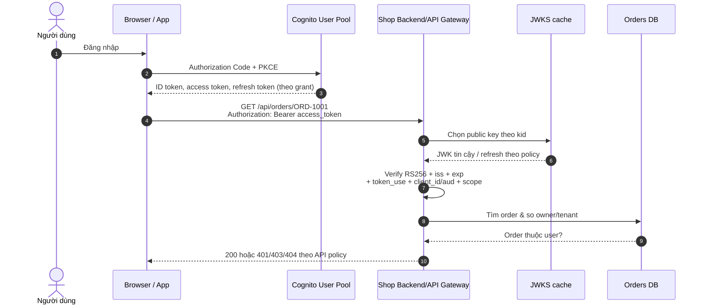
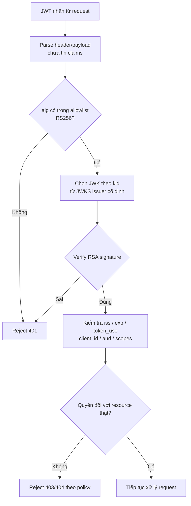
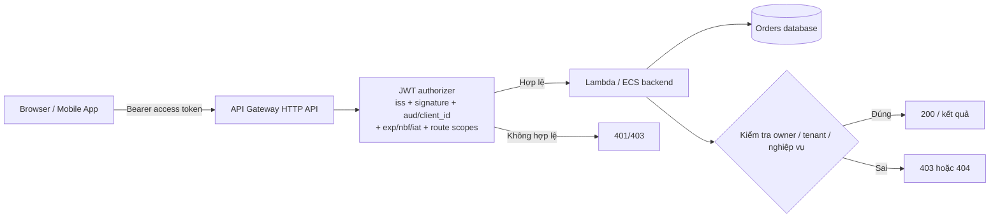
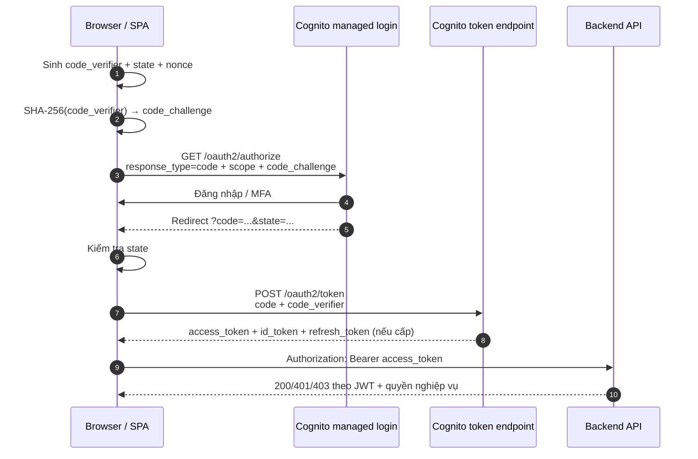
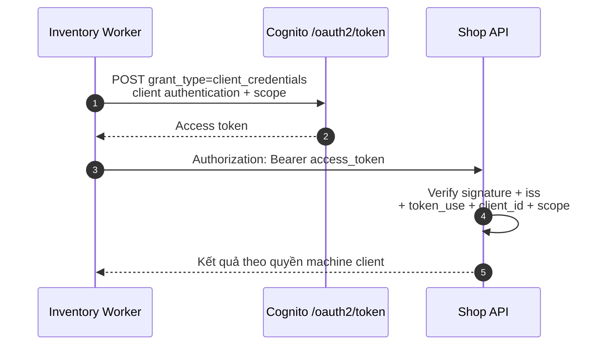
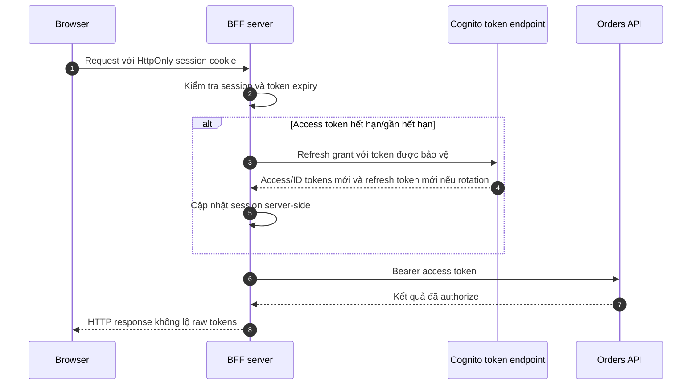
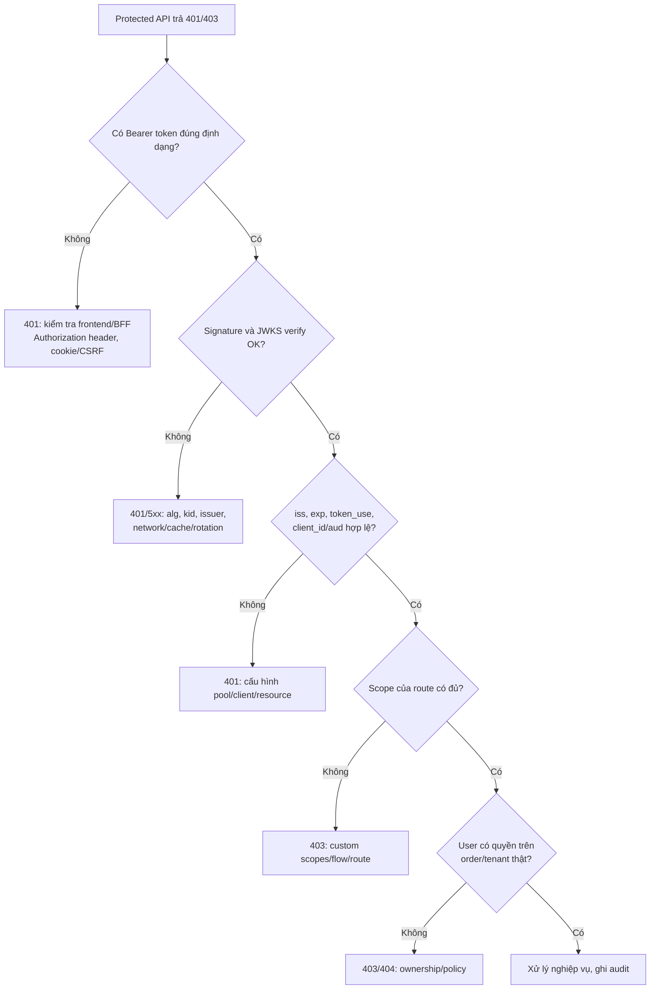
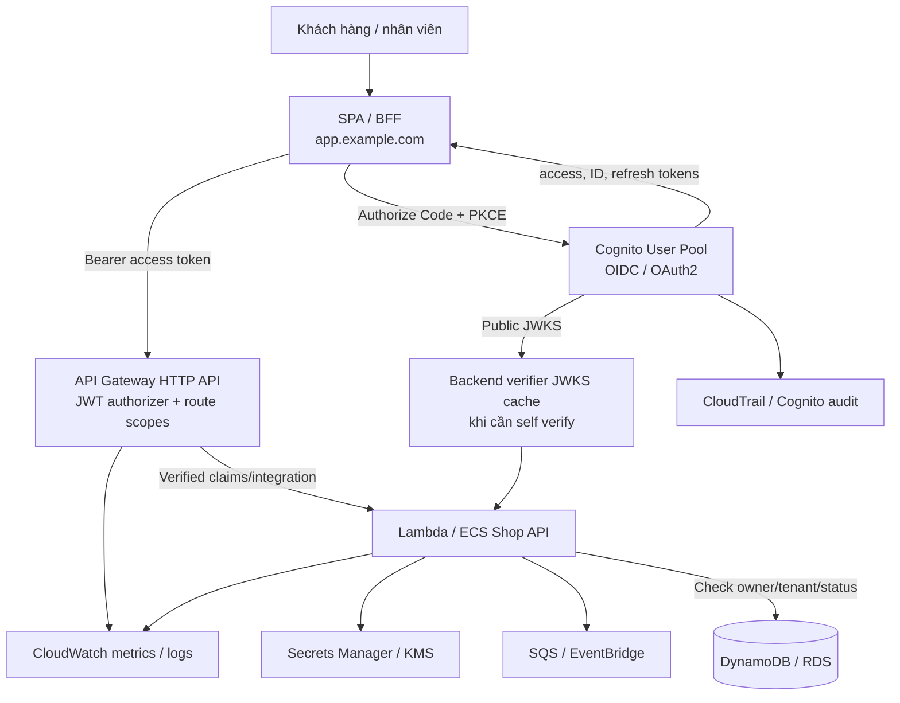

# JWT, JWKS, scope và kiểm tra token ở backend với Amazon Cognito

Một ứng dụng web có thể đăng nhập thành công qua **Amazon Cognito**, nhận được chuỗi token trông giống `eyJ...eyJ...signature` và gửi token đó lên REST API. Nhưng **đăng nhập thành công không đồng nghĩa mọi request sau đó đã được phép**. Backend phải kiểm tra **chữ ký, nguồn phát hành, thời gian hiệu lực, loại token, client/audience, scope** và cuối cùng là **quyền truy cập tài nguyên nghiệp vụ** trước khi xử lý yêu cầu.

Đây là bài học thuộc chương **Danh tính ứng dụng với Cognito**, module **CLOUD_PROVIDERS_AWS**. Người học đang khám phá hệ sinh thái AWS từ Region/AZ, IAM, VPC, compute, storage, database đến tích hợp và serverless; chủ đề này kết nối Cognito với backend chạy trên EC2, ECS, EKS hoặc Lambda/API Gateway để xây ứng dụng **an toàn, có thể giám sát, phục hồi và kiểm soát chi phí**. Trọng tâm trực tiếp là **JWT, JWKS, scope và kiểm tra token ở backend**, không phải hướng dẫn tạo giao diện đăng nhập từ đầu.

Trong bài, **Cognito User Pools** là nhà cung cấp danh tính phát hành ID/access/refresh tokens. **Cognito Identity Pools** là tính năng khác dùng để cấp AWS credentials tạm thời cho ứng dụng khi cần truy cập AWS resources; không dùng Identity Pool ID làm issuer của JWT User Pool.

## 1. Mục tiêu và tình huống xuyên suốt

Sau bài học, người học có thể:

1. Phân biệt **authentication**, **OAuth 2.0 authorization**, **OIDC**, **JWT** và **AWS IAM** theo đúng trách nhiệm.
2. Giải thích ba loại **ID token, access token và refresh token** của Cognito User Pool, xác định token nào gửi đến backend API.
3. Đọc cấu trúc JWT `header.payload.signature` và hiểu vì sao **decode không đồng nghĩa verify**.
4. Xác định issuer, JWKS URL, signing key `kid` và xác minh chữ ký `RS256` có cache/rotation.
5. Kiểm tra `iss`, `exp`, `nbf` khi có, `iat`, `token_use`, `client_id` hoặc `aud` và `scope` theo ngữ cảnh.
6. Thiết kế **resource server/custom scopes**, chặn token từ app client hoặc API khác, kiểm soát quyền theo object/tenant.
7. Áp dụng xác thực backend bằng Node.js và Spring Security/Java; hiểu khi nào dùng API Gateway JWT authorizer.
8. Xử lý refresh, revocation, key rotation, logging, 401/403, IAM/network và các kịch bản an ninh.

**Tình huống Shop API:** frontend `https://app.example.com` phục vụ người mua, backend `https://api.example.com` cung cấp `GET /api/orders/{id}`, `POST /api/orders` và `GET /api/admin/reports`. Người dùng đăng nhập qua Cognito User Pool ở Region `ap-southeast-1`. Chỉ người sở hữu mới được xem đơn hàng của mình; nhân viên có thể có quyền nghiệp vụ khác nhưng không được dựa vào một claim client tự sửa.

## 2. Phân biệt các lớp danh tính và cấp quyền

| Cơ chế | Trả lời câu hỏi | Ví dụ |
|---|---|---|
| **Cognito User Pool** | Người dùng/ứng dụng nào đăng nhập và được cấp những token gì? | User `user-42` xác thực bằng managed login |
| **OpenID Connect (OIDC)** | Làm thế nào ứng dụng nhận danh tính người dùng đã đăng nhập? | ID token và các standard claims |
| **OAuth 2.0** | Client được cấp token để truy cập resource/API ở mức scope nào? | `shop-api/orders.read` |
| **JWT/JWS** | Claims trong token có phải do issuer tin cậy ký và còn hợp lệ không? | Chữ ký RS256 đối chiếu JWKS |
| **Backend authorization** | Principal này có quyền đối với **đơn hàng cụ thể** không? | `order.ownerSub === claims.sub` |
| **AWS IAM** | AWS principal có quyền gọi AWS APIs không? | Lambda execution role đọc DynamoDB |
| **WAF/rate limit/network** | Request đi từ đâu, lưu lượng và bề mặt tấn công ra sao? | API Gateway throttling, AWS WAF |

**JWT hợp lệ chỉ chứng minh claims đáng tin trong phạm vi issuer**. Nó không chứng minh request có quyền đọc mọi order, sửa tenant hoặc thực hiện thao tác nhạy cảm. Quyết định nghiệp vụ cần do backend lấy **đối tượng thật từ database** và đối chiếu với principal đã xác thực.

### 2.1. Luồng tổng thể



Đây là luồng logic; việc backend trực tiếp kiểm tra JWT có thể được thực hiện tại ứng dụng, middleware, API Gateway authorizer hoặc một lớp bảo vệ tương đương. **Ngay cả khi API Gateway đã kiểm tra chữ ký/scope, backend vẫn cần kiểm tra quyền theo dữ liệu nghiệp vụ**.

## 3. Ba loại token trong Cognito User Pools

| Token | Mục đích | Dạng thường gặp | Backend REST API nên xử lý ra sao? |
|---|---|---|---|
| **ID token** | Chứng minh danh tính của user cho **client application** theo OIDC; chứa các claims profile | JWT có chữ ký | Không dùng thay access token để bảo vệ API tài nguyên theo mặc định |
| **Access token** | Cho phép client gọi User Pool APIs hoặc resource server theo scopes | JWT có chữ ký | **Token chính** để xác minh ở protected APIs |
| **Refresh token** | Đổi lấy access/ID tokens mới theo flow được hỗ trợ | Chuỗi token nhạy cảm, không cùng vai trò JWT dùng để gửi vào API | Chỉ gửi tới token endpoint/flow refresh phù hợp; **không** dùng làm Bearer API token |

**ID token không phải “access token có nhiều trường hơn”.** Mục đích của chúng khác nhau: ID token dành cho client xác nhận user đã đăng nhập, còn access token được thiết kế để authorize gọi API. Một backend chỉ kiểm tra chữ ký mà không kiểm tra `token_use` có thể **vô tình nhận ID token** trong endpoint vốn cần access token.

### 3.1. ID token

Một ID token Cognito thường có:

- `iss`: issuer của User Pool.
- `aud`: **app client ID** mà ID token được phát hành cho.
- `token_use: "id"`.
- `sub`: định danh user trong User Pool; các claims profile như `email`, `email_verified` nếu có/được cấp.
- `iat`, `exp`, `auth_time` và có thể `nonce`.
- `cognito:groups` hoặc các custom claims nếu được cấu hình.

ID token thích hợp để app hiển thị user profile hoặc xác minh bước đăng nhập OIDC sau khi **đã verify**; profile claims không được tự coi là quyền update database hoặc AWS IAM permissions.

### 3.2. Access token

Một access token Cognito điển hình có:

- `iss`: issuer User Pool.
- `client_id`: **app client ID** đã xác thực client/user.
- `token_use: "access"`.
- `scope`: chuỗi các OAuth scopes cách nhau bằng dấu cách.
- `sub` và `username` khi đại diện user; một số flow machine-to-machine có claims khác.
- `cognito:groups` khi group membership được phát hành vào token.
- `exp`, `iat`, `jti`, `origin_jti` trong những cấu hình tính năng thích hợp.
- **`aud` chỉ xuất hiện khi access token được ràng buộc với một API/resource bằng resource binding**, theo khả năng hỗ trợ của Cognito.

Vì access token thông thường dùng `client_id` thay vì `aud` như ID token, **không áp một cách máy móc `aud === appClientId` cho mọi Cognito access token**. Với resource-bound access token, backend có thể đồng thời kiểm tra `client_id` và `aud` là URL resource mà API mong đợi.

### 3.3. Refresh token

Refresh token có vòng đời, bảo vệ và cơ chế thu hồi riêng. Nó có thể được giữ bởi backend **Backend-for-Frontend (BFF)** trong session server-side, hoặc bởi một public client theo mô hình bảo mật phù hợp. Không đưa refresh token vào URL query, analytics, local logs hoặc gửi tới mọi microservice.

Nếu user logout, refresh token có thể bị thu hồi; điều đó **không đồng nghĩa mọi backend đang verify JWT offline sẽ lập tức nhận biết access token đã bị thu hồi**. Phần 18 phân tích giới hạn này.

### 3.4. Khác biệt về cách ký

Amazon Cognito User Pools ký ID/access tokens bằng **RS256** và có thể dùng **hai signing key pairs khác nhau** cho ID token và access token trong cùng User Pool. Vì vậy `kid` của ID token không nhất thiết trùng `kid` của access token. Backend phải chọn đúng JWK **theo `kid` của chính token nhận được**, không hardcode một public key cho cả hai.

## 4. JWT gồm header, payload và signature

Một JSON Web Token có cấu trúc:

```text
BASE64URL(UTF8(JWS header)) .
BASE64URL(UTF8(JWT claims)) .
BASE64URL(JWS signature)
```

Dấu chấm trong biểu diễn trên có khoảng trắng để dễ đọc; token thật có **ba phần nối bằng hai dấu chấm, không có khoảng trắng**.

### 4.1. Header mẫu

```json
{
  "alg": "RS256",
  "kid": "example-key-id",
  "typ": "JWT"
}
```

- `alg` nêu thuật toán ký; đối với Cognito User Pool phải phù hợp với thuật toán mong đợi.
- `kid` là key ID để chọn JWK tương ứng trong JWKS tin cậy.
- `typ` là metadata và không thay thế việc kiểm tra `token_use`.

### 4.2. Payload mẫu của access token

```json
{
  "iss": "https://cognito-idp.ap-southeast-1.amazonaws.com/ap-southeast-1_EXAMPLE",
  "sub": "9b2d0c9e-example-user-id",
  "client_id": "exampleappclientid123",
  "token_use": "access",
  "scope": "openid shop-api/orders.read shop-api/orders.write",
  "cognito:groups": ["shop-customers"],
  "iat": 1795128000,
  "exp": 1795131600,
  "jti": "sample-unique-token-id"
}
```

Payload này là **minh họa cấu trúc**, không phải JWT thực hay bằng chứng user có quyền. Các thời điểm `iat/exp` là Unix epoch seconds và giá trị mẫu chỉ cho thấy cách biểu diễn số.

### 4.3. Decode khác verify

**Decode**: chuyển chuỗi base64url thành JSON để xem. Bất kỳ ai cũng có thể decode hoặc **sửa** header/payload của JWT.

**Verify**: xác thực chữ ký bằng public key đáng tin cậy, thuật toán cho phép và xác minh claims theo policy backend. Nếu ai đó sửa `scope` thành `shop-api/orders.write` nhưng không có private signing key của Cognito, chữ ký sẽ không còn hợp lệ.



**Không đưa claims chưa được verify vào context user tin cậy** rồi để middleware khác đọc trước khi kết thúc xác thực. Header và payload có thể được parse phục vụ chọn verifier/log chẩn đoán an toàn, nhưng chỉ **sau khi verify thành công** mới được dùng chúng để cấp quyền.

## 5. JWKS: public keys để kiểm tra chữ ký

**JSON Web Key Set (JWKS)** là tài liệu JSON gồm một hoặc nhiều **JSON Web Keys (JWK)**. Cognito lưu private signing keys ở phía AWS, chỉ công bố **public keys** qua JWKS để resource servers xác thực chữ ký.

### 5.1. Issuer và JWKS endpoint

Với User Pool ID minh họa `ap-southeast-1_EXAMPLE`:

```text
Issuer (iss):
  https://cognito-idp.ap-southeast-1.amazonaws.com/ap-southeast-1_EXAMPLE

JWKS:
  https://cognito-idp.ap-southeast-1.amazonaws.com/ap-southeast-1_EXAMPLE/.well-known/jwks.json

OIDC discovery:
  https://cognito-idp.ap-southeast-1.amazonaws.com/ap-southeast-1_EXAMPLE/.well-known/openid-configuration
```

**Cognito managed login/custom domain và Cognito User Pool issuer là hai ngữ cảnh khác nhau**. Không tự thay `iss` bằng domain trang login `auth.example.com`. Với các tính năng issuer mới/multi-Region được hỗ trợ, lấy issuer/JWKS chuẩn từ cấu hình OIDC và công cụ xác minh hiện hành, không tự dựng URL theo giả định không còn đúng với cấu hình thực tế.

### 5.2. JWKS mẫu (public metadata)

```json
{
  "keys": [
    {
      "kty": "RSA",
      "kid": "example-key-id",
      "use": "sig",
      "alg": "RS256",
      "n": "sample-base64url-modulus",
      "e": "AQAB"
    }
  ]
}
```

Giá trị `n` trong ví dụ **không phải modulus hợp lệ**; dùng để minh họa field. Khi thực tế, public key được dựng từ `n` (modulus) và `e` (exponent). Dùng thư viện JWT/JWK tiêu chuẩn thay vì tự viết phép toán RSA.

| Trường | Ý nghĩa | Backend dùng làm gì? |
|---|---|---|
| `keys` | Danh sách public JWKs | Tìm key phù hợp |
| `kid` | Key ID | Ghép với header `kid` của JWT |
| `kty=RSA` | Loại khóa RSA | Kiểm tra key phù hợp RS256 |
| `use=sig` | Khóa dùng để verify signature | Không dùng nhầm key của chức năng khác |
| `alg=RS256` nếu có | Thuật toán được khai | Phù hợp allowlist của verifier |
| `n`, `e` | Các tham số public RSA | Thư viện dùng để verify |

### 5.3. Kiểm tra JWKS bằng curl (chỉ đọc)

```bash
curl --fail --silent --show-error \
  "https://cognito-idp.ap-southeast-1.amazonaws.com/ap-southeast-1_EXAMPLE/.well-known/jwks.json"
```

Lệnh minh họa, cần thay User Pool ID thật; không thực hiện nếu chưa có pool. JWKS chứa **public keys**, nhưng hãy lấy từ HTTPS endpoint **do backend cấu hình trước**. Không lấy bất kỳ JWKS URL do JWT hoặc request header không tin cậy chỉ định, vì sẽ tạo lỗ hổng tin tưởng attacker-controlled signing keys.

### 5.4. Cache và key rotation

Verifier không nên gọi JWKS endpoint **mỗi request**:

1. Tạo verifier dùng chung ở tầng process/handler (bên ngoài vòng xử lý request).
2. Cache JWKs theo issuer và `kid`, có TTL/revalidation phù hợp.
3. Khi `kid` chưa có trong cache nhưng issuer được tin cậy, thử **refresh JWKS có giới hạn tần suất**.
4. Nếu sau refresh vẫn không có key phù hợp, **reject token**, không bỏ qua signature.
5. Chịu được thời gian rotation có nhiều keys cùng tồn tại; không xóa key cũ tức thì khi thấy key mới.
6. Giám sát lỗi JWKS fetch và không làm hệ thống lệ thuộc vào một lượt gọi mạng cho mỗi API request.

Cognito có thể **rotate signing keys**; ứng dụng không nên hardcode modulus/public key từ một lần copy lúc deploy. Thư viện `aws-jwt-verify` hoặc OIDC/JWK verifier phổ biến có thể quản lý cache và làm mới khóa tốt hơn code tự viết.

### 5.5. Tránh các tấn công liên quan thuật toán và JWKS

- Không chấp nhận `alg: "none"` hoặc chuyển từ RSA sang HMAC chỉ vì header token tự yêu cầu.
- Không chọn JWK từ `jku`/`x5u` hay URL do caller cung cấp; chỉ dùng JWKS của **issuer trong allowlist của backend**.
- Không cho phép issuer tùy ý chỉ vì token tự khai `iss`.
- Hạn chế token/JWKS kích thước bất thường, số lần refresh và timeout để tránh DoS.
- Không log raw JWT; những ai có token còn hiệu lực có thể sử dụng nó như **bearer credential**.

## 6. Checklist verify token cho backend

| Kiểm tra | Điều kiện đúng | Nếu thiếu |
|---|---|---|
| **Format/size** | JWT có cấu trúc hợp lệ, kích thước nằm trong giới hạn API | Reject thay vì parse vô hạn |
| **Signature/algorithm** | RS256 với JWK từ issuer tin cậy và `kid` khớp | JWT có thể bị sửa tùy ý |
| **Issuer `iss`** | Chính xác user pool issuer được phép | Token pool/Region khác được nhận nhầm |
| **Expiration `exp`** | Chưa hết hiệu lực, clock skew chỉ nới nhỏ có kiểm soát | Nhận token hết hạn |
| **Not before `nbf` nếu có** | Thời điểm hiện tại phù hợp | Nhận token trước thời điểm có hiệu lực |
| **Issued at `iat`** | Giá trị thời gian hợp lý, không quá xa tương lai | Token bất thường có thể lọt |
| **Token type** | `token_use === "access"` cho backend API | ID token được dùng thay access token |
| **App client** | `client_id` thuộc danh sách clients API chấp nhận | Token do app client khác được dùng |
| **Resource audience nếu yêu cầu** | `aud` đúng URL/API identifier mong đợi | Token cấp cho API A dùng tại API B |
| **Scope** | Chứa scope yêu cầu cho route | Caller thiếu quyền OAuth |
| **Tenant/object authorization** | User được phép truy cập đối tượng thật | IDOR/BOLA dù JWT hợp lệ |
| **Revocation/session policy** | Phù hợp nhu cầu thu hồi trước khi hết hạn | Token đã thu hồi có thể vẫn qua offline check |

**Lưu ý:** `iat`, `nbf`, `auth_time` có ý nghĩa khác nhau. Backend không được tự tạo một rule tùy tiện “token phải mới dưới 5 phút” nếu yêu cầu không có cơ sở, vì token hợp lệ có thể có TTL lâu hơn. Kiểm tra timestamp theo verifier/thư viện và policy tuổi session cho hành động nhạy cảm nếu cần.

### 6.1. Phân biệt 401 và 403

- **401 Unauthorized** theo HTTP semantics: không có Bearer token hoặc token không hợp lệ, sai chữ ký/issuer/type/client, hết hạn. Response có thể có `WWW-Authenticate: Bearer`, không rò rỉ chi tiết internals.
- **403 Forbidden**: token đã được xác thực nhưng thiếu scope/quyền nghiệp vụ; hoặc policy chặn quyền đã nhận diện.
- **404 Not Found** đôi khi được dùng thay 403 cho object thuộc người khác để tránh lộ sự tồn tại, nếu API contract thiết kế nhất quán.
- **503/5xx**: một số lỗi hệ thống như JWKS endpoint/cache không hoạt động, không tự chuyển thành “cho phép tạm” khi chưa verify được chữ ký.

Một verifier được cấu hình sai `client_id` có thể liên tục trả 401 cho token hợp lệ của một app client khác. Không giải quyết bằng cách đặt validation client ID thành `null` hoặc tắt verify signature.

## 7. OAuth scopes: định nghĩa quyền cho API

**OAuth scope** mô tả mức quyền mà resource server cho phép client yêu cầu/được cấp; scope được Cognito phát hành trong **access token** dưới dạng **chuỗi cách nhau bằng dấu cách**. Nó là một tín hiệu ủy quyền do token issuer đáng tin cậy ký, nhưng **không thay thế kiểm tra quyền trên dữ liệu cụ thể**.

### 7.1. Các nhóm scope

| Loại | Ví dụ | Dùng khi nào? |
|---|---|---|
| **OIDC scopes** | `openid`, `email`, `profile`, `phone` | Yêu cầu OIDC ID token/userinfo và claims user theo quyền client |
| **Cognito reserved API scope** | `aws.cognito.signin.user.admin` | Cho phép một số self-service Cognito User Pool APIs cho chính user |
| **Custom resource server scope** | `shop-api/orders.read`, `shop-api/orders.write` | Bảo vệ business APIs như Orders/Payments |

Custom scopes được cấu hình với **resource server identifier** (ví dụ `shop-api`) và tên scope (`orders.read`), được phát hành theo cấu trúc `resource-server-identifier/scope-name` trong access token. Hãy dùng tên ổn định, thể hiện hành động/ngữ nghĩa, có version strategy nếu thay đổi contracts lâu dài.

**Không dùng `openid` hoặc `email` làm quyền “được sửa đơn hàng”**. Chúng nói về ngữ cảnh OIDC và dữ liệu profile, không phải quyền nghiệp vụ Orders API.

### 7.2. Scope cần được bật ở app client

Một custom scope chỉ xuất hiện trong access token nếu:

1. Resource server/scope được khai báo trong User Pool.
2. App client được phép dùng scope đó.
3. Flow thực tế request và Cognito phát hành scope tương ứng.

Nếu frontend đăng nhập bằng **Cognito User Pools API authentication** như `InitiateAuth` thay vì OAuth authorization endpoint, access token thông thường chỉ có `aws.cognito.signin.user.admin`, **không tự chứa custom resource server scopes**. Muốn bảo vệ API bằng custom OAuth scopes, thiết kế **OAuth authorization code flow** (PKCE cho public clients) hoặc grant phù hợp.

### 7.3. Ví dụ scopes cho Shop API

| Endpoint | Phương thức | Scope cần thiết | Kiểm tra nghiệp vụ bổ sung |
|---|---|---|---|
| `/api/orders` | GET | `shop-api/orders.read` | Chỉ trả orders thuộc principal/tenant |
| `/api/orders/{id}` | GET | `shop-api/orders.read` | `order.ownerSub === user.sub` hoặc role hỗ trợ được duyệt |
| `/api/orders` | POST | `shop-api/orders.write` | Kiểm tra chủ tài khoản, sản phẩm và chính sách hạn mức |
| `/api/orders/{id}/cancel` | POST | `shop-api/orders.write` | Chủ sở hữu, trạng thái order có thể hủy |
| `/api/admin/reports` | GET | `shop-api/reports.read` | Role nhân viên, phạm vi dữ liệu được duyệt |

Nếu một route chỉ yêu cầu **một scope bất kỳ** trong danh sách, cần hiểu semantics của thư viện/gateway. Ví dụ **AWS API Gateway HTTP API JWT authorizer** cho phép route khi token chứa **ít nhất một** trong các authorization scopes mà route cấu hình. Nếu nghiệp vụ yêu cầu **đồng thời cả A và B**, backend phải kiểm tra hai scopes hoặc dùng authorizer tùy biến thực thi logic AND; đừng nhầm danh sách scopes của gateway là AND.

### 7.4. Phân tích `scope` đúng cách

Ví dụ claim:

```text
scope = "openid shop-api/orders.read shop-api/orders.write"
```

Không sử dụng:

```javascript
// SAI: substring khiến orders.read.extra khớp orders.read
if (payload.scope.includes("shop-api/orders.read")) {
  allow();
}
```

Nên tách theo whitespace và so sánh **giá trị chính xác**:

```javascript
function hasScope(payload, requiredScope) {
  const scopes = new Set(
    typeof payload.scope === "string"
      ? payload.scope.trim().split(/\s+/).filter(Boolean)
      : []
  );
  return scopes.has(requiredScope);
}
```

Không nhận scope từ header do client tự gửi như `X-User-Scope`; scope phải đến từ **verified token claims** hoặc từ chính sách server-side được kiểm soát.

### 7.5. Scope không phải danh sách mọi tài nguyên user được phép đọc

Token có `shop-api/orders.read` không có nghĩa user được đọc order của người khác. Backend cần biết **principal nào**, **order nào**, **tenant nào** và **quan hệ sở hữu nào**. Đây là khoảng cách giữa **coarse-grained authorization (scope)** và **fine-grained authorization (resource ownership/ABAC/RBAC nghiệp vụ)**.

## 8. Audience, client ID và resource binding

Đây là khu vực dễ cấu hình sai nhất khi một backend dùng Cognito JWT:

| Token/ngữ cảnh | Claim định danh app client | Claim intended resource | Chính sách backend |
|---|---|---|---|
| **ID token** | `aud = appClientId` | ID token dành cho client, không phải business API access | Không chấp nhận ở API cần access token |
| **Access token thông thường** | `client_id = appClientId` | `aud` thường **không có** | Kiểm tra `token_use=access`, `client_id` và scopes |
| **Access token có resource binding** | `client_id = appClientId` | `aud = API/resource URL` | Kiểm tra `client_id` **và** `aud` resource của chính API |
| **M2M client credentials access token** | Client ID của machine client | Resource binding theo user-flow không hỗ trợ | Kiểm tra grant/client, issuer, scopes và policy M2M |

### 8.1. Vì sao resource binding hữu ích?

Giả sử doanh nghiệp có hai APIs cùng tin một Cognito User Pool:

- Orders API: `https://orders.example.com`
- Billing API: `https://billing.example.com`

Một access token được cấp từ đúng User Pool và đúng app client nhưng **không có API-specific audience** có thể cần được phân biệt bằng scope/API policy. Khi dùng **OAuth 2.0 Resource Indicators (RFC 8707)** được Cognito hỗ trợ, frontend có thể yêu cầu:

```text
GET /oauth2/authorize?
  response_type=code&
  client_id=<APP_CLIENT_ID>&
  redirect_uri=https%3A%2F%2Fapp.example.com%2Fcallback&
  scope=openid%20shop-api%2Forders.read&
  resource=https%3A%2F%2Forders.example.com&
  code_challenge=<BASE64URL_SHA256>&
  code_challenge_method=S256&
  state=<RANDOM_STATE>
```

Khi flow/cấu hình được hỗ trợ và yêu cầu hợp lệ, Cognito có thể phát access token với:

```json
{
  "token_use": "access",
  "client_id": "exampleappclientid123",
  "aud": "https://orders.example.com",
  "scope": "shop-api/orders.read"
}
```

Orders API kiểm tra `aud === "https://orders.example.com"`. Billing API sẽ từ chối token đó nếu yêu cầu audience riêng `https://billing.example.com`.

**Giới hạn cần nhớ:** theo Cognito, resource binding dùng OAuth endpoint/managed login user authentication, không dùng cho **client credentials M2M grants** và không có trong những Cognito SDK authentication models không sử dụng authorization endpoint. Backend không thể yêu cầu claim `aud` resource-specific nếu client hiện tại chưa tạo token theo flow hỗ trợ.

### 8.2. API Gateway HTTP API JWT authorizer xử lý audience thế nào?

Với **API Gateway HTTP API JWT authorizer**:

1. Gateway kiểm tra chữ ký, issuer, các timestamp claims và các trường liên quan.
2. Nếu JWT **có `aud`**, Gateway so `aud` với danh sách audience đã cấu hình.
3. Nếu JWT **không có `aud`**, Gateway dùng `client_id` để so với danh sách audience.
4. Nếu route yêu cầu scopes, Gateway kiểm tra `scope`/`scp` theo policy của route.

Do đó:

- Access token Cognito **không có resource-bound aud**: cấu hình audience thường là **app client ID**.
- Access token Cognito **có aud của resource server**: cấu hình audience phù hợp **resource URL**, không phải chỉ app client ID.
- Một **ID token cũng có `aud=appClientId`**, nên chỉ cấu hình issuer/audience **chưa đủ bảo đảm** Gateway không nhận ID token cho API. Nếu dùng Gateway built-in JWT authorizer, yêu cầu **custom resource scopes** phù hợp trên protected routes để phân biệt access token; hoặc dùng Lambda authorizer/backend verifier có kiểm tra rõ `token_use=access`.

**Không áp chính sách của HTTP API JWT authorizer cho REST API authorizer hoặc ALB authentication một cách máy móc.** Mỗi dịch vụ/loại authorizer có cơ chế kiểm tra, truyền claims và cấu hình riêng.

### 8.3. Nhiều app clients và nhiều User Pools

Một backend có thể phục vụ mobile app client, SPA app client và admin portal, nhưng cần whitelist **chính xác các client IDs được duyệt**. Với tài nguyên nhạy cảm:

- Không để một access token của mobile client tự có quyền admin chỉ vì cùng issuer.
- Không cho bất kỳ user pool nào trong cùng Region là trusted issuer.
- Nếu dùng nhiều User Pools (khách hàng và nhân viên), cấu hình verifier riêng theo issuer/client/scopes và tách chính sách truy cập rõ ràng.
- Không dùng `clientId: null` hoặc `audience: null` trừ khi đã thay bằng logic kiểm tra tương đương một cách có chủ đích.

## 9. Cognito groups, roles và quyền nghiệp vụ

Cognito User Pools có thể phát `cognito:groups` là danh sách nhóm của user. Nhóm có ích cho RBAC cấp ứng dụng, nhưng cần hiểu giới hạn:

### 9.1. Group claim không phải IAM role của backend

| Khái niệm | Ví dụ | Mục đích |
|---|---|---|
| Cognito User Pool group | `shop-operators` | Tổ chức/quyền của user trong User Pool |
| `cognito:groups` claim | `["shop-operators"]` | Backend tham chiếu **sau khi verify** |
| IAM role trong AWS | `arn:aws:iam::111122223333:role/shop-api-task-role` | Cấp quyền AWS API cho container/Lambda |
| Resource ownership | `order.ownerSub` trong database | Quyết định ai được thao tác order cụ thể |
| OAuth scope | `shop-api/orders.read` | Giới hạn loại API operation |

Một nhóm `shop-operators` không tự cho phép container gọi DynamoDB. Quyền DynamoDB của backend do **IAM execution/task role** của backend quyết định; quyền đọc order của user là logic **application authorization**.

### 9.2. Token có thể mang group membership cũ

Nếu admin vừa bỏ user khỏi nhóm, **access token đã phát hành trước đó vẫn chứa claim group cũ** đến khi refresh/hết hạn, trừ khi backend có cơ chế kiểm tra trạng thái tức thời. Nếu business yêu cầu thu hồi quyền admin ngay:

- Cân nhắc access token TTL ngắn.
- Kiểm tra trạng thái/quyền hiện thời trong nguồn dữ liệu tin cậy cho thao tác nhạy cảm.
- Đánh giá logout/revocation, session invalidation và cache policy.
- Có luồng audit ai cấp/thu hồi group, không chỉ cập nhật UI.

**Không dùng mỗi `cognito:groups` trong token làm quyền vĩnh viễn** đối với chuyển tiền, xuất dữ liệu nhạy cảm hoặc hành động quản trị quan trọng.

### 9.3. Pre Token Generation trigger và custom claims

Cognito có **Pre Token Generation Lambda trigger** cho một số thao tác tùy biến claims/scopes theo phiên bản sự kiện/tính năng hỗ trợ. Khi thêm tenant/role custom claims:

- Chỉ thêm claims từ **nguồn tin cậy** (database, directory, chính sách server-side).
- Kiểm tra dữ liệu và tránh đưa thông tin nhạy cảm không cần thiết vào JWT.
- Không giả định claims tùy biến luôn có cùng shape ở mọi grant/version.
- Phải kiểm thử token thực tế cho user, machine client và refresh flow.
- Backend vẫn kiểm tra quyền tài nguyên và phát hiện claim stale nếu rủi ro yêu cầu.

JWT thường được gửi trên mọi API request, nên đừng nhồi danh sách hàng nghìn quyền hoặc thông tin cá nhân vào token; token lớn ảnh hưởng header size, network, gateway limits và khả năng lộ dữ liệu.

## 10. Node.js/Express: xác minh Cognito access token ở backend

AWS khuyến nghị dùng thư viện **`aws-jwt-verify`** cho Node.js. Thư viện này xử lý RS256 signature, issuer, token type, app client, expiry, JWKS cache/rotation theo cấu hình phù hợp.

### 10.1. Cài thư viện

```bash
npm install express aws-jwt-verify
```

### 10.2. Middleware verify access token và kiểm tra scopes

Ví dụ backend Node.js dùng ESM imports, cấu hình bằng environment variables. **Phải điền đúng user pool ID/client ID** khi deploy, không lấy giá trị hai trường này từ request của browser:

```javascript
import express from "express";
import { CognitoJwtVerifier } from "aws-jwt-verify";

const poolId = process.env.COGNITO_USER_POOL_ID;
const appClientId = process.env.COGNITO_APP_CLIENT_ID;
const expectedApiAudience = process.env.COGNITO_API_AUDIENCE;

if (!poolId || !appClientId) {
  throw new Error("Cognito user pool and app client must be configured");
}

// Khởi tạo một lần để tận dụng JWKS cache.
const verifier = CognitoJwtVerifier.create({
  userPoolId: poolId,
  clientId: appClientId,
  tokenUse: "access",
});

const app = express();
app.use(express.json({ limit: "64kb" }));

function requireAccessToken(requiredScope) {
  return async (req, res, next) => {
    const header = req.headers.authorization;
    const parts =
      typeof header === "string"
        ? /^Bearer ([^\s]+)$/i.exec(header)
        : null;

    if (!parts) {
      res.setHeader("WWW-Authenticate", "Bearer");
      return res.status(401).json({ error: "unauthorized" });
    }

    let claims;
    try {
      claims = await verifier.verify(parts[1]);
    } catch {
      // Không log raw JWT hoặc chi tiết chữ ký cho client.
      res.setHeader("WWW-Authenticate", "Bearer error=\"invalid_token\"");
      return res.status(401).json({ error: "invalid_token" });
    }

    // Chỉ áp dụng khi frontend đã xin resource-bound access tokens.
    if (
      expectedApiAudience &&
      claims.aud !== expectedApiAudience
    ) {
      return res.status(401).json({ error: "invalid_audience" });
    }

    const scopes = new Set(
      typeof claims.scope === "string"
        ? claims.scope.trim().split(/\s+/).filter(Boolean)
        : []
    );
    if (requiredScope && !scopes.has(requiredScope)) {
      return res.status(403).json({ error: "insufficient_scope" });
    }

    // Chỉ dùng context này sau khi chữ ký/claims đã được verify.
    req.auth = {
      sub: claims.sub,
      clientId: claims.client_id,
      scopes,
      groups: Array.isArray(claims["cognito:groups"])
        ? claims["cognito:groups"]
        : [],
    };
    return next();
  };
}

app.get(
  "/api/orders/:orderId",
  requireAccessToken("shop-api/orders.read"),
  async (req, res) => {
    // Ví dụ giả định đã có storage layer.
    const order = await loadOrderById(req.params.orderId);
    if (!order || order.ownerSub !== req.auth.sub) {
      // Không cho người ngoài suy ra một order có tồn tại hay không.
      return res.status(404).json({ error: "not_found" });
    }
    return res.json({ id: order.id, status: order.status });
  }
);

app.listen(3000);
```

**Đây là skeleton giảng dạy**, không phải application hoàn chỉnh: `loadOrderById` cần được triển khai, lỗi DB cần middleware/error handler riêng, các input phải được validate, logging/rate limit/CORS/CSRF phải phù hợp hạ tầng thật.

Điểm cần lưu ý:

1. `CognitoJwtVerifier` được tạo một lần, **không tạo mới trên từng request**, để tái sử dụng JWKS cache.
2. `tokenUse:"access"` bảo đảm ID token không được chấp nhận.
3. `clientId`/`userPoolId` do backend cấu hình, không tin client tự khai.
4. Kiểm tra `aud` **chỉ bắt buộc ở ví dụ nếu ứng dụng đã bật resource binding** và cấu hình `COGNITO_API_AUDIENCE`. Nếu mong đợi resource binding, **phải** đặt biến này khi deploy; nếu không, đây không phải policy bảo vệ audience-bound.
5. Scope so sánh giá trị chính xác; mọi route cần scope tương ứng và kiểm tra quyền nghiệp vụ.
6. `req.auth.sub` lấy từ token verified, nhưng `order.ownerSub` lấy từ database; đó là lớp chống **Broken Object Level Authorization (BOLA/IDOR)**.
7. Không log hoặc trả token trong thông báo lỗi; tránh cho attacker suy luận chi tiết về bộ kiểm tra chữ ký.

### 10.3. Khi nhiều app clients cùng gọi API

Nếu backend hỗ trợ hai app clients được phê duyệt (ví dụ SPA và mobile), có thể cấu hình verifier cho danh sách client IDs theo thư viện hỗ trợ, hoặc duy trì verifiers cụ thể với chính sách rõ ràng. Luôn kiểm tra rằng **mỗi client** chỉ có quyền/scopes đúng; đừng mở ra toàn bộ app clients của User Pool.

### 10.4. Scope AND vs OR

Trong ví dụ Node.js, mỗi route yêu cầu **một scope cụ thể**. Khi endpoint cần cả `orders.write` **và** `orders.approve`:

```javascript
function requireAllScopes(scopes, required) {
  return required.every(scope => scopes.has(scope));
}

// Ví dụ sau khi claims đã được verify:
const required = [
  "shop-api/orders.write",
  "shop-api/orders.approve",
];
if (!requireAllScopes(req.auth.scopes, required)) {
  return res.status(403).json({ error: "insufficient_scope" });
}
```

Không dùng option của thư viện verifier nhận nhiều scope với giả định nó luôn kiểm tra **tất cả**; thư viện `aws-jwt-verify` khi đưa danh sách scopes vào verifier mặc định kiểm tra **ít nhất một** scope trong danh sách. Với logic AND, tự kiểm tra tập scopes **sau verify** như ví dụ.

## 11. Java/Spring Security: xác thực Cognito access token

Với backend Java Spring Boot, **Spring Security OAuth2 Resource Server** có thể verify JWT bằng JWKS. Tuy nhiên, **cấu hình issuer-uri cơ bản chưa đủ cho Cognito API** nếu backend còn yêu cầu `token_use=access` và `client_id` cụ thể. Cần bổ sung validators và bảo vệ routes bằng OAuth scopes.

### 11.1. Dependencies và nguyên tắc cấu hình

Trong ứng dụng Spring Boot dùng Spring Security phù hợp, cần modules:

```text
spring-boot-starter-security
spring-boot-starter-oauth2-resource-server
```

Resource Server sử dụng các thành phần hỗ trợ JWT/JWS (bao gồm `spring-security-oauth2-jose`), thường được starter cung cấp theo dependency management của Spring Boot. Không tự viết RSA signature verification hoặc base64url parser.

Ví dụ dùng environment variables được khai báo qua ECS task definition/Lambda/EC2 configuration:

```text
COGNITO_REGION=ap-southeast-1
COGNITO_USER_POOL_ID=ap-southeast-1_EXAMPLE
COGNITO_APP_CLIENT_ID=exampleappclientid123
COGNITO_API_AUDIENCE=https://orders.example.com  # nếu yêu cầu resource binding
```

Không cấu hình client secret của Cognito trong browser. Server-side environment variables không nên chứa static secrets nếu có thể dùng IAM role/Secrets Manager; thông số Region/Pool ID/Client ID không phải credentials bí mật.

### 11.2. JwtDecoder với issuer, RS256, token_use và client_id

Ví dụ Spring Security 6.x/7.x theo phong cách Spring Boot hiện đại. Đảm bảo phương thức builder/API tương thích chính xác với phiên bản thư viện trong dự án:

```java
package example.shop.security;

import java.util.Objects;

import org.springframework.context.annotation.Bean;
import org.springframework.context.annotation.Configuration;
import org.springframework.security.oauth2.core.OAuth2Error;
import org.springframework.security.oauth2.core.OAuth2TokenValidator;
import org.springframework.security.oauth2.core.OAuth2TokenValidatorResult;
import org.springframework.security.oauth2.core.DelegatingOAuth2TokenValidator;
import org.springframework.security.oauth2.jose.jws.SignatureAlgorithm;
import org.springframework.security.oauth2.jwt.Jwt;
import org.springframework.security.oauth2.jwt.JwtDecoder;
import org.springframework.security.oauth2.jwt.JwtValidators;
import org.springframework.security.oauth2.jwt.NimbusJwtDecoder;

@Configuration
public class CognitoJwtConfig {

    @Bean
    JwtDecoder jwtDecoder() {
        String region = Objects.requireNonNull(
            System.getenv("COGNITO_REGION"), "COGNITO_REGION missing");
        String poolId = Objects.requireNonNull(
            System.getenv("COGNITO_USER_POOL_ID"), "COGNITO_USER_POOL_ID missing");
        String clientId = Objects.requireNonNull(
            System.getenv("COGNITO_APP_CLIENT_ID"), "COGNITO_APP_CLIENT_ID missing");
        String apiAudience = System.getenv("COGNITO_API_AUDIENCE");

        String issuer = "https://cognito-idp." + region
                + ".amazonaws.com/" + poolId;
        String jwks = issuer + "/.well-known/jwks.json";

        NimbusJwtDecoder decoder = NimbusJwtDecoder
                .withJwkSetUri(jwks)
                .jwsAlgorithm(SignatureAlgorithm.RS256)
                .build();

        OAuth2TokenValidator<Jwt> cognitoClaims = jwt -> {
            boolean validType =
                    "access".equals(jwt.getClaimAsString("token_use"));
            boolean validClient =
                    clientId.equals(jwt.getClaimAsString("client_id"));

            // Chỉ bắt buộc aud khi flow đã xin resource-bound token.
            boolean validAudience = apiAudience == null
                    || jwt.getAudience().contains(apiAudience);

            if (validType && validClient && validAudience) {
                return OAuth2TokenValidatorResult.success();
            }
            return OAuth2TokenValidatorResult.failure(
                    new OAuth2Error(
                            "invalid_token",
                            "Cognito token type, client or audience invalid",
                            null));
        };

        decoder.setJwtValidator(new DelegatingOAuth2TokenValidator<>(
                JwtValidators.createDefaultWithIssuer(issuer),
                cognitoClaims));
        return decoder;
    }
}
```

**Điểm quan trọng của cấu hình:**

- `NimbusJwtDecoder` xác minh JWT signature bằng JWK từ JWKS tin cậy và chỉ cho phép **RS256** theo builder.
- `JwtValidators.createDefaultWithIssuer(issuer)` bổ sung kiểm tra issuer và các default validators liên quan (như thời gian hiệu lực).
- Custom validator buộc `token_use=access` và đúng `client_id`; nếu cấu hình resource audience, còn buộc `aud` chứa resource ID tương ứng.
- Không dùng decoder mặc định chỉ check `aud` là app client ID vì **Cognito access token thường không có `aud`**.
- **Nếu user pool của bạn dùng issuer mới/multi-Region OIDC issuer**, cần lấy issuer và JWKS chuẩn qua discovery/cấu hình được hỗ trợ. Đừng tự ghép URL từ Region/Pool ID nếu issuer thật khác.
- Đối với nhiều app clients, thiết kế danh sách approved clients theo policy server-side thay vì loại bỏ hoàn toàn validation.

### 11.3. SecurityFilterChain yêu cầu access token và scope

```java
package example.shop.security;

import org.springframework.context.annotation.Bean;
import org.springframework.context.annotation.Configuration;
import org.springframework.http.HttpMethod;
import org.springframework.security.config.Customizer;
import org.springframework.security.config.annotation.web.builders.HttpSecurity;
import org.springframework.security.config.http.SessionCreationPolicy;
import org.springframework.security.web.SecurityFilterChain;

@Configuration
public class ApiSecurityConfig {

    @Bean
    SecurityFilterChain securityFilterChain(HttpSecurity http)
            throws Exception {
        return http
                // Phù hợp API thuần Bearer header, không dùng cookie session.
                .csrf(csrf -> csrf.disable())
                .sessionManagement(sm ->
                        sm.sessionCreationPolicy(SessionCreationPolicy.STATELESS))
                .authorizeHttpRequests(auth -> auth
                        .requestMatchers("/health").permitAll()
                        .requestMatchers(
                                HttpMethod.GET, "/api/orders/**")
                        .hasAuthority("SCOPE_shop-api/orders.read")
                        .requestMatchers(
                                HttpMethod.POST, "/api/orders/**")
                        .hasAuthority("SCOPE_shop-api/orders.write")
                        .anyRequest().authenticated())
                .oauth2ResourceServer(oauth2 ->
                        oauth2.jwt(Customizer.withDefaults()))
                .build();
    }
}
```

Spring Security thường chuyển các scopes trong JWT thành authorities có prefix `SCOPE_`; vì vậy `shop-api/orders.read` tương ứng `SCOPE_shop-api/orders.read`.

**Không vô hiệu hóa CSRF theo mẫu này nếu ứng dụng của bạn xác thực bằng cookie tự động được browser gửi hoặc dùng session login.** Khi dùng Backend-for-Frontend (BFF)/cookie, phải thiết kế CSRF defense cùng SameSite/cookie attributes và các endpoint phù hợp. Mẫu trên giả định Bearer token do client đưa vào `Authorization` và backend không dùng credential cookie cho API auth.

### 11.4. Kiểm tra quyền trên order thật

Role/authority chỉ giải quyết tầng endpoint. Trong controller/service, vẫn cần:

```java
// Pseudocode trong service sau khi JWT đã được Spring Security verify.
String userSub = jwt.getSubject();
Order order = orderRepository.findById(orderId)
        .orElseThrow(NotFoundException::new);

if (!order.ownerSub().equals(userSub)) {
    throw new NotFoundException(); // hoặc Forbidden theo API policy
}
return toPublicOrderResponse(order);
```

Pseudocode trên giả định có `Order`, `OrderRepository` và `NotFoundException` do ứng dụng tự định nghĩa. Không xây quyền đọc chỉ từ `orderId` do browser gửi hoặc từ `email`, vì email có thể thay đổi; với User Pool, **`sub` là khóa định danh user ổn định trong phạm vi issuer**.

### 11.5. Khi triển khai API nhiều User Pools

Nếu có User Pool riêng cho customers và admins, có thể sử dụng nhiều `AuthenticationManagerResolver`/JWT decoders theo issuer allowlist và chính sách tách biệt. Không lấy `iss` bất kỳ từ JWT rồi tự tải JWKS theo URL đó mà không kiểm tra danh sách trusted issuers; đó là đường mở cho attacker ký token của chính họ.

## 12. API Gateway JWT authorizer và xác thực tại backend

Không phải lúc nào backend cũng cần tự download JWKS. **Amazon API Gateway HTTP API JWT authorizer** có thể kiểm tra JWT trước khi chuyển request tới Lambda/ECS backend. AWS API Gateway có nhiều loại authorizer và API types; những điểm dưới đây áp dụng chủ yếu cho **HTTP API JWT authorizer**.

### 12.1. Kiến trúc



### 12.2. Ví dụ cấu hình JWT authorizer bằng AWS CLI

Giả sử có HTTP API ID `a1b2c3d4`, User Pool ID và app client ID tương ứng:

```bash
aws apigatewayv2 create-authorizer \
  --api-id a1b2c3d4 \
  --name shop-cognito-jwt \
  --authorizer-type JWT \
  --identity-source '$request.header.Authorization' \
  --jwt-configuration '{"Audience":["exampleappclientid123"],"Issuer":"https://cognito-idp.ap-southeast-1.amazonaws.com/ap-southeast-1_EXAMPLE"}' \
  --region ap-southeast-1
```

Đây là ví dụ về **token không sử dụng resource-bound audience**. Nếu OAuth flow đã gắn `aud=https://orders.example.com` cho access token, sửa `Audience` của authorizer cho phù hợp với URL resource, không chỉ app client ID.

Sau đó gắn authorizer vào route, ví dụ:

```bash
aws apigatewayv2 update-route \
  --api-id a1b2c3d4 \
  --route-id "<ROUTE_ID>" \
  --authorization-type JWT \
  --authorizer-id "<AUTHORIZER_ID>" \
  --authorization-scopes shop-api/orders.read \
  --region ap-southeast-1
```

**Lưu ý:** ví dụ chỉ cấu hình một route. Những routes khác phải được gắn authorizer và scopes phù hợp; **không để endpoint quản trị khác tự nhiên thành public** vì chỉ bảo vệ `GET /api/orders`.

### 12.3. API Gateway kiểm tra gì, backend kiểm tra gì?

| Tầng | Trách nhiệm chính | Lỗ hổng nếu bỏ qua |
|---|---|---|
| **HTTP API JWT authorizer** | Signature, issuer, audience/client_id, expiry, scopes theo route | Token giả/sai issuer hoặc thiếu scopes đi vào backend |
| **Backend identity boundary** | Chỉ tin claims từ authorizer đáng tin hoặc tự verify; kiểm tra token type theo cơ chế | ID token/headers giả có thể lọt khi cấu hình lỏng |
| **Backend business authorization** | Ownership, tenant, role hiện hành, trạng thái dữ liệu | User đọc/sửa order của người khác |
| **IAM backend role** | Lambda/ECS được phép đọc/ghi DynamoDB/SQS/S3 | Quyền AWS quá rộng nếu app bị RCE |
| **Network/access policy** | Backend không thể bị gọi vòng ngoài authorizer | Bypass qua public ALB/Function URL/container endpoint khác |

**Header forwarding là một trust boundary.** Nếu backend đọc `X-User-Sub` hoặc một header chứa claims từ API Gateway, phải bảo đảm client không thể tự chèn/spoof header đó và không có đường gọi thẳng vào backend. Nếu không bảo đảm được, hãy **verify JWT trực tiếp ở backend** hoặc dùng integration context đáng tin cậy theo hướng dẫn AWS.

### 12.4. Claims trong Lambda proxy event

Với HTTP API Lambda integration payload format 2.0, claims sau authorizer có thể nằm ở:

```javascript
const claims = event.requestContext?.authorizer?.jwt?.claims;
const scopes = event.requestContext?.authorizer?.jwt?.scopes;
```

Đây là **shape phụ thuộc integration payload version và authorizer**. Không dùng nó cho một public Lambda Function URL hoặc một HTTP request gọi thẳng vào ECS mà không có API Gateway JWT authorizer đứng trước. Trong một hệ thống dùng cả HTTP API và REST API, cấu trúc event và khả năng scope enforcement có thể khác.

### 12.5. Những giới hạn của JWT authorizer tích hợp

- Route scopes được kiểm tra theo **OR** khi cấu hình nhiều scopes; logic AND hoặc ABAC nghiệp vụ cần thực thi riêng.
- ID token có thể đi qua issuer/audience check nếu không có route scope hoặc guardrail chuyên cho access token. Không xem gateway tự động kiểm tra `token_use=access` cho mọi loại JWT theo hướng dẫn chung.
- Backend vẫn cần validate payload, owner, tenant và quyền thao tác trên record thật.
- Key cache/rotation và JWKS fetch behavior là một phần của dịch vụ; nếu cần xử lý token revocation tức thì hoặc các policy tùy biến, cân nhắc authorizer/backend logic phù hợp.
- Nếu backend còn có lối vào công khai khác không qua JWT authorizer, endpoint đó phải tự bảo vệ tương đương.

## 13. Authentication Code + PKCE: cách frontend nhận token an toàn

Với **SPA/mobile public clients**, AWS Cognito hỗ trợ **OAuth 2.0 Authorization Code Grant với PKCE S256**. Flow phù hợp khi frontend yêu cầu custom scopes để gọi backend.



### 13.1. Ý nghĩa của state, nonce và PKCE

| Giá trị | Công dụng | Ai kiểm tra? |
|---|---|---|
| `state` | Gắn redirect với phiên login do client khởi tạo, chống một số dạng CSRF/login mix-up | OAuth client khi callback |
| `nonce` | Ràng buộc ID token với OIDC auth request, giảm replay | OIDC client khi xử lý ID token |
| `code_verifier` | Chuỗi ngẫu nhiên chỉ client biết để đổi authorization code | Cognito token endpoint |
| `code_challenge` | Base64url SHA-256 của verifier, gửi trước tới authorize endpoint | Cognito so với verifier |
| `redirect_uri` | Đích callback đã đăng ký trên app client | Cognito, phải khớp policy |

**PKCE không thay thế state**, và state không thay thế nonce khi OIDC client sử dụng nonce. Không tự tạo giá trị cố định hoặc dùng timestamp dễ đoán làm PKCE/state; dùng cryptographically secure random generator và thư viện OAuth/OIDC tin cậy.

### 13.2. Không dùng implicit flow chỉ vì dễ lấy token

Implicit flow có thể đưa token qua redirect fragment và có nhiều giới hạn bảo mật/lifecycle. Với ứng dụng browser hiện đại, ưu tiên **Authorization Code + PKCE**, không tự lập trình token parser trên frontend rồi coi đó là hệ thống auth hoàn chỉnh.

### 13.3. Token lưu ở đâu trong browser?

Không có một vị trí lưu token hoàn hảo:

- **In-memory** giảm tồn tại lâu nhưng token mất khi refresh trang.
- **localStorage/sessionStorage** dễ triển khai nhưng bị JavaScript trong cùng origin truy cập nếu XSS; đặc biệt tránh lưu refresh token không kiểm soát.
- **HttpOnly + Secure + SameSite cookie** trong mô hình **Backend-for-Frontend (BFF)** tránh cho JavaScript trực tiếp đọc session cookie, nhưng phải xử lý CSRF, cookie scoping và session management.
- Mobile/native apps dùng secure OS credential store và OAuth client libraries phù hợp.

Đối với ứng dụng có yêu cầu bảo mật cao, **BFF giữ refresh/access tokens server-side, browser chỉ dùng cookie phiên được bảo vệ** có thể giảm nguy cơ token bị đánh cắp bởi JavaScript. Tuy nhiên nó tăng state/session management, CSRF và chi phí vận hành.

**Không đưa access/refresh tokens vào URL query, web analytics hoặc error logs.** Khi frontend gọi API bằng Bearer token, dùng HTTPS và không gửi token sang domain của bên thứ ba.

### 13.4. Login session khác token expiration

Cognito managed login có cookie phiên đăng nhập có vòng đời riêng. Access token có thể hết hạn sau vài phút nhưng **người dùng vẫn có thể reauthenticate không nhập lại mật khẩu** khi login cookie còn hiệu lực. Đừng nhầm “token hết hạn” với “user đã bị logout ở mọi nơi”. Phần 18 sẽ mô tả thu hồi/refresh và cách xử lý bảo mật trong backend.

## 14. Machine-to-machine (M2M): Client Credentials khác đăng nhập người dùng

Không phải mọi API client đều là browser có người dùng. Một scheduled worker hoặc backend service có thể cần gọi Shop API theo danh tính **máy**, không đại diện một customer.

### 14.1. OAuth Client Credentials Grant

Với Cognito User Pool, app client phù hợp có thể dùng **client credentials grant** để nhận **access token chứa custom scopes** được cấp cho chính client.



**M2M access token không phải ID token của một người dùng.** Backend không nên yêu cầu `email`, `cognito:groups` hoặc chủ sở hữu customer `sub` có cùng shape như user-flow. Hãy tách principal type:

| Client | Principal nghiệp vụ | Ví dụ quyền |
|---|---|---|
| Browser user | `sub` trong User Pool, tenant/customer record | Xem orders thuộc customer |
| Service-to-service | App client được duyệt, machine identity | Đồng bộ warehouse inventory |
| Admin portal user | User `sub` + group/role và policy cập nhật | Xuất báo cáo theo organization |

Khi dùng client credentials:

- App client thường là **confidential client** và phải bảo vệ client secret/tài liệu xác thực trong Secrets Manager hoặc hệ thống tương đương.
- Không đưa client secret vào frontend/mobile. Public app không giữ bí mật lâu dài được.
- Chỉ yêu cầu custom scopes thực sự cần, cấu hình grant type và secret rotation phù hợp.
- Backend whitelist machine client IDs và scopes riêng, không coi quyền của machine client như quyền của một human customer.
- **Resource binding qua Cognito `resource` parameter không được hỗ trợ trong client-credentials M2M grants** theo phạm vi tính năng hiện tại; không bắt `aud` resource-bound giống user authorization code flow.

### 14.2. Ví dụ request minh họa

```http
POST /oauth2/token HTTP/1.1
Host: shop-login.auth.ap-southeast-1.amazoncognito.com
Authorization: Basic <base64-client-id-colon-secret>
Content-Type: application/x-www-form-urlencoded

grant_type=client_credentials&scope=shop-api%2Finventory.write
```

Địa chỉ host và Basic header trong ví dụ chỉ minh họa; trong thực tế lấy token endpoint từ domain Cognito/OIDC metadata được cấu hình và tạo client secret an toàn. **Không đưa Basic header thật vào tài liệu, logs hoặc shell history**.

### 14.3. Phân biệt Cognito M2M OAuth và AWS IAM

Nếu hai backend đều chạy trong AWS, đôi khi **IAM SigV4** (ví dụ API Gateway AWS_IAM) hoặc IAM role permissions là lựa chọn hợp lý hơn client credentials, nhất là khi chỉ cần gọi AWS APIs. Nếu gọi một HTTP API với OAuth clients đa nền tảng và scopes độc lập, Cognito M2M có thể phù hợp. Chọn theo boundary/trust model thay vì dùng OAuth ở mọi service một cách mặc định.

## 15. Phân quyền theo tenant, order và dữ liệu thật

JWT đã verify trả lời **caller là ai theo Cognito**, còn backend phải trả lời **caller được làm gì với đối tượng nào**. Đây là phần cốt lõi để chống **Broken Object Level Authorization (BOLA)**.

### 15.1. Tại sao chỉ kiểm tra scope là chưa đủ?

Giả sử user A có access token hợp lệ chứa `shop-api/orders.read`. Họ đổi URL:

```text
GET /api/orders/ORD-1001   # đơn hàng của A
GET /api/orders/ORD-2002   # đơn hàng của B
```

Scope vẫn là `orders.read`. Nếu backend chỉ check scope rồi đọc order theo ID, A có thể đọc dữ liệu của B.

Phải đưa principal vào query hoặc kiểm tra owner:

```sql
-- Minh họa cho bảng Orders đã lưu owner_sub tin cậy.
SELECT order_id, status, total_amount
FROM orders
WHERE order_id = :orderId
  AND owner_sub = :verifiedSub;
```

Với hệ thống đa tenant, còn cần ràng buộc `tenant_id` với membership/permission thực tế. **Không lấy `tenantId` từ request query rồi mặc định user sở hữu tenant đó**.

### 15.2. Sub là định danh trong phạm vi issuer

`sub` là định danh user trong User Pool. Nếu ứng dụng chấp nhận nhiều User Pools, khóa định danh nghiệp vụ an toàn có thể là **(issuer, sub)** thay vì chỉ `sub`. Nếu user thay đổi email hoặc tên đăng nhập, bản ghi sở hữu nên tiếp tục dựa trên định danh bất biến/được mapping theo identity policy.

### 15.3. Phân tách cấp quyền

| Kiểm tra | Ví dụ | Nên đặt ở đâu? |
|---|---|---|
| JWT integrity | Chữ ký, issuer, expires | Gateway/middleware trước business logic |
| OAuth operation scope | `orders.read` | Gateway hoặc middleware |
| Group/role | `shop-support` | Backend authorization layer |
| Tenant ownership | User thuộc merchant/tenant hợp lệ | Database/authorization service |
| Resource ownership | User sở hữu order cụ thể | Query/service layer |
| Business state | Chỉ hủy đơn `CREATED`, không hủy `SHIPPED` | Domain logic/transaction |
| Rate/abuse limits | Tối đa 30 lần tạo đơn/phút | Gateway/WAF/app rate limiter |
| Data masking | Nhân viên hỗ trợ chỉ xem một phần thông tin | Response mapping/domain authorization |

Khi quyền thay đổi tức thời quan trọng, cập nhật chính sách trong database/authorization service và kiểm tra runtime thay vì chờ group claim refresh. Có thể sử dụng **Amazon Verified Permissions** nếu hệ thống có nhu cầu policy-as-code/authorization tập trung, nhưng JWT verifier vẫn cần trust boundary và cấu hình principal phù hợp.

### 15.4. Tránh group-based admin toàn cục

Một user có claim `cognito:groups=["merchant-admins"]` không có nghĩa họ là admin của **mọi merchant**. Group có thể nói rằng user thuộc **vai trò chung**, trong khi backend còn phải tra cứu quan hệ `userSub ↔ merchantId ↔ role` từ nguồn dữ liệu nghiệp vụ.

Nếu ứng dụng nhiều khách hàng chỉ dùng một User Pool, không để một nhóm toàn pool đại diện trực tiếp cho quyền quản trị toàn tenant. Có thể dùng:

- Scope cho loại hành động.
- Group cho capability chung hoặc phân loại người dùng.
- Database/Verified Permissions cho membership/relationship thực tế.
- Mọi query theo (tenantId, resourceId, principal).

## 16. Refresh token, rotation và vòng đời phiên

### 16.1. Vì sao token có thời hạn ngắn?

Access token là **bearer credential**: ai sở hữu token còn hiệu lực có thể sử dụng nó trong phạm vi quyền được cấp. TTL ngắn hạn chế thời gian token bị lộ có thể bị lạm dụng, nhưng cũng làm tăng nhu cầu refresh.

| Thành phần | Vòng đời | Điểm kiểm soát |
|---|---|---|
| **Access token** | Có `exp`, app client cấu hình TTL trong giới hạn AWS | JWT verifier kiểm tra mỗi request |
| **ID token** | Có `exp`, phục vụ OIDC client | Client verify trước khi dùng profile/identity |
| **Refresh token** | TTL dài hơn theo cấu hình, dùng đổi token mới | Bảo mật lưu trữ, rotation/revocation |
| **Managed login cookie** | Session browser phía Cognito có thời hạn riêng | Không đồng nhất với TTL của access token |
| **Backend session cookie/BFF** | Theo chính sách ứng dụng | Secure/HttpOnly/SameSite, CSRF, session revocation |

Cognito cho phép cấu hình access token expiration theo app client trong phạm vi hỗ trợ (thường **5 phút đến 1 ngày**). Không chọn TTL dài nhất chỉ để tránh xử lý refresh. Với hệ thống yêu cầu thu hồi nhanh, TTL ngắn và kiểm tra trạng thái phù hợp là một phần của chiến lược.

### 16.2. Refresh token rotation

**Refresh token rotation** tạo refresh token mới khi dùng refresh theo cơ chế hỗ trợ, giảm rủi ro một token bị sử dụng lại quá lâu. Khi bật rotation, ứng dụng phải:

1. Lưu refresh token **mới** được trả về, không tiếp tục dùng token cũ vô thời hạn.
2. Xử lý khoảng thời gian grace/retry theo cấu hình Cognito và giới hạn tính năng.
3. Tránh nhiều tab/requests thực hiện refresh cùng lúc gây race.
4. Có logic khi refresh thất bại hoặc token bị thu hồi (yêu cầu đăng nhập lại).
5. Không log refresh token, không đưa nó sang backend APIs không cần biết.

Các authentication flows và thao tác `REFRESH_TOKEN_AUTH`/`GetTokensFromRefreshToken`/OAuth token endpoint có khác biệt khi rotation bật; cần đọc tài liệu Cognito theo **flow đã chọn**. Không copy một refresh API từ luồng cũ vào app mới mà không kiểm thử khả năng tương thích.

### 16.3. Ví dụ refresh ở BFF



BFF phải có session store/locking khi nhiều request đồng thời, xử lý cookie/CSRF, mã hóa dữ liệu phiên và logout. Đây là phương án bảo mật hữu ích nhưng có đánh đổi về độ phức tạp và chi phí.

## 17. Token revocation: vì sao offline verification có giới hạn?

Cognito hỗ trợ thu hồi refresh token và phiên đăng nhập bằng `RevokeToken`/revocation endpoint, `GlobalSignOut` hoặc `AdminUserGlobalSignOut` theo điều kiện và quyền tương ứng.

**Điểm đặc biệt:** JWT là cấu trúc **self-contained**. Một token đã bị Cognito thu hồi vẫn có thể **qua bước signature + expiration verification offline**, bởi chữ ký RS256 và `exp` không tự thay đổi khi server đánh dấu token bị thu hồi. AWS Cognito APIs có thể từ chối token đã revoked, nhưng **JWT library offline không tự biết trạng thái thu hồi**.

### 17.1. Phân biệt các thao tác

| Thao tác | Phạm vi tác động khái quát | Tác động đến API verify offline |
|---|---|---|
| `RevokeToken` / revocation endpoint | Thu hồi một refresh token và những tokens con liên quan | Các JWT đã phát hành có thể vẫn pass signature/exp offline |
| `GlobalSignOut` | Thu hồi các phiên/tokens của chính user theo hành vi Cognito | Backend tự verify offline không tự nhận tín hiệu thu hồi |
| `AdminUserGlobalSignOut` | Admin thu hồi phiên của user được chỉ định | Cần cơ chế downstream nếu muốn chặn trước `exp` |
| Xóa/disable user | Thay đổi trạng thái user trong Cognito | Không tự đồng bộ tức thời đến verifier chỉ đọc JWT |
| Hết hạn `exp` | Mọi JWT verifier chuẩn biết được | Request bị từ chối sau thời gian hợp lệ |

### 17.2. Cơ chế tăng khả năng thu hồi

Tùy rủi ro và SLO bảo mật:

- **Access token TTL ngắn**: giảm cửa sổ tồn tại của token bị đánh cắp/đã thu hồi.
- **Server-side session/token state**: kiểm tra session ID, revoked user ID hoặc token ID theo cache/DB tin cậy ở thao tác nhạy cảm.
- **Authorization check realtime**: tra trạng thái quyền/user từ domain database khi tài nguyên có rủi ro cao.
- **Revoke refresh token**: ngăn mint tokens mới trong phiên liên quan.
- **Incident playbook**: khóa user, chặn session, rotate secrets, kiểm tra audit và xử lý tokens còn sống.

Claims như `origin_jti` và `jti` giúp nhận diện dòng token và hỗ trợ cơ chế revocation của Cognito, nhưng **chúng không tự khiến thư viện offline nhận biết token đã bị revoke**.

### 17.3. Khi nào cần introspection hoặc kiểm tra online?

Cognito User Pool không cung cấp một **OAuth introspection endpoint phổ quát chuẩn RFC 7662** theo cách nhiều IdP khác cung cấp. Một số Cognito API operations có thể phản ánh tình trạng revoked tokens khi token dùng để gọi chúng, nhưng **không dùng `GetUser` mỗi request như một phương thức kiểm tra chữ ký/expiry**. AWS khuyến nghị verify JWT bằng chữ ký và claims; nếu cần thu hồi trước expiration, thiết kế một **server-side revocation/session state check có SLA rõ ràng**, cân nhắc trade-off latency, availability và chi phí.

Khi một security-sensitive API yêu cầu current user state, phải xác định **cơ chế kiểm tra online nào đang dùng**, cache bao lâu và hành vi nếu nguồn trạng thái không thể truy cập. Không nói “JWT có `exp` nên logout sẽ lập tức chặn mọi request”.

## 18. Token/key rotation và khả năng phục hồi

Token được ký có thể hợp lệ trong thời gian ngắn, còn JWKS có thể thay đổi khi Cognito rotate signing keys. Một backend phải hỗ trợ cả **security correctness** và **availability**:

### 18.1. Các tình huống và cách xử lý

| Tình huống | Biện pháp |
|---|---|
| `kid` có trong cache và signature hợp lệ | Dùng cached JWK, không fetch lại mỗi request |
| `kid` không có trong cache, issuer đáng tin | Refresh JWKS một lần theo rate limit/singleflight |
| `kid` vẫn không tìm thấy | Reject token; log metric, không bỏ signature verification |
| JWKS endpoint tạm lỗi, key đã cache hợp lệ | Sử dụng cache theo policy và tuổi key được cho phép |
| JWKS endpoint lỗi, key chưa từng thấy | Fail closed/response theo availability policy; không tin token chưa xác minh |
| Clock skew nhỏ giữa hệ thống | Đồng bộ thời gian, nới grace nhỏ có kiểm soát |
| Rotate key trong lúc backend đang nhận requests | Hỗ trợ nhiều active JWKS keys và refresh cache hợp lý |
| CDN/proxy cache cũ hoặc sai issuer | Theo dõi JWKS fetch age, HTTP caching headers và issuer discovery |

### 18.2. VPC và khả năng truy cập JWKS

Backend chạy trong **EC2/ECS/EKS/Lambda private subnets** vẫn cần tải JWKS từ HTTPS endpoint Cognito do issuer công bố khi khởi tạo/refresh keys. Nếu môi trường **không có đường egress**, verifier có thể thất bại lúc cold start hoặc khi key rotation.

Đánh giá:

- NAT Gateway/proxy egress có kiểm soát cho HTTPS JWKS endpoint.
- DNS, network ACL, TLS trust store và timeout.
- Các **VPC endpoints dành cho Cognito service APIs không mặc nhiên thay thế JWKS OIDC public endpoint**; kiểm tra endpoint thực tế.
- Caching, graceful reload và hạn chế JWKS request storms khi hàng nghìn Lambda instances cold start.
- Không tắt certificate validation hoặc pin cố định public key mãi mãi để “chữa” lỗi network.

Trong các hệ thống yêu cầu điều kiện bất khả dụng rõ ràng, nên kiểm thử **JWKS endpoint offline nhưng cache còn valid**, **new kid trong lúc mạng mất**, và **key rotation ngoài giờ**.

### 18.3. HTTP client và key refresh an toàn

Nếu tự cấu hình generic JWT verifier:

1. Issuer allowlist do deploy configuration kiểm soát.
2. TLS 1.2+/certificate chain theo chính sách.
3. Timeout kết nối, read timeout và retry/backoff vừa đủ.
4. JWKS cache TTL hợp lý, singleflight/synchronization trên cache miss.
5. Giới hạn số keys, kích thước response và số lần fetch.
6. Metrics cho cache hit, unknown kid, signature fail, refresh fail.
7. Không chấp nhận attacker-supplied JWKS URL, redirect tới host tùy ý hoặc bất kỳ `alg` khác allowlist.

**Thư viện phổ biến như `aws-jwt-verify` và Nimbus/Spring Security xử lý nhiều phần trên**, nhưng người vận hành vẫn phải xác nhận network và cache behavior thực tế trong deployment architecture.

## 19. Threat modeling: những lỗi JWT nguy hiểm nhất

Khi thiết kế protected API, hãy kiểm tra các tình huống mà attacker có thể đưa token tự tạo, token của pool khác, token hết hạn, token của app client khác hoặc **token thật nhưng không có quyền đối với object**.

| Lỗ hổng | Ví dụ | Kiểm soát cần có |
|---|---|---|
| **Chỉ decode, không verify** | Đọc `sub/admin` từ payload rồi cho phép | Verify RS256/JWKS và tất cả claims trước |
| **Algorithm confusion** | Token tự khai `alg=none` hoặc đổi sang HMAC | Algorithm allowlist RS256, library chuẩn |
| **JWKS URL injection** | Token tự đưa `jku` tới domain attacker | JWKS từ issuer allowlist cố định |
| **Chấp nhận token sai issuer** | Token User Pool dev dùng ở prod | `iss` exact match hoặc allowlist theo môi trường |
| **Chấp nhận ID token làm access token** | ID token có `aud` client hợp lệ | `token_use=access` ở backend; routes có custom scopes |
| **Chấp nhận token của app client khác** | Token cấp cho app công khai khác trong pool | Check `client_id` hoặc audience theo loại token |
| **Cross-resource token substitution** | Token của Billing API dùng Orders API | Resource-bound `aud` khi flow hỗ trợ + scopes riêng |
| **Scope substring matching** | `orders.read.anything` chứa chữ `orders.read` | Split tokenized scope, so sánh exact |
| **BOLA/IDOR** | User A GET order của B | Query theo verified `sub`/tenant/permissions |
| **Stale group permissions** | User bị bỏ admin nhưng token cũ vẫn có group | TTL ngắn, online authorization khi nhạy cảm |
| **Header spoofing/bypass gateway** | Gọi trực tiếp backend với `X-User-Sub: admin` | Chỉ tin verified authorizer context, chặn bypass |
| **Bearer token leakage** | Token trong URL/analytics/log hoặc browser XSS | HTTPS, token handling, CSP, logging redaction |
| **Refresh token theft** | Refresh token lưu plaintext lâu dài | BFF/secure storage, rotation, revoke và monitoring |
| **Missing rate limit** | Abuse token/credential stuffing/API flood | WAF, API Gateway throttling, login protection |
| **Open redirect/OAuth misbinding** | Callback/`state` không được so với request | Exact redirect URIs, state/nonce/PKCE |

### 19.1. “JWT đã verify” vẫn có thể không đủ

Giả sử user `alice` đã login hợp lệ, được cấp `shop-api/orders.write`. Nếu handler nhận:

```json
{
  "orderId": "ORD-2002",
  "ownerSub": "bob",
  "newStatus": "CANCELLED"
}
```

Mọi trường trong request body đều do caller kiểm soát. Backend **không được tin `ownerSub` do browser gửi** để quyết định user có quyền hủy đơn. Nó phải lấy user từ verified token, tải order thực tế, kiểm tra ownership/tenant và state transition rồi mới cập nhật.

### 19.2. Một ID token hợp lệ không đủ để bảo vệ backend API

Một attacker đã đăng nhập bằng app client đúng có thể có **ID token** với `aud=appClientId`. Nếu API chỉ kiểm tra issuer, signature và `aud`, ID token có thể bị chấp nhận như Bearer authorization. Điều này phá vỡ ranh giới OIDC identity ↔ OAuth resource authorization.

**Cách kiểm soát:**

- Backend resource server kiểm tra `token_use==="access"`.
- Gateway HTTP JWT authorizer có protected routes yêu cầu **custom scopes**, hoặc dùng authorizer/backend verify phân biệt token type.
- Chỉ nhận `Authorization: Bearer` access token, không dùng ID token vì dễ lấy profile claims.

### 19.3. Multi-tenant: groups và scope không bảo đảm cô lập

Một user có thể thuộc nhóm `merchant-admins` nhưng chỉ quản lý merchant A. Nếu API lấy `merchantId` từ path và chỉ kiểm tra group, user có thể truy cập merchant B. Bảo vệ bằng:

1. Quan hệ user/tenant/role server-side.
2. Truy vấn dữ liệu có tenant condition.
3. Kiểm tra ownership trong transaction, không chỉ sau khi dữ liệu đã lộ.
4. Thử nghiệm user A đọc/sửa object của B.
5. Có audit cho những thao tác đặc quyền.

## 20. Observability, kiểm toán và chi phí

### 20.1. Log đủ để điều tra, nhưng không lộ token

Một request đã được xác thực có thể ghi structured log như sau:

```json
{
  "timestamp": "2026-11-20T08:00:00Z",
  "requestId": "req-1001",
  "route": "GET /api/orders/:id",
  "httpStatus": 403,
  "authResult": "authenticated_insufficient_scope",
  "issuerId": "shop-prod-cognito",
  "clientId": "exampleappclientid123",
  "principalRef": "user-hash-or-internal-id",
  "requiredScope": "shop-api/orders.read",
  "latencyMs": 48
}
```

**Không log raw `Authorization` header, JWT signature, ID token, refresh token, client secret, password hoặc nguyên payload profile.** Nếu `sub` được coi là dữ liệu nhạy cảm theo tổ chức, dùng internal user ID/hash ổn định hoặc phương pháp pseudonymization phù hợp.

### 20.2. Metrics đề xuất

| Metric | Nguồn | Khi nào báo động |
|---|---|---|
| **401 rate** | API Gateway/ALB/backend | Tăng bất thường sau deploy/JWKS rotation |
| **403 rate** | Backend/domain authorization | Tăng đột biến, thử dò đối tượng hoặc policy regression |
| **Invalid issuer/client ID** | JWT verifier logs/metrics không chứa token | Token từ dev/staging/client sai liên tục |
| **Unknown `kid` / signature failures** | JWT verifier | Key rotation lỗi, token giả, cache stale |
| **JWKS fetch failures/latency** | HTTP/JWK client | VPC egress/DNS lỗi, Cognito endpoint khó truy cập |
| **Expired token rate** | Verifier/BFF | Refresh race hoặc browser session bất thường |
| **Insufficient scopes** | API auth middleware/gateway | Client request scope sai hoặc app client chưa cho phép |
| **Cross-tenant denies** | Business authorization | Có thể là tấn công BOLA hoặc bug client |
| **Token refresh failure** | OAuth/BFF/session service | Client secret rotation, session hết hạn, refresh race |
| **p95/p99 API latency** | Backend/API Gateway | JWKS fetch trên mỗi request, DB policy checks chậm |

Đừng tạo alarm chỉ dựa vào mọi `401`, vì token hết hạn do refresh bình thường cũng có thể sinh một số 401. Dùng **baseline, tỷ lệ, loại lỗi và thay đổi sau deploy** để đánh giá.

### 20.3. CloudTrail có thể và không thể cho biết gì?

| Loại hoạt động | Nguồn log phù hợp |
|---|---|
| Đổi User Pool/App Client/Group, admin APIs | AWS CloudTrail và Cognito audit theo phạm vi hỗ trợ |
| Auth attempt/managed login events | Cognito logs/metrics/features theo cấu hình và tích hợp |
| HTTP request mang Bearer token | API Gateway/ALB/backend access logs **đã redacted** |
| JWT signature/claims verification | Application verifier metrics/logs; không phải CloudTrail per-request |
| Quyền đọc order cụ thể | Backend business audit, DB access/event logs phù hợp |
| Thay IAM task role/KMS/bucket policy | CloudTrail/AWS Config theo tài nguyên |

**Cognito JWT được backend verify offline không tạo một Cognito API call cho mỗi request.** Vì vậy CloudTrail không tự ghi mọi lần người dùng GET order từ backend. Muốn audit hành vi API, cần thiết kế ứng dụng/gateway logging và bảo vệ dữ liệu log.

### 20.4. Chi phí và các đánh đổi

| Thành phần | Chi phí/giới hạn cần tính | Cách quản lý |
|---|---|---|
| Cognito User Pool | Phí theo tier/usage như MAU, authentication features, M2M grants tùy plan | Chọn tier và tính năng đúng use case, kiểm tra biểu giá hiện hành |
| Token endpoint | Lượng request refresh/login, quotas/latency | Cache token đúng TTL, tránh refresh trên mọi API request |
| Backend JWT verification | CPU xử lý RSA và cache JWKS | Reuse verifier, benchmark latency/throughput |
| JWKS HTTPS egress | NAT/proxy/VPC network charges khi backend private | Cache public keys, tối ưu network, kiểm tra NAT endpoints |
| API Gateway/JWT authorizer | API request charges và loại authorizer/integration | Chọn loại API và cache/authorizer theo yêu cầu |
| Lambda/EC2/ECS | Compute chạy backend, autoscaling/cold starts | Sizing và benchmark auth middleware |
| CloudWatch/X-Ray/CloudTrail | Log ingestion, retention, tracing/audit usage | Redaction, retention, sampling, phân vùng dữ liệu |
| Authorization database | Tra cứu tenant/role và cache | Đặt SLA consistency, TTL và tránh truy vấn thừa |

Không có một con số phí Cognito cố định phù hợp mọi deployment. Với yêu cầu pricing, kiểm tra **Amazon Cognito Pricing** và biểu giá AWS theo Region/tier hiện hành, cả free tier/limits nếu có. Một hệ thống dùng token verify offline có thể giảm lượt gọi Cognito mỗi API request, nhưng phải chấp nhận **đánh đổi revocation và stale claims**.

### 20.5. SLO và quy trình kiểm thử độ tin cậy

Khi thiết kế backend:

- **SLO xác thực:** ví dụ 99,9% requests với JWT hợp lệ có thể được xác thực trong ngưỡng latency nhất định, phụ thuộc network/cache.
- **SLO authorization:** các quyền theo resource phải chính xác; false allow là sự cố bảo mật, false deny có thể là sự cố availability.
- **JWKS rotation test:** key ID mới xuất hiện nhưng backend vẫn tự refresh/cache và tiếp tục hoạt động.
- **Cognito outage test:** đã có JWK cache cho token hợp lệ, nhưng đăng nhập/refresh mới có thể bị ảnh hưởng.
- **Token expiry/refresh race:** nhiều tabs/instances không gây logout loop hoặc lỗi 401 hàng loạt.
- **Policy rollback:** thay sai scope/group cần khôi phục qua IaC mà không mở quyền bất kỳ user nào.

Không đánh đổi **verify signature** lấy availability bằng cách tắt validation khi Cognito/JWKS không truy cập được.

## 21. Chẩn đoán lỗi JWT, JWKS và scope theo triệu chứng

| Triệu chứng | Nguyên nhân có khả năng | Kiểm tra |
|---|---|---|
| 401 ngay sau login | Frontend gửi ID token thay access token | So `token_use` sau decode chẩn đoán; dùng access token đã verify |
| 401 `Invalid issuer` | User Pool/Region/issuer khác backend config | `iss`, configured pool, OIDC metadata |
| 401 `Invalid audience` | App client ID sai, hoặc access token có `aud` resource URL khác | `client_id`, `aud`, audience config của gateway |
| 401 `Token expired` | `exp` đã qua, refresh không chạy hoặc clock lệch | Token TTL, refresh logs, đồng bộ thời gian |
| 401 `Invalid signature` | JWT bị sửa, dùng sai JWK/alg, cache key cũ | `alg`, `kid`, JWKS issuer, rotation |
| 401 `Unknown kid` | Key rotation, cache stale, token từ issuer khác | Refresh JWKS theo rate limit, so `iss` |
| 401 khi backend trong private subnet | Không tải được JWKS qua HTTPS | DNS, NAT/proxy, TLS trust, endpoint |
| 403 `insufficient_scope` | App client chưa cho custom scope hoặc frontend không request | OAuth authorize scope, token `scope`, resource server |
| 403 chỉ một order | User thiếu quyền sở hữu/tenant | Query authorization, verified `sub`, DB record |
| BFF logout loop | Refresh token rotation/race/cookie/session lỗi | Refresh logs, cookie SameSite, state/session store |
| Backend vẫn nhận token sau revoke | Offline signature/exp không biết revoked state | TTL, session denylist/check, Cognito revoke event |
| API Gateway JWT authorizer nhận ID token | Chỉ cấu hình issuer/audience, thiếu route scope/token_use check | Custom authorization scopes hoặc backend verifier |
| 401 chỉ khi bật resource binding | Token có `aud` URL resource thay vì app client ID | Config audience theo URL resource |
| JWT dài làm HTTP 431 | Token chứa nhiều groups/claims, headers vượt giới hạn | Giảm token claims và header/cookie payload |
| 502/5xx sau triển khai auth | Verifier tạo mỗi request, không có egress, exception handling lỗi | JWKS cache/init, network, logs và middleware error handler |

### 21.1. Cây chẩn đoán



### 21.2. Cách debug không làm lộ token

1. Xác nhận endpoint, HTTP status, request ID/correlation ID và thời điểm xảy ra.
2. Kiểm tra cấu hình **trusted User Pool ID/issuer**, client ID allowlist và expected API audience ở môi trường đó.
3. Nếu cần xem JWT claims để debug trong **môi trường an toàn**, chỉ decode cục bộ vào process đã kiểm soát; **không dán token thật lên website bên ngoài**.
4. Kiểm tra `token_use`, `client_id`/`aud`, `scope`, `exp`, `iss` và `kid` **mà không log raw token**.
5. So `kid` với JWKS tin cậy, kiểm tra thư viện cache/rotation và tình trạng egress.
6. Nếu signature/claims đạt mà vẫn 403, kiểm tra route scopes và quyền nghiệp vụ trên resource.
7. Nếu lỗi chỉ xuất hiện sau đổi quyền nhóm, kiểm tra **stale token** và domain policy cache.
8. Ghi nhận fix vào IaC/config, thêm regression test và hạn chế quyền log xem dữ liệu danh tính.

**Không chữa lỗi bằng cách tắt kiểm tra `exp`, gỡ `token_use` hoặc bỏ `client_id`.** Những guardrails này là nguyên nhân tồn tại của resource server.

## 22. Kiến trúc tổng hợp: Shop API bảo vệ đơn hàng và báo cáo

Giả sử công ty triển khai:

- **Frontend:** SPA tại `https://app.example.com`, đăng nhập Cognito managed login + Authorization Code/PKCE.
- **Cognito User Pool:** `ap-southeast-1_EXAMPLE`, app client `shop-web-client` (ID thực tế là chuỗi được Cognito cấp), scopes `shop-api/orders.read`, `shop-api/orders.write`.
- **Gateway:** API Gateway HTTP API với JWT authorizer cho các routes phù hợp.
- **Backend:** Lambda hoặc ECS Java/Spring Boot, dùng IAM execution/task role để truy cập DynamoDB/RDS/SQS.
- **Storage:** database lưu `ownerSub` và `tenantId` cho từng order.
- **Monitoring:** CloudWatch API/backend metrics, log đã redacted; CloudTrail theo dõi AWS management API changes.
- **Authorization nâng cao:** trạng thái nhân viên/tenant role từ database hoặc policy engine.

### 22.1. Sơ đồ



Sơ đồ chỉ trình bày trust boundaries, không có nghĩa mọi request phải gọi Cognito/JWKS qua mạng. Gateway/backend nên **cache public keys**; JWT verify thông thường thực hiện local. Nếu dùng Gateway JWT authorizer, backend không nhất thiết tải JWKS lần nữa nhưng phải bảo vệ khỏi **đường truy cập bỏ qua gateway** hoặc thực hiện verify trực tiếp khi trust boundary không bảo đảm.

### 22.2. Định nghĩa quyền theo route

| Route | Token yêu cầu | Scope | Authorization sau JWT |
|---|---|---|---|
| `GET /health` | Không cần nếu health endpoint chỉ lộ thông tin an toàn | Không | Không lộ thông tin nội bộ |
| `GET /api/orders/{id}` | Cognito **access token** | `shop-api/orders.read` | Order thuộc verified user/tenant |
| `POST /api/orders` | Cognito access token | `shop-api/orders.write` | Business validation, owner lấy từ token |
| `POST /api/orders/{id}/cancel` | Cognito access token | `shop-api/orders.write` | Owner và trạng thái order cho phép hủy |
| `GET /api/admin/reports` | Cognito access token | `shop-api/reports.read` | Employee/admin role và tenant scope |
| `POST /api/internal/inventory-sync` | M2M access token từ client riêng | `shop-api/inventory.write` | Whitelist machine client và payload validation |

Không cấp `reports.read` cho frontend customer app client. App client là nơi giới hạn **scopes có thể được yêu cầu**, còn backend vẫn kiểm tra việc phát hành scope có đúng và caller có quyền với dữ liệu thật.

### 22.3. Tình huống cross-tenant request

1. User A đăng nhập, được cấp token có `token_use=access`, `client_id` đúng và `shop-api/orders.read`.
2. A gọi `GET /api/orders/ORD-2002` vốn thuộc User B.
3. API Gateway trả qua vì signature/iss/audience/scope hợp lệ.
4. Backend query database với `orderId` và **verified `sub`**, không tìm thấy object được phép.
5. Backend trả `404` (hoặc `403` theo policy), ghi security event không lộ dữ liệu của B.

Đây là hành vi **đúng**, không phải gateway bị lỗi. OAuth scope mang ý nghĩa permission category, còn quyền object phải được backend thực thi.

### 22.4. Tình huống staff mất quyền admin giữa phiên

1. Staff có access token với group `shop-support` và scope `reports.read`.
2. Người quản trị thu hồi quyền staff trong authorization database.
3. Token cũ vẫn còn hiệu lực chữ ký/expiry và có thể giữ group claim cũ.
4. Backend kiểm tra quyền staff **hiện tại** khi xuất báo cáo nhạy cảm và từ chối.
5. Tổ chức tiếp tục revoke refresh tokens/phiên liên quan, alert và audit.

Với thao tác có tác động cao, **quyền hiện tại trong dữ liệu nghiệp vụ** quan trọng hơn việc group claim được phát hành bao lâu trước đó.

### 22.5. Tình huống issuer/JWKS key rotation

1. Cognito phát token mới có `kid` chưa có trong cache.
2. Verifier nhận diện issuer hợp lệ, refresh JWKS theo logic được thư viện hỗ trợ.
3. JWK mới được cache; verifier xác minh signature và claims.
4. Nếu refresh thất bại nhưng chưa có key mới, token mới bị từ chối hoặc request báo lỗi theo policy — **không cho qua không verify**.
5. Metrics phản ánh unknown kid/JWKS fetch failure để người trực xử lý.

### 22.6. Quy trình release và rollback auth policy

Khi thay scopes/clients:

- Thiết kế thay đổi dưới dạng IaC (CDK/CloudFormation/Terraform theo stack của tổ chức).
- Thêm scope mới vào Cognito resource server, duyệt app clients được phép.
- Deploy backend support **trước** khi frontend request scope mới, để tránh 401/403 hàng loạt.
- Kiểm thử token thật trên dev/staging, cả access token thường và resource-bound nếu dùng.
- Triển khai từng bước, theo dõi 401/403, JWT verifier failures và business errors.
- Rollback có kiểm soát; không xóa scope cũ khi clients/refresh tokens chưa di chuyển xong.
- Đối với quyền bị thu hồi do sự cố bảo mật, ưu tiên hạn chế server-side ngay thay vì chờ token expiry.

## 23. Lab thực hành an toàn

Chỉ dùng User Pool và API trong **AWS account lab/sandbox** có quyền quản lý; không đưa token thật, secrets hoặc dữ liệu cá nhân vào bài nộp. Lab này tập trung vào kiểm tra token, không yêu cầu triển khai toàn bộ website.

### 23.1. Chuẩn bị

| Thành phần | Giá trị minh họa |
|---|---|
| AWS Region | `ap-southeast-1` |
| User Pool ID | `ap-southeast-1_EXAMPLE` |
| App client ID | `exampleappclientid123` |
| Custom scope | `shop-api/orders.read` |
| Authorized frontend | `https://app.example.com` hoặc lab localhost callback được duyệt |
| JWKS endpoint | Issuer `/.well-known/jwks.json` |
| Backend | Node.js/Express hoặc Spring Security Resource Server |

### 23.2. Bước 1 — Quan sát OIDC metadata và JWKS

Từ máy có HTTPS egress:

```bash
# Dùng User Pool ID thật từ lab.
curl --fail --silent --show-error \
  "https://cognito-idp.ap-southeast-1.amazonaws.com/ap-southeast-1_EXAMPLE/.well-known/openid-configuration"

curl --fail --silent --show-error \
  "https://cognito-idp.ap-southeast-1.amazonaws.com/ap-southeast-1_EXAMPLE/.well-known/jwks.json"
```

**Ghi lại:** issuer, jwks_uri, số public keys, `kid` và thuật toán. Public key có thể thay đổi trong tương lai; không paste key vào code production.

### 23.3. Bước 2 — Lấy token bằng flow được duyệt

Sử dụng **managed login Authorization Code + PKCE** hoặc OAuth client phù hợp được phòng lab cung cấp. Request scopes gồm `openid` và `shop-api/orders.read` đã được app client cho phép. Khi nhận tokens:

1. Ghi nhận **token type** (ID/access), nhưng **không lưu raw token trong bài nộp**.
2. Dùng thư viện JWT local để **decode header/claims** cho mục đích quan sát.
3. Xác minh `iss`, `token_use`, `client_id`/`aud`, `scope`, `iat/exp` và `kid`.
4. Kiểm tra `kid` tương ứng trong JWKS.
5. Dùng verifier chuẩn để **verify signature** trước khi kết luận token hợp lệ.

Không gửi token thật đến website giải mã JWT công khai; thông tin trong JWT có thể mang PII hoặc cung cấp quyền Bearer nếu bị lộ.

### 23.4. Bước 3 — Dựng protected endpoint

Dùng middleware Node.js ở phần 10 hoặc Spring Security ở phần 11, cấu hình:

- Trusted User Pool ID/issuer từ **environment**.
- Allowed app client ID(s) được duyệt.
- `token_use=access`.
- Scope `shop-api/orders.read` cho route `GET /api/orders/{id}`.
- Business ownership check theo verified `sub`.

Nếu dùng API Gateway HTTP API JWT authorizer, gắn scopes với route và đảm bảo backend không có đường bypass. Một bài lab tốt cần **cả 401 lẫn 403**; nếu toàn bộ request đều trả 200, chưa có bằng chứng hệ thống đã bảo vệ đúng.

### 23.5. Bước 4 — Ma trận thử nghiệm

| Test | Mô tả | Kết quả kỳ vọng |
|---|---|---|
| T1 | Không gửi Authorization header | 401 |
| T2 | Gửi chuỗi JWT sai cấu trúc | 401 |
| T3 | Gửi token bị chỉnh sửa payload nhưng giữ signature cũ | 401 |
| T4 | Gửi token hết hạn | 401 |
| T5 | Gửi ID token thay access token | 401 nếu backend kiểm tra type đúng |
| T6 | Gửi access token từ User Pool khác | 401 |
| T7 | Gửi access token đúng issuer nhưng sai app client | 401 |
| T8 | Gửi access token hợp lệ nhưng thiếu `orders.read` | 403 |
| T9 | Gửi access token đúng scope, order của user khác | 403/404 |
| T10 | Gửi access token đúng scope, order của mình | 200 |
| T11 | Token có `aud` resource khác API mong đợi | 401 |
| T12 | JWKS xoay key/hết cache (mô phỏng trong lab) | Refresh key có kiểm soát, không tắt signature |

**Chỉ tạo token giả/đã sửa để test trong lab có quyền**, không sửa policy production hoặc phát token thật công khai. Không cần private signing key của Cognito để chứng minh token bị chỉnh sửa sẽ fail: thay payload của một token lab sẽ làm chữ ký không khớp.

### 23.6. Bước 5 — Đối chiếu logs mà không lộ bí mật

Trong backend/log gateway, kiểm tra:

- Request ID, HTTP status, route và thời gian.
- Auth reason category: malformed, wrong token type, wrong issuer/client, expired, insufficient scope.
- Thời gian verify JWT và cache hit/miss nếu thư viện/metrics có hỗ trợ.
- Business authorization denied vì resource ownership.
- Không xuất raw Bearer token, refresh token, email hoặc secret.

Nộp **bảng kết quả T1–T12**, kiến trúc ngắn, cấu hình scopes, giải thích code và ảnh chụp logs đã redacted; không gửi raw tokens.

## 24. Bài tập và câu hỏi tự kiểm tra

### Bài tập A — Token nào được dùng ở đâu?

Một SPA nhận access, ID và refresh token sau login. Hãy điền:

| Mục đích | Token phù hợp | Giải thích |
|---|---|---|
| Hiển thị tên user đã xác minh trong client | ID token đã verify | Identity/profile claims |
| Gọi `GET /api/orders` | Access token | OAuth API scopes + backend ownership |
| Đổi lấy access token mới sau hết hạn | Refresh token | Chỉ gửi token/refresh flow hợp lệ |
| Gọi `s3:GetObject` bằng AWS SDK trực tiếp | Không mặc định dùng một trong ba token | Cần IAM credentials hoặc ứng dụng cấp presigned URL theo kiến trúc |

**Đáp án cần nêu:** Cognito Identity Pools/IAM hoặc backend/presigned URLs xử lý quyền AWS resource; User Pool access token không phải AWS IAM access key.

### Bài tập B — Vì sao decode JWT không đủ?

Attacker lấy một JWT có `scope="shop-api/orders.read"`, sửa payload thành `scope="shop-api/orders.write"` nhưng giữ nguyên signature.

**Gợi ý:** decode vẫn trả payload đã sửa, nhưng **verify RS256 thất bại** vì signature không còn khớp. Backend không được tin `scope` trước signature verification.

### Bài tập C — Tìm lỗi ở middleware

```javascript
// Ví dụ CỐ Ý SAI để nhận diện lỗ hổng.
const payload = JSON.parse(
  Buffer.from(token.split(".")[1], "base64url").toString("utf8")
);
if (payload.scope.includes("orders.read")) {
  return next();
}
```

Hãy tìm ít nhất năm lỗi:

1. Chỉ parse payload, không verify signature/JWKS.
2. Không giới hạn trusted issuer.
3. Không kiểm tra expiry/not-before.
4. Không kiểm tra `token_use=access`.
5. Không kiểm tra `client_id`/resource audience.
6. Dùng substring scope thay cho exact match.
7. Không có object ownership/tenant authorization.
8. Không hạn kích thước/định dạng token hoặc xử lý parse errors an toàn.

**Cách sửa:** dùng verifier tiêu chuẩn, middleware Node/Java đã cấu hình trust, scope exact match, sau đó kiểm tra quyền nghiệp vụ.

### Bài tập D — Audience nào đúng?

Một resource-bound access token chứa:

```json
{
  "token_use": "access",
  "client_id": "shop-web-client-id",
  "aud": "https://orders.example.com",
  "scope": "shop-api/orders.read"
}
```

Backend `https://billing.example.com` chỉ kiểm tra `client_id` và issuer, không kiểm tra `aud`.

**Gợi ý:** token có intended audience là Orders API; Billing API phải từ chối nếu yêu cầu resource-bound tokens cho riêng mình. Cần check `aud=https://billing.example.com`, scopes của Billing và chính sách riêng, không chỉ client ID.

### Bài tập E — Scope có thay thế quyền owner không?

User A có `shop-api/orders.read` và gọi order của B.

**Gợi ý:** scope chỉ cho phép loại thao tác “đọc order” trong phạm vi được backend xác nhận; user A phải bị chặn bởi ownership/tenant check. Một API trả order của B là lỗi **BOLA/IDOR**, không phải vấn đề chữ ký.

### Bài tập F — Logout đã revoke nhưng JWT vẫn pass

Security team dùng `AdminUserGlobalSignOut` cho user. Backend offline verifier tiếp tục nhận một access token của user trong vài phút.

**Gợi ý:** offline verifier không có nguồn dữ liệu revocation realtime; token self-contained vẫn giữ signature/exp. Để chặn nhanh hơn phải dùng session denylist/current user state hoặc một cơ chế online authorization được thiết kế, đồng thời giảm token TTL và bảo vệ refresh token.

### Bài tập G — Scope OR hay AND?

API Gateway HTTP API route yêu cầu authorizationScopes `["orders.read", "orders.write"]`. Một token chỉ có `orders.read`.

**Gợi ý:** Gateway coi danh sách route scopes theo **ít nhất một scope (OR)**; token có thể qua khi chỉ có `orders.read`. Nếu cần cả read và write, backend/custom authorizer phải kiểm tra **AND**, hoặc định nghĩa một scope phù hợp với hành động.

### Bài tập H — Unknown kid sau key rotation

Backend dùng một public key hardcoded lúc deploy, từ đó bỏ qua JWKS endpoint. Sau key rotation, user mới đăng nhập nhưng API trả 401 hàng loạt.

**Gợi ý:** cache/refresh JWKS theo issuer và `kid`, dùng thư viện chuẩn; giữ key cũ khi cần trong thời gian chuyển, nhưng không pin một key mãi mãi. Không bao giờ tạm tắt signature verification.

### Bài tập I — M2M không có user sub như dự kiến

Inventory worker dùng client credentials grant, gọi `POST /api/internal/inventory-sync`. Backend lại yêu cầu `cognito:groups=["staff"]`, dẫn đến 403.

**Gợi ý:** client credentials là machine-to-machine, không đại diện user session. Dùng app client ID allowlist + custom scope `shop-api/inventory.write` và policy service identity riêng; không dùng user group làm tiêu chuẩn bắt buộc cho machine client.

### Bài tập J — Thiết kế quyền đa tenant

Hệ thống có 50 merchants, một User Pool và hai app clients (customer web, staff portal). Hãy thiết kế:

- Scopes cho đọc/ghi order, xuất báo cáo và đồng bộ kho.
- Danh sách app clients được quyền xin từng scope.
- Tenant membership và owner authorization lấy từ nguồn nào.
- Cách xử lý quyền staff bị thu hồi trong lúc token còn hiệu lực.
- JWKS cache/rotation khi backend chạy private subnet.
- Bảng T1–T12 và tối thiểu một test cross-tenant.

**Tiêu chí:** tách đúng JWT verification, API scope và object-level authorization; dùng AWS IAM đúng lớp, tránh hardcode access keys, có audit và đường thu hồi quyền.

## 25. Checklist production cho Cognito JWT và backend

### Cấu hình User Pool, App Client và OAuth

- [ ] User Pool/issuer đúng account, Region và môi trường dev/staging/production.
- [ ] App client IDs và OAuth grants đúng đối tượng: SPA public client, confidential M2M client hoặc BFF.
- [ ] SPA/mobile dùng Authorization Code + PKCE S256 và kiểm tra `state`/`nonce` khi liên quan.
- [ ] Redirect URIs được allowlist cụ thể; không chấp nhận arbitrary redirect.
- [ ] Custom resource server scopes mô tả thao tác API, không dùng `openid` làm business permission.
- [ ] App client chỉ được cấp scopes thực sự cần; production app clients tách khỏi dev.
- [ ] Nếu dùng resource binding, client yêu cầu đúng `resource` và API kiểm tra `aud` resource.
- [ ] Token TTL và refresh token rotation phù hợp với session/SLA; không giữ raw tokens trong logs.

### Kiểm tra JWT/JWKS ở backend

- [ ] Chỉ tin issuer/JWKS URL do server configuration xác định, không theo URL do JWT/request đưa vào.
- [ ] Verifier dùng thuật toán RS256 thích hợp cho Cognito User Pool.
- [ ] JWT signature được verify trước khi tin bất kỳ claim nào.
- [ ] `kid` được chọn trong JWKS trusted, có cache, refresh khi rotation và rate limit.
- [ ] Kiểm tra `exp`, `nbf` (nếu có), `iat` và clock skew nhỏ theo policy.
- [ ] Kiểm tra `token_use=access` cho resource APIs; không chấp nhận ID token thay access token.
- [ ] Kiểm tra `client_id` trong approved app clients; thêm `aud` khi API yêu cầu resource binding.
- [ ] Scope được tách theo whitespace và so khớp chính xác, biết rõ khi nào cần AND/OR.
- [ ] Mọi request sai format/sai issuer/sai signature/sai client đều fail closed.
- [ ] 401 và 403 được phân biệt, không rò rỉ raw token hoặc JWT validation internals.
- [ ] JWKS cache được chia sẻ trong cùng process/instance, tránh network fetch trên từng request.
- [ ] Có kế hoạch JWKS refresh và egress từ private subnet khi cache miss/key rotation.

### Authorization nghiệp vụ

- [ ] Quyền đọc/ghi order được kiểm tra theo verified `sub`, tenant và trạng thái dữ liệu thật.
- [ ] Các routes admin có group/role/scope đầy đủ, không dựa vào profile email.
- [ ] User A không thể đọc/sửa tài nguyên user B; có negative tests cross-tenant.
- [ ] Các thao tác quan trọng có kiểm tra permission/current state theo SLA thay vì chỉ token claims stale.
- [ ] Machine clients có policy riêng, không bị lẫn với human users.
- [ ] JWT user `sub` không bị nhầm với IAM execution role hoặc backend service identity.
- [ ] Không có đường truy cập API trực tiếp bỏ qua Gateway/authorizer, trừ khi backend tự verify tương đương.
- [ ] Header context từ proxy/gateway không được client tự giả mạo.

### Bảo mật phiên và vận hành

- [ ] HTTPS từ client đến gateway/backend và từ backend đến JWKS endpoint.
- [ ] Frontend/BFF có chiến lược lưu token, CSRF/XSS/CSP, cookie Secure/HttpOnly/SameSite phù hợp.
- [ ] Refresh tokens được bảo vệ, có rotation/revocation/logout flow và xử lý race conditions.
- [ ] Không mặc định Cognito revoke sẽ được offline verifier phát hiện tức thì.
- [ ] Có session denylist/online authorization cho quyền nhạy cảm nếu SLA thu hồi yêu cầu.
- [ ] Có WAF/rate limiting, login abuse protection và alert bất thường.
- [ ] CloudTrail, Cognito configuration changes, application auth logs được thu thập theo quy tắc retention.
- [ ] Logs đã redacted, không lưu Bearer/ID/refresh tokens hoặc PII không cần thiết.
- [ ] Monitoring 401/403, scope denies, unknown kid, JWKS fetch failures, p95 latency và token refresh errors.
- [ ] Có runbook cho issuer sai, key rotation, Cognito outage, lộ token và thu hồi role.
- [ ] Có budget cho Cognito tier/MAU/M2M, backend compute, NAT, API Gateway và logging.
- [ ] Đã diễn tập rollback auth policy, login/refresh và cross-tenant negative tests trước khi phát hành.

## 26. Tổng kết và nguyên tắc ghi nhớ

Đối với Amazon Cognito User Pool, backend cần một **chuỗi kiểm tra theo thứ tự đúng**:

```text
1. Nhận Authorization: Bearer <access_token>
2. Kiểm tra JWT structure/size, alg=RS256
3. Tải/chọn JWK theo kid từ trusted issuer JWKS
4. Verify cryptographic signature
5. Validate iss + exp + nbf/iat theo policy
6. Validate token_use=access
7. Validate client_id; nếu resource-bound thì validate aud API
8. Validate scopes chính xác cho route
9. Validate group/role + owner/tenant + business state ở backend
10. Xử lý nghiệp vụ, ghi audit đã redacted, trả response
```

**Năm điều không được nhầm:**

1. **Decode ≠ Verify.** Base64url chỉ là cách mã hóa dữ liệu, không bảo đảm chữ ký.
2. **ID token ≠ Access token.** ID token xác minh danh tính cho client; resource API dùng access token và kiểm tra `token_use`.
3. **Client ID ≠ Resource audience trong mọi flow.** Access token Cognito thường có `client_id`; `aud` xuất hiện khi token gắn resource binding phù hợp.
4. **Scope ≠ Quyền trên object thật.** `orders.read` không cho phép xem mọi order.
5. **Revocation ở Cognito ≠ Offline verifier biết tức thì.** JWT có signature/exp hợp lệ có thể vẫn qua offline check cho tới khi hết hạn nếu không có session-state mechanism.

Một hệ thống an toàn cần tích hợp **JWT verifier chuẩn**, JWKS cache/rotation, custom scopes có ý nghĩa, object-level authorization, kiểm soát phiên, least-privilege IAM, audit logs, monitoring và kế hoạch ứng cứu. Đây là cách người học module **CLOUD_PROVIDERS_AWS** biến đăng nhập Cognito thành một lớp bảo vệ backend thực sự, giúp ứng dụng trên Lambda/EC2/ECS/EKS hoạt động đáng tin cậy, dễ quan sát và kiểm soát chi phí.

### Tài liệu AWS, OAuth/OIDC và Spring Security tham khảo

- [Amazon Cognito — Verifying JSON web tokens](https://docs.aws.amazon.com/cognito/latest/developerguide/amazon-cognito-user-pools-using-tokens-verifying-a-jwt.html)
- [Amazon Cognito — Understanding the access token](https://docs.aws.amazon.com/cognito/latest/developerguide/amazon-cognito-user-pools-using-the-access-token.html)
- [Amazon Cognito — Understanding the ID token](https://docs.aws.amazon.com/cognito/latest/developerguide/amazon-cognito-user-pools-using-the-id-token.html)
- [Amazon Cognito — Scopes, M2M and resource servers](https://docs.aws.amazon.com/cognito/latest/developerguide/cognito-user-pools-define-resource-servers.html)
- [Amazon Cognito — Authorization endpoint and authorization code](https://docs.aws.amazon.com/cognito/latest/developerguide/authorization-endpoint.html)
- [Amazon Cognito — Token endpoint](https://docs.aws.amazon.com/cognito/latest/developerguide/token-endpoint.html)
- [Amazon Cognito — PKCE for authorization code grants](https://docs.aws.amazon.com/cognito/latest/developerguide/using-pkce-in-authorization-code.html)
- [Amazon Cognito — Refresh tokens and rotation](https://docs.aws.amazon.com/cognito/latest/developerguide/amazon-cognito-user-pools-using-the-refresh-token.html)
- [Amazon Cognito — Ending user sessions with token revocation](https://docs.aws.amazon.com/cognito/latest/developerguide/token-revocation.html)
- [Amazon Cognito — OAuth grants](https://docs.aws.amazon.com/cognito/latest/developerguide/federation-endpoints-oauth-grants.html)
- [Amazon Cognito — Troubleshooting](https://docs.aws.amazon.com/cognito/latest/developerguide/troubleshooting.html)
- [Amazon API Gateway — Control access to HTTP APIs with JWT authorizers](https://docs.aws.amazon.com/apigateway/latest/developerguide/http-api-jwt-authorizer.html)
- [Amazon API Gateway — Troubleshoot JWT authorizers](https://docs.aws.amazon.com/apigateway/latest/developerguide/http-api-troubleshooting-jwt.html)
- [AWS Labs — aws-jwt-verify Node.js library](https://github.com/awslabs/aws-jwt-verify)
- [Spring Security — OAuth2 Resource Server JWT](https://docs.spring.io/spring-security/reference/servlet/oauth2/resource-server/jwt.html)
- [IETF RFC 7519 — JSON Web Token (JWT)](https://datatracker.ietf.org/doc/html/rfc7519)
- [IETF RFC 7517 — JSON Web Key (JWK)](https://datatracker.ietf.org/doc/html/rfc7517)
- [IETF RFC 8707 — Resource Indicators for OAuth 2.0](https://datatracker.ietf.org/doc/html/rfc8707)
- [OpenID Connect Core 1.0](https://openid.net/specs/openid-connect-core-1_0.html)
- [Amazon Cognito pricing](https://aws.amazon.com/cognito/pricing/)
