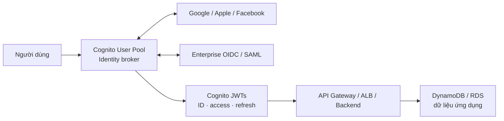
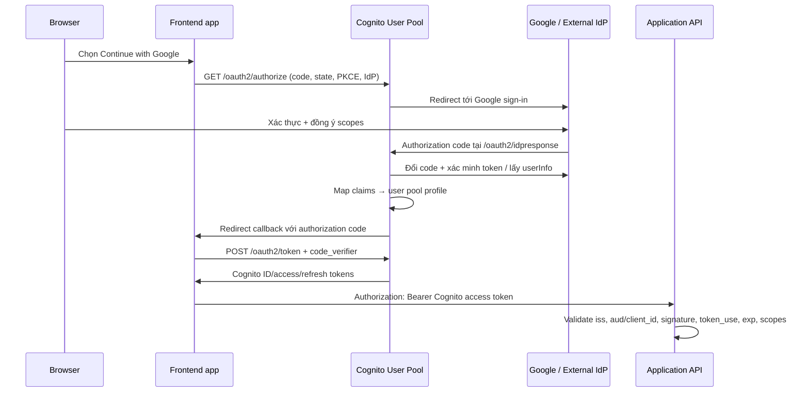
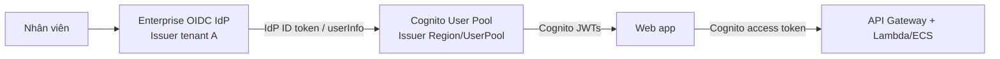
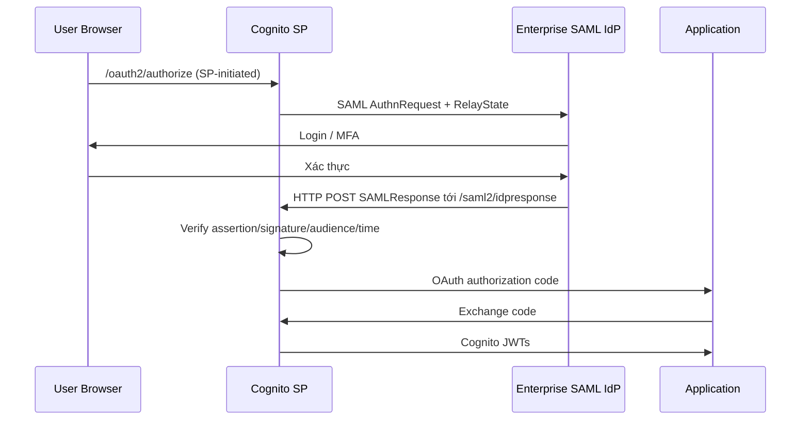
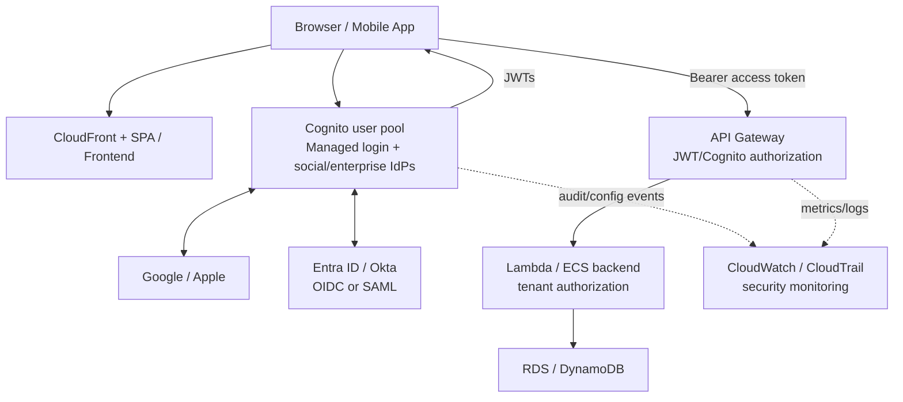
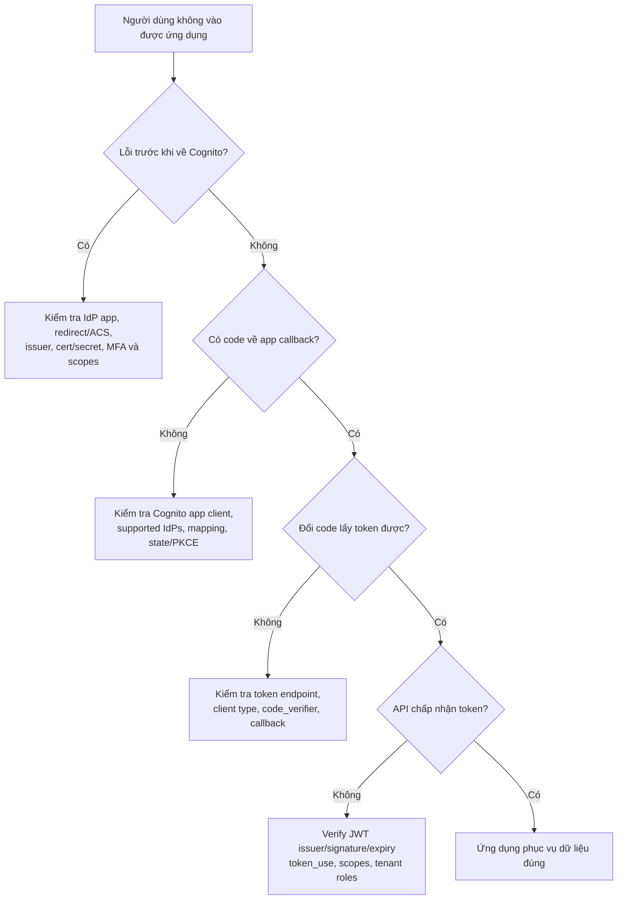

# Liên kết nhà cung cấp danh tính xã hội và doanh nghiệp với Amazon Cognito

> **Chương:** Danh tính ứng dụng với Cognito  
> **Module:** CLOUD_PROVIDERS_AWS  
> **Mục tiêu:** cấu hình và vận hành đăng nhập liên kết (*federated sign-in*) bằng tài khoản Google, Apple, Facebook, Amazon và các nhà cung cấp danh tính doanh nghiệp qua OpenID Connect (OIDC) hoặc SAML 2.0. Người học cần phân biệt Cognito user pools/identity pools, bảo vệ callback và token, ánh xạ claims, liên kết hồ sơ người dùng, phân quyền đa tenant và giám sát/kiểm soát chi phí.

## 1. Bài toán: một ứng dụng, nhiều cách đăng nhập

Một nền tảng thương mại điện tử triển khai tại AWS Region Singapore có hai nhóm người dùng:

- **Khách hàng B2C:** muốn đăng nhập với Google hoặc Apple để không cần tạo mật khẩu riêng.
- **Nhân viên/đối tác B2B:** đã có tài khoản trong Microsoft Entra ID, Okta hoặc Active Directory Federation Services (AD FS) và cần single sign-on (SSO) theo chính sách bảo mật của doanh nghiệp.
- **Một số người dùng:** có cả tài khoản email/mật khẩu cũ và tài khoản mạng xã hội; họ muốn giữ lịch sử đơn hàng sau khi đổi phương thức đăng nhập.
- **Ứng dụng:** frontend web/mobile, API Gateway + Lambda/ECS, dữ liệu đơn hàng trong DynamoDB/RDS, hệ thống logs và cảnh báo CloudWatch.

Nếu mỗi backend tự tích hợp với Google, Apple, Entra ID và SAML, hệ thống phải quản nhiều loại token, tiêu chuẩn xác thực, key rotation, session và schema claims. **Amazon Cognito user pool** có thể đóng vai trò **identity broker**: liên kết các nhà cung cấp bên ngoài, chuẩn hóa hồ sơ và cấp **một bộ JWT của user pool** cho ứng dụng.

Các mục tiêu cần đạt là:

1. Người dùng chọn nhà cung cấp danh tính quen thuộc rồi trở về ứng dụng an toàn.
2. Backend xác minh JWT **do đúng Cognito user pool phát hành**.
3. Quyền truy cập đơn hàng được kiểm tra theo **user ID/tenant**, không theo sự có mặt của email.
4. Khách hàng có thể liên kết nhiều danh tính mà không bị chiếm tài khoản.
5. Đội vận hành phát hiện được IdP hết hạn certificate, redirect sai, mapping thiếu hoặc token không hợp lệ.

**Điểm trọng tâm:** *federation giúp xác thực người dùng qua bên thứ ba; nó không tự chứng minh người đó được phép xem mọi dữ liệu của một tenant.*

## 2. Chọn đúng sản phẩm: user pool, identity pool và IAM Identity Center

AWS có nhiều dịch vụ đều nhắc tới identity federation, nhưng không có cùng mục tiêu.

| Dịch vụ | Vai trò chính | Đầu ra điển hình |
|---|---|---|
| **Amazon Cognito user pools** | Xác thực **người dùng ứng dụng**; hỗ trợ local sign-in, social IdP, OIDC IdP và SAML IdP | **ID token, access token, refresh token** do Cognito phát hành |
| **Amazon Cognito identity pools** | Đổi danh tính từ nhà cung cấp được cấu hình thành **AWS temporary credentials** qua IAM roles | Temporary AWS access key, secret và session token |
| **AWS IAM Identity Center** | Workforce SSO để nhân viên vào AWS accounts và ứng dụng công việc | Workforce access/SSO theo mô hình IAM Identity Center |
| **AWS IAM role + federation** | Cấp quyền đến AWS APIs cho workload/identity được tin cậy | AWS session credentials và IAM permissions |
| **Ứng dụng của bạn** | Quyền nghiệp vụ theo user, tenant, đơn hàng, nhóm và hành động | Cho phép/từ chối tài nguyên ứng dụng |

### 2.1. User pool liên kết IdP, không phải trực tiếp cấp IAM credentials



Ở đây **access token Cognito** giúp gọi API được bảo vệ. Nếu client còn cần truy cập trực tiếp Amazon S3/DynamoDB bằng AWS SDK với IAM permissions, có thể kết hợp **identity pool** để đổi token thành temporary credentials. Không nhầm hai bước.

### 2.2. Một user pool có thể làm hai vai trò

- Với **Google/Apple/Entra ID/AD FS**, Cognito user pool là **relying party (RP)** trong OIDC hoặc **service provider (SP)** trong SAML.
- Với **frontend/backend ứng dụng**, Cognito user pool là **identity provider/OAuth 2.0 authorization server**, phát hành JWT theo cấu hình app client.

Vì vậy có **hai mối quan hệ tin cậy** nối tiếp nhau: bên ngoài → Cognito và Cognito → ứng dụng. Backend không nhất thiết biết mỗi nhà cung cấp bên ngoài dùng token format gì.

## 3. Khái niệm nền tảng cần nắm

| Thuật ngữ | Ý nghĩa | Ví dụ |
|---|---|---|
| **Identity Provider (IdP)** | Hệ thống xác thực người dùng và phát thông tin danh tính | Google, Apple, Microsoft Entra ID |
| **Relying Party (RP)** | Ứng dụng dựa vào OIDC assertions/tokens của IdP | Cognito khi làm việc với OIDC IdP |
| **Service Provider (SP)** | Ứng dụng tiêu thụ SAML assertions | Cognito khi làm việc với SAML IdP |
| **Federation** | Liên kết xác thực giữa các hệ thống danh tính | User đăng nhập Entra ID để vào ứng dụng có Cognito |
| **SSO** | Người dùng tận dụng phiên đăng nhập ở IdP để vào ứng dụng khác | Nhân viên đã login Entra ID, vào ứng dụng B2B |
| **OIDC** | Lớp xác thực danh tính xây trên OAuth 2.0 | ID token, issuer, subject, userInfo |
| **SAML 2.0** | Chuẩn trao đổi XML assertions, phổ biến trong enterprise SSO | SAMLResponse, ACS URL, metadata, signing cert |
| **OAuth 2.0 authorization code** | Cơ chế nhận code rồi đổi lấy tokens | Frontend redirect → Cognito → token endpoint |
| **PKCE** | Bảo vệ authorization code cho public clients | `code_verifier` và `code_challenge` |
| **Claims / attributes** | Thông tin danh tính do IdP phát | `sub`, `email`, `email_verified`, `groups` |
| **App client** | Cấu hình một ứng dụng dùng user pool | Client ID, callback URL, allowed scopes/IdPs |
| **Managed login** | Giao diện và OAuth endpoints do Cognito host | Trang chọn Google/Apple/enterprise |
| **Account linking** | Gắn nhiều IdP identities với một user pool profile | Google + Entra ID → một người dùng ứng dụng |

Không dùng tên hiển thị hoặc email làm định danh duy nhất một cách tùy tiện. Với OIDC, cặp **(issuer, subject)** là một căn cứ định danh ổn định đáng xem xét; với Cognito backend thường dựa vào **`sub` của user pool** và bảng ánh xạ tenant.

## 4. Các loại nhà cung cấp danh tính Cognito hỗ trợ

### 4.1. Social identity providers

Cognito user pools hỗ trợ tích hợp sẵn:

1. **Google**.
2. **Sign in with Apple**.
3. **Facebook**.
4. **Login with Amazon**.

Các tích hợp social thường sử dụng OAuth 2.0/OIDC dựa trên cấu hình provider. Tài liệu AWS có hướng dẫn riêng cho từng provider vì **dashboard, client credentials, redirect và scopes khác nhau**.

### 4.2. Nhà cung cấp doanh nghiệp

Cognito user pools có thể dùng:

- **OIDC IdP tổng quát:** Microsoft Entra ID, Okta, Ping Identity hoặc hệ thống tuân thủ OIDC.
- **SAML 2.0 IdP:** Microsoft Entra ID, Okta, AD FS và các giải pháp SAML tương thích.

**Chọn giao thức theo khả năng của IdP và kiến trúc doanh nghiệp**, không suy rằng một tên hãng chỉ dùng OIDC hoặc chỉ dùng SAML. Chẳng hạn một nhà cung cấp có thể hỗ trợ cả hai.

### 4.3. Nên chọn social, OIDC hay SAML?

| Tiêu chí | Social tích hợp sẵn | Enterprise OIDC | Enterprise SAML 2.0 |
|---|---|---|---|
| Người dùng | Khách hàng B2C | Nhân viên/đối tác, cũng có thể B2C | Enterprise workforce/B2B |
| Thông tin cấu hình | App/client ID, secret hoặc Apple keys, scopes | Issuer, client ID/secret, discovery/endpoints, scopes | Metadata XML/URL, Entity ID, ACS, certificates |
| Dữ liệu danh tính | Social claims/profile | ID token + userInfo claims | SAML attributes/NameID |
| Callback đến Cognito | `/oauth2/idpresponse` | `/oauth2/idpresponse` | `/saml2/idpresponse` |
| Quản lý key/cert | Provider credentials/keys | Client secret và OIDC signing keys | X.509 metadata/signing certificates |
| Chú ý | Privacy/email relay, scopes | Issuer/audience/HTTPS, secret rotation | Assertion signature, clock skew, metadata/cert rotation |
| Phù hợp nhất | Đăng nhập nhanh cho khách hàng | OIDC SSO được IdP hỗ trợ | Enterprise SAML SSO hiện có |

Cả ba cuối cùng đều đi qua **Cognito user pool**, và client ứng dụng nhận **JWT Cognito** sau khi sign-in hoàn tất.

## 5. Chuỗi federation end-to-end: người dùng đi đâu?

Giả sử khách truy cập `https://app.example.com`, chọn **Continue with Google**.



**Có hai lượt authorization code độc lập về mặt vai trò**:

1. Provider ngoài trả authorization code **về Cognito**, thường tại `/oauth2/idpresponse`.
2. **Cognito** trả authorization code **về callback của ứng dụng** như `https://app.example.com/callback`.

Do đó đăng ký đúng **cả hai callback URLs** là điều kiện bắt buộc.

### 5.1. Ai giữ mật khẩu?

Khi người dùng đăng nhập social/enterprise:

- Mật khẩu, passkey hoặc MFA tương ứng được xử lý bởi **IdP bên ngoài**.
- Cognito nhận kết quả federation rồi lập/cập nhật profile theo mapping.
- Ứng dụng nhận **JWT Cognito**, không nên nhận raw IdP password.
- Client ứng dụng cũng không cần nhận SAML assertion hoặc access token gốc của Google/Entra ID chỉ để gọi backend ứng dụng.

Ứng dụng vẫn phải chịu trách nhiệm **authorization, session handling và bảo vệ tokens**.

## 6. Chuẩn bị user pool, app client và domain trước khi kết nối IdP

### 6.1. Các thành phần tối thiểu

| Thành phần | Cấu hình quan trọng |
|---|---|
| **User pool** | Region, user attributes bắt buộc, MFA/threat protection/feature plan phù hợp |
| **User pool domain** | Prefix domain Cognito hoặc custom domain HTTPS |
| **App client** | Client ID; public/confidential client; OAuth 2.0 grants; scopes; callback/logout URLs |
| **Managed login / hosted UI** | Trang chọn IdP hoặc redirect trực tiếp từ giao diện tự xây |
| **External IdP app** | Client ID/secret hoặc SAML metadata, allowed redirect URL/ACS |
| **Identity provider in Cognito** | Provider name/type, credentials/metadata, attribute mapping |
| **App client identity providers** | Bật provider cho đúng app client đang sử dụng |
| **Backend authorization** | JWT validation, app scopes, tenant/resource permissions |
| **Logging/monitoring** | CloudTrail, Cognito sign-in telemetry/logging phù hợp, API metrics, alarm |

### 6.2. Managed login và classic hosted UI

AWS hiện có **managed login** với giao diện tùy chỉnh nhiều hơn và **classic hosted UI** đời trước.

- **Managed login** là lựa chọn giao diện được phát triển hiện nay.
- **Classic hosted UI** vẫn có phạm vi sử dụng, ví dụ một số **Lite feature plan**.
- User pool domain và app client branding/login settings phải được cấu hình phù hợp với feature plan.
- Không đồng thời giả định một domain sử dụng cả managed login và classic hosted UI cho cùng một luồng theo cách tùy ý.

**Federation không bắt buộc người dùng nhìn trang do AWS thiết kế:** ứng dụng có thể tự tạo nút login, nhưng vẫn phải **redirect browser qua authorization endpoint của Cognito** để thực hiện social/OIDC/SAML federation đúng giao thức.

### 6.3. Public client và confidential client

| Loại ứng dụng | Lưu được client secret an toàn? | Cách phổ biến |
|---|---|---|
| SPA trong trình duyệt | **Không** | OAuth authorization code + **PKCE** |
| Native mobile app | **Không** | Authorization code + PKCE qua browser/system auth session |
| Server-rendered web/BFF | Có thể, trong server secret store | Code grant, client secret nếu phù hợp, session cookie |
| Backend machine-to-machine | Có thể | Client credentials hoặc cơ chế service identity khác, không phải user social sign-in |

**Không đặt app client secret trong JavaScript bundle/mobile binary** rồi cho rằng nó vẫn bí mật. Với public client, ưu tiên authorization code + PKCE và lưu tokens đúng cách.

### 6.4. Callback URLs và HTTPS

Cấu hình callback rõ ràng:

```text
Application callback:
https://app.example.com/auth/callback

Cognito domain:
https://auth.example.com

External OIDC/social IdP return URL:
https://auth.example.com/oauth2/idpresponse

External SAML IdP ACS URL:
https://auth.example.com/saml2/idpresponse
```

Ở môi trường local development, các ngoại lệ `http://localhost` chỉ dùng theo điều kiện AWS/IdP hỗ trợ. Production phải dùng HTTPS và **exact allowlist** callback/logout URLs, tránh wildcard/open redirect không kiểm soát.

## 7. Liên kết Google: ví dụ social sign-in có kiểm soát

### 7.1. Bước 1 — Đăng ký OAuth application tại Google

Tại **Google Auth Platform**:

1. Tạo/chọn project của tổ chức.
2. Cấu hình brand/consent screen, audience, privacy information và scopes.
3. Tạo OAuth client phù hợp với web app.
4. Thêm **Authorized redirect URI** là **Cognito domain `/oauth2/idpresponse`**, ví dụ:

```text
https://auth.example.com/oauth2/idpresponse
```

5. Lưu **Google client ID** và **Google client secret** ở kho bí mật phù hợp.

**Đừng nhập callback của ứng dụng `/auth/callback` vào Google thay cho callback Cognito.** Ứng dụng của bạn là client đối với Cognito; **Cognito là OAuth client của Google**.

### 7.2. Bước 2 — Thêm Google IdP vào Cognito

Trong **Cognito → User pools → chọn pool → Social and external providers → Add identity provider → Google**:

- Nhập Google client ID/secret.
- Chọn authorized scopes phù hợp, thường `openid profile email`.
- Map những thuộc tính cần dùng, ví dụ `email → email`, `email_verified → email_verified`, `name → name`.
- Lưu provider, sau đó **bật Google trên đúng app client**.

Nếu user pool yêu cầu `email` nhưng provider không trả claim đó hoặc chưa có mapping, sign-in có thể thất bại.

### 7.3. Bước 3 — Test

Mở managed login của app client và chọn Google. Sau khi xác thực thành công:

- Browser trở lại callback của **ứng dụng** với code.
- Client đổi code lấy JWT **do Cognito phát hành**.
- User pool có thể chứa profile federated với username bắt đầu bằng provider name.
- Backend xác minh token và tenant, không coi `email` từ Google là quyền truy cập mọi tài khoản có cùng email.

**Cảnh báo:** `email_verified` phải được map đúng và kiểm tra ngữ nghĩa của IdP. Một email claim không tự chứng minh đã được xác minh.

## 8. Sign in with Apple: privacy và những lưu ý đặc biệt

### 8.1. Những giá trị cấu hình từ Apple

Theo tài liệu AWS hiện hành, Apple integration yêu cầu những thành phần như:

- **App ID** đã bật Sign in with Apple.
- **Services ID** cho web integration.
- **Team ID** của Apple Developer organization.
- **Key ID** và **private key (.p8)** do Apple cấp.

Cấu hình domain/return URL của Apple phải trỏ về Cognito `/oauth2/idpresponse`, không phải tùy tiện sang URL khác.

Trong Cognito, nhập Services ID/Team ID/Key ID/private key theo form nhà cung cấp, rồi chọn scopes như `email name` khi cần.

### 8.2. Vì sao không dùng email làm khóa duy nhất?

Apple cho phép người dùng **Hide My Email**. Khi đó IdP có thể trả địa chỉ dạng:

```text
random-alias@privaterelay.appleid.com
```

Địa chỉ này không giống email thật mà người đó dùng với Google hoặc Entra ID. Một user hoàn toàn có thể dùng cùng tài khoản Apple nhưng có relay address riêng. Vì vậy:

- **Không tự động liên kết Apple với Google chỉ vì email “có vẻ giống nhau”**.
- Ưu tiên định danh provider-specific **`sub`** ổn định và quy trình chứng minh người dùng sở hữu **cả hai identities**.
- Nếu gửi email đến relay address, cần cấu hình sender domains/addresses theo yêu cầu của Apple.
- Apple có thể chỉ trả **name ở lần sign-in đầu tiên**; phải xử lý trường hợp thiếu name ở những lần sau.
- `email_verified` có thể có kiểu dữ liệu/giá trị khác nhau; đừng tin một chuỗi chưa chuẩn hóa.

### 8.3. Bảo vệ Apple key

Apple private key là thông tin nhạy cảm, cần:

1. Cất trong secret store có kiểm soát.
2. Không ghi trực tiếp vào Git, CloudWatch logs, ticket hoặc CLI history.
3. Biết người sở hữu quyền quản lý Apple Developer account.
4. Có lịch rotation và test sign-in sau khi thay key.
5. Ghi nhận ngày hết hạn/thu hồi credentials phụ thuộc.

**Đừng dùng ví dụ private key thật trong tài liệu học.**

## 9. Facebook và Login with Amazon

### 9.1. Facebook

Với Facebook Login:

- Tạo app trong Facebook for Developers.
- Lấy App ID và App Secret.
- Cấu hình redirect URI là Cognito `/oauth2/idpresponse`.
- Chọn phiên bản Facebook API đang được hỗ trợ và scopes phù hợp, ví dụ `public_profile, email`.
- Map những claims thực sự được Facebook trả về.
- Bật Facebook cho đúng Cognito app client.

**Scopes Facebook thường được nhập phân tách bằng dấu phẩy**, khác cách nhập scopes Google/OIDC thường phân tách bằng dấu cách.

### 9.2. Login with Amazon

Với Login with Amazon:

- Tạo **security profile** tại Amazon Developer portal (khác AWS Management Console).
- Lấy Client ID/Secret.
- Cấu hình allowed origins và return URL tới Cognito.
- Chọn scopes tối thiểu, ví dụ `profile`.
- Map các attributes thực tế như `email`, `name` và provider-specific ID.

**Điểm cần kiểm tra:** Login with Amazon không nhất thiết cung cấp `email_verified` giống Google. AWS lưu ý mapped email có thể mặc định được coi là **unverified**. Không tự gán verified=true để việc account linking dễ hơn nếu không có tiêu chí tin cậy và quy trình phù hợp.

### 9.3. Mỗi social provider có lifecycle riêng

Provider có thể đổi:

- Developer console/menu.
- OAuth scopes và consent requirements.
- API version.
- Client secret/key rotation.
- Chính sách bảo vệ dữ liệu và điều kiện sử dụng.

Do đó, sau khi triển khai, cần **chủ sở hữu vận hành cho từng IdP** và test sign-in định kỳ. “Đăng nhập Google chạy hôm nay” không bảo đảm chạy mãi sau khi secret hết hạn hoặc consent app bị khóa.

## 10. Enterprise OIDC: liên kết Entra ID, Okta hoặc Ping Identity

### 10.1. Vì sao doanh nghiệp chọn OIDC?

OIDC xây trên OAuth 2.0 và phù hợp với web/mobile applications:

- IdP cấp ID token chứa claims về người dùng.
- Có **issuer, authorization endpoint, token endpoint, userInfo endpoint và JWKS**.
- Cognito tiêu thụ kết quả từ IdP rồi **phát hành JWT riêng của user pool**.
- Ứng dụng backend chỉ cần validate Cognito JWTs, tránh tích hợp nhiều token issuers trực tiếp.

**Ví dụ:** đội CNTT công ty đối tác quản lý nhân viên trong Entra ID; user đăng nhập Entra ID, Cognito tạo/cập nhật profile và trả token cho `partner-portal`.

### 10.2. Điều kiện OIDC provider cần đáp ứng

Tài liệu Cognito hiện hành có các yêu cầu đáng chú ý đối với OIDC IdP, chẳng hạn:

- IdP có **client ID và client secret** đăng ký cho Cognito.
- Hỗ trợ client authentication method **`client_secret_post`** ở token endpoint; Cognito **không hỗ trợ `client_secret_basic`** làm cơ chế thay thế.
- Expose HTTPS endpoints cho OIDC discovery/userInfo/JWKS/token.
- Endpoint đáp ứng các yêu cầu TLS, port và certificate trust được AWS hỗ trợ.
- ID token có `iss`, `aud`, `exp`, `sub` và thông tin ký phù hợp, có `kid` và JWKS keys khi dùng thuật toán bất đối xứng.
- Có discovery document hợp lệ, hoặc cung cấp endpoints thủ công.
- API provider trả về claims cần thiết (ví dụ email) theo requested scopes.

**Tình huống lỗi:** hệ thống IdP nội bộ chỉ cho phép client_secret_basic, không có client_secret_post. Bạn không thể chỉ đổi tên field trong Cognito để tự tạo hỗ trợ; cần IdP tương thích hoặc chọn giải pháp federation phù hợp như SAML.

### 10.3. Cấu hình ở doanh nghiệp IdP trước

Tại Entra ID/Okta/Ping hoặc IdP khác:

1. Đăng ký application (Cognito là relying party/OIDC client của IdP).
2. Chọn redirect URI:

```text
https://auth.example.com/oauth2/idpresponse
```

3. Ghi nhận **issuer URL**, client ID/secret và discovery URL.
4. Cấp những scopes cần thiết, thường `openid profile email`.
5. Cấu hình user/group assignment ở IdP và MFA/Conditional Access theo chính sách doanh nghiệp.
6. Cho phép Cognito truy cập endpoints và JWKS công khai qua HTTPS theo yêu cầu.

**Không truyền client secret từ IdP sang frontend.** Secret thuộc quan hệ **Cognito ↔ enterprise IdP**, cần được quản lý bởi người vận hành có quyền.

### 10.4. Cấu hình OIDC ở Cognito

Tại **User pools → Social and external providers → Add identity provider → OpenID Connect**:

- Đặt **Provider name** rõ ràng, ví dụ `EntraPartnerA`.
- Điền client ID/secret.
- Chọn issuer/discovery hoặc cung cấp endpoints thủ công theo yêu cầu.
- Chọn scopes.
- Map claims như `sub`, `email`, `email_verified`, `given_name`, `family_name` theo thực tế.
- Thêm IdP vào app client.
- Test authorization code flow, userInfo claims và token validation.

Một provider name thay đổi có thể ảnh hưởng `identity_provider` trong login URL hoặc mapping/linked identities. Không rename IdP trong production mà không kiểm tra ảnh hưởng.

### 10.5. OIDC token từ IdP không đồng nhất với token Cognito



Backend **không nên lấy JWT do Entra ID phát hành rồi xác minh bằng Cognito JWKS**: issuer/key/audience khác nhau. Nếu kiến trúc đã dùng Cognito làm broker, hãy định nghĩa một **trust boundary nhất quán**: backend nhận Cognito access token.

## 11. Enterprise SAML 2.0: khi công ty đã có SSO truyền thống

### 11.1. Những thuật ngữ SAML tối thiểu

| Thành phần | Ý nghĩa |
|---|---|
| **SAML IdP** | Entra ID, Okta, AD FS hoặc hệ thống SAML xác thực user |
| **SAML SP** | Cognito user pool khi nhận assertions từ IdP |
| **Metadata XML** | Thông tin Entity ID, SSO URLs và signing certificates |
| **Entity ID / Audience** | Định danh SP mà assertion hướng tới |
| **ACS URL** | Assertion Consumer Service nhận SAMLResponse |
| **NameID** | Định danh user trong SAML assertion |
| **Attributes** | Email, tên, department, roles/groups tùy IdP |
| **Signature** | Chứng minh assertion/response đến từ IdP tin cậy |
| **RelayState** | Thông tin liên kết sign-in request và điểm chuyển hướng |
| **Single Logout (SLO)** | Cơ chế phối hợp logout khi IdP/Cognito hỗ trợ và cấu hình |

Với Cognito user pool ID `ap-southeast-1_Example123`, giá trị Entity ID thường có dạng:

```text
urn:amazon:cognito:sp:ap-southeast-1_Example123
```

ACS URL có dạng:

```text
https://auth.example.com/saml2/idpresponse
```

Hai giá trị này phải được cấu hình chính xác trên **enterprise SAML IdP**.

### 11.2. Cấu hình IdP SAML ở Cognito

1. Tạo/chọn Cognito user pool và app client có domain.
2. Tại **Social and external providers**, thêm một **SAML 2.0 identity provider**.
3. Chọn **metadata URL** công khai hoặc tải lên metadata XML được IdP cấp.
4. Xác định có cho phép IdP-initiated sign-in không; **ưu tiên SP-initiated** nếu không có yêu cầu đặc biệt.
5. Xem xét **request signing, encrypted responses, sign-out flow** theo khả năng IdP và tiêu chuẩn bảo mật.
6. Map SAML attributes vào user pool attributes; lưu ý claim name đôi khi là URI dài.
7. Bật IdP trong đúng app client.
8. Kiểm thử login/logout, metadata/cert rotation và error paths.

AWS khuyến nghị **metadata URL** khi IdP có endpoint tin cậy để Cognito tự refresh metadata/certificate theo chu kỳ. Nếu upload static XML, đội vận hành phải chủ động cập nhật khi IdP rotate certificates.

### 11.3. SP-initiated vs IdP-initiated



**SP-initiated** (được khuyến nghị): request khởi đầu từ Cognito, giúp có state/RelayState để đối chiếu yêu cầu và giảm rủi ro login CSRF.

**IdP-initiated**: user bắt đầu từ dashboard của doanh nghiệp, IdP gửi **unsolicited SAML assertion** tới Cognito. Luồng này có các rủi ro bổ sung (CSRF/request spoofing) và hạn chế app client/provider combination; chỉ bật khi có yêu cầu nghiệp vụ đã đánh giá.

### 11.4. SAML metadata và certificate rotation

Nếu SAML IdP thay signing certificate:

- Cognito phải biết certificate mới qua metadata URL hoặc metadata XML đã upload.
- Certificate cũ/mới có thể cần giai đoạn overlap theo khả năng IdP.
- Cần kiểm tra expiration, signing algorithm, audience, ACS, clock skew.
- Không chặn việc cập nhật certificate chỉ vì một môi trường staging đang hoạt động.
- Kiểm tra SAML logout certificate/signing settings nếu dùng SLO.

**Sai lầm nghiêm trọng:** certificate hết hạn hoặc metadata cũ khiến toàn bộ workforce SSO ngừng hoạt động, dù EC2/ALB/API Gateway vẫn khỏe.

## 12. So sánh OIDC với SAML trong doanh nghiệp

| Câu hỏi | OIDC | SAML 2.0 |
|---|---|---|
| Artifact danh tính | JSON Web Token và userInfo | XML assertion |
| Metadata | `.well-known/openid-configuration`, JWKS | SAML XML metadata |
| Callback tới Cognito | `/oauth2/idpresponse` | `/saml2/idpresponse` |
| Identity key | `iss + sub`, trong trust model | NameID/issuer và attributes được xác minh |
| Client credentials | Client ID/secret giữa Cognito và IdP | Metadata, entity ID, signing/encryption certificates |
| Ưu thế thường gặp | App tích hợp hiện đại, OAuth/OIDC ecosystem | Enterprise SSO cũ, AD FS/IdP dashboard |
| Rủi ro đặc trưng | Sai issuer/audience/secret/discovery/scopes | Sai Entity ID, ACS, RelayState, cert/clock skew |
| Quyền nghiệp vụ | Vẫn do application quyết định | Vẫn do application quyết định |

Một doanh nghiệp hỗ trợ **cả OIDC và SAML** có thể lựa chọn OIDC để tận dụng token-based APIs, hoặc SAML nếu đã có hệ sinh thái SSO enterprise ổn định. Không cần tích hợp cả hai chỉ để “có nhiều chuẩn hơn”.

## 13. Authorization code + PKCE: bảo vệ callback đăng nhập

### 13.1. Tại sao không khuyến nghị implicit flow?

**Authorization code grant + PKCE** là lựa chọn chủ đạo cho browser/mobile public clients:

1. Client tạo `code_verifier` ngẫu nhiên độ dài phù hợp.
2. Tính `code_challenge = BASE64URL(SHA256(code_verifier))` theo phương thức S256.
3. Redirect browser đến Cognito authorize endpoint, kèm state/nonce khi phù hợp.
4. Cognito/IdP thực hiện sign-in và trả authorization code về callback đã allowlist.
5. Client kiểm tra `state`, rồi dùng `code_verifier` để đổi code tại token endpoint.
6. Nhận Cognito JWTs, thiết lập session app.

Implicit grant đưa tokens trực tiếp qua browser fragment và có trade-off bảo mật; không chọn chỉ vì URL ngắn hơn.

### 13.2. Ví dụ URL authorize (minh họa)

```text
https://auth.example.com/oauth2/authorize
  ?response_type=code
  &client_id=PUBLIC_APP_CLIENT_ID
  &redirect_uri=https%3A%2F%2Fapp.example.com%2Fauth%2Fcallback
  &scope=openid%20email%20profile
  &state=RANDOM_CSRF_STATE
  &nonce=RANDOM_NONCE
  &code_challenge=BASE64URL_SHA256_VERIFIER
  &code_challenge_method=S256
  &identity_provider=Google
```

Trong triển khai thật, URL phải là **một chuỗi hợp lệ, đã URL-encode chính xác**. Các giá trị `RANDOM_*` phải được tạo an toàn ở runtime và quản lý theo một login transaction; không copy chuỗi cố định từ bài học.

### 13.3. Chuyển trực tiếp tới IdP doanh nghiệp

Nếu muốn bỏ bước chọn nhà cung cấp ở Cognito managed login, authorize endpoint hỗ trợ:

- `identity_provider=EntraPartnerA`: chọn đúng **Provider name** đã tạo.
- `idp_identifier=partner-a.example.com`: với SAML provider có identifiers/domain routing được cấu hình.

**Không lấy tên miền email người dùng làm bằng chứng quyền tenant.** IdP discovery/routing chỉ chọn *nơi đăng nhập*, còn backend vẫn phải kiểm tra tenant của user đã được xác thực.

### 13.4. Callback của app khác callback của IdP

| Luồng | Callback/return URL | Đăng ký ở đâu |
|---|---|---|
| Google/Apple/Facebook/Amazon → Cognito | `https://auth.example.com/oauth2/idpresponse` | Developer console của social IdP |
| Enterprise OIDC → Cognito | `https://auth.example.com/oauth2/idpresponse` | Enterprise IdP client registration |
| Enterprise SAML → Cognito | `https://auth.example.com/saml2/idpresponse` | Enterprise SAML SP/enterprise app settings |
| **Cognito → ứng dụng** | `https://app.example.com/auth/callback` | **Cognito app client callback URLs** |

**Vấn đề redirect mismatch** rất thường do người quản trị nhập callback của ứng dụng vào IdP ngoài hoặc ngược lại.

## 14. Attribute mapping: biến external claims thành hồ sơ user pool

### 14.1. Mapped attributes là gì?

Khi nhận thông tin từ IdP, Cognito ánh xạ claims vào user pool user attributes.

| External provider claim | User pool attribute | Cần lưu ý |
|---|---|---|
| `email` | `email` | Có thể thiếu hoặc không verified |
| `email_verified` | `email_verified` | Chỉ map khi provider thực sự cấp claim đáng tin |
| `given_name` | `given_name` | Không phải mã định danh user |
| `family_name` | `family_name` | Có thể thay đổi theo thời gian |
| `name` | `name` | Display name, không phải access-control key |
| `sub` hoặc persistent ID | User provider identity | Cần giữ ổn định theo issuer/provider |
| `groups`/`department` | Custom attributes hoặc cơ chế auth mapping | Cần xác thực nguồn, kích thước, tính cập nhật |
| SAML email URI | `email` | Tên claim có thể là URI, không chỉ `email` |

**Mỗi login có thể cập nhật mapped attributes** trong user pool profile. Đây là cơ chế đồng bộ theo đăng nhập, **không phải đồng bộ danh sách người dùng liên tục như SCIM provisioning**.

### 14.2. Required attributes

Nếu user pool đánh dấu `email` là required, nhưng OIDC provider không gửi `email` hoặc không có attribute mapping:

- Cognito có thể từ chối sign-in.
- Cần yêu cầu đúng scopes như `openid email`.
- Cần kiểm tra ID token và userInfo endpoint của IdP.
- Cần map `email` đúng claim trong Cognito.
- Không “sửa” bằng cách bịa một email hay tự động gán user ID không có xác minh.

Với SAML, required attribute cũng phải xuất hiện và được map theo đúng attribute statement.

### 14.3. Mutability và app client writable attributes

Cognito có các điều kiện với mapped attributes:

- Attribute được map phải **writable** đối với app client phù hợp.
- Custom attribute được map cần **mutable** nếu phải cập nhật khi sign-in.
- Nếu ánh xạ tới immutable attribute đã được set, lần sign-in sau có thể thất bại khi Cognito cố cập nhật.
- Độ dài/type của target attribute phải đáp ứng limits của user pool.
- Nếu IdP không trả một claim ở lần sign-in tiếp theo, Cognito **không mặc định xóa giá trị cũ** của mapped attribute.

**Sai lầm:** map IdP `groups` hoặc email vào một immutable custom attribute, test sign-in lần đầu thành công nhưng người dùng đăng nhập tiếp theo bị lỗi.

### 14.4. Quyền ứng dụng không chỉ nằm ở mapped groups

Không dùng trực tiếp một string `department=finance` để cho phép xem toàn bộ hồ sơ tài chính. Nên xác định:

1. **Authority:** tổ chức nào được quyền phát claim?
2. **Tenant:** user thuộc doanh nghiệp nào, theo identity mapping nào?
3. **Permissions:** claim nào được tin để cấp vai trò nào?
4. **Freshness:** nhóm/role bị thu hồi ở IdP khi nào có hiệu lực trong app?
5. **Token validity:** JWT hiện tại vẫn có thể còn hiệu lực dù quyền đã thay đổi.

Khi cần, dùng **pre token generation Lambda trigger** hoặc authorization service để bổ sung/chuẩn hóa claims sau khi đã kiểm tra nguồn. Không tự coi mapped claims là IAM permissions.

## 15. Hồ sơ federated và account linking: phần dễ gây chiếm tài khoản nhất

### 15.1. Khi user đăng nhập lần đầu

Thông thường, nếu Cognito chưa tìm thấy liên kết phù hợp, nó tạo **một federated user profile mới** trong user pool. Username có thể có dạng gắn với provider, ví dụ:

```text
Google_<provider-user-id>
EntraPartnerA_<provider-user-id>
SignInWithApple_<provider-user-id>
```

**Không hard-code parsing dựa trên format username** như một hợp đồng định danh vĩnh viễn. Dùng `sub` của Cognito profile và metadata identity được API hỗ trợ.

### 15.2. Vì sao người dùng có thể bị tạo hai tài khoản?

Một khách có tài khoản native `alice@example.com`, sau đó dùng Google với cùng email. Cognito **không tự động bảo đảm hai identities được ghép thành một hồ sơ**.

Nếu không có account linking:

- User native A có đơn hàng cũ.
- Federated profile B được tạo khi Google sign-in.
- Backend thấy Cognito `sub` của B khác A.
- Người dùng tưởng lịch sử đơn hàng bị mất hoặc hệ thống có tài khoản mới.

**Không xử lý bằng cách đổi mọi API query sang `WHERE email = ...`.** Điều này mở rủi ro tenant mix-up và account takeover.

### 15.3. AdminLinkProviderForUser

Amazon Cognito cung cấp **`AdminLinkProviderForUser`** để liên kết một identity bên ngoài với profile đang có, khi bạn có đủ căn cứ tin cậy.

Các khái niệm:

- **DestinationUser:** user pool profile sẽ được sử dụng làm hồ sơ chính.
- **SourceUser:** provider name + provider subject/attribute được liên kết.
- Một profile có thể liên kết **tối đa năm federated identities** theo giới hạn AWS hiện hành.
- Social providers dùng `ProviderAttributeName=Cognito_Subject` và stable provider user ID.
- SAML/OIDC có thể có các thuộc tính liên kết khác theo API hỗ trợ, nhưng cần chọn claim đáng tin cậy.

**Đây là API quản trị bảo mật cao:** nếu link user của kẻ tấn công vào profile người khác, kẻ tấn công có thể đăng nhập để nhận quyền của profile nạn nhân.

### 15.4. Quy trình account linking an toàn

Không tự link chỉ vì email strings bằng nhau. Một quy trình tốt:

1. User **đăng nhập vào profile đích** đang sở hữu đơn hàng.
2. User chủ động chọn “Link Google/Apple/Enterprise account”.
3. User được redirect để **xác thực thành công với source IdP**.
4. Backend kiểm tra state, nonce, token issuer, stable subject và phiên đăng nhập profile đích.
5. Áp dụng chính sách tenant/organization, kiểm tra nguy cơ liên kết cross-tenant.
6. Một backend được cấp quyền quản trị giới hạn thực hiện `AdminLinkProviderForUser`.
7. Ghi audit event, thông báo user và hỗ trợ revoke/unlink.
8. Khi user sign-in qua source IdP về sau, Cognito nhận ra profile đã link.

Nếu federated profile đã tự được tạo trước đó, việc chuyển/liên kết cần **runbook migration** dựa trên tài liệu AWS; không xóa user sản xuất khi chưa kiểm tra dữ liệu liên kết và backup.

### 15.5. Cẩn trọng với email_verified

- Google có `email_verified` claim có thể map.
- Login with Amazon có thể không có claim tương đương.
- Apple có **private relay email**, gây khác email với provider khác.
- Enterprise OIDC/SAML có thể cung cấp email từ directory nhưng **mức độ tin cậy phụ thuộc cấu hình tenant/IdP**.
- **Email có thể được thay đổi hoặc tái cấp**, nên không phải định danh kỹ thuật lý tưởng cho account linking.

**Quy tắc:** identity linking phải dựa vào **proof of control** và provider subject/issuer được tin, không chỉ match email hoặc tên hiển thị.

## 16. Token sau federation: backend nên kiểm tra gì?

### 16.1. ID token, access token và refresh token

| Token | Mục tiêu | Nơi sử dụng |
|---|---|---|
| **ID token** | Claims về việc người dùng đăng nhập và identity/profile | Client ứng dụng |
| **Access token** | Quyền/scope cho API phù hợp | API Gateway/backend |
| **Refresh token** | Lấy access/ID tokens mới theo app client policy | Client/BFF theo cơ chế bảo vệ |

**Không dùng ID token thay access token cho API authorization** chỉ vì nó có email/name. Backend cần kiểm tra token phù hợp với mục đích.

### 16.2. Verify JWT tại backend

API Gateway Cognito authorizer/JWT authorizer hoặc backend JWT verifier cần kiểm tra tối thiểu:

1. **Signature** với public keys tại **JWKS** của đúng Cognito user pool.
2. **`iss` (issuer)** đúng user pool/Region đã được tin.
3. **`token_use`** tương ứng `access` cho API access.
4. **`client_id`** ở access token hoặc **`aud`** ở ID token phù hợp app client policy.
5. **`exp`, `nbf`, `iat`** khi áp dụng và chính sách clock skew.
6. **Scopes** và permissions cần cho endpoint.
7. **Tenant/resource ownership** trong backend — không chỉ chữ ký JWT.
8. Chính sách **revocation/logout/token lifetime** phù hợp rủi ro ứng dụng.

Cognito JWKS có dạng:

```text
https://cognito-idp.ap-southeast-1.amazonaws.com/ap-southeast-1_EXAMPLE/.well-known/jwks.json
```

**Đừng giải mã JWT bằng base64 rồi coi như “đã validate”.** Decode chỉ cho thấy nội dung; cần verify chữ ký, issuer/audience và thời hạn theo thư viện đã kiểm thử.

### 16.3. Scopes và groups

Ví dụ custom resource server scopes:

```text
inventory-api/read
inventory-api/write
orders-api/read
orders-api/write
```

Một API có thể yêu cầu `orders-api/read`; backend còn kiểm tra user chỉ được đọc đơn hàng của tenant tương ứng.

**Group membership Cognito/IdP không tự đồng nghĩa IAM role**; mapping từ group sang app permissions phải được thiết kế rõ. Khi group của user bị thu hồi ở IdP, JWT đã phát trước đó có thể còn hiệu lực tới khi hết hạn/trở thành vô hiệu theo cơ chế phù hợp.

## 17. Định tuyến người dùng tới đúng IdP trong B2B multi-tenant

### 17.1. Nhiều doanh nghiệp, nhiều IdPs

Giả sử ứng dụng có:

| Tenant | Địa chỉ email thường gặp | Nhà cung cấp | Phương án |
|---|---|---|---|
| **Company A** | `@company-a.example` | Entra ID (OIDC) | Provider `EntraA` |
| **Company B** | `@company-b.example` | Okta (SAML) | Provider `OktaB` |
| **Consumer** | Nhiều domain | Google/Apple | Social providers |
| **Admin nội bộ** | `@operator.example` | SAML/OIDC doanh nghiệp | IdP riêng + MFA |

Có thể dùng:

- Nút **“Continue with Company A”** chuyển trực tiếp bằng `identity_provider=EntraA`.
- **SAML IdP identifiers** và `idp_identifier=company-b.example` để hỗ trợ domain-based routing.
- Trang chọn tenant theo domain URL/path đã đăng ký, rồi tìm provider tương ứng.
- Managed login để người dùng chọn provider khi quy mô nhỏ.

### 17.2. Tenant routing không phải tenant authorization

Giả sử người dùng tự nhập email `ceo@company-a.example` để app chuyển đến EntraA. Chỉ thao tác nhập email **không chứng minh quyền**. Phải đợi IdP xác thực và Cognito phát token, sau đó backend kiểm tra:

- Trusted issuer/provider và stable subject.
- Organization/tenant membership đã được xác minh.
- User có quyền với tenant ID trong request không.
- Tài khoản có bị suspended/deprovisioned không.
- Token và claims còn hiệu lực theo yêu cầu.

**Không xây authorization kiểu “email kết thúc bằng @company-a.example → quyền admin của Company A”.**

### 17.3. Khi nào nên tách user pools?

Một user pool có thể chứa nhiều IdPs, nhưng đôi khi nên tách theo:

- Compliance/data residency hoặc tách phạm vi người dùng B2C/B2B.
- Yêu cầu MFA/password/recovery khác nhau.
- Khả năng cách ly incident/tenant và blast radius.
- Quy mô, quotas/IdP count, feature plan, billing.
- Mức độ cần phân quyền quản trị giữa các đối tác.

Đổi lại, nhiều user pools tạo thêm công việc về client config, token issuer, user migration, API authorizers và vận hành. Chọn ranh giới theo yêu cầu bảo mật và sản phẩm chứ không mặc định một pool/tenant.

## 18. SSO, logout và session lifecycle

### 18.1. Ba lớp phiên đăng nhập

Một người dùng federated có thể cùng lúc có:

1. **Phiên của external IdP** (Google/Entra ID/Okta).
2. **Phiên managed login của Cognito** trong browser.
3. **Session/token của ứng dụng** (ID/access/refresh tokens hoặc server cookie).

Khi user chọn Logout trong ứng dụng, phải quyết định muốn chấm dứt lớp nào.

### 18.2. Cognito logout không đồng nghĩa logout Google/Entra ID

- Cognito `/logout` có thể xóa managed login browser session và chuyển hướng theo cấu hình.
- Ứng dụng phải xóa/revoke tokens hoặc session cookie theo thiết kế.
- **External IdP có thể vẫn giữ SSO session**. Nếu user bấm login lại, họ có thể được xác thực “im lặng” ở IdP.
- Với SAML, Cognito có thể tích hợp **Single Logout** khi cấu hình IdP/support phù hợp, nhưng không nên suy mọi IdP đều thực hiện logout toàn cục.
- Với social/OIDC, ứng dụng cần hiểu provider-specific sign-out và chính sách người dùng.

**Logout không phải chỉ xóa một localStorage key** rồi đảm bảo mọi access token đang lưu ở thiết bị khác đều bị vô hiệu ngay lập tức.

### 18.3. Refresh tokens và IdP session

Cognito có thể phát refresh token sau authorization code flow. Client dùng refresh token để lấy JWT mới theo thời hạn/cơ chế app client đã chọn.

Một số điểm cần chú ý:

- Refresh token lifetime có thể khác access token lifetime.
- Cognito refresh **không mặc định đồng bộ tức thì** trạng thái user đã bị xóa khỏi enterprise directory.
- Khi IdP session hết nhưng Cognito refresh token vẫn còn hợp lệ, ứng dụng cần chính sách session phù hợp yêu cầu workforce/compliance.
- Có thể bật **refresh token rotation**, quản lý token storage và revocation.
- Với yêu cầu truy cập nhạy cảm, cân nhắc re-authentication/step-up authentication theo khả năng IdP/Cognito đang có trong Region/tier.

**Deprovisioning** là một quy trình vận hành độc lập: xóa user ở IdP không có nghĩa mọi access token Cognito đã cấp trước đó biến mất ngay.

## 19. Bảo mật federation: những rủi ro phải kiểm soát

### 19.1. OAuth/OIDC security

- Dùng **authorization code + PKCE** cho public clients.
- Dùng `state` ngẫu nhiên chống login CSRF và kiểm tra khớp callback.
- Dùng `nonce` và verify khi dùng ID token theo thiết kế.
- **Exact redirect URI allowlist**, HTTPS, không open redirects.
- Scope tối thiểu; không yêu cầu quyền dữ liệu social không cần thiết.
- Không để client secret trong browser/mobile code.
- Verify issuer/audience/signature/exp/token_use, cache JWKS có xử lý key rotation.
- Giới hạn token storage exposure: ưu tiên BFF/httpOnly secure cookies khi mô hình phù hợp, quản lý CSRF/XSS.
- Không ghi authorization code, access/refresh tokens hay secrets vào URL logs/ticket.

### 19.2. SAML security

- Validate SAML signature, issuer, audience/Entity ID, recipient/ACS, timestamps và replay protections.
- Cấu hình **SP-initiated SSO** làm mặc định khi có thể.
- Chỉ bật IdP-initiated SSO khi đã đánh giá login CSRF/unsolicited assertions.
- Theo dõi signing certificate và metadata rotation.
- Cân nhắc encrypted assertions khi yêu cầu bảo mật nội dung.
- Không tin một SAML attribute text chưa được ký/xác minh chỉ vì “nó là XML từ công ty”.

Cognito xử lý các bước protocol validation tại lớp liên kết, nhưng **ứng dụng vẫn phải kiểm tra token Cognito và business permissions**.

### 19.3. IAM và phân quyền quản trị

| Vai trò | Quyền có thể cần | Giới hạn |
|---|---|---|
| **Cognito administrator** | Quản lý user pools, app clients, IdPs | Không tự cần quyền đọc dữ liệu đơn hàng |
| **Identity integration admin** | `cognito-idp:CreateIdentityProvider`, `UpdateIdentityProvider`, `DescribeIdentityProvider` | Tách approval khi đổi IdP/secret/issuer |
| **Account linking service** | `cognito-idp:AdminLinkProviderForUser` và tra cứu user cần thiết | Chỉ backend tin cậy, audit và xác thực bằng chứng |
| **App deployment role** | Cập nhật callback URLs, scopes, app client theo IaC | Không được mở callback wildcard bừa bãi |
| **Audit/monitoring** | Read-only Cognito/CloudTrail/log metrics | Không cần secrets, raw tokens hay quyền liên kết user |
| **Backend runtime role** | DynamoDB/RDS/Secrets/KMS đúng nghiệp vụ | Không dùng administrator policy cho app |

Đặc biệt **`AdminLinkProviderForUser` là quyền nhạy cảm gần với quyền chiếm danh tính**, cần giới hạn IAM, audit và kiểm tra source/destination trước khi gọi.

### 19.4. Liên kết nhiều tenant và vấn đề email

Không cho phép đăng nhập từ IdP Company B rồi link vào tài khoản admin Company A chỉ dựa trên email khớp. Cần quy định:

- Tenant nào có quyền quản lý những identities nào?
- IdP nào được phép phát claims gì?
- Ai có quyền duyệt liên kết cross-tenant?
- Stable subject có bị tái sử dụng không?
- Khi user rời công ty, unlink/deactivate/revoke thế nào?

Trong multi-tenant SaaS, **tenant isolation phải được kiểm chứng ở backend và data access layer**, không chỉ qua giao diện đăng nhập.

## 20. Tích hợp frontend, API Gateway, ALB và Lambda/ECS

### 20.1. Mô hình thường gặp trên AWS



Những thành phần đóng vai trò khác nhau:

- **CloudFront:** phân phối frontend/caching, không thay JWT validation.
- **Cognito:** authentication federation và token issuance.
- **API Gateway:** kiểm tra token/route/rate limit theo khả năng API type.
- **Lambda/ECS:** authorization theo resource và tenant.
- **DynamoDB/RDS:** lưu dữ liệu, phân quyền truy cập qua application roles.
- **CloudWatch/CloudTrail:** quan sát request, federation failures, thay đổi cấu hình IdP.
- **VPC:** quản lý backend network; không cần biến mọi external IdP thành private subnet endpoint.

### 20.2. Khi dùng ALB authenticate action

Application Load Balancer có thể thực hiện **authenticate-cognito** hoặc **authenticate-oidc** trước khi forward request đến backend trong mô hình được hỗ trợ. Cần hiểu:

- ALB authenticate-cognito dùng user pool app client/domain/OIDC flows.
- Backend cần tin đúng đường proxy và identity headers do ALB cung cấp, không tin headers giả do client gửi trực tiếp.
- ALB auth khác với API Gateway Cognito/JWT authorizer về token handling, cookies và scope.
- Dùng ALB auth không thay kiểm tra tenant/resource permissions ở backend.

Chọn **API Gateway + Cognito JWT** nếu API clients/mobile tích hợp token-centric; chọn **ALB authenticate action** khi phù hợp ứng dụng web/backend truyền thống, nhưng phải kiểm tra redirect/session/security và cost.

### 20.3. Region và multi-Region

Cognito user pool thuộc **một AWS Region**. User pool ID/issuer gắn Region, nên:

- Backend ở Region khác cần tin đúng issuer và JWKS.
- Federation IdP redirect URL trỏ đúng user pool domain.
- Disaster recovery sang Region khác thường cần **user pool/data migration**, app client/IdP callback reconfiguration và kế hoạch issuer/token switching.
- Không giả định có cấu hình “bật multi-AZ” cho user pool tương tự EC2 ASG; Cognito là managed service, nhưng ứng dụng và dữ liệu phụ thuộc vẫn cần thiết kế RTO/RPO.

## 21. AWS CLI read-only: quan sát cấu hình mà không lộ credentials

Các lệnh sau **không tạo/sửa tài nguyên**. Cần AWS CLI v2, profile có quyền đọc Amazon Cognito và Region được cấp quyền. Tất cả IDs, domain và account values là ví dụ; thay bằng môi trường lab.

### 21.1. Liệt kê user pools trong Region

```bash
aws cognito-idp list-user-pools \
  --region ap-southeast-1 \
  --max-results 30 \
  --query 'UserPools[].[Id,Name]' \
  --output table
```

Một user pool có ID dạng `ap-southeast-1_EXAMPLE`. Không chọn nhầm pool của staging khi xử lý production.

### 21.2. Xem user pool và domain

```bash
aws cognito-idp describe-user-pool \
  --region ap-southeast-1 \
  --user-pool-id ap-southeast-1_EXAMPLE \
  --query 'UserPool.{Id:Id,Name:Name,Domain:Domain,CustomDomain:CustomDomain,DeletionProtection:DeletionProtection}' \
  --output json
```

Nếu có custom domain, kiểm tra ACM/TLS/DNS cấu hình đúng. **Không mặc định** domain hiện tại là callback được đăng ký tại IdP; phải xác minh từng provider.

### 21.3. Liệt kê identity providers của pool

```bash
aws cognito-idp list-identity-providers \
  --region ap-southeast-1 \
  --user-pool-id ap-southeast-1_EXAMPLE \
  --max-results 60 \
  --query 'Providers[].[ProviderName,ProviderType]' \
  --output table
```

Kết quả có thể có `Google`, `SignInWithApple`, provider OIDC như `EntraA` hoặc SAML như `OktaB`.

### 21.4. Xem attribute mapping mà không in client secret

```bash
aws cognito-idp describe-identity-provider \
  --region ap-southeast-1 \
  --user-pool-id ap-southeast-1_EXAMPLE \
  --provider-name EntraA \
  --query 'IdentityProvider.{ProviderName:ProviderName,ProviderType:ProviderType,AttributeMapping:AttributeMapping}' \
  --output json
```

**Quan trọng:** response đầy đủ có thể chứa `ProviderDetails` gồm OIDC/social client secrets hoặc thông tin nhạy cảm. Ví dụ cố tình **không truy vấn ProviderDetails**. Chỉ người có quyền và mục đích quản trị phù hợp mới nên kiểm tra chi tiết, không in response đầy đủ trong CI logs.

### 21.5. Xem app clients

```bash
aws cognito-idp list-user-pool-clients \
  --region ap-southeast-1 \
  --user-pool-id ap-southeast-1_EXAMPLE \
  --max-results 60 \
  --query 'UserPoolClients[].[ClientId,ClientName]' \
  --output table
```

Và xem các URLs/scopes/IdPs được bật:

```bash
aws cognito-idp describe-user-pool-client \
  --region ap-southeast-1 \
  --user-pool-id ap-southeast-1_EXAMPLE \
  --client-id EXAMPLE_APP_CLIENT_ID \
  --query 'UserPoolClient.{ClientId:ClientId,CallbackURLs:CallbackURLs,LogoutURLs:LogoutURLs,AllowedOAuthFlows:AllowedOAuthFlows,AllowedOAuthScopes:AllowedOAuthScopes,SupportedIdentityProviders:SupportedIdentityProviders}' \
  --output json
```

Không chạy `describe-user-pool-client --output json` không giới hạn trong kênh chia sẻ nếu client có secret; chỉ chọn fields cần thiết.

### 21.6. Kiểm tra user đã được tạo qua IdP

Có thể dùng `list-users` với filter thích hợp khi được phép xử lý thông tin cá nhân. Ví dụ:

```bash
# Chỉ áp dụng trong lab và với người dùng kiểm thử được cho phép.
aws cognito-idp list-users \
  --region ap-southeast-1 \
  --user-pool-id ap-southeast-1_EXAMPLE \
  --filter 'email = "test-user@example.com"' \
  --query 'Users[].[Username,UserStatus,Enabled]' \
  --output table
```

Không in toàn bộ `Attributes` (email/name/identities) lên hệ thống log công khai. Một federated profile có thể có `UserStatus=EXTERNAL_PROVIDER` theo cách AWS biểu diễn; cần xem profile/identity linking theo API và quyền.

### 21.7. Xem OIDC discovery và JWKS của Cognito

Đây là HTTP GET chỉ đọc; thay ID thật:

```bash
curl --silent \
  'https://cognito-idp.ap-southeast-1.amazonaws.com/ap-southeast-1_EXAMPLE/.well-known/openid-configuration'

curl --silent \
  'https://cognito-idp.ap-southeast-1.amazonaws.com/ap-southeast-1_EXAMPLE/.well-known/jwks.json'
```

Dùng để kiểm tra **issuer, authorization/token/JWKS URLs** và phục vụ JWT verifier. **Không copy JWKS public key lẫn với private key**: JWKS public keys có thể công khai theo thiết kế, nhưng không bao giờ dán app client secret/refresh token vào lệnh hoặc logs.

## 22. Ví dụ thay đổi cấu hình — chỉ minh họa, không chạy trên production

> Các API trong mục này **có thể tạo/sửa cấu hình xác thực** và gây gián đoạn đăng nhập nếu sai. Chỉ thực hiện qua change approval, môi trường lab và pipeline bảo vệ secrets.

### 22.1. Tạo một OIDC IdP (mẫu CLI)

```bash
# KHÔNG chạy trực tiếp — chỉ là cấu trúc ví dụ.
# CLIENT_SECRET phải được lấy an toàn, không lưu vào shell history/logs.
aws cognito-idp create-identity-provider \
  --region ap-southeast-1 \
  --user-pool-id ap-southeast-1_EXAMPLE \
  --provider-name EntraA \
  --provider-type OIDC \
  --provider-details \
      client_id=OIDC_CLIENT_ID,client_secret=CLIENT_SECRET,authorize_scopes="openid email profile",oidc_issuer=https://login.example-idp.com/tenant/v2.0 \
  --attribute-mapping email=email
```

Cú pháp mẫu cần đối chiếu **schema ProviderDetails**, endpoint discovery của IdP và AWS CLI phiên bản hiện hành trước khi triển khai. **Lệnh CLI không giải quyết tự động** app client SupportedIdentityProviders, callback URLs ở IdP ngoài hoặc required attribute mapping. Phải cấu hình đầy đủ từng phần.

### 22.2. Link external identity vào local profile (mẫu)

```bash
# MỤC ĐÍCH CHỈ ĐỂ HIỂU API — có thể gây account takeover nếu dùng sai.
aws cognito-idp admin-link-provider-for-user \
  --region ap-southeast-1 \
  --user-pool-id ap-southeast-1_EXAMPLE \
  --destination-user ProviderName=Cognito,ProviderAttributeValue=local-user-id \
  --source-user ProviderName=Google,ProviderAttributeName=Cognito_Subject,ProviderAttributeValue=GOOGLE_SUBJECT
```

**Chỉ backend tin cậy có xác minh source identity và destination profile mới được gọi**. Với social IdP cần đúng stable subject; với enterprise IdP cần kiểm tra issuer/provider/tenant. Không thay `GOOGLE_SUBJECT` bằng email chỉ vì dễ tìm.

### 22.3. Infrastructure as Code và secret management

Một quy trình triển khai có thể dùng CloudFormation/CDK/Terraform để quản lý:

- User pool và app clients.
- Managed login/domain/branding options.
- OIDC/SAML/social provider definitions.
- Attribute mappings.
- OAuth scopes, allowed flows, callback/logout URLs.
- CloudTrail/monitoring và IAM permissions.

**Vấn đề secrets:** IaC state, CloudFormation parameters, pipeline logs và change sets có thể làm lộ provider client secrets nếu cấu hình không đúng. Dùng kho secrets và cơ chế nhập secrets bảo mật của công cụ triển khai; review permissions, encryption, state locking và audit.

**Không tự tạo/migrate user pool production** chỉ để thử một IdP, vì pool IDs/issuer/tokens sẽ thay và ảnh hưởng toàn bộ clients.

## 23. Troubleshooting: người dùng không đăng nhập được

| Triệu chứng | Nguyên nhân đáng kiểm tra | Cách điều tra an toàn |
|---|---|---|
| Social login báo `redirect_uri_mismatch` | IdP đăng ký callback sai | So sánh **Cognito `/oauth2/idpresponse`** với developer console |
| Ứng dụng báo `invalid_redirect_uri` | Cognito app client không có callback URL đúng | Kiểm tra `CallbackURLs`, URL encode và HTTPS |
| Google login thành công nhưng Cognito không phát token | Missing required claim/mapping hoặc client settings | Map email/email_verified, scopes và app client supported providers |
| Apple Sign in lỗi `invalid_client` | Services ID/Team/Key/return URL sai, secret/key không hợp lệ | Kiểm tra Apple developer configuration và key rotation |
| Apple user không nhận được email thông báo | Private relay sender chưa được đăng ký | Kiểm tra relay email, sender domains và Apple email communication |
| Login with Amazon có `email_verified=false` | Provider không gửi verified claim | Không ép true; đánh giá chính sách verification/linking |
| SAML lỗi `Audience restriction` | Entity ID không khớp | Kiểm tra `urn:amazon:cognito:sp:<pool-id>` |
| SAML báo không hợp lệ/`RelayState` | ACS/RelayState/flow SP-initiated sai | Bắt đầu từ Cognito authorize endpoint, so sánh POST/ACS |
| SAML login ngừng sau IdP cert rotation | Metadata/certificate cũ | Refresh metadata URL/XML và certificate chain |
| OIDC lỗi token endpoint | `client_secret_post` không được IdP hỗ trợ, secret hết hạn | Kiểm tra IdP token auth method, secret, TLS |
| OIDC issuer/audience mismatch | Sai issuer URL/client ID | Đối chiếu discovery, ID token `iss`/`aud`, app registration |
| OIDC không map email | Scope `email` thiếu hoặc userInfo không trả claim | Kiểm tra scopes và attribute mapping |
| Provider có trong pool nhưng không có nút login | Chưa enable provider trên **app client** | Kiểm tra `SupportedIdentityProviders` và managed login settings |
| Login thành công nhưng API 401 | Backend validate sai issuer/JWKS/token_use/audience | Kiểm tra Cognito access token, authorizer, JWKS cache |
| API 403 dù token hợp lệ | Thiếu scope/tenant permission | Kiểm tra RBAC/ABAC/backend logs |
| User có hai hồ sơ | Native và federated chưa link | Xây quy trình ownership proof + AdminLinkProviderForUser |
| Login lần đầu được, lần sau thất bại | Mapped immutable/custom attribute, IdP claim thay đổi | Kiểm tra writability/mutability và token claims |
| Logout xong user tự đăng nhập lại | External IdP SSO session còn sống | Phân biệt Cognito logout vs provider logout |
| Nhân viên đã bị xóa ở IdP vẫn gọi API | JWT/refresh session còn hiệu lực hoặc account không bị disable | Kiểm tra token lifetime, revocation, app deprovisioning |
| Chỉ một tenant đăng nhập lỗi | IdP/client secret/cert/issuer thuộc tenant đó | Kiểm tra cấu hình provider và tenant-specific monitoring |
| Mọi tenant lỗi cùng lúc | Cognito app client/domain changes hoặc callback sai | CloudTrail, deployment diff, endpoint availability |
| Tạo federated user thành công nhưng không vào được app | User được auth nhưng thiếu business permissions | Kiểm tra onboarding/tenant binding không tự cấp quyền |

### 23.1. Quy trình chẩn đoán theo tầng



**Phân tích một tình huống cụ thể:** nếu API trả 403 vì user không thuộc tenant, **không sửa Google OAuth client secret**. Xác thực đã thành công; lỗi thuộc tầng **application authorization**. Tương tự, nếu Google trả redirect mismatch, tăng Lambda memory hoặc mở security group sẽ không giúp.

## 24. Giám sát, vận hành và compliance

### 24.1. Những tín hiệu nên theo dõi

| Lớp | Tín hiệu | Câu hỏi |
|---|---|---|
| **User experience** | Tỷ lệ sign-in success/fail theo IdP và tenant | Provider nào đang gặp lỗi? |
| **OAuth callback** | `invalid_redirect_uri`, `invalid_grant`, PKCE/state errors | Client hay callback vừa đổi? |
| **OIDC IdP** | Client secret expiry, issuer/discovery/JWKS errors | External IdP còn tương thích? |
| **SAML IdP** | Metadata/cert expiry, ACS/Entity ID failures | Certificate hoặc SP config đã thay? |
| **Cognito user pool** | Sign-in failures, throttles, logs/threat indicators theo feature plan | Pool đang gặp lỗi dịch vụ hay abuse? |
| **API Gateway/ALB** | 401/403/5xx, latency, unauthorized calls | Token đã đến đúng API chưa? |
| **Backend** | Authorization denied, tenant mismatches, app errors | Vấn đề quyền hay nghiệp vụ? |
| **Security/Audit** | CloudTrail IdP/client config updates, AdminLinkProviderForUser | Ai đã đổi cấu hình/liên kết user? |
| **Cost** | Cognito monthly active users, advanced features, SMS/email traffic | Dự toán còn phù hợp? |

Không log raw SAML assertions, ID/access/refresh tokens, Apple private key, OIDC client secret hoặc full user profile claims vào nơi ai cũng đọc được.

### 24.2. Rotation và sở hữu nhà cung cấp

Với mỗi IdP, lưu runbook:

- **Provider owner** và người được cấp quyền developer/admin console.
- **Client ID/secret rotation window**, key/certificate expiry.
- **Callback/ACS/Entity ID** đã đăng ký.
- **Scopes và claims contract** mà Cognito đang map.
- Người nhận cảnh báo và kênh escalation khi provider lỗi.
- Lab account/test users cho synthetic sign-in test.
- Kế hoạch rollback khi đổi IdP/metadata/secret.
- Quy trình offboarding tenant và thu hồi linked identities.

Một tổ chức có thể chủ động rotate secret mỗi quý, nhưng vẫn cần đánh giá giới hạn provider và quy trình overlap cụ thể; không tự tạo lịch dẫn đến outage.

### 24.3. MFA và chính sách doanh nghiệp

Nếu external IdP là nơi thực hiện authentication, **MFA/conditional access của IdP** là thành phần quan trọng của trust model. Tuy nhiên:

- Không coi việc “có SAML/OIDC” mặc nhiên nghĩa user đã qua MFA.
- Các claim về `amr`/`acr` cần được cấp đúng và được tin khi dùng cho step-up authorization.
- Cognito có khả năng liên quan **step-up authentication với federated users** được AWS triển khai dần ở một số user pools; cần kiểm tra tính khả dụng thực tế trước khi phụ thuộc.
- Các thao tác đặc biệt nhạy cảm có thể cần **re-authentication** hoặc yêu cầu xác minh ở application layer.

### 24.4. Data privacy

User pool lưu thông tin cá nhân như email, name, phone, custom attributes và linked identities theo cấu hình. Nên:

1. Thu thập **ít nhất** những claims cần cho app.
2. Đặt chính sách retention/deletion và tuân thủ luật áp dụng.
3. Kiểm soát IAM quyền đọc users, API logs, backups.
4. Không ánh xạ tràn lan groups/employee IDs/phone vào token cho mọi client.
5. Tách dữ liệu nhạy cảm khỏi browser token khi không cần.
6. Quản lý cross-border data/Region và quyền tenant theo chính sách tổ chức.

## 25. Chi phí khi liên kết nhà cung cấp danh tính

### 25.1. Cognito thường tính theo mức sử dụng

Các yếu tố cần xem trong bảng giá AWS Cognito:

- **Monthly active users (MAUs)** của user pools, theo feature plan/tier và loại sử dụng phù hợp.
- Các khả năng **threat protection/advanced security** khi dùng.
- SMS MFA/verification qua Amazon SNS và email/SMS delivery.
- Custom domain/CloudFront/ACM, CloudWatch Logs và các dịch vụ phụ thuộc.
- Nếu dùng identity pools và cấp AWS credentials, tính chi phí của các AWS resources mà người dùng truy cập.
- Chi phí/giới hạn riêng của external IdP (đặc biệt workforce licenses).

**Không gộp “số lượng tài khoản được lưu trong user pool” với “số MAU phải trả tiền”**. Billing dựa trên định nghĩa usage của AWS. Cần xem tài liệu giá mới nhất và hóa đơn thực tế.

### 25.2. Linked identities và MAU

AWS ghi nhận rằng một **user pool profile** có thể có nhiều linked IdP identities mà vẫn được tính là **một user profile hoạt động** theo quy tắc billing Cognito, nếu được liên kết đúng. Nhưng:

- Không tạo account linking chỉ để giảm MAU billing nếu thiếu bằng chứng cùng người dùng.
- Liên kết sai có rủi ro chiếm tài khoản lớn hơn lợi ích chi phí.
- Feature plan, IdP availability, external provider licensing và usage patterns vẫn ảnh hưởng tổng chi phí.

### 25.3. Ví dụ dự toán logic

Giả sử:

- 40.000 khách B2C đăng nhập trong tháng.
- 3.000 nhân viên B2B đăng nhập qua doanh nghiệp.
- 2.000 khách có cả Google và Apple identities **đã được liên kết đúng** với cùng user pool profile.
- Có SMS MFA cho một số users và CloudWatch log retention 30 ngày.

Không thể lấy 40.000 + 3.000 + 2.000 làm tổng MAU một cách máy móc nếu 2.000 là **identities của các user đã được đếm**. Phải tính số user profiles hoạt động theo định nghĩa AWS, sau đó nhân cấu trúc giá theo feature plan, thêm SMS/email và monitoring costs. Không hard-code USD/MAU khi giá và free tiers có thể thay đổi.

## 26. Bài tập thực hành và đáp án

### Bài 1 — Chọn user pool hay identity pool

Ứng dụng web muốn cho user đăng nhập Google rồi gọi REST API backend bằng JWT. Có cần identity pool để lấy AWS credentials không?

**Đáp án:** Thông thường **Cognito user pool** đủ để federation và cấp JWT cho API. Chỉ thêm **identity pool** khi client cần AWS temporary credentials để gọi AWS APIs trực tiếp theo IAM roles.

### Bài 2 — Hai callback URLs

Google OAuth app đã đăng ký `https://app.example.com/callback` nhưng Cognito sign-in báo redirect mismatch.

**Đáp án:** Google cần callback **Cognito `https://auth.example.com/oauth2/idpresponse`**. Callback `https://app.example.com/callback` phải đăng ký ở **Cognito app client**.

### Bài 3 — Enterprise SAML ACS

Một IdP SAML đang POST assertion tới `/oauth2/idpresponse`.

**Đáp án:** Sai endpoint. SAML ACS của Cognito là `/saml2/idpresponse`; `/oauth2/idpresponse` dùng cho social/OIDC authorization code.

### Bài 4 — OIDC client authentication

Enterprise OIDC provider chỉ hỗ trợ `client_secret_basic`, trong khi Cognito integration đang lỗi ở token endpoint.

**Đáp án:** Cognito yêu cầu `client_secret_post` cho OIDC IdP theo tài liệu hiện hành. Cần cấu hình IdP hỗ trợ hoặc chọn giải pháp khác, không chỉ thay một redirect.

### Bài 5 — Google email claim

User pool yêu cầu `email`, nhưng nhà cung cấp Google chỉ có scope `openid` và sign-in thất bại.

**Đáp án:** Đề nghị scope `email` theo thiết kế, map `email → email`, `email_verified → email_verified` khi IdP trả claim. Required attributes phải có mapping và giá trị thực.

### Bài 6 — Apple Hide My Email

User có Google email thật và Apple relay email; team muốn auto merge hai identities bằng email.

**Đáp án:** Không phù hợp. Apple có thể trả `@privaterelay.appleid.com`; liên kết phải dựa trên xác thực user sở hữu cả hai identities và stable provider subject, không chỉ so email.

### Bài 7 — Một người nhiều IdPs

Một user đã có native account với lịch sử mua hàng, sau đó muốn đăng nhập Entra ID.

**Đáp án:** Thiết kế quy trình **account linking được ủy quyền**, dùng `AdminLinkProviderForUser` sau khi xác minh ownership/issuer/subject, thay vì thay truy vấn dữ liệu sang email.

### Bài 8 — Mapped immutable attribute

IdP gửi `department` thay đổi giữa các lần đăng nhập, Cognito map sang custom attribute không mutable.

**Đáp án:** Có thể lỗi khi Cognito cập nhật attribute. Cần dùng mutable/writable target attribute phù hợp hoặc đổi cách lưu claim và quản lý quyền.

### Bài 9 — Social key làm quyền admin

Backend thấy `email=admin@company.example` từ một social IdP và cấp quyền admin của tenant.

**Đáp án:** Không đủ tin cậy. Cần kiểm tra trusted issuer/subject, tenant mapping, verified authorization và quyền do doanh nghiệp cấp.

### Bài 10 — SAML cert rotation

Đăng nhập Entra ID hoạt động nhiều tháng rồi đột nhiên lỗi vào ngày IdP đổi signing certificate.

**Đáp án:** Kiểm tra SAML metadata/certificates, nguồn metadata URL hoặc XML upload, issuer/audience/ACS và kế hoạch rotation.

### Bài 11 — SP-initiated vs IdP-initiated

Một ứng dụng B2B không có yêu cầu bắt đầu login từ dashboard doanh nghiệp. Nên ưu tiên flow nào?

**Đáp án:** **SP-initiated** thông qua Cognito authorize endpoint, vì có state/RelayState gắn với yêu cầu đăng nhập, giảm rủi ro unsolicited assertion/login CSRF.

### Bài 12 — Token issuer sai

Backend xác minh access token Cognito bằng JWKS của Google.

**Đáp án:** Sai trust boundary. Backend phải dùng **Cognito user pool JWKS**, verify `iss`, `client_id`, `token_use=access` và scopes theo app.

### Bài 13 — ID token cho API

Mobile app gửi Cognito ID token thay access token để gọi API vì ID token có email.

**Đáp án:** Không nên. API authorization phải dùng access token với checks phù hợp; ID token nhằm thể hiện danh tính cho client. Backend vẫn phải kiểm tra tenant/resource.

### Bài 14 — Logout rồi đăng nhập lại ngay

User nhấn logout khỏi ứng dụng rồi chọn Entra ID, không cần nhập password vì có SSO session.

**Đáp án:** Có thể bình thường. Cognito/app logout không nhất thiết xóa external IdP session; cần chính sách SSO/SAML SLO/re-authentication tương ứng nếu nghiệp vụ yêu cầu.

### Bài 15 — Nhân viên nghỉ việc

HR disable user ở Entra ID nhưng JWT Cognito hiện tại vẫn hoạt động vài phút.

**Đáp án:** Token đã phát có lifetime và cơ chế thu hồi riêng. Cần offboarding runbook: disable Cognito profile/refresh token theo yêu cầu, áp token lifetime phù hợp và backend authorization cho quyền nhạy cảm.

### Bài 16 — Identity provider đã tạo nhưng login không hiện

Cognito có provider `OktaB` trong list, nhưng màn hình login của ứng dụng không có lựa chọn đó.

**Đáp án:** Kiểm tra **SupportedIdentityProviders trên đúng app client** và managed login/brand settings. Provider tồn tại trong pool chưa đủ.

### Bài 17 — Multi-tenant email routing

User tự nhập `ceo@company-a.example`, ứng dụng chuyển thẳng đến Entra A rồi gán quyền tenant admin trước khi đăng nhập.

**Đáp án:** Sai. Email input chỉ giúp **chọn IdP**, không phải bằng chứng identity hoặc role. Chỉ cấp quyền sau JWT hợp lệ và app tenant authorization.

### Bài 18 — Social user profile trùng

Một user đã từng đăng nhập Google tạo federated profile riêng, giờ nhóm muốn xóa profile đó và link vào native user ngay lập tức.

**Đáp án:** Cần runbook account migration, kiểm tra ownership, dữ liệu gắn profile và rủi ro xóa user. `AdminLinkProviderForUser` có điều kiện đối với identities đã tạo profile, không nên xóa production profile không có backup/plan.

### Bài 19 — Provider secret lộ qua logs

CI pipeline chạy `describe-identity-provider --output json` rồi upload toàn bộ JSON lên public build log.

**Đáp án:** Có thể làm lộ ProviderDetails/client secret. Phải giới hạn IAM, dùng CLI `--query` chỉ chọn fields an toàn, xoay secret nếu bị lộ và điều tra phạm vi truy cập.

### Bài 20 — Quota và chi phí

Một ứng dụng có 10.000 user pool profiles, nhưng chỉ 2.000 đăng nhập trong tháng; trong 2.000 có vài người liên kết cả Google và Apple.

**Đáp án:** Không suy Cognito charge theo 10.000 profiles hoặc nhân đôi chỉ vì có hai IdP identities. Cần xem định nghĩa **MAU**, linked users và cấu trúc giá của feature plan thực tế.

## 27. Checklist cho một triển khai production

1. **Phân loại người dùng:** B2C social, B2B enterprise, admins và service accounts.
2. **Chọn sản phẩm:** Cognito user pool để federation/JWT; identity pool chỉ khi cần AWS credentials.
3. **Chuẩn bị pool:** Region, required attributes, MFA/threat protection, feature plan và user pool domain.
4. **App client:** public/confidential đúng loại, OAuth code grant, PKCE, allowed scopes, callback/logout URLs.
5. **IdP credentials:** social app IDs/secrets/Apple private key hoặc enterprise OIDC client/secret/SAML metadata.
6. **Callbacks:** social/OIDC `/oauth2/idpresponse`, SAML `/saml2/idpresponse`, Cognito → app callback riêng.
7. **Provider enablement:** IdP tồn tại trong pool **và** được bật cho đúng app client.
8. **OIDC:** kiểm tra issuer, discovery, HTTPS, `client_secret_post`, scopes/JWKS và certificate trust.
9. **SAML:** Entity ID, ACS, metadata URL, certificate rotation, ưu tiên SP-initiated.
10. **Attributes:** map required fields, verify email_verified semantics, writable/mutable mappings.
11. **Linked accounts:** chỉ link sau ownership proof; tenant isolation và audit; không link theo email đơn thuần.
12. **Backend:** verify Cognito JWT signature/issuer/audience/token_use/exp/scopes và business authorization.
13. **MFA & compliance:** IdP policy, step-up khi được hỗ trợ, onboarding/deprovisioning và privacy.
14. **Sessions:** token lifetime, refresh rotation, Cognito logout vs IdP SSO logout.
15. **Security:** IAM least privilege, quản lý IdP secrets, CSP/XSS/CSRF, PKCE/state/nonce và HTTPS.
16. **Observability:** synthetic sign-in tests, provider failure rate, CloudTrail config changes và backend auth metrics.
17. **Rotation:** lịch đổi secret/cert/metadata, owner, overlap, rollback, release approval.
18. **Quy mô:** xem quota user pools/app clients/IdPs, multi-Region recovery và external provider SLA.
19. **Chi phí:** MAUs theo feature plan, advanced features, SMS/email, monitoring và external IdP licensing.
20. **Diễn tập:** thử invalid callback, expired client secret, SAML cert rollover, duplicate identity, revoked user và tenant-crossing attempts.

**Ghi nhớ cuối bài:** trong **Cognito user pools**, liên kết social hoặc enterprise IdP giúp người dùng **đăng nhập bằng danh tính đã có**, nhưng ứng dụng vẫn dựa vào **Cognito-issued JWTs** và cần kiểm tra quyền theo từng resource/tenant. Social sign-in, OIDC và SAML khác nhau ở **protocol, callback, credentials/metadata và trust model**. Triển khai an toàn cần thiết kế **OAuth code + PKCE, attribute mapping, account linking có chứng cứ, token validation, logout/deprovisioning và giám sát lâu dài** — không chỉ thêm một nút “Login with Google”.

## Tài liệu AWS tham khảo

- [Authenticating users with Amazon Cognito user pools](https://docs.aws.amazon.com/cognito/latest/developerguide/cognito-user-pools.html)
- [User pool sign-in with third-party identity providers](https://docs.aws.amazon.com/cognito/latest/developerguide/cognito-user-pools-identity-federation.html)
- [Configuring identity providers for your user pool](https://docs.aws.amazon.com/cognito/latest/developerguide/cognito-user-pools-identity-provider.html)
- [Using social identity providers with a user pool](https://docs.aws.amazon.com/cognito/latest/developerguide/cognito-user-pools-social-idp.html)
- [Add Google as a social identity provider](https://docs.aws.amazon.com/cognito/latest/developerguide/cognito-user-pools-social-idp-google.html)
- [Add Sign in with Apple as a social identity provider](https://docs.aws.amazon.com/cognito/latest/developerguide/cognito-user-pools-social-idp-apple.html)
- [Add Facebook as a social identity provider](https://docs.aws.amazon.com/cognito/latest/developerguide/cognito-user-pools-social-idp-facebook.html)
- [Add Login with Amazon as a social identity provider](https://docs.aws.amazon.com/cognito/latest/developerguide/cognito-user-pools-social-idp-lwa.html)
- [Using OIDC identity providers with a user pool](https://docs.aws.amazon.com/cognito/latest/developerguide/cognito-user-pools-oidc-idp.html)
- [Managing SAML identity providers](https://docs.aws.amazon.com/cognito/latest/developerguide/cognito-user-pools-managing-saml-idp.html)
- [SAML session initiation](https://docs.aws.amazon.com/cognito/latest/developerguide/cognito-user-pools-SAML-session-initiation.html)
- [SAML signing and encryption](https://docs.aws.amazon.com/cognito/latest/developerguide/cognito-user-pools-SAML-signing-encryption.html)
- [Identity provider and relying party endpoints](https://docs.aws.amazon.com/cognito/latest/developerguide/federation-endpoints.html)
- [Cognito authorize endpoint and PKCE](https://docs.aws.amazon.com/cognito/latest/developerguide/authorization-endpoint.html)
- [User pool managed login](https://docs.aws.amazon.com/cognito/latest/developerguide/cognito-user-pools-managed-login.html)
- [Mapping IdP attributes to profiles and tokens](https://docs.aws.amazon.com/cognito/latest/developerguide/cognito-user-pools-specifying-attribute-mapping.html)
- [Linking federated users to an existing user profile](https://docs.aws.amazon.com/cognito/latest/developerguide/cognito-user-pools-identity-federation-consolidate-users.html)
- [Verifying Amazon Cognito JWTs](https://docs.aws.amazon.com/cognito/latest/developerguide/amazon-cognito-user-pools-using-tokens-verifying-a-jwt.html)
- [Amazon Cognito user pools and identity pools](https://docs.aws.amazon.com/cognito/latest/developerguide/amazon-cognito-integrating-user-pools-with-identity-pools.html)
- [Troubleshoot Amazon Cognito](https://docs.aws.amazon.com/cognito/latest/developerguide/troubleshooting.html)
- [Amazon Cognito pricing](https://aws.amazon.com/cognito/pricing/)
