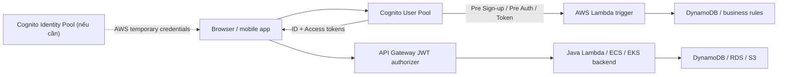
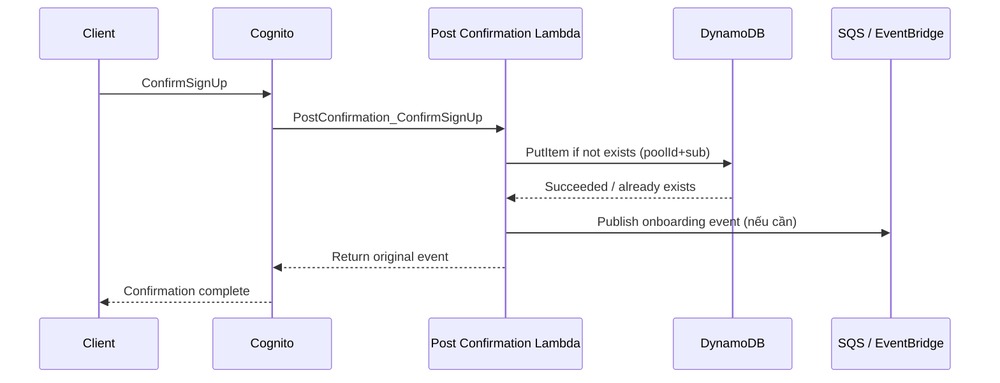
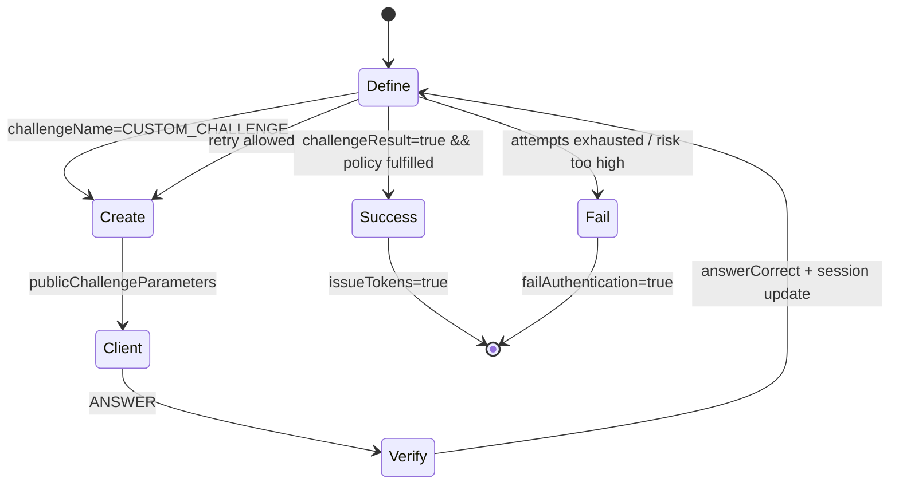
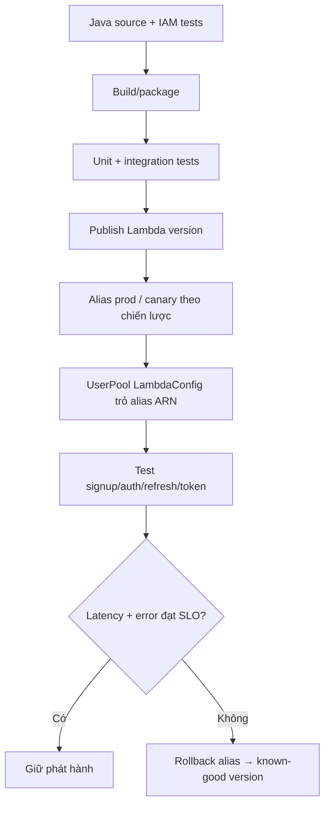
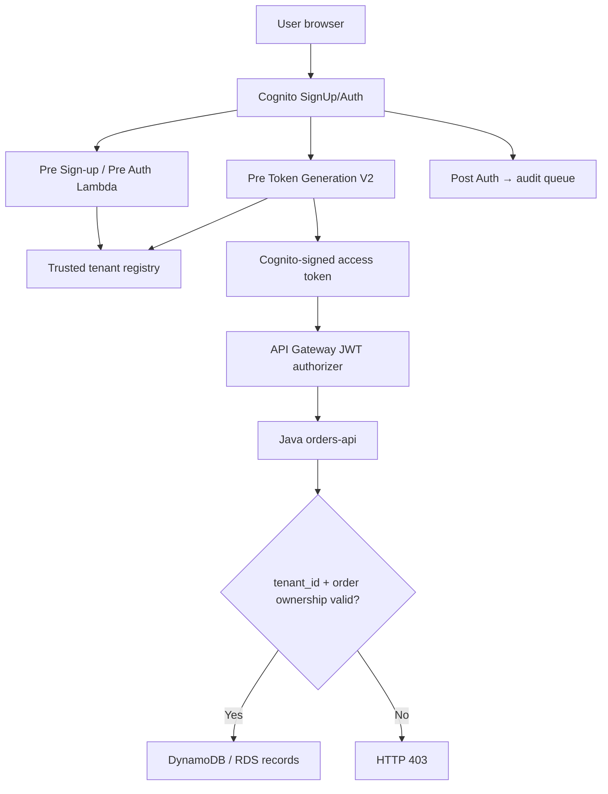

# Lambda trigger và tùy biến quy trình xác thực với Amazon Cognito

> **Chương:** Danh tính ứng dụng với Cognito  
> **Module:** `CLOUD_PROVIDERS_AWS`  
> **Bối cảnh:** Amazon Cognito User Pools quản lý danh tính người dùng cho ứng dụng web, mobile và backend trên AWS. Bài học đi sâu vào **Lambda triggers** để kiểm soát đăng ký, xác thực, cấp token, thông báo và chuyển đổi người dùng từ hệ thống cũ; kết hợp kiến thức IAM, API Gateway, Lambda, VPC, KMS, CloudWatch và vận hành an toàn, phục hồi được, kiểm soát chi phí.  
> **Đối tượng:** Người học đã biết nguyên tắc AWS IAM và Lambda cơ bản, đang thiết kế kiến trúc ứng dụng Java/Spring Boot với Amazon Cognito.

## Mục tiêu học tập

Sau bài này, người học có thể:

1. Phân biệt **Cognito User Pool**, **User Pool app client**, **Identity Pool**, **OAuth 2.0/OIDC token** và vai trò của **Lambda trigger** trong từng thao tác xác thực.
2. Nhận diện và chọn đúng trigger cho đăng ký, xác nhận tài khoản, pre/post authentication, thông báo, token generation, di chuyển người dùng, custom authentication và federation.
3. Đọc cấu trúc **Cognito trigger event** gồm `triggerSource`, `userPoolId`, `userName`, `callerContext`, `request` và `response`; hoàn trả event đúng contract.
4. Viết handler Java cho **Pre Sign-up** và **Pre Token Generation V2_0**, tránh tin tưởng dữ liệu do client tự khai và không làm lộ secret/PII.
5. Giải thích luồng **Define → Create → Verify Auth Challenge**, các trường session, challengeName, issueTokens và failAuthentication; chống brute force, replay và user enumeration.
6. Phân biệt **Pre Token Generation V1_0, V2_0, V3_0**; hiểu ID token, access token, scopes, groups và M2M.
7. Thiết lập Lambda permission đúng `cognito-idp.amazonaws.com`, IAM execution role tối thiểu, cấu hình trigger theo IaC/CLI và biết rủi ro của `UpdateUserPool`.
8. Thiết kế trigger có latency thấp trong ngưỡng Cognito, đo lỗi, triển khai theo alias/version, kiểm thử flow thật và rollback khi một trigger bị lỗi.
9. Ước tính tác động tới đăng nhập, retry, availability và chi phí Lambda/Cognito/SES/SMS/KMS.

## 1. Cognito quản lý danh tính; Lambda trigger bổ sung quy tắc nghiệp vụ

**Amazon Cognito User Pools** quản lý tài khoản, thuộc tính người dùng, phương thức đăng nhập, xác minh email/điện thoại, MFA, federation và cấp các token OIDC/OAuth 2.0. Tùy user pool feature plan, Cognito hỗ trợ thêm những cách đăng nhập như passkey hoặc passwordless theo quy tắc dịch vụ.

**Lambda trigger** là một function được Cognito gọi tại **điểm xác định của workflow**. Handler nhận event theo schema của Cognito, có thể trả về các field cho phép, thêm thông tin token, từ chối thao tác, chuyển sang challenge khác hoặc gọi dịch vụ AWS phụ trợ.

Một kiến trúc điển hình:



**Điểm quan trọng:** User Pool phát **JWT** phục vụ xác thực/ủy quyền ở tầng ứng dụng; **Identity Pool** (nếu dùng) liên kết identity provider để đổi danh tính thành temporary AWS credentials theo cấu hình role. **Thêm claim vào JWT không tự cấp IAM permissions** cho người dùng hoặc backend.

### 1.1 Ba cách tùy biến dễ nhầm

| Cơ chế | Xử lý việc gì? | Ví dụ |
|---|---|---|
| **User Pool Lambda trigger** | Can thiệp tại điểm được Cognito gọi trong signup/auth/token flow | Kiểm tra domain đăng ký, thêm tenant claim |
| **Lambda authorizer của API Gateway** | Xác thực/ủy quyền **HTTP request** đi vào API | Chặn request thiếu scope theo route |
| **Backend Java authorization** | Kiểm tra quyền truy cập **tài nguyên nghiệp vụ** | User A không được đọc đơn hàng của user B |

Một người đã đăng nhập thành công vẫn có thể **không có quyền** xem hóa đơn khác tenant. Trigger không thay thế kiểm tra tenant, ownership, record-level authorization ở API/backend.

### 1.2 Lambda trigger không phải một service chạy nền

Không phải mọi API action của Cognito đều gọi mọi trigger. Khi Cognito gọi trigger, handler thường nằm **trong đường xử lý xác thực** và ảnh hưởng trực tiếp đến thời gian phản hồi, thông báo lỗi hoặc khả năng đăng nhập.

Ví dụ:

```text
Client SignUp
  → Cognito Pre Sign-up trigger
  → Cognito tạo tài khoản nếu hợp lệ
  → Cognito gửi mã xác minh (Custom Message nếu cấu hình)
  → Client ConfirmSignUp
  → Post Confirmation trigger
  → Client InitiateAuth
  → Pre Authentication trigger
  → Cognito kiểm tra credentials / MFA theo flow
  → Post Authentication trigger
  → Pre Token Generation trigger
  → Cognito ký JWT và trả token
```

Sơ đồ mô tả luồng **điển hình**, không phải một thứ tự bắt buộc cho mọi flow. Federation, admin-created users, refresh token, passkey/passwordless, custom challenge, machine-to-machine và user migration có các nhánh, điều kiện gọi trigger khác nhau.

## 2. Bản đồ các loại trigger trên Cognito User Pools

Một User Pool có thể cấu hình trigger ở các giai đoạn sau.

| Trigger | Khi nào chạy / mục đích chính | Mặc định trả dữ liệu gì? |
|---|---|---|
| **Pre Sign-up** | Trước khi hoàn tất tạo user từ SignUp, AdminCreateUser hoặc first sign-in bằng IdP | Có thể set `autoConfirmUser` / `autoVerifyEmail` / `autoVerifyPhone` theo điều kiện |
| **Post Confirmation** | Sau khi user xác nhận đăng ký hoặc hoàn tất đặt lại password theo event phù hợp | Trả event; side effect như tạo user profile |
| **Pre Authentication** | Trước bước xác thực của những sign-in flows phù hợp | Có thể từ chối đăng nhập bằng lỗi |
| **Post Authentication** | Sau xác thực thành công theo trigger source tương ứng | Audit/risk signal nhẹ; không mặc định chạy khi refresh token |
| **Pre Token Generation** | Trước khi Cognito phát ID/access token | Tùy biến claims, groups, scopes theo event version |
| **Define Auth Challenge** | Điều phối chuỗi thử thách custom authentication | Chọn challenge kế tiếp, issueTokens hoặc failAuthentication |
| **Create Auth Challenge** | Sinh câu hỏi/thử thách custom | Public/private challenge parameters |
| **Verify Auth Challenge Response** | Kiểm tra câu trả lời custom challenge | `answerCorrect` |
| **Custom Message** | Tùy biến nội dung email/SMS do Cognito gửi | `emailSubject`, `emailMessage`, `smsMessage` theo hỗ trợ |
| **Custom Email/SMS Sender** | Gửi thông báo qua provider do bạn điều khiển | Handler nhận dữ liệu mã hóa và tự gửi message |
| **Migrate User** | Di chuyển user từ identity store cũ khi auth/forgot password | Trả attributes/status/confirmation theo contract migration |
| **Inbound Federation** | Biến đổi user attributes của inbound federated identity trước khi user được tạo/cập nhật | Trả mapping/response theo schema của trigger |

**Chọn trigger theo đúng điểm can thiệp**, không tạo một Lambda gọi trong mọi trường hợp nếu quy trình chỉ cần thêm một claim.

### 2.1 Một số giá trị `triggerSource` cần nhớ

| Sự kiện | Giá trị tiêu biểu |
|---|---|
| Đăng ký mới | `PreSignUp_SignUp` |
| Admin tạo user | `PreSignUp_AdminCreateUser` |
| Federated sign-in lần đầu | `PreSignUp_ExternalProvider` |
| Xác nhận đăng ký | `PostConfirmation_ConfirmSignUp` |
| Xác nhận quên mật khẩu | `PostConfirmation_ConfirmForgotPassword` |
| Đăng nhập | `PreAuthentication_Authentication` |
| Sau khi đăng nhập | `PostAuthentication_Authentication` |
| Define custom challenge | `DefineAuthChallenge_Authentication` |
| Create custom challenge | `CreateAuthChallenge_Authentication` |
| Verify custom challenge | `VerifyAuthChallengeResponse_Authentication` |
| Đăng nhập phát token | `TokenGeneration_Authentication` |
| Refresh token | `TokenGeneration_RefreshTokens` |
| M2M client credentials | `TokenGeneration_ClientCredentials` nếu dùng V3_0 |
| Migrate từ legacy | `UserMigration_Authentication` / `UserMigration_ForgotPassword` |
| Inbound federation | `InboundFederation_ExternalProvider` |

Danh sách **không toàn bộ**: Cognito có các trigger sources cho hosted/managed login, device auth, custom message, custom sender và những tác vụ khác. Khi làm code, hãy đọc chính xác danh sách event sources của trigger đã chọn thay vì chỉ so prefix.

## 3. Trigger event contract: phải giữ nguyên cấu trúc

Một Lambda User Pool trigger thường nhận event có cấu trúc chung:

```json
{
  "version": "1",
  "triggerSource": "PreSignUp_SignUp",
  "region": "ap-southeast-1",
  "userPoolId": "ap-southeast-1_ExAmplE",
  "userName": "alice-example",
  "callerContext": {
    "awsSdkVersion": "aws-sdk-unknown-unknown",
    "clientId": "exampleclientid123"
  },
  "request": {
    "userAttributes": {
      "email": "alice@example.org",
      "given_name": "Alice"
    },
    "clientMetadata": {
      "signupSource": "web"
    }
  },
  "response": {
    "autoConfirmUser": false,
    "autoVerifyEmail": false,
    "autoVerifyPhone": false
  }
}
```

Đây là **event minh họa của Pre Sign-up**, không phải event cho mọi loại trigger. Một số fields có thể vắng mặt; `request`/`response` khác nhau theo giai đoạn, và `version` của **Pre Token Generation** có các lựa chọn V1/V2/V3.

### 3.1 Các phần quan trọng

- `triggerSource`: xác định **chính xác** nhánh nào gọi handler; phù hợp khi cùng Lambda xử lý nhiều trigger sources.
- `userPoolId`, `region`, `callerContext.clientId`: ngữ cảnh Cognito service cung cấp; dùng để giới hạn pool/client được phép.
- `userName`: tên trong user pool, không nhất thiết bằng email; không dùng làm định danh duy nhất bất biến trong mọi ngữ cảnh.
- `request.userAttributes`: thông tin profile/request. Một thuộc tính mới gửi lúc SignUp **chưa được xác minh** chỉ vì tên là `email`.
- `request.clientMetadata`: dữ liệu app/client cung cấp. **Không đáng tin làm bằng chứng quyền**, vì caller có thể tự truyền giá trị.
- `response`: chỉ được thay những field Cognito hỗ trợ **cho đúng trigger type**.

### 3.2 Handler phải trả **event**, không trả HTTP response

**Đúng với Cognito trigger:**

```json
{
  "version": "1",
  "triggerSource": "PreSignUp_SignUp",
  "region": "ap-southeast-1",
  "userPoolId": "ap-southeast-1_ExAmplE",
  "userName": "alice-example",
  "callerContext": {
    "clientId": "exampleclientid123"
  },
  "request": {
    "userAttributes": {
      "email": "alice@example.org"
    }
  },
  "response": {
    "autoConfirmUser": false,
    "autoVerifyEmail": false,
    "autoVerifyPhone": false
  }
}
```

**Sai:** áp dụng kết quả trả từ API Gateway Lambda proxy:

```json
{
  "statusCode": 200,
  "headers": {
    "content-type": "application/json"
  },
  "body": "{\"allow\":true}"
}
```

Cognito **không đọc** `statusCode/body` như một HTTP proxy integration. Nếu handler trả format không đúng hoặc không giữ event/request/response hợp lệ, Cognito có thể trả **`InvalidLambdaResponseException`**; nếu trigger không thể chạy/timeout, có thể gặp **`UnexpectedLambdaException`**.

### 3.3 Người gọi có thể điều khiển `ClientMetadata`

Một attacker đăng ký user với metadata:

```json
{
  "ClientMetadata": {
    "tenant": "enterprise",
    "role": "admin",
    "skipVerification": "true"
  }
}
```

Nếu Pre Sign-up hoặc Pre Token Generation tin ngay dữ liệu này, attacker có thể tự nâng quyền. **Không cấp role, group hoặc scope từ `ClientMetadata` nếu chưa có bước kiểm chứng server-side**. Dùng dữ liệu đáng tin từ backend, mapping đã xác minh, bảng membership có quyền quản trị hoặc hệ thống policy.

Cognito **không tự lưu/validate/encrypt `ClientMetadata` như secret** và việc metadata có đi vào trigger nào phụ thuộc thao tác API/flow. Không gửi password, OTP hoặc token trong field này.

## 4. Giới hạn vận hành đặc biệt: Cognito chờ khoảng 5 giây

Với hầu hết User Pool triggers, Cognito gọi Lambda **đồng bộ**, chờ response tối đa **5 giây**, và **không thể tăng giới hạn này** bằng cách chỉnh `Timeout` của Lambda. Nếu invocation phù hợp cơ chế retry, Cognito có thể thử lại; không được giả định chính xác một lần chạy.

**Ngoại lệ:** **Custom sender Lambda triggers** có mô hình invocation khác; không áp dụng vô điều kiện mọi kết luận sync/retry của các trigger còn lại cho custom sender.

### 4.1 Hệ quả thiết kế

Không nên để một trigger đồng bộ:

- Chạy query phức tạp mất nhiều giây.
- Gọi 5 microservices nối tiếp qua mạng.
- Download artifact/large config từ Internet trong mỗi invocation.
- Đồng bộ hóa toàn bộ CRM và chờ thành công trước khi đăng nhập.
- Gửi email qua dịch vụ chậm nếu không cần chặn request.

**Thiết kế tốt:** xác thực/kiểm tra ngắn, dùng local config hoặc cache có kiểm soát, đặt timeout nhỏ cho SDK/HTTP client, trả event nhanh. Với side effect không cần chặn luồng (analytics, welcome workflow), cân nhắc **EventBridge/SQS/Step Functions** theo yêu cầu; đảm bảo handler chỉ chờ acknowledgment nếu điều đó thật sự bắt buộc.

### 4.2 Retry dẫn tới side effect trùng

Một Post Confirmation trigger có thể viết profile vào DynamoDB. Nếu Lambda ghi thành công nhưng response bị timeout, Cognito có thể retry khi điều kiện dịch vụ cho phép. Do đó:

- Dùng **idempotency key** dựa trên User Pool ID, `sub`, event type.
- Dùng `PutItem` có `attribute_not_exists` hoặc transaction/conditional update khi thích hợp.
- Không gửi hai email chào mừng chỉ vì trigger chạy lại.
- Khi queue event async, nên có deduplication/tracing và cách phục hồi nếu worker phụ trợ lỗi.

### 4.3 Rollout propagation

AWS ghi nhận việc thêm/đổi/xóa trigger có thể mất **tới khoảng 70 giây** để áp dụng cho mọi yêu cầu trong User Pool. Trong thời gian chuyển đổi, có thể tồn tại invocation theo cấu hình cũ/mới. Sử dụng published Lambda versions/aliases và test staging để giảm rủi ro, đồng thời tránh thay đổi API shape không tương thích giữa hai phiên bản khi rollout.

## 5. Pre Sign-up: kiểm tra trước khi tài khoản được tạo

**Pre Sign-up** chạy trước khi Cognito hoàn tất quá trình tạo local/federated user trong các trường hợp tương ứng. Nó thường được dùng để:

- Từ chối email domain không được phép ở một **B2B private application**.
- Kiểm tra mã invitation **đã được server cấp và xác minh**, thay vì chỉ tin client metadata.
- Chuẩn hóa logic onboarding theo nguồn user.
- Có điều kiện auto-confirm/auto-verify đã được tổ chức chấp thuận.

### 5.1 Ba response fields

| Trường | Ý nghĩa | Cần chú ý |
|---|---|---|
| `autoConfirmUser` | Cho phép Cognito tự xác nhận user | Không đồng nghĩa tự xác minh email/phone |
| `autoVerifyEmail` | Đánh dấu email verified | Chỉ dùng khi thật sự có cơ sở tin cậy; liên quan alias takeover |
| `autoVerifyPhone` | Đánh dấu số điện thoại verified | Chỉ dùng khi xác minh sở hữu số qua kênh đáng tin |

**Giới hạn:** Khi `triggerSource=PreSignUp_AdminCreateUser`, Cognito **bỏ qua** ba response flags này. Trigger vẫn có thể kiểm tra/từ chối request, nhưng không dùng chúng để thay đổi việc admin tạo user.

### 5.2 Không tự động verify mọi email cùng domain

Dù email kết thúc bằng `@company.example` không có nghĩa user đã chứng minh quyền sở hữu địa chỉ đó. Nếu cứ đặt `autoVerifyEmail=true` cho email chưa được xác thực, có thể mở đường giả mạo hoặc takeover alias.

Trong nhiều hệ thống, **chỉ kiểm tra allowlist domain để cho phép signup**; để Cognito tự gửi mã xác minh qua email theo quy trình bình thường. Auto verification chỉ nên thực hiện khi có bằng chứng server-side mạnh như invitation được ký/xác thực, IdP đã xác minh và identity linking được thiết kế đúng.

### 5.3 Java handler cho Pre Sign-up

Ví dụ dưới đây sử dụng **AWS Lambda Java managed runtime**, event dạng `Map<String,Object>` và giữ nguyên request fields. Chính sách minh họa: chỉ cho phép đăng ký với domain doanh nghiệp có tên `example.org`, **không** tự xác minh email.

```java
package example.cognito;

import com.amazonaws.services.lambda.runtime.Context;
import com.amazonaws.services.lambda.runtime.RequestHandler;
import java.util.Locale;
import java.util.Map;

public final class PreSignUpHandler
        implements RequestHandler<Map<String, Object>, Map<String, Object>> {

    private static final String EXPECTED_POOL =
            "ap-southeast-1_ExAmplE";
    private static final String ALLOWED_DOMAIN = "example.org";

    @Override
    public Map<String, Object> handleRequest(
            Map<String, Object> event,
            Context context) {

        String source = String.valueOf(event.get("triggerSource"));
        if (!"PreSignUp_SignUp".equals(source)
                && !"PreSignUp_ExternalProvider".equals(source)
                && !"PreSignUp_AdminCreateUser".equals(source)) {
            throw new IllegalArgumentException("Unsupported trigger source");
        }

        if (!EXPECTED_POOL.equals(event.get("userPoolId"))) {
            throw new SecurityException("Unexpected user pool");
        }

        Map<String, Object> request = map(event.get("request"));
        Map<String, Object> attrs = map(request.get("userAttributes"));
        Object rawEmail = attrs.get("email");

        if (!(rawEmail instanceof String)) {
            throw new IllegalArgumentException("Email is required");
        }
        String email = ((String) rawEmail).trim()
                .toLowerCase(Locale.ROOT);
        int at = email.lastIndexOf('@');
        if (at <= 0 || at == email.length() - 1) {
            throw new IllegalArgumentException("Invalid email");
        }
        String domain = email.substring(at + 1);
        if (!ALLOWED_DOMAIN.equals(domain)) {
            throw new IllegalArgumentException("Sign-up not permitted");
        }

        Map<String, Object> response = map(event.get("response"));
        response.put("autoConfirmUser", false);
        response.put("autoVerifyEmail", false);
        response.put("autoVerifyPhone", false);
        event.put("response", response);

        context.getLogger().log(
                "PreSignUp accepted from permitted domain\n");
        return event; // Cognito expects the trigger event back.
    }

    @SuppressWarnings("unchecked")
    private static Map<String, Object> map(Object obj) {
        if (obj instanceof Map<?, ?>) {
            return (Map<String, Object>) obj;
        }
        return new java.util.HashMap<>();
    }
}
```

**Hạn chế của ví dụ:** `EXPECTED_POOL` và `ALLOWED_DOMAIN` chỉ là placeholder; logic email check ở đây dành cho **một ứng dụng B2B giới hạn domain**, không phải policy tổng quát của mọi User Pool. Khi federated user login, thuộc tính email có thể được mapping khác nhau, và logic từ chối có thể làm mất khả năng đăng nhập của người hợp lệ. Production nên dùng cấu hình versioned, unit tests theo từng `triggerSource` và tránh đưa email người dùng vào log.

**Dependency:** `com.amazonaws:aws-lambda-java-core`. Handler cấu hình `example.cognito.PreSignUpHandler`.

### 5.4 Mẫu test event và kỳ vọng

```json
{
  "version": "1",
  "triggerSource": "PreSignUp_SignUp",
  "region": "ap-southeast-1",
  "userPoolId": "ap-southeast-1_ExAmplE",
  "userName": "alice",
  "callerContext": {
    "clientId": "exampleclient123"
  },
  "request": {
    "userAttributes": {
      "email": "alice@example.org"
    },
    "clientMetadata": {
      "signupSource": "web"
    }
  },
  "response": {}
}
```

Kỳ vọng:

- Email `alice@example.org`: Lambda trả lại event có flags `false`; Cognito tiếp tục yêu cầu xác minh theo flow.
- Email `alice@external.example`: Lambda trả lỗi, Cognito từ chối signup theo policy.
- Email trống hoặc sai format: từ chối.
- Metadata tự khai `skipVerification=true`: **không** làm thay đổi kết quả.

**Không dùng Lambda Console test event đơn lẻ để kết luận flow thực tế đầy đủ hoạt động**: cần chạy `SignUp → ConfirmSignUp` ở User Pool staging, kiểm tra app client, policy, permissions và thông điệp thực tế.

## 6. Post Confirmation: tạo profile và khởi động onboarding

**Post Confirmation** chạy sau các sự kiện xác nhận phù hợp, ví dụ `ConfirmSignUp` và `ConfirmForgotPassword`. Nó có thể:

- Tạo profile mặc định trong DynamoDB.
- Khởi động onboarding workflow.
- Ghi event kiểm toán.
- Thêm preference mặc định trong hệ thống khác.

**Quan trọng:** Post Confirmation **không chạy cho tài khoản được tạo bởi quy trình admin theo cùng cách** như user self-signup. Tài liệu Cognito phân biệt user sign-up và admin-created accounts; đừng dựa vào trigger để chắc chắn mọi admin-created user đã được khởi tạo profile.

### 6.1 Phân biệt xác nhận đăng ký và xác nhận reset password

```text
PostConfirmation_ConfirmSignUp
PostConfirmation_ConfirmForgotPassword
```

Đừng gửi email “Chào mừng tài khoản mới” hoặc tạo record profile mới khi người dùng **chỉ vừa hoàn tất reset password**.

### 6.2 Một workflow gợi ý



Điểm cần thiết kế:

- Thao tác ghi profile phải **idempotent**.
- Việc gửi sự kiện onboarding có thể lỗi sau khi profile đã được tạo; cần transactional outbox hoặc cơ chế retry/compensation nếu yêu cầu không mất event.
- Nếu webhook/CRM chậm, không chờ đồng bộ trong Cognito 5 giây.
- Dữ liệu PII chỉ truyền đến nơi được phép; cân nhắc mã hóa, retention, xóa theo yêu cầu riêng tư.

## 7. Pre Authentication: chặn đăng nhập theo điều kiện đáng tin

**Pre Authentication** chạy khi user cố gắng đăng nhập theo những flow được hỗ trợ, cho phép xác thực policy tùy biến trước khi Cognito chấp nhận bước xác thực.

Use cases:

- Từ chối user có trạng thái `suspended` theo business registry.
- Giới hạn đăng nhập từ một tập app clients cụ thể.
- Kiểm tra một policy hoặc dấu hiệu rủi ro được hệ thống server-side quyết định.
- Tạm khóa luồng sign-in khi có sự cố cần bảo vệ.

### 7.1 Quy tắc quan trọng

- Trigger không tự xác minh password/OTP thay cho Cognito; chỉ thêm policy kiểm tra.
- `request.userAttributes`/`clientMetadata` khác nhau theo flow, không dùng client metadata làm bằng chứng user đã MFA.
- Khi `PreventUserExistenceErrors=ENABLED`, Cognito có thể cung cấp `userNotFound` trong những event liên quan. Hãy giữ trải nghiệm và timing đủ tương đồng để giảm **user enumeration**.
- **Refresh của một session hiện có không kích hoạt Pre Authentication**, do đó policy chỉ đặt ở Pre Auth không bảo đảm một token vừa refresh được kiểm lại chính sách account suspension.

Nếu yêu cầu thu hồi quyền ngay, phải kết hợp kiểm tra ở API/backend, token expiry, revocation/global sign-out và policy cập nhật — không chỉ dựa vào Pre Authentication.

### 7.2 Từ chối bằng exception có kiểm soát

Cognito có thể từ chối flow khi handler ném lỗi hoặc không trả response hợp lệ. Nhưng **không** trả thông báo chi tiết như “Email này đã tồn tại”, “Tài khoản của bạn nằm trong danh sách VIP” hay “User không có MFA” cho public client khi thông tin đó giúp attacker suy đoán tài khoản.

Thông báo lỗi public nên mang tính tổng quát; log nội bộ ghi event type/correlation (không PII), metrics phân loại lý do theo mã nội bộ. Cẩn trọng vì managed login có thể hiển thị thông báo lỗi trigger trong UI.

## 8. Post Authentication: sau khi xác thực thành công

**Post Authentication** dùng để ghi dấu đăng nhập, cập nhật timestamp nghiệp vụ hoặc gửi sự kiện phân tích theo các luồng Cognito có kích hoạt.

Ví dụ:

- Gửi event `USER_SIGNED_IN` đến EventBridge/SQS.
- Cập nhật last successful sign-in trong hồ sơ business.
- Ghi risk signals nhẹ hoặc quản lý thiết bị theo luật hiện hành.
- Đồng bộ dấu vết kiểm toán sang hệ thống SIEM.

### 8.1 Giới hạn

- Không giả định chạy trên **mọi** cách lấy token, đặc biệt **refresh token** không đồng nghĩa new sign-in.
- Không biến Post Authentication thành service ghi log cồng kềnh có thể chặn đăng nhập khi downstream lỗi.
- Cognito có tính năng audit/security nâng cao tùy feature plan; không thay nó bằng một bảng custom đơn giản rồi cho là đủ chống account takeover.
- Side effects phải idempotent và có phương án nếu event queue tạm không khả dụng.

### 8.2 Đánh đổi availability vs audit

Nếu SIEM tạm lỗi, cần xác định policy nghiệp vụ:

- **Fail-open với audit được queue**: người dùng vẫn đăng nhập, công việc audit gửi đến hệ thống được phục hồi sau.
- **Fail-closed**: chặn login nếu không thể kiểm chứng policy bắt buộc; phải chấp nhận outage lan rộng và có runbook.

Không có lựa chọn chung cho tất cả ứng dụng. Hệ thống ngân hàng và ứng dụng nội bộ ít nhạy cảm có thể có yêu cầu khác nhau.

## 9. Custom Authentication: Define → Create → Verify Challenge

Cognito hỗ trợ **custom authentication** khi app client/flow được cấu hình tương ứng. Chuỗi thông thường gồm ba Lambda triggers:

1. **Define Auth Challenge**: chọn bước kế tiếp dựa vào session.
2. **Create Auth Challenge**: tạo challenge và parameters.
3. **Verify Auth Challenge Response**: kiểm tra câu trả lời, trả `answerCorrect`.

Dùng khi bạn cần một cơ chế thử thách tùy biến có policy chặt chẽ, ví dụ xác nhận một transaction ngoài quy trình mặc định. **Không tự xây OTP/passwordless chỉ để thay thế tính năng Cognito managed có sẵn** nếu dịch vụ đã hỗ trợ passkey, SMS/email OTP hoặc MFA theo nhu cầu.

### 9.1 Sơ đồ state machine



**Không đặt `issueTokens=true` chỉ vì một client tự gửi metadata “passed=true”.** Chỉ issue token khi session xác nhận chính xác challenge(s) bắt buộc đã được Verify thành công.

### 9.2 Define Auth Challenge event và output

Ví dụ rút gọn sau lần đầu:

```json
{
  "triggerSource": "DefineAuthChallenge_Authentication",
  "request": {
    "userNotFound": false,
    "session": []
  },
  "response": {
    "challengeName": "CUSTOM_CHALLENGE",
    "issueTokens": false,
    "failAuthentication": false
  }
}
```

Sau Verify, session có thể chứa:

```json
{
  "session": [
    {
      "challengeName": "CUSTOM_CHALLENGE",
      "challengeResult": true,
      "challengeMetadata": "OTP_V1"
    }
  ]
}
```

Hãy kiểm tra **cả** `challengeName` và `challengeResult`. Nếu custom flow đòi hỏi password/SRP và MFA trước đó, cần xem toàn bộ session theo đúng thứ tự, không chỉ kiểm tra một phần tử cuối.

### 9.3 Define challenge pseudocode an toàn

```text
function define(event):
    session = event.request.session or []
    userNotFound = event.request.userNotFound == true

    if session contains a verified success
       for the REQUIRED CUSTOM_CHALLENGE
       and required prior challenges are satisfied
       and not userNotFound:
        event.response.issueTokens = true
        event.response.failAuthentication = false

    else if session has 3 failed attempts OR policy denies:
        event.response.issueTokens = false
        event.response.failAuthentication = true

    else:
        event.response.challengeName = "CUSTOM_CHALLENGE"
        event.response.issueTokens = false
        event.response.failAuthentication = false

    return event
```

Đây là pseudocode. Production phải thêm chống brute force theo user/device/IP, kiểm soát số thử lại ở server, lifetime challenge, và xử lý user không tồn tại với timing/response tương đồng.

### 9.4 Create Auth Challenge: tách public và private

Cognito hỗ trợ:

- `publicChallengeParameters`: được gửi cho client, ví dụ `delivery=EMAIL` hoặc `maskedDestination`.
- `privateChallengeParameters`: dữ liệu chỉ cho Verify Lambda xem, không trả trực tiếp cho client.
- `challengeMetadata`: metadata phục vụ lịch sử challenge.

Ví dụ response shape:

```json
{
  "response": {
    "publicChallengeParameters": {
      "delivery": "EMAIL",
      "maskedDestination": "a***@example.org"
    },
    "privateChallengeParameters": {
      "challengeId": "opaque-server-generated-id"
    },
    "challengeMetadata": "OTP_V1"
  }
}
```

**Không đặt OTP hoặc secret answer vào `publicChallengeParameters`.** Khi Verify, cần kiểm tra challenge ID, expiry, số lần thử, replay và owner phù hợp trong server-side store. `privateChallengeParameters` không tới client nhưng không thay thế server-side state/rate limiting nếu custom flow cần bảo vệ sâu.

### 9.5 Verify Auth Challenge Response

Event Verify mang `request.challengeAnswer` và `request.privateChallengeParameters`. Handler trả:

```json
{
  "response": {
    "answerCorrect": true
  }
}
```

Trong production:

1. Không log `challengeAnswer`/OTP.
2. Dùng cryptographically secure random cho challenge/nonce; không dùng `Math.random` hoặc timestamp làm bí mật.
3. Lưu hashed OTP/challenge state trong DynamoDB hoặc secret-capable store nếu cần; dùng TTL và one-time consumption có **conditional update**.
4. So sánh giá trị bằng primitive an toàn nếu xử lý secret material.
5. Giới hạn attempts và gắn challenge với user/session/device, không để một OTP dùng lại.
6. Nếu gửi email/SMS, có quy định tốc độ gửi lại/chống spam và kênh backup hợp lý.
7. Không issue token khi `userNotFound=true` hoặc khi chưa đủ những bước policy quy định.

### 9.6 Custom auth và choice-based sign-in

Khi tự xây flow dạng `CUSTOM_AUTH`, app client phải cho phép `ALLOW_CUSTOM_AUTH` và client phải khởi tạo/đáp ứng challenge theo API như `InitiateAuth`, `RespondToAuthChallenge`. Nếu app client hoặc flow cấu hình chỉ password/SRP, bộ ba custom challenge không tự xuất hiện.

Cognito còn có **`USER_AUTH`/choice-based authentication** cho password/passwordless/passkey theo các điều kiện và feature plan được hỗ trợ. Không đồng nhất `USER_AUTH` với `CUSTOM_AUTH`; ưu tiên tính năng managed cho passwordless phổ thông, và chỉ thiết kế custom challenge khi yêu cầu thực sự đặc thù. Đọc tài liệu auth flow theo version và feature plan hiện hành trước khi phối hợp các cơ chế.

## 10. Pre Token Generation: sửa claims và scopes trước khi ký JWT

**Pre Token Generation** là trigger rất quan trọng vì nó ảnh hưởng trực tiếp **nội dung token được backend tin tưởng**. Cognito ký JWT sau khi áp dụng các thay đổi hợp lệ từ trigger.

### 10.1 ID token, access token, refresh token khác nhau

| Token | Mục đích | Backend cần làm gì? |
|---|---|---|
| **ID token** | Thông tin identity/profile cho client dựa trên OIDC | Kiểm tra signature, issuer, audience/client, token_use, expiry khi sử dụng |
| **Access token** | Cấp quyền truy cập tài nguyên/API theo scopes/groups/claims | Validate đúng access-token semantics, issuer, client, token_use, expiry và scopes |
| **Refresh token** | Xin token mới theo cơ chế client auth | Bảo vệ như credential nhạy cảm, không gửi cho business API như access token |

Thêm `tenantId` vào ID token **không tự làm** access token mang cùng claim; backend JWT authorizer thường kiểm tra **access token** với route scopes, tùy API type/configuration.

### 10.2 Ba phiên bản event Pre Token Generation

| Event version | Khả năng chính | Điều kiện |
|---|---|---|
| **V1_0** | Tùy biến **ID token** claims và group/role override; group override ảnh hưởng `cognito:groups` trong access token | Feature cơ bản theo user pool |
| **V2_0** | Tùy biến claims, groups và scopes ở **ID + Access tokens** cho user identities | User pool **Essentials hoặc Plus** / feature có cấp tương ứng |
| **V3_0** | Như V2 và áp dụng cho **machine-to-machine (M2M)** client credentials flow | Feature plan phù hợp và cấu hình event V3_0 |

Cognito không gọi Pre Token Generation cho M2M client-credentials authorization nếu chỉ cấu hình V1/V2; cần **V3_0** cho nguồn sự kiện M2M được hỗ trợ.

**Đừng suy rằng “đã gắn Lambda” nghĩa là access token customization hoạt động.** Phải xem user pool plan, `PreTokenGenerationConfig.LambdaVersion` và response schema tương ứng.

### 10.3 V1 response vs V2/V3 response

**V1_0**:

```json
{
  "response": {
    "claimsOverrideDetails": {
      "claimsToAddOrOverride": {
        "tenant_id": "tenant-a"
      },
      "claimsToSuppress": [],
      "groupOverrideDetails": {
        "groupsToOverride": ["basic-users"]
      }
    }
  }
}
```

**V2_0/V3_0**:

```json
{
  "response": {
    "claimsAndScopeOverrideDetails": {
      "idTokenGeneration": {
        "claimsToAddOrOverride": {
          "tenant_id": "tenant-a"
        }
      },
      "accessTokenGeneration": {
        "claimsToAddOrOverride": {
          "tenant_id": "tenant-a",
          "subscription_tier": "pro"
        },
        "scopesToAdd": [
          "orders/read"
        ]
      }
    }
  }
}
```

Giá trị claims/scopes ở đây chỉ minh họa. **Không** gán `subscription_tier=pro` hoặc thêm scope `orders/write` từ self-declared metadata; phải dựa vào **entitlement source** đáng tin cậy và kiểm soát mã hóa/lifetime.

### 10.4 Java handler Pre Token Generation V2_0

Ví dụ thêm claim `tenant_id` vào ID và access token **chỉ khi** thuộc tính user pool `custom:tenant_id` đã tồn tại và được coi là đáng tin trong kiến trúc. Bài học giả định chỉ privileged backend/admin workflow mới được sửa attribute này; nếu app client có quyền viết `custom:tenant_id`, ví dụ này **không an toàn**.

```java
package example.cognito;

import com.amazonaws.services.lambda.runtime.Context;
import com.amazonaws.services.lambda.runtime.RequestHandler;
import java.util.HashMap;
import java.util.Map;

public final class PreTokenHandler
        implements RequestHandler<Map<String, Object>, Map<String, Object>> {

    @Override
    public Map<String, Object> handleRequest(
            Map<String, Object> event, Context context) {

        String version = String.valueOf(event.get("version"));
        String source = String.valueOf(event.get("triggerSource"));

        if (!"2".equals(version)) {
            throw new IllegalArgumentException("Expected V2_0 trigger event");
        }
        if (!source.startsWith("TokenGeneration_")) {
            throw new IllegalArgumentException("Unexpected trigger source");
        }

        Map<String, Object> request = map(event.get("request"));
        Map<String, Object> attrs = map(request.get("userAttributes"));

        Object tenantValue = attrs.get("custom:tenant_id");
        if (!(tenantValue instanceof String)
                || !((String) tenantValue).matches("[a-z0-9-]{1,48}")) {
            // Chính sách mẫu: không phát token với tenant context thiếu.
            throw new IllegalStateException("Trusted tenant context unavailable");
        }

        String tenantId = (String) tenantValue;
        Map<String, Object> id = new HashMap<>();
        id.put("claimsToAddOrOverride", Map.of("tenant_id", tenantId));

        Map<String, Object> access = new HashMap<>();
        access.put("claimsToAddOrOverride",
                   Map.of("tenant_id", tenantId));

        Map<String, Object> details = new HashMap<>();
        details.put("idTokenGeneration", id);
        details.put("accessTokenGeneration", access);

        Map<String, Object> response = map(event.get("response"));
        response.put("claimsAndScopeOverrideDetails", details);
        event.put("response", response);

        context.getLogger().log("Token claims policy applied\n");
        return event;
    }

    @SuppressWarnings("unchecked")
    private static Map<String, Object> map(Object obj) {
        if (obj instanceof Map<?, ?>) {
            return (Map<String, Object>) obj;
        }
        return new HashMap<>();
    }
}
```

Điểm cần nhớ:

- Lambda handler không tự ký JWT; **Cognito** ký token sau khi trigger trả response.
- Không gắn scope admin mặc định.
- Code cố ý **không đổi `cognito:groups`** nếu không cần; khi override groups, phải hiểu hành vi thay thế toàn bộ group list.
- Lambda ở trên từ chối token nếu thiếu tenant. Có thể thay bằng fail-safe policy chỉ cấp quyền baseline sau khi kiểm tra yêu cầu nghiệp vụ, nhưng phải quyết định có chủ đích.
- Nếu dùng **V3_0**, event có thể không tương ứng user profile thông thường trong M2M flow; không áp dụng handler này nguyên xi mà phải viết branch xác định machine client và quyền tương ứng.

### 10.5 Trường claims không được sửa tùy ý

Cognito giới hạn một số reserved claims và field token; không thể tùy ý sửa `iss`, `exp`, `token_use`, `sub`, authentication timestamps hoặc các claim hệ thống bị khóa theo docs.

Không bao giờ cố tạo “admin” bằng cách chèn `cognito:groups` thủ công qua arbitrary claims nếu dịch vụ yêu cầu `groupOverrideDetails`. Nên kiểm tra danh sách reserved/restricted claims ở tài liệu AWS trước khi xây cơ chế claim override.

### 10.6 Token cũ có được tự cập nhật không?

**Không.** Token JWT đã ký được client giữ cho đến khi hết hạn/được xử lý theo cơ chế revocation phù hợp. Khi entitlement tenant đổi:

- Token được phát **sau đó** có thể có claims mới qua Pre Token Generation.
- Token **đã phát** có thể còn hợp lệ đến lúc hết hạn nếu backend không có cơ chế kiểm tra/revocation theo yêu cầu.
- Với quyền rất nhạy cảm, API/backend có thể cần policy lookup động hoặc token TTL ngắn hơn, thay vì chỉ tin claim cũ.

## 11. Custom Message và Custom Sender: hai mức tùy biến thông báo

### 11.1 Custom Message

**Custom Message** chỉnh cách Cognito tạo email/SMS: nội dung, localization, template theo event source. Thường nhận `request.codeParameter` placeholder, thông tin user attributes và response fields:

- `emailSubject` và `emailMessage` cho email theo điều kiện supported.
- `smsMessage` cho SMS.
- Khi có invitation, có thể có username placeholder và các yêu cầu về code/template.

**Không thay placeholder mã xác minh thành chuỗi tùy ý**, vì user có thể nhận thông báo không chứa mã hợp lệ. Ví dụ email:

```text
Xin chào,
Mã xác minh tài khoản của bạn là {####}.
Nếu bạn không yêu cầu thao tác này, hãy bỏ qua thông báo.
```

`{####}` trong ví dụ là placeholder thường dùng theo hướng dẫn Cognito, nhưng **response phải dùng đúng `codeParameter` được gửi trong event** và tuân theo quy tắc từng event/message type. Không hardcode `123456` hoặc in verification code vào logs.

Nếu user pool dùng **`COGNITO_DEFAULT`** cho email, việc tùy biến email subject/body bằng Custom Message có giới hạn; thường cần **`DEVELOPER` email sending account/SES** để dùng các response email fields tương ứng. Kiểm tra cấu hình email và tài liệu AWS trước khi kết luận template không có tác dụng.

### 11.2 Custom Email Sender / Custom SMS Sender

Custom sender triggers thay thế **cơ chế gửi** thông điệp, không chỉ chỉnh body. Lambda có thể gửi qua Amazon SES/SNS hoặc provider bên ngoài.

Điểm khác:

- Cognito mã hóa mã xác minh/temporary password trong event gửi custom sender bằng **AWS KMS customer managed key** và AWS Encryption SDK theo mô hình dịch vụ.
- Lambda custom sender cần **giải mã đúng cách** trước khi gửi cho người dùng; phải có quyền KMS và kết nối tới provider.
- Các sender hooks có event sources riêng như `CustomEmailSender_SignUp` và `CustomSMSSender_Authentication`.
- Cấu hình `CustomEmailSender`/`CustomSMSSender` và `KMSKeyID` thường phải thực hiện qua **AWS CLI/SDK/IaC**, không chọn hoàn toàn như triggers thông thường trong Console.
- Không log ciphertext, plaintext OTP/temporary password hoặc thông tin người nhận chi tiết.

**Custom Sender là trách nhiệm vận hành đáng kể.** Nếu provider email/SMS thất bại, signup/password reset/MFA có thể bị ảnh hưởng. Cần quản lý delivery retries, suppression lists, fraud throttling, failover provider, audit và chi phí tin nhắn.

### 11.3 Khi nào không nên custom sender?

Nếu Cognito built-in email/SMS với SES và template mặc định đã đáp ứng nhu cầu, đừng tự xây sender Lambda chỉ vì muốn đổi cách viết subject. Custom sender mở rộng attack surface và độ phụ thuộc vận hành.

## 12. User Migration và Inbound Federation

### 12.1 Migrate User: chuyển người dùng từ hệ thống cũ

**Migrate User** hỗ trợ chuyển user từ hệ thống danh tính cũ sang User Pool Cognito trong một số flow phù hợp, ví dụ:

```text
UserMigration_Authentication
UserMigration_ForgotPassword
```

Với migration trong sign-in:

1. User cố gắng đăng nhập vào Cognito với thông tin phù hợp.
2. Cognito không tìm thấy user trong User Pool và kích hoạt Migrate User trigger theo điều kiện.
3. Trigger kiểm tra credential ở hệ thống cũ bằng kênh bảo mật.
4. Nếu hợp lệ, trả response profile/status theo schema để Cognito tạo user.
5. Những lần tiếp theo có thể xác thực qua Cognito khi migration hoàn tất.

**Cẩn trọng:** Migration authentication có liên hệ mật khẩu trong request và giới hạn auth flow; flow kiểu SRP không chuyển plaintext password cho trigger như password-based flow. Phải thiết kế `USER_PASSWORD_AUTH`/mô hình được docs hỗ trợ và xử lý secret trong bộ nhớ, không log password, không gửi qua HTTP plaintext đến legacy system.

### 12.2 Forgot password migration

`UserMigration_ForgotPassword` phục vụ trường hợp cần đưa user chưa có trong Cognito vào quy trình recovery. Không giả định có password plaintext ở flow này; phản hồi phải tuân theo schema và user status/attributes/verification requirements.

### 12.3 Inbound Federation

Khi ứng dụng đăng nhập qua external IdP (SAML/OIDC/social), Cognito liên kết/mapping attributes sang User Pool. **Inbound Federation trigger** có thể tùy biến mapping/validation của thuộc tính trước khi tạo hoặc cập nhật user, theo tính năng và schema hỗ trợ.

Ví dụ kiểm tra:

- Email/tenant claim mà external IdP thực sự ký/xác nhận.
- Normalization của tên/department theo policy.
- Ngăn identity linking không chính xác giữa hai tenants.
- Tránh tự cấp group admin nếu IdP assertion không đáng tin hoặc app client không được phép.

**Không nhầm** Pre Sign-up ExternalProvider với Inbound Federation: cả hai có thể tham gia ở những điểm khác nhau của federation workflow. Đọc docs theo User Pool feature plan và trigger source thực tế.

## 13. Customization không được phá ranh giới bảo mật

### 13.1 Không tự nâng quyền từ input client

Những dữ liệu sau thường cần được kiểm chứng:

- `ClientMetadata.role=admin`.
- `userAttributes.email` khi chưa verified.
- Email domain string không có bằng chứng sở hữu.
- Header `X-Tenant` của browser/mobile client.
- Tên group do app đưa vào `ClientMetadata`.
- OIDC claims chưa được validate issuer/audience/signature/mapping policy ở gateway.

**Cách đúng:** Chỉ cấp tenant role/scopes từ IAM/authorization service, server-side entitlement store, group membership được quản trị, hoặc verified identity source. Đặt quyền ghi các attribute nhạy cảm chỉ cho privileged backend, không cấp `WriteAttributes` cho app client public trên `custom:tenant_id`.

### 13.2 User enumeration và timing leakage

Khi có `PreventUserExistenceErrors=ENABLED`, Cognito cố giảm việc lộ user tồn tại hay không; custom triggers vẫn có thể phá bảo vệ nếu:

- Trả thông điệp riêng “Không tìm thấy email” trong một nhánh.
- Gọi database thêm 1 giây chỉ khi user tồn tại.
- Khác số lượng retries hoặc challenge types với unknown user.
- Log/telemetry xuất user identity ra nơi không có quyền.

Nên thống nhất thông báo public, thời gian xử lý hợp lý, rate limit và thiết kế flow tương đồng cho unknown vs known user. Không xác nhận existence của user chỉ vì frontend muốn hiển thị thông báo “thân thiện hơn”.

### 13.3 Cognito token phải được backend validate

Ngay cả khi Pre Token Generation chỉ thêm claim đáng tin, API vẫn phải:

1. Kiểm tra chữ ký JWT bằng **JWKS từ đúng issuer**.
2. Kiểm tra `iss`, `exp`, `token_use`, client ID/audience phù hợp.
3. Kiểm tra scopes/groups/claims theo route.
4. Kiểm tra tenant/resource ownership ở tầng nghiệp vụ.
5. Chống replay/idempotency khi thao tác ghi.
6. Không đọc token bằng Base64 decode rồi tin claims mà không verify signature.

### 13.4 Execution role vs invoke permission

**Hai quyền khác nhau:**

| Quyền | Đối tượng | Mục đích |
|---|---|---|
| Lambda **resource-based permission** | `cognito-idp.amazonaws.com` | Cho Cognito User Pool gọi function |
| Lambda **execution role** | `lambda.amazonaws.com` assume role | Cho code Lambda đọc DynamoDB/Secrets Manager/KMS… |
| Role CI/CD | Người/pipeline quản trị tài nguyên | Gọi `UpdateFunctionCode`, `UpdateUserPool`, `iam:PassRole` khi cần |

Không cấp DynamoDB permissions cho Cognito principal chỉ vì Pre Sign-up Lambda đọc DynamoDB. Ngược lại, việc Lambda execution role có `dynamodb:GetItem` không có nghĩa Cognito có `lambda:InvokeFunction`.

## 14. Cấp invoke permission cho Cognito đúng cách

User Pool Cognito phải được cho phép invoke Lambda qua **resource-based policy của function**. Mẫu AWS CLI:

```bash
aws lambda add-permission \
  --function-name arn:aws:lambda:ap-southeast-1:111122223333:function:cognito-presignup:prod \
  --statement-id allow-cognito-presignup-prod \
  --action lambda:InvokeFunction \
  --principal cognito-idp.amazonaws.com \
  --source-account 111122223333 \
  --source-arn arn:aws:cognito-idp:ap-southeast-1:111122223333:userpool/ap-southeast-1_ExAmplE \
  --region ap-southeast-1
```

Các ARN/account/ID chỉ minh họa; **không chạy** trên production nếu chưa thay bằng resource thật.

Các kiểm soát:

- `SourceArn` chỉ user pool được phép.
- `SourceAccount` giới hạn nguồn tài khoản trong trường hợp được API hỗ trợ.
- Nếu user pool trỏ alias `:prod`, permission cần tồn tại trên resource/qualifier thích hợp.
- User Pool và Lambda trigger phải phù hợp yêu cầu **Region**; không tự giả định Cognito trigger có thể gọi function bất kỳ Region.
- Trust policy Lambda execution role vẫn là `lambda.amazonaws.com`.
- Khi trigger bị xóa khỏi User Pool, cân nhắc thu hồi permission không còn dùng sau khi kiểm tra các luồng khác.

Ví dụ xem policy:

```bash
aws lambda get-policy \
  --function-name cognito-presignup \
  --qualifier prod \
  --region ap-southeast-1
```

Kiểm tra `Principal`, `Action` và điều kiện `AWS:SourceArn`/`AWS:SourceAccount`. Không mở `Principal:"*"` cho invoke chỉ để sửa `AccessDeniedException`.

## 15. Cấu hình Lambda triggers: Console, IaC và AWS CLI

### 15.1 Preflight read-only

```bash
aws sts get-caller-identity

aws cognito-idp describe-user-pool \
  --user-pool-id ap-southeast-1_ExAmplE \
  --region ap-southeast-1 \
  --query 'UserPool.{Id:Id,Name:Name,LambdaConfig:LambdaConfig,UserPoolTier:UserPoolTier,Status:Status}' \
  --output json

aws cognito-idp describe-user-pool-client \
  --user-pool-id ap-southeast-1_ExAmplE \
  --client-id exampleclientid123 \
  --region ap-southeast-1 \
  --query 'UserPoolClient.{ClientId:ClientId,ExplicitAuthFlows:ExplicitAuthFlows,PreventUserExistenceErrors:PreventUserExistenceErrors,TokenValidityUnits:TokenValidityUnits}' \
  --output json
```

Đây là các lệnh đọc cấu hình, **không gọi GetUser/GetToken** và không in secret. Kiểm tra `LambdaConfig` trước khi thay đổi bất kỳ trigger nào. Nếu CLI query không trả trường do API/version khác, xem output thực tế và tài liệu tương ứng.

### 15.2 Cấu hình thông qua IaC (khuyến nghị)

**AWS CloudFormation**, **AWS CDK** hoặc Terraform có thể quản lý:

1. Lambda function code/role/trust.
2. Version/alias ổn định.
3. Invoke permission cho User Pool ARN.
4. User Pool `LambdaConfig`.
5. Feature plan và trigger version (nếu dùng Pre Token).
6. CloudWatch log retention/alarms.
7. Rollback/change approval.

**Không xóa/recreate User Pool production** khi chỉ muốn đổi trigger; User Pool ID thay đổi sẽ ảnh hưởng tất cả user, JWT issuer, app clients, endpoints và tích hợp.

### 15.3 Dạng cấu hình `LambdaConfig` trong CloudFormation

Ví dụ **trích đoạn thuộc tính** của `AWS::Cognito::UserPool`, không phải một stack hoàn chỉnh:

```yaml
Type: AWS::Cognito::UserPool
Properties:
  UserPoolName: orders-users-staging
  LambdaConfig:
    PreSignUp: arn:aws:lambda:ap-southeast-1:111122223333:function:cognito-presignup:prod
    PreAuthentication: arn:aws:lambda:ap-southeast-1:111122223333:function:cognito-preauth:prod
    PreTokenGenerationConfig:
      LambdaArn: arn:aws:lambda:ap-southeast-1:111122223333:function:cognito-pretoken:prod
      LambdaVersion: V2_0
```

Ví dụ này cần template resource thực, IAM permissions, user pool feature plan tương thích, đúng syntax CloudFormation version và các thuộc tính bắt buộc của stack. Cần giữ đúng existing user pool config nếu làm migration của stack cũ.

### 15.4 Vì sao phải cẩn thận với `UpdateUserPool`?

`aws cognito-idp update-user-pool` có các rủi ro:

- API cập nhật **nhiều cấu hình của User Pool**, không phải patch riêng field `LambdaConfig.PreSignUp`.
- Các tham số không truyền trong một số update có thể bị **đặt về mặc định**, làm thay đổi policy/email/MFA/schema hoặc cấu hình khác.
- Khi gửi `LambdaConfig`, phải **giữ những trigger đã có** và những thành phần cùng cấu hình quan trọng.
- Một số thay đổi có hiệu lực sau khoảng thời gian propagation.
- Sự cố Lambda trigger có thể làm **toàn bộ đăng nhập/đăng ký** cho những flow liên quan bị lỗi.

Trình tự an toàn: `describe-user-pool` → tạo bản cấu hình đầy đủ qua IaC/state → review diff → backup/export metadata → deploy staging → chạy test auth thật → rollout production có monitoring → rollback đã được diễn tập.

**Không dùng một câu lệnh `--lambda-config PreSignUp=...` rời rạc trên User Pool production nếu không hiểu rằng các config khác có thể bị thay/đặt mặc định.**

## 16. Lambda alias, versioning và rollback

Cognito Console thường trỏ tới **latest function**; nhưng dùng API/IaC, bạn có thể trỏ trigger tới **Lambda alias ARN** để release/rollback có kiểm soát. Theo tài liệu AWS, không khai báo **raw published version ARN** trực tiếp như một trigger configuration tùy ý; dùng alias để kiểm soát version.

### 16.1 Luồng phát hành an toàn



Khi dùng alias, **tránh update API/IaC làm trỏ lại `$LATEST`** ngoài ý muốn. Hạn chế thay đổi đồng thời trigger schema, feature plan và SDK/client auth flow nếu chưa có kế hoạch migration.

### 16.2 Rollback khó hơn đổi alias khi đã thay dữ liệu

Nếu trigger Pre Token V2 đã phát claims sai, token cũ vẫn có thể được client giữ; rollback alias chỉ tác động những invocation/token phát **sau khi** thay đổi có hiệu lực. Cần xem token revocation/expiry và bảo vệ quyền backend.

Nếu trigger Pre Sign-up auto-confirm nhầm nhiều users, rollback code không tự đảo ngược trạng thái user accounts đã thay. Cần kiểm kê các accounts bị ảnh hưởng và quy trình sửa dữ liệu riêng.

## 17. VPC, timeout, cold start và reliability

### 17.1 Vì sao 5 giây đặc biệt quan trọng với Java?

Java Lambda có thể cold start đáng kể nếu package lớn hoặc init nhiều dependencies. Khi Cognito chờ trigger khoảng **5 giây**, cold start + SDK fetch + business logic + network latency đều chiếm ngân sách.

Giả sử:

```text
Cold start JVM + class loading:  1400 ms
Read config from DynamoDB:       120 ms
Policy evaluation:                 10 ms
Network retry:                   3000 ms
------------------------------------------
Total:                           4530 ms
```

Với chỉ một retry HTTP tăng thêm, request có thể vượt ngưỡng. Đây là **ví dụ minh họa**, không phải SLO mặc định.

### 17.2 Tối ưu an toàn

- Giảm dependency và init không cần thiết; cân nhắc Java runtime/layers hợp lý.
- Tạo AWS SDK clients một lần mỗi execution environment, nhưng kiểm tra stale network connections khi reuse.
- Đặt connect/read/overall API call timeout nhỏ và bounded retries.
- Đừng tải secret/config quá lớn trong mỗi request; cache TTL phù hợp với security policy.
- Chỉ gọi service thiết yếu trong critical path. Ghi side-effect khác qua SQS/EventBridge nếu có thể.
- Dùng **Provisioned Concurrency** khi cần giảm cold start của trigger nhiều traffic và tính được chi phí; kiểm tra compatibility/runtime/alias.
- Giảm logging payload, PII và cold-start telemetry overhead.

### 17.3 Trigger có nên vào VPC không?

Nếu cần truy cập RDS/Redis/private API, Lambda có thể chạy trong private subnet. Khi đó:

- Đảm bảo subnet/SG có đường truy cập dependency.
- Nếu phải gọi AWS services public endpoints, dùng NAT hoặc VPC endpoint phù hợp.
- Kết nối internet không tự có chỉ vì Lambda được gắn VPC.
- KMS/Secrets Manager/DynamoDB có thể yêu cầu IAM/resource policy và endpoint policy hợp lệ.
- Kiểm tra DNS và VPC IP capacity; đừng đặt trigger vào VPC chỉ vì nghĩ nó tự an toàn hơn.

**Một VPC/network timeout sẽ xuất hiện trực tiếp trước mắt người dùng** dưới dạng đăng nhập/đăng ký thất bại nếu trigger nằm trong đường synchronous auth.

### 17.4 Fail-open hay fail-closed?

Đối với **chặn người bị khóa**, nếu không thể kiểm tra policy, fail-open có thể là sai bảo mật. Với **phân tích đăng nhập không bắt buộc**, fail-closed có thể làm toàn hệ thống outage vì analytics.

Hãy phân loại từng trigger:

| Trigger / chức năng | Failure policy thường cân nhắc |
|---|---|
| Pre Auth kiểm tra user suspension bắt buộc | **Fail-closed** và có availability design |
| Pre Sign-up kiểm tra invitation bắt buộc | **Fail-closed** |
| Pre Token tạo claim tenant dùng để cấp quyền | Không phát token với quyền cao khi thiếu dữ liệu tin cậy |
| Post Auth audit thông thường | Queue/durable event, hạn chế block login |
| Post Confirmation welcome email | Async/retry ngoài critical path khi có thể |
| Custom sender OTP/MFA | Bảo đảm delivery hoặc xử lý lỗi an toàn, không cấp token khi chưa chứng minh challenge |

Lưu ý: Cognito trigger là bước blocking theo cơ chế dịch vụ trong nhiều trường hợp; “fail-open” thường phải được **handler tự thiết kế** để trả event hợp lệ khi dependency phụ không cần thiết lỗi, không phải một flag tự động của Cognito.

## 18. Quan sát lỗi từ Cognito và Lambda

### 18.1 Các lỗi nổi bật

| Lỗi / triệu chứng | Nguyên nhân thường gặp | Hướng điều tra |
|---|---|---|
| `InvalidLambdaResponseException` | Handler trả sai schema, thiếu `request/response` hoặc field version không hợp lệ | Log shape event (đã redacted), unit test serialization, so response contract |
| `UnexpectedLambdaException` | Timeout, runtime exception, không invoke được Lambda | Cognito error, Lambda INIT/REPORT, IAM, quota |
| `AccessDeniedException` khi Cognito gọi trigger | Lambda resource policy thiếu `cognito-idp.amazonaws.com` hoặc sai SourceArn/alias | `lambda get-policy`, user pool LambdaConfig |
| User signup bị chặn dù email hợp lệ | PreSignUp policy quá chặt, event source khác dự kiến | So sánh SignUp/ExternalProvider/AdminCreateUser tests |
| User mới không auto-confirm | PreSignUp_AdminCreateUser ignores flags; code return sai | Kiểm tra triggerSource và flow |
| User login chậm hoặc 5s timeout | Cold start, SDK retries, VPC/network | InitDuration, Duration, dependency tracing |
| Token có claim cũ | Token đã phát trước khi sửa logic hoặc refresh chưa chạy | Token iat/exp, trigger logs, refresh behavior |
| Access token không có custom claim | PreToken V1_0, user pool plan không hỗ trợ V2, response schema sai | UserPool LambdaConfig + feature plan + JWT validation |
| M2M token không kích hoạt trigger | Chưa bật V3_0 | Kiểm tra pre-token event version và client credentials flow |
| Custom challenge không phát token | Define đặt issueTokens sai hoặc Verify answerCorrect false | Session trace, challenge result và flow flags |
| Verify challenge không chạy | App client không cho CUSTOM_AUTH / Define không phát CUSTOM_CHALLENGE | Client ExplicitAuthFlows, event logs |
| User enumeration leak | Error messages/timing khác giữa known/unknown | Kiểm tra `PreventUserExistenceErrors` và custom handlers |
| Custom email không có nội dung mới | Chưa dùng SES/DEVELOPER mode được hỗ trợ | User Pool email config, trigger response fields |
| Custom sender không gửi được OTP | KMS decrypt lỗi, provider API/SES/SMS permissions | Custom sender logs, KMS policy, delivery pipeline |
| Sau update User Pool, trigger khác biến mất | Thao tác `UpdateUserPool` thiếu LambdaConfig/params hiện hữu | IaC drift diff, describe-user-pool và rollback |

### 18.2 Quan sát ở đâu?

- **CloudWatch Logs** của Lambda: `/aws/lambda/<function-name>` (hoặc custom log group), system logs và application metrics.
- **CloudWatch Lambda Metrics**: `Invocations`, `Errors`, `Duration`, `Throttles`, `ConcurrentExecutions`.
- **Cognito User Pool logs/metrics**: metrics auth/MAU/token request/threat protection tùy gói và cấu hình.
- **CloudTrail**: thay đổi User Pool, Lambda policy/alias/function code, IAM/KMS events được ghi theo event types và cấu hình.
- **X-Ray / tracing**: các API calls từ Lambda đến DynamoDB/Secrets Manager/HTTP khi được instrument.
- **EventBridge/SQS DLQ**: worker async được trigger phát ra, không phải một DLQ mặc định cho mọi Cognito sync trigger.

**Không log toàn bộ event**: event có thể mang email, phone, attributes, `challengeAnswer`, mã xác minh hoặc token-related data ở một số trigger. Dùng structured logs chỉ với `triggerSource`, `userPoolId`, request ID, status, duration và mã nguyên nhân đã được redacted.

### 18.3 Một truy vấn CloudWatch Logs Insights minh họa

Nếu handler log JSON fields `triggerSource`, `status`, `durationMs`:

```sql
fields @timestamp, triggerSource, status, durationMs
| filter ispresent(triggerSource)
| stats count(*) as calls,
        pct(durationMs, 95) as p95Ms,
        sum(if(status = "ERROR", 1, 0)) as errors
  by triggerSource
| sort calls desc
```

Đây là **ví dụ truy vấn**; CloudWatch Logs Insights có những hàm/biểu thức hỗ trợ khác nhau theo thời điểm, format log. Cần xác minh syntax hiện hành và trường log thực tế trước khi chạy dashboard. Không giả định mọi Lambda mặc định đã ghi các fields này.

## 19. AWS CLI: kiểm tra và thử nghiệm từng luồng

> **Điều kiện:** AWS CLI v2, profile và Region đúng. Các ID, tên, email đều giả định. Những lệnh `describe/get/list` bên dưới chỉ đọc metadata; những lệnh `sign-up`, `initiate-auth`, `respond-to-auth-challenge` thay đổi trạng thái hoặc thực hiện authentication và **chỉ nên dùng trên môi trường thực hành được phép**.

### 19.1 Kiểm tra User Pool và app client

```bash
aws sts get-caller-identity

aws cognito-idp describe-user-pool \
  --user-pool-id ap-southeast-1_ExAmplE \
  --region ap-southeast-1 \
  --query 'UserPool.{Id:Id,Tier:UserPoolTier,LambdaConfig:LambdaConfig}' \
  --output json

aws cognito-idp describe-user-pool-client \
  --user-pool-id ap-southeast-1_ExAmplE \
  --client-id exampleclientid123 \
  --region ap-southeast-1 \
  --query 'UserPoolClient.{ClientId:ClientId,Flows:ExplicitAuthFlows,PreventUserExistenceErrors:PreventUserExistenceErrors}' \
  --output json
```

Từ `LambdaConfig` kiểm tra:

- `PreSignUp`, `PreAuthentication`, `PostAuthentication`…
- `PreTokenGenerationConfig.LambdaArn` và `LambdaVersion`.
- `KMSKeyID`/`CustomEmailSender`/`CustomSMSSender` nếu custom sender.
- Alias ARN có đúng release dự kiến.
- Feature plan có phù hợp V2/V3 token generation.

### 19.2 Kiểm tra Lambda aliases, permission và logs

```bash
aws lambda list-aliases \
  --function-name cognito-presignup \
  --region ap-southeast-1

aws lambda get-policy \
  --function-name cognito-presignup \
  --qualifier prod \
  --region ap-southeast-1

aws lambda get-function-configuration \
  --function-name cognito-presignup \
  --region ap-southeast-1 \
  --query '{Name:FunctionName,Runtime:Runtime,Handler:Handler,Timeout:Timeout,Role:Role,State:State}' \
  --output json

aws logs tail /aws/lambda/cognito-presignup \
  --since 30m \
  --region ap-southeast-1 \
  --format short
```

Lưu ý `Timeout` của Lambda có thể cấu hình lớn hơn 5 giây nhưng **không thay đổi Cognito trigger response deadline**. Khi function có alias qualifier, kiểm tra policy đúng target ARN.

### 19.3 Test signup tại staging

Chỉ cho **app client public không có client secret** hoặc đã chuẩn bị `SECRET_HASH` đúng nếu app client dùng secret:

```bash
aws cognito-idp sign-up \
  --client-id exampleclientid123 \
  --username alice-staging \
  --password '<test-only-strong-password>' \
  --user-attributes Name=email,Value=alice@example.org \
  --region ap-southeast-1
```

**Cảnh báo:** Lệnh trên tạo user và chứa password trong command-line argument, có thể được ghi vào shell history/process monitoring. Với test thực, nên dùng **AWS SDK** và secrets input an toàn, không paste password thật vào lệnh/lịch sử. Nếu app client có secret, tham số `--secret-hash` phải được tính đúng; public client không được nhúng secret vào frontend.

Kiểm tra flow xác nhận bằng test inbox/OTP an toàn, không yêu cầu cung cấp mã OTP cho người không được ủy quyền.

### 19.4 Test CUSTOM_AUTH tại staging

```bash
aws cognito-idp initiate-auth \
  --client-id exampleclientid123 \
  --auth-flow CUSTOM_AUTH \
  --auth-parameters USERNAME=alice-staging,CHALLENGE_NAME=CUSTOM_CHALLENGE \
  --region ap-southeast-1
```

Phản hồi có thể có `ChallengeName=CUSTOM_CHALLENGE` và `Session`. Sau đó ứng dụng gọi `RespondToAuthChallenge` với câu trả lời **từ người dùng** và `Session` tương ứng. **Không in Session, OTP, code hoặc token ra log công khai.**

Nếu bị từ chối, kiểm tra `ExplicitAuthFlows` có `ALLOW_CUSTOM_AUTH` và ba triggers Define/Create/Verify đã cấu hình. Flow có thể khác khi có SRP/MFA/password reset; đừng copy một request cố định cho mọi user.

### 19.5 Kiểm tra token được phát

Sau khi đăng nhập hợp lệ, hãy giải mã/kiểm tra JWT bằng **thư viện OIDC/JWT có signature verification**; không copy token đầy đủ lên các web decoder công khai. Kiểm tra:

- `iss` đúng User Pool issuer.
- `token_use` là `id` hay `access` đúng endpoint.
- `exp` và thời gian liên quan.
- `client_id`/`aud` theo loại token.
- `scope`, `cognito:groups`, `tenant_id` đúng policy.
- Token V2/V3 có claims tương ứng khi feature plan hỗ trợ.

**Không dùng `GetUser` với access token giả định lấy từ một app client khác mà chưa kiểm tra scopes/permissions.**

## 20. Kiểm thử và triển khai theo trường hợp

### 20.1 Test matrix cơ bản

| Test case | Trigger chính | Kết quả kỳ vọng |
|---|---|---|
| Sign-up domain được cho phép, email chưa verified | Pre Sign-up | User được tạo nhưng cần xác minh theo policy |
| Sign-up domain không được cho phép | Pre Sign-up | Từ chối, không tiết lộ thông tin user khác |
| AdminCreateUser và autoConfirm flags | Pre Sign-up | Flags bị Cognito bỏ qua theo docs |
| User confirm signup | Post Confirmation | Profile tạo đúng một lần (idempotent) |
| User reset password | Post Confirmation | Không tạo profile/onboarding trùng |
| User suspended đăng nhập | Pre Authentication | Bị từ chối theo server policy |
| Sign-in bình thường | Pre/Post Auth + Pre Token | Token hợp lệ, claims đúng |
| Refresh token | Pre Token; không mặc định Pre Auth | Claims mới phản ánh policy nếu trigger áp dụng |
| Password/SRP flow với custom challenge | Define/Create/Verify | Tokens chỉ cấp sau khi đủ challenge |
| OTP sai nhiều lần | Define/Verify | Từ chối, rate limit, không lộ existence |
| User không tồn tại và PreventUserExistenceErrors | Custom auth/Pre Auth | Public behavior không phân biệt rõ user có thật |
| M2M client credentials | Pre Token V3_0 | Access token đúng scopes/claims machine |
| Custom sender KMS key deny | Custom sender | Delivery thất bại có cảnh báo, không lộ OTP |
| Lambda timeout/VPC outage | Mọi sync trigger liên quan | Lỗi có thể rollback, không cấp quyền sai |
| Alias rollback | Trigger dùng alias | Flow hoạt động lại với version đã duyệt |

### 20.2 Unit tests cho Java handlers

Đối với Pre Sign-up, test:

- `triggerSource` SignUp / ExternalProvider / AdminCreateUser.
- Email null, blank, sai format, domain có suffix tương tự (`evil-example.org`).
- User Pool ID sai.
- `clientMetadata.role=admin` không làm autoConfirm.
- Response giữ nguyên các field không được sửa.
- Exception không chứa email hay secret.

Đối với Pre Token V2, test:

- Event version đúng/sai.
- `custom:tenant_id` tồn tại và do nguồn đáng tin quản lý.
- Không cấp scope admin mặc định.
- Response `claimsAndScopeOverrideDetails` đúng schema, không phải `claimsOverrideDetails` V1.
- Các source sign-in/refresh khác nhau.
- M2M cần nhánh/handler V3 riêng nếu triển khai.

### 20.3 Integration tests bắt buộc

Unit tests với event mock **không xác nhận** IAM resource policy, thực thi Cognito, email delivery hay JWT signing thực. Phải có staging User Pool, app client, function alias, domain, email/SMS giả lập được phép, IAM/Secrets config và test flows end-to-end.

Giám sát trong rollout:

- Successful/failed signup và sign-in theo tỉ lệ.
- Latency p95/p99.
- Lambda `Errors/Duration/Throttles`, cold starts.
- Delivery errors của notification provider.
- Số account/claims bị tạo sai hoặc user migration lỗi.
- Chi phí dịch vụ và outbound calls.

## 21. Tình huống thực tế: xác thực đa tenant cho ứng dụng đặt hàng

Giả sử một ứng dụng Java backend trên ECS/EKS phục vụ nhiều doanh nghiệp. Frontend đăng nhập qua Cognito User Pool, API Gateway xác minh JWT, Java backend cần từ chối truy cập khác tenant.

### 21.1 Thiết kế chính sách

- **Pre Sign-up:** kiểm tra invitation từ hệ thống doanh nghiệp trước khi cho phép tạo user; **không** tự auto-verify email chỉ từ domain.
- **Post Confirmation:** tạo profile với `sub` và trạng thái onboarding; ghi idempotent.
- **Pre Authentication:** kiểm tra user đã bị block theo registry đáng tin; không tin metadata.
- **Pre Token Generation V2_0:** thêm `tenant_id` vào access token từ entitlement store/cognito attribute được bảo vệ quyền ghi.
- **Java backend:** validate JWT, `tenant_id` và quyền trên đơn hàng; không dùng tenant claim như bằng chứng truy cập mọi record.
- **Refresh:** cập nhật token claims theo policy, backend vẫn có thể kiểm tra quyền động cho thao tác nhạy cảm.
- **Post Authentication:** gửi audit event nhẹ, có cơ chế phục hồi async.

### 21.2 Sơ đồ



### 21.3 Rủi ro thiết kế

1. Một user có nhiều tenants: mô hình access token phải biết **tenant context** được server xác nhận, không tự lấy tenant header từ browser rồi cấp quyền vô điều kiện.
2. Một user đổi doanh nghiệp: token cũ có thể còn tenant claim cũ cho đến khi hết hạn/revocation. Backend cần bảo vệ thao tác rủi ro cao.
3. Group admin trong Cognito **không** tự chứng minh user là admin ở mọi tenant.
4. Khi entitlement store lỗi, không phát token với scope rộng “để user khỏi bị gián đoạn”.
5. Post Confirmation không tự bảo đảm admin-created users có profile; cần onboarding/repair path riêng.
6. Nếu có M2M automation, phải xem V3_0 và machine permissions khác người dùng thông thường.

## 22. Chi phí, độ sẵn sàng và quyết định kiến trúc

### 22.1 Chi phí phải dự toán

| Thành phần | Nhóm chi phí |
|---|---|
| Cognito User Pool | Monthly active users (MAU), feature plan và những tính năng bổ sung theo pricing |
| M2M clients | Token requests/feature pricing theo dịch vụ/plan |
| AWS Lambda | Số invocations, memory × duration, Provisioned Concurrency nếu dùng |
| SES/SMS/custom provider | Email/SMS sends, deliverability và định mức gửi |
| DynamoDB/Secrets Manager/KMS | API calls, storage, encryption và rotation |
| CloudWatch/X-Ray | Logs, metrics, tracing, alerts, retention |
| NAT/VPC endpoints | Network connectivity nếu Lambda cần private/VPC resources |
| Bảo mật/analytics nâng cao | Feature plan Plus/Essentials, threat protection, audit tools theo cấu hình |

**Một login có thể gọi nhiều triggers**. Nếu mỗi trigger lại làm nhiều API calls, chi phí, latency và độ phụ thuộc tăng nhanh. Ưu tiên ít trigger cần thiết, logic nhẹ và sử dụng built-in Cognito features.

### 22.2 Đánh đổi tính sẵn sàng

Nếu mỗi login gọi ba triggers đồng bộ và mỗi trigger phụ thuộc một database hoặc API ngoài, một sự cố ngắn của downstream có thể **đóng băng toàn bộ sign-in**.

Giảm rủi ro bằng:

- Cô lập policy checks thật sự bắt buộc.
- Cache cấu hình đáng tin với TTL, có kế hoạch invalidation.
- Bounded timeouts, circuit breaker/backoff phù hợp.
- Phân tách audit/notification khỏi critical path.
- Cảnh báo CloudWatch theo p95/p99 và error rate.
- Canary/alias rollout, rollback đã diễn tập.
- Có runbook disable trigger **đúng cách** trong User Pool nếu tính năng không còn cần; không đơn thuần xóa Lambda function rồi để stale reference.

## 23. Bài tập và câu hỏi tự kiểm tra

**Bài 1 — Chọn trigger.** Một ứng dụng chỉ cho nhân viên doanh nghiệp dùng email công ty để đăng ký, nhưng vẫn phải xác minh sở hữu email. Trigger nào và response flags nào nên được chọn?

**Bài 2 — Event contract.** Một Java handler Cognito trả `{"statusCode":200,"body":"ok"}`. Vì sao dù Lambda không throw exception, Cognito vẫn có thể báo `InvalidLambdaResponseException`?

**Bài 3 — 5 giây.** Pre Authentication Lambda đặt `Timeout=30s` nhưng Cognito vẫn lỗi sau khoảng 5 giây khi DynamoDB/API chậm. Vì sao? Đề xuất hai cách cải tiến.

**Bài 4 — AdminCreateUser.** Tại sao đặt `autoConfirmUser=true` trong PreSignUp_AdminCreateUser không làm Cognito auto-confirm như SignUp thông thường?

**Bài 5 — Post Confirmation.** Một user reset password nhiều lần; handler luôn gửi welcome email/tạo profile. Cần kiểm tra field nào để tránh trùng logic?

**Bài 6 — ClientMetadata.** App gửi `ClientMetadata.role=admin` khi SignUp. Có được dùng trực tiếp để cấp group admin trong Pre Token Generation không? Vì sao?

**Bài 7 — Custom challenge.** Liệt kê thứ tự Define → Create → Verify; `issueTokens` cần đặt true khi nào? Có nên đặt OTP trong `publicChallengeParameters` không?

**Bài 8 — PreventUserExistenceErrors.** Khi username không tồn tại, handler trả “Không tìm thấy user” trong 50 ms, còn user tồn tại trả “Password sai” trong 800 ms. Vấn đề gì và cách sửa?

**Bài 9 — Token V1/V2/V3.** Một User Pool chỉ dùng V1_0 nhưng muốn thêm `tenant_id` vào access token của người dùng. Cần làm gì? Nếu muốn sửa scopes cho client credentials M2M?

**Bài 10 — Security.** Bạn thêm `tenant_id` vào access token từ `custom:tenant_id`. Nếu public app client được phép sửa attribute này, có nguy cơ gì và cách khắc phục?

**Bài 11 — JWT.** Một API chỉ Base64-decode JWT rồi tin claim `admin=true`. Thiếu các bước xác minh nào? Pre Token Lambda có thay backend authorization không?

**Bài 12 — Custom Message/Sender.** Đội marketing muốn thay subject email. Khi nào dùng Custom Message? Khi nào mới cần Custom Email Sender và KMS?

**Bài 13 — IAM.** Cognito báo không invoke được Lambda dù execution role của Lambda có `dynamodb:GetItem`. Thiếu quyền ở đâu?

**Bài 14 — UpdateUserPool.** Team chạy `update-user-pool --lambda-config PreSignUp=...` và sau đó các trigger khác biến mất. Nguyên nhân có thể là gì? Cách triển khai lại an toàn?

**Bài 15 — Rollback.** Pre Token V2 phát sai quyền trong access token 15 phút trước rồi bạn rollback Lambda alias. Những token đã phát có tự đổi không?

**Bài 16 — User Migration.** Tại sao không log user password đi qua migration trigger? Tại sao SRP flow có thể không phù hợp cho migration xác thực password từ legacy directory?

**Bài 17 — Chi phí/RTO.** Một User Pool có 100.000 lần đăng nhập/ngày, mỗi lần chạy 3 sync triggers gọi external API. Những nhóm rủi ro và chi phí nào cần theo dõi?

<details>
<summary>Gợi ý đáp án</summary>

1. Pre Sign-up kiểm tra domain; giữ `autoConfirmUser=false`/`autoVerifyEmail=false` để Cognito xác minh email theo flow.
2. Cognito trigger yêu cầu event/request/response schema, không phải API Gateway HTTP envelope.
3. Deadline khoảng 5 giây của Cognito là giới hạn riêng, không phụ thuộc Lambda Timeout; dùng bounded timeout, cache hoặc tách async side effects.
4. Cognito bỏ qua ba auto flags khi Pre Sign-up được kích hoạt bởi AdminCreateUser.
5. `triggerSource`, phân biệt `PostConfirmation_ConfirmSignUp` và `PostConfirmation_ConfirmForgotPassword`; xử lý idempotent.
6. Không. ClientMetadata do caller tự khai, không phải proof of privilege; đọc entitlement từ server-side trusted store.
7. Define chọn challenge, Create sinh public/private parameters, Verify xác nhận answer; issue token khi session đã đạt toàn bộ policy. Không đưa OTP vào public parameters.
8. Lộ user enumeration qua thông báo và timing; thống nhất public response, latency tương đồng và chống brute force.
9. V2_0 với Essentials/Plus để custom access token cho human users; V3_0 cho machine token flows.
10. User tự đổi tenant để leo quyền. Giới hạn app client `WriteAttributes` và xác thực quyền tại backend/entitlement service.
11. Verify signature/JWKS, issuer, audience/client_id, token_use, expiration, scope và resource authorization.
12. Custom Message để đổi nội dung/tone theo cấu hình email; custom sender khi thay đường gửi/provider, cần xử lý decrypt qua KMS/Encryption SDK.
13. Lambda resource-based policy cho `cognito-idp.amazonaws.com` với đúng SourceArn/alias, không phải execution role.
14. `UpdateUserPool` không phải patch field đơn giản, có thể thay cấu hình nếu thiếu params; dùng IaC/full diff và backup config.
15. Không. Token đã ký có lifetime/revocation riêng; rollback chỉ ảnh hưởng token phát sau và những request dùng cấu hình mới.
16. Password là secret cực nhạy; SRP không gửi plaintext password cho Cognito migration Lambda như password-based auth flow.
17. Theo dõi CloudWatch Lambda calls/Duration/Errors/Throttles, external API quota/latency, Cognito MAU, SES/SMS, network, KMS và availability của dependency.

</details>

## 24. Checklist triển khai production

- [ ] Đã xác định **User Pool** và app client/feature plan; không nhầm với Cognito Identity Pool.
- [ ] Đã chọn đúng trigger cho **đăng ký, xác nhận, xác thực, cấp token, custom challenges hoặc migration**.
- [ ] Handler trả **Cognito event** đầy đủ, không trả API Gateway proxy response.
- [ ] Đã xác minh `triggerSource` và sơ đồ event theo phiên bản.
- [ ] Không tin `ClientMetadata` hay email chưa verified như quyền người dùng.
- [ ] Không auto-confirm/auto-verify nếu chưa có bằng chứng sở hữu/approval đáng tin.
- [ ] Có kiểm tra user enumeration, timing leak, brute force và account takeover.
- [ ] Custom challenge dùng secure random, one-time state, expiry và rate limits.
- [ ] Pre Token V1/V2/V3 được chọn theo yêu cầu ID/access/M2M, feature plan tương ứng.
- [ ] ID/access/refresh token được phân biệt rõ, backend verify JWT và kiểm tra quyền resource.
- [ ] Token claims/scopes/groups chỉ cấp từ entitlement được quản lý, không từ dữ liệu client có thể tự sửa.
- [ ] Lambda execution role chỉ có quyền DynamoDB/Secrets/KMS cần thiết; Cognito invoke permission đúng `SourceArn`.
- [ ] Trigger chạy nhanh hơn deadline Cognito, có bounded network timeouts và quan sát p95/p99.
- [ ] User Pool/trigger config được quản lý qua IaC, backup diff trước `UpdateUserPool`.
- [ ] Có Lambda alias/version và rollout/rollback đã được diễn tập.
- [ ] Có test riêng cho `SignUp`, `AdminCreateUser`, federation, password reset, authentication, refresh và M2M nếu dùng.
- [ ] Post Confirmation và audit side effects idempotent; không chặn sign-in vì dependency không bắt buộc.
- [ ] Không log passwords, OTP, tokens, raw Cognito events chứa PII hoặc ciphertext custom sender.
- [ ] Custom sender có KMS/Encryption SDK, delivery retries, giám sát, quy định tin nhắn và cảnh báo.
- [ ] Có metrics/alarms cho Cognito auth failures, Lambda Errors/Throttles/Duration, alert + runbook disable/rollback.
- [ ] Đã dự toán Cognito plan/MAU, Lambda, PC, DynamoDB, SES/SMS, CloudWatch và networking.

## Tài liệu AWS chính thức

- [Amazon Cognito — Customizing user pool workflows with Lambda triggers](https://docs.aws.amazon.com/cognito/latest/developerguide/cognito-user-pools-working-with-lambda-triggers.html)
- [Amazon Cognito — Pre sign-up Lambda trigger](https://docs.aws.amazon.com/cognito/latest/developerguide/user-pool-lambda-pre-sign-up.html)
- [Amazon Cognito — Post confirmation Lambda trigger](https://docs.aws.amazon.com/cognito/latest/developerguide/user-pool-lambda-post-confirmation.html)
- [Amazon Cognito — Pre authentication Lambda trigger](https://docs.aws.amazon.com/cognito/latest/developerguide/user-pool-lambda-pre-authentication.html)
- [Amazon Cognito — Post authentication Lambda trigger](https://docs.aws.amazon.com/cognito/latest/developerguide/user-pool-lambda-post-authentication.html)
- [Amazon Cognito — Custom authentication challenge Lambda triggers](https://docs.aws.amazon.com/cognito/latest/developerguide/user-pool-lambda-challenge.html)
- [Amazon Cognito — Define auth challenge Lambda trigger](https://docs.aws.amazon.com/cognito/latest/developerguide/user-pool-lambda-define-auth-challenge.html)
- [Amazon Cognito — Create auth challenge Lambda trigger](https://docs.aws.amazon.com/cognito/latest/developerguide/user-pool-lambda-create-auth-challenge.html)
- [Amazon Cognito — Verify auth challenge response](https://docs.aws.amazon.com/cognito/latest/developerguide/user-pool-lambda-verify-auth-challenge-response.html)
- [Amazon Cognito — Pre token generation Lambda trigger](https://docs.aws.amazon.com/cognito/latest/developerguide/user-pool-lambda-pre-token-generation.html)
- [Amazon Cognito — Custom message Lambda trigger](https://docs.aws.amazon.com/cognito/latest/developerguide/user-pool-lambda-custom-message.html)
- [Amazon Cognito — Custom sender Lambda triggers](https://docs.aws.amazon.com/cognito/latest/developerguide/user-pool-lambda-custom-sender-triggers.html)
- [Amazon Cognito — User migration Lambda trigger](https://docs.aws.amazon.com/cognito/latest/developerguide/user-pool-lambda-migrate-user.html)
- [Amazon Cognito — Authentication flows](https://docs.aws.amazon.com/cognito/latest/developerguide/authentication.html)
- [Amazon Cognito — Implement authentication flows](https://docs.aws.amazon.com/cognito/latest/developerguide/authentication-implement.html)
- [Amazon Cognito — User pool feature plans](https://docs.aws.amazon.com/cognito/latest/developerguide/cognito-sign-in-feature-plans.html)
- [Amazon Cognito — Troubleshooting](https://docs.aws.amazon.com/cognito/latest/developerguide/troubleshooting.html)
- [AWS CloudFormation — AWS::Cognito::UserPool LambdaConfig](https://docs.aws.amazon.com/AWSCloudFormation/latest/TemplateReference/aws-properties-cognito-userpool-lambdaconfig.html)
- [AWS CLI — cognito-idp commands](https://docs.aws.amazon.com/cli/latest/reference/cognito-idp/index.html)
- [AWS Lambda — Resource-based policies](https://docs.aws.amazon.com/lambda/latest/dg/access-control-resource-based.html)

**Điểm cần ghi nhớ:** **Cognito User Pool Lambda triggers** là các điểm mở rộng có contract và giới hạn vận hành riêng, không phải Lambda HTTP proxy. Hãy dùng **Pre Sign-up/Pre Authentication** để áp dụng policy đăng ký/đăng nhập, **Define/Create/Verify Challenge** khi cần custom auth, **Pre Token Generation V1/V2/V3** để tùy biến claims/scopes theo feature plan, và **Custom Message/Sender** khi cần tùy biến thông báo. Một thiết kế an toàn phải kết hợp **5-second deadline, event schema đúng, least-privilege IAM, entitlement đáng tin, JWT validation, idempotency, logging không lộ bí mật và rollback có kiểm chứng**.

