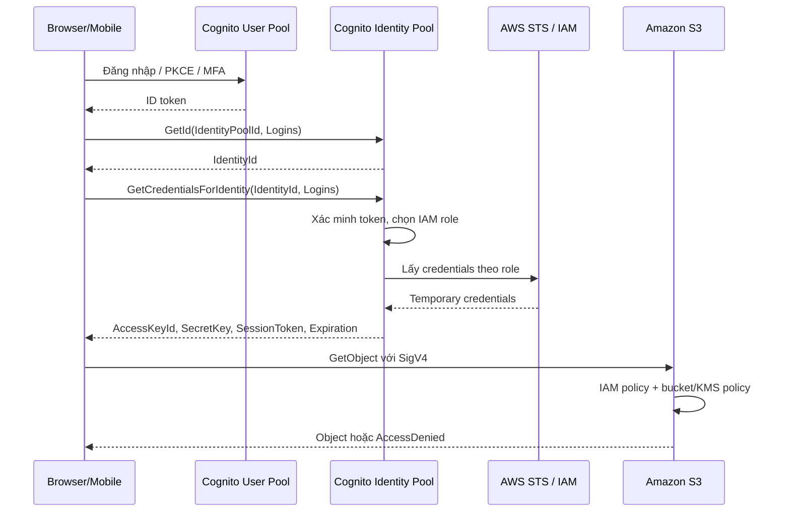
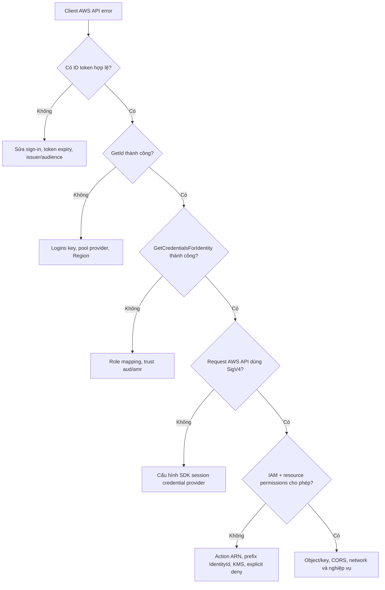

# Cấp quyền truy cập AWS tạm thời qua Identity Pool

> **Học phần:** CLOUD_PROVIDERS_AWS  
> **Chương:** Danh tính ứng dụng với Cognito  
> **Bài học:** Cấp quyền truy cập AWS tạm thời qua Identity Pool  
> **Bối cảnh:** Hệ thống học trực tuyến trên AWS cần cho web/mobile app tải tài liệu hoặc gọi AWS APIs mà không nhúng IAM user access keys dài hạn.

## 1. Bài toán: làm sao cấp quyền S3 cho từng học viên?

Một ứng dụng học Java/Spring Boot cho phép học viên đăng nhập, xem khóa học và tải tài liệu cá nhân từ Amazon S3. Nếu mọi file phải đi qua Spring Boot backend, server có thể trở thành nút cổ chai khi số lượng người dùng lớn. Nhóm muốn client có thể gọi S3 trực tiếp nhưng vẫn đảm bảo:

- Chỉ học viên đã đăng nhập được đọc file cá nhân.
- Học viên A không thể đọc file của học viên B dù biết object key.
- Không đưa `AWS_ACCESS_KEY_ID` và `AWS_SECRET_ACCESS_KEY` của IAM user vào JavaScript hoặc mobile app.
- Quyền được giới hạn theo người dùng và hết hạn tự động.
- Có thể đăng nhập qua Cognito User Pool hoặc identity provider khác khi phù hợp.
- Có cách giám sát, thu hồi/quản lý rủi ro và tính toán chi phí.

**Amazon Cognito Identity Pools** giúp liên kết danh tính người dùng/khách với AWS IAM roles và nhận **temporary AWS credentials** từ AWS STS. Từ đó, AWS SDK ký các request đến S3, AppSync hoặc API Gateway bằng **AWS Signature Version 4 (SigV4)**.

Sau bài học, bạn có thể phân biệt User Pool/Identity Pool, thực hiện enhanced credentials flow, cấu hình IAM trust/permission policies, hạn chế quyền theo Identity ID hoặc principal tags, viết ví dụ Java/JavaScript, thử các tình huống từ chối quyền và quyết định khi nào dùng Identity Pool thay vì presigned URL.

## 2. Cognito User Pool khác Cognito Identity Pool

| Tiêu chí | User Pool | Identity Pool |
|---|---|---|
| Nhiệm vụ | Đăng ký, đăng nhập, MFA, quản lý tài khoản và token | Liên kết user từ identity provider với quyền AWS |
| Đầu ra | ID token, access token, refresh token | Identity ID, AWS credentials tạm thời |
| Xác thực user | Có, như một identity provider | Dựa trên proof từ IdP; **không thay User Pool để đăng nhập** |
| Gắn quyền IAM | JWT dùng với các API authorizers phù hợp | Chọn IAM role, trả credentials ký SigV4 |
| Guest chưa đăng nhập | Không cấp AWS guest role | Có nếu chủ động bật unauthenticated identities |
| Dùng một mình | Có, bảo vệ API bằng JWT | Có thể tin social/OIDC/SAML/other IdP, không bắt buộc User Pool |

**Không nhầm:**

- **JWT từ User Pool** là bằng chứng phiên/danh tính, không phải AWS secret access key.
- **Identity Pool** không tự cấp quyền trên S3 chỉ vì user login. Nó cần IAM role với **trust policy** và **permission policy** đúng.
- **Identity Pool ID** là thông tin cấu hình client có thể biết, **không phải secret**.
- **Temporary credentials** vẫn là dữ liệu nhạy cảm và có thể bị lạm dụng trong thời hạn tồn tại.

### 2.1. Các nhà cung cấp danh tính

Identity Pool hỗ trợ Cognito User Pools, một số OIDC/social providers, SAML providers và developer-authenticated identities.

Loại token đầu vào tùy nhà cung cấp:

| IdP | Bằng chứng trong `Logins` |
|---|---|
| **Cognito User Pool** | **ID token** của user đã đăng nhập |
| OIDC thông thường | ID token theo cấu hình IdP |
| Một số social providers | Access token do provider phát hành |
| SAML | Assertion qua cơ chế tích hợp được hỗ trợ |
| Developer provider | Token do quy trình developer-authenticated đã được server xác nhận |

**Không tùy tiện dùng access token của Cognito User Pool** ở chỗ hướng dẫn yêu cầu ID token. Với API Gateway JWT authorizer, access token lại thường là lựa chọn phù hợp để gọi API theo scopes — đó là một bài toán khác.

### 2.2. Hai loại định danh không giống nhau

Giả sử User Pool cấp:

```text
User Pool sub: 7fe92d1c-0a71-4eab-a36d-1970af2b3d80
```

Identity Pool có thể cấp:

```text
IdentityId: ap-southeast-1:11111111-2222-4333-8444-555555555555
```

- User Pool `sub`: định danh người dùng tại User Pool.
- Identity Pool `IdentityId`: định danh liên kết của người dùng tại Identity Pool.
- IAM condition key `cognito-identity.amazonaws.com:sub` = **Identity Pool identity ID**, không phải User Pool `sub`.
- IAM trust condition `cognito-identity.amazonaws.com:aud` = **Identity Pool ID**; claim `aud` của User Pool ID token lại thường là **app client ID**.

Nhầm hai loại ID này thường tạo S3 policies không hoạt động hoặc mở quyền sai phạm vi.

## 3. Kiến trúc tổng quan



Sơ đồ dùng **enhanced (simplified) flow**. Identity Pool chọn role và làm việc với STS thay app. Client không cần gọi AWS STS trực tiếp.

### 3.1. Bốn lớp bảo vệ

1. **IdP authentication:** Token từ đúng provider và app client, chưa hết hạn.
2. **IAM role trust:** Đúng Identity Pool và đúng authenticated/unauthenticated state.
3. **IAM permission policy:** Đúng AWS action và resource ARN/prefix.
4. **Resource/business authorization:** Bucket policy, KMS key policy và logic quyền sở hữu/tổ chức trong ứng dụng nếu cần.

Cho phép ở lớp 1 **không đảm bảo** được phép ở các lớp 2–4.

## 4. Enhanced flow và basic/classic flow

### 4.1. Enhanced flow — nên dùng mặc định

```text
Provider ID token
       |
       v
GetId(IdentityPoolId, Logins)
       |
       v
IdentityId
       |
       v
GetCredentialsForIdentity(IdentityId, Logins)
       |
       v
Identity Pool chọn IAM role và dùng STS
       |
       v
AWS temporary credentials
```

Trên client thường có **hai Cognito Identity API calls**: `GetId` và `GetCredentialsForIdentity`. Identity Pool kiểm soát role mappings, có thể dùng RBAC/ABAC. Theo AWS, credentials từ enhanced flow có hiệu lực thông thường **một giờ**.

Ưu điểm:

- Role selection tập trung, không trao quyền tự chọn role cho client.
- Ít API calls và ít logic nhạy cảm hơn.
- SDK credential providers hỗ trợ cache/làm mới credentials.
- Có scope-down policy bổ sung cho guest identities trong enhanced flow.

### 4.2. Basic/classic flow — chỉ dùng khi có yêu cầu cụ thể

```text
GetId -> GetOpenIdToken -> STS AssumeRoleWithWebIdentity
      -> AWS temporary credentials
```

Basic flow đưa việc chọn role và gọi STS về ứng dụng. Vì mã browser/mobile có thể bị thay đổi, **không được tin lựa chọn role chỉ vì client code đang hard-code ARN**.

Theo AWS:

- Không bật classic authentication khi tạo pool mới trừ khi có use case đã security-review.
- Basic flow **không tương thích với Identity Pool role mappings**; có thể trả `Basic (classic) flow is not supported with RoleMappings, please use enhanced flow`.
- Enhanced flow yêu cầu IAM role trong cùng AWS account với Identity Pool; basic flow có thể hỗ trợ cross-account theo điều kiện trust và STS tương ứng.
- Với cross-account basic auth, các điều kiện `aud` và `amr` càng quan trọng; không được dùng trust policy quá rộng.

**Kết luận:** Dùng enhanced flow trong các ví dụ triển khai mới của bài học.

### 4.3. Developer-authenticated identities

Khi ứng dụng có hệ thống đăng nhập riêng, **backend được tin cậy** có thể xác minh user, sau đó gọi `GetOpenIdTokenForDeveloperIdentity` theo quy trình AWS. Backend không được tin một `userId` client tự gửi mà không xác thực, và **không chuyển IAM server credentials dài hạn xuống browser**.

## 5. Authenticated và unauthenticated users

| Nhóm | Bằng chứng | Role |
|---|---|---|
| **Authenticated** | Token hợp lệ từ IdP đã cấu hình | Default authenticated role hoặc role từ mapping |
| **Unauthenticated** | Không có token, pool cho phép guest | Unauthenticated role rất hẹp |
| **No login + guest disabled** | Không có bằng chứng hợp lệ | Từ chối cấp credentials |

**Guest access không phải bí mật.** Bất kỳ ai trên Internet có cấu hình Identity Pool có thể thử xin guest credentials nếu guest đã bật. Vì vậy, chỉ bật khi **sẵn sàng cấp đúng những quyền IAM của guest role cho người lạ**.

### 5.1. Guest role nên giới hạn đến đâu?

Một guest role có thể chỉ cần đọc vài object public:

```json
{
  "Version": "2012-10-17",
  "Statement": [
    {
      "Effect": "Allow",
      "Action": "s3:GetObject",
      "Resource": "arn:aws:s3:::course-assets-demo-123456789012/public-lessons/*"
    }
  ]
}
```

Không cho guest đọc toàn bộ hồ sơ học viên, ghi object tùy ý, gọi `iam:*`, `secretsmanager:*` hay các API phát sinh phí không giới hạn. Nếu không có nhu cầu guest AWS access, **tắt guest access**.

### 5.2. Guest chuyển sang logged-in user

Identity Pools có thể liên kết/merge identities khi guest đăng nhập hoặc thêm identity provider. Identity ID **có thể thay đổi** trong quá trình liên kết; SDK cần cập nhật cached ID, và dữ liệu đặt theo prefix guest ID có thể cần quy trình migration có kiểm soát.

Đừng dùng Identity ID của guest như user ID nghiệp vụ bất biến. Với hồ sơ đăng ký khóa học, backend thường nên có user key riêng và mapping có kiểm soát.

## 6. IAM trust policy: đúng Identity Pool, đúng loại identity

**Trust policy** xác định ai được assume role; **permission policy** xác định role làm được gì sau khi assume.

Ví dụ role dành cho học viên authenticated:

```json
{
  "Version": "2012-10-17",
  "Statement": [
    {
      "Effect": "Allow",
      "Principal": {
        "Federated": "cognito-identity.amazonaws.com"
      },
      "Action": "sts:AssumeRoleWithWebIdentity",
      "Condition": {
        "StringEquals": {
          "cognito-identity.amazonaws.com:aud": "ap-southeast-1:11111111-2222-4333-8444-555555555555"
        },
        "ForAnyValue:StringLike": {
          "cognito-identity.amazonaws.com:amr": "authenticated"
        }
      }
    }
  ]
}
```

Giải thích:

- `Principal.Federated` phải là `cognito-identity.amazonaws.com` cho Identity Pool.
- `cognito-identity.amazonaws.com:aud` giới hạn **Identity Pool ID cụ thể**. AWS yêu cầu IAM role trust của Identity Pool không được bỏ điều kiện này.
- `cognito-identity.amazonaws.com:amr` kiểm tra trạng thái `authenticated` hoặc `unauthenticated`. Đây là tập nhiều giá trị nên ví dụ dùng `ForAnyValue:StringLike`.
- `sts:AssumeRoleWithWebIdentity` cho phép Identity Pool đi qua STS theo token hợp lệ.
- Nếu dùng principal session tags cho ABAC, cần thêm `sts:TagSession` theo hướng dẫn AWS.

### 6.1. Trust policy cho guest (chỉ khi cần)

```json
{
  "Version": "2012-10-17",
  "Statement": [
    {
      "Effect": "Allow",
      "Principal": {
        "Federated": "cognito-identity.amazonaws.com"
      },
      "Action": "sts:AssumeRoleWithWebIdentity",
      "Condition": {
        "StringEquals": {
          "cognito-identity.amazonaws.com:aud": "ap-southeast-1:11111111-2222-4333-8444-555555555555"
        },
        "ForAnyValue:StringLike": {
          "cognito-identity.amazonaws.com:amr": "unauthenticated"
        }
      }
    }
  ]
}
```

Guest role cần **permission policy riêng hẹp hơn**. Không dùng chung role nhiều quyền rồi chỉ thêm điều kiện `amr`.

### 6.2. Những điều không được làm

- Không thay principal bằng `cognito-idp.amazonaws.com` chỉ vì IdP là User Pool.
- Không thay `aud` bằng **User Pool app client ID**.
- Không dùng `Resource:"*"` và IAM action admin rộng cho user clients.
- Không cho client tự chọn role tùy ý trong basic flow khi role trust không giới hạn.
- Không coi việc assume thành công có nghĩa được đọc tất cả S3 objects.

## 7. Permission policy: mỗi IdentityId chỉ đọc S3 prefix riêng

Bucket ví dụ:

```text
course-private-data-demo-123456789012/
  private/
    ap-southeast-1:11111111-2222-4333-8444-555555555555/
      report-2026.pdf
    ap-southeast-1:aaaaaaaa-bbbb-4ccc-8ddd-eeeeeeeeeeee/
      report-2026.pdf
```

IAM policy gắn vào **authenticated role**:

```json
{
  "Version": "2012-10-17",
  "Statement": [
    {
      "Sid": "ListOwnPrefix",
      "Effect": "Allow",
      "Action": "s3:ListBucket",
      "Resource": "arn:aws:s3:::course-private-data-demo-123456789012",
      "Condition": {
        "StringLike": {
          "s3:prefix": [
            "private/${cognito-identity.amazonaws.com:sub}/*"
          ]
        }
      }
    },
    {
      "Sid": "ReadOwnObjects",
      "Effect": "Allow",
      "Action": "s3:GetObject",
      "Resource": "arn:aws:s3:::course-private-data-demo-123456789012/private/${cognito-identity.amazonaws.com:sub}/*"
    }
  ]
}
```

`${cognito-identity.amazonaws.com:sub}` là **policy variable** được IAM thay bằng Identity Pool IdentityId, **không lấy từ query parameter hay User Pool sub**.

Đây là sự khác nhau giữa:

- **Ẩn một file trong UI**: user có thể bỏ qua giao diện và gọi AWS API trực tiếp.
- **IAM policy giới hạn ARN**: ngay cả khi user biết object key khác, IAM vẫn từ chối request ngoài prefix được cấp.

**Lưu ý:** `s3:ListBucket` dùng ARN **bucket**, còn `s3:GetObject` dùng ARN **object**. Khi object không tồn tại, S3 có thể trả 403 hoặc 404 tùy quyền list.

### 7.1. Thêm quyền upload (nếu cần)

Có thể cấp quyền ghi chỉ trong prefix người dùng:

```json
{
  "Version": "2012-10-17",
  "Statement": [
    {
      "Sid": "UploadOwnObjects",
      "Effect": "Allow",
      "Action": "s3:PutObject",
      "Resource": "arn:aws:s3:::course-private-data-demo-123456789012/private/${cognito-identity.amazonaws.com:sub}/*"
    }
  ]
}
```

Tuy nhiên, `PutObject` theo prefix **không tự giới hạn** size, content type, malware, số lượng objects hoặc ngân sách upload. Cần thêm kiểm tra nghiệp vụ, scan pipeline, alarm/quotas; nếu muốn backend phê duyệt từng file và đặt điều kiện upload, cân nhắc **presigned POST/URL**.

### 7.2. SSE-KMS, bucket policy và các deny khác

Nếu bucket dùng SSE-KMS, requester có thể cần KMS permissions (ví dụ `kms:Decrypt` khi đọc) và key policy cho phép. Bucket policy, SCP, permissions boundary, endpoint policy hoặc explicit deny vẫn có thể chặn truy cập.

**Không chữa lỗi bằng** `s3:*` hoặc `kms:*` trên mọi resource. Xác định đúng action, object, key và condition trước.

## 8. RBAC: chọn roles bằng claims và role mappings

Một pool có thể quản lý nhiều nhóm người dùng:

| Nhóm | IAM role | Quyền gợi ý |
|---|---|---|
| Học viên | `CourseStudentRole` | Đọc S3 prefix riêng |
| Giảng viên | `CourseInstructorRole` | Truy cập vùng tài liệu giảng dạy có kiểm soát |
| Người quản trị nội dung | `CourseEditorRole` | Cập nhật prefix được giao, không phải IAM admin |
| Guest | `CourseGuestRole` nếu bật | Chỉ đọc public assets |

Cách Identity Pool chọn role:

1. **Default authenticated/unauthenticated role**.
2. **Role mappings theo rules**, dựa trên claims đáng tin cậy của IdP.
3. Với Cognito User Pool, có thể chọn theo `cognito:preferred_role` claim liên quan IAM role của user groups.
4. **Ambiguous/no-match role resolution**: quay về authenticated role mặc định hoặc **Deny** theo cấu hình.

### 8.1. Ví dụ role mapping theo claim

IdP phát hành claim giả lập:

```json
{
  "sub": "7fe92d1c-0a71-4eab-a36d-1970af2b3d80",
  "custom:user_type": "instructor"
}
```

Rule giả định:

```text
Claim: custom:user_type
MatchType: Equals
Value: instructor
Role: CourseInstructorRole
No match: Deny hoặc Use authenticated role tùy nghiệp vụ
```

**Không chọn InstructorRole từ giá trị `role=instructor` do client gửi lên**. Chỉ dùng claim do IdP tin cậy ký; đồng thời phải giới hạn ai được quyền cập nhật custom attribute. Nếu user tự sửa được `custom:user_type`, mapping có thể thành đường nâng quyền.

### 8.2. Rule precedence và fallback

- Các rules được đánh giá theo **thứ tự**; rule khớp đầu tiên có thể quyết định role.
- Không khớp rule có thể dẫn đến role fallback hoặc Deny.
- `cognito:preferred_role` cần phù hợp mapping và role trust.
- Đánh giá cả tình huống role claims bị thiếu hoặc không còn hợp lệ, không chỉ happy path.

## 9. ABAC: ánh xạ claims sang IAM principal session tags

**ABAC** giới hạn quyền bằng các thuộc tính được xác minh, ví dụ `tenant_id` hoặc `department`.

IdP phát hành:

```json
{
  "sub": "7fe92d1c-0a71-4eab-a36d-1970af2b3d80",
  "custom:tenant_id": "school-01",
  "custom:department": "academics"
}
```

Trong Identity Pool **Attributes for access control** có thể cấu hình:

```text
custom:tenant_id -> aws:PrincipalTag/tenant
custom:department -> aws:PrincipalTag/department
```

Để truyền session tags, IAM role trust có thể cần hai hành động:

```json
{
  "Version": "2012-10-17",
  "Statement": [
    {
      "Effect": "Allow",
      "Principal": {
        "Federated": "cognito-identity.amazonaws.com"
      },
      "Action": [
        "sts:AssumeRoleWithWebIdentity",
        "sts:TagSession"
      ],
      "Condition": {
        "StringEquals": {
          "cognito-identity.amazonaws.com:aud": "ap-southeast-1:11111111-2222-4333-8444-555555555555"
        },
        "ForAnyValue:StringLike": {
          "cognito-identity.amazonaws.com:amr": "authenticated"
        }
      }
    }
  ]
}
```

IAM permission policy:

```json
{
  "Version": "2012-10-17",
  "Statement": [
    {
      "Effect": "Allow",
      "Action": "s3:GetObject",
      "Resource": "arn:aws:s3:::course-private-data-demo-123456789012/tenants/${aws:PrincipalTag/tenant}/*"
    }
  ]
}
```

Nếu principal tag `tenant=school-01`, role được đọc prefix `tenants/school-01/`. Nhưng vẫn cần kiểm tra quyền sở hữu từng document bên trong tenant nếu dữ liệu yêu cầu.

**Lưu ý bảo mật:** Claims dùng để cấp quyền phải được IdP quản lý; đừng map một attribute do user tùy ý chỉnh sửa thành IAM principal tag có quyền nhạy cảm.

## 10. AWS Console: tạo Identity Pool cho User Pool

Giả sử sandbox:

```text
Region: ap-southeast-1
Account: 123456789012
User Pool: ap-southeast-1_EXAMPLE
User Pool app client: 7exampleclientid8
Identity Pool: ap-southeast-1:11111111-2222-4333-8444-555555555555
Authenticated role: CourseStudentRole
S3 bucket: course-private-data-demo-123456789012
```

Tất cả là **giá trị minh họa**, không phải ID thực.

### 10.1. Chuẩn bị IdP

1. Tạo hoặc chọn Cognito User Pool của sandbox.
2. Cấu hình app client và sign-in flow phù hợp, ví dụ **Authorization Code + PKCE** cho public browser/mobile client.
3. Không nhúng app client secret vào JavaScript/mobile binary.
4. Tạo user sandbox và đăng nhập theo đúng flow.
5. Xác nhận ID token có `iss` đúng User Pool và `aud` là app client ID dự kiến.
6. Kiểm tra token expiry và cơ chế refresh trước khi nối Identity Pool.

### 10.2. Tạo Identity Pool

1. Mở **Amazon Cognito → Identity pools → Create identity pool**.
2. Chọn **Authenticated access**.
3. Chọn **Amazon Cognito user pool** làm provider.
4. Chọn đúng User Pool/app client đã cấu hình.
5. Tạo hoặc chọn authenticated IAM role có trust policy đúng `aud` và `amr`.
6. Cấu hình role mappings/default role phù hợp.
7. Không bật **Guest access** nếu ứng dụng không cần.
8. Không bật **Basic/classic flow** nếu không có yêu cầu chuyên biệt.
9. Nếu dùng ABAC, cấu hình attributes for access control và trust `sts:TagSession`.
10. Review, tạo pool, ghi lại Identity Pool ID và role ARNs.
11. Thử nghiệm với user sandbox, sau đó mới cho phép frontend thực sử dụng.

Console có thể thay đổi nhãn theo phiên bản. Luôn kiểm tra AWS account, Region và identity providers đã liên kết trước khi lưu.

## 11. AWS CLI: xác minh metadata và role configuration

Để **đọc cấu hình** trong tài khoản được cấp quyền:

```bash
aws sts get-caller-identity

aws cognito-identity describe-identity-pool \
  --identity-pool-id ap-southeast-1:11111111-2222-4333-8444-555555555555 \
  --region ap-southeast-1

aws cognito-identity get-identity-pool-roles \
  --identity-pool-id ap-southeast-1:11111111-2222-4333-8444-555555555555 \
  --region ap-southeast-1

aws iam get-role \
  --role-name CourseStudentRole \
  --query 'Role.AssumeRolePolicyDocument' \
  --output json
```

Quan sát:

- `AllowUnauthenticatedIdentities` có bật vô ý không?
- User Pool provider và app client có đúng không?
- Role mappings có chỉ tới role hợp lệ không?
- IAM trust có `aud` là Identity Pool ID và `amr` chính xác không?
- Permission policy đã giới hạn tài nguyên tới prefix của từng identity chưa?

### 11.1. Cấu trúc yêu cầu GetId và GetCredentialsForIdentity

Provider key với Cognito User Pool phải có dạng:

```text
cognito-idp.{region}.amazonaws.com/{userPoolId}
```

Ví dụ request `GetId` minh họa:

```json
{
  "IdentityPoolId": "ap-southeast-1:11111111-2222-4333-8444-555555555555",
  "Logins": {
    "cognito-idp.ap-southeast-1.amazonaws.com/ap-southeast-1_EXAMPLE": "ID_TOKEN_FROM_IDP"
  }
}
```

Response:

```json
{
  "IdentityId": "ap-southeast-1:aaaaaaaa-bbbb-4ccc-8ddd-eeeeeeeeeeee"
}
```

Request `GetCredentialsForIdentity`:

```json
{
  "IdentityId": "ap-southeast-1:aaaaaaaa-bbbb-4ccc-8ddd-eeeeeeeeeeee",
  "Logins": {
    "cognito-idp.ap-southeast-1.amazonaws.com/ap-southeast-1_EXAMPLE": "ID_TOKEN_FROM_IDP"
  }
}
```

Response thật chứa `Credentials.AccessKeyId`, `SecretKey`, `SessionToken` và `Expiration`. **Không in output thật vào terminal log, screenshot, ticket, chat hoặc commit vào repository**. Ưu tiên credential provider của SDK tự giữ và refresh hơn là lưu thủ công.

**Không nhầm:** key của `Logins` không phải issuer có tiền tố `https://`, cũng không phải user email. Token phải là **ID token thật** phát hành từ User Pool đã liên kết.

## 12. Java 17 + AWS SDK for Java 2.x: enhanced flow

Ví dụ dưới đây phù hợp với **Java client/sandbox được kiểm soát**, đã có ID token sau đăng nhập. Nó gọi Cognito Identity API và dùng temporary credentials để đọc metadata S3 trong prefix riêng.

Dependencies AWS SDK v2: `software.amazon.awssdk:cognitoidentity`, `software.amazon.awssdk:s3` (và các dependencies chuyển tiếp). Quản lý versions bằng AWS SDK BOM của dự án.

```java
package example.course.identity;

import java.util.Map;

import software.amazon.awssdk.auth.credentials.AnonymousCredentialsProvider;
import software.amazon.awssdk.auth.credentials.AwsSessionCredentials;
import software.amazon.awssdk.auth.credentials.StaticCredentialsProvider;
import software.amazon.awssdk.regions.Region;
import software.amazon.awssdk.services.cognitoidentity.CognitoIdentityClient;
import software.amazon.awssdk.services.cognitoidentity.model.Credentials;
import software.amazon.awssdk.services.cognitoidentity.model.GetIdRequest;
import software.amazon.awssdk.services.cognitoidentity.model.GetIdResponse;
import software.amazon.awssdk.services.cognitoidentity.model.GetCredentialsForIdentityRequest;
import software.amazon.awssdk.services.cognitoidentity.model.GetCredentialsForIdentityResponse;
import software.amazon.awssdk.services.s3.S3Client;
import software.amazon.awssdk.services.s3.model.HeadObjectRequest;

public final class CourseIdentityExample {
    private static final Region REGION = Region.AP_SOUTHEAST_1;
    private static final String IDENTITY_POOL =
        "ap-southeast-1:11111111-2222-4333-8444-555555555555";
    private static final String PROVIDER =
        "cognito-idp.ap-southeast-1.amazonaws.com/ap-southeast-1_EXAMPLE";
    private static final String BUCKET =
        "course-private-data-demo-123456789012";

    public static void main(String[] args) {
        // Lấy từ quy trình sign-in đã được xác thực, không hard-code.
        String idToken = System.getenv("COURSE_LAB_ID_TOKEN");
        if (idToken == null || idToken.isBlank()) {
            throw new IllegalStateException("Missing ID token for lab");
        }

        Map<String, String> logins = Map.of(PROVIDER, idToken);

        // Hai identity API này không cần IAM user credentials có sẵn.
        try (CognitoIdentityClient cognito = CognitoIdentityClient.builder()
                .region(REGION)
                .credentialsProvider(AnonymousCredentialsProvider.create())
                .build()) {

            GetIdResponse id = cognito.getId(GetIdRequest.builder()
                .identityPoolId(IDENTITY_POOL)
                .logins(logins)
                .build());

            GetCredentialsForIdentityResponse result =
                cognito.getCredentialsForIdentity(
                    GetCredentialsForIdentityRequest.builder()
                        .identityId(id.identityId())
                        .logins(logins)
                        .build());

            Credentials c = result.credentials();

            // Đừng in AccessKeyId/SecretKey/SessionToken ra log.
            AwsSessionCredentials session = AwsSessionCredentials.create(
                c.accessKeyId(),
                c.secretKey(),
                c.sessionToken());

            try (S3Client s3 = S3Client.builder()
                    .region(REGION)
                    .credentialsProvider(
                        StaticCredentialsProvider.create(session))
                    .build()) {

                String identityId = result.identityId();
                String key = "private/" + identityId + "/profile.json";

                var obj = s3.headObject(HeadObjectRequest.builder()
                    .bucket(BUCKET)
                    .key(key)
                    .build());

                System.out.println("IdentityId: " + identityId);
                System.out.println("Object bytes: " + obj.contentLength());
            }
        }
    }
}
```

**Giới hạn của ví dụ:**

- `StaticCredentialsProvider` chỉ giữ một bộ credentials, **không tự refresh** khi hết hạn. Dùng credential provider có quản lý refresh trong ứng dụng dài hạn.
- File `private/<IdentityId>/profile.json` phải tồn tại; IAM role cần quyền S3 phù hợp. Thiếu object có thể trả 403/404 tùy policy.
- Trong production browser/mobile, nên dùng SDK provider tích hợp thay vì tự thu thập/lưu STS credentials.
- Nếu Spring Boot backend đã chạy trên EC2/ECS/Lambda, thường nên dùng **instance profile/task role/execution role của backend**; không cần Identity Pool chỉ để server gọi S3 bằng quyền server.
- Khi backend thay mặt user gọi tài nguyên theo user identity, phải có trust boundary rõ ràng và không trộn credentials của các user khác nhau.

## 13. JavaScript SDK v3 cho browser/mobile: provider tự refresh

Ví dụ cho user đã đăng nhập qua Cognito User Pool:

```javascript
import { S3Client, HeadObjectCommand } from "@aws-sdk/client-s3";
import { fromCognitoIdentityPool } from "@aws-sdk/credential-providers";

const region = "ap-southeast-1";
const identityPoolId =
  "ap-southeast-1:11111111-2222-4333-8444-555555555555";
const providerName =
  "cognito-idp.ap-southeast-1.amazonaws.com/ap-southeast-1_EXAMPLE";

// Hàm thuộc authentication layer, không phải API có sẵn của SDK.
// Hàm này trả ID token còn hạn từ một sign-in flow đáng tin cậy.
const idToken = await getCurrentIdToken();

const credentials = fromCognitoIdentityPool({
  identityPoolId,
  logins: { [providerName]: idToken },
  clientConfig: { region },
});

const s3 = new S3Client({ region, credentials });
const identityCredentials = await credentials();
const identityId = identityCredentials.identityId;
if (!identityId) {
  throw new Error("Cognito did not return an IdentityId");
}

// Tạo key từ IdentityId do Cognito trả, không tin input client tự chọn.
const key = "private/" + identityId + "/profile.json";

await s3.send(new HeadObjectCommand({
  Bucket: "course-private-data-demo-123456789012",
  Key: key,
}));
```

**Giải thích:**

- `fromCognitoIdentityPool` thực hiện enhanced flow, lấy identity ID và session credentials theo cơ chế được SDK hỗ trợ.
- Chỉ dùng `ID token` phù hợp với Cognito User Pool IdP trong `logins`.
- Khi ID token hết hạn, ứng dụng phải **refresh IdP login state** và đảm bảo credentials provider nhận token mới; không giả định provider tự refresh JWT từ User Pool khi không có integration auth.
- Sau khi logout/đổi account, không giữ AWS credentials hoặc identity ID từ session cũ.
- Browser gọi S3 trực tiếp cần **S3 CORS** cho origin/method/headers phù hợp, nhưng **CORS không cấp IAM permissions**.
- Không lưu AWS secret access key/session token dài hạn vào localStorage; bảo vệ ứng dụng chống XSS, dùng HTTPS và security headers.

### 13.1. Guest credential provider

Chỉ khi đã chủ động bật guest role:

```javascript
const guestCredentials = fromCognitoIdentityPool({
  identityPoolId,
  clientConfig: { region },
  // Không có logins: unauthenticated flow nếu pool cho phép.
});
```

Không có `Logins` mà guest bị tắt thì không được cấp credentials. Đừng dùng guest như cách vượt qua đăng nhập cho file riêng.

## 14. Gọi API Gateway hoặc AppSync với Identity Pool credentials

Temporary credentials không chỉ dành cho S3. Chúng có thể gọi API có **AWS_IAM authorization**.

### 14.1. API Gateway IAM

Route:

```text
GET /student-files
AuthorizationType = AWS_IAM
```

IAM policy:

```json
{
  "Version": "2012-10-17",
  "Statement": [
    {
      "Effect": "Allow",
      "Action": "execute-api:Invoke",
      "Resource": "arn:aws:execute-api:ap-southeast-1:123456789012:abc123def4/prod/GET/student-files"
    }
  ]
}
```

Client phải dùng **AWS SigV4 signer** với session credentials. `Bearer ID_TOKEN` **không tự gọi được** một route chỉ cho `AWS_IAM`.

### 14.2. AppSync GraphQL IAM

IAM policy có thể giới hạn một GraphQL root field:

```json
{
  "Version": "2012-10-17",
  "Statement": [
    {
      "Effect": "Allow",
      "Action": "appsync:GraphQL",
      "Resource": "arn:aws:appsync:ap-southeast-1:123456789012:apis/graphqlexample123/types/Query/fields/myCourses"
    }
  ]
}
```

AppSync resolver còn phải kiểm tra người dùng chỉ thấy courses họ được phép xem. **IAM field-level permission không thay thế object/tenant-level authorization**.

### 14.3. Loại credential nào cho API nào?

| Nơi gọi | Credential |
|---|---|
| Cognito User Pool đăng nhập | OAuth flow/password/MFA theo cấu hình |
| Identity Pool GetId | ID token của User Pool trong `Logins` |
| S3 GetObject/PutObject | AWS session credentials + SigV4 |
| API Gateway HTTP API JWT authorizer | Bearer access JWT phù hợp issuer/audience/scopes |
| API Gateway AWS_IAM | AWS session credentials + SigV4 |
| AppSync Cognito auth | User Pool token theo mode |
| AppSync AWS_IAM | AWS session credentials + SigV4 |

Một app có thể dùng **cả JWT và AWS credentials** vì các API có trust model khác nhau. Không trộn expiry, storage và authorization semantics của chúng.

## 15. Khi nào nên dùng presigned URL thay vì Identity Pool?

| Giải pháp | Ưu điểm | Đánh đổi |
|---|---|---|
| **Identity Pool → AWS APIs trực tiếp** | Client có thể gọi nhiều operations theo IAM role hẹp; giảm proxy traffic | Client giữ credentials tạm; role/prefix/ABAC phải rất đúng |
| **Backend tạo presigned S3 URL/POST** | Backend kiểm tra business ownership trước mỗi lần cấp URL, hạn chế thao tác theo thời hạn | URL là bearer capability, phải bảo vệ và giới hạn TTL/điều kiện |
| **Backend proxy S3** | Mọi authorization/validation tập trung ở server | Tăng bandwidth/CPU backend khi stream file lớn |
| **CloudFront signed URL/cookie** | Phân phối nội dung qua CDN, phục vụ download nhiều | Cần quản lý signing keys/CloudFront origin access |

Nếu quyền đọc phụ thuộc **enrollment trong RDS**, trạng thái khóa học hay việc user đã thanh toán, các điều kiện này có thể không thể biểu diễn đơn giản thành một S3 IAM prefix. Khi đó presigned URL sau backend authorization hoặc một API proxy có thể an toàn và dễ kiểm soát hơn.

**Không cấp** authenticated role `s3:GetObject` cho cả bucket rồi kỳ vọng backend API chặn những request **không qua backend**.

## 16. Bảo mật production và thu hồi quyền

### 16.1. Temporary không có nghĩa là vô hại

Một AWS session có:

- Access Key ID.
- Secret Access Key.
- Session Token.
- Expiration.

Bất kỳ ai lấy được ba thành phần credentials có thể gọi những AWS APIs mà session IAM cho phép **trong thời gian chúng còn hiệu lực**. Không ghi credentials/token vào logs, URLs, crash reports hoặc chat.

### 16.2. Checklist theo lớp

| Lớp | Kiểm soát |
|---|---|
| IdP | PKCE, MFA nếu cần, validation issuer/audience, bảo vệ token |
| Identity Pool | Chỉ provider hợp lệ, role mappings, guest tắt nếu không cần |
| IAM role trust | `aud` đúng pool ID, `amr` đúng trạng thái, `TagSession` khi dùng ABAC |
| Permission policy | Action/resource/prefix hẹp, không admin wildcard |
| S3/KMS | Bucket policy, Block Public Access, encryption, KMS key policy |
| Browser/mobile | HTTPS, CSP/XSS defenses, session cache isolation, logout cleanup |
| Backend | Kiểm tra owner/tenant/role, input validation, audit |
| Logs | Không lộ secrets, CloudTrail S3 data events nếu cần, retention |
| Operations | Theo dõi credential expiry, revoke policy và incident response |

### 16.3. Logout không bảo đảm revoke mọi credentials ngay lập tức

Khi user logout hoặc mất quyền ở User Pool, **AWS credentials đã phát hành trước đó có thể còn dùng được** đến khi hết hạn hoặc đến khi một biện pháp IAM/resource deny có hiệu lực.

Nếu nghiệp vụ cần **thu hồi truy cập ngay**, cân nhắc:

- Backend kiểm tra authorization trước khi cấp presigned URL có TTL ngắn.
- Explicit deny/resource policy/role session revocation phù hợp và quy trình kiểm chứng.
- Không dựa hoàn toàn vào cached IAM credentials để bảo vệ dữ liệu có yêu cầu revocation tức thời.
- Tách authorization theo dữ liệu hiện hành thay vì một quyền giữ được lâu.

**MFA bảo vệ login**, nhưng không thể thay thế IAM least privilege của AWS credentials đã cấp.

## 17. Quan sát và chi phí

Theo [Amazon Cognito pricing](https://aws.amazon.com/cognito/pricing/), **Identity Pools để xác thực identities và tạo unique identifiers hiện được cung cấp không thu phí riêng** theo mục này. Điều đó **không có nghĩa kiến trúc miễn phí**.

| Thành phần | Chi phí/quan sát |
|---|---|
| Cognito User Pool | Tier Lite/Essentials/Plus, MAUs, SAML/OIDC federation, MFA/SMS |
| S3 | Storage, GET/PUT/LIST, KMS, data transfer |
| API Gateway / AppSync | Requests và bandwidth |
| Lambda / EC2 / ECS / RDS | Compute và vận hành backend |
| CloudWatch / CloudTrail | Logs, metrics, audit data events |
| VPC/NAT/endpoints | Route/transfer theo kiến trúc |
| Third-party identity provider | Phí xác thực/tier bên ngoài AWS |

### 17.1. Metric và audit quan trọng

- Tỷ lệ Cognito sign-in thành công/thất bại.
- Số lỗi `GetId` và `GetCredentialsForIdentity` theo loại.
- AWS API `AccessDenied` theo action/resource.
- Tỷ lệ token/session credentials hết hạn gây lỗi.
- S3 4xx/5xx và requests/data transfer.
- CloudTrail management events cho thay đổi IAM/Identity Pool; S3 data events khi cần audit object access.
- AWS Budgets/Cost Explorer cho S3, KMS, logs và các services liên quan.

Không in ID token/secret access key để debug. Thay vào đó, dùng request ID, mã lỗi, tên provider, Region, action/resource ARN đã giảm nhạy cảm.

## 18. Troubleshooting có hệ thống

| Hiện tượng | Nguyên nhân khả dĩ | Cách kiểm tra |
|---|---|---|
| `NotAuthorizedException` từ GetId | IdP token expired/sai provider/audience | Kiểm tra iss/aud, app client, Logins key |
| `Token is not from a supported provider` | Logins key sai hoặc provider chưa liên kết | Dùng đúng `cognito-idp.{region}.amazonaws.com/{userPoolId}` |
| `Unauthenticated access is not supported` | Không có Logins và guest disabled | Đăng nhập hoặc chỉ bật guest nếu nghiệp vụ yêu cầu |
| `Invalid identity pool configuration. Check assigned IAM roles for this pool.` | Thiếu role hoặc trust sai | GetIdentityPoolRoles, trust aud/amr |
| `AccessDenied: sts:AssumeRoleWithWebIdentity` | Trust role từ chối hoặc basic flow sai | Kiểm tra aud/amr/account/role |
| `Basic flow is not supported with RoleMappings` | Dùng classic cùng mappings | Chuyển sang enhanced |
| GetCredentialsForIdentity có credentials, S3 AccessDenied | IAM permissions/resource policy/KMS | Kiểm tra prefix và policy variables |
| S3 403 hoặc 404 | Object không có hoặc thiếu ListBucket | Kiểm tra key và identity ID đúng |
| A đọc được file B | Role permission quá rộng | Thu hẹp resources, negative test cross-identity |
| Chỉ chạy ngay sau login | ID token/credentials expire, cache cũ | Kiểm tra refresh token flow/provider state |
| Guest→login mất file cũ | Identity ID merge/link hoặc prefix khác | Migration dữ liệu có kiểm soát |
| Browser báo CORS | S3 CORS thiếu origin/headers/method | Sửa CORS; **không tăng IAM permission để chữa CORS** |
| SSE-KMS AccessDenied | Thiếu KMS decrypt/generate-data-key hoặc key policy | Kiểm tra quyền theo operation |
| Role mapping sai role | Claim thiếu, thứ tự rule, fallback rộng | Xem id token và mapping rules |
| Quyền bị thu hồi nhưng request vẫn chạy | Session credentials cũ chưa hết hạn | Đánh giá IAM deny/revocation policy |
| IAM đúng nhưng timeout | DNS, route, endpoint, client network | Chẩn đoán network riêng với authorization |

### 18.1. Sơ đồ debug theo lớp



Đừng coi mọi `AccessDenied` là do Cognito login. Cần xác định lỗi thuộc **IdP**, **credential issuance**, **IAM permission**, **resource policy**, **CORS** hay **network**.

## 19. Lab tổng hợp: học viên chỉ đọc file S3 của mình

**Tình huống:** Ứng dụng học trực tuyến dùng Cognito User Pool để đăng nhập. Client cần tải báo cáo đã tạo sẵn trên S3. Bài lab dùng Identity Pool enhanced flow, chỉ authenticated users, không cho xóa hoặc sửa file.

### 19.1. Nhiệm vụ

1. Vẽ flow User Pool → Identity Pool → STS → S3.
2. Chỉ ra User Pool `sub` khác Identity Pool `IdentityId`.
3. Cấu hình Identity Pool chỉ cho authenticated users và User Pool/app client đã xác định.
4. Tạo trust policy với `cognito-identity.amazonaws.com:aud` và `amr=authenticated`.
5. Tạo permission policy chỉ có `s3:GetObject` dưới `private/${cognito-identity.amazonaws.com:sub}/*`.
6. Đăng nhập bằng user sandbox, nhận ID token và map `Logins` đúng provider.
7. Gọi `GetId`, `GetCredentialsForIdentity` bằng SDK, không log credentials.
8. Dùng credentials đọc object của identity A.
9. Thử đọc object của identity B, phải bị từ chối.
10. Thử `s3:DeleteObject`, phải bị từ chối.
11. Thử ID token sai issuer/app client hoặc hết hạn.
12. Thử thiếu `Logins` khi guest disabled.
13. Quan sát session expiration và refresh behavior.
14. Viết checklist cleanup để không xóa nhầm resources đang dùng chung.

### 19.2. Ma trận test âm tính

| Test | Dữ liệu | Kết quả mong đợi |
|---|---|---|
| T1 | User A token hợp lệ + key của A | Allow nếu object tồn tại |
| T2 | User A token hợp lệ + key của B | Deny |
| T3 | User A thử DeleteObject | Deny |
| T4 | Token sai IdP issuer/audience | Không cấp authenticated credentials |
| T5 | Token hết hạn | Yêu cầu refresh/token hợp lệ |
| T6 | Không gửi Logins, guest disabled | Không cấp guest credentials |
| T7 | Trust policy aud/amr sai trên role sandbox | Assume role bị từ chối |
| T8 | Dùng credentials hết hạn | AWS API lỗi đến khi refresh |
| T9 | Browser origin không nằm trong CORS allowlist | Browser chặn kết quả |
| T10 | Role mapping nhầm InstructorRole | Phát hiện, sửa claim/mapping |

**Không cố ý chỉnh trust policy trên role Production để làm test.** Dùng role/pool sandbox và ghi lại kết quả.

### 19.3. Những câu hỏi phân tích

- Nếu user bị khóa sau khi đã nhận AWS credentials, cần thiết kế khả năng revoke đến mức nào?
- Nếu file thuộc một khóa học cụ thể, làm sao xác minh enrollment khi không có điều kiện IAM tương ứng?
- Nếu mỗi user có nhiều trường học (tenant), có nên cấp role theo tenant hay dùng presigned URL?
- Nếu browser có XSS, Identity Pool có ngăn việc attacker lấy credentials từ phiên hiện tại không?
- Tại sao Backend Spring Boot nên dùng ECS task role/EC2 instance profile khi chính backend gọi AWS APIs?

## 20. Câu hỏi tự kiểm tra

**1. User Pool và Identity Pool có cùng chức năng không?**  
Không. User Pool quản lý login/JWT; Identity Pool cấp temporary AWS credentials theo IAM role.

**2. Identity Pool trả JWT để S3 trực tiếp kiểm tra như một bearer token?**  
Không. S3 IAM access cần request ký bằng AWS session credentials/SigV4.

**3. Khi dùng User Pool làm IdP cho Identity Pool, truyền token nào trong Logins?**  
**ID token** từ User Pool.

**4. Trust condition cognito-identity.amazonaws.com:aud có phải User Pool app client ID?**  
Không, đó là **Identity Pool ID**.

**5. IAM cognito-identity.amazonaws.com:sub có giống User Pool sub không?**  
Không, đây là **Identity Pool identity ID**.

**6. Guest access bật có phải chỉ user đăng ký mới nhận được credentials?**  
Không. Guest permissions phải được xem là quyền có thể cấp cho người dùng Internet không đăng nhập.

**7. Enhanced flow cần client tự gọi STS AssumeRoleWithWebIdentity?**  
Không, Cognito Identity Pool làm thay client.

**8. Basic flow có nên bật mặc định khi có role mappings?**  
Không. Basic không tương thích role mappings và được AWS khuyên không bật mặc định.

**9. Trust policy cho assume role đã đủ để S3 GetObject thành công chưa?**  
Chưa. Còn cần permission policy và các resource/KMS policies khác.

**10. Identity Pool credentials có thể truy cập API Gateway AWS_IAM và AppSync AWS_IAM không?**  
Có, nếu IAM role cho phép và client ký SigV4 đúng.

**11. Có thể dùng aws:PrincipalTag/tenant mà không cấu hình claim mapping/TagSession không?**  
Không. Cần attributes for access control và IAM session tags hợp lệ.

**12. Logout có thu hồi ngay mọi STS credentials đã cấp không?**  
Không nhất thiết; credentials cũ có thể tồn tại đến expiry hoặc bị chặn bằng policy phù hợp.

**13. Chỉ thêm S3 CORS là user đã có quyền IAM?**  
Không. CORS là cơ chế của browser, không phải IAM authorization.

**14. Khi backend Java đã dùng ECS task role, có cần Identity Pool cho chính backend đọc S3?**  
Không bắt buộc. Dùng workload IAM role của backend thường thích hợp hơn.

## 21. Tổng kết và tài liệu tham khảo AWS

**Cognito Identity Pools** cung cấp cách cấp **AWS credentials tạm thời, quyền tối thiểu** cho client theo identity đã xác thực hoặc guest nếu chủ động cho phép. Identity Pool **không thay thế User Pool**, **không biến JWT thành IAM access key**, và không cho phép truy cập tài nguyên nếu thiếu IAM/resource permissions.

Thiết kế tốt cần **enhanced flow**, trust policy có **aud và amr**, permission policy phân tách theo IdentityId/verified principal tags, SDK refresh credentials, kiểm soát guest, business authorization khi cần và giám sát lỗi/cost. Không nhúng IAM user keys dài hạn trong mobile/browser.

Tài liệu chính thức:

- [Amazon Cognito — Identity pools](https://docs.aws.amazon.com/cognito/latest/developerguide/identity-pools.html)
- [Amazon Cognito — Create identity pools](https://docs.aws.amazon.com/cognito/latest/developerguide/getting-started-with-identity-pools.html)
- [Amazon Cognito — Identity pools authentication flow](https://docs.aws.amazon.com/cognito/latest/developerguide/authentication-flow.html)
- [Amazon Cognito — Getting credentials](https://docs.aws.amazon.com/cognito/latest/developerguide/getting-credentials.html)
- [Amazon Cognito — User Pool sign-in to Identity Pool AWS credentials](https://docs.aws.amazon.com/cognito/latest/developerguide/amazon-cognito-integrating-user-pools-with-identity-pools.html)
- [Amazon Cognito — IAM roles and trust policies](https://docs.aws.amazon.com/cognito/latest/developerguide/iam-roles.html)
- [Amazon Cognito — Using role-based access control](https://docs.aws.amazon.com/cognito/latest/developerguide/role-based-access-control.html)
- [Amazon Cognito — Attributes for access control](https://docs.aws.amazon.com/cognito/latest/developerguide/attributes-for-access-control.html)
- [Amazon Cognito — Identity pool security best practices](https://docs.aws.amazon.com/cognito/latest/developerguide/identity-pools-security-best-practices.html)
- [Amazon Cognito — Troubleshooting](https://docs.aws.amazon.com/cognito/latest/developerguide/troubleshooting.html)
- [AWS IAM — S3 policy for Cognito identity users](https://docs.aws.amazon.com/IAM/latest/UserGuide/reference_policies_examples_s3_cognito-bucket.html)
- [AWS SDK for Java 2.x — Cognito Identity code examples](https://docs.aws.amazon.com/sdk-for-java/latest/developer-guide/java_cognito-identity_code_examples.html)
- [AWS SDK for JavaScript v3 — Browser Cognito identity credentials](https://docs.aws.amazon.com/sdk-for-javascript/v3/developer-guide/loading-browser-credentials-cognito.html)
- [AWS STS — AssumeRoleWithWebIdentity](https://docs.aws.amazon.com/STS/latest/APIReference/API_AssumeRoleWithWebIdentity.html)
- [Amazon Cognito — Pricing](https://aws.amazon.com/cognito/pricing/)

> **Lưu ý:** Account IDs, Identity Pool/User Pool IDs, ARNs, bucket names, code và token payloads trong bài chỉ là minh họa. Chỉ cấu hình thử nghiệm trong account được cấp quyền, không gửi credentials/token thật vào logs, chat hoặc repository. Phải kiểm thử negative cases, quyền sở hữu dữ liệu, làm mới sessions và kế hoạch rollback trước khi đưa vào Production.
