# Lựa chọn SQS, SNS và Amazon MQ

## Mục tiêu học tập

Sau bài học, bạn có thể:

1. Giải thích sự khác nhau giữa **work queue (hàng đợi công việc)**, **publish/subscribe topic (chủ đề thông báo)** và **message broker (máy chủ trung gian hỗ trợ giao thức nhắn tin)**.
2. Chọn **Amazon SQS**, **Amazon SNS**, **Amazon MQ** hoặc kết hợp chúng dựa trên nhu cầu buffering, fanout, ordering, delivery guarantee, giao thức, vận hành, bảo mật và chi phí.
3. Phân biệt **SQS Standard và FIFO**, hiểu `visibility timeout`, `long polling`, `message retention`, `dead-letter queue (DLQ)`, `redrive`, `MessageGroupId` và `MessageDeduplicationId`.
4. Giải thích **SNS Standard/FIFO topics**, subscription types, message filtering, SQS subscription queue policy, retry, delivery status và kiến trúc **SNS → nhiều SQS queues**.
5. Hiểu khi nào cần **Amazon MQ for ActiveMQ Classic** hoặc **Amazon MQ for RabbitMQ** để giữ giao thức/clients như JMS, OpenWire, AMQP, MQTT hoặc STOMP và chấp nhận trách nhiệm broker operations.
6. Thiết kế xử lý sự kiện **at-least-once** với consumer idempotency, khả năng khôi phục, tránh xử lý trùng, bảo vệ PII và theo dõi backlog.
7. Thực hành AWS CLI/CloudFormation tạo một topic fanout đến các queue, kiểm chứng bằng Java AWS SDK v2, phân tích IAM/KMS/networking và ước lượng chi phí.

## 1. Vì sao hệ thống cần hàng đợi và thông báo?

Giả sử một dịch vụ bán hàng viết bằng Java/Spring Boot nhận yêu cầu **đặt hàng**. Sau khi giao dịch được ghi vào cơ sở dữ liệu, các công việc khác phải diễn ra: tính điểm thưởng, gửi email, tạo hóa đơn PDF và cập nhật hệ thống phân tích.

Nếu API đồng bộ gọi lần lượt cả bốn dịch vụ:

- Độ trễ API tăng theo thời gian xử lý của từng hệ thống.
- Email provider lỗi có thể khiến khách hàng tưởng đơn hàng thất bại dù database đã ghi.
- Trong giờ cao điểm, một dịch vụ chậm có thể tạo **cascading failure**.
- Việc thêm một subscriber mới thường buộc sửa producer hoặc tích hợp chặt với endpoint mới.

Một kiến trúc bất đồng bộ tách **thời điểm phát sinh sự kiện** khỏi **thời điểm xử lý**:

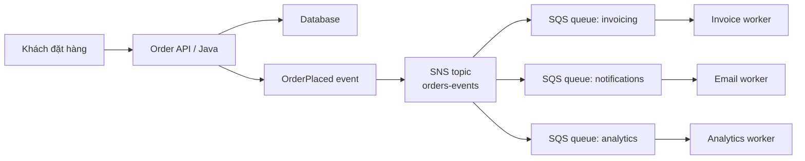

Khi producer publish thành công, **mỗi queue subscriber nhận bản sao của sự kiện** và giữ thông điệp cho consumer tương ứng. Invoice worker có thể chậm hơn Email worker mà không bắt Email worker đợi.

**Điểm cần thận trọng:** nếu Order API ghi database rồi mới publish SNS, hai thao tác không mặc định là **một giao dịch nguyên tử**. Khi ứng dụng crash sau DB commit nhưng trước khi publish, event có thể thất lạc. Mục 14 trình bày **transactional outbox** để giải quyết khoảng hở đó.

## 2. Ba mô hình cơ bản: queue, topic và broker

### 2.1. Work queue: nhiều worker chia nhau công việc

Một **SQS queue** lưu message trong khoảng retention, cho phép consumer **poll** và nhận một message. Sau khi xử lý xong, consumer gọi `DeleteMessage` bằng receipt handle để xác nhận và xóa.

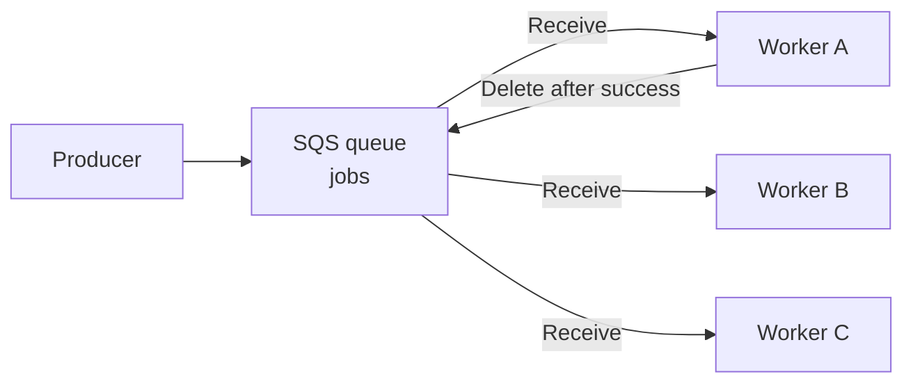

Về mặt logic, **mỗi bản sao message trong một queue** nên được xử lý thành công bởi **một** worker. Nếu worker thất bại hoặc không delete kịp, message có thể hiển thị lại và worker khác xử lý. Vì vậy **không được đồng nhất queue với bảo đảm một lần thực thi nghiệp vụ tuyệt đối**.

### 2.2. Publish/subscribe: một event gửi đến nhiều người nhận

Với **SNS topic**, producer **publish** một lần; SNS **push** notification tới các subscriptions phù hợp. Một topic có thể fanout tới SQS queues, Lambda functions, HTTP(S) endpoints và các kênh khác theo tính năng/topic type.

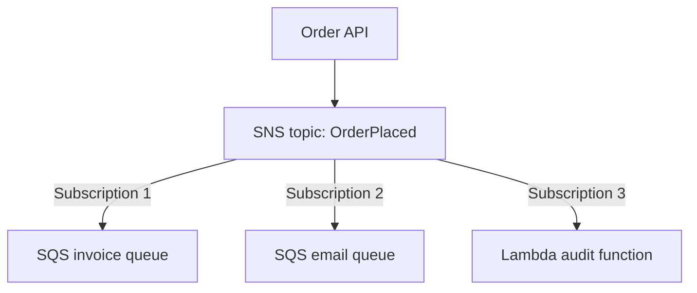

SNS **không phải work queue truyền thống**: nó xử lý việc publish và giao thông báo tới subscriber với chính sách retry, nhưng **SNS Standard topic không tự giữ mỗi event như một SQS queue để application worker poll bất kỳ lúc nào**. Để buffering bền vững và backpressure riêng cho mỗi consumer, hãy **subscribe SQS queue** thay vì chỉ HTTP callback.

### 2.3. Message broker: giao thức nhắn tin và topology phong phú

**Amazon MQ** là dịch vụ quản lý các broker **ActiveMQ Classic** hoặc **RabbitMQ** trên AWS. Client dùng protocol do engine hỗ trợ, duy trì connection tới broker, publish/consume bằng queues, topics/exchanges và consumer acknowledgment theo cơ chế broker.

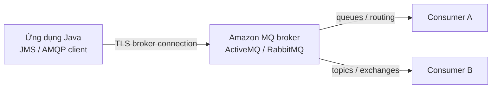

Amazon MQ phù hợp khi hệ thống **đã phụ thuộc vào broker protocol, thư viện JMS, exchange routing hoặc đặc điểm sản phẩm broker**. Nếu chỉ cần một queue công việc native AWS, Amazon MQ thường đòi hỏi nhiều vận hành hơn SQS mà không đem lại lợi ích cần thiết.

## 3. Bảng so sánh SQS, SNS và Amazon MQ

| Tiêu chí | Amazon SQS | Amazon SNS | Amazon MQ |
| --- | --- | --- | --- |
| **Mô hình chính** | Queue: lưu công việc để worker poll. | Topic: fanout/push notifications. | Broker: queues, topics/exchanges, protocol clients. |
| **Đối tượng nhận** | Consumers dùng AWS API/SDK hoặc Lambda event source mapping. | SQS, Lambda, HTTP(S), email/SMS/mobile push và endpoint hỗ trợ khác. | Apps dùng JMS/AMQP/OpenWire/MQTT/STOMP theo engine/version. |
| **Đệm tải khi worker chậm** | **Mạnh**, message backlog nằm trong queue. | Không giống queue; thường kết hợp SQS để đệm riêng. | Có thể giữ message trong broker nhưng giới hạn bởi broker capacity/storage. |
| **Một message phục vụ nhiều nhóm** | Một queue không phát riêng bản sao tới mọi worker group. | **Fanout** đến mỗi subscription. | Topic/exchange có thể định tuyến đến nhiều queues/subscribers. |
| **Ordering** | Standard: best effort; FIFO: theo message group. | FIFO topic giữ thứ tự khi đến SQS FIFO tương ứng. | Tùy engine/queue topology, số consumer, prefetch, redelivery. |
| **Delivery semantics** | Standard at-least-once; FIFO ordering/dedup, consumer vẫn cần idempotency. | Tùy loại topic và subscriber, retries/dedup với FIFO. | Acknowledgment/persistence/retry phụ thuộc cấu hình broker/client. |
| **Quản trị hạ tầng** | Serverless, không quản lý brokers. | Serverless, không quản lý brokers. | AWS quản lý broker nodes/patching một phần; vẫn cần instance, engine version, capacity và topology. |
| **Network** | AWS public API hoặc VPC interface endpoint. | AWS public API hoặc VPC interface endpoint cho publishers theo khả năng. | Kết nối tới broker endpoint/VPC và SG qua giao thức TLS. |
| **Pricing** | Theo request/payload và các dịch vụ liên quan. | Theo publish/delivery/API và endpoint. | **Broker instance-hours + storage** và chi phí hạ tầng phụ trợ. |
| **Tình huống chọn** | Background jobs, buffer spikes, retry/DLQ. | One-to-many notification, subscription filtering. | Migrate/on-prem JMS/RabbitMQ/AMQP với ít sửa code. |

**SQS và SNS không phải đối thủ một-mất-một-còn**: nhiều hệ thống dùng **SNS + SQS** để đạt đồng thời fanout và durable buffering. **Amazon MQ** không phải “SNS phiên bản mạnh hơn”; nó giải quyết yêu cầu **protocol compatibility và broker semantics**.

## 4. Amazon SQS: vòng đời của một message

### 4.1. Send → Receive → Process → Delete

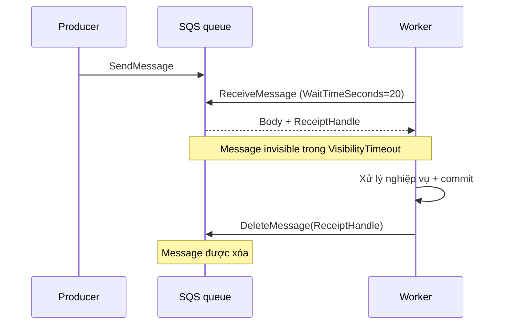

Nếu worker chết trước `DeleteMessage`, message **không tự mất**. Sau `visibility timeout`, SQS có thể đưa message trở lại để consumer khác nhận. Nếu worker xử lý xong nhưng request delete thất bại, **một message đã xử lý có thể được giao lại**.

**ReceiptHandle khác MessageId:** phải dùng **receipt handle mới nhất** của lần receive để delete; đừng gọi DeleteMessage với `MessageId`.

### 4.2. Những thông số chính

| Thuộc tính | Giá trị/giới hạn SQS thông dụng | Ý nghĩa |
| --- | --- | --- |
| `VisibilityTimeout` | Mặc định **30 giây**; cấu hình tới **12 giờ**. | Message tạm ẩn sau khi worker nhận. |
| `MessageRetentionPeriod` | Mặc định **4 ngày**; tối đa **14 ngày**. | Message chưa delete được giữ tối đa bao lâu. |
| `ReceiveMessageWaitTimeSeconds` | **0–20 giây**. | Long polling để giảm empty responses/API calls. |
| `DelaySeconds` | Tối đa **15 phút**. | Hoãn thời điểm message bắt đầu visible; không phải scheduler dài hạn. |
| Kích thước message | Tối đa **1 MiB** theo tài liệu SQS hiện hành. | Payload lớn nên để S3 và gửi pointer/metadata. |
| `MaxNumberOfMessages` | Tối đa **10** trong một ReceiveMessage call. | Đọc batch giảm số API requests nhưng cần xử lý lỗi từng message. |
| DLQ `maxReceiveCount` | Khi vượt số lượt nhận được cấu hình, message chuyển DLQ. | Giữ poison messages để điều tra. |

Các thông số/quotas khác như in-flight messages, throughput FIFO hay queue policy size cần kiểm tra theo Region tại lúc triển khai, không suy đoán từ một cấu hình lab.

### 4.3. Chọn visibility timeout theo thời gian xử lý

Nếu worker xử lý PDF trung bình 45 giây, một `VisibilityTimeout=30` giây có thể khiến message được nhận lại trước khi worker đầu tiên hoàn tất. Tùy workload:

- Đặt visibility timeout lớn hơn thời gian xử lý dự kiến, có biên an toàn.
- Khi thời gian xử lý biến động, dùng `ChangeMessageVisibility` định kỳ (heartbeat) để kéo dài.
- Tổng khoảng invisibility từ lần receive đầu tiên **không vượt giới hạn 12 giờ**; với workflow lâu hơn, chia nhỏ hoặc dùng Step Functions.
- Nếu dùng **Lambda SQS event source mapping**, xem thêm `function timeout`, batch window, batch size và khuyến nghị visibility timeout theo tài liệu Lambda; không chỉ lấy thời gian trung bình.

Một visibility timeout quá dài làm **retry chậm** khi worker chết. Quá ngắn gây **xử lý trùng** hoặc số lần receive tăng bất thường. Cần đo `Duration`/P99 và điều chỉnh bằng dữ liệu thực.

### 4.4. Dead-letter queue và redrive

**DLQ** là queue nhận messages không xử lý thành công sau `maxReceiveCount`. SQS **không tự tạo DLQ**; bạn phải tạo nó và cấu hình `RedrivePolicy` ở source queue.

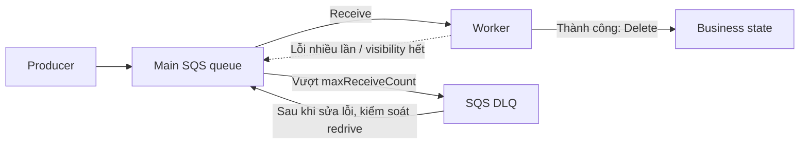

**Điểm vận hành:**

- **Standard source queue → Standard DLQ**; **FIFO source queue → FIFO DLQ**.
- DLQ cần retention đủ lâu để điều tra; đặt alarm khi DLQ có message mới.
- **Redrive** không phải nút “retry tất cả” không rủi ro: trước khi chạy, phân tích root cause, poison message và bảo vệ idempotency.
- Với FIFO, việc đưa message sang DLQ có thể cho phép message kế tiếp trong cùng group chạy, làm **đứt thứ tự nghiệp vụ tuyệt đối**. Nếu ordering là yêu cầu pháp lý hoặc kế toán, cần chiến lược xử lý bị chặn thay vì auto-DLQ không điều kiện.

### 4.5. Long polling và backpressure

`ReceiveMessage(WaitTimeSeconds=20)` giảm số request rỗng khi queue ít tải. Nhiều consumers có thể mở long polls đồng thời; vẫn phải giới hạn **thread pools**, **JDBC connections**, Lambda concurrency hoặc EC2 Auto Scaling để downstream không bị quá tải.

Một message backlog lớn không làm producer tự động thất bại ngay; đó là lợi ích của queue nhưng cũng là **nợ công việc**. Hãy theo dõi tuổi message lâu nhất, số message chờ và tốc độ xử lý, thay vì chỉ nhìn CPU của workers.

## 5. SQS Standard và FIFO: khác nhau ở đâu?

### 5.1. Standard queue

**SQS Standard** được tối ưu cho thông lượng cao, gần như không giới hạn theo các quota dịch vụ hiện hành, **at-least-once delivery** và **best-effort ordering**. Trong những tình huống retry/phân tán, message có thể được giao **hơn một lần** hoặc **khác thứ tự**.

Phù hợp:

- Gửi email, tạo thumbnail, báo cáo, ingest logs.
- Công việc độc lập hoặc kết quả cho phép xử lý không theo thứ tự.
- Hệ thống có idempotency keys, retry an toàn và cần tăng số consumers linh hoạt.

**Mới cần lưu ý:** SQS Standard có hỗ trợ `MessageGroupId` cho **fair queues** trong một số workload đa tenant; điều này **không biến Standard queue thành FIFO** và không tạo bảo đảm thứ tự.

### 5.2. FIFO queue

**SQS FIFO** có tên kết thúc bằng `.fifo`, dùng:

- **`MessageGroupId`** để xác định một chuỗi message cần xử lý theo thứ tự, ví dụ `order-101` hoặc `account-889`.
- **`MessageDeduplicationId`** hoặc `ContentBasedDeduplication` để ngăn gửi message trùng trong **cửa sổ dedup khoảng 5 phút**.

Ví dụ:

```text
Group order-101:
  OrderPlaced → PaymentAuthorized → OrderShipped

Group order-202:
  OrderPlaced → PaymentRejected
```

Các messages **cùng group** được phân phối tuần tự, còn **các groups khác nhau** có thể được xử lý song song. Nếu dùng cùng một group ID `all-orders` cho mọi message, bạn có thể vô tình tạo **nút cổ chai**.

| Tiêu chí | Standard | FIFO |
| --- | --- | --- |
| Tên queue | `orders-jobs` | `orders-events.fifo` |
| Thứ tự | Best effort. | Trong **một MessageGroupId**. |
| Trùng lặp phía giao thông điệp | At-least-once. | Có cơ chế dedup trong cửa sổ 5 phút. |
| Thông lượng | Rất cao. | Theo quota/throughput mode và số active groups. |
| Cần idempotent consumer? | **Có.** | **Vẫn có** để đảm bảo kết quả nghiệp vụ an toàn. |
| Khi chọn | Jobs không phụ thuộc thứ tự. | Thao tác trên cùng entity cần tuần tự. |

**Ranh giới quan trọng:** “FIFO exactly-once” đề cập **hành vi phân phối/dedup theo điều kiện dịch vụ**, không bảo đảm transaction ở RDS/DynamoDB, gửi email bên ngoài hoặc thanh toán chỉ xảy ra một lần. Một consumer có thể commit database thành công rồi lỗi trước khi xóa message, hoặc client có thể publish lại cùng nội dung **ngoài** cửa sổ 5 phút. Dùng **business idempotency key** và unique constraint/conditional write.

### 5.3. Không thể đổi kiểu queue tại chỗ

**Standard → FIFO** hoặc ngược lại **không phải thuộc tính có thể toggle** sau khi tạo. Cần tạo queue mới, cập nhật producer/consumer, IAM policies, subscriptions, event source mappings, monitoring và di chuyển backlog theo kế hoạch.

Ngoài ra, **S3 Event Notifications không gửi trực tiếp tới SQS FIFO queue**; nếu bắt buộc dùng FIFO downstream, thường dùng **S3 → EventBridge → SQS FIFO** khi cấu hình được hỗ trợ.

## 6. Amazon SNS: push notification, fanout và filtering

### 6.1. Standard SNS topic

SNS Standard phù hợp khi producer có một sự kiện nhưng nhiều subscriber:

```text
OrderPlaced
  ├── SQS invoicing-queue         → lưu sự kiện cho invoice workers
  ├── SQS loyalty-queue           → lưu sự kiện cho loyalty workers
  ├── Lambda audit-function       → xử lý sự kiện trực tiếp
  └── HTTP(S) partner webhook     → cần retry/auth và receiver chịu tải
```

SNS topic chỉ biết cách **gửi** sự kiện tới subscription; mỗi subscriber tự có failure mode, quota, retry policy và quan sát delivery tương ứng. Với partner webhook không ổn định, dùng **SQS queue trung gian + worker** có thể kiểm soát retry và rate limit tốt hơn là đẩy HTTP trực tiếp.

### 6.2. Subscription protocols

| Protocol | Điểm nhận | Thực tế vận hành |
| --- | --- | --- |
| `sqs` | SQS queue. | **Đệm tải bền vững**, queue policy phải cho SNS `sqs:SendMessage`. |
| `lambda` | Lambda function. | Resource-based policy phải cho SNS invoke; điều chỉnh concurrency và retry. |
| `https`/`http` | Webhook endpoint. | Cần endpoint confirmation, HTTP delivery policy, authentication và chống replay. |
| `email`/`email-json` | Địa chỉ email. | Người nhận phải confirm subscription; không phù hợp xử lý có transaction guarantee. |
| `sms` | Số điện thoại. | Tùy quy định/quốc gia/quota và dịch vụ AWS End User Messaging. |
| `application` | Mobile push endpoint. | Tùy platform endpoint/credentials và trạng thái thiết bị. |
| `firehose` | Amazon Data Firehose delivery stream. | Streaming/archive/analytics theo quyền role và giới hạn. |

**Không phải mọi protocol dùng được cho SNS FIFO.** Cần chọn topic type sau khi biết chính xác subscribers.

### 6.3. Subscription filter policy

Thay vì producer biết có bao nhiêu consumer, mỗi subscription có thể nhận một **tập con events** qua `FilterPolicy`.

Ví dụ publish:

```json
{
  "eventId": "evt-901",
  "eventType": "OrderPlaced",
  "orderId": "ord-101",
  "schemaVersion": 1
}
```

Message attributes:

```json
{
  "eventType": {
    "DataType": "String",
    "StringValue": "OrderPlaced"
  }
}
```

Filter policy trên subscription invoice:

```json
{
  "eventType": ["OrderPlaced", "PaymentAuthorized"]
}
```

Với `FilterPolicyScope=MessageAttributes` (mặc định), SNS so attributes, **không tự phân tích field trong body**. Nếu dùng `FilterPolicyScope=MessageBody`, policy áp dụng cho JSON body hợp lệ theo điều kiện SNS. Một message không khớp filter **không được giao** tới subscription đó; đây là routing dựa trên nội dung, không phải lỗi delivery.

### 6.4. SNS Standard so với SNS FIFO

| Thuộc tính | SNS Standard | SNS FIFO |
| --- | --- | --- |
| Fanout | Nhiều protocol subscriber. | Chủ yếu dùng **SQS Standard/FIFO**; một số integration qua Firehose nếu hỗ trợ; không hỗ trợ email/SMS/HTTP(S) kiểu thông thường. |
| Message ordering | Không có strict ordering guarantee. | Bảo đảm thứ tự theo **message group** tới SQS FIFO phù hợp. |
| Deduplication | Không cung cấp FIFO dedup. | `MessageDeduplicationId`/content-based dedup và scope theo cấu hình. |
| Tên topic | `orders-events` | `orders-events.fifo` |
| Filtering | Có, áp message attributes hoặc body. | Có; filter ảnh hưởng đến điều kiện giao nhận/chính xác. |
| Mô hình ưu tiên | Thông báo rộng, nhiều loại endpoints. | Fanout các luồng cần ordering/dedup qua SQS FIFO. |

Nếu SNS FIFO topic subscribe tới **SQS Standard**, queue downstream **vẫn có thể trùng/lệch thứ tự**. Muốn bảo toàn ordering end-to-end từ SNS tới consumer, chọn **SNS FIFO → SQS FIFO** và cấu hình group/dedup ở producer, đồng thời xử lý retry/idempotency.

Với SNS FIFO có **subscription filtering**, điều kiện phân phối/chính xác có giới hạn vì message không khớp có thể bị lọc; không hiểu “exactly once” như bảo đảm mọi event business được tất cả subscribers nhận một lần.

### 6.5. Kích thước message và archive/replay

**Theo tài liệu SNS hiện hành**:

- Topic thông thường mặc định nhận message tối đa **256 KiB**.
- Có thể đặt topic attribute `MaximumMessageSize` lên tới **1 MiB**, nhưng với message trên 256 KiB chỉ hỗ trợ những subscribers nhất định (**SQS, Lambda, Amazon Data Firehose**) và tổng subscribers của topic chịu giới hạn bổ sung. Kiểm tra trước khi tăng limit trên topic có email/HTTP subscriptions.
- Nếu payload lớn, gửi **S3 object pointer** thay vì nhét file PDF/image vào message.
- **SNS FIFO** hỗ trợ **message archive và replay** khi cấu hình `ArchivePolicy`/`ReplayPolicy`, có thể giữ tới **365 ngày** theo tính năng/giá áp dụng; SNS Standard không có cùng cơ chế replay built-in, cần kiến trúc archive riêng khi cần.

Để an toàn, thiết kế event nhỏ và có version schema, tránh đặt PII/credentials trong body nếu không cần.

## 7. Amazon MQ: khi cần giao thức message broker

### 7.1. Amazon MQ không phải một API serverless như SQS

Amazon MQ quản lý vòng đời **message brokers** được triển khai trên tài nguyên có compute/storage theo cấu hình. Nó có thể thay thế một phần công việc cài đặt, vá lỗi và bảo trì broker tự quản lý, nhưng **không xóa hết trách nhiệm capacity planning, queue topology, version upgrades, connection management và failover testing** của đội vận hành.

Hai engine hiện được Amazon MQ hỗ trợ:

1. **Apache ActiveMQ Classic:** thường gặp trong ứng dụng Java dùng **JMS**, OpenWire, virtual destinations, durable topics, enterprise integration và hệ thống cũ.
2. **RabbitMQ:** phổ biến với **AMQP** và cơ chế exchange/binding/routing keys, consumer acknowledgments, publisher confirms, queue types và client libraries đa ngôn ngữ.

| Chủ đề | Amazon MQ for ActiveMQ Classic | Amazon MQ for RabbitMQ |
| --- | --- | --- |
| Mô hình | JMS queue/topic, broker destinations. | Exchange → bindings → queues → consumers. |
| Protocol điển hình | **OpenWire**, AMQP, MQTT, STOMP; JMS clients qua driver thích hợp. | **AMQP 0-9-1**, AMQP 1.0 và JMS với các version/plugin được hỗ trợ. |
| Java integration | Legacy `javax.jms` hoặc `jakarta.jms` tùy thư viện/broker, Spring JMS. | Spring AMQP, RabbitMQ Java client; JMS hỗ trợ có điều kiện theo engine version/plugin. |
| Triển khai HA | Active/standby hai AZ cho loại broker hỗ trợ. | Cluster ba nodes đa AZ theo kiến trúc Amazon MQ. |
| Chi phí | Broker instances, storage, networking và monitoring. | Broker instances, storage, networking và monitoring. |
| Rủi ro vận hành | Broker limits, destination count, failover clients, KahaDB/EFS. | Queue topology, quorum/mirroring theo engine version, connections/channels, broker memory/disk alarms. |

**Không suy ra Amazon MQ RabbitMQ có đủ mọi plugin/feature của RabbitMQ tự host** hoặc ActiveMQ Classic hỗ trợ đầy đủ mọi tính năng JMS của broker khác. Amazon MQ quản lý engine versions, plugin policies và cấu hình theo danh sách được AWS hỗ trợ.

### 7.2. RabbitMQ routing: exchange, queue, binding

RabbitMQ tách producer khỏi queue thông qua **exchange**:

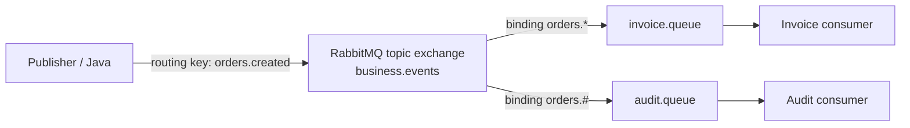

- **Direct exchange:** route theo routing key khớp chính xác.
- **Topic exchange:** route theo pattern như `orders.*` hoặc `orders.#`.
- **Fanout exchange:** broadcast tới tất cả queue có binding phù hợp.
- **Headers exchange:** có thể route theo message headers.

Publisher thường dùng **publisher confirms** để nhận biết broker đã chấp nhận publish; consumer dùng **manual acknowledgment** để xác nhận sau khi xử lý. Các cơ chế này cần cấu hình **durable queues**, persistent messages và queue type thích hợp khi yêu cầu bền vững.

**Một exchange có tên `orders` không phải Amazon SNS topic**, dù cách phát nhiều đích trông giống nhau. Protocol, access control, failover, vận hành và chi phí khác hoàn toàn.

### 7.3. ActiveMQ Classic và JMS

Một hệ thống Java lâu năm có thể có code:

```java
// Minh họa ý tưởng JMS; package và connection factory phụ thuộc
// phiên bản JMS/Spring/ActiveMQ client được chọn.
ConnectionFactory connectionFactory = /* managed broker client */;
// Producer/consumer sẽ kết nối tới broker endpoint qua TLS.
```

Khi migrate từ broker tự host lên Amazon MQ for ActiveMQ Classic, nhóm phát triển có thể giữ phần lớn mô hình JMS queue/topic và cách ack/transaction, nhưng vẫn phải cập nhật **broker URL, TLS trust, credentials, failover transport, network routes** và test lại producer/consumer khi maintenance.

Amazon MQ **không biến ActiveMQ thành SQS**: không có `SendMessage`/`ReceiveMessage` API cùng semantics. Không nên dùng `SqsClient` của AWS SDK để kết nối đến Amazon MQ.

### 7.4. Single-instance hay high availability?

| Phương án Amazon MQ | Đặc điểm | Khi cân nhắc |
| --- | --- | --- |
| ActiveMQ single-instance | Broker ở một AZ; capacity/HA giới hạn hơn. | Lab, thử nghiệm, ứng dụng có thể chịu downtime. |
| ActiveMQ active/standby | Hai brokers ở hai AZ theo cặp failover. | Cần tăng khả dụng mà vẫn giữ ActiveMQ Classic semantics. |
| RabbitMQ single-instance | Một broker RabbitMQ có endpoint do dịch vụ quản lý. | Test hoặc tải nhỏ có thể chấp nhận điểm lỗi. |
| RabbitMQ cluster deployment | Cluster nhiều nodes, thường **ba nodes** ở các AZ và có cơ chế HA. | Production cần HA và chấp nhận quản lý cluster/queue replication. |

**HA không có nghĩa “không mất kết nối”:** broker maintenance hoặc failover có thể làm **TCP/TLS connections đứt**, producers cần retry, consumers reconnect/resubscribe và messaging clients phải hỗ trợ broker failover. Việc đổi **major engine version** có thể có downtime theo release notes, kể cả khi tên endpoint giữ nguyên.

### 7.5. Bảo mật của Amazon MQ

**IAM** kiểm soát các thao tác **AWS control plane** như tạo/sửa/xóa Amazon MQ brokers, **không mặc định thay thế cơ chế xác thực message protocol**. Khi ứng dụng Java kết nối broker:

- Dùng **broker user/credentials** và permissions/vhosts/ACLs theo engine; lưu secret trong **AWS Secrets Manager** và rotate có kế hoạch.
- Dùng **TLS**, kiểm tra certificate, tránh tắt TLS verification.
- Chọn **private broker endpoint trong VPC** nếu workload nội bộ, SG cho đúng client subnets/ports và routing phù hợp.
- Kiểm soát broker management console, metrics và số kết nối/channels.

Không mở mọi cổng broker cho `0.0.0.0/0` để thử kết nối. Nếu client on-premises cần truy cập, thiết kế **VPN/Direct Connect** hoặc đường mạng được hỗ trợ; IAM permission cấp cho người dùng AWS **không tự tạo đường mạng**.

### 7.6. Khi nào nên migrate khỏi MQ?

Nếu một hệ thống dùng JMS chỉ để gửi message vào một queue và không phụ thuộc đặc điểm broker, có thể cân nhắc **SQS** bằng cách sửa producer/consumer adapter và kiểm tra semantics. Nếu dùng RabbitMQ exchange topology phức tạp, transactions hoặc protocol-specific plugins, chi phí migration có thể lớn hơn lợi ích trong ngắn hạn.

Mẫu tiến trình:

1. Kiểm kê protocol, destination/queue, message size, ordering, ack, transactions, retries, DLQ và consumer groups.
2. Chọn khả năng AWS native tương ứng (SQS/FIFO, SNS fanout, EventBridge routing) nếu đáp ứng.
3. Xây lớp adapter cho Java clients, thử schema/versioning và idempotency.
4. Chạy song song hoặc dual-write có kiểm soát, đo khả năng mất/trùng và lag.
5. Chuyển consumer/publisher từng nhóm, có kế hoạch rollback và drain backlog.

Đừng đổi broker chỉ vì tên dịch vụ “managed” nghe tương tự nhau; **đối chiếu delivery semantics và business invariants** mới là tiêu chí quyết định.

## 8. Quy trình chọn dịch vụ theo yêu cầu thực

### 8.1. Cây quyết định ngắn

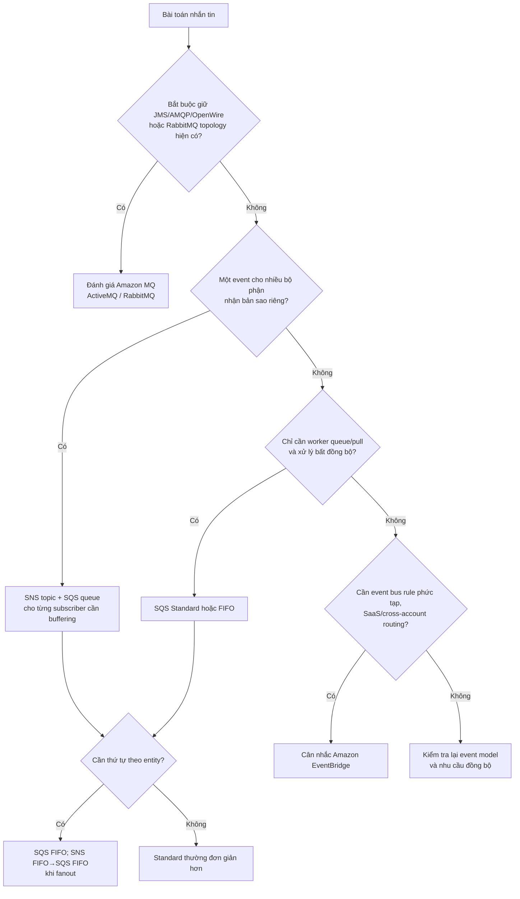

**Amazon EventBridge** chỉ là phương án so sánh lân cận trong chương này: event bus phù hợp khi cần routing rules theo content, tích hợp nhiều AWS/SaaS sources, API destinations, schema/archive/replay theo tính năng. Nó **không thay thế durable per-consumer queue** khi worker cần poll/backpressure; nhiều hệ thống dùng **EventBridge → SQS**.

### 8.2. Ma trận nhu cầu

| Yêu cầu cụ thể | Lựa chọn khởi đầu | Vì sao |
| --- | --- | --- |
| Đẩy tác vụ tạo thumbnail từ Java API, nhiều worker cùng tiêu thụ | **SQS Standard** | Buffer, worker competing consumers, throughput cao. |
| Cập nhật trạng thái đơn phải theo thứ tự trong mỗi đơn hàng | **SQS FIFO** | `MessageGroupId=orderId` giữ thứ tự theo entity. |
| Một sự kiện OrderPlaced phải đến ba nhóm độc lập | **SNS Standard → 3 SQS Standard** | Fanout + queue backlog riêng cho từng nhóm. |
| Một event cần fanout mà mọi queue giữ ordering theo account | **SNS FIFO → SQS FIFO** | Thứ tự group end-to-end theo điều kiện hỗ trợ. |
| Gửi email/SMS/mobile push tới người dùng | **SNS Standard** hoặc dịch vụ giao tiếp chuyên dụng | Hỗ trợ notification endpoints; không dùng SNS FIFO cho email/SMS. |
| Hệ thống ngân hàng cũ dùng JMS/OpenWire và broker transactions | **Amazon MQ for ActiveMQ Classic** | Giảm chi phí sửa code/protocol, giữ semantics legacy. |
| Microservices đang dùng RabbitMQ topic exchange và client AMQP | **Amazon MQ for RabbitMQ** | Giữ exchange topology/protocol, vận hành broker được AWS hỗ trợ. |
| Rules gửi event tới hàng chục AWS/SaaS destinations | **EventBridge** (có thể tới SQS) | Event bus routing và integrations. |
| Workflow nhiều bước có chờ, timeout và compensation | **AWS Step Functions** (cùng SQS/SNS nếu cần) | Điều phối trạng thái, không ép queue giải quyết orchestration. |

### 8.3. Sáu câu hỏi nên trả lời trước khi chọn

1. **Bản chất sự kiện hay lệnh?** `OrderPlaced` là event; `GenerateInvoice` là command/job. Một event có thể fanout, một job thường chỉ một worker xử lý.
2. **Một hay nhiều nhóm tiêu thụ?** Một queue đủ cho nhóm worker chung; nhiều nhóm độc lập cần nhiều queues hoặc topic fanout.
3. **Ordering có thật sự cần?** FIFO theo từng `orderId` khác với một thứ tự toàn hệ thống. Tránh FIFO khi không có ràng buộc nghiệp vụ.
4. **Tốc độ biến động thế nào?** Nếu producer spike và consumer chậm, cần buffer/backpressure/queue depth và scale strategy.
5. **Có ràng buộc giao thức không?** Nếu đã phụ thuộc JMS/AMQP, đánh giá MQ; nếu có thể đổi code và không cần broker-specific features, SQS/SNS thường đơn giản.
6. **Giới hạn vận hành và chi phí?** Ai trực broker, failover, certs, storage, IAM/KMS, queues, DLQ, logs và quota?

## 9. Ordering, delivery guarantee và idempotency

### 9.1. “Exactly once” là câu hỏi ở tầng nào?

Giả sử một consumer nhận event:

```json
{
  "eventId": "evt-payment-7788",
  "orderId": "ORD-7788",
  "eventType": "PaymentCaptured",
  "amount": 125000,
  "currency": "VND"
}
```

Worker cập nhật `payment_status=PAID` trong database rồi crash trước `DeleteMessage`. Khi message xuất hiện lại, worker mới có thể gọi database và bên thứ ba lần nữa.

**Một queue FIFO không thể tự hoàn tác hoặc xác nhận một database commit từ bên ngoài.** Vì thế:

- Dùng **eventId/commandId** duy nhất làm business idempotency key.
- Lưu trạng thái đã xử lý trong transaction với kết quả nghiệp vụ (unique constraint, conditional write hoặc inbox table).
- Đối với payment APIs, truyền **idempotency key** tới downstream nếu nhà cung cấp hỗ trợ.
- Chỉ **ACK/DeleteMessage sau khi commit thành công**; nếu không, để retry nhưng đảm bảo xử lý lặp an toàn.
- Định nghĩa retryable errors, poison messages và cách điều tra DLQ.

### 9.2. Ví dụ inbox chống xử lý trùng

Một schema đơn giản ở PostgreSQL:

```sql
CREATE TABLE processed_events (
    consumer_name VARCHAR(100) NOT NULL,
    event_id      VARCHAR(100) NOT NULL,
    processed_at  TIMESTAMPTZ NOT NULL DEFAULT CURRENT_TIMESTAMP,
    PRIMARY KEY (consumer_name, event_id)
);
```

Trong một database transaction:

```text
BEGIN
  INSERT processed_events(consumer_name, event_id)
     ON CONFLICT DO NOTHING
  IF đã tồn tại:
     COMMIT, coi là xử lý lại và ACK an toàn
  ELSE:
     cập nhật dữ liệu nghiệp vụ
     COMMIT
Sau COMMIT mới DeleteMessage/ACK
```

Với **side effects ngoài database** (gửi email, gọi API thanh toán), bảng inbox chỉ đủ nếu có thêm **outbox/external idempotency** hoặc cách ghi trạng thái side effect an toàn. Một lần commit DB không atomically commit được email provider.

### 9.3. Message ordering và partitioning

Ordering cần được định nghĩa theo **aggregate/business entity**, ví dụ:

| MessageGroupId | Sequence | Đòi hỏi |
| --- | --- | --- |
| `order-101` | Placed → Paid → Shipped | Theo thứ tự **trong cùng đơn hàng**. |
| `order-202` | Placed → Cancelled | Có thể xử lý song song với order-101. |
| `customer-77` | KYCUpdated → AccountActivated | Theo thứ tự **trong cùng khách hàng**. |

Tránh chọn group ID theo timestamp random nếu cần ordering của một đơn hàng. Nhưng cũng tránh dồn tất cả messages vào `group=global` trừ khi thực sự cần một luồng tuần tự duy nhất, vì việc đó giới hạn throughput.

**Chặn message đầu group:** với FIFO, message chưa xử lý hoặc được redeliver có thể khiến messages tiếp theo trong group **không tiến lên**. Cần monitor message age, retries và thiết kế xử lý poison messages an toàn với yêu cầu thứ tự.

### 9.4. Retry và DLQ ở từng lớp không giống nhau

| Lớp | Retry do ai kiểm soát? | Điều cần cấu hình |
| --- | --- | --- |
| SQS consumer do ứng dụng poll | Worker code + visibility timeout/redrive. | Không delete khi lỗi, maxReceiveCount, backoff, idempotency. |
| Lambda poll SQS | Lambda event source mapping. | Batch size, visibility/timeout, `ReportBatchItemFailures`, concurrency, queue DLQ. |
| SNS → HTTP(S) | SNS delivery policy/retry; optional subscription DLQ. | Endpoint HTTP codes, confirmation, authentication, redrive. |
| SNS → SQS | SNS giao message vào queue; sau đó SQS consumer xử lý. | **SQS queue policy**, queue retention/DLQ, consumer retry. |
| Amazon MQ consumer | Broker/client ack/nack/requeue, dead-letter exchange/queue tùy engine. | Manual ack, TTL, prefetch, DLX, poison-message policy. |

Nếu thêm **SNS subscription DLQ** để bắt notification giao không thành công, đó là **DLQ của bước SNS delivery**, khác **SQS source queue DLQ** khi business worker xử lý lỗi. Hai DLQ có thể cùng tồn tại nhưng giải quyết hai loại sự cố khác nhau.

## 10. Bảo mật IAM, queue/topic policies, KMS và mạng

### 10.1. Ba principal cần tách biệt

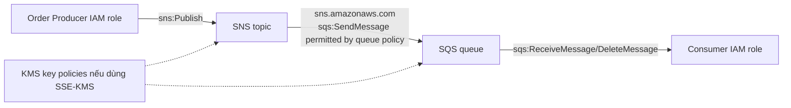

| Tác nhân | Identity/resource permission điển hình | Không cần cấp |
| --- | --- | --- |
| Producer app role | `sns:Publish` trên đúng topic ARN. | `sqs:DeleteMessage` trên mọi queue. |
| SNS service | Queue **resource policy** cho `sns.amazonaws.com` thực hiện `sqs:SendMessage` từ đúng `aws:SourceArn` topic. | `sqs:*` hay `Principal: "*"` không điều kiện. |
| Worker app role | `sqs:ReceiveMessage`, `sqs:DeleteMessage`, `sqs:ChangeMessageVisibility`, `sqs:GetQueueAttributes` trên đúng queue ARN. | `sns:Publish`, `iam:*` nếu không cần. |
| Deployment role | Tạo/sửa topic, queue, policy, subscription qua IaC. | Không bắt buộc quyền xử lý message ở runtime. |
| Amazon MQ client | Broker credentials và permissions theo engine. | IAM role không tự thay broker user/password. |

### 10.2. Queue policy để SNS gửi message vào SQS

Ví dụ **đặt trên SQS queue**, không phải trên SNS topic:

```json
{
  "Version": "2012-10-17",
  "Statement": [
    {
      "Sid": "AllowSpecificSnsTopicToPublishToQueue",
      "Effect": "Allow",
      "Principal": {
        "Service": "sns.amazonaws.com"
      },
      "Action": "sqs:SendMessage",
      "Resource": "arn:aws:sqs:ap-southeast-1:111122223333:orders-invoice-lab",
      "Condition": {
        "ArnEquals": {
          "aws:SourceArn": "arn:aws:sns:ap-southeast-1:111122223333:orders-events-lab"
        }
      }
    }
  ]
}
```

- `Resource` là **ARN queue**, không phải QueueUrl.
- `aws:SourceArn` là **SNS topic ARN**, giúp tránh confused deputy.
- Trong môi trường cross-account, có thể cần **topic policy cho `sns:Subscribe`** và queue policy được chủ queue cấp, cùng quyền IAM và KMS thích hợp.
- `SetQueueAttributes` cập nhật **toàn bộ giá trị Policy attribute**. Đọc/diff/merge policy hiện có trước khi ghi, đừng thay policy chung của production bằng ví dụ một statement.

### 10.3. KMS encryption

SQS/SNS có hỗ trợ mã hóa at-rest qua cơ chế dịch vụ và **SSE-KMS**. Nếu dùng **customer managed KMS key**:

- Publisher/consumer/service principal cần những `kms:GenerateDataKey`, `kms:Decrypt` và KMS key policy/conditions phù hợp với luồng dữ liệu.
- Một topic/queue mã hóa bằng key ở account khác hoặc một AWS service gửi vào queue có thể yêu cầu grant/policy riêng.
- Kiểm tra khả năng tích hợp của dịch vụ phát sự kiện và key policy; không nghĩ chỉ thêm `sqs:SendMessage` là đủ nếu KMS từ chối.
- Không tự cấp `kms:*` trên mọi key để “sửa nhanh” lỗi.

KMS key, API calls và data keys cache có thể ảnh hưởng chi phí/latency. Chọn default encryption hay customer managed key theo yêu cầu compliance, audit và vận hành thực tế.

### 10.4. Network và truy cập private

**SQS/SNS là AWS API services**, không cần một broker TCP chạy trong subnet của bạn. Ứng dụng EC2/ECS/EKS/Lambda:

- Có thể gọi public AWS endpoints qua Internet/NAT phù hợp; hoặc
- Dùng **interface VPC endpoints (AWS PrivateLink)** cho SQS/SNS khi hỗ trợ, cấu hình private DNS, SG/route/policies.

**Amazon MQ** lại có broker endpoints trong VPC theo chế độ triển khai, cần SG cho TLS protocol ports, DNS resolution, kết nối VPC/peering/TGW/VPN và broker credentials. Không thể dùng một **SQS interface endpoint** để kết nối RabbitMQ protocol.

### 10.5. Không đưa dữ liệu nhạy cảm vào message một cách tùy tiện

Event nên chứa **ID/reference**, schemaVersion, timestamp và field tối thiểu. Với nội dung nhạy cảm:

- Tránh đặt credentials, tokens, toàn bộ hồ sơ khách hàng trong SNS email/SMS body hoặc CloudWatch logs.
- Dùng S3 object pointer và IAM/KMS kiểm soát quyền đọc nếu payload lớn/nhạy cảm.
- Phân tách topic/queue dev và prod, account/role, encryption, retention và DLQ access.
- Đặt log retention và tránh log nguyên payload nếu có PII.

## 11. Lab AWS CLI: SNS fanout tới hai SQS Standard queues

Mục tiêu lab: tạo topic `lesson-orders-events` và hai queues `lesson-invoices`, `lesson-audit`. **Invoice queue** chỉ nhận event `OrderPlaced`, còn **audit queue** nhận tất cả. Sau khi publish, kiểm tra message vào đúng queue.

> **Phạm vi:** đây là **lệnh mẫu**, không phải thao tác đã chạy trong AWS account thật. Cần có AWS CLI với IAM quyền tạo/sửa topic, queue, policy/subscription và một shell Bash có công cụ `jq`. Nếu dùng PowerShell, chuyển cú pháp biến và quoting cho phù hợp. Tên cố định phải được thay nếu đã có tài nguyên cùng tên; tuyệt đối không sửa policy của queue production.

### 11.1. Xác nhận account và đặt biến

```bash
export AWS_REGION=ap-southeast-1

aws sts get-caller-identity
ACCOUNT_ID=$(aws sts get-caller-identity --query Account --output text)

printf 'Region=%s Account=%s\n' "$AWS_REGION" "$ACCOUNT_ID"
```

Nếu account/Region không phải môi trường lab, **dừng lại** trước khi tạo tài nguyên.

### 11.2. Tạo topic và hai queues

```bash
TOPIC_ARN=$(aws sns create-topic \
  --name lesson-orders-events \
  --region "$AWS_REGION" \
  --query TopicArn --output text)

INVOICE_URL=$(aws sqs create-queue \
  --queue-name lesson-invoices \
  --attributes VisibilityTimeout=120,ReceiveMessageWaitTimeSeconds=20,MessageRetentionPeriod=345600 \
  --region "$AWS_REGION" \
  --query QueueUrl --output text)

AUDIT_URL=$(aws sqs create-queue \
  --queue-name lesson-audit \
  --attributes VisibilityTimeout=120,ReceiveMessageWaitTimeSeconds=20,MessageRetentionPeriod=345600 \
  --region "$AWS_REGION" \
  --query QueueUrl --output text)

INVOICE_ARN=$(aws sqs get-queue-attributes \
  --queue-url "$INVOICE_URL" \
  --attribute-names QueueArn \
  --region "$AWS_REGION" \
  --query 'Attributes.QueueArn' --output text)

AUDIT_ARN=$(aws sqs get-queue-attributes \
  --queue-url "$AUDIT_URL" \
  --attribute-names QueueArn \
  --region "$AWS_REGION" \
  --query 'Attributes.QueueArn' --output text)

printf 'Topic: %s\nInvoice: %s\nAudit: %s\n' \
  "$TOPIC_ARN" "$INVOICE_ARN" "$AUDIT_ARN"
```

**QueueUrl và QueueArn khác nhau:** `ReceiveMessage`/`DeleteMessage` thường cần **QueueUrl**, còn SNS subscription `--notification-endpoint` và IAM/resource policies dùng **QueueArn**.

### 11.3. Cho SNS topic quyền gửi vào mỗi queue

Tạo queue attribute JSON bằng `jq` để tránh lỗi escape JSON lồng nhau. Lệnh sau **chỉ dành cho queue lab mới tạo**, vì nó thay **giá trị `Policy` hiện tại**:

```bash
jq -n --arg q "$INVOICE_ARN" --arg t "$TOPIC_ARN" '
{
  Policy: ({
    Version: "2012-10-17",
    Statement: [{
      Sid: "AllowOrdersTopic",
      Effect: "Allow",
      Principal: {Service: "sns.amazonaws.com"},
      Action: "sqs:SendMessage",
      Resource: $q,
      Condition: {ArnEquals: {"aws:SourceArn": $t}}
    }]
  } | tojson)
}' > invoice-queue-attributes.json

jq -n --arg q "$AUDIT_ARN" --arg t "$TOPIC_ARN" '
{
  Policy: ({
    Version: "2012-10-17",
    Statement: [{
      Sid: "AllowOrdersTopic",
      Effect: "Allow",
      Principal: {Service: "sns.amazonaws.com"},
      Action: "sqs:SendMessage",
      Resource: $q,
      Condition: {ArnEquals: {"aws:SourceArn": $t}}
    }]
  } | tojson)
}' > audit-queue-attributes.json

aws sqs set-queue-attributes \
  --queue-url "$INVOICE_URL" \
  --attributes file://invoice-queue-attributes.json \
  --region "$AWS_REGION"

aws sqs set-queue-attributes \
  --queue-url "$AUDIT_URL" \
  --attributes file://audit-queue-attributes.json \
  --region "$AWS_REGION"
```

Sau khi cập nhật policy, có thể kiểm tra:

```bash
aws sqs get-queue-attributes \
  --queue-url "$INVOICE_URL" \
  --attribute-names Policy \
  --region "$AWS_REGION"
```

Ở production, phải **đọc, merge và review policy hiện tại** trước khi gọi `set-queue-attributes`. Ví dụ `jq` trên tạo đúng một statement, phù hợp queue mới trong lab nhưng sẽ xóa các statement hợp lệ khác nếu áp lên queue dùng chung.

### 11.4. Đăng ký hai SQS subscriptions

```bash
INVOICE_SUB_ARN=$(aws sns subscribe \
  --topic-arn "$TOPIC_ARN" \
  --protocol sqs \
  --notification-endpoint "$INVOICE_ARN" \
  --attributes RawMessageDelivery=true \
  --region "$AWS_REGION" \
  --query SubscriptionArn --output text)

AUDIT_SUB_ARN=$(aws sns subscribe \
  --topic-arn "$TOPIC_ARN" \
  --protocol sqs \
  --notification-endpoint "$AUDIT_ARN" \
  --attributes RawMessageDelivery=true \
  --region "$AWS_REGION" \
  --query SubscriptionArn --output text)

aws sns list-subscriptions-by-topic \
  --topic-arn "$TOPIC_ARN" \
  --region "$AWS_REGION"
```

Với subscription **cùng account và quyền hợp lệ**, SNS→SQS thường có thể được xác nhận tự động. Trong trường hợp cross-account, xem **pending confirmation** và quy trình xác nhận của queue owner; không gọi `set-subscription-attributes` nếu `SubscriptionArn` vẫn ở trạng thái chờ.

**RawMessageDelivery=true** khiến SQS message body là payload gốc thay vì SNS JSON envelope. Nếu không bật, worker phải parse `Message` nằm trong SNS envelope trước khi xử lý event. Với SQS raw delivery, số message attributes được chuyển tiếp có giới hạn theo tài liệu SNS; kiểm tra nếu event có nhiều attributes.

### 11.5. Bật filtering cho invoice queue

```bash
aws sns set-subscription-attributes \
  --subscription-arn "$INVOICE_SUB_ARN" \
  --attribute-name FilterPolicyScope \
  --attribute-value MessageAttributes \
  --region "$AWS_REGION"

aws sns set-subscription-attributes \
  --subscription-arn "$INVOICE_SUB_ARN" \
  --attribute-name FilterPolicy \
  --attribute-value '{"eventType":["OrderPlaced"]}' \
  --region "$AWS_REGION"
```

SNS subscription filter changes có **độ trễ eventual consistency**; theo hướng dẫn AWS, propagation có thể mất tới khoảng **15 phút**. Đừng coi kết quả ngay sau thao tác là bằng chứng filter bị lỗi: đợi, kiểm tra attribute và test lại.

### 11.6. Publish hai events, kiểm tra kết quả

```bash
aws sns publish \
  --topic-arn "$TOPIC_ARN" \
  --message '{"eventId":"evt-lab-1","eventType":"OrderPlaced","orderId":"ORD-101"}' \
  --message-attributes '{"eventType":{"DataType":"String","StringValue":"OrderPlaced"}}' \
  --region "$AWS_REGION"

aws sns publish \
  --topic-arn "$TOPIC_ARN" \
  --message '{"eventId":"evt-lab-2","eventType":"RefundRequested","orderId":"ORD-202"}' \
  --message-attributes '{"eventType":{"DataType":"String","StringValue":"RefundRequested"}}' \
  --region "$AWS_REGION"

aws sqs receive-message \
  --queue-url "$INVOICE_URL" \
  --max-number-of-messages 10 \
  --wait-time-seconds 20 \
  --message-attribute-names All \
  --region "$AWS_REGION"

aws sqs receive-message \
  --queue-url "$AUDIT_URL" \
  --max-number-of-messages 10 \
  --wait-time-seconds 20 \
  --message-attribute-names All \
  --region "$AWS_REGION"
```

**Mong đợi sau khi filter đã được áp dụng**:

- Invoice queue nhận **OrderPlaced** và **không nhận RefundRequested**.
- Audit queue nhận **cả hai** events.
- Hai queue có `MessageId`/`ReceiptHandle` khác nhau và tiến trình xử lý độc lập.
- Nếu nhận rỗng, có thể message chưa giao, visibility timeout đang ẩn message, policy/subscription chưa đúng, hoặc filter chưa propagate; không mặc định đó là lỗi SNS.

Sau khi **xử lý thành công**, consumer thực tế phải gọi:

```bash
aws sqs delete-message \
  --queue-url "$INVOICE_URL" \
  --receipt-handle "<receipt-handle-moi-nhat-tu-receive-message>" \
  --region "$AWS_REGION"
```

Lệnh trên là **ví dụ cú pháp**, không được tự delete message chưa kiểm chứng. Với queue audit, dùng QueueUrl/ReceiptHandle **của chính audit message**. Không có lệnh `DeleteMessage` thì sau khi hết visibility timeout, message có thể lại được nhận.

### 11.7. Xóa tài nguyên lab

Chỉ dọn các tài nguyên **lab do chính bạn tạo**. Xác nhận không có consumer/data thật và ghi nhận các subscription ARNs:

```bash
aws sns unsubscribe \
  --subscription-arn "$INVOICE_SUB_ARN" \
  --region "$AWS_REGION"

aws sns unsubscribe \
  --subscription-arn "$AUDIT_SUB_ARN" \
  --region "$AWS_REGION"

aws sns delete-topic \
  --topic-arn "$TOPIC_ARN" \
  --region "$AWS_REGION"

aws sqs delete-queue \
  --queue-url "$INVOICE_URL" \
  --region "$AWS_REGION"

aws sqs delete-queue \
  --queue-url "$AUDIT_URL" \
  --region "$AWS_REGION"
```

**Xóa queue sẽ làm mất messages còn trong queue.** Không được dùng lệnh cleanup nếu một tài nguyên đã tồn tại trước lab hoặc đang có consumer sử dụng.

## 12. Infrastructure as Code: SNS → hai SQS queues với DLQ

Ví dụ CloudFormation sau có thể dùng làm **khởi điểm thiết kế** cho lab độc lập:

- Một **SNS Standard topic**.
- Hai **SQS Standard queues** (invoice và audit), mỗi queue có DLQ riêng.
- Queue policies cho phép **chỉ SNS topic này** gửi message.
- Invoice subscription chỉ nhận `eventType=OrderPlaced`; Audit nhận tất cả.
- `RawMessageDelivery=true` để Java consumers đọc trực tiếp event JSON.

Lưu mẫu thành `orders-fanout.yml` trong một thư mục lab:

```yaml
AWSTemplateFormatVersion: '2010-09-09'
Description: SNS fanout to two standard SQS queues with DLQs

Resources:
  OrdersTopic:
    Type: AWS::SNS::Topic
    Properties:
      TopicName: !Sub 'lesson-orders-${AWS::StackName}'

  InvoiceDLQ:
    Type: AWS::SQS::Queue
    Properties:
      QueueName: !Sub 'lesson-invoice-dlq-${AWS::StackName}'
      MessageRetentionPeriod: 1209600

  AuditDLQ:
    Type: AWS::SQS::Queue
    Properties:
      QueueName: !Sub 'lesson-audit-dlq-${AWS::StackName}'
      MessageRetentionPeriod: 1209600

  InvoiceQueue:
    Type: AWS::SQS::Queue
    Properties:
      QueueName: !Sub 'lesson-invoice-${AWS::StackName}'
      VisibilityTimeout: 120
      ReceiveMessageWaitTimeSeconds: 20
      MessageRetentionPeriod: 345600
      RedrivePolicy:
        deadLetterTargetArn: !GetAtt InvoiceDLQ.Arn
        maxReceiveCount: 5

  AuditQueue:
    Type: AWS::SQS::Queue
    Properties:
      QueueName: !Sub 'lesson-audit-${AWS::StackName}'
      VisibilityTimeout: 120
      ReceiveMessageWaitTimeSeconds: 20
      MessageRetentionPeriod: 345600
      RedrivePolicy:
        deadLetterTargetArn: !GetAtt AuditDLQ.Arn
        maxReceiveCount: 5

  OrdersQueuePolicy:
    Type: AWS::SQS::QueuePolicy
    Properties:
      Queues:
        - !Ref InvoiceQueue
        - !Ref AuditQueue
      PolicyDocument:
        Version: '2012-10-17'
        Statement:
          - Sid: AllowOrdersTopicPublish
            Effect: Allow
            Principal:
              Service: sns.amazonaws.com
            Action: sqs:SendMessage
            Resource:
              - !GetAtt InvoiceQueue.Arn
              - !GetAtt AuditQueue.Arn
            Condition:
              ArnEquals:
                aws:SourceArn: !Ref OrdersTopic

  InvoiceSubscription:
    Type: AWS::SNS::Subscription
    DependsOn: OrdersQueuePolicy
    Properties:
      TopicArn: !Ref OrdersTopic
      Protocol: sqs
      Endpoint: !GetAtt InvoiceQueue.Arn
      RawMessageDelivery: true
      FilterPolicyScope: MessageAttributes
      FilterPolicy:
        eventType:
          - OrderPlaced

  AuditSubscription:
    Type: AWS::SNS::Subscription
    DependsOn: OrdersQueuePolicy
    Properties:
      TopicArn: !Ref OrdersTopic
      Protocol: sqs
      Endpoint: !GetAtt AuditQueue.Arn
      RawMessageDelivery: true

Outputs:
  TopicArn:
    Value: !Ref OrdersTopic
  InvoiceQueueUrl:
    Value: !Ref InvoiceQueue
  InvoiceQueueArn:
    Value: !GetAtt InvoiceQueue.Arn
  AuditQueueUrl:
    Value: !Ref AuditQueue
  AuditQueueArn:
    Value: !GetAtt AuditQueue.Arn
  InvoiceDLQUrl:
    Value: !Ref InvoiceDLQ
  AuditDLQUrl:
    Value: !Ref AuditDLQ
```

**Giải thích cấu hình:**

1. `OrdersTopic` là topic Standard, không có hậu tố `.fifo`.
2. Mỗi queue có **DLQ cùng loại Standard**, để poison messages của invoice không làm lẫn sang audit.
3. `maxReceiveCount: 5` là ngưỡng nhận lại của mỗi worker, không phải số lần SNS publish.
4. `OrdersQueuePolicy` chỉ cho `sns.amazonaws.com` gửi từ **topic ARN cụ thể**; IAM user không tự có `ReceiveMessage` chỉ vì policy này tồn tại.
5. `DependsOn` giúp queue policy có trước subscriptions; không phải bảo đảm tức thì về eventual consistency của toàn hệ thống.
6. `FilterPolicyScope: MessageAttributes` yêu cầu producer publish đúng message attribute `eventType`. Field `eventType` chỉ nằm trong body không đủ để filter.
7. `RawMessageDelivery=true` khiến body ở SQS chính là event JSON thay vì SNS envelope.
8. Template chưa cấu hình SSE-KMS customer managed keys, consumer IAM roles, CloudWatch alarms hoặc autoscaling; production cần bổ sung.

### Triển khai, thử và dọn stack

```bash
aws cloudformation deploy \
  --template-file orders-fanout.yml \
  --stack-name lesson-orders-fanout \
  --region ap-southeast-1

aws cloudformation describe-stacks \
  --stack-name lesson-orders-fanout \
  --region ap-southeast-1 \
  --query 'Stacks[0].Outputs' \
  --output table
```

Lấy TopicArn/QueueUrl từ Outputs và thử `aws sns publish` + `aws sqs receive-message` như mục 11, sau khi đã thay bằng giá trị thực tế. Khi dọn stack, **toàn bộ queues và messages trong các queues của stack có thể bị xóa**:

```bash
aws cloudformation delete-stack \
  --stack-name lesson-orders-fanout \
  --region ap-southeast-1
```

Không thử template tạo tài nguyên trùng tên trên production. Đặt name/stack riêng và áp guardrails/IaC review cho môi trường thật.

## 13. Ví dụ Java với AWS SDK v2

Trong module phát triển ứng dụng Java, **AWS SDK for Java 2.x** cung cấp `SnsClient` và `SqsClient` để publish/poll messages mà không cần tự triển khai HTTP API, request signing hoặc connection management thủ công.

### 13.1. Publisher: Java phát một sự kiện OrderPlaced vào SNS

Dependencies cần các artifact `software.amazon.awssdk:sns` và SDK platform/BOM theo phiên bản được dự án quản lý. Đoạn dưới là ví dụ độc lập về API:

```java
import java.util.Map;
import software.amazon.awssdk.regions.Region;
import software.amazon.awssdk.services.sns.SnsClient;
import software.amazon.awssdk.services.sns.model.MessageAttributeValue;
import software.amazon.awssdk.services.sns.model.PublishRequest;
import software.amazon.awssdk.services.sns.model.PublishResponse;

public final class OrderEventPublisher {
    private OrderEventPublisher() {}

    public static void main(String[] args) {
        String topicArn = System.getenv("ORDERS_TOPIC_ARN");
        if (topicArn == null || topicArn.isBlank()) {
            throw new IllegalStateException("ORDERS_TOPIC_ARN is required");
        }

        String payload = """
                {
                  "eventId": "evt-example-1001",
                  "eventType": "OrderPlaced",
                  "schemaVersion": 1,
                  "orderId": "ORD-1001"
                }
                """;

        try (SnsClient sns = SnsClient.builder()
                .region(Region.AP_SOUTHEAST_1)
                .build()) {
            PublishResponse response = sns.publish(
                    PublishRequest.builder()
                            .topicArn(topicArn)
                            .message(payload)
                            .messageAttributes(Map.of(
                                    "eventType",
                                    MessageAttributeValue.builder()
                                            .dataType("String")
                                            .stringValue("OrderPlaced")
                                            .build()
                            ))
                            .build()
            );

            System.out.println("SNS publish request accepted; messageId="
                    + response.messageId());
        }
    }
}
```

**Diễn giải:**

- SDK tìm AWS credentials qua **default credentials provider chain** (IAM role trên EC2/ECS/EKS, profile dev, Identity Center, v.v.). **Không hardcode AWS access keys** trong Java source code.
- `ORDERS_TOPIC_ARN` chỉ định topic cụ thể, nên IAM role chỉ có `sns:Publish` trên topic đó.
- `eventId` là ID có ý nghĩa nghiệp vụ; ở production phải sinh unique ID và lưu cùng đơn hàng, không dùng một literal cố định.
- `messageAttributes.eventType` giúp subscription filter policy ở mục 11 quyết định queue nào nhận.
- `PublishResponse.messageId()` chứng minh SNS đã chấp nhận **publish request**, **không chứng minh mọi subscriber xử lý business thành công**.

### 13.2. Consumer: Java poll từ SQS và chỉ ACK sau khi xử lý

Dependencies thêm `software.amazon.awssdk:sqs`. Với Java 17+:

```java
import java.nio.charset.StandardCharsets;
import software.amazon.awssdk.regions.Region;
import software.amazon.awssdk.services.sqs.SqsClient;
import software.amazon.awssdk.services.sqs.model.DeleteMessageRequest;
import software.amazon.awssdk.services.sqs.model.Message;
import software.amazon.awssdk.services.sqs.model.ReceiveMessageRequest;

public final class OrderQueueConsumer {
    private OrderQueueConsumer() {}

    public static void main(String[] args) {
        String queueUrl = System.getenv("ORDERS_QUEUE_URL");
        if (queueUrl == null || queueUrl.isBlank()) {
            throw new IllegalStateException("ORDERS_QUEUE_URL is required");
        }

        try (SqsClient sqs = SqsClient.builder()
                .region(Region.AP_SOUTHEAST_1)
                .build()) {
            var result = sqs.receiveMessage(ReceiveMessageRequest.builder()
                    .queueUrl(queueUrl)
                    .waitTimeSeconds(20)
                    .maxNumberOfMessages(10)
                    .visibilityTimeout(120)
                    .build());

            for (Message message : result.messages()) {
                try {
                    processBusinessEvent(message.body());

                    sqs.deleteMessage(DeleteMessageRequest.builder()
                            .queueUrl(queueUrl)
                            .receiptHandle(message.receiptHandle())
                            .build());
                } catch (RuntimeException ex) {
                    // Demo only: log error metadata, let SQS retry after
                    // visibility timeout. Never ACK before business success.
                    System.err.println("Failed to process SQS messageId="
                            + message.messageId()
                            + ", errorType=" + ex.getClass().getSimpleName());
                }
            }
        }
    }

    private static void processBusinessEvent(String body) {
        if (body == null || body.isBlank()) {
            throw new IllegalArgumentException("Empty business event");
        }
        // TODO production:
        // 1) Parse/validate schemaVersion, eventId, eventType.
        // 2) Check eventId in a persistent idempotency/inbox store.
        // 3) Apply business side effects in a transaction.
        // 4) Throw on failure so DeleteMessage is NOT called.
        System.out.println("Event received, bytes="
                + body.getBytes(StandardCharsets.UTF_8).length);
    }
}
```

**Đây là ví dụ API, chưa phải production worker**: hàm `processBusinessEvent` hiện chỉ kiểm tra body nên **chưa có business transaction hay idempotency**. Muốn chạy thật phải bổ sung JSON parsing/schema validation, persistence, retries, metrics và graceful shutdown. Nó poll **một lần** để dễ hiểu; service production thường có loop/scheduler/containers hoặc dùng **Lambda event source mapping**.

### 13.3. Khi dùng Lambda làm SQS consumer

Với Lambda, không cần tự viết vòng `ReceiveMessage/DeleteMessage`; Lambda service poll queue và invoke function theo event source mapping. Ví dụ:

```bash
aws lambda create-event-source-mapping \
  --function-name orders-invoice-worker \
  --event-source-arn arn:aws:sqs:ap-southeast-1:111122223333:lesson-invoices \
  --batch-size 10 \
  --function-response-types ReportBatchItemFailures \
  --region ap-southeast-1
```

Execution role của function cần `sqs:ReceiveMessage`, `sqs:DeleteMessage`, `sqs:GetQueueAttributes` và quyền KMS khi queue mã hóa bằng customer managed key. Không phải SQS tự **push** message vào function bằng `lambda:InvokeFunction` như SNS.

**Partial batch failure:** khi dùng `ReportBatchItemFailures`, handler phải trả đúng danh sách message IDs thất bại; nếu không có cơ chế này, một exception có thể khiến cả batch được xử lý lại và tạo duplicate side effects.

## 14. Mẫu kiến trúc tin cậy: transactional outbox, inbox, replay

### 14.1. Vì sao publish trực tiếp ngay sau database commit có thể mất event?

Ứng dụng:

```text
BEGIN transaction
  INSERT orders (order_id, ...)
COMMIT

SNS Publish(OrderPlaced)
```

Nếu process crash **sau COMMIT nhưng trước Publish**, database đã có đơn hàng nhưng consumer của email/invoice **không nhận được event**.

### 14.2. Transactional outbox

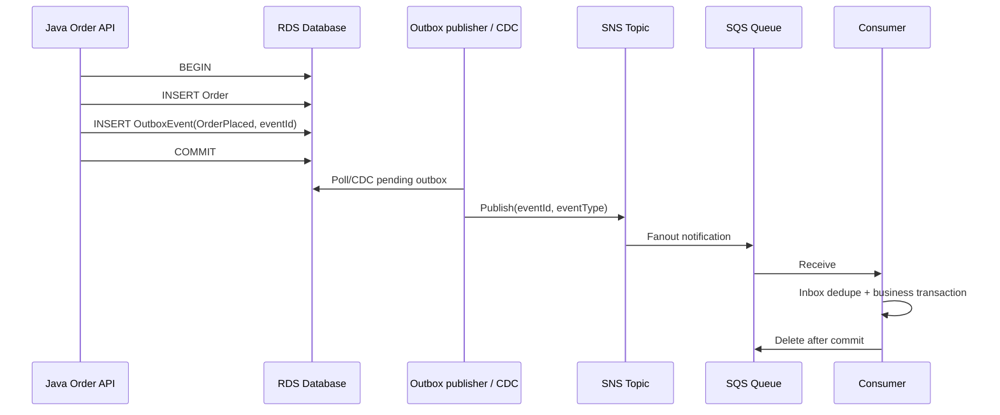

**Nguyên tắc:** order và outbox event được ghi trong **cùng một DB transaction**. Một tiến trình publisher riêng hoặc CDC đọc outbox và gửi SNS. Nếu publisher crash sau publish nhưng trước khi đánh dấu outbox delivered, event có thể được publish lại — consumer vẫn cần **idempotency**.

Với DynamoDB, có thể dùng conditional writes/transactions và streams hoặc EventBridge Pipes theo nhu cầu để đạt cùng mục tiêu “commit trạng thái và dấu vết event” có kiểm soát.

### 14.3. Inbox deduplication

Mỗi consumer duy trì `consumerName + eventId` độc lập. Invoice worker nhận lại `evt-901` thì kiểm tra unique key:

```text
if inbox("invoice", "evt-901") đã xử lý:
    ACK / DeleteMessage
else:
    trong transaction:
        xử lý invoice
        ghi inbox("invoice", "evt-901")
    COMMIT
    ACK / DeleteMessage
```

Không dùng SQS `MessageId` làm business key duy nhất khi sự kiện có thể được publish lại với MessageId mới. Dùng `eventId` do business producer phát hành và lưu bền vững.

### 14.4. Retry policy và poison messages

Một chiến lược:

1. **Transient error** (timeout DB/API): retry có jitter/backoff, không xóa message trước khi thành công.
2. **Invalid schema**: đánh dấu lỗi permanent hoặc chuyển DLQ sau ngưỡng phù hợp; tránh lặp vô hạn.
3. **Partial side effect**: thiết kế idempotency/outbox hoặc saga compensation theo nghiệp vụ.
4. **DLQ alert**: bảo toàn payload/trace ID để điều tra; không đẩy lại vô điều kiện.
5. **Replay/re-drive**: xác định batch, quota, rate limit và ảnh hưởng thứ tự, test trên staging nếu có thể.

**SNS FIFO archive/replay** giúp subscriber lấy lại event theo tính năng hỗ trợ; nó không thay thế replay từ outbox/event store khi cần khôi phục lịch sử nghiệp vụ dài hạn.

### 14.5. Backpressure và kiểm soát concurrency

- SQS queue backlog cho phép API producer không chờ worker chậm, nhưng backlog liên tục tăng là tín hiệu **thiếu capacity hoặc lỗi downstream**.
- Lambda event source mapping có cấu hình **maximum concurrency** và batching; EC2/ECS consumers có thể scale bằng CPU/queue backlog theo mục tiêu message age.
- Đừng tăng đồng thời quá mức khiến RDS connection pool, payment gateway hay email API bị giới hạn; worker throughput phải phù hợp downstream capacity.
- Thời gian xử lý tối đa, visibility timeout, PDB/termination grace và retry strategy cần nhất quán.

### 14.6. Schema versioning

Một event contract thực tế nên có:

```json
{
  "eventId": "evt-901",
  "eventType": "OrderPlaced",
  "schemaVersion": 2,
  "occurredAt": "2026-11-20T08:30:00Z",
  "aggregateId": "ORD-101",
  "correlationId": "req-5521",
  "data": {
    "currency": "VND",
    "amount": 125000
  }
}
```

Producer và consumer nên hỗ trợ **backward/forward compatibility** khi thay schema, có contract tests và rollout strategy. `correlationId` giúp truy trace qua SNS/SQS/worker, `eventId` dùng dedup/inbox, `aggregateId` có thể dùng làm FIFO message group.

## 15. Giám sát vận hành: queue, topic và broker

### 15.1. SQS CloudWatch metrics

SQS metrics thuộc namespace `AWS/SQS`. Tùy cách sử dụng, một số metrics là **giá trị xấp xỉ** và không cập nhật tức thì, đặc biệt khi lượng messages thay đổi nhanh.

| Metric SQS | Ý nghĩa | Hành động điển hình |
| --- | --- | --- |
| `ApproximateNumberOfMessagesVisible` | Ước lượng số messages sẵn sàng nhận. | Cảnh báo backlog tăng, scale workers có kiểm soát. |
| `ApproximateNumberOfMessagesNotVisible` | Ước lượng messages đang in-flight. | Phát hiện workers đang giữ nhiều messages hoặc visibility lâu. |
| `ApproximateAgeOfOldestMessage` | Tuổi message lâu nhất theo cách SQS tính. | Cảnh báo SLO xử lý bị vi phạm; với DLQ/FIFO lưu ý cách đo và poison messages. |
| `NumberOfMessagesSent` | Số messages được gửi vào queue. | Theo dõi producer rate và fanout. |
| `NumberOfMessagesReceived` | Số lần nhận message. | Có thể lớn hơn số unique events do redelivery/retry. |
| `NumberOfMessagesDeleted` | Số lần delete thành công. | Không đồng nghĩa với unique business transactions. |
| `NumberOfEmptyReceives` | Số lần poll không có message. | Kiểm tra long polling/chi phí empty calls. |
| `ApproximateNumberOfMessagesDelayed` | Ước lượng messages đang bị delay. | Phân biệt delay hợp lệ với thiếu worker. |

**DLQ alert:** tạo alarm trên `ApproximateNumberOfMessagesVisible` của DLQ lớn hơn 0 trong khoảng phù hợp và thông báo tới nhóm trực. Với hệ thống nhiều messages, cũng cần theo dõi **tốc độ messages mới vào DLQ** và thời gian xử lý redrive, không chỉ giá trị tồn đọng.

Ví dụ liệt kê metrics:

```bash
aws cloudwatch list-metrics \
  --namespace AWS/SQS \
  --metric-name ApproximateNumberOfMessagesVisible \
  --region ap-southeast-1
```

Các thông số như số workers tối ưu không được suy ra trực tiếp từ `NumberOfMessagesReceived`; message có thể bị nhận nhiều lần. Để đo thành công nghiệp vụ, cần thêm **application counters** như `invoice_completed_total` với unique event IDs.

### 15.2. SNS CloudWatch metrics

Namespace `AWS/SNS` có các metric tiêu biểu:

| Metric SNS | Ý nghĩa |
| --- | --- |
| `NumberOfMessagesPublished` | Số messages producer publish được SNS chấp nhận. |
| `NumberOfNotificationsDelivered` | Notifications giao thành công tới subscriber endpoints theo cơ chế dịch vụ. |
| `NumberOfNotificationsFailed` | Lỗi giao notifications. |
| `NumberOfNotificationsFilteredOut` | Message bị subscription filter loại bỏ; không nhất thiết là lỗi. |
| `NumberOfNotificationsFilteredOut-NoMessageAttributes` | Filter theo attributes nhưng message không mang thuộc tính cần thiết. |
| `PublishSize` | Kích thước payload/nhóm messages để theo dõi quota. |

Một `NumberOfNotificationsDelivered` thành công tới **SQS** chỉ chứng minh SNS đã gửi vào queue; nó **không khẳng định worker đã xử lý thành công và delete message**. Muốn đo end-to-end phải kết hợp SNS, SQS và application metrics.

### 15.3. Amazon MQ metrics

Amazon MQ gửi metrics broker tới **CloudWatch**, với namespace/metric names khác nhau theo engine. Các nhóm tín hiệu hữu ích:

- **Broker CPU, memory, disk/storage usage**, connections/channels.
- **Queue depth/queue size**, consumer counts, enqueued/dequeued message rates.
- **Unacknowledged messages**, publishers blocked, RabbitMQ memory/disk alarms hoặc ActiveMQ broker limits.
- Broker state, maintenance/restart/failover và application reconnect errors.

Với RabbitMQ 4.2+, AWS còn hỗ trợ những **Prometheus metrics endpoints** theo release notes; cần thiết kế xác thực/networking và scrape targets phù hợp. Không giả định mọi metric từ RabbitMQ/ActiveMQ tự host tồn tại y nguyên trên Amazon MQ.

### 15.4. Nên đặt alarm như thế nào?

Một dashboard tốt có các **câu hỏi**:

1. Producer publish thành công hay lỗi?
2. Topic có giao notifications cho subscriber không?
3. Queue có nhận messages và worker đang xử lý kịp không?
4. Có DLQ messages mới xuất hiện không?
5. Message age P95 hoặc oldest age vượt SLA chưa?
6. Backend business operations có hoàn thành với **eventId duy nhất** không?
7. Có tăng chi phí poll/delivery hoặc broker capacity không?

Đặt alarms theo **business SLO** và metrics hạ tầng, ví dụ “95% invoices hoàn tất trong 2 phút” cùng “DLQ visible messages > 0”. Chỉ nhìn queue depth bằng 0 có thể gây hiểu nhầm khi **producer không publish được event**.

## 16. Chi phí, hiệu năng và quotas

### 16.1. SQS: phí theo request và payload

SQS thường tính phí dựa trên **API requests** và cách tính payload/request units theo biểu giá hiện hành, cùng các khoản bổ sung:

- `SendMessage`, `ReceiveMessage`, `DeleteMessage`, batch requests, visibility changes.
- Dữ liệu transfer, KMS requests nếu SSE-KMS customer managed key.
- VPC interface endpoint, CloudWatch metrics/alarms hoặc logs do bạn cấu hình.
- **Nhiều empty receives** nếu short polling quá thường xuyên.

**Tối ưu:**

- Dùng `WaitTimeSeconds` từ 1–20 giây cho long polling khi phù hợp.
- Dùng batch sends/receives/deletes tới giới hạn API, nhưng thiết kế xử lý lỗi **từng message**.
- Dùng autoscaling dựa trên backlog per worker hoặc tuổi message; không scale vô hạn vượt năng lực database.
- Với payload lớn, lưu ở S3 và gửi reference, tính thêm phí storage/GET và quyền truy cập.

### 16.2. SNS: một publish có thể sinh nhiều deliveries

Ví dụ publish **100.000 OrderPlaced events** tới một SNS topic có **ba SQS subscriptions** không filtering:

```text
100.000 SNS Publish requests
   × 3 subscriptions
 = tối đa 300.000 SQS message deliveries (trước lỗi/retry/quota)
```

Con số trên mô tả fanout về mặt logic, **không phải bảng hóa đơn chính xác**. Chi phí có thể gồm SNS API publish/deliver, SQS Send/Receive/Delete, payload units, data transfer, KMS/CloudWatch. Nếu một filter nhận 20% events, tổng deliveries của subscription đó khác đi.

SNS có thể tính phí khác nhau theo **protocol đích** (SQS, Lambda, email, SMS, HTTP/S hoặc Firehose). SMS pricing/quota không giống email hoặc queue delivery. Kiểm tra AWS Pricing Calculator và bảng giá của từng dịch vụ.

### 16.3. Amazon MQ: broker chạy liên tục, dù ít message

Amazon MQ thường có phí **broker instance-hours**, **storage**, data transfer, logs/monitoring, và các chi phí kết nối/hạ tầng. Một RabbitMQ cluster đa AZ có thể cần **nhiều broker nodes** và storage/replication capacity lớn hơn single-instance.

Với workload chỉ vài nghìn events/ngày và không có yêu cầu JMS/AMQP đặc thù, **SQS/SNS serverless có thể đơn giản và tiết kiệm hơn**. Với hệ thống đã có JMS/OpenWire tích hợp sâu, khoản **chi phí sửa ứng dụng, migration và rủi ro vận hành** có thể lớn hơn chênh lệch hóa đơn AWS.

### 16.4. Quotas và giới hạn cần xem khi thiết kế

| Chủ đề | Câu hỏi trước khi load test |
| --- | --- |
| SQS Standard | API TPS, in-flight quota, long polling/concurrency, message size và backlog tuổi tối đa. |
| SQS FIFO | Số **message groups**, high-throughput mode, batch/partition quotas, dedup scope. |
| SNS Standard | Publish TPS theo Region, subscriptions/filters, protocols và message size. |
| SNS FIFO | Throughput scope `Topic`/`MessageGroup`, group distribution, SQS FIFO downstream capacity. |
| Amazon MQ | Broker instance type/engine version, connections/channels, destinations/queues, storage, disk/memory alarms, maintenance windows. |
| Lambda consumer | Reserved/max concurrency, event source mapping batch/visibility/timeout, downstream quota. |
| IAM/KMS/PrivateLink | Service policies, KMS throttling/cost, network endpoints và cross-account policies. |

**AWS feature/quota thay đổi theo thời gian và Region**, nên ưu tiên Service Quotas/console, metrics thực và tải thử. Không thiết kế cả hệ thống dựa trên một con số throughput từ blog cũ.

## 17. Troubleshooting theo triệu chứng

| Triệu chứng | Nguyên nhân có thể | Hướng kiểm tra |
| --- | --- | --- |
| `sns:Publish` báo `AccessDenied` | Producer role thiếu `sns:Publish`, topic policy hoặc SCP/KMS chặn. | IAM identity, topic policy, KMS key và CloudTrail. |
| Topic publish thành công nhưng SQS không có message | Queue policy chưa cho `sns.amazonaws.com` SendMessage, subscription PendingConfirmation, filter loại message. | Queue `Policy`, topic/queue ARN, subscription status/filter. |
| SNS→SQS bị `KMSAccessDenied` | Queue SSE-KMS dùng key policy thiếu quyền cho SNS/publisher. | KMS key policy, encryption config, CloudTrail. |
| SQS queue trống sau ReceiveMessage lần đầu | Message đang **invisible** trong visibility timeout. | `ApproximateNumberOfMessagesNotVisible`, thử sau timeout, receipt handle. |
| Worker nhận cùng event hai lần | Redelivery, delete thất bại, visibility quá ngắn hoặc producer publish trùng. | Idempotency key, message receive count, `DeleteMessage`, visibility/timeout. |
| `ReceiptHandleIsInvalid` | Dùng MessageId, handle cũ hoặc nhầm queue. | Chỉ dùng receipt handle mới nhất đúng QueueUrl. |
| Backlog tăng nhanh, message age tăng | Downstream chậm, worker thiếu capacity hoặc lỗi kết nối/DB. | Worker metrics, scaling, DB capacity, DLQ và oldest age. |
| DLQ có nhiều poison messages | Schema không tương thích, bug, thiếu quyền hoặc timeout. | Lấy mẫu an toàn, logs/correlation IDs, sửa code rồi redrive có kiểm soát. |
| FIFO queue chỉ có một consumer hoạt động hiệu quả | Tất cả messages cùng một `MessageGroupId`, không có parallel groups. | Chọn group theo order/account, kiểm tra tiêu chí ordering. |
| SQS FIFO `SendMessage` lỗi | Thiếu `MessageGroupId` hoặc `MessageDeduplicationId` khi không bật content-based dedup. | Queue attributes, message metadata và tên `.fifo`. |
| S3 Event Notifications không đẩy trực tiếp tới SQS FIFO | Tích hợp nguồn không hỗ trợ FIFO target. | Dùng EventBridge intermediary theo tài liệu AWS. |
| SNS FIFO không cho subscribe email/SMS/HTTP | Những endpoint types đó không giữ ordering yêu cầu. | Chọn SNS Standard riêng hoặc thay pattern. |
| SNS filter không hoạt động ngay | Eventual consistency hoặc dùng body thay vì message attribute. | `FilterPolicyScope`, attributes JSON và đợi propagation. |
| Java SQS consumer parse JSON bị lỗi | SNS raw delivery chưa bật, body chứa SNS envelope. | `RawMessageDelivery`, parse envelope hoặc đổi subscription. |
| Lambda consumer liên tục retry batch | Handler throw, timeout, visibility không đúng hoặc thiếu partial failure config. | `ReportBatchItemFailures`, Lambda logs, per-record idempotency. |
| Amazon MQ client không connect được | SG, VPC route, broker endpoint/port, TLS/credentials sai hoặc broker maintenance. | Broker state/engine endpoints, network, TLS chain, broker user. |
| RabbitMQ publish ACK nhưng consumer chưa xử lý | Publisher confirm và consumer acknowledgment là hai bước khác. | Queue depth, consumer count, unacked messages, DLQ/requeue. |
| Amazon MQ memory/disk alarm | Broker thiếu capacity, queue backlog, too many connections/queues. | CloudWatch broker metrics, scale/purge **theo quy trình**, topology. |
| Cross-account SNS→SQS không hoạt động | Chưa cấp topic Subscribe policy hoặc queue SendMessage policy/KMS tương ứng. | Chủ từng account, ARN, principal, source account và key policy. |

### Quy trình chẩn đoán end-to-end

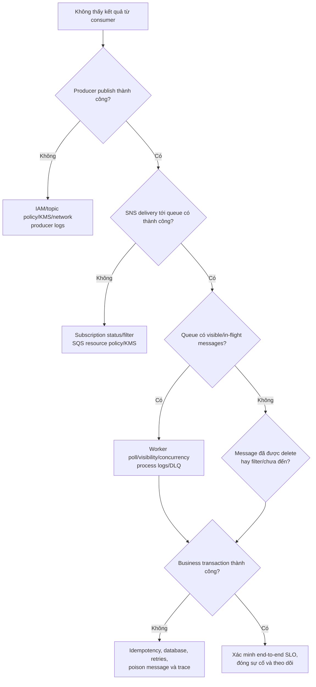

**Không chữa lỗi bằng cách cấp `sqs:*`/`sns:*` cho mọi principal**, tắt KMS hoặc xóa ngay queue chứa backlog. Xác định lỗi ở producer, routing, queue, consumer hay downstream trước, sau đó thay đổi quyền/cấu hình nhỏ nhất.

## 18. Tình huống thiết kế: hệ thống bán hàng đa kênh

### Bối cảnh

Một doanh nghiệp có:

- **Java Order API** nhận **15.000 đơn/phút** trong sự kiện khuyến mãi, bình thường chỉ 100 đơn/phút.
- Hệ thống **Invoice** tạo PDF và có thể mất 10–90 giây/message.
- Hệ thống **Marketing** gửi email theo sự kiện nhưng chấp nhận delay vài phút.
- Hệ thống **Inventory** cần xử lý `StockReserved` rồi `StockReleased` theo **đúng thứ tự cho từng SKU**.
- Một đối tác cũ dùng **JMS/OpenWire ActiveMQ** nhận event qua kết nối broker.
- SLO: không thất lạc đơn đã commit, không thu tiền hai lần, các message lỗi có thể điều tra/replay.

### 18.1. Đề xuất kiến trúc

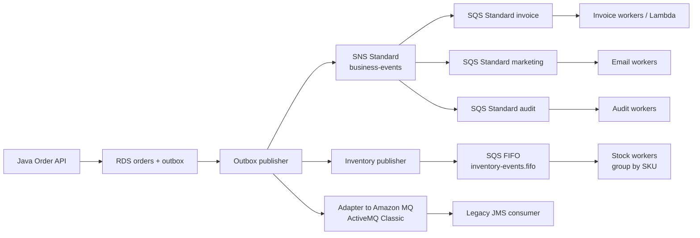

**Điểm quan trọng:** sơ đồ biểu diễn **nhiều đích publish** từ outbox publisher. Nếu yêu cầu cả standard và FIFO messaging, có thể thiết kế các adapters/channels riêng. Không dùng một SNS Standard topic rồi kỳ vọng SQS FIFO tự sửa được thứ tự của events đã phát không có grouping.

### 18.2. Vì sao chọn như vậy?

1. **Outbox:** đảm bảo ghi order và event record trong cùng một DB transaction; publisher retry có thể gửi trùng nhưng consumer inbox xử lý idempotent.
2. **SNS Standard + SQS Standard:** invoice/marketing/audit mỗi nhóm có queue backlog, throughput và DLQ độc lập, phù hợp spike workload.
3. **Invoice worker:** visibility timeout dựa trên P99 xử lý, heartbeat nếu cần, concurrency giới hạn theo PDF storage/API quota và DLQ maxReceiveCount phù hợp.
4. **Inventory SQS FIFO:** `MessageGroupId=skuId` giữ ordering theo từng SKU, các SKU khác xử lý song song. `MessageDeduplicationId=eventId` giúp giảm duplicate trong cửa sổ dedup nhưng vẫn cần unique business check.
5. **Legacy JMS:** giữ **Amazon MQ for ActiveMQ Classic** khi cần giao thức/semantics cũ; adapter từ outbox/event bus tới broker phải có retry, ack và idempotency riêng.
6. **DLQ/replay:** tách invoice/marketing/audit DLQs; với inventory FIFO phải xem cách poison message ảnh hưởng thứ tự trước khi redrive.
7. **Security:** IAM roles cho publisher/consumers, queue policies chỉ cho SNS topic, KMS key policies và broker credentials trong Secrets Manager.
8. **Monitoring:** SNS delivered/failed, SQS backlog/age/DLQ, MQ queue depth/connections, và metrics business `orders_committed_total`/`invoices_completed_total`.

### 18.3. Các lựa chọn cần bác bỏ

| Ý tưởng | Vì sao không phù hợp? |
| --- | --- |
| Chỉ một SQS queue cho cả invoice/marketing/audit | Worker nhóm nào nhận trước sẽ lấy message; không có bản sao event cho từng nhóm. |
| Dùng SNS push thẳng HTTP tới invoice worker để buffer spike | Endpoint có thể bị quá tải; không có queue backlog riêng và consumer-controlled backpressure. |
| Dùng duy nhất một FIFO group cho mọi SKU | Giữ ordering toàn cục nhưng giảm concurrency nghiêm trọng. |
| Dùng Amazon MQ cho mọi tác vụ chỉ vì đã có broker legacy | Phát sinh capacity/operations không cần thiết cho các jobs native AWS. |
| Tin rằng queue FIFO loại trừ mọi lỗi double-payment | Queue không bảo đảm idempotency ở payment gateway/database transaction. |
| Xóa messages DLQ để dashboard sạch | Làm mất bằng chứng lỗi/khả năng replay và có thể gây sai lệch nghiệp vụ. |

### 18.4. Checklist kiểm thử trong staging

1. Publish cùng eventId hai lần và xác minh **business side effect chỉ một lần**.
2. Cho Invoice worker crash sau DB commit nhưng trước DeleteMessage; kiểm tra retry và inbox.
3. Tắt invoice workers 10 phút; xác minh queue backlog tăng, Marketing vẫn hoạt động và Invoice tiếp tục khi workers trở lại.
4. Publish StockReserved/StockReleased cùng SKU qua FIFO, dùng nhiều groups để test concurrency.
5. Cố tình gửi schemaVersion không hỗ trợ, xác minh DLQ alert và quy trình fix/redrive.
6. Chặn broker connection trong lab và kiểm tra adapter reconnect/idempotency, không ảnh hưởng đơn hàng đã commit.
7. Thử KMS/queue policy sai trong lab để xác định lỗi giao nhận, sau đó khôi phục least-privilege policy.
8. Theo dõi chi phí SQS requests, SNS fanout, KMS, CloudWatch và Amazon MQ broker trong test load.

## 19. Những sai lầm phổ biến khi chọn dịch vụ

**Sai lầm 1: “SQS queue gửi một message cho tất cả consumers.”**

Không. Những consumers cùng poll **một queue** cạnh tranh nhận work; muốn mỗi business team nhận một bản sao, dùng **nhiều queues** hoặc **SNS fanout**.

**Sai lầm 2: “SNS là queue và có thể poll như SQS.”**

Không. SNS chủ yếu **publish/push tới subscriptions**; nếu cần consumer poll, lưu backlog và backpressure thì subscribe **SQS queue**.

**Sai lầm 3: “SQS Standard luôn giao message một lần và đúng thứ tự.”**

Không. Standard cung cấp **at-least-once**, best-effort ordering; consumer cần idempotency và logic xử lý out-of-order nếu nghiệp vụ yêu cầu.

**Sai lầm 4: “SQS FIFO bảo đảm thanh toán không bao giờ bị trùng.”**

Không. FIFO có ordering/dedup trong **cửa sổ 5 phút** theo điều kiện dịch vụ, không điều phối transaction của payment gateway hoặc RDS.

**Sai lầm 5: “MessageGroupId có mặt trên Standard thì tự thành FIFO.”**

Không. SQS Standard fair-queue behavior không tạo strict ordering; để xử lý theo thứ tự cần **FIFO queue**.

**Sai lầm 6: “Chỉ tăng VisibilityTimeout thật lớn là xử lý retry tốt.”**

Không. Timeout dài làm retry chậm khi worker chết; timeout ngắn làm redelivery sớm. Đo thời gian xử lý và dùng heartbeat/ChangeMessageVisibility có giới hạn.

**Sai lầm 7: “ReceiveMessage thành công tức message đã hoàn thành.”**

Không. Phải **process/commit rồi DeleteMessage** bằng receipt handle mới nhất. Nếu quên delete, message quay lại.

**Sai lầm 8: “DLQ tự tạo và tự sửa dữ liệu lỗi.”**

Không. Bạn phải tạo/thiết lập DLQ, điều tra nguyên nhân và redrive có kiểm soát. DLQ có thể ảnh hưởng nghiêm trọng tới ordering của FIFO.

**Sai lầm 9: “SNS publish thành công nghĩa cả ba subscribers đã xử lý xong.”**

Không. Publish được SNS chấp nhận chưa chứng minh notification được giao mọi nơi, càng không chứng minh business consumers đã commit thành công.

**Sai lầm 10: “Chỉ cần SNS subscribe là SQS sẽ nhận message.”**

Chưa đủ. SQS **resource policy** phải cho SNS topic `sqs:SendMessage` với SourceArn; cross-account/KMS có thể yêu cầu thêm permissions.

**Sai lầm 11: “SNS FIFO gửi email/SMS/HTTP giống Standard.”**

Không. SNS FIFO có giới hạn protocols, đặc biệt email/SMS/HTTP(S) không có strict ordering guarantee và không được hỗ trợ như Standard.

**Sai lầm 12: “SNS lúc nào cũng chỉ hỗ trợ 256 KiB.”**

Không còn đúng với SNS topic có cấu hình `MaximumMessageSize` mới: có thể lên **1 MiB** khi đáp ứng giới hạn subscriber; mặc định vẫn **256 KiB**.

**Sai lầm 13: “SNS message filtering không tác động delivery semantics.”**

Không hoàn toàn. Message không khớp bị loại; với FIFO, các điều kiện exactly-once và filtering cần được xem kỹ, tránh suy ra mọi subscriber nhận tất cả events.

**Sai lầm 14: “SQS và Amazon MQ có API/giao thức như nhau.”**

Không. SQS dùng AWS API/SDK với visibility timeout; Amazon MQ dùng protocol broker và ack semantics riêng như JMS/AMQP.

**Sai lầm 15: “Amazon MQ là serverless hoàn toàn, không cần quản lý capacity.”**

Không. AWS quản lý nhiều khâu broker nhưng bạn vẫn chọn instance/storage/topology, engine version, maintenance, network, credentials, HA và giám sát.

**Sai lầm 16: “Gắn IAM role cho Java app là đủ đăng nhập RabbitMQ broker.”**

Không. IAM kiểm soát **AWS control plane** của Amazon MQ, còn **protocol connection** thường dùng broker credentials/TLS và quyền theo engine.

**Sai lầm 17: “Có SQS thì không bao giờ mất event sau DB commit.”**

Không. Nếu producer crash trước publish, SQS chưa bao giờ nhận event; cần **transactional outbox/CDC** nếu nghiệp vụ yêu cầu đồng bộ DB và event emission.

**Sai lầm 18: “Đẩy càng nhiều consumer song song càng nhanh.”**

Không chắc. Database, API quotas, FIFO group count, RabbitMQ broker capacity và network có thể là nút cổ chai; tăng concurrency vô hạn dễ gây lỗi dây chuyền.

## 20. Câu hỏi tự kiểm tra

**Câu 1.** Một Java API muốn xử lý tác vụ resize ảnh bất đồng bộ, nhiều workers cùng lấy job, không quan tâm thứ tự. Nên bắt đầu bằng gì?

**Đáp án:** **SQS Standard** với workers poll hoặc Lambda event source mapping, có idempotency, visibility timeout và DLQ.

**Câu 2.** Một event OrderPlaced cần tới ba hệ thống độc lập và mỗi hệ thống có retry riêng. Kiến trúc nào phù hợp?

**Đáp án:** **SNS Standard topic → ba SQS Standard queues** (hoặc FIFO tương ứng nếu thứ tự là bắt buộc), mỗi nhóm có consumer/monitoring/DLQ riêng.

**Câu 3.** SQS Standard bảo đảm thứ tự và exactly-once business processing không?

**Đáp án:** **Không.** At-least-once và best-effort ordering; cần idempotency, retry và handling out-of-order ở ứng dụng.

**Câu 4.** Với SQS FIFO, MessageGroupId nên đặt theo gì nếu cần tuần tự theo từng đơn hàng?

**Đáp án:** **Theo `orderId` hoặc aggregate ID**, để các event của một đơn tuần tự, các đơn khác có thể song song.

**Câu 5.** Vì sao vẫn cần idempotency khi đã dùng FIFO?

**Đáp án:** Dedup của FIFO có cửa sổ khoảng **5 phút** và không kiểm soát việc transaction business/HTTP API/DB commit đã xảy ra chưa khi consumer gặp lỗi hoặc redelivery.

**Câu 6.** Consumer xử lý thành công rồi crash trước DeleteMessage. Điều gì có thể xảy ra?

**Đáp án:** Message có thể hiển thị lại sau visibility timeout; consumer khác phải dùng **eventId/inbox** để tránh thực hiện lại business side effect.

**Câu 7.** Một SNS topic publish thành công nhưng SQS subscriber không thấy message; ba bước kiểm tra đầu tiên?

**Đáp án:** Xác minh **subscription status**, **SQS queue policy cho sns.amazonaws.com và đúng SourceArn**, rồi **FilterPolicy/FilterPolicyScope** và KMS.

**Câu 8.** SNS FIFO có gửi trực tiếp tới email/SMS như SNS Standard không?

**Đáp án:** Không theo phạm vi hỗ trợ SNS FIFO; cần cân nhắc **SNS Standard** riêng hoặc thiết kế thông báo khác.

**Câu 9.** Một đội đang dùng Java JMS/OpenWire trên ActiveMQ tự host. Dịch vụ nào giảm thay đổi protocol?

**Đáp án:** **Amazon MQ for ActiveMQ Classic**, sau khi kiểm tra engine compatibility, TLS, broker endpoints, HA và chi phí.

**Câu 10.** Một RabbitMQ client publish thành công nhưng consumer chưa xử lý; cần xem gì?

**Đáp án:** Exchange/binding/queue, publisher confirms, queue depth, consumer count, ACK/nack, dead-letter routing và broker metrics, không chỉ thành công ở publisher.

**Câu 11.** MaximumMessageSize của SNS hiện tại là bao nhiêu?

**Đáp án:** **Mặc định 256 KiB**, có thể cấu hình tới **1 MiB** theo điều kiện subscription/protocol được AWS hỗ trợ. SQS cũng hỗ trợ message tới **1 MiB** theo tài liệu hiện hành.

**Câu 12.** Khi nào cần transactional outbox?

**Đáp án:** Khi trạng thái trong database và việc phát event phải đồng nhất, tránh trường hợp **DB commit thành công nhưng process chết trước khi publish**.

**Câu 13.** Một queue FIFO có DLQ; vì sao redrive cần thận trọng?

**Đáp án:** Poison message và việc chuyển message sang DLQ có thể làm thay đổi thứ tự thực thi business trong group, còn redrive có nguy cơ duplicate side effects.

**Câu 14.** Metrics nào quan trọng để biết worker xử lý không kịp?

**Đáp án:** `ApproximateAgeOfOldestMessage`, `ApproximateNumberOfMessagesVisible/NotVisible`, DLQ counts, tốc độ xử lý thành công và độ trễ nghiệp vụ.

**Câu 15.** SQS, SNS hay Amazon MQ nên ưu tiên khi không có yêu cầu giao thức broker cũ nhưng cần gửi thông báo một-nhiều?

**Đáp án:** Thường chọn **SNS** để fanout, thêm **SQS queue cho từng subscriber** cần buffering/retry. Không cần broker chỉ để thực hiện fanout cơ bản.

## Tài liệu tham khảo AWS chính thức

- [Amazon SQS — Developer Guide](https://docs.aws.amazon.com/AWSSimpleQueueService/latest/SQSDeveloperGuide/welcome.html)
- [Amazon SQS — Standard queues](https://docs.aws.amazon.com/AWSSimpleQueueService/latest/SQSDeveloperGuide/standard-queues.html)
- [Amazon SQS — FIFO queues](https://docs.aws.amazon.com/AWSSimpleQueueService/latest/SQSDeveloperGuide/sqs-fifo-queues.html)
- [Amazon SQS — Queue types and choosing Standard/FIFO](https://docs.aws.amazon.com/AWSSimpleQueueService/latest/SQSDeveloperGuide/sqs-queue-types.html)
- [Amazon SQS — Visibility timeout](https://docs.aws.amazon.com/AWSSimpleQueueService/latest/SQSDeveloperGuide/sqs-visibility-timeout.html)
- [Amazon SQS — Dead-letter queues](https://docs.aws.amazon.com/AWSSimpleQueueService/latest/SQSDeveloperGuide/sqs-dead-letter-queues.html)
- [Amazon SQS — Message quotas](https://docs.aws.amazon.com/AWSSimpleQueueService/latest/SQSDeveloperGuide/quotas-messages.html)
- [Amazon SQS — FIFO message identifiers](https://docs.aws.amazon.com/AWSSimpleQueueService/latest/SQSDeveloperGuide/sqs-fifo-queue-message-identifiers.html)
- [Amazon SNS — What is Amazon SNS?](https://docs.aws.amazon.com/sns/latest/dg/welcome.html)
- [Amazon SNS — Subscribe SQS queue to topic](https://docs.aws.amazon.com/sns/latest/dg/subscribe-sqs-queue-to-sns-topic.html)
- [Amazon SNS — FIFO topics and deduplication](https://docs.aws.amazon.com/sns/latest/dg/sns-fifo-topics.html)
- [Amazon SNS — FIFO delivery to SQS](https://docs.aws.amazon.com/sns/latest/dg/fifo-message-delivery.html)
- [Amazon SNS — Message filtering for FIFO topics](https://docs.aws.amazon.com/sns/latest/dg/fifo-message-filtering.html)
- [Amazon SNS — Publishing large messages](https://docs.aws.amazon.com/sns/latest/dg/large-message-payloads.html)
- [Amazon SNS — Archiving and replay](https://docs.aws.amazon.com/sns/latest/dg/message-archiving-and-analytics.html)
- [Amazon MQ — Developer Guide](https://docs.aws.amazon.com/amazon-mq/latest/developer-guide/)
- [Amazon MQ — ActiveMQ Classic brokers](https://docs.aws.amazon.com/amazon-mq/latest/developer-guide/working-with-activemq.html)
- [Amazon MQ — RabbitMQ brokers](https://docs.aws.amazon.com/amazon-mq/latest/developer-guide/working-with-rabbitmq.html)
- [Amazon MQ — RabbitMQ deployment architecture](https://docs.aws.amazon.com/amazon-mq/latest/developer-guide/rabbitmq-broker-architecture.html)
- [Amazon MQ — Supported RabbitMQ protocols](https://docs.aws.amazon.com/amazon-mq/latest/developer-guide/rabbitmq-supported-protocols.html)
- [Amazon MQ — CloudWatch monitoring](https://docs.aws.amazon.com/amazon-mq/latest/developer-guide/security-logging-monitoring.html)
- [AWS Decision Guide — SQS, SNS or EventBridge](https://docs.aws.amazon.com/decision-guides/latest/decision-guides/sns-or-sqs-or-eventbridge.html)
- [AWS Lambda — SQS event source mapping](https://docs.aws.amazon.com/lambda/latest/dg/with-sqs.html)
- [AWS Pricing — SQS](https://aws.amazon.com/sqs/pricing/)
- [AWS Pricing — SNS](https://aws.amazon.com/sns/pricing/)
- [AWS Pricing — Amazon MQ](https://aws.amazon.com/amazon-mq/pricing/)

**Ghi nhớ:** Chọn **SQS** khi cần **durable work queue và backpressure**, chọn **SNS** khi cần **fanout/notifications tới nhiều subscribers**, và chọn **Amazon MQ** khi hệ thống cần giữ **message broker protocols/semantics** như JMS hoặc AMQP. Trong thực tế, **SNS → SQS** thường là bộ đôi linh hoạt nhất cho hệ thống AWS event-driven. Dù dùng Standard hay FIFO, phải thiết kế **idempotency, outbox, retry/DLQ, IAM/KMS, monitoring, HA và chi phí** theo yêu cầu nghiệp vụ; không coi một dịch vụ nhắn tin là thay thế cho giao dịch và khả năng khôi phục ở tầng ứng dụng.
