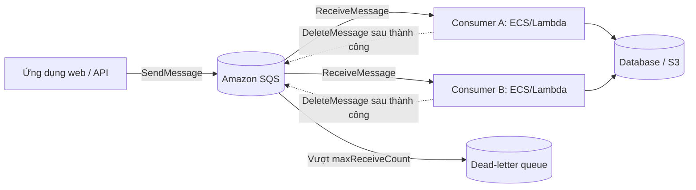
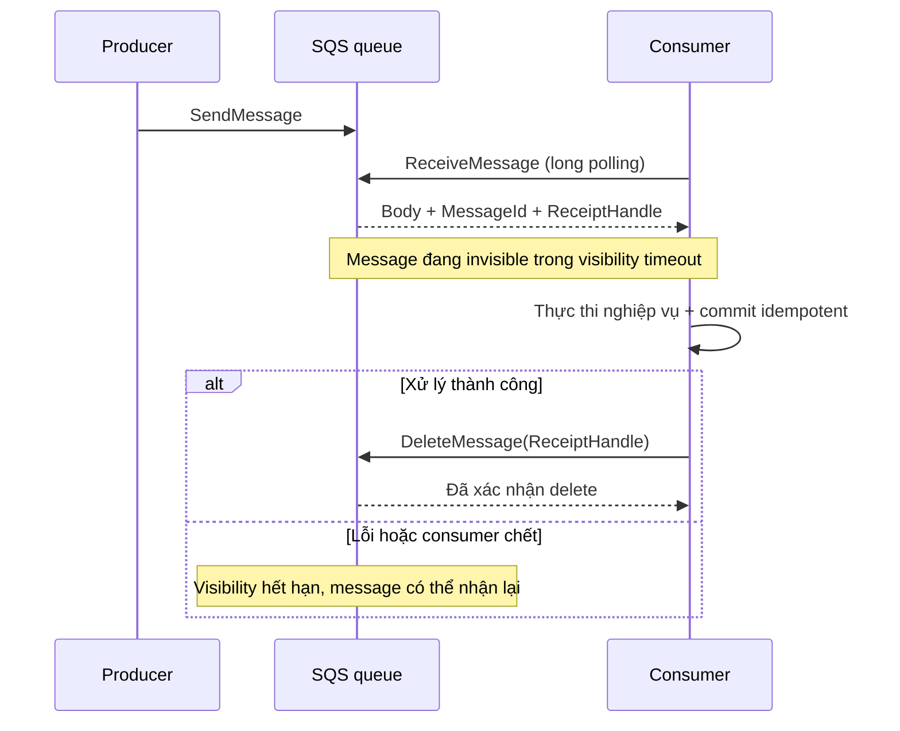
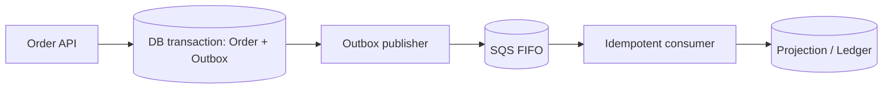
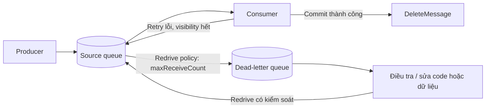
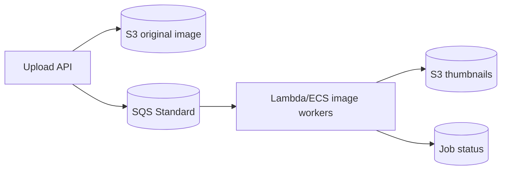
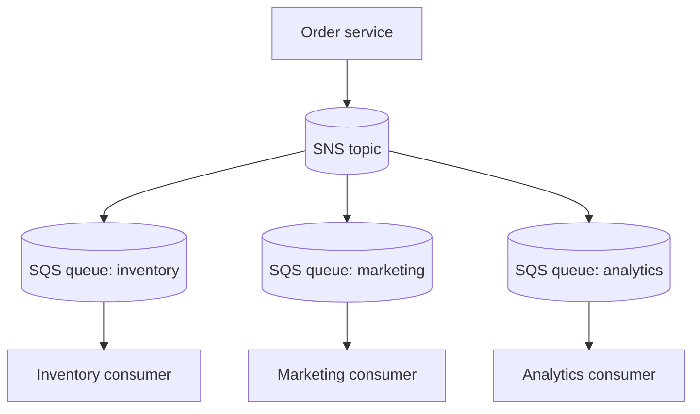
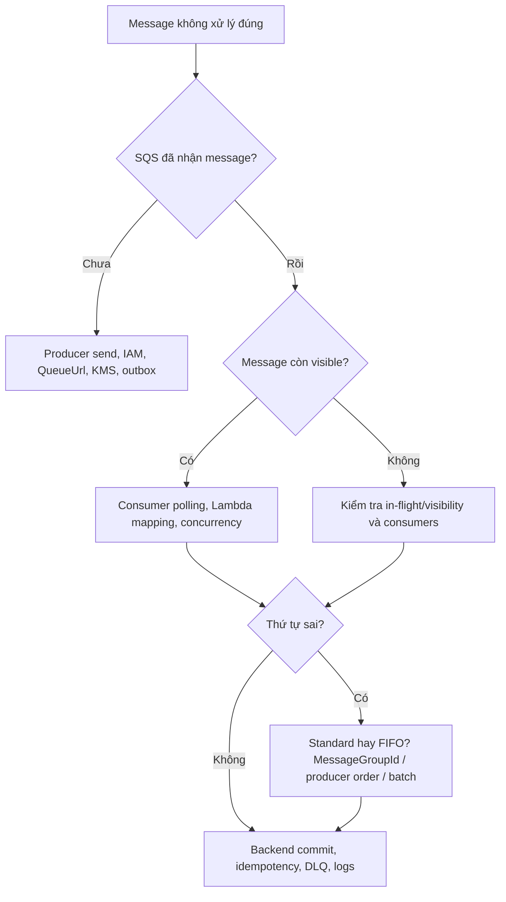
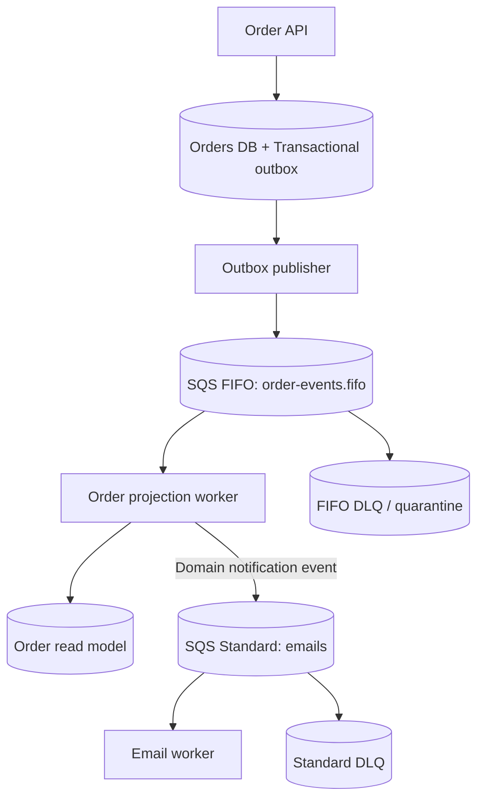

# SQS Standard, FIFO và thứ tự xử lý thông điệp

## 1. Vì sao doanh nghiệp cần hàng đợi và kiểm soát thứ tự?

Một hệ thống thương mại điện tử nhận hàng nghìn đơn hàng mỗi phút. API tạo đơn phải trả lời khách nhanh, trong khi những thao tác phía sau như kiểm tra kho, gửi email, ghi sổ và cập nhật hệ thống đối tác có thể mất vài giây hoặc tạm thời thất bại. Nếu API gọi đồng bộ tất cả hệ thống phụ, một dịch vụ downstream chậm sẽ làm tăng độ trễ và rủi ro lỗi dây chuyền.

**Amazon Simple Queue Service (Amazon SQS)** cho phép tách biệt **producer** (bên phát sinh công việc) và **consumer** (bên xử lý). Producer gửi message vào queue; consumer lấy message khi có khả năng xử lý, thực hiện nghiệp vụ và **xóa message** sau khi xử lý thành công.

Tuy nhiên, không phải mọi luồng nghiệp vụ đều có cùng yêu cầu về thứ tự:

- Gửi email xác nhận cho những đơn hàng **độc lập** có thể chấp nhận message đến không theo thứ tự và retry nhiều lần. **SQS Standard** thường phù hợp.
- Với cùng **một đơn hàng**, sự kiện `OrderCreated → PaymentCaptured → OrderCancelled` có thể cần được tiêu thụ theo **đúng thứ tự phát sinh**. **SQS FIFO** với `MessageGroupId` phù hợp hơn khi producer thiết kế đúng luồng.
- Một pipeline nhập dữ liệu có thể muốn xử lý đồng thời hàng trăm khách hàng, nhưng **tuần tự trong từng khách hàng**. FIFO có thể dùng **mỗi customerId/orderId làm một message group**.

Bài thuộc chương **Hàng đợi và thông báo** trong lộ trình **CLOUD_PROVIDERS_AWS**, gắn với Region/AZ, IAM, VPC, compute, lưu trữ, cơ sở dữ liệu, tích hợp và serverless. Người học cần biết chọn dịch vụ, triển khai hệ thống an toàn, giám sát được, phục hồi được và kiểm soát chi phí. Nội dung tập trung vào **SQS Standard, FIFO và thứ tự xử lý thông điệp**; các dịch vụ như SNS, EventBridge, Lambda và ECS được đề cập khi chúng giúp xây dựng kiến trúc hàng đợi thực tế.

Sau bài học, bạn sẽ có thể:

- Phân biệt **best-effort ordering** ở Standard với **strict ordering trong từng message group** của FIFO.
- Mô tả at-least-once delivery, visibility timeout, long polling, deduplication window và vòng đời message.
- Chọn `MessageGroupId` và `MessageDeduplicationId` đúng với khóa nghiệp vụ.
- Viết producer/consumer có khả năng **retry và idempotency**, tránh nhầm FIFO với giao dịch exactly-once toàn hệ thống.
- Dùng AWS CLI tạo queue, gửi/nhận/xóa message, quan sát thứ tự và lỗi.
- Thiết kế DLQ/redrive, scaling, IAM/KMS, CloudWatch và giám sát backlog/độ trễ.

## 2. SQS là hàng đợi công việc, không phải lời gọi đồng bộ

SQS là dịch vụ **managed message queue**. Producer không cần chờ consumer trực tiếp xử lý xong mới tiếp tục; hai bên có thể scale và triển khai độc lập.



Một **queue** khác với một **topic**:

| Dịch vụ | Mô hình chính | Ví dụ |
| --- | --- | --- |
| **SQS** | Producer gửi vào queue; các consumers cạnh tranh xử lý message của queue | Hàng đợi tạo hóa đơn |
| **SNS** | Publish/subscribe, fan-out thông báo cho nhiều subscriptions | Một sự kiện gửi vào nhiều queues để nhiều hệ thống cùng nhận |
| **EventBridge** | Event routing theo rule/pattern, nhiều target phù hợp | Các event nghiệp vụ/AWS services được phân phối theo loại |

Nếu cùng một đơn hàng cần đi đến **hệ thống kho** và **hệ thống phân tích**, việc để hai consumer groups đọc **cùng một queue** không mặc nhiên cho cả hai nhóm nhận được bản sao mỗi message: consumer sẽ cạnh tranh nhận message. Dùng SNS/EventBridge fan-out thành **hai queue riêng**, rồi mỗi nhóm tiêu thụ queue của mình.

### 2.1. SQS không tự lưu kết quả xử lý nghiệp vụ

Khi producer gửi message thành công, SQS đã nhận một đơn vị công việc; nó **không xác nhận** cơ sở dữ liệu, email hoặc hệ thống kho đã được cập nhật. Sau khi consumer xử lý xong, kết quả cần được lưu ở nơi bền vững phù hợp như **RDS/Aurora, DynamoDB hoặc S3**. Message vẫn có thời hạn lưu giữ và có thể cần DLQ nếu nhiều lần xử lý thất bại.

Trong hệ thống production, hãy phân biệt:

1. **Accepted**: SQS đã nhận message.
2. **Delivered**: consumer đã nhận message để thử xử lý.
3. **Committed**: tác động nghiệp vụ đã được ghi/hoàn tất.
4. **Acknowledged**: consumer đã gọi `DeleteMessage` thành công để loại message khỏi hàng đợi.

Các trạng thái này có thể xảy ra ở những thời điểm khác nhau. Nếu consumer **commit dữ liệu rồi crash trước DeleteMessage**, message có thể xuất hiện lại; đó là lý do cần idempotency.

## 3. Standard và FIFO: khác nhau ở những cam kết nào?

Amazon SQS cung cấp hai kiểu queue chính: **Standard** và **FIFO (First-In-First-Out)**.

| Tiêu chí | SQS Standard | SQS FIFO |
| --- | --- | --- |
| Thứ tự message | **Best-effort ordering**; không cam kết mọi message được nhận theo đúng thứ tự gửi | Giữ thứ tự **trong cùng `MessageGroupId`** theo những điều kiện của FIFO |
| Delivery | **At least once**; consumer phải chấp nhận message có thể lặp | Có deduplication producer trong cửa sổ 5 phút; vẫn phải xử lý tình huống retry/nhận lại |
| Duplicate từ send retry | Không tự loại toàn bộ các lần gửi trùng nghiệp vụ | Sử dụng `MessageDeduplicationId` hoặc content-based deduplication trong **5 phút** |
| Parallelism | Nhiều consumers xử lý message độc lập; không giới hạn bởi thứ tự FIFO | Nhiều **message groups** được xử lý song song; một group cần tuần tự |
| Throughput | Thiết kế cho thông lượng rất cao; phù hợp workload độc lập | Phụ thuộc số message groups, batching và cấu hình throughput/deduplication |
| Tên queue | Tên không cần hậu tố đặc biệt | **Bắt buộc kết thúc bằng `.fifo`** |
| Trường gửi message | `MessageBody` là trọng tâm | Cần **`MessageGroupId`**, và dedup ID nếu không bật content-based dedup |
| Tình huống | Email, logs, resize ảnh, jobs độc lập | Trạng thái đơn hàng, chuyển đổi số dư theo tài khoản, cập nhật tuần tự theo entity |

**Điểm quan trọng:** cụm từ “exactly-once processing” đôi khi xuất hiện trong mô tả FIFO, nhưng **không phải bảo đảm mọi side effect trong database/email chỉ xảy ra đúng một lần**. FIFO chống nhận trùng từ **producer gửi lặp cùng deduplication ID trong cửa sổ khử trùng**. Consumer vẫn có thể gặp retry, quá hạn visibility, lỗi mạng hoặc delete thất bại. Thiết kế idempotent vẫn là bắt buộc.

### 3.1. Standard không có thứ tự nghiêm ngặt

Producer gửi theo trình tự:

```text
Message A: OrderCreated
Message B: PaymentCaptured
Message C: OrderShipped

Standard queue:
  Consumer 1 có thể nhận B trước khi Consumer 2 nhận A.
  Consumer 3 có thể xử lý C xong trước khi A hoàn tất.
  Một message có thể xuất hiện lại khi visibility timeout hết hoặc có bản sao.
```

SQS Standard nỗ lực bảo toàn thứ tự trong nhiều tình huống, nhưng **không cung cấp hợp đồng FIFO**. Không dùng thứ tự thực tế quan sát được trong môi trường thử tải nhẹ làm bằng chứng rằng thứ tự sẽ luôn đúng khi scale, failover hoặc retry.

### 3.2. FIFO có bảo đảm theo nhóm, không phải toàn hàng đợi

Trong FIFO, producer phải chọn **MessageGroupId**. Các messages có **cùng group ID** được tiêu thụ theo thứ tự tương ứng; **khác group ID** có thể xử lý song song và thứ tự giữa chúng **không được cam kết**.

```text
FIFO queue: order-events.fifo

MessageGroupId = order-101:
  M1 OrderCreated -> M2 PaymentCaptured -> M3 OrderShipped

MessageGroupId = order-202:
  N1 OrderCreated -> N2 PaymentFailed

Nhóm order-101 xử lý tuần tự.
Nhóm order-202 có thể xử lý song song với order-101.
Không có thứ tự toàn cục bắt buộc giữa M1 và N1.
```

Nếu đặt **mọi message cùng một MessageGroupId** (ví dụ `global`), bạn gần như biến toàn bộ FIFO queue thành một luồng tuần tự, gây nghẽn throughput khi consumer chậm. Nếu đặt **mỗi message một group ID mới**, bạn có nhiều concurrency nhưng **mất quan hệ thứ tự giữa các sự kiện cùng entity**. Chọn group theo khóa nghiệp vụ cần tuần tự, không phải theo tên producer hoặc số ngẫu nhiên.

## 4. Vòng đời message: Send, Receive, Visibility, Delete

Một message SQS không bị xóa ngay khi consumer nhận được. SQS sử dụng **visibility timeout** để ẩn message tạm thời khỏi các lần nhận khác, tạo thời gian cho consumer xử lý.



### 4.1. Visibility timeout không phải message retention

| Cơ chế | Ý nghĩa | Giá trị AWS thường gặp |
| --- | --- | --- |
| **Visibility timeout** | Thời gian message đang được consumer xử lý bị ẩn khỏi các receive khác | Mặc định **30 giây**, có thể cấu hình trong giới hạn dịch vụ |
| **Message retention period** | Message được giữ trong queue tối đa bao lâu trước khi tự hết hạn | Mặc định **4 ngày**, cấu hình trong khoảng **1 phút đến 14 ngày** |
| **Receive message wait time** | Long polling chờ tối đa bao lâu khi tìm messages | Tối đa **20 giây** |
| **Delay seconds** | Trì hoãn thời điểm message bắt đầu visible | Tối đa **15 phút** theo khả năng của queue/API |

Nếu xử lý thực tế mất 50 giây nhưng visibility chỉ 30 giây, message có thể hiện trở lại trước khi consumer cũ commit và xóa. Với Standard, consumer khác có thể xử lý trùng **cùng lúc**; với FIFO, message group có thể bị giữ lại hoặc được giao lại tùy visibility và trạng thái nhận. Nếu công việc dài, cần cấu hình visibility thích hợp hoặc dùng `ChangeMessageVisibility` để **gia hạn có kiểm soát** khi consumer vẫn đang xử lý.

Không đặt visibility timeout cực dài “cho chắc” mà không cân nhắc recovery: consumer crash có thể khiến message bị ẩn quá lâu trước khi được retry, tăng độ trễ phục hồi.

### 4.2. ReceiptHandle khác MessageId

`MessageId` định danh message do SQS trả khi gửi. Mỗi lần `ReceiveMessage` lại có **ReceiptHandle** phù hợp lần nhận đó. Khi xóa, sử dụng **ReceiptHandle mới nhất của lần nhận hiện hành**; không dùng MessageId thay cho receipt handle.

Vì xóa và xử lý backend không thuộc cùng transaction nguyên tử với SQS, hãy:

1. Thực hiện tác động nghiệp vụ một cách idempotent.
2. Commit kết quả nếu có transaction.
3. Chỉ sau đó gọi `DeleteMessage` với receipt handle đúng.
4. Nếu delete thất bại hoặc kết nối mất trước khi nhận được xác nhận, chuẩn bị tình huống message quay lại.

### 4.3. Long polling và xử lý queue rỗng

**Short polling** có thể trả lời ngay với message tìm được hoặc response rỗng. **Long polling** (`WaitTimeSeconds` lên đến 20) chờ khi queue đang trống, giúp giảm các receive rỗng, số request và chi phí. Không đánh đồng long polling với thời gian xử lý: tham số này chỉ ảnh hưởng **thời gian chờ nhận message**.

Với consumer chạy trong ECS/EC2, long polling kết hợp graceful shutdown là một lựa chọn phổ biến. Với Lambda event source mapping, **Lambda service sẽ poll SQS thay ứng dụng**; handler không cần viết vòng lặp `ReceiveMessage` thủ công.

## 5. FIFO MessageGroupId và thứ tự xử lý thực sự

**MessageGroupId** là khóa quan trọng nhất để quyết định thứ tự trong SQS FIFO. Nó là chuỗi mà producer gửi kèm mỗi message. SQS dùng group ID để ngăn nhiều consumer cùng xử lý các messages của **cùng nhóm** theo cách phá vỡ thứ tự giao nhận.

### 5.1. SQS có thể trả một batch gồm nhiều message trong một group

Một lần `ReceiveMessage` có thể trả về **nhiều message của cùng group**, theo thứ tự FIFO. Consumer nhận batch phải xử lý chúng **tuần tự** nếu nghiệp vụ yêu cầu. Đừng vô tình xử lý cả batch đồng thời bằng các futures rồi cho rằng SQS sẽ bảo vệ thứ tự hoàn tất.

Ví dụ:

```text
Group customer-42:
  1. CreditAdded(+100)
  2. Purchase(-40)
  3. Refund(+10)

Consumer nhận 3 messages trong cùng batch:
  Đúng:    process(1) -> commit -> process(2) -> commit -> process(3)
  Sai:     chạy đồng thời cả 3 rồi commit theo tốc độ hoàn thành khác nhau
```

Với FIFO, SQS có thể phát messages từ **các nhóm khác nhau** sang những consumers khác để xử lý song song. Khi một group có message in-flight, các message tiếp theo của group đó không được chuyển sang consumer khác như một luồng xử lý độc lập, cho tới khi message in-flight được xóa hoặc visibility hết hạn theo quy tắc dịch vụ.

### 5.2. Chọn group theo ranh giới bất biến nghiệp vụ

| Yêu cầu | MessageGroupId gợi ý | Lợi ích | Rủi ro cần nghĩ tới |
| --- | --- | --- | --- |
| Thứ tự thay đổi một đơn | `orderId` | Tuần tự trong cùng order | Hot order group bị chậm thì những event tiếp theo chờ |
| Thứ tự cập nhật một khách hàng | `customerId` | Không đảo thứ tự thay đổi cùng customer | Một khách rất nhiều events có thể trở thành hot group |
| Thứ tự theo tài khoản thanh toán | `accountId` | Bảo toàn trình tự nghiệp vụ trong tài khoản | Cần kết hợp DB transaction/conditional update |
| Xử lý logs độc lập theo thiết bị | `deviceId` | Có thể chạy nhiều thiết bị song song | Phải nhất quán group ID giữa các producer |
| Không yêu cầu thứ tự | Standard queue, hoặc thiết kế phù hợp | Tận dụng parallelism | Nếu dùng FIFO một group chung sẽ nghẽn |

Nếu hai producers gửi sự kiện của **cùng orderId**, thứ tự SQS chấp nhận message phụ thuộc **thứ tự thực tế của các SendMessage requests**, không phải thứ tự business event đã xảy ra trong database. Nếu producer B gửi `OrderShipped` trước khi producer A gửi `OrderCreated`, FIFO sẽ giữ **thứ tự gửi vào queue**, không tự sửa thứ tự nghiệp vụ. Cần thiết kế **single-writer, transactional outbox, event sequence number hoặc cơ chế điều phối** ở phía producer.

### 5.3. FIFO không bảo đảm thứ tự hoàn tất giữa các message groups

Giả sử group A có message xử lý 10 giây và group B có message xử lý 1 giây. B có thể hoàn tất trước A, dù A được gửi vào queue trước. Đây là **hành vi thiết kế** để tăng throughput, không phải lỗi FIFO.

Một yêu cầu “mọi giao dịch của mọi khách phải có một thứ tự toàn cục” rất khác yêu cầu “mỗi khách có thứ tự riêng”. Nếu bắt buộc thứ tự toàn cục, phải chấp nhận giảm parallelism hoặc dùng cơ chế điều phối/transaction phù hợp ở hệ thống dữ liệu.

## 6. Deduplication: ngăn send lặp, không thay thế idempotency

SQS FIFO hỗ trợ **deduplication interval khoảng 5 phút**. Khi producer gửi lại một message với **cùng MessageDeduplicationId** trong khoảng này, SQS nhận biết message trùng và **không phát một bản sao mới để consumer xử lý** theo cơ chế FIFO. Mục tiêu là giảm rủi ro producer retry sau khi mất kết nối/không nhận được xác nhận SendMessage.

### 6.1. Explicit deduplication ID

Một producer có thể gửi:

```json
{
  "MessageGroupId": "order-101",
  "MessageDeduplicationId": "order-101-event-v3",
  "MessageBody": "{\"orderId\":\"101\",\"version\":3,\"type\":\"PaymentCaptured\"}"
}
```

Trong thực tế, dedup ID nên gắn với **logical event identity** hoặc một version duy nhất của aggregate, không chỉ cố định theo `orderId`. Nếu dùng `MessageDeduplicationId=order-101` cho **mọi event** của một đơn, các event khác nhau trong cùng 5 phút có thể bị coi là trùng và **bị bỏ qua**.

SQS vẫn ghi nhớ dedup ID trong cửa sổ dedup ngay cả khi message tương ứng đã được nhận/xóa; vì thế retry sớm với cùng ID bị loại là điều bình thường.

### 6.2. Content-based deduplication

Nếu queue bật `ContentBasedDeduplication=true`, khi producer không cung cấp `MessageDeduplicationId`, SQS có thể tạo dedup ID từ **SHA-256 hash của MessageBody**. **Message attributes không được dùng trong việc tính hash** đó.

Ví dụ hai sends có cùng body nhưng attributes khác nhau có thể vẫn bị xem là trùng trong cửa sổ dedup. Ngược lại, hai body có khoảng trắng hoặc JSON key order khác nhau có thể cho hash khác nhau dù mang cùng ý nghĩa nghiệp vụ. Với events cần identity rõ, **explicit dedup ID** thường dễ kiểm soát hơn.

Khi producer gửi **cùng dedup ID nhưng body khác**, FIFO có thể loại lần gửi sau trong window. Đừng dùng dedup ID như một cơ chế kiểm tra nội dung/version hợp lệ; ứng dụng cần validation và sự nhất quán sự kiện riêng.

### 6.3. Điều gì xảy ra sau 5 phút?

Nếu producer lặp lại một event **sau khi deduplication interval kết thúc**, SQS có thể nhận nó như một message mới. Nếu consumer đã commit vào DB rồi crash trước DeleteMessage, message cũng có thể được xử lý lại theo quá trình retry. **FIFO không đem lại exactly-once business transaction trên RDS/DynamoDB/S3/email**.

Để đạt hiệu ứng “mỗi sự kiện nghiệp vụ chỉ tác động một lần”, kết hợp:

- Event ID/version không thay đổi qua producer retries.
- Bảng **processed_events** với unique key hoặc DynamoDB conditional write.
- Ghi dữ liệu nghiệp vụ **và** dấu đã xử lý theo transaction khi công nghệ lưu trữ hỗ trợ.
- Consumer **idempotent**: nhận cùng event lần thứ hai trả kết quả đã xử lý mà không trừ kho/thanh toán thêm.
- Thứ tự application-level theo `aggregateVersion` khi có nhiều producers/những hệ thống phải merge events.

## 7. Thực hành AWS CLI: tạo và so sánh Standard/FIFO queue

Các ví dụ sau dành cho **tài khoản thử nghiệm**. Chúng tạo queue, gửi/nhận/xóa message thật nếu chạy. Bạn cần AWS CLI đã xác thực, IAM permissions được phê duyệt và một AWS Region đang hỗ trợ SQS. Các giá trị `QUEUE_URL_HERE`, ARN, account ID và tên queue chỉ là **placeholder**; không chạy nguyên mẫu trên dữ liệu production.

### 7.1. Xác nhận tài khoản và tạo Standard queue

```bash
# Trước khi tạo tài nguyên, xác nhận identity đang dùng
aws sts get-caller-identity

# Standard queue: không cần tên .fifo
aws sqs create-queue \
  --queue-name shop-emails-standard \
  --attributes VisibilityTimeout=60,MessageRetentionPeriod=345600,ReceiveMessageWaitTimeSeconds=20 \
  --region ap-southeast-1
```

`MessageRetentionPeriod=345600` nghĩa là 4 ngày (tính theo giây); `VisibilityTimeout=60` là 60 giây. Chọn giá trị theo thời gian thực tế của consumer và kế hoạch retry, không tự sao chép từ bài học sang workload khác.

### 7.2. Tạo FIFO queue

```bash
# FIFO queue phải có hậu tố .fifo và FifoQueue=true
aws sqs create-queue \
  --queue-name shop-order-events.fifo \
  --attributes FifoQueue=true,ContentBasedDeduplication=false,VisibilityTimeout=60,MessageRetentionPeriod=345600,ReceiveMessageWaitTimeSeconds=20 \
  --region ap-southeast-1
```

Ở đây **content-based deduplication tắt**; producer phải cung cấp **`MessageDeduplicationId`** khi gửi FIFO message. Muốn dùng content-based deduplication, tạo/cấu hình queue với `ContentBasedDeduplication=true` và hiểu rõ nó tính hash theo **body**, không theo attributes.

Để tham khảo các attributes đang có:

```bash
aws sqs get-queue-url \
  --queue-name shop-order-events.fifo \
  --region ap-southeast-1

aws sqs get-queue-attributes \
  --queue-url 'FIFO_QUEUE_URL_HERE' \
  --attribute-names All \
  --region ap-southeast-1
```

Queue URL được SQS trả về, thường có cấu trúc `https://sqs.ap-southeast-1.amazonaws.com/111122223333/shop-order-events.fifo`. **Không tự đoán queue URL** khi có nhiều AWS accounts/Regions; dùng `get-queue-url`.

### 7.3. Gửi ba sự kiện cùng group

```bash
aws sqs send-message \
  --queue-url 'FIFO_QUEUE_URL_HERE' \
  --message-group-id order-101 \
  --message-deduplication-id order-101-v1 \
  --message-body '{"orderId":"101","version":1,"type":"OrderCreated"}' \
  --region ap-southeast-1

aws sqs send-message \
  --queue-url 'FIFO_QUEUE_URL_HERE' \
  --message-group-id order-101 \
  --message-deduplication-id order-101-v2 \
  --message-body '{"orderId":"101","version":2,"type":"PaymentCaptured"}' \
  --region ap-southeast-1

aws sqs send-message \
  --queue-url 'FIFO_QUEUE_URL_HERE' \
  --message-group-id order-101 \
  --message-deduplication-id order-101-v3 \
  --message-body '{"orderId":"101","version":3,"type":"OrderShipped"}' \
  --region ap-southeast-1
```

Gửi thêm sự kiện cho `order-202` với **group ID khác** để quan sát concurrency giữa groups. Thứ tự các lần gọi `send-message` phía trên được thực hiện tuần tự; nếu nhiều producers hoạt động đồng thời, ứng dụng phải thiết kế thứ tự sự kiện nghiệp vụ chứ không trông chờ vào thứ tự wall-clock của các services.

### 7.4. Nhận và xóa message

```bash
# Long polling tối đa 20 giây, nhận tối đa 10 messages mỗi lần
aws sqs receive-message \
  --queue-url 'FIFO_QUEUE_URL_HERE' \
  --max-number-of-messages 10 \
  --wait-time-seconds 20 \
  --message-system-attribute-names All \
  --region ap-southeast-1

# Sau khi xử lý nghiệp vụ thành công, xóa bằng ReceiptHandle của lần nhận hiện tại
aws sqs delete-message \
  --queue-url 'FIFO_QUEUE_URL_HERE' \
  --receipt-handle 'RECEIPT_HANDLE_FROM_RECEIVE' \
  --region ap-southeast-1
```

`receive-message` có thể trả **ít hơn 10 messages**, kể cả khi queue có nhiều messages; số lượng là giới hạn tối đa chứ không phải cam kết. Nếu consumer đang nhận cả batch cùng group, hãy xử lý tuần tự. Chỉ xóa **message đã commit thành công**, không xóa toàn bộ batch nếu một phần xử lý lỗi.

### 7.5. Thử deduplication

Gửi lại `order-101-v3` **trong vòng 5 phút** với cùng dedup ID:

```bash
aws sqs send-message \
  --queue-url 'FIFO_QUEUE_URL_HERE' \
  --message-group-id order-101 \
  --message-deduplication-id order-101-v3 \
  --message-body '{"orderId":"101","version":3,"type":"OrderShipped"}' \
  --region ap-southeast-1
```

SQS có thể trả response gửi thành công nhưng **không tạo thêm message để consumer xử lý** vì dedup ID trùng. Nếu bài thử diễn ra sau 5 phút, dedup ID đã hết cửa sổ ghi nhớ và có thể phát sinh thêm một message. Đây không phải một phép thử đáng tin để bảo đảm “exactly-once forever”.

### 7.6. Điều chỉnh visibility khi xử lý dài

Nếu consumer cần thêm thời gian xử lý, dùng **receipt handle đang còn hiệu lực**:

```bash
aws sqs change-message-visibility \
  --queue-url 'FIFO_QUEUE_URL_HERE' \
  --receipt-handle 'RECEIPT_HANDLE_FROM_RECEIVE' \
  --visibility-timeout 120 \
  --region ap-southeast-1
```

API này thay đổi khoảng visibility của message đang nhận, **không phải tăng message retention period**. Có giới hạn tổng thời gian visibility theo SQS; với job rất dài, nên có heartbeat/gia hạn được kiểm soát hoặc chia nhỏ/tách sang Step Functions, ECS tasks hay hệ thống batch phù hợp.

## 8. Consumer idempotent và xử lý sự kiện theo version

SQS Standard có thể giao lại message; FIFO cũng không thể kết hợp thao tác **update DB + DeleteMessage** thành một transaction nguyên tử xuyên hai hệ thống. Vì vậy, phải thiết kế **consumer idempotent**.

### 8.1. Mẫu transaction trong relational database

Giả sử mỗi event có `eventId` duy nhất do producer tạo và một `orderId` cùng `version`. Một thiết kế có bảng:

```sql
CREATE TABLE processed_events (
    event_id VARCHAR(100) PRIMARY KEY,
    order_id VARCHAR(100) NOT NULL,
    processed_at TIMESTAMP NOT NULL DEFAULT CURRENT_TIMESTAMP
);

CREATE TABLE order_projection (
    order_id VARCHAR(100) PRIMARY KEY,
    event_version BIGINT NOT NULL,
    status VARCHAR(40) NOT NULL
);
```

Pseudo-code quy trình:

```text
receive(message):
  parse và validate message schema/eventId/orderId/version

  BEGIN TRANSACTION
    nếu eventId đã tồn tại trong processed_events:
       => không thực hiện side effect lần nữa
    ngược lại:
       kiểm tra version/transition hợp lệ của order
       cập nhật order_projection
       insert processed_events(eventId, orderId)
  COMMIT

  DeleteMessage(receiptHandle)
```

Một số DB cung cấp `INSERT ... ON CONFLICT` hoặc unique constraint để thực thi idempotency. **Lệnh và isolation level cụ thể phụ thuộc RDS engine**; quan trọng là đánh dấu đã xử lý và thay đổi dữ liệu nghiệp vụ trong **cùng transaction**, nếu không có thể xảy ra “đánh dấu xong nhưng cập nhật thất bại” hoặc ngược lại.

Nếu side effect là **gửi email qua hệ thống bên ngoài**, database transaction không thể rollback email đã gửi. Hãy thiết kế **delivery ledger**, trạng thái gửi, idempotency key phía provider nếu hỗ trợ và chính sách chấp nhận at-least-once với các hành động không thể làm nguyên tử.

### 8.2. FIFO vẫn cần version check khi có nhiều producers

SQS FIFO bảo toàn thứ tự các message **được chấp nhận gửi trong cùng group**, không bảo đảm thứ tự business transaction được commit trước đó. Nếu producer của event `v4` gửi trước `v3`, FIFO có thể nhận `v4` trước.

Cách phòng tránh:

1. Producer ghi event và version theo transaction với aggregate.
2. **Transactional outbox** giữ events cần publish cùng thay đổi database.
3. Một publisher có trật tự hoặc coordinator bảo đảm publish events theo `aggregateVersion` cho từng entity.
4. Consumer kiểm tra `version = lastProcessedVersion + 1` hoặc xử lý replay/gap theo policy.
5. Khi thấy gap, **không xóa nhầm event quan trọng**, cũng không retry vô hạn để chặn cả group; chọn cơ chế retry/parking/alert phù hợp.

### 8.3. Transactional outbox giải quyết vấn đề “DB có đơn nhưng SQS không có event”

Không thể coi hai lệnh độc lập sau là một transaction:

```text
1. INSERT order vào RDS  -> thành công
2. SendMessage SQS       -> network error
```

Nếu producer chỉ retry mơ hồ, event có thể mất hoặc nhân đôi. Mẫu **transactional outbox** ghi **order và outbox row** trong cùng database transaction. Một worker/poller sau đó publish event ra SQS, đánh dấu outbox trạng thái đã gửi và retry khi cần. Vì worker cũng có thể crash sau SendMessage nhưng trước khi đánh dấu sent, vẫn cần **dedup ID ổn định và idempotent consumer**.



Đây là giải pháp phổ biến khi cần sự nhất quán giữa trạng thái ứng dụng và event publishing. FIFO giữ thứ tự message sau khi chúng được gửi đúng trình tự, **không thay thế outbox**.

## 9. High-throughput FIFO và thiết kế concurrency

FIFO có thể được cấu hình cho **high-throughput mode** khi thỏa những điều kiện của dịch vụ. Các attributes liên quan gồm:

- `DeduplicationScope=queue` hoặc `messageGroup`: xác định phạm vi đánh giá deduplication.
- `FifoThroughputLimit=perQueue` hoặc `perMessageGroupId`: mô hình giới hạn throughput được tính theo queue hoặc theo từng message group.
- Để bật high-throughput FIFO theo cách AWS hướng dẫn, thông thường chọn **`DeduplicationScope=messageGroup`** và **`FifoThroughputLimit=perMessageGroupId`**.

Ví dụ cấu hình queue **thử nghiệm**:

```bash
aws sqs create-queue \
  --queue-name shop-events-throughput.fifo \
  --attributes FifoQueue=true,ContentBasedDeduplication=false,DeduplicationScope=messageGroup,FifoThroughputLimit=perMessageGroupId \
  --region ap-southeast-1
```

Các con số về throughput mặc định/tối đa phụ thuộc **Region, batching, API và quota hiện hành**; không đưa một giá trị messages/giây cố định cho mọi tài khoản. Xem Service Quotas và tài liệu high-throughput FIFO tại thời điểm triển khai.

### 9.1. Concurrency phụ thuộc số active groups

Giả sử có 2.000 message cần xử lý nhưng **chỉ một MessageGroupId**. Thêm 100 consumers không biến group đó thành 100 luồng có thể commit song song theo thứ tự. Nếu có 200 group IDs độc lập và đủ năng lực, nhiều consumers có thể xử lý các groups đồng thời.

| Cách đặt group ID | Thứ tự | Parallelism |
| --- | --- | --- |
| Một ID cho toàn queue | Tuần tự gần như toàn bộ | Rất thấp |
| Một ID cho mỗi order | Thứ tự theo order | Tăng theo số orders đang hoạt động |
| Một ID cho mỗi request | Không gắn các event cùng entity vào một luồng | Cao nhưng không đáp ứng ordering nghiệp vụ |
| Một ID theo partition có chủ đích | Thứ tự trong partition | Cần bảo đảm entity luôn chọn cùng partition |

Nếu một customer tạo cực nhiều giao dịch và trở thành **hot message group**, những message sau trong group sẽ bị chặn bởi message chậm/đang retry. Cân nhắc liệu yêu cầu tuần tự thật sự ở mức **customer** hay chỉ cần ở mức **account/order**; chia nhóm quá nhỏ để tăng concurrency có thể phá bất biến nghiệp vụ.

### 9.2. Batching để tăng hiệu suất

SQS hỗ trợ `SendMessageBatch` và `DeleteMessageBatch`; một batch có thể chứa tối đa **10 entries** theo điều kiện của API. Với FIFO, messages thuộc cùng group được sắp xếp theo thứ tự gửi trong batch. Không mặc định **toàn batch là transaction nguyên tử**: kết quả có thể có **Successful** và **Failed** entries; producer cần retry riêng phần lỗi với dedup ID/identity ổn định.

Ví dụ file `send-order-events.json` cho ba messages cùng group:

```json
[
  {
    "Id": "event-1",
    "MessageBody": "{\"eventId\":\"ev101-v1\",\"orderId\":\"101\",\"version\":1,\"type\":\"OrderCreated\"}",
    "MessageGroupId": "order-101",
    "MessageDeduplicationId": "ev101-v1"
  },
  {
    "Id": "event-2",
    "MessageBody": "{\"eventId\":\"ev101-v2\",\"orderId\":\"101\",\"version\":2,\"type\":\"PaymentCaptured\"}",
    "MessageGroupId": "order-101",
    "MessageDeduplicationId": "ev101-v2"
  },
  {
    "Id": "event-3",
    "MessageBody": "{\"eventId\":\"ev101-v3\",\"orderId\":\"101\",\"version\":3,\"type\":\"OrderShipped\"}",
    "MessageGroupId": "order-101",
    "MessageDeduplicationId": "ev101-v3"
  }
]
```

```bash
aws sqs send-message-batch \
  --queue-url 'FIFO_QUEUE_URL_HERE' \
  --entries file://send-order-events.json \
  --region ap-southeast-1
```

**Kiểm tra cả danh sách Failed**, không chỉ exit code. Với FIFO và messages cùng group, producer phải có chiến lược retry/bù lỗ hổng thứ tự nếu một entry không được chấp nhận; batch thành công một phần không tự bảo đảm contract nghiệp vụ nếu code xử lý mù kết quả.

## 10. Lambda consumers với SQS Standard và FIFO

**AWS Lambda event source mapping** có thể poll SQS và gọi Lambda function với một **batch** message. Lambda thay bạn duy trì pollers, điều chỉnh concurrency trong giới hạn và xử lý cơ chế nhận/xóa theo outcome của invocation. Handler phải phản ánh **thành công/thất bại** chính xác; nếu code nuốt exception rồi return success, Lambda có thể xóa message dù nghiệp vụ thất bại.

### 10.1. Standard queue: concurrency linh hoạt

Standard queue cho phép Lambda xử lý nhiều batches song song theo khả năng và quota. Thứ tự giữa batches và thứ tự commit backend **không được đảm bảo**. Nếu handler lỗi, cả batch có thể xuất hiện lại sau visibility timeout tùy cấu hình; các messages thành công trước đó cũng có thể bị xử lý lại nếu chưa dùng partial batch response.

### 10.2. FIFO queue: concurrency theo MessageGroupId

Với FIFO, Lambda event source mapping tôn trọng **thứ tự trong group** và không xử lý các batches thuộc cùng group đồng thời theo cách vi phạm thứ tự; có thể xử lý **những group khác nhau song song**. Giới hạn concurrency thực tế liên quan số active message groups, event source mapping maximum concurrency (khi cấu hình), reserved concurrency và các quota khác.

**Batch size tối đa cho SQS FIFO event source mapping là 10 messages** theo mô hình Lambda SQS FIFO; backend vẫn cần idempotency.

### 10.3. Partial batch responses và trật tự FIFO

Nếu bật `ReportBatchItemFailures`, Lambda handler có thể trả danh sách message IDs **thất bại**, để những phần thành công không bị retry không cần thiết. Với **FIFO**, để giữ đúng thứ tự, AWS khuyến nghị **dừng xử lý khi gặp lỗi đầu tiên** và trả lỗi cho **message thất bại cùng tất cả messages chưa xử lý** trong batch.

Ví dụ pseudo-code:

```python
def handler(event, context):
    failures = []
    records = event.get("Records", [])

    # FIFO: xử lý theo thứ tự records trong batch.
    for index, record in enumerate(records):
        try:
            process_idempotently(record)  # DB commit/side effects an toàn
        except Exception:
            # Đánh dấu bản ghi lỗi và những bản ghi CHƯA xử lý.
            failures = [
                {"itemIdentifier": r["messageId"]}
                for r in records[index:]
            ]
            break

    return {"batchItemFailures": failures}
```

Đây là pseudo-code; `process_idempotently` cần do ứng dụng tự cài đặt, còn event source mapping phải bật chế độ partial batch response. Nếu batch chứa messages từ nhiều groups, có thể thiết kế tối ưu xử lý độc lập từng group mà vẫn không phá thứ tự trong group; ví dụ đơn giản trên cố tình dừng toàn batch để tránh sai contract.

### 10.4. Visibility timeout và Lambda timeout

Khi gắn SQS vào Lambda, AWS khuyến nghị visibility timeout phải **đủ dài so với Lambda function timeout và batch window**, có headroom cho retry/throttling. Một hướng dẫn phổ biến là visibility timeout **ít nhất khoảng sáu lần Lambda timeout cộng batching window** trong cấu hình liên quan. Đây là **guideline**, không thay thế đo đạc và giới hạn queue/function.

Nếu batch processing chậm hơn visibility, một invocation khác có thể nhận message trong khi invocation trước chưa hoàn tất. **Event source mapping không tự mang lại exactly-once side effects**. Bổ sung dedup nghiệp vụ, RDS/DynamoDB transactions và cấu hình concurrency/backend limits.

## 11. Dead-letter queue, redrive và rủi ro phá thứ tự FIFO

Một message có thể liên tục thất bại vì dữ liệu sai, schema không hỗ trợ, database không sẵn sàng hoặc bug trong consumer. Nếu mọi message lỗi đều retry vô hạn trong queue chính, throughput giảm, chi phí tăng và một **hot FIFO message group** có thể chặn tất cả event sau của cùng entity.

**Dead-letter queue (DLQ)** là queue riêng dùng để giữ messages sau khi số lần nhận vượt giới hạn **`maxReceiveCount`** trong **redrive policy**. Người vận hành có thể điều tra, sửa nguyên nhân và đưa message trở lại nguồn bằng **DLQ redrive** hoặc công cụ xử lý lại có kiểm soát.



### 11.1. Standard và FIFO DLQ phải cùng loại tương ứng

- **Standard source** → **Standard DLQ**.
- **FIFO source** → **FIFO DLQ**.

Thiết lập **redrive allow policy** để giới hạn queue nguồn nào được phép sử dụng queue làm DLQ. Sử dụng IAM để phân quyền đọc message DLQ, redrive, xóa queue và sửa attributes; không cho mọi ứng dụng tự xả DLQ hoặc xóa dữ liệu.

### 11.2. FIFO DLQ có thể làm mất yêu cầu thứ tự tuyệt đối

Giả sử group `order-101` có `v1 → v2 → v3`. Event `v2` là poison message, bị chuyển vào DLQ sau nhiều lần thất bại. Các event sau nó có thể tiếp tục được xử lý ở source queue, trong khi `v2` nằm trong DLQ. Lúc đó **trật tự thực tế của các side effects** không còn tương ứng với chuỗi v1-v2-v3 ban đầu.

**Nếu việc bỏ một message giữa chuỗi là không thể chấp nhận**, không nên dùng DLQ một cách mù quáng cho FIFO. AWS cũng lưu ý tránh dùng DLQ với FIFO khi thao tác làm hỏng tính đúng đắn của thứ tự, ví dụ một chuỗi các bước thao tác nghiệp vụ bắt buộc không thể bỏ qua.

Các hướng giải quyết cần được thiết kế rõ:

1. Tạm dừng/pause xử lý **group chịu ảnh hưởng** bằng cơ chế nghiệp vụ, không chỉ tắt toàn queue nếu không cần.
2. Đưa sự kiện sai vào **parking lot/quarantine** đồng thời ghi lại entity/version và trạng thái blocked.
3. Sửa dữ liệu/schema/consumer, replay event theo đúng thứ tự, rồi mở lại group.
4. Nếu nghiệp vụ chấp nhận bỏ qua event lỗi, phải có quyết định/ghi nhận audit và logic bù tác động phù hợp.

**Không suy rằng DLQ giữ thứ tự toàn hệ thống một cách tự động.** Redrive job còn có thể thay đổi thứ tự tương đối giữa những messages được redrive và những messages mới đến; cần kiểm soát producer/consumer trong thời gian phục hồi.

### 11.3. CLI cấu hình DLQ

Đầu tiên tạo DLQ đúng loại:

```bash
aws sqs create-queue \
  --queue-name shop-order-errors.fifo \
  --attributes FifoQueue=true,ContentBasedDeduplication=true,MessageRetentionPeriod=1209600 \
  --region ap-southeast-1

# Đọc QueueArn thật của DLQ sau khi tạo
aws sqs get-queue-attributes \
  --queue-url 'FIFO_DLQ_URL_HERE' \
  --attribute-names QueueArn \
  --region ap-southeast-1
```

`MessageRetentionPeriod=1209600` bằng 14 ngày. Lưu một file `redrive-policy.json` dùng cho thao tác `set-queue-attributes` (lưu ý kiểu dữ liệu là **JSON string** bên trong `Attributes.RedrivePolicy`):

```json
{
  "Attributes": {
    "RedrivePolicy": "{\"deadLetterTargetArn\":\"arn:aws:sqs:ap-southeast-1:111122223333:shop-order-errors.fifo\",\"maxReceiveCount\":\"5\"}"
  }
}
```

```bash
aws sqs set-queue-attributes \
  --queue-url 'FIFO_QUEUE_URL_HERE' \
  --attributes file://redrive-policy.json \
  --region ap-southeast-1
```

**Thực thi cần DLQ ARN thực**, queue cùng Region và IAM permissions tương ứng. Kiểm tra thêm redrive allow policy nếu sử dụng kiểm soát nguồn được phép. Không sao chép ví dụ trên đến queue production mà chưa đánh giá `maxReceiveCount=5`, retention, tác động thứ tự và quy trình hỗ trợ vận hành.

### 11.4. Độ tuổi message trong DLQ

SQS Standard và FIFO có những khác biệt khi message chuyển DLQ, đặc biệt ở **enqueue timestamp và cách chỉ số AgeOfOldestMessage được diễn giải**. Không nên chỉ dựa vào một metric để tính thời gian còn lại trước khi DLQ tự xóa message; hãy đọc retention policy/loại queue và kiểm tra timestamp đúng.

Nguyên tắc thực tế là: **DLQ retention phải đủ dài để đội vận hành phát hiện, điều tra, sửa lỗi và replay**. Có thể đặt retention DLQ lớn hơn source queue để tránh mất bằng chứng, nhưng vẫn phải tuân thủ chính sách bảo vệ dữ liệu và ngân sách.

## 12. Delay queue, visibility và cơ chế retry thích hợp

**Delay** và **visibility** phục vụ các giai đoạn khác nhau:

- **DelaySeconds:** trì hoãn việc một message **mới gửi** bắt đầu visible.
- **VisibilityTimeout:** tạm ẩn message **đã được nhận** để consumer có cơ hội xử lý.
- **MessageRetentionPeriod:** giới hạn thời gian SQS giữ message chưa được xóa.
- **DLQ redrive policy:** điều kiện chuyển message lỗi ra DLQ.

Không dùng delay 15 phút để thay thế cơ chế lên lịch hàng giờ/hàng ngày. Với nghiệp vụ cần hẹn trong tương lai xa, cân nhắc **EventBridge Scheduler**, Step Functions Wait state hoặc một scheduler bền vững phù hợp.

### 12.1. FIFO và độ trễ gửi

SQS FIFO hỗ trợ **delay ở cấp queue**, nhưng không hỗ trợ **per-message delay timer** theo cùng cách Standard queue. Trước khi cấu hình `--delay-seconds` trên từng message của FIFO, kiểm tra khả năng hỗ trợ; cách thường dùng là queue-level `DelaySeconds` hoặc hệ thống scheduling riêng.

Một message lỗi được receive lại sau visibility timeout cũng **không đồng nghĩa đang chờ một lịch retry exponential backoff tự động**. Nếu cần backoff kéo dài, phải xây dựng retry orchestration (ví dụ thay visibility có kiểm soát, parking queue/Step Functions hoặc scheduler).

### 12.2. Poison message không nên chặn mãi

Một consumer gặp input sai schema thường có hai lựa chọn:

1. **Lỗi tạm thời**: timeout của database, HTTP 503; retry với backoff và có giới hạn.
2. **Lỗi vĩnh viễn**: field bắt buộc thiếu, event không thể giải mã; log an toàn và đưa vào quy trình quarantine/DLQ theo business rules.

Với FIFO, retry một message lỗi **chặn những message sau cùng group**. Nếu vẫn muốn đảm bảo thứ tự, đây là đánh đổi phải chấp nhận hoặc giải bằng một workflow phụ, không nên xóa message lỗi chỉ để tăng số liệu throughput.

## 13. Bảo mật SQS: IAM, queue policy, SSE-KMS và VPC

SQS là dịch vụ quản lý ngoài VPC, được gọi qua AWS APIs. **Message không phải một HTTP request của backend chạy trong queue**, và SQS không tự đọc hay ghi RDS thay ứng dụng. Mỗi producer/consumer cần danh tính IAM phù hợp.

### 13.1. Tách quyền producer và consumer

| Principal | Quyền thường cần | Không nên cấp |
| --- | --- | --- |
| **Producer** (Lambda/ECS/EC2) | `sqs:SendMessage` tới queue đích | `sqs:DeleteMessage`, `sqs:PurgeQueue` nếu không cần |
| **Consumer** | `sqs:ReceiveMessage`, `sqs:DeleteMessage`, `sqs:ChangeMessageVisibility`, thường `sqs:GetQueueAttributes` | Quyền quản trị/xóa queue |
| **Admin/CI** | Cấp quyền tạo/sửa queue/redrive theo scope và approval | `sqs:*` toàn account cho mọi ứng dụng |
| **Lambda poller qua event source mapping** | Quyền trong Lambda execution role để poll/delete SQS, và KMS nếu queue mã hóa | Không dùng quyền Lambda function của mọi dự án chung một role |

Một IAM policy producer ví dụ:

```json
{
  "Version": "2012-10-17",
  "Statement": [
    {
      "Effect": "Allow",
      "Action": "sqs:SendMessage",
      "Resource": "arn:aws:sqs:ap-southeast-1:111122223333:shop-order-events.fifo"
    }
  ]
}
```

Role của consumer cần quyền khác; dùng **IAM role temporary credentials** trong Lambda, ECS task role hoặc EC2 instance profile. Không đưa AWS access key tĩnh vào environment variables hoặc Docker image.

### 13.2. Queue resource policy và cross-account

**Queue policy** là resource-based policy của SQS. Nó hữu ích khi:

- SNS topic ở account khác cần gửi messages vào queue.
- Producer role ở account được ủy quyền khác cần gửi vào queue.
- Tổ chức yêu cầu chặn nguồn không được phép.

Với SNS → SQS, thường dùng principal `sns.amazonaws.com` và điều kiện `aws:SourceArn` giới hạn đúng SNS topic ARN. Không cho mọi SNS topic trong mọi account gửi vào hàng đợi.

```json
{
  "Version": "2012-10-17",
  "Statement": [
    {
      "Sid": "AllowOneSnsTopicToPublish",
      "Effect": "Allow",
      "Principal": { "Service": "sns.amazonaws.com" },
      "Action": "sqs:SendMessage",
      "Resource": "arn:aws:sqs:ap-southeast-1:111122223333:shop-order-events.fifo",
      "Condition": {
        "ArnEquals": {
          "aws:SourceArn": "arn:aws:sns:ap-southeast-1:111122223333:order-events.fifo"
        }
      }
    }
  ]
}
```

Đây là **ví dụ một statement**, không phải bucket policy hoặc cấu hình SNS subscription đầy đủ. Để sử dụng FIFO qua SNS, phải dùng **SNS FIFO topic** và subscription/queue type tương thích; thông số group ID/deduplication phải được truyền đúng theo contract của dịch vụ. **SNS topic gửi vào Standard queue không biến queue đó thành FIFO**, dù SNS phát sự kiện theo thứ tự.

### 13.3. Encryption in transit và at rest

SQS hỗ trợ HTTPS/TLS khi gửi API requests và **server-side encryption** cho message data at rest. Tùy yêu cầu, có thể dùng **SSE-SQS** do SQS quản lý hoặc **SSE-KMS** với KMS key phù hợp. SSE-KMS cần xem **key policy**, identity policy và quyền thực tế của producer/consumer:

- Producer có thể cần quyền KMS phù hợp như `kms:GenerateDataKey` và `kms:Decrypt` theo cơ chế SQS SSE-KMS.
- Consumer cần `kms:Decrypt` phù hợp khi đọc queue đã mã hóa bằng KMS key.
- Cross-account, SNS subscriptions và AWS managed KMS keys có những ràng buộc riêng; **customer managed key** giúp kiểm soát quyền rõ hơn trong một số mô hình tích hợp.

**Encryption không thay authorization.** Một principal có quyền đọc queue cùng KMS key vẫn có thể nhận message; chỉ mã hóa không ngăn consumer không mong muốn.

### 13.4. Private connectivity

Consumer chạy trên EC2/ECS/EKS trong private subnet có thể truy cập SQS thông qua **VPC interface endpoint cho SQS (AWS PrivateLink)** khi được hỗ trợ, thay vì buộc đi qua NAT Gateway/public Internet. Cần:

- Bật private DNS/endpoints tương thích, đúng Region.
- Security group cho interface endpoint cho phép TLS 443 từ workload.
- Endpoint policy/queue policy/IAM hợp lệ.
- Các routes, DNS và NACL phù hợp.

VPC endpoint **không thay thế** IAM permissions hay queue encryption/KMS. Nếu dùng NAT, cũng cần tính phí NAT/data processing và bảo vệ outbound networking. Truy cập SQS qua HTTPS công khai vẫn có thể được bảo vệ bằng TLS nhưng không tự là private VPC path.

## 14. CloudWatch: metrics giúp biết queue có đang nghẽn

SQS phát metrics trong namespace **`AWS/SQS`**. Nhiều metrics là giá trị **xấp xỉ**, không phải cơ sở dữ liệu transaction toàn cục. CloudWatch có độ trễ tổng hợp, vì vậy không dựa vào một lần đọc metric để cam kết số message tuyệt đối tại thời điểm đó.

| Metric | Ý nghĩa | Cách diễn giải |
| --- | --- | --- |
| `ApproximateNumberOfMessagesVisible` | Ước lượng message sẵn sàng receive | Backlog chưa được xử lý |
| `ApproximateNumberOfMessagesNotVisible` | Message đang in-flight/ẩn | Consumers đang xử lý hoặc bị kẹt với visibility |
| `ApproximateAgeOfOldestMessage` | Tuổi message cũ nhất theo cách SQS ghi nhận | Tín hiệu quan trọng cho độ trễ của hệ thống |
| `NumberOfMessagesSent` | Số message send được ghi nhận theo metric | Kiểm tra producer activity; không tự đồng nghĩa số event nghiệp vụ duy nhất |
| `NumberOfMessagesReceived` | Số lần messages được receive | Có thể tăng do redelivery; không phải unique messages |
| `NumberOfMessagesDeleted` | Số thao tác xóa được ghi nhận | Không đồng nghĩa chính xác số business events hoàn tất |
| `NumberOfEmptyReceives` | Số lần poll không có message | Có thể cải thiện bằng long polling |
| `SentMessageSize` | Kích thước message gửi | Giúp theo dõi payload/cost |

### 14.1. Alert theo tuổi message, không chỉ số lượng

Một queue có 50.000 messages nhưng có 500 consumers khỏe, xử lý xong trong 2 phút có thể vẫn đạt SLO. Ngược lại, chỉ 100 messages nhưng message cũ nhất đợi 2 giờ có thể là sự cố nghiêm trọng.

Dashboard nên theo dõi:

1. **Messages visible** và tốc độ gửi/nhận/xóa.
2. **AgeOfOldestMessage** theo ngưỡng SLO.
3. **NotVisible** tăng lâu bất thường (visibility quá dài, consumers bị treo).
4. **DLQ backlog/age** và tốc độ xuất hiện poison messages.
5. **Lambda errors/throttles/duration/concurrency** hoặc ECS CPU/memory/healthy tasks.
6. **Business metrics**: số đơn được commit, số email được gửi, số event trùng bị bỏ qua, số order versions bị gap.

Riêng FIFO, tuổi của message có thể tăng vì một **hot group bị block**, dù các groups khác vẫn xử lý khỏe. Cần bổ sung app logs/telemetry theo group ID hoặc entity ID (không đưa PII vào CloudWatch logs).

### 14.2. Lệnh xem queue attributes và metrics

```bash
aws sqs get-queue-attributes \
  --queue-url 'FIFO_QUEUE_URL_HERE' \
  --attribute-names ApproximateNumberOfMessages ApproximateNumberOfMessagesDelayed ApproximateNumberOfMessagesNotVisible \
  --region ap-southeast-1

# CloudWatch dashboard/alarms có thể dùng AWS/SQS metrics với dimension QueueName.
# Khi truy vấn metrics, cần khai báo namespace, metric name, dimension và statistics.
```

Các queue attributes là **xấp xỉ** và tên attribute trong SQS API không hoàn toàn trùng tên metric CloudWatch. Ví dụ `ApproximateNumberOfMessages` ở Queue Attributes phản ánh messages visible theo định nghĩa API, còn CloudWatch dùng `ApproximateNumberOfMessagesVisible`.

### 14.3. CloudTrail và logging ứng dụng

CloudTrail giúp audit các hoạt động cấu hình/management của SQS. Nếu cần audit **data-plane APIs** như SendMessage/ReceiveMessage, phải xem phạm vi hỗ trợ và cấu hình **CloudTrail data events** theo yêu cầu; đừng mặc định mọi message body được CloudTrail ghi lại.

SQS **không thay application log**: thêm `eventId`, `orderId` (ở dạng phù hợp bảo mật), `MessageGroupId`, `attempt`, trace ID và thời gian commit vào structured logs. Không ghi access token, payment data, mật khẩu hoặc toàn bộ payload nhạy cảm.

## 15. Capacity planning, throughput và chi phí

### 15.1. Ước lượng số consumer cần thiết

Giả sử queue nhận trung bình **500 messages/giây**, mỗi message cần **200 ms** xử lý, không phụ thuộc message khác. Theo mô hình đơn giản của Little's Law:

```text
Concurrent messages needed
    ≈ arrival rate × processing time
    = 500 messages/s × 0,2 s
    = 100 concurrent processing slots

Nếu muốn headroom 30%:
    100 × 1,3 = 130 slots (ước lượng khởi điểm)
```

Đây chỉ là **ước lượng năng lực xử lý**, không phải quota AWS SQS/Lambda. Thời gian thực tế phân bố lệch, nhiều message có thể mất 5–10 giây, consumer bị throttle, database có giới hạn connections và nhận batch có overhead. Bạn cần **load test** với traffic peak, đo p95/p99 processing duration, queue age và completion rate.

**Với Standard**, số consumers có thể tăng theo workloads độc lập và quota. **Với FIFO**, concurrency của cùng entity bị giới hạn bởi group ordering. Nếu 500 messages/giây đều thuộc **một MessageGroupId** và mỗi message cần 200 ms, một luồng tuần tự chỉ hoàn tất khoảng **5 messages/giây** trong giả định đơn giản; backlog sẽ tăng rất nhanh dù thêm nhiều worker. Phải thay kiến trúc xử lý/partition nghiệp vụ, không chỉ tăng Lambda concurrency.

### 15.2. Phân biệt throughput producer và tốc độ commit

```text
Producer throughput: 800 messages/s
Consumer commit throughput: 500 messages/s

Backlog tăng xấp xỉ: 800 - 500 = 300 messages/s
Sau 10 phút (600 s): khoảng 180.000 messages chờ thêm
```

Con số này bỏ qua message delay, retry, batch, biến động traffic và retention. Nó giúp nhận ra queue **hấp thụ burst** nhưng không tạo ra compute miễn phí: nếu tốc độ vào lớn hơn tốc độ xử lý trong thời gian dài, backlog/age sẽ tiếp tục tăng.

Khi tìm bottleneck, đặt câu hỏi theo thứ tự:

1. Producer có gửi message cần thiết, đúng eventId/group ID không?
2. Queue Standard hay FIFO, có bao nhiêu **active groups**?
3. Visibility timeout và batch processing đang hạn chế concurrency không?
4. Consumer CPU/DB/HTTP dependencies có bị throttle, connection exhaustion hoặc rate limits không?
5. Có poison message/hot group chặn tiến trình không?
6. Thêm workers có thực sự tăng **successful commits/s** mà không tạo lỗi trùng lặp không?

### 15.3. SQS Standard fair queues không phải FIFO

Trong những cấu hình **SQS Standard fair queues** được AWS hỗ trợ, producer có thể dùng `MessageGroupId` để hỗ trợ phân bổ công bằng tài nguyên xử lý giữa những tenant/group (*noisy-neighbor fairness*). **Điều đó không chuyển Standard queue thành FIFO và không tạo cam kết strict ordering trong group**. Nếu nghiệp vụ yêu cầu event sequence, chọn FIFO hoặc cơ chế sequencer ở ứng dụng, không chỉ thêm group ID vào Standard.

### 15.4. Những khoản chi phí cần tính

| Khoản phí | Nguyên nhân |
| --- | --- |
| **SQS API requests** | Send, Receive, Delete, ChangeVisibility, batch actions và cách AWS đếm request/chunk |
| **Message payload** | Kích thước message ảnh hưởng số request units theo bảng giá |
| **Lambda/ECS consumers** | Compute, memory, duration, concurrency, image/logs |
| **DLQ/redrive** | Requests và lưu giữ message khi retry/replay |
| **SSE-KMS** | KMS API calls/key usage theo thiết kế |
| **VPC interface endpoints/NAT** | Phí hạ tầng mạng khi consumers ở private subnet |
| **CloudWatch/CloudTrail** | Logs, alarms, metrics và audit theo cấu hình |
| **SNS/EventBridge** | Nếu dùng fan-out hoặc routing phía trước SQS |

**Batching** và **long polling** có thể giảm số SQS API calls; nhưng batch quá lớn có thể tăng latency xử lý và vùng retry khi failure. Với FIFO, chọn batch size và số groups sao cho **ordering không bị phá** và database chịu được concurrency.

Không ghi đơn giá hoặc thông lượng cố định vì giá/quota khác nhau theo Region, mode và thời điểm. Dùng **AWS Pricing Calculator, Service Quotas và bảng giá SQS/Lambda/KMS/CloudWatch** của Region thật để chốt ngân sách.

## 16. Độ sẵn sàng, retention và disaster recovery

Amazon SQS là dịch vụ quản lý có độ bền/sẵn sàng cao **trong AWS Region**, nhưng điều đó không nghĩa queue tự phục vụ ở mọi Region hoặc tự có bản sao độc lập tại Region dự phòng.

### 16.1. Nếu một consumer/AZ thất bại

Consumer trên EC2/ECS có thể chạy ở nhiều Availability Zones; khi một instance/AZ lỗi, message chưa được xóa sẽ trở lại available sau visibility timeout để consumer khác nhận lại. Với Lambda, event source mapping và Lambda service quản lý nhiều phần scaling/retry, nhưng backend database và IAM/network vẫn phải khỏe.

Điều cần thiết:

- Consumer stateless hoặc có checkpoint bền vững.
- Xử lý idempotent đối với event nhận lại.
- Visibility timeout phù hợp, không quá dài làm tăng thời gian recovery.
- Nhiều worker/AZ cho Standard hoặc nhiều active groups cho FIFO khi tải cao.
- Giám sát AgeOfOldestMessage và DLQ backlog, không chỉ task `RUNNING`.

### 16.2. Nếu Region chính không sẵn sàng

SQS queue gắn với **một Region cụ thể**. Không có cơ chế “bật một flag” để mọi message đang chờ được đồng bộ **tự động và bảo đảm thứ tự** sang FIFO queue ở Region khác theo cách database multi-Region.

Nếu doanh nghiệp có RTO/RPO nghiêm ngặt giữa các Regions, cần thiết kế:

1. Tái tạo queue/DLQ, IAM, KMS, consumers và alarms ở Region dự phòng (IaC).
2. Quyết định nguồn dữ liệu nào có thể tái tạo/replay messages, ví dụ transactional outbox hoặc event log bền vững.
3. Xác định **khóa idempotency và order version** hoạt động qua Region.
4. Kích hoạt producer/consumer ở Region đích mà không gửi trùng hoặc đảo thứ tự sự kiện không kiểm soát.
5. Kiểm thử failover/failback với database, DNS, VPC, quyền và người vận hành.

**SQS không phải backup vô hạn:** message có retention tối đa 14 ngày và có thể hết hạn trước khi người vận hành xử lý xong. Với event cần lưu trữ/audit dài hạn, hãy lưu payload/event source trong S3, database hoặc hệ thống event log thích hợp.

### 16.3. Poison message và thứ tự trong phục hồi

Một message ở DLQ có thể là sự kiện v2 của order-101 trong khi source queue đã có v3. Redrive thẳng v2 vào FIFO source mà producer vẫn gửi v4 có thể khiến **thứ tự side effects không được phục hồi**. Cần có **quy trình tạm dừng entity/group, kiểm tra version, replay theo thứ tự, xác nhận trạng thái cuối và mở lại traffic**.

## 17. Các mẫu kiến trúc nên áp dụng

### 17.1. Standard queue cho jobs độc lập

Một API tiếp nhận yêu cầu tạo thumbnail ảnh:



Ảnh của khách A và khách B không cần xử lý theo thứ tự. **Standard** với nhiều workers/long polling phù hợp. Worker dùng một key/idempotency record để tránh ghi file hai lần hoặc ghi lại file không cần thiết khi message nhận lại.

### 17.2. FIFO queue cho trạng thái đơn hàng theo orderId

Một service phát sự kiện khi:

```text
order-101:
  v1 OrderCreated
  v2 PaymentCaptured
  v3 OrderShipped

order-202:
  v1 OrderCreated
  v2 PaymentFailed
```

Producer đặt `MessageGroupId=orderId` và `MessageDeduplicationId=eventId`. Consumers xử lý **tuần tự trong group**, nhưng có thể chạy song song các orders. Để chống lỗi producer và failover, event có `aggregateVersion`; projection consumer chỉ chấp nhận chuyển tiếp version hợp lệ và ghi dấu event đã xử lý.

### 17.3. Fan-out với SNS và các queues riêng

Một event `OrderCreated` cần tới **hệ thống kho**, **marketing** và **phân tích**:



Nếu muốn mỗi nhánh **giữ thứ tự trong từng order** qua SNS, đánh giá **SNS FIFO topic → SQS FIFO queues** và truyền đúng group ID/deduplication ID. Không giả định việc publish từ SNS FIFO vào **Standard queue** giữ FIFO semantics ở đích. Mỗi hệ thống cần DLQ, retries và metrics riêng để một consumer chậm không chặn các hệ thống khác.

### 17.4. EventBridge trước SQS

EventBridge rules có thể định tuyến events khác nhau đến SQS queues, giảm logic phân phối trong producer. Nhưng **EventBridge là event router**, không thay SQS message-group ordering semantics. Nếu cần FIFO, hãy kiểm tra khả năng mapping `MessageGroupId`/target parameters và cấu hình đúng theo tài liệu EventBridge; không giả định mọi event field tự được chuyển thành FIFO grouping.

## 18. Troubleshooting: xác định lỗi trước khi thay cấu hình

| Triệu chứng | Nguyên nhân khả dĩ | Cách xử lý |
| --- | --- | --- |
| Standard nhận `PaymentCaptured` trước `OrderCreated` | Standard không đảm bảo thứ tự | Dùng FIFO/group phù hợp hoặc backend version gate |
| FIFO gửi message lỗi “MessageGroupId required” | Producer thiếu group ID | Truyền group ID theo khóa nghiệp vụ |
| FIFO “gửi thành công nhưng không thấy message” | Dedup ID/body bị coi là trùng 5 phút | Kiểm tra dedup ID, `ContentBasedDeduplication` và send retries |
| FIFO chỉ xử lý ~1 group dù thêm workers | Tất cả messages chung một group | Tách theo entity/partition khi đúng invariant |
| Message được xử lý hai lần | Visibility hết, delete thất bại, redelivery | Idempotency, visibility phù hợp, receipt handle đúng |
| `NumberOfMessagesNotVisible` tăng lâu | Consumer xử lý chậm, visibility cao, không delete | Xem consumer logs, timeout, lỗi commit và receipts |
| `AgeOfOldestMessage` tăng | Producer nhanh hơn consumer, hot FIFO group hoặc poison message | Tăng năng lực phù hợp, phân tích groups, DLQ |
| FIFO bị kẹt sau poison message | Cùng MessageGroupId chờ message lỗi | Sửa consumer, quarantine/replay có kiểm soát |
| DLQ có nhiều messages | Lỗi không được xử lý hết trong maxReceiveCount | Phân loại transient/permanent, xem payload an toàn và redrive |
| Consumer trong VPC timeout SQS | DNS/SG/NAT/VPC endpoint thiếu | Kiểm tra endpoint policy, TLS 443, routes/IAM |
| SendMessage `AccessDenied` | IAM producer hoặc queue policy từ chối | Xem role/queue resource policy/SCP, CloudTrail |
| KMS error khi gửi/nhận | Thiếu KMS key policy/permissions | Kiểm tra SSE-KMS producer/consumer roles |
| Lambda SQS batch retry cả messages thành công | Handler lỗi cả batch, chưa bật partial batch response | Dùng `ReportBatchItemFailures` và logic FIFO dừng đúng khi lỗi |
| Producer lưu DB nhưng message không xuất hiện | DB commit và SendMessage không nguyên tử | Transactional outbox và publish retries |

### 18.1. Cây kiểm tra nhanh



### 18.2. Lệnh đọc để điều tra

```bash
# Đọc cấu hình queue, không thay đổi trạng thái
aws sqs get-queue-attributes \
  --queue-url 'FIFO_QUEUE_URL_HERE' \
  --attribute-names All \
  --region ap-southeast-1

# Đọc queue ARN/status và redrive policy
aws sqs get-queue-attributes \
  --queue-url 'FIFO_QUEUE_URL_HERE' \
  --attribute-names QueueArn RedrivePolicy FifoQueue ContentBasedDeduplication \
  --region ap-southeast-1
```

Lệnh `ReceiveMessage` tuy không thay đổi body nhưng **làm message invisible trong visibility timeout**, nên không coi đó là thao tác “chỉ đọc không tác động”. Đừng dùng ReceiveMessage từ một laptop để debug queue production mà không phối hợp với team consumers.

## 19. Case study: xử lý thanh toán và email xác nhận

Một doanh nghiệp có hai luồng:

1. **Order state transitions** phải theo trình tự trong từng order: Created → PaymentCaptured → Fulfilled.
2. **Notification emails** có thể retry độc lập, không cần giữ thứ tự gửi giữa các khách hàng.

### 19.1. Thiết kế đề xuất



**Luồng FIFO:**

- Dùng `MessageGroupId=orderId` và `MessageDeduplicationId=eventId`.
- Producer publish từ outbox theo `aggregateVersion`.
- Consumer kiểm tra eventId, version và transaction trước khi DeleteMessage.
- Nếu gặp event poison, không chỉ cho DLQ redrive tự động mà thiếu kiểm soát thứ tự. Có quarantine/alert/runbook.

**Luồng Standard:**

- Gửi email job với `notificationId` duy nhất.
- Worker dùng delivery ledger/idempotency key của nhà cung cấp email khi hỗ trợ.
- Có retry/backoff, DLQ, không chờ các email khách khác.

### 19.2. Những bài thử bắt buộc

| Kiểm thử | Kết quả mong muốn |
| --- | --- |
| Gửi event order-101 v1/v2/v3 theo đúng thứ tự | FIFO consumer commit đúng thứ tự của order-101 |
| Gửi events của order-202 xen vào order-101 | Có concurrency giữa hai groups, không yêu cầu global order |
| Retry `SendMessage` với cùng dedup ID trong 5 phút | Không có message nghiệp vụ trùng phát thêm do producer retry |
| Retry message sau khi visibility hết | Idempotent consumer không tạo side effect trùng |
| Consumer crash sau DB commit trước DeleteMessage | Nhận lại được xử lý an toàn, không trừ tiền/kho hai lần |
| Producer commit DB nhưng mất kết nối SQS | Outbox publisher có thể publish lại, không mất event |
| Event v2 lỗi schema và đi DLQ | Hệ thống cảnh báo/park group, không âm thầm commit v3 |
| Email provider trả 503 | Standard queue retry và DLQ không chặn đơn hàng khác |
| Một AZ consumer ngừng hoạt động | Consumer ở AZ khác tiếp tục, backlog/age nằm trong SLO |

### 19.3. Vì sao không dùng FIFO cho mọi thứ?

FIFO đem lại **hợp đồng thứ tự theo group** và producer dedup hữu ích, nhưng yêu cầu lựa chọn group ID, tuân thủ cơ chế nhận batch/visibility và có thể tạo hot-group bottleneck. Với ảnh độc lập, email không cần thứ tự, batch jobs không phụ thuộc nhau, Standard thường đơn giản hơn và dễ tận dụng parallelism. **Chọn Standard khi thật sự không cần ordering**, không phải vì bỏ qua bài toán consistency ở backend.

## 20. Câu hỏi tự kiểm tra

**Câu 1.** Standard queue có bảo đảm nhận `OrderCreated` trước `OrderShipped` nếu producer gửi đúng thứ tự không?

**Gợi ý:** Không. Standard chỉ best-effort ordering. Với thứ tự bắt buộc cho một order, dùng FIFO với group ID phù hợp và producer ordering/versioning.

**Câu 2.** Tại sao FIFO queue chứa 1.000 messages nhưng thêm 100 consumers vẫn chỉ xử lý chậm?

**Gợi ý:** Kiểm tra có phải tất cả messages dùng **một MessageGroupId** không. SQS không cho phép xử lý song song messages trong cùng group theo cách phá thứ tự.

**Câu 3.** Deduplication ID có nên đặt bằng `orderId` cho mọi event của cùng order không?

**Gợi ý:** Không. Những event khác nhau trong cửa sổ 5 phút có thể bị coi là trùng. Dùng `eventId` hoặc `orderId + version`.

**Câu 4.** FIFO có bảo đảm thao tác `UPDATE orders SET status=...` chỉ xảy ra một lần không?

**Gợi ý:** Không. Consumer có thể commit DB rồi crash trước DeleteMessage. Cần idempotency/transaction và eventId unique.

**Câu 5.** Hai events cùng MessageGroupId do hai producers gửi; producer B gửi event v3 trước producer A gửi v2. FIFO sẽ sửa lại thứ tự theo version không?

**Gợi ý:** Không. FIFO giữ thứ tự message được chấp nhận vào queue, không suy ra business version; cần outbox/coordinator và version gate.

**Câu 6.** Tại sao FIFO DLQ có thể làm mất thứ tự nghiệp vụ?

**Gợi ý:** Message lỗi v2 được đưa ra DLQ có thể cho source tiếp tục xử lý v3. Cần quarantine/blocked group và replay theo version.

**Câu 7.** Producer dùng content-based deduplication, hai messages body giống nhau nhưng attributes khác nhau trong 5 phút. Cả hai có được xử lý?

**Gợi ý:** Có thể không. Content-based deduplication tính hash từ **body**, bỏ qua message attributes.

**Câu 8.** `WaitTimeSeconds=20` có nghĩa consumer được phép xử lý tối đa 20 giây không?

**Gợi ý:** Không. Đó là **long polling wait time** khi gọi ReceiveMessage, không phải visibility timeout hay thời gian xử lý nghiệp vụ.

**Câu 9.** Queue metrics cho thấy NotVisible cao, nhưng tất cả consumer tasks đều RUNNING. Có thể suy ra hệ thống khỏe không?

**Gợi ý:** Không. Cần kiểm tra xử lý/commit/delete thành công, visibility dài, backpressure, DLQ, AgeOfOldestMessage và logs.

**Câu 10.** Một sự kiện cần tới ba hệ thống độc lập. Ba nhóm cùng poll một queue SQS có được ba bản sao riêng không?

**Gợi ý:** Không. Consumers trên cùng queue cạnh tranh. Dùng SNS/EventBridge fan-out tới queues riêng.

**Câu 11.** Consumer trong private subnet không kết nối được SQS API, nhưng security group đã mở port database. Cần kiểm tra gì?

**Gợi ý:** SQS là HTTPS API: cần NAT hoặc interface VPC endpoint SQS, DNS/SG 443, IAM/queue/KMS policies. Port database không giải quyết egress SQS.

**Câu 12.** Khi nào Standard queue với MessageGroupId vẫn không đáp ứng yêu cầu FIFO?

**Gợi ý:** Standard fair queue có thể dùng group để tối ưu fairness, nhưng **không có strict ordering theo group** như FIFO.

## 21. Ghi nhớ và tài liệu tham khảo

**SQS Standard** phù hợp cho các công việc độc lập với thông lượng cao, **at-least-once delivery** và **best-effort ordering**. **SQS FIFO** giữ **thứ tự trong từng MessageGroupId** và dùng **5-minute deduplication window** theo MessageDeduplicationId hoặc content-based hash. FIFO **không bảo đảm exactly-once side effects**: cần idempotent consumer, unique event ID, transactional outbox và kiểm soát producer order.

Để vận hành tốt, hiểu rõ **ReceiveMessage → visibility timeout → commit → DeleteMessage**, dùng long polling/batching hợp lý, theo dõi tuổi message và backlog, thiết kế DLQ/redrive đúng yêu cầu thứ tự, bảo vệ IAM/KMS/queue policy và lập kế hoạch số consumers **theo active groups và năng lực backend**. Nếu một chuỗi events phải tuần tự tuyệt đối, việc đưa message lỗi vào DLQ không được tự động bỏ qua trong quy trình nghiệp vụ.

Trong hệ thống AWS, **SQS là ranh giới tách producer và consumer**, còn SNS/EventBridge đảm nhiệm fan-out/routing khi cần. Chọn đúng Standard/FIFO và thiết kế trạng thái bền vững là cách đáp ứng SLO, phục hồi sau lỗi và tối ưu chi phí.

### Tài liệu AWS tham khảo

- [Amazon SQS — What is Amazon SQS?](https://docs.aws.amazon.com/AWSSimpleQueueService/latest/SQSDeveloperGuide/welcome.html)
- [Amazon SQS — Queue types](https://docs.aws.amazon.com/AWSSimpleQueueService/latest/SQSDeveloperGuide/sqs-queue-types.html)
- [Amazon SQS — Standard queues](https://docs.aws.amazon.com/AWSSimpleQueueService/latest/SQSDeveloperGuide/standard-queues.html)
- [Amazon SQS — FIFO queues](https://docs.aws.amazon.com/AWSSimpleQueueService/latest/SQSDeveloperGuide/sqs-fifo-queues.html)
- [Amazon SQS — Ordering in FIFO queues](https://docs.aws.amazon.com/AWSSimpleQueueService/latest/SQSDeveloperGuide/FIFO-queues-understanding-logic.html)
- [Amazon SQS — Exactly-once processing in FIFO queues](https://docs.aws.amazon.com/AWSSimpleQueueService/latest/SQSDeveloperGuide/FIFO-queues-exactly-once-processing.html)
- [Amazon SQS — Message deduplication and grouping](https://docs.aws.amazon.com/AWSSimpleQueueService/latest/SQSDeveloperGuide/FIFO-key-terms.html)
- [Amazon SQS — High throughput for FIFO queues](https://docs.aws.amazon.com/AWSSimpleQueueService/latest/SQSDeveloperGuide/high-throughput-fifo.html)
- [Amazon SQS — Visibility timeout](https://docs.aws.amazon.com/AWSSimpleQueueService/latest/SQSDeveloperGuide/sqs-visibility-timeout.html)
- [Amazon SQS — Long polling](https://docs.aws.amazon.com/AWSSimpleQueueService/latest/SQSDeveloperGuide/sqs-short-and-long-polling.html)
- [Amazon SQS — Dead-letter queues](https://docs.aws.amazon.com/AWSSimpleQueueService/latest/SQSDeveloperGuide/sqs-dead-letter-queues.html)
- [Amazon SQS — Queue attributes and configuration](https://docs.aws.amazon.com/AWSSimpleQueueService/latest/SQSDeveloperGuide/sqs-configure-queue.html)
- [Amazon SQS — CloudWatch metrics](https://docs.aws.amazon.com/AWSSimpleQueueService/latest/SQSDeveloperGuide/sqs-available-cloudwatch-metrics.html)
- [Amazon SQS — Server-side encryption](https://docs.aws.amazon.com/AWSSimpleQueueService/latest/SQSDeveloperGuide/sqs-server-side-encryption.html)
- [Amazon SQS — IAM and queue policies](https://docs.aws.amazon.com/AWSSimpleQueueService/latest/SQSDeveloperGuide/sqs-using-identity-based-policies.html)
- [Amazon SQS — VPC endpoints](https://docs.aws.amazon.com/AWSSimpleQueueService/latest/SQSDeveloperGuide/sqs-internetwork-traffic-privacy.html)
- [AWS Lambda — Use an Amazon SQS trigger](https://docs.aws.amazon.com/lambda/latest/dg/with-sqs.html)
- [AWS Lambda — SQS event source mappings](https://docs.aws.amazon.com/lambda/latest/dg/services-sqs-configure.html)
- [AWS Lambda — Handle SQS partial batch responses](https://docs.aws.amazon.com/lambda/latest/dg/services-sqs-errorhandling.html)
- [AWS SNS — Fanout to Amazon SQS queues](https://docs.aws.amazon.com/sns/latest/dg/sns-sqs-as-subscriber.html)
- [Amazon SQS pricing](https://aws.amazon.com/sqs/pricing/)


