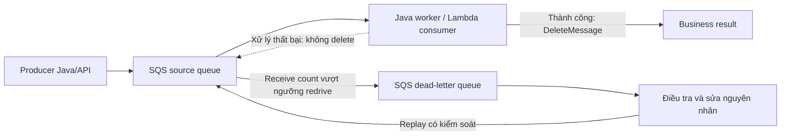
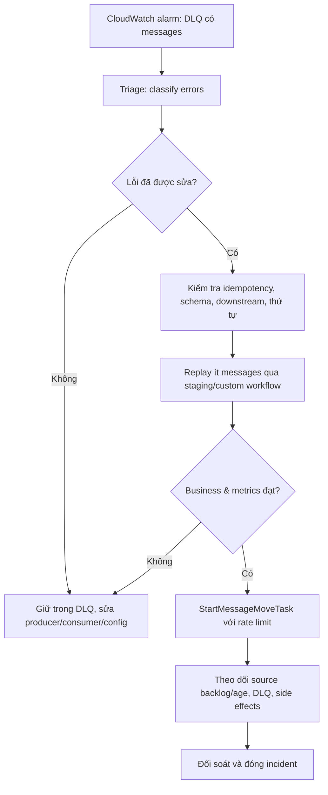
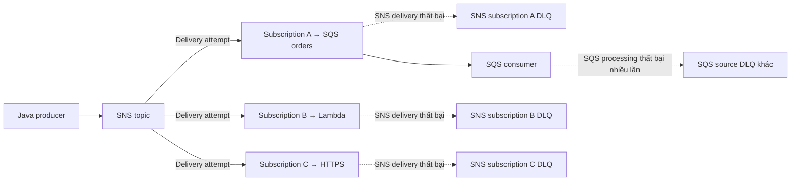

# Dead-letter queue, redrive policy và poison message trên AWS

Một ứng dụng Java gửi sự kiện tạo đơn hàng vào **Amazon Simple Queue Service (Amazon SQS)** để xử lý bất đồng bộ. Mỗi message có thể khiến consumer ghi cơ sở dữ liệu, trừ tồn kho hoặc gửi email. Nhưng nếu một message chứa JSON sai schema, tham chiếu đến bản ghi không tồn tại hoặc gọi dịch vụ bên ngoài liên tục thất bại, nó có thể được giao lại nhiều lần mà vẫn không hoàn tất. Đó là tình huống **poison message**.

Nếu không có cơ chế cách ly, một message hỏng có thể gây tắc luồng xử lý, làm tăng số lần gọi Lambda/EC2, đẩy chi phí lên, và khiến hệ thống không biết công việc nào thực sự hoàn thành. **Dead-letter queue (DLQ)**, **redrive policy** và quy trình **triage → sửa nguyên nhân → replay có kiểm soát** là những công cụ quan trọng để xử lý.

Bài học thuộc chương **Hàng đợi và thông báo** của module **CLOUD_PROVIDERS_AWS**. Người học sẽ kết nối kiến thức AWS Region/AZ, IAM, VPC, SQS/SNS, Java/Lambda, DynamoDB, CloudWatch, bảo mật, phục hồi và chi phí để xây dựng hệ thống nhắn tin đáng tin cậy. Phạm vi chính là **SQS source queue → SQS DLQ**, đồng thời phân biệt với **SNS subscription DLQ**, **Lambda asynchronous DLQ** và **stream on-failure destinations**.

## 1. Mục tiêu học tập

Sau bài học, bạn có thể:

1. Mô tả vòng đời message trong SQS và vai trò **visibility timeout**, **retention period**, **receive count**.
2. Phân biệt **lỗi tạm thời**, **lỗi dữ liệu vĩnh viễn**, **poison message**, **duplicate delivery** và **backpressure**.
3. Cấu hình **SQS source-queue redrive policy** với `deadLetterTargetArn` và `maxReceiveCount`.
4. Cấu hình **DLQ redrive allow policy** với `allowAll`, `byQueue` hoặc `denyAll` và xác định nơi đặt từng policy.
5. Hiểu những khác biệt giữa **SQS Standard** và **SQS FIFO**, đặc biệt về **thứ tự** và **message retention khi chuyển vào DLQ**.
6. Thiết kế consumer **Java SDK v2** hoặc **Lambda SQS trigger** để tránh xóa message chưa xử lý thành công.
7. Sử dụng **partial batch failure response** đúng khi một số messages trong Lambda batch bị lỗi.
8. Thiết kế **idempotency**, lỗi nghiệp vụ không thể xác định kết quả, và quy trình **DLQ redrive/replay** an toàn.
9. Giám sát queue age, backlog, DLQ depth, retries, consumer failures và giới hạn chi phí.
10. Điều tra sự cố SQS/SNS/IAM/KMS và diễn tập khôi phục với quyền tối thiểu.

## 2. DLQ giải quyết vấn đề gì?

**Dead-letter queue** là nơi giữ các messages không thể xử lý hoặc chuyển phát thành công sau chính sách retry tương ứng. Trong mô hình SQS source queue, **DLQ cũng là một SQS queue bình thường** nhưng được cấu hình làm đích của source queue.



DLQ giúp **cách ly**, **lưu dấu vết** và **phát lại** công việc sau khi sửa lỗi. Nhưng DLQ:

- **Không tự sửa JSON** hoặc thay thế quy tắc nghiệp vụ sai.
- **Không tự bảo đảm xử lý đúng một lần**.
- **Không tự phát cảnh báo** nếu không có metrics/alarms.
- **Không tự động replay sau khi nguyên nhân đã được sửa**.
- **Không phải kho lưu trữ vĩnh viễn**: SQS retention có giới hạn và khác giữa Standard/FIFO.
- **Không bảo đảm thứ tự nghiệp vụ** sau khi tách message khỏi luồng FIFO và replay.
- **Không phải nơi nhận mọi loại lỗi của AWS**: SNS delivery failure, Lambda async failure, stream discards có những cơ chế cấu hình riêng.

Một hệ thống production nên xem “message vào DLQ” là **công việc chưa hoàn tất cần xử lý**, không phải trạng thái thành công.

## 3. Vòng đời một SQS message

### 3.1. Gửi, nhận, ẩn, xóa hoặc retry

1. Producer gọi `SendMessage`, SQS lưu message trong queue theo retention.
2. Consumer gọi `ReceiveMessage`, hoặc Lambda event source mapping poll SQS.
3. Message trở thành **in-flight** và bị ẩn trong **visibility timeout**.
4. Nếu xử lý thành công, consumer gọi `DeleteMessage` bằng **receipt handle của lần receive hiện tại**; với Lambda SQS trigger, event source mapping xóa các messages được coi là thành công.
5. Nếu xử lý thất bại/timeout và chưa bị delete, message có thể **hiện lại** khi hết visibility.
6. Mỗi lần SQS giao message được nhận, giá trị **`ApproximateReceiveCount`** có thể tăng.
7. Nếu source queue có redrive policy và message đã được nhận thất bại đủ số lần theo ngưỡng, SQS đưa message sang DLQ.

```text
AVAILABLE ──ReceiveMessage──► IN_FLIGHT
   ▲                               │
   │                               ├─ DeleteMessage thành công ─► DONE
   │                               │
   └── Hết visibility timeout ◄────┘
                  │
       Receive count vượt ngưỡng
                  ▼
                 DLQ
```

**Quan trọng:** một message bị nhận 5 lần **không nhất thiết** tương đương 5 lần exception trong code. Receive count dựa trên **lần nhận** tại SQS, chịu ảnh hưởng của consumer crash, timeout, visibility, failover hoặc đường xử lý batch.

### 3.2. Các thời hạn không được đánh đồng

| Cấu hình | Chỗ đặt | Ý nghĩa |
|---|---|---|
| `VisibilityTimeout` | SQS queue hoặc một lần receive | Tạm ẩn message sau khi nhận |
| `MessageRetentionPeriod` | SQS queue | Khoảng SQS lưu message trước khi hết hạn |
| `maxReceiveCount` | **RedrivePolicy của source queue** | Ngưỡng lần receive trước khi bị chuyển DLQ |
| `WaitTimeSeconds` | ReceiveMessage / queue-level polling | Long polling, chờ message khả dụng |
| `Timeout` | Lambda function | Thời gian tối đa một Lambda invocation |
| `MaximumBatchingWindowInSeconds` | Lambda event source mapping | Thời gian tối đa gom messages trước invocation |
| `DelaySeconds` | SQS message hoặc queue | Trì hoãn thời điểm message bắt đầu khả dụng, không phải retry backoff tự động đầy đủ |

Trong SQS, message retention có thể cấu hình trong khoảng **1 phút đến 14 ngày**; không xem DLQ là archival store vô hạn. Visibility timeout tối đa **12 giờ**, nhưng chọn quá dài có thể làm chậm retry.

### 3.3. Visibility timeout không phải lock tuyệt đối

SQS Standard có semantics **at least once**. Dù đang in-flight, duplicate delivery có thể xảy ra trong các trường hợp dịch vụ phân phối; consumer vẫn cần idempotency.

Nếu thời gian xử lý dài hơn visibility, message có thể xuất hiện lại khi worker đầu tiên vẫn chạy. Có thể dùng `ChangeMessageVisibility` cho tác vụ dài, nhưng phải:

- Giới hạn thời gian xử lý thật, có timeout/heartbeat.
- Không gia hạn vô hạn để giữ một message lỗi mãi mãi.
- Dùng idempotency/lease bên ngoài queue nếu side effects nguy hiểm.
- Tránh thiết kế workflow nhiều giờ bên trong một invocation Lambda, vì Lambda có giới hạn thời gian; cân nhắc Step Functions hoặc chia nhỏ công việc.

## 4. Poison message là gì?

**Poison message** là message mà consumer không xử lý thành công một cách lặp lại vì chính nội dung, trạng thái nghiệp vụ hoặc sự không tương thích cố định; cũng có trường hợp lỗi hệ thống kéo dài khiến message “trông giống” poison dù bản thân dữ liệu hợp lệ.

Ví dụ:

| Tình huống | Loại lỗi khả dĩ | Nên làm gì? |
|---|---|---|
| JSON sai cú pháp, thiếu `orderId` | Permanent data/schema error | Quarantine, sửa producer và contract |
| `eventVersion=99` nhưng consumer chỉ hỗ trợ 1–3 | Version incompatibility | Rollout consumer mới hoặc converter có kiểm soát |
| Đơn hàng liên kết record đã bị xóa | Business integrity issue | Đối soát dữ liệu, có thể xử lý thủ công |
| DynamoDB/HTTP trả `ProvisionedThroughputExceeded` hoặc 429 | Transient/overload | Retry có backoff, giảm concurrency |
| KMS `AccessDenied` vì policy bị đổi | Configuration/authorization incident | Alert, sửa IAM/key policy; retry mù không giải quyết |
| Payment API timeout sau khi đã nhận lệnh | Unknown outcome | Idempotency key + reconciliation trước khi retry |
| Message 25 MB trong workflow kỳ vọng SQS body nhỏ | Payload design/schema | Dùng S3 reference/pattern thích hợp, không log cả payload |
| Service thứ ba mất kết nối 30 phút | Temporary dependency outage | Circuit breaker, retry và SLO backlog |
| Event cùng `operationId` đã xử lý | Duplicate | Nhận diện bằng durable idempotency store, không chạy lại side effect |

**Không xóa message vì “nó gây lỗi nhiều lần”.** Hãy có chính sách rõ cho những lỗi không thể sửa, lưu chứng cứ đủ an toàn và tạo đường kiểm toán/quarantine.

### 4.1. Retry storm và snowball anti-pattern

Khi nhiều messages cứ được nhận lại, chúng có thể:

- Chiếm concurrency và chi phí Lambda/EC2.
- Tạo thêm requests lỗi đến database/external API.
- Làm tăng `ApproximateAgeOfOldestMessage` và backlog.
- Đẩy messages tốt ra sau, giảm throughput nghiệp vụ.
- Gây **snowball anti-pattern** nếu producer/consumer tiếp tục nhân bản message lỗi hoặc không có DLQ/partial batch logic.

Giải pháp không chỉ là tăng `maxReceiveCount`; cần phân loại lỗi, DLQ, giới hạn concurrency, exponential backoff/jitter, metrics và kiểm tra đúng source of truth.

## 5. SQS redrive policy: đặt tại source queue

**RedrivePolicy** là thuộc tính của **source SQS queue**. Nó xác định **DLQ ARN** và **số lần receive tối đa**:

```json
{
  "deadLetterTargetArn": "arn:aws:sqs:ap-southeast-1:111122223333:orders-dlq",
  "maxReceiveCount": "5"
}
```

Ý nghĩa:

- `deadLetterTargetArn`: SQS DLQ được chọn.
- `maxReceiveCount`: số lần một consumer có thể receive message trước khi SQS chuyển nó sang DLQ khi chưa được xử lý/xóa thành công.
- Đây **không phải số lần Java catch exception**, cũng không phải một timer “retry mỗi 5 giây”.
- SQS thực hiện redrive theo cơ chế dịch vụ. Thời điểm thực tế bị chuyển tùy receive/visibility/retention.

AWS khuyến nghị đặt `maxReceiveCount` **ít nhất 5** với Lambda SQS source mapping để tránh đưa messages vào DLQ quá sớm vì một lỗi nhất thời.

### 5.1. Chọn maxReceiveCount theo thực tế

| Loại workload | Giá trị tham khảo | Đánh đổi |
|---|---|---|
| Dữ liệu đầu vào thường chuẩn, lỗi chủ yếu transient | `5–8` | Có nhiều cơ hội hồi phục |
| Workflow phụ thuộc API rate limit kéo dài | `5–10` kết hợp backoff/visibility và circuit breaker | Nếu chỉ tăng count mà không có backoff vẫn gây retry storm |
| Validation lỗi vĩnh viễn | Không khắc phục bằng count rất lớn | Nhanh phát hiện, quarantine và sửa producer |
| Thanh toán nhạy cảm | Count phụ thuộc reconciliation/idempotency | Tránh trừ tiền hai lần, không xử lý “mù” |

Các số này là **ví dụ định hướng**, không phải default bắt buộc. Phải điều chỉnh theo SLO, retention, retry intervals, DLQ monitoring và rủi ro nghiệp vụ.

### 5.2. Queue compatibility

Với SQS-managed DLQ:

- Source và DLQ cần ở **cùng AWS account và Region**.
- **Standard source → Standard DLQ**.
- **FIFO source → FIFO DLQ**.
- Một DLQ có thể phục vụ nhiều source queues khi policies cho phép, nhưng production thường dễ quan sát/quản lý hơn khi **phân loại theo ứng dụng/kiểu lỗi**.
- Dùng cùng queue cho production/dev hoặc nhiều tenant không có isolation có thể làm lẫn dữ liệu nhạy cảm và khó replay.

Nguồn: [Using dead-letter queues in Amazon SQS](https://docs.aws.amazon.com/AWSSimpleQueueService/latest/SQSDeveloperGuide/sqs-dead-letter-queues.html).

## 6. Redrive allow policy: đặt tại DLQ

**RedriveAllowPolicy** nằm ở **DLQ**, quyết định **những source queues nào được phép chọn DLQ này**. Đây là policy khác với `RedrivePolicy`.

| `redrivePermission` | Tác dụng | Khi chọn |
|---|---|---|
| `allowAll` | Cho phép các source queues hợp lệ dùng DLQ | Mặc định; đơn giản nhưng ranh giới rộng |
| `byQueue` | Chỉ cho source queue ARNs được liệt kê | Production cần least privilege |
| `denyAll` | Không cho source queue nào dùng DLQ | Cách ly/không dành làm DLQ |

AWS giới hạn `byQueue` ở **tối đa 10 source queue ARNs**. Nếu cần nhiều nguồn hơn, thiết kế thêm DLQs hoặc phương án quyền thích hợp.

Ví dụ policy của **orders-dlq**:

```json
{
  "redrivePermission": "byQueue",
  "sourceQueueArns": [
    "arn:aws:sqs:ap-southeast-1:111122223333:orders-main"
  ]
}
```

**Không nhầm** RedriveAllowPolicy với **queue access policy**. Queue access policy dùng IAM-style permissions cho SendMessage/ReceiveMessage… theo principals, còn redrive allow policy giới hạn quan hệ **source → DLQ**. Với SNS → SQS, cần queue resource policy cho SNS publisher nữa.

### 6.1. Trước khi thay policy

- Đọc danh sách source queues dùng DLQ hiện tại.
- Kiểm tra deployment IaC của mọi nguồn.
- Nếu chuyển `allowAll` sang `byQueue`, đừng quên source queues cần thiết.
- Không dùng `denyAll` trên DLQ đang hoạt động mà không có kế hoạch vì có thể ngăn message mới được chuyển tới.
- Kiểm tra cross-account policies trong các mô hình liên quan; **SQS-managed DLQ** ở đây yêu cầu cùng account/Region.

## 7. SQS Standard và FIFO: lưu ý thứ tự

### 7.1. Standard queue

SQS Standard mang tính **at least once**, best-effort ordering. Message lỗi lặp lại có thể được đưa về phía sau queue; sau nhiều lần receive thất bại, metric tuổi message cũ nhất có thể phản ánh message khác thay vì message poison ban đầu.

Ưu điểm: throughput cao và không cần xử lý strict ordering. Nếu một message cần 5 lần receive rồi tới DLQ, các messages tốt khác vẫn có thể được xử lý.

### 7.2. FIFO queue

FIFO queue đảm bảo thứ tự theo **`MessageGroupId`** theo các điều kiện của SQS FIFO. Nếu message đầu của một group chưa được xử lý/xóa hoặc chưa hết visibility, messages tiếp theo trong group có thể bị giữ lại.

Ví dụ:

```text
MessageGroupId = ORDER#123

M1: CreateOrder      → success
M2: ReserveInventory → poison
M3: ChargePayment    → chờ M2 xử lý hoặc bị chuyển DLQ
M4: SendReceipt      → chờ M2 xử lý hoặc bị chuyển DLQ
```

Đưa M2 vào DLQ giúp giảm tắc group, nhưng **có thể phá vỡ thứ tự nghiệp vụ** nếu M3/M4 tiếp tục mà không có inventory reservation. AWS cảnh báo **không dùng DLQ với FIFO khi không thể chấp nhận phá thứ tự thao tác**.

**Không suy ra** “FIFO exactly once processing” là exactly-once side effects trên DynamoDB/Payment API. Consumer vẫn cần idempotency và xử lý trường hợp ghi xong nhưng chưa delete message.

### 7.3. DLQ và redrive không bảo toàn thứ tự tuyệt đối

Khi replay messages từ DLQ vào source FIFO:

- Messages redrive có thể **xen kẽ** với messages mới do producers khác gửi vào source.
- Những messages đã vượt qua poison message có thể đã tác động dữ liệu trước khi poison được sửa.
- Cần quyết định **pause producer/consumer**, thứ tự replay theo business key, reconciliation và idempotency.
- Không chỉ nhấn nút “Redrive messages” cho một workflow đòi ordering nghiêm ngặt mà chưa đánh giá logic domain.

## 8. Retention period: Standard khác FIFO thế nào?

Một khác biệt quan trọng của SQS DLQ:

| Đặc tính | **Standard source/DLQ** | **FIFO source/DLQ** |
|---|---|---|
| Khi move message sang DLQ | **Original enqueue timestamp giữ nguyên** cho mục đích expiry | Enqueue timestamp **được đặt lại** khi move sang DLQ |
| `ApproximateAgeOfOldestMessage` trên DLQ | Thời gian kể từ khi message vào DLQ, **không phải tuổi từ lần gửi ban đầu** | Thời gian kể từ khi message vào DLQ |
| Thời gian còn lại trong DLQ | Retention DLQ trừ thời gian message đã ở source | Retention DLQ tính lại từ lúc chuyển DLQ |
| Khuyến nghị | **DLQ retention dài hơn source retention** | Chọn retention đủ dài cho triage/replay |

Ví dụ Standard:

```text
Source retention = 4 ngày
Message ở source = 1 ngày rồi chuyển DLQ
DLQ retention    = 4 ngày

Message chỉ còn khoảng 3 ngày trong DLQ,
dù DLQ ApproximateAgeOfOldestMessage bắt đầu từ 0 khi move.
```

Với FIFO, trong ví dụ tương đương, retention bắt đầu lại khi message vào DLQ, nên có thể còn gần 4 ngày.

**Ví dụ production:** source retention 4 ngày, DLQ retention 14 ngày để có thời gian điều tra và replay. Tuy nhiên với Standard, thời gian còn lại vẫn phụ thuộc tuổi từ lần gửi ban đầu; đừng chờ sát hạn mới kiểm tra.

**Khi thực hiện redrive chính thức từ DLQ**, SQS xem messages được chuyển là messages mới, gán **message ID và enqueue time mới**, reset chu kỳ retention ở destination. Vì vậy không dùng SQS messageId làm business idempotency key cho nhiều vòng redrive.

Nguồn: [SQS DLQ retention](https://docs.aws.amazon.com/AWSSimpleQueueService/latest/SQSDeveloperGuide/sqs-dead-letter-queues.html), [Redrive messages from a DLQ](https://docs.aws.amazon.com/AWSSimpleQueueService/latest/SQSDeveloperGuide/sqs-configure-dead-letter-queue-redrive.html).

## 9. Java SQS consumer: chỉ xóa sau khi xử lý thành công

Với Java chạy trên EC2, ECS, EKS hoặc một service worker, AWS SDK for Java v2 có thể poll SQS bằng `SqsClient`. Cần **long polling**, một **receipt handle đúng lần nhận** và quy tắc delete rõ ràng.

### 9.1. Ví dụ Java SDK v2

```java
import software.amazon.awssdk.services.sqs.SqsClient;
import software.amazon.awssdk.services.sqs.model.DeleteMessageRequest;
import software.amazon.awssdk.services.sqs.model.Message;
import software.amazon.awssdk.services.sqs.model.ReceiveMessageRequest;
import software.amazon.awssdk.services.sqs.model.ReceiveMessageResponse;
import java.util.List;

public final class OrdersWorker {
    private final SqsClient sqs;
    private final String queueUrl;

    public OrdersWorker(SqsClient sqs, String queueUrl) {
        this.sqs = sqs;
        this.queueUrl = queueUrl;
    }

    public void pollOnce() {
        ReceiveMessageResponse response = sqs.receiveMessage(
            ReceiveMessageRequest.builder()
                .queueUrl(queueUrl)
                .maxNumberOfMessages(10)
                .waitTimeSeconds(20)
                .build()
        );

        List<Message> messages = response.messages();

        for (Message message : messages) {
            try {
                // 1. Validate schema and event version.
                // 2. Check business idempotency.
                // 3. Commit durable business operation.
                process(message.body());

                // Delete ONLY after business operation succeeds.
                sqs.deleteMessage(
                    DeleteMessageRequest.builder()
                        .queueUrl(queueUrl)
                        .receiptHandle(message.receiptHandle())
                        .build()
                );
            } catch (Exception error) {
                // Leave message in queue. It will become visible after
                // visibility timeout and may eventually move to DLQ.
                System.err.println(
                    "SQS processing failed; messageId="
                    + message.messageId()
                    + ", errorType=" + error.getClass().getSimpleName()
                );
            }
        }
    }

    private void process(String json) {
        if (json == null || json.isBlank()) {
            throw new IllegalArgumentException("Empty event");
        }
        // TODO: real JSON validation, idempotency & durable side effects.
    }
}
```

**Đây là khung giáo dục**, không phải consumer production hoàn chỉnh. `process` chưa commit gì; nếu chạy nguyên code, messages có body không rỗng sẽ bị xóa dù nghiệp vụ chưa được thực hiện. Bạn phải thay bằng logic thật, có xử lý retry/idempotency, error policy, logging, lifecycle và graceful shutdown.

### 9.2. Các nguyên tắc khi dùng worker tự poll

- `DeleteMessage` chỉ sau **xác nhận nghiệp vụ bền vững**, không phải ngay sau deserialize.
- Không dùng `messageId` làm idempotency key cho business event được producer gửi lại bằng SQS message khác.
- Nếu consumer bị crash sau commit nhưng trước delete, message có thể được giao lại → cần idempotency.
- Nếu processing vượt visibility timeout, dùng `ChangeMessageVisibility` phù hợp và monitor, tránh hai workers cùng xử lý.
- Log `messageId` và `businessOperationId`, không log raw PII/credentials.
- Trên JVM worker dùng SDK credentials provider chain/IAM task role hoặc instance profile, tránh access keys hardcoded.
- Long polling giảm empty receives/cost, nhưng không giúp nếu queue permissions/network sai.

### 9.3. Sửa dữ liệu trong DLQ có nên thực hiện trực tiếp?

SQS message body **không thể chỉnh sửa tại chỗ** sau khi đã gửi. Khi cần normalize một poison message, tạo **message mới** qua một workflow được phê duyệt (validation + audit + destination) rồi mới xử lý bản cũ theo chính sách, tránh mất chứng cứ và tạo duplicate.

## 10. Lambda SQS trigger: lỗi cả batch và partial failure

Với **Lambda event source mapping**, dịch vụ Lambda poll SQS và gọi function bằng batch có thể chứa nhiều messages.

```text
Batch: M1 M2 M3 M4 M5
       ✓  ✓  ✗  ✓  ✓
```

Nếu handler **throw exception** ra ngoài:

- Lambda xem **cả invocation thất bại**.
- Cả batch có thể xuất hiện lại sau visibility timeout, bao gồm records đã có side effects.
- Cùng một poisoned message có thể khiến nhiều records tốt bị retry thừa.

Nếu handler catch lỗi M3 rồi **trả thành công rỗng**, M3 có thể bị xóa mà chưa xử lý xong. Cách đúng với SQS Standard là **partial batch response**.

### 10.1. Bật ReportBatchItemFailures

Trên **Lambda event source mapping**:

```text
FunctionResponseTypes = [ReportBatchItemFailures]
```

Response:

```json
{
  "batchItemFailures": [
    { "itemIdentifier": "message-id-M3" }
  ]
}
```

**`itemIdentifier` phải là SQS `messageId` của record thất bại**, không phải business `orderId`, receipt handle hoặc stream sequence number.

Khi cấu hình đúng, Lambda có thể xóa các messages thành công và để messages lỗi retry. **Nếu handler ném exception** hoặc trả response sai schema/ID không nằm trong batch, **toàn batch** có thể bị coi là lỗi. Nếu quên bật `ReportBatchItemFailures` trong mapping, response partial của handler **không có ý nghĩa retry như mong đợi** và có nguy cơ xóa records lỗi.

### 10.2. Ví dụ Java Lambda handler

```java
import com.amazonaws.services.lambda.runtime.Context;
import com.amazonaws.services.lambda.runtime.RequestHandler;
import com.amazonaws.services.lambda.runtime.events.SQSEvent;
import com.amazonaws.services.lambda.runtime.events.SQSBatchResponse;

import java.util.ArrayList;
import java.util.List;

public final class OrdersLambdaHandler
        implements RequestHandler<SQSEvent, SQSBatchResponse> {

    @Override
    public SQSBatchResponse handleRequest(SQSEvent event, Context context) {
        List<SQSBatchResponse.BatchItemFailure> failures = new ArrayList<>();

        for (SQSEvent.SQSMessage message : event.getRecords()) {
            try {
                processIdempotently(message.getBody());
            } catch (Exception error) {
                context.getLogger().log(
                    "Failed messageId=" + message.getMessageId()
                    + ", errorType=" + error.getClass().getSimpleName()
                );
                failures.add(
                    new SQSBatchResponse.BatchItemFailure(message.getMessageId())
                );
            }
        }
        return new SQSBatchResponse(failures);
    }

    private void processIdempotently(String body) {
        if (body == null || body.isBlank()) {
            throw new IllegalArgumentException("Empty event");
        }
        // TODO: schema validation, durable idempotency and side effects.
        // This skeleton must NOT be used to acknowledge real orders.
    }
}
```

Ứng dụng Java cần dependencies `aws-lambda-java-core` và `aws-lambda-java-events` tương thích runtime; handler class được cấu hình đúng và có quyền IAM/KMS tương ứng.

**Với SQS FIFO:** dừng sau record lỗi đầu tiên và đưa **tất cả records lỗi + chưa xử lý** vào `batchItemFailures` để giữ thứ tự. Không xử lý song song không kiểm soát các records trong cùng message group.

### 10.3. Partial failure không thay DLQ

Partial response làm giảm retry records tốt; **record thất bại vẫn phải retry và có thể đến DLQ** theo `maxReceiveCount`. Đồng thời, Lambda metric `Errors` có thể bằng 0 khi handler trả partial response hợp lệ dù có nhiều business records lỗi. Hãy tạo metric riêng `RecordFailures` và alarm trên DLQ/queue age.

Nguồn: [Lambda SQS error handling](https://docs.aws.amazon.com/lambda/latest/dg/services-sqs-errorhandling.html), [SQS Lambda integration](https://docs.aws.amazon.com/lambda/latest/dg/with-sqs.html).

## 11. Idempotency: rào chắn chống retry gây hại

**Idempotent processing** có nghĩa nhiều lần xử lý cùng **business operation** không tạo side effects lặp không mong muốn.

```text
Producer: orderId=ORD-123, operation=ChargePayment

First delivery:
  charge once → persist provider transaction ID → ACK message

Duplicate delivery/replay:
  find completed operation → do NOT charge again → ACK message
```

### 11.1. Chọn idempotency key

| Key | Có nên dùng? | Vì sao? |
|---|---|---|
| `tenantId + orderId + operationType` | Thường tốt nếu quy tắc nghiệp vụ xác định rõ | Tương ứng một thao tác logic |
| `paymentIntentId` | Tốt với payment provider hỗ trợ idem | Giữ ổn định qua retries |
| `producerEventId` ổn định | Có thể tốt | Producer phải tái sử dụng ID khi gửi lại cùng event |
| `SQS messageId` | Không đủ cho business replay qua new messages | Redrive có thể tạo ID mới |
| `customerId` | Không đủ | Một customer được phép có nhiều orders |
| Hash full JSON body | Chỉ khi schema/canonicalization ổn định | Metadata/order fields thay đổi sẽ tạo hash khác |

### 11.2. DynamoDB conditional write làm durable dedup

Một thiết kế có thể tạo bảng `ProcessedOperations` với primary key `operationId` và điều kiện ghi:

```json
{
  "ConditionExpression": "attribute_not_exists(operationId)"
}
```

Ví dụ AWS SDK for Java v2:

```java
import java.util.Map;
import software.amazon.awssdk.services.dynamodb.DynamoDbClient;
import software.amazon.awssdk.services.dynamodb.model.AttributeValue;
import software.amazon.awssdk.services.dynamodb.model.PutItemRequest;

public final class DedupStore {
    public void claim(DynamoDbClient ddb, String operationId) {
        ddb.putItem(
            PutItemRequest.builder()
                .tableName("ProcessedOperations")
                .item(Map.of(
                    "operationId", AttributeValue.fromS(operationId),
                    "state", AttributeValue.fromS("IN_PROGRESS")
                ))
                .conditionExpression("attribute_not_exists(operationId)")
                .build()
        );
    }
}
```

**Không xem ví dụ trên là xử lý idempotency hoàn chỉnh.** Cần xử lý `ConditionalCheckFailedException`, so sánh nội dung nghiệp vụ, phân biệt `IN_PROGRESS`/`COMPLETED`, lease expiry, conflict và business result.

Đặc biệt **không ghi trạng thái COMPLETED trước external side effect**: nếu Lambda crash sau marker nhưng trước khi charge, lần retry sẽ bỏ qua thao tác chưa thực hiện. Ngược lại, nếu charge trước rồi mới ghi COMPLETED, crash giữa hai bước có thể charge lần hai. Dùng **provider idempotency key** và reconciliation/outbox/transaction pattern phù hợp.

### 11.3. TTL phải đủ dài

Nếu DLQ message được giữ 10 ngày rồi replay, nhưng idempotency record hết hạn sau 1 giờ, hệ thống có thể thực hiện lại nghiệp vụ như message mới. TTL nên dựa trên **SQS retention, DLQ replay horizon, business transaction window và compliance**, không chỉ thời lượng Lambda invocation.

Với thanh toán/đơn hàng quan trọng, có thể cần giữ operation key lâu hoặc có unique constraint theo business life cycle.

## 12. Từ DLQ quay lại nguồn: redrive task

**DLQ redrive** có nghĩa chuyển messages đã bị cách ly từ DLQ về **source SQS queue ban đầu** hoặc **custom destination queue**.

AWS cung cấp API bất đồng bộ **`StartMessageMoveTask`** cho tình huống **SQS DLQ có nguồn là SQS queue**. Khi gọi:

- `SourceArn` là **ARN của DLQ**, không phải source queue gốc.
- `DestinationArn` có thể chọn **SQS queue đích**; nếu bỏ trống, SQS redrive về các source queues tương ứng theo metadata.
- `MaxNumberOfMessagesPerSecond` nếu được dùng là **rate limit cố định**, tối đa **500 messages/giây**.
- Chỉ **một message move task đang active trên một DLQ** trong một thời điểm.
- Task có thể quan sát qua `ListMessageMoveTasks` và hủy bằng `CancelMessageMoveTask` khi đang chạy.

**Redrive không tự sửa message body**, không chạy schema migration, không chắc đảm bảo thứ tự nghiệp vụ cũ và không chọn lọc tự động “chỉ messages đã sửa”. Đây là lý do phải review batch trước khi replay.

### 12.1. Quy trình an toàn



### 12.2. Những việc nên làm trước khi replay

1. **Đóng băng nguyên nhân**: xác định code/config change hoặc dữ liệu nào sửa poison.
2. **Lưu chứng cứ phù hợp**: message ID ban đầu, operation ID, event version, exception type, receive count, thời gian (ẩn PII).
3. **Xem có messages hợp lệ trong DLQ** do outage không, không chỉ poison.
4. **Kiểm tra schema** của consumer mới và backward compatibility với messages cũ.
5. **Xác minh idempotency** vẫn còn hiệu lực; redrive tạo **message ID mới**.
6. **Nếu FIFO**, đánh giá ordering, nhóm, producer mới và khả năng pause queue.
7. **Đảm bảo downstream chịu được replay rate** (RDS connections, API quota, DynamoDB WCU).
8. Thực hiện canary; sau đó tăng tốc độ theo theo dõi.
9. Đối soát tổng events, thành công, lỗi còn lại và side effects.
10. Đặt runbook hủy task nếu DLQ tiếp tục tăng hoặc downstream quá tải.

### 12.3. Các lệnh AWS CLI minh họa

```bash
# Chỉ đọc DLQ và source queue attributes; thay URL/ARN thật.
aws sqs get-queue-attributes \
  --queue-url https://sqs.ap-southeast-1.amazonaws.com/111122223333/orders-main \
  --attribute-names RedrivePolicy VisibilityTimeout MessageRetentionPeriod \
  --region ap-southeast-1

aws sqs get-queue-attributes \
  --queue-url https://sqs.ap-southeast-1.amazonaws.com/111122223333/orders-dlq \
  --attribute-names RedriveAllowPolicy ApproximateNumberOfMessages \
  --region ap-southeast-1
```

Để kiểm tra các move tasks:

```bash
aws sqs list-message-move-tasks \
  --source-arn arn:aws:sqs:ap-southeast-1:111122223333:orders-dlq \
  --region ap-southeast-1
```

**Lệnh ghi** chỉ nên chạy trong runbook đã phê duyệt:

```bash
# CHỈ MINH HỌA: di chuyển tối đa 10 messages/giây,
# không chạy vào production khi chưa phân tích ảnh hưởng.
aws sqs start-message-move-task \
  --source-arn arn:aws:sqs:ap-southeast-1:111122223333:orders-dlq \
  --destination-arn arn:aws:sqs:ap-southeast-1:111122223333:orders-main \
  --max-number-of-messages-per-second 10 \
  --region ap-southeast-1
```

Trên AWS Console có thể dùng **Start DLQ redrive** khi đáp ứng điều kiện và quyền. Hãy kiểm tra đích, rate, nguồn, trạng thái task, IAM/KMS permissions và policies.

Nguồn: [StartMessageMoveTask API](https://docs.aws.amazon.com/AWSSimpleQueueService/latest/APIReference/API_StartMessageMoveTask.html), [Configure dead-letter queue redrive](https://docs.aws.amazon.com/AWSSimpleQueueService/latest/SQSDeveloperGuide/sqs-configure-dead-letter-queue-redrive.html).

## 13. Khi nào không dùng native StartMessageMoveTask?

Native SQS redrive chỉ hỗ trợ **DLQs có nguồn là SQS queue** theo tài liệu API. Nó **không** tự di chuyển mọi loại message bất kỳ trong một SQS queue về một nguồn logic khác.

Ví dụ:

- SQS queue làm **SNS subscription DLQ**: nguồn logic là SNS delivery, không phải một SQS source queue đã cấu hình RedrivePolicy.
- Lambda **asynchronous invocation DLQ** dùng SQS queue làm đích.
- EventBridge/Lambda streams dùng SQS destination để ghi failed event metadata.

Trong các trường hợp này cần **workflow replay riêng** với đúng event payload/định dạng/đích. Không gán mặc định `StartMessageMoveTask` sẽ phát lại notification vào SNS topic hoặc async Lambda invocation.

### 13.1. Replay tùy biến cần xử lý tính đúng đắn

Nếu xây Java replay worker:

- Đọc SQS DLQ một cách có kiểm soát, không dùng tool xem queue như phép xóa.
- Kiểm tra nguồn sự kiện, signature/schema/version, destination và authorization.
- Có idempotency cho operation, kể cả replay.
- Gửi sang SQS/SNS/EventBridge đích phù hợp theo allowlist, không nhận ARN arbitrary từ message.
- Chỉ delete DLQ message **sau khi** đích xác nhận đã lưu/publish thành công.
- Ghi audit/correlation ID, counter và retry/quarantine nếu publish thất bại.
- Đối soát message count và side effects, tránh duplicate sau worker crash.

Trong use case cần giữ thứ tự FIFO, replay tùy biến phải có kế hoạch preserve `MessageGroupId`, deduplication ID, ordering business key và concurrent producers.

## 14. SNS subscription DLQ khác gì SQS source DLQ?

Amazon SNS publish một message tới các **subscriptions** (SQS, Lambda, HTTP/S…). **SNS dead-letter queue** được gắn ở **subscription**, dùng một SQS queue để nhận message **SNS không giao được tới subscriber**.



### 14.1. Hai loại thất bại khác nhau

| Vấn đề | Nơi có thể xuất hiện |
|---|---|
| SNS không thể **deliver** tới SQS vì queue policy/KMS/endpoint lỗi | **SNS subscription DLQ** |
| SNS deliver tới SQS thành công nhưng Java/Lambda consumer xử lý thất bại 5 lần | **SQS source DLQ** |
| SNS không thể deliver tới Lambda function vì resource policy hoặc Lambda service lỗi | **SNS subscription DLQ** |
| Lambda function đã được invoke async và chính code ném exception | **Lambda async retry/on-failure** theo cấu hình, không nhất thiết SNS subscription DLQ |
| HTTP/S subscriber trả lỗi trong quá trình nhận SNS notification | SNS retry/delivery policy và **subscription DLQ** nếu hết retry |

SNS DLQ được cấu hình thông qua **RedrivePolicy của SNS subscription**, khác `RedrivePolicy của SQS source queue` dù cùng tên trường.

### 14.2. Quy tắc SNS DLQ

Theo AWS:

- SNS subscription và SQS DLQ cần ở **cùng AWS account và Region** theo điều kiện dịch vụ.
- Chọn **SQS queue type** tương thích với loại topic/subscription theo hướng dẫn SNS FIFO/Standard.
- SQS queue **access policy** phải cho phép `sns.amazonaws.com` gửi message từ đúng `aws:SourceArn`; nếu dùng KMS customer-managed key thì cần key policy cho SNS.
- SNS delivery retry tùy endpoint type. Với các AWS-managed endpoints như SQS/Lambda, một số lỗi server-side có thể được retry rất lâu; không dựa vào một giá trị thử nghiệm cố định cho mọi protocol.
- SNS DLQ chỉ lưu **delivery failures** sau cơ chế retry tương ứng, không phải business processing failures sau khi subscriber đã nhận thành công.

Nguồn: [Amazon SNS dead-letter queues](https://docs.aws.amazon.com/sns/latest/dg/sns-dead-letter-queues.html), [SNS delivery retries](https://docs.aws.amazon.com/sns/latest/dg/sns-message-delivery-retries.html).

## 15. Lambda asynchronous DLQ và stream failure destination

Các nguồn AWS khác có cơ chế xử lý lỗi liên quan nhưng **không giống SQS redrive**:

| Mô hình | Đường giao nhận | Cơ chế lỗi nên xem |
|---|---|---|
| **Lambda đọc SQS** | ESM poll SQS, gọi function synchronously | SQS RedrivePolicy + DLQ, Lambda partial batch responses |
| **Lambda async invocation** | Event được xếp trong Lambda async queue | Lambda async retry, maximum event age, **on-failure destination** hoặc DLQ nếu hỗ trợ |
| **Lambda đọc DynamoDB Streams/Kinesis** | Stream ESM/iterator | Retry/record age, `BisectBatchOnFunctionError`, ESM on-failure destination |
| **SNS topic → SQS subscription** | SNS delivery tới queue | SNS subscription DLQ khi giao thất bại; SQS source DLQ khi consumer lỗi |
| **EventBridge rule target** | EventBridge gửi event tới target | Target retry policy và DLQ theo kiểu target |
| **Step Functions workflow** | State machine transitions | Retry/Catch, compensation, workflow failure theo thiết kế |

Nếu Lambda handler nhận batch từ **Kinesis/DynamoDB Streams**, partial failure trả **sequence number** để tiến checkpoint; SQS partial failure trả **messageId**. Đừng dùng chung schema/định danh một cách mù quáng.

**Một SQS DLQ có thể chỉ là container chứa lỗi của một dịch vụ khác.** Khi đó cần hiểu **failure envelope format** và cơ chế replay gốc trước khi dùng tool redrive.

## 16. IaC: tạo SQS source queue và DLQ bằng CloudFormation

Ví dụ minh họa trong **một AWS account và Region**. Yêu cầu: Standard queue, source retention 4 ngày, DLQ retention 14 ngày, visibility timeout 3 phút, tối đa 5 lần receive trước khi sang DLQ.

```yaml
AWSTemplateFormatVersion: '2010-09-09'
Description: SQS source queue with isolated DLQ and redrive policy

Resources:
  OrdersDlq:
    Type: AWS::SQS::Queue
    Properties:
      QueueName: orders-dlq
      MessageRetentionPeriod: 1209600  # 14 days
      SqsManagedSseEnabled: true
      RedriveAllowPolicy:
        redrivePermission: byQueue
        sourceQueueArns:
          - !Sub 'arn:${AWS::Partition}:sqs:${AWS::Region}:${AWS::AccountId}:orders-main'

  OrdersQueue:
    Type: AWS::SQS::Queue
    Properties:
      QueueName: orders-main
      VisibilityTimeout: 180
      MessageRetentionPeriod: 345600  # 4 days
      ReceiveMessageWaitTimeSeconds: 20
      SqsManagedSseEnabled: true
      RedrivePolicy:
        deadLetterTargetArn: !GetAtt OrdersDlq.Arn
        maxReceiveCount: 5

Outputs:
  SourceQueueUrl:
    Value: !Ref OrdersQueue
  DeadLetterQueueArn:
    Value: !GetAtt OrdersDlq.Arn
```

**Lý do dùng `!Sub` để tạo source ARN tĩnh từ tên queue:** tránh vòng tham chiếu CloudFormation: source queue cần DLQ ARN, trong khi DLQ `RedriveAllowPolicy` cần source ARN. `!Sub` với queue name đã biết giúp không tạo dependency cycle trong template này. Nếu có tài khoản khác cùng tên queue hoặc dùng queue-name suffix/stack khác, điều chỉnh theo đúng ARN thực tế.

Các thành phần production cần bổ sung: queue resource policies, IAM execution roles, CloudWatch alarms, AWS Budgets, tags, KMS khi dùng customer-managed keys, deletion policies/rollback phù hợp. **SSE-SQS** trong ví dụ là SQS-managed encryption; không phải SSE-KMS và không đòi KMS CMK policy.

### 16.1. Nếu muốn FIFO

Cần tạo source và DLQ cùng loại FIFO, ví dụ `orders-main.fifo` / `orders-dlq.fifo`, với `FifoQueue: true` cho cả hai, và producer phải truyền `MessageGroupId`/deduplication thích hợp.

**Không chỉ đổi tên queue thêm `.fifo`** mà quên attribute `FifoQueue` hoặc không đánh giá business ordering khi đưa message sang DLQ.

## 17. IAM, queue policies và KMS

### 17.1. Quyền cho Java producer

Producer chỉ cần quyền phù hợp, ví dụ:

```json
{
  "Version": "2012-10-17",
  "Statement": [
    {
      "Effect": "Allow",
      "Action": ["sqs:SendMessage"],
      "Resource": "arn:aws:sqs:ap-southeast-1:111122223333:orders-main"
    }
  ]
}
```

### 17.2. Quyền cho Java worker/Lambda execution role

Consumer thường cần:

- `sqs:ReceiveMessage`
- `sqs:DeleteMessage`
- `sqs:GetQueueAttributes`
- `sqs:ChangeMessageVisibility` nếu chủ động gia hạn visibility
- Quyền DynamoDB/RDS/Secrets/CloudWatch phù hợp các side effects

Nếu dùng Lambda SQS trigger, có thể tham khảo managed policy `AWSLambdaSQSQueueExecutionRole` rồi giảm quyền/resource scope theo yêu cầu. Không cấp `sqs:SendMessage` tới DLQ cho consumer nếu chỉ dựa vào SQS redrive policy và không thực sự cần tự gửi.

### 17.3. Quyền cho redrive operator

Quy trình `StartMessageMoveTask` cần quyền SQS thích hợp trên **DLQ/source/destination** và trong trường hợp SSE-KMS, quyền KMS phù hợp để đọc message ở nguồn, ghi ở đích. Cần kiểm tra AWS docs hiện hành về `sqs:StartMessageMoveTask`, `sqs:ListMessageMoveTasks`, `sqs:CancelMessageMoveTask`, `ReceiveMessage/DeleteMessage/SendMessage`, và các chính sách queue-level. **Không cấp `sqs:*` trên mọi queues** chỉ để chạy redrive.

### 17.4. Queue resource policy khác IAM identity policy

Nếu SNS publish tới SQS, queue policy thường phải cho **SNS service principal** gửi vào đúng queue, với `aws:SourceArn` gắn đúng topic; IAM producer thông thường dùng role identity policy và queue policies khi cross-account/service integration.

Tách rõ:

- **Identity policy**: IAM role/user được phép thao tác gì.
- **SQS resource policy**: ai được truy cập queue từ ngoài/qua dịch vụ.
- **RedriveAllowPolicy**: source queues nào có thể chọn DLQ.
- **KMS key policy**: principal/services nào có quyền dùng encryption key.
- **SCP/permission boundaries**: giới hạn do AWS Organizations định nghĩa.

### 17.5. Bảo mật dữ liệu DLQ

DLQ đôi khi lưu nhiều message lỗi chứa dữ liệu nhạy cảm. Hãy:

- Bật mã hóa phù hợp (`SSE-SQS` hoặc `SSE-KMS`).
- Giới hạn `sqs:ReceiveMessage`/`DeleteMessage` vào DLQ chỉ cho đội vận hành cần thiết.
- Không mở DLQ cho Internet/cross-account principals rộng.
- Ẩn PII/token khỏi application logs, support tickets và audit exports.
- Đặt retention đủ cho điều tra nhưng phù hợp chính sách dữ liệu.
- Giám sát quyền truy cập DLQ và mọi redrive task.
- Với Lambda/VPC workloads, kiểm tra private egress tới AWS APIs nếu code trực tiếp gọi SQS; ESM polling là thành phần được Lambda quản lý.

## 18. Giám sát DLQ và poison messages

### 18.1. CloudWatch dashboard

| Metric/tín hiệu | Ý nghĩa | Điểm dễ nhầm |
|---|---|---|
| `ApproximateNumberOfMessagesVisible` (DLQ) | Bao nhiêu messages đang chờ điều tra | Approximate, không là exact transaction count |
| `ApproximateAgeOfOldestMessage` (source) | Backlog đang già đi ra sao | Với Standard, poison xử lý lặp có thể không phải message được tính |
| `ApproximateAgeOfOldestMessage` (DLQ) | Tuổi từ lúc message vào DLQ | Với Standard **không** là tuổi nguyên gốc tính cho retention |
| `ApproximateNumberOfMessagesNotVisible` | In-flight messages | Cao kéo dài có thể do consumer timeout hoặc visibility |
| `NumberOfMessagesReceived` | Số lần nhận messages | Có thể > số business events vì retry |
| `NumberOfMessagesDeleted` | Số thao tác delete được ghi nhận | Không phải số business operations duy nhất |
| `Lambda Errors / Throttles / Duration` | Lỗi invocation và hiệu năng | Partial failures hợp lệ có thể không tăng Errors |
| **Custom `RecordFailures` / `PoisonByType`** | Số lỗi ứng dụng theo record/type | Phải instrument trong Java/Lambda |
| `DynamoDB ConditionalCheckFailed` | Idempotency conflict/duplicate | Không phải lúc nào cũng là lỗi nghiệp vụ |
| SNS delivery failure metric/log | SNS có giao vào subscriber được không | Không đo processing sau SQS consumer |

**Quan trọng:** nếu DLQ có messages nhưng không ai xem, hệ thống đang **chấp nhận mất công việc nghiệp vụ trên thực tế** dù message vẫn còn tạm thời. Hãy có người chịu trách nhiệm, alarm route, SLA xử lý và runbook.

### 18.2. Ví dụ alarm quan trọng

- DLQ `ApproximateNumberOfMessagesVisible > 0` trong hai kỳ liên tiếp hoặc ngưỡng phù hợp SLO.
- Source `ApproximateAgeOfOldestMessage` tăng cao.
- Lượng messages vào DLQ tăng nhanh sau deploy.
- Lambda function errors/throttles, SQS backlog hoặc duration gần timeout.
- `RecordFailures` tăng ngay cả khi Lambda Errors = 0 do partial response.
- Tỷ lệ duplicate/idempotency conflicts tăng bất thường.
- Source/DLQ retention còn quá ngắn so với thời gian khắc phục.

### 18.3. Structured logging

Ví dụ log **không chứa message body**:

```json
{
  "severity": "WARN",
  "event": "order_event_failed",
  "queue": "orders-main",
  "messageId": "example-sqs-id",
  "operationId": "tenant-A:ORD-123:ReserveInventory",
  "receiveCount": 4,
  "errorType": "MissingOrderReference",
  "retryable": false,
  "traceId": "trace-example"
}
```

Receive count có thể lấy qua SQS system attributes; bảo đảm giá trị đúng nguồn và không coi nó là số lần exception tuyệt đối. Kết hợp log consumer, CloudTrail quản trị queue/permissions và CloudWatch metrics để truy vết.

## 19. Chi phí và tác động khả năng phục hồi

### 19.1. Chi phí của một message lỗi

Một poison message có thể phát sinh:

- Nhiều `ReceiveMessage` và `Delete/ChangeVisibility` requests hoặc Lambda batch invocations.
- CPU/GB-seconds, cold starts, CloudWatch Logs/X-Ray.
- Calls tới RDS, DynamoDB, API bên thứ ba — kể cả charges ngoài AWS.
- S3/storage/log retention khi triage.
- Băng thông/VPC endpoint/NAT charges nếu consumer gọi AWS APIs qua mạng riêng.
- Công sức nhân sự điều tra/khôi phục.
- Ảnh hưởng customer/SLO, khó đo bằng hóa đơn AWS.

Giảm chi phí đúng cách bằng **partial failures, idempotency, đúng backoff, concurrency limits, DLQ monitoring, lỗi permanent triage sớm**, chứ không phải nuốt exception và xóa message.

### 19.2. Phân biệt HA và DR

SQS là dịch vụ AWS được thiết kế chịu lỗi trong Region, nhưng không có nghĩa:

- Consumer application tự động có đủ nhiều AZ/nodes.
- Một poison message tự được sửa sau failover.
- DLQ tự được sao lưu/vận hành như long-term archive.
- RDS hoặc hệ thống tài chính phía sau đã có backup.
- Queue/SNS subscriptions ở Region khác tự nhận replay.

Nếu yêu cầu **RPO/RTO liên Region**, phải thiết kế riêng replication, dữ liệu nguồn bền vững, quyền replay và recovery tests. DLQ là công cụ **operational recovery** cho messages, không thay disaster recovery toàn hệ thống.

## 20. Quy trình triển khai production từng giai đoạn

### Giai đoạn A — Thiết kế hợp đồng message

1. Xác định event type, version, `eventId` và business operation ID bền vững.
2. Validate schema, tenant isolation, permissions và loại dữ liệu được đặt trong message.
3. Phân loại lỗi thành retryable, permanent và unknown outcome.
4. Chọn Standard/FIFO theo ordering requirements, không theo thói quen.
5. Xác định TTL/idempotency horizon và chính sách replay.

### Giai đoạn B — Tạo queue và DLQ

1. Chọn source/DLQ cùng account/Region và queue type.
2. Chọn source retention/visibility, DLQ retention dài đủ xử lý.
3. Đặt source `RedrivePolicy`, `maxReceiveCount` theo SLO và retry cadence.
4. Đặt DLQ `RedriveAllowPolicy` theo nguồn được phép.
5. Cấp IAM/queue/KMS policies tối thiểu.
6. Tạo CloudWatch alarms và dashboard cho source lẫn DLQ.

### Giai đoạn C — Viết consumer

1. Poll SQS với long polling hoặc dùng Lambda ESM.
2. Validate từng record và gọi durable/idempotent business operation.
3. Success mới delete; lỗi thì không ACK giả.
4. Với Lambda, bật `ReportBatchItemFailures` và return record-level failures.
5. Với FIFO, giữ thứ tự nhóm; không dùng parallel processing mù.
6. Giới hạn concurrency và kết nối downstream.

### Giai đoạn D — Kiểm thử và vận hành

1. Test happy path, duplicate delivery, poison JSON, permission denied.
2. Test source queue retries, receive count và move sang DLQ.
3. Test data retention/age với Standard/FIFO nếu liên quan.
4. Test redrive workflow và bảo đảm message mới không lặp side effects.
5. Test khi downstream outage, throttle và rollback deployment.
6. Định kỳ kiểm tra DLQ, owner, IAM access, metrics/cost và phiên bản schema.

## 21. Tình huống thiết kế: hệ thống đơn hàng Java + SQS + Lambda

Một công ty bán hàng có Java API nhận đơn và phát message:

```json
{
  "eventId": "evt-123",
  "tenantId": "tenant-a",
  "orderId": "ORD-123",
  "operation": "ReserveInventory",
  "eventVersion": 2,
  "occurredAt": "2026-11-20T02:00:00Z"
}
```

Thiết kế:

| Thành phần | Lựa chọn | Lý do |
|---|---|---|
| Java API producer | Gửi SQS message với `eventId` ổn định | Tách request HTTP khỏi xử lý lâu |
| Source SQS Standard | Retention 4 ngày, visibility phù hợp function, long polling | Cân bằng backlog/retry |
| SQS DLQ | Retention 14 ngày, `byQueue` allow policy | Cách ly lỗi và hạn chế nguồn |
| Redrive policy | `maxReceiveCount=5` | Cho transient errors cơ hội phục hồi |
| Lambda handler | Partial failure + per-record log | Không retry records thành công vì 1 poison |
| DynamoDB | Idempotency record theo tenant/order/operation | Chống xử lý trùng và replay |
| Inventory service | Hỗ trợ idempotency key hoặc reconciliation | Tránh trừ tồn kho hai lần |
| Monitoring | Queue age, DLQ visible, record errors, Lambda failures | Phát hiện sự cố kịp thời |
| Operations | Runbook phân loại và replay 10 msg/giây ban đầu | Giảm blast radius khi khôi phục |

### 21.1. Một sự cố end-to-end

- 09:00: producer version mới gửi `eventVersion=3`.
- 09:05: consumer chỉ hiểu version 2; mọi event v3 lỗi validation.
- 09:10: messages v3 được receive lặp lại, sau ngưỡng chuyển DLQ.
- 09:12: alarm DLQ depth vượt 0 gửi tới on-call.
- 09:20: đội ngũ xác định schema mismatch, tạm dừng rollout producer v3.
- 09:40: triển khai consumer hỗ trợ version 3, test với bản mẫu được kiểm soát.
- 09:50: đối soát business idempotency keys; chạy thử replay một nhóm nhỏ.
- 10:00: bắt đầu DLQ redrive với rate limit thấp, quan sát Lambda/Inventory.
- 10:20: kiểm tra orders xử lý đủ, DLQ không tăng lại; lưu postmortem.

Các mốc thời gian là **minh họa**, không mô tả SLO bắt buộc.

### 21.2. Vì sao không replay ngay lúc 09:12?

Vì consumer chưa hiểu schema v3, replay ngay chỉ tạo thêm retries và đẩy messages trở lại DLQ. Cần **sửa nguyên nhân trước, replay sau**, đồng thời quan sát hiệu quả thay đổi và khả năng rollback.

## 22. Ma trận kiểm thử lỗi

| Test | Kỳ vọng | Cần kiểm tra |
|---|---|---|
| Message hợp lệ | Consumer xử lý, DeleteMessage, DLQ không tăng | DB/business result |
| JSON sai schema | Không xóa, nhận lại, cuối cùng vào DLQ | Message remains intact, error logs |
| Một lỗi trong Lambda batch Standard | Chỉ failed message được retry khi ESM bật partial | `FunctionResponseTypes`, message IDs |
| Lambda batch FIFO lỗi ở giữa | Records lỗi/chưa xử lý đều được report | Group ordering |
| Duplicate message cùng operation ID | Không tạo thêm side effect | DynamoDB idempotency state |
| Message timeout sau khi gọi inventory thành công | Không reserve thêm khi retry | External idempotency/reconciliation |
| Visibility nhỏ hơn xử lý thực tế | Có thể xử lý song song cùng message | Race tests, metrics |
| Source queue redrive allow mismatch | Cấu hình/hoạt động DLQ có thể bị từ chối | RedriveAllowPolicy và IAM |
| DLQ retention quá ngắn | Message có thể hết hạn trước triage | Retention policy/age |
| Redrive sau fix code | Messages trở lại source và xử lý đúng | Business event counts |
| Redrive khi consumer còn lỗi | DLQ tăng lại | Stop task/circuit breaker |
| SNS topic giao vào SQS thành công, consumer fail | SQS source DLQ tăng, SNS subscription DLQ không nhất thiết tăng | Phân tách delivery vs processing |
| SQS FIFO replay cùng producers mới | Messages xen kẽ, ordering nghiệp vụ có thể đổi | MessageGroupId & reconciliation |

## 23. Chẩn đoán sự cố thường gặp

### 23.1. DLQ trống dù có nhiều exceptions

Có thể:

- Source queue chưa có RedrivePolicy hoặc trỏ sai DLQ.
- Message chưa vượt `maxReceiveCount`.
- Consumer **catch exception rồi delete/ACK** trước khi retry.
- Visibility timeout dài khiến lần receive mới chưa xảy ra.
- Message bị retention expiration trước khi vào DLQ.
- Alarm đang đọc sai account/Region/queue.
- Lambda async DLQ và SQS source DLQ bị nhầm lẫn.

**Điều tra:** đọc source `RedrivePolicy`, `ApproximateReceiveCount` trong log, `NumberOfMessagesDeleted`, consumer code và queue metrics.

### 23.2. DLQ tăng nhanh ngay sau deployment

Có thể do schema incompatibility, IAM/KMS lỗi, route/VPC endpoint sai, timeout quá ngắn hoặc downstream outage. **Không vội redrive** trước khi phân loại nguồn lỗi, cân đối pause producers/consumers và rollback code.

### 23.3. Không StartMessageMoveTask được

Có thể:

- SourceArn trỏ tới **source queue gốc** thay vì **DLQ**.
- DLQ không có nguồn SQS được cấu hình, ví dụ là SNS subscription DLQ.
- Không có IAM/queue permissions hoặc thiếu KMS decrypt/encrypt permissions.
- Đã có một move task active trên DLQ.
- Destination ARN sai Region/type/quyền.
- Source/destination queue đã bị xóa hoặc policy drift.

Xem lỗi API và `ListMessageMoveTasks`; không cấp `sqs:*` trên toàn tài khoản như biện pháp đầu tiên.

### 23.4. Replay xong vẫn có messages ở DLQ

Có thể một số messages vẫn poison, người quản trị chọn sai destination/rate hoặc tasks bị stop, consumer vẫn chạy version cũ, idempotency state conflict, queue nhận thêm errors trong lúc replay.

Cần đối soát theo business operation ID và nguồn log, không chỉ “DLQ count giảm” để đánh giá thành công.

### 23.5. FIFO group đứng chờ lâu

Một message lỗi đầu group giữ những messages phía sau. Tăng consumer concurrency không giúp nếu chỉ có **một MessageGroupId** hoặc không thể chia thứ tự. Cần sửa poison, quyết định ngữ nghĩa chuyển DLQ, và tái thiết kế group key nếu có thể.

## 24. Bài tập tình huống

### Bài A — Phân biệt hai policies

Source `orders-main` có `RedrivePolicy.maxReceiveCount=5`. DLQ `orders-dlq` có `RedriveAllowPolicy.redrivePermission=byQueue` với source ARN được cho phép.

**Hỏi:** policy nào quyết định khi nào message vào DLQ? Policy nào quyết định source queue nào được dùng DLQ?

**Đáp án:** `RedrivePolicy` của **source queue** quyết định target và `maxReceiveCount`; `RedriveAllowPolicy` của **DLQ** quyết định các source queues hợp lệ.

### Bài B — Tính DLQ retention Standard

Một Standard message nằm ở source 2 ngày rồi mới sang DLQ. DLQ retention 7 ngày.

**Hỏi:** còn bao lâu trước expiry theo retention logic?

**Đáp án:** khoảng **5 ngày**, vì Standard giữ nguyên original enqueue time khi move. `ApproximateAgeOfOldestMessage` của DLQ bắt đầu tính khi vào DLQ nên **không phản ánh đầy đủ tuổi dùng để expire**.

### Bài C — FIFO business ordering

Workflow `DebitAccount → CreditAccount → NotifyUser` dùng cùng MessageGroupId. Message Debit thất bại và bị chuyển DLQ, Credit tiếp tục chạy.

**Hỏi:** hệ thống có an toàn vì dùng FIFO không?

**Đáp án:** **Không**. DLQ làm mất bảo đảm thứ tự business process khi bỏ qua bước đầu. Cần workflow transactional/compensating, block theo business key hoặc quyết định thiết kế không dùng DLQ nếu ordering không thể phá.

### Bài D — Lambda partial batch

Input IDs `m1,m2,m3,m4`. `m2` lỗi; các messages khác thành công.

**Output:**

```json
{
  "batchItemFailures": [
    {"itemIdentifier": "m2"}
  ]
}
```

**Điều kiện:** ESM phải có `ReportBatchItemFailures`. Không dùng `orderId` thay `messageId`.

### Bài E — Redrive tạo message ID mới

Consumer Java lưu idempotency key bằng `SQS messageId`. Sau redrive, cùng đơn hàng bị xử lý lần hai.

**Đáp án:** Redrive có thể tạo `messageId` mới. Dùng **business operation ID ổn định** và durable idempotency record, kèm TTL tương ứng với replay horizon.

### Bài F — SNS DLQ khác consumer DLQ

SNS topic publish vào source SQS thành công; Java consumer lỗi sau khi nhận message.

**Hỏi:** lỗi nằm ở SNS subscription DLQ hay SQS source DLQ?

**Đáp án:** do consumer xử lý lỗi **sau khi SNS đã deliver thành công**, nên dùng **SQS source DLQ** theo redrive policy. SNS subscription DLQ nhằm lưu thất bại **trong quá trình SNS delivery**.

### Bài G — Chọn redrive rate

DLQ có 30.000 messages. Downstream chịu thêm tối đa 20 messages/giây khi hệ thống đang hoạt động bình thường.

**Gợi ý:** chọn rate có headroom, ví dụ **10 messages/giây**, test canary rồi nâng theo telemetry. Nếu rate giữ đều 10, lý thuyết cần khoảng **3.000 giây (50 phút)** để chuyển 30.000 messages, nhưng thực tế task và consumer behavior/limits khác; kiểm tra cost, business latency và DLQ retention.

### Bài H — Chẩn đoán AccessDenied

Queue dùng SSE-KMS customer-managed key. Operator có `sqs:StartMessageMoveTask` nhưng redrive fail.

**Gợi ý:** kiểm tra thêm queue permissions, `sqs:ReceiveMessage`/`DeleteMessage` nguồn DLQ, `sqs:SendMessage` destination và **KMS decrypt/encrypt/generate data key** cho keys tương ứng, không cho `kms:*` tùy tiện.

### Bài I — Tính visibility timeout

Lambda timeout 25 giây, SQS Standard batch window 4 giây.

**Gợi ý:** AWS Lambda khuyến nghị visibility timeout **ít nhất 6 × 25 + 4 = 154 giây** để có headroom cho retry/throttling; xác minh thêm nhu cầu thực tế, function duration và batch behavior.

### Câu hỏi ôn tập

1. Poison message có nhất thiết là lỗi JSON không?
2. SQS DLQ có tự sửa message hoặc auto replay không?
3. `maxReceiveCount` thuộc queue/policy nào?
4. `RedriveAllowPolicy` thuộc source hay DLQ?
5. Ba giá trị `redrivePermission` là gì?
6. Standard source có thể dùng FIFO DLQ không?
7. Vì sao FIFO DLQ có thể làm hỏng thứ tự nghiệp vụ?
8. `ApproximateReceiveCount` có phải số exception trong Java không?
9. Standard và FIFO khác nhau thế nào về enqueue timestamp khi move DLQ?
10. `ApproximateAgeOfOldestMessage` trên Standard DLQ phản ánh tuổi gì?
11. Vì sao source và DLQ retention nên khác nhau?
12. `StartMessageMoveTask.SourceArn` trỏ tới queue nào?
13. Native DLQ redrive có phát lại SNS subscription notification tự động không?
14. Sau redrive SQS messageId có giữ nguyên không?
15. Vì sao cần idempotency ngay cả khi sử dụng SQS FIFO?
16. SQS message lỗi được Java worker xóa trước commit có hậu quả gì?
17. Khi nào Lambda `ReportBatchItemFailures` có hiệu lực?
18. Với FIFO Lambda batch, vì sao báo cả chưa xử lý?
19. SNS subscription DLQ bắt lỗi delivery hay xử lý của Java consumer?
20. DLQ depth tăng nhưng Lambda Errors = 0 có thể vì sao?
21. Tại sao không nên replay ngay khi downstream vẫn hỏng?
22. Redrive rate limit có ý nghĩa gì với database/API?
23. CloudWatch alarm nào nên được bật ngay trên DLQ?
24. Vì sao không sử dụng DLQ làm archive dữ liệu vĩnh viễn?

**Đáp án tóm tắt:** (1) không, có thể do state, permissions, dependency; (2) không; (3) source `RedrivePolicy`; (4) DLQ; (5) allowAll/byQueue/denyAll; (6) không; (7) bỏ qua failed message; (8) không; (9) Standard giữ timestamp gốc, FIFO reset; (10) lúc vào DLQ; (11) Standard cần time for triage tính cả tuổi nguồn; (12) DLQ ARN; (13) không; (14) không nên coi giữ nguyên, redrive cấp ID mới; (15) at-least-once/side effects; (16) mất công việc; (17) khi ESM bật; (18) tránh ACK giả và giữ thứ tự; (19) delivery; (20) partial batch returned success, record failures không là invocation Errors; (21) chỉ tạo retry storm; (22) bảo vệ downstream và SLO; (23) visible message count/age; (24) retention hữu hạn.

## 25. Checklist production

- [ ] Đã xác định source type và mục tiêu DLQ: SQS consumer, SNS delivery, Lambda async hay stream.
- [ ] Source và DLQ đúng Region/account, Standard/FIFO cùng loại theo yêu cầu.
- [ ] Source `RedrivePolicy` đúng DLQ ARN và `maxReceiveCount` phù hợp retry/SLO.
- [ ] DLQ `RedriveAllowPolicy` kiểm soát nguồn, không nhầm với queue IAM/resource policy.
- [ ] Message retention được tính đúng theo Standard/FIFO, đủ thời gian triage/replay.
- [ ] Visibility timeout phù hợp xử lý và Lambda timeout/batch window khi có.
- [ ] Producer có event schema/version và business operationId ổn định.
- [ ] Consumer chỉ ACK/delete sau durable business success.
- [ ] Lambda SQS ESM bật partial failures nếu handler dùng `batchItemFailures`.
- [ ] FIFO preserve ordering; đã đánh giá tác hại của DLQ đối với message groups.
- [ ] Có idempotency store/unique constraints, downstream idempotency và reconciliation.
- [ ] Lỗi permanent có quarantine, transient có backoff/concurrency limit.
- [ ] SQS/Lambda/SNS/DynamoDB/RDS IAM và KMS least privilege.
- [ ] Dữ liệu DLQ được mã hóa, hạn chế read/delete và redaction logs/PII.
- [ ] CloudWatch alerts cho DLQ depth, age, backlog và per-record failure rates.
- [ ] Có owner/on-call, SOP triage, tiêu chí replay và phê duyệt quyền write.
- [ ] Trước redrive, xác minh fix, version compatibility và TTL idempotency.
- [ ] Redrive có canary, rate limit, dashboards, stop/rollback runbook.
- [ ] Test poison message, duplicate, timeout sau side effect, thiếu KMS permission.
- [ ] Đã dự toán SQS, Lambda, DynamoDB, observability, network và chi phí retries.
- [ ] Đã luyện tập sự cố FIFO, SNS subscription DLQ và replay từ nguồn ngoài SQS.

## 26. Tổng kết

**Dead-letter queue** là lớp cách ly công việc chưa xử lý thành công. Với SQS, **RedrivePolicy nằm trên source queue**, quy định DLQ đích và `maxReceiveCount`; **RedriveAllowPolicy nằm trên DLQ**, giới hạn những source queues được phép dùng nó.

Các quy tắc không được quên:

- **Không ACK thành công giả** khi nghiệp vụ vẫn lỗi; chỉ delete message sau commit an toàn.
- **SQS Standard và FIFO khác nhau** về ordering và retention timestamp khi chuyển sang DLQ.
- **Replay không sửa dữ liệu**, có thể làm lặp side effects và không bảo toàn thứ tự; cần triage, fix, idempotency, rate limit và reconciliation.
- **Lambda partial batch response** chỉ giúp giảm retry records tốt khi ESM được cấu hình đúng; không tạo exactly-once.
- **SNS subscription DLQ** xử lý delivery failures; **SQS source DLQ** xử lý consumer failures; không nhầm với Lambda async/stream destinations.
- **Metrics/alarms, IAM/KMS, runbooks, chi phí và ownership** là một phần của thiết kế, không phải việc bổ sung sau khi xảy ra sự cố.

Khi kết hợp DLQ với Java consumers, Lambda/SQS, DynamoDB idempotency, CloudWatch và cơ chế khôi phục có kiểm soát, hệ thống hàng đợi AWS có thể tiếp tục xử lý messages tốt, cô lập records hỏng và phục hồi mà không vô tình nhân đôi giao dịch.

### Tài liệu AWS chính thức

1. [Using dead-letter queues in Amazon SQS](https://docs.aws.amazon.com/AWSSimpleQueueService/latest/SQSDeveloperGuide/sqs-dead-letter-queues.html)
2. [Configure DLQ redrive](https://docs.aws.amazon.com/AWSSimpleQueueService/latest/SQSDeveloperGuide/sqs-configure-dead-letter-queue-redrive.html)
3. [StartMessageMoveTask API](https://docs.aws.amazon.com/AWSSimpleQueueService/latest/APIReference/API_StartMessageMoveTask.html)
4. [Troubleshoot DLQ redrive](https://docs.aws.amazon.com/AWSSimpleQueueService/latest/SQSDeveloperGuide/troubleshooting-dlq-redrive.html)
5. [SQS best practices](https://docs.aws.amazon.com/AWSSimpleQueueService/latest/SQSDeveloperGuide/sqs-best-practices.html)
6. [SQS visibility timeout](https://docs.aws.amazon.com/AWSSimpleQueueService/latest/SQSDeveloperGuide/sqs-visibility-timeout.html)
7. [SQS message retention periods](https://docs.aws.amazon.com/AWSSimpleQueueService/latest/SQSDeveloperGuide/sqs-message-retention-periods.html)
8. [Lambda with SQS](https://docs.aws.amazon.com/lambda/latest/dg/with-sqs.html)
9. [Lambda SQS error handling and partial batches](https://docs.aws.amazon.com/lambda/latest/dg/services-sqs-errorhandling.html)
10. [Lambda SQS event source mapping configuration](https://docs.aws.amazon.com/lambda/latest/dg/services-sqs-configure.html)
11. [AWS prescriptive guidance: partial batch response best practices](https://docs.aws.amazon.com/prescriptive-guidance/latest/lambda-event-filtering-partial-batch-responses-for-sqs/best-practices-partial-batch-responses.html)
12. [Amazon SNS dead-letter queues](https://docs.aws.amazon.com/sns/latest/dg/sns-dead-letter-queues.html)
13. [Amazon SNS delivery retries](https://docs.aws.amazon.com/sns/latest/dg/sns-message-delivery-retries.html)
14. [Amazon SQS Java SDK v2 examples](https://docs.aws.amazon.com/sdk-for-java/latest/developer-guide/java_sqs_code_examples.html)
15. [Amazon DynamoDB condition expressions](https://docs.aws.amazon.com/amazondynamodb/latest/developerguide/Expressions.ConditionExpressions.html)
16. [Amazon SQS pricing](https://aws.amazon.com/sqs/pricing/)
17. [AWS Lambda pricing](https://aws.amazon.com/lambda/pricing/)
18. [Amazon CloudWatch pricing](https://aws.amazon.com/cloudwatch/pricing/)
