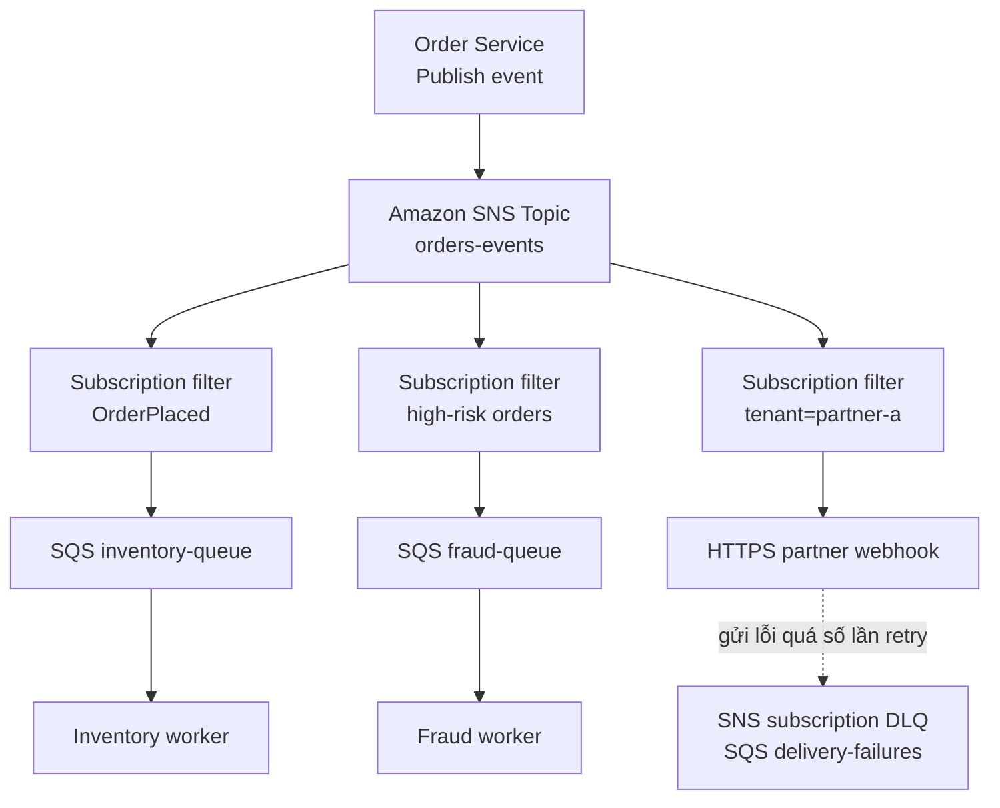
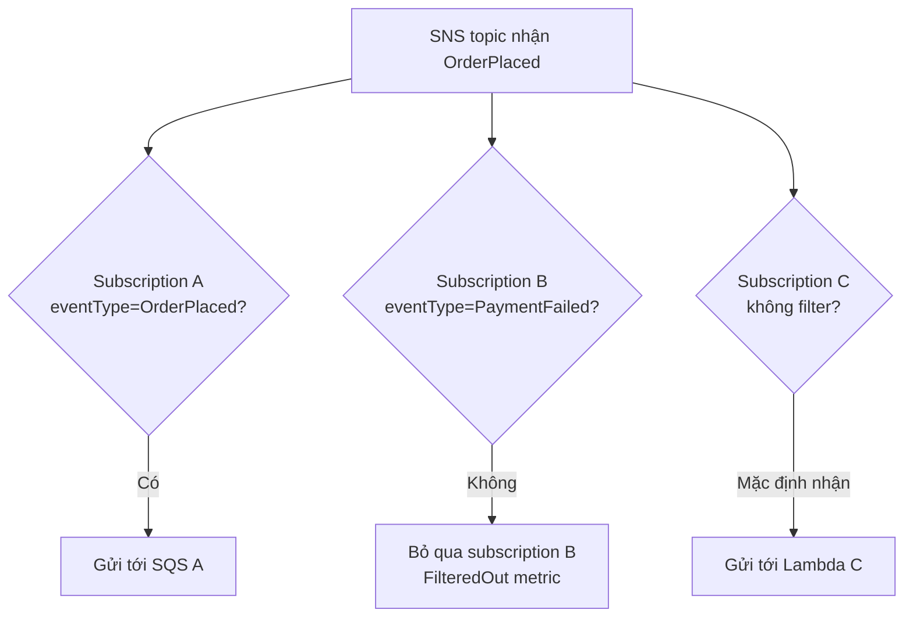
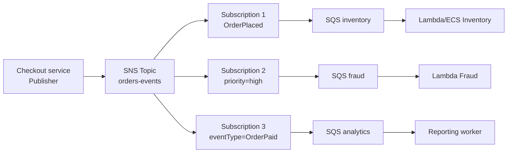
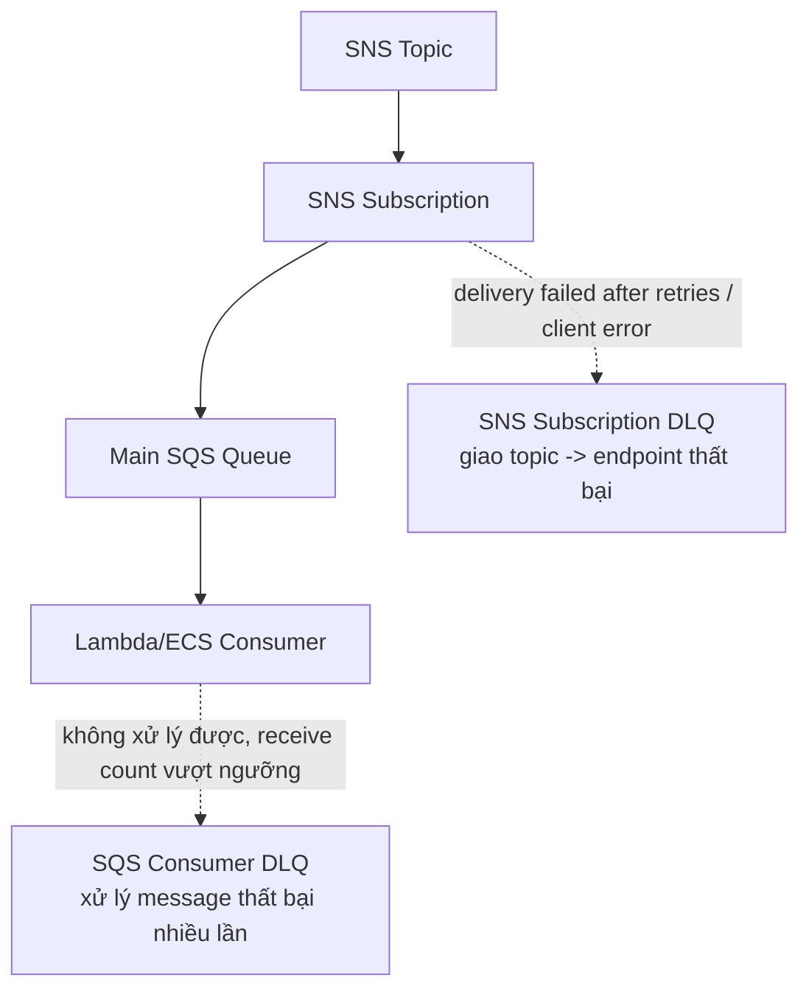
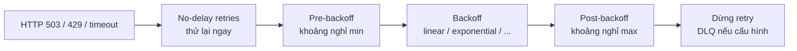
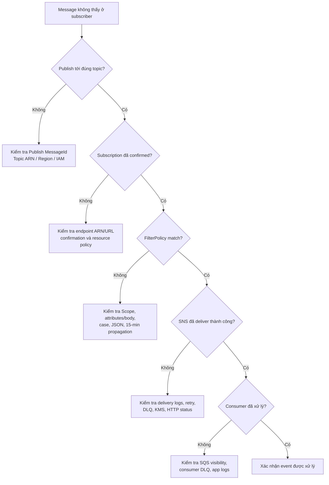

# SNS message filtering và delivery policy trên Amazon SNS

> **Chương:** Hàng đợi và thông báo  
> **Module:** CLOUD_PROVIDERS_AWS  
> **Mục tiêu:** thiết kế fan-out theo loại sự kiện, lọc thông điệp trên từng subscription, cấu hình delivery policy/retries cho endpoint HTTP/S, bảo vệ thông điệp không gửi được bằng dead-letter queue, giám sát độ tin cậy và kiểm soát chi phí.
>
> **Phạm vi:** Amazon Simple Notification Service (Amazon SNS) standard/FIFO topics; subscriber sử dụng Amazon SQS, AWS Lambda, HTTP/S và các giao thức SNS hỗ trợ. Các ID, ARN, event, tài khoản, hạn mức khách hàng và URL bên dưới đều là minh họa. Các lệnh có thể làm thay đổi tài nguyên được ghi rõ và không được chạy trên production nếu thiếu phê duyệt.

## 1. Bài toán thực tế: một sự kiện đơn hàng, nhiều người nhận

Một ứng dụng bán hàng chạy trên Amazon ECS/Fargate và Lambda phát sự kiện khi có đơn hàng mới:

```json
{
  "eventId": "evt-2026-001",
  "eventType": "OrderPlaced",
  "tenantId": "shop-a",
  "region": "VN",
  "priority": "high",
  "orderId": "O-12345",
  "totalAmount": 850000,
  "currency": "VND"
}
```

Có nhiều hệ thống cần phản ứng:

- **Inventory worker:** cập nhật tồn kho với tất cả sự kiện `OrderPlaced`.
- **Fraud worker:** kiểm tra các đơn có `priority=high` hoặc tổng tiền lớn.
- **Notification service:** gửi email/SMS xác nhận theo chính sách của ứng dụng.
- **Reporting service:** chỉ quan tâm `OrderPlaced` và `OrderCancelled`.
- **Đối tác HTTP webhook:** nhận các sự kiện thuộc tenant của họ, nhưng endpoint thỉnh thoảng trả HTTP 503 hoặc 429.

Nếu publisher gọi trực tiếp từng dịch vụ, mỗi lần thêm subscriber lại sửa mã publisher; khi webhook chậm, publisher có thể bị ảnh hưởng. **Amazon SNS topic** cung cấp mô hình **publish/subscribe fan-out**, trong đó publisher phát **một message** tới topic, còn các subscriptions quyết định có nhận hay không và nhận bằng giao thức nào.



Có **hai quyết định độc lập**:

1. **Message filtering:** có **gửi message đến subscription này không?**
2. **Delivery policy:** **nếu được chọn để gửi nhưng endpoint gặp lỗi thì thử lại ra sao?**

Đây là phân biệt quan trọng nhất của bài học.

## 2. Các đối tượng SNS cơ bản

| Thành phần | Vai trò | Ví dụ |
|---|---|---|
| **Topic** | Điểm phát một message tới nhiều subscriptions | `orders-events` |
| **Publisher** | Ứng dụng/dịch vụ gọi `Publish` hoặc `PublishBatch` | ECS order service |
| **Message body** | Nội dung chính của message | JSON đơn hàng |
| **Message attributes** | Các cặp tên/kiểu/giá trị kèm message | `eventType=OrderPlaced` |
| **Subscription** | Liên kết topic với endpoint/giao thức cụ thể | Topic → SQS queue |
| **FilterPolicy** | Điều kiện nhận message của một subscription | Chỉ nhận `eventType=OrderPlaced` |
| **FilterPolicyScope** | Chọn lọc theo attributes hoặc JSON body | `MessageAttributes` / `MessageBody` |
| **DeliveryPolicy** | Quy tắc retries/throttling delivery, có thể tùy chỉnh cho HTTP/S | Retry backoff đến 60 giây |
| **RedrivePolicy** | Chỉ định **SNS subscription DLQ** để giữ message giao không thành công | ARN của SQS DLQ |
| **RawMessageDelivery** | Chọn body nguyên gốc hay bọc SNS envelope theo giao thức | SQS nhận body JSON nguyên gốc |
| **Delivery status logging** | Ghi kết quả giao tới endpoint vào CloudWatch Logs | HTTP 503 và retry attempts |

**FilterPolicy, DeliveryPolicy, RedrivePolicy là ba cấu hình khác nhau.** Chúng không tự thay thế hoặc suy ra lẫn nhau.

### 2.1. Topic không “biết” nghiệp vụ của từng consumer

Publisher nên công bố event có **schema/semantic rõ ràng**; mỗi consumer tự subscribe và nhận phần liên quan. Topic không cần gọi code của fraud hay inventory để quyết định “event này có phải đơn rủi ro không” nếu filter policy đã biểu diễn đúng.

Nhưng SNS filter **chỉ là bộ lọc theo thuộc tính/JSON**, không phải engine phân tích nghiệp vụ tùy ý. Nếu phân loại rủi ro cần ML hoặc query DB, hãy tính ở publisher hoặc dùng một consumer chuyên biệt trước, rồi phát sự kiện có trường `riskClass` được xác nhận.

### 2.2. Standard topic và FIFO topic

**SNS Standard** thích hợp fan-out quy mô lớn, có khả năng message được giao **ít nhất một lần** và thứ tự không được cam kết tuyệt đối theo từng subscriber.

**SNS FIFO** dành cho trường hợp cần bảo toàn thứ tự theo **`MessageGroupId`**, kết hợp deduplication và các điều kiện bảo đảm của SNS/SQS FIFO. Đây không phải việc đổi tên topic thành `.fifo` rồi mọi endpoint đều tự đạt exactly-once ở tầng ứng dụng.

| Tiêu chí | Standard SNS | FIFO SNS |
|---|---|---|
| Sắp xếp thứ tự | Best effort | Thứ tự trong cùng message group theo điều kiện hỗ trợ |
| Duplicates | Consumer phải chịu được | Deduplication trong cửa sổ và giới hạn AWS; app vẫn phải idempotent |
| Fan-out đến SQS | Standard queue chủ yếu | SQS FIFO để giữ đặc tính FIFO tương ứng |
| Filter policy | Có | Có, nhưng lọc có thể loại một số events trong chuỗi |
| DLQ | Subscription DLQ theo loại được hỗ trợ | DLQ FIFO theo yêu cầu nguồn |
| Bài toán | Sự kiện dịch vụ đa dạng | Workflows có ràng buộc thứ tự/dedup |

**Với mọi mô hình, đừng coi “đã deliver tới SQS” đồng nghĩa “consumer đã xử lý thành công”.** Hai chặng có quy trình retries/DLQ riêng.

## 3. Mặc định SNS gửi gì?

Một SNS subscription **không có filter policy** sẽ đủ điều kiện nhận **mọi message** được publish tới topic, miễn giao thức/permissions/delivery hoạt động.

Nếu có filter policy:

- SNS đọc **message attributes** hoặc **JSON message body**, tùy `FilterPolicyScope`.
- Mỗi subscription được xét **độc lập**.
- Nếu match, SNS cố gắng deliver tới endpoint của subscription.
- Nếu không match, message **bị lọc khỏi subscription đó**; đây **không phải lỗi giao hàng**.
- Các subscriptions khác trên cùng topic vẫn có thể nhận cùng message nếu policy của chúng match.



Nếu một message bị lọc khỏi Fraud subscription, **không** chuyển nó tới Fraud DLQ; đúng như thiết kế, subscription đó không phải đối tượng cần nhận message.

## 4. Hai scope của filter policy

`FilterPolicyScope` là **subscription attribute** có hai giá trị.

| Scope | Lọc trên đâu? | Khi nào phù hợp? |
|---|---|---|
| **`MessageAttributes`** (**mặc định**) | Các message attributes gắn riêng với SNS Publish | Sự kiện có metadata/routing keys rõ ràng |
| **`MessageBody`** | Các property trong **JSON object** của message body | Event đã có JSON schema và không muốn nhân đôi metadata |

**Một subscription có một scope tại một thời điểm**, không thể viết một FilterPolicy duy nhất để AND trực tiếp attribute `eventType` với field body `tenantId` nếu chưa đưa chúng về cùng scope.

### 4.1. MessageAttributes: publisher gửi metadata riêng

Publisher gửi body:

```json
{
  "eventId": "evt-001",
  "orderId": "O-12345",
  "totalAmount": 850000
}
```

Đồng thời gửi attributes:

```json
{
  "eventType": {
    "DataType": "String",
    "StringValue": "OrderPlaced"
  },
  "priority": {
    "DataType": "String",
    "StringValue": "high"
  },
  "amount": {
    "DataType": "Number",
    "StringValue": "850000"
  },
  "tenantId": {
    "DataType": "String",
    "StringValue": "shop-a"
  }
}
```

Filter của inventory subscription:

```json
{
  "eventType": ["OrderPlaced"]
}
```

Filter của priority fulfillment subscription:

```json
{
  "eventType": ["OrderPlaced"],
  "priority": ["high"]
}
```

**Lợi ích:** routing information rõ, không cần parse sâu JSON body để chọn subscriber. **Đổi lại:** publisher phải duy trì metadata đồng bộ với body; nếu body ghi `OrderCancelled` mà attribute ghi `OrderPlaced`, consumer có thể nhận một event không như kỳ vọng.

### 4.2. MessageBody: lọc trực tiếp JSON

Publisher gửi JSON:

```json
{
  "eventType": "OrderPlaced",
  "tenantId": "shop-a",
  "risk": {
    "level": "high",
    "score": 92
  },
  "shipping": {
    "country": "VN"
  },
  "orderId": "O-12345"
}
```

Đặt `FilterPolicyScope=MessageBody` và filter:

```json
{
  "eventType": ["OrderPlaced"],
  "risk": {
    "level": ["high"],
    "score": [
      { "numeric": [">=", 80] }
    ]
  }
}
```

Đây là **nested filter policy** phù hợp với `MessageBody`. Không dùng nested object trên attributes-based policy, vì SNS không hỗ trợ nested attribute filters.

### 4.3. Body phải là JSON object hợp lệ

Với scope `MessageBody`, SNS cần message payload là **well-formed JSON object**.

Ví dụ **không thích hợp** để lọc theo body:

```text
Order O-12345 created
```

Hoặc JSON string đơn:

```json
"OrderPlaced"
```

Để lọc theo JSON properties, hãy gửi object như `{"eventType":"OrderPlaced"}`. Nếu body không phải JSON object hợp lệ, SNS có thể ghi tăng **`NumberOfNotificationsFilteredOut-InvalidMessageBody`** thay vì gửi tới subscription có filter theo body.

**Không thể sửa điều này bằng cách bật RawMessageDelivery.** Raw delivery quyết định **định dạng sau khi giao tới endpoint**, còn FilterPolicyScope quyết định **cách SNS xét message trước khi giao**.

## 5. Semantics: AND giữa keys, OR giữa các values

Quy tắc cơ bản:

1. Những **top-level keys / điều kiện theo property** trong policy cần đồng thời match — logic **AND**.
2. Trong **một mảng values** của một key, chỉ cần **một** value/operator match — logic **OR**.
3. Những thuộc tính body/attributes **không nêu trong policy** thường được SNS bỏ qua khi đánh giá filter.
4. Tên key và exact string match mặc định **phân biệt chữ hoa/chữ thường**.

Ví dụ:

```json
{
  "eventType": ["OrderPlaced", "OrderPaid"],
  "region": ["VN", "SG"],
  "priority": ["high"]
}
```

Biểu thức logic:

\[
(eventType = OrderPlaced \lor eventType = OrderPaid)
\land (region = VN \lor region = SG)
\land (priority = high)
\]

Bảng kiểm tra:

| Event | Region | Priority | Match? |
|---|---|---|---|
| `OrderPlaced` | `VN` | `high` | **Có** |
| `OrderPaid` | `SG` | `high` | **Có** |
| `OrderCancelled` | `VN` | `high` | Không |
| `OrderPlaced` | `US` | `high` | Không |
| `OrderPlaced` | `VN` | `low` | Không |
| `OrderPlaced` | `VN` | *thiếu* | Không |

**Chú ý:** Một field không nhắc đến trong policy là không ràng buộc. Nhưng **field được policy yêu cầu mà message thiếu** thường không match, trừ điều kiện rõ ràng như `exists:false`.

### 5.1. Khi muốn OR giữa nhiều keys thì sao?

Policy:

```json
{
  "eventType": ["OrderPlaced"],
  "priority": ["high"]
}
```

**không** có nghĩa “eventType=OrderPlaced **hoặc** priority=high”. Nó là AND.

Để biểu diễn nhiều đường điều kiện khác nhau, hãy xem **OR operator** hiện được SNS hỗ trợ và cú pháp chính xác trong tài liệu; hoặc tách thành **nhiều subscriptions** nếu phù hợp kiến trúc. Không sửa semantics bằng cách lén bỏ key vì sẽ nhận quá nhiều messages.

## 6. Những operators hữu ích

Amazon SNS hỗ trợ các operators để lọc theo chuỗi, số, tồn tại field và mẫu ký tự.

| Operator | Ví dụ | Ý nghĩa |
|---|---|---|
| Exact string | `"eventType": ["OrderPlaced"]` | Match chính xác chuỗi |
| Numeric | `{"numeric":[">=",1000]}` | Match numeric range |
| `anything-but` | `{"anything-but":["test","demo"]}` | Loại các giá trị được liệt kê |
| `prefix` | `{"prefix":"vip-"}` | Chuỗi bắt đầu bằng prefix |
| `suffix` | `{"suffix":".csv"}` | Chuỗi kết thúc bằng suffix |
| `equals-ignore-case` | `{"equals-ignore-case":"urgent"}` | So khớp không phân biệt hoa/thường |
| `wildcard` | `{"wildcard":"order-*-created"}` | Pattern chuỗi có wildcard |
| `cidr` | `{"cidr":"10.0.0.0/24"}` | Match chuỗi IPv4 theo CIDR |
| `exists` | `{"exists":true}` | Kiểm tra property tồn tại, theo semantics AWS |
| OR operator | Cú pháp SNS chuyên biệt | OR qua các nhánh điều kiện |

**Dùng operators càng đơn giản càng dễ kiểm thử và vận hành.** Không dùng wildcards để che việc event schema không ổn định.

### 6.1. Numeric range

Một worker chỉ quan tâm đơn >= 1.000.000 VND:

```json
{
  "eventType": ["OrderPlaced"],
  "amount": [
    { "numeric": [">=", 1000000] }
  ]
}
```

Có thể kết hợp nhiều toán tử:

```json
{
  "riskScore": [
    { "numeric": [">=", 70, "<", 90] }
  ]
}
```

Giá trị được so sánh **theo số**, không theo thứ tự từ điển. Với `MessageAttributes`, publisher dùng attribute loại `Number`; với `MessageBody`, body có field là **JSON number**.

**Đừng lấy giá trị `"850000"` kiểu JSON string rồi giả định numeric filter sẽ tự chuyển đổi trong mọi trường hợp.** Hợp đồng schema phải định kiểu nhất quán.

### 6.2. Prefix, suffix, anything-but

Subscription chỉ nhận sự kiện từ merchants có ID bắt đầu bằng `vip-`:

```json
{
  "merchantId": [
    { "prefix": "vip-" }
  ]
}
```

Subscription xử lý uploads định dạng CSV:

```json
{
  "fileName": [
    { "suffix": ".csv" }
  ]
}
```

Subscription chặn các sự kiện demo trong môi trường chính:

```json
{
  "environment": [
    { "anything-but": ["demo", "sandbox"] }
  ]
}
```

**Hãy kiểm tra hành vi khi field bị thiếu.** Policy `anything-but` không phải “cho phép tất cả message không có field environment”; muốn xử lý field vắng mặt cần thiết kế điều kiện `exists:false` hoặc bổ sung routing attribute bắt buộc.

### 6.3. Exists và schema evolution

Khi chuyển schema từ v1 chưa có `riskScore` sang v2 có field đó, có thể cần một subscription nhận message chưa có key. SNS hỗ trợ `exists` conditions:

```json
{
  "riskScore": [
    { "exists": false }
  ]
}
```

Tuy nhiên semantics của `exists` có khác biệt theo scope, kiểu value và trường hợp property null/rỗng; cần test bằng thông điệp thực. Không coi `exists:false` là “giá trị bằng null”.

Với sự kiện quan trọng, giải pháp dài hạn tốt hơn thường là **schema versioning**:

```json
{
  "schemaVersion": 2,
  "eventType": "OrderPlaced",
  "riskScore": 90
}
```

### 6.4. Case sensitivity và wildcard complexity

`"OrderPlaced"` và `"orderplaced"` là **hai chuỗi khác nhau** theo exact matching. Khi có tên event/tenant ID, hãy thống nhất naming convention, ví dụ **PascalCase event names** hoặc **snake_case**, nhưng đừng tùy tiện thay đổi sau khi đã có subscribers.

Wildcard có giới hạn complexity riêng; tránh policy như `"*a*b*c*d*"` lặp lại nhiều giá trị, dễ chạm quota và khó dự đoán. Tham khảo tài liệu AWS về maximum three wildcards per pattern và tổng wildcard complexity trước khi dùng mẫu phức tạp.

## 7. Kiểu message attribute và những cạm bẫy

SNS hỗ trợ các kiểu message attributes như:

| DataType | Ví dụ | Lưu ý |
|---|---|---|
| `String` | `eventType=OrderPlaced` | Exact string match, case-sensitive |
| `Number` | `amount=850000` | Numeric matching theo số |
| `String.Array` | `tags=["vip","express"]` | Có thể match từng phần tử phù hợp |
| `Binary` | Dữ liệu nhị phân | **SNS subscription filters bỏ qua Binary attributes** |

Các ràng buộc phổ biến:

- Attribute name phân biệt hoa/thường, giới hạn ký tự và không được dùng các prefix `AWS.`, `Amazon.` được AWS giữ riêng.
- Attribute được dùng cho filtering cần đúng **JSON encoding/escaping** theo tài liệu SDK/API; đặc biệt dấu nháy kép và backslash có thể phải escape đúng cách.
- Với `MessageAttributes`, SNS không hỗ trợ **nested filter policy**; với `MessageBody` thì hỗ trợ nested JSON.
- Trong **FIFO topics**, các thuộc tính như `MessageGroupId` và `MessageDeduplicationId` có vai trò riêng của SNS FIFO; đừng mặc định filter policy có thể dùng chúng như message attributes nếu publisher không truyền tương ứng.
- Một số giao thức/format không chuyển toàn bộ attributes tới subscriber giống hệt nhau, dù SNS vẫn dùng attributes để lọc.

### 7.1. Ví dụ String.Array

Publisher gửi:

```json
{
  "tags": {
    "DataType": "String.Array",
    "StringValue": "[\"vip\",\"fragile\",\"express\"]"
  }
}
```

Subscription filter:

```json
{
  "tags": ["express", "cold-chain"]
}
```

Vì mảng có phần tử `express`, SNS có thể xét match theo quy tắc String.Array. Đừng gửi literal chuỗi `"vip,fragile,express"` kiểu `String` rồi tưởng SNS tự tách thành array.

## 8. Quy mô và giới hạn filter policy

Theo tài liệu AWS về filter policy constraints, có những giới hạn đáng theo dõi:

| Giới hạn | Giá trị tài liệu AWS | Ý nghĩa |
|---|---|---|
| Số filter policy keys | Tối đa **5** | Với nested MessageBody, tính leaf keys |
| Số tổ hợp match | Tối đa **150** | Tính từ số lựa chọn của từng key; nested còn hệ số depth |
| Kích thước FilterPolicy JSON | Tối đa **256 KB** | Không dùng policy thay database routing rules |
| Số filter policies/topic | Mặc định **200** | Có thể yêu cầu tăng quota phù hợp |
| Số filter policies/account | Mặc định **10.000** | Có thể yêu cầu tăng quota |
| Wildcard complexity | Tổng tối đa **100 points** | Tránh patterns nhiều wildcards |
| Propagation khi đổi policy | Có thể tới **15 phút** | Không tin thay đổi có hiệu lực tức thì |

### 8.1. Cách tính combinations của policy flat

Policy:

```json
{
  "eventType": ["OrderPlaced", "OrderCancelled", "OrderReturned"],
  "region": ["VN", "SG"],
  "priority": ["high", "normal"]
}
```

Số tổ hợp =

\[
3\times 2\times 2=12
\]

Nếu tiếp tục thêm 10 values vào mỗi key mà không kiểm toán, complexity tăng theo phép nhân, không phải phép cộng. Khi vượt giới hạn, SNS từ chối cấu hình policy.

### 8.2. Nested policy cần tính depth

Với `MessageBody`:

```json
{
  "order": {
    "payment": {
      "status": ["PAID", "PENDING"]
    }
  },
  "shipping": {
    "country": ["VN", "SG"]
  }
}
```

AWS tính complexity có xét **số leaf choices × nesting depth** cho mỗi leaf, rồi nhân các giá trị. Vì vậy policy lồng sâu có thể chạm limit **trước** một policy flat có cùng số giá trị.

**Khuyến nghị:** giữ routing metadata nhỏ, ít keys, ổn định qua các schema versions; nếu cần hàng nghìn tenant-specific rules động, đánh giá tách topics, application router hoặc EventBridge event patterns thay vì nhét tất cả tenant IDs vào một filter policy.

### 8.3. Eventual consistency: cập nhật chưa áp ngay

Thêm/sửa/xóa filter policy có thể mất tới **15 phút** để propagate hoàn toàn. Trong giai đoạn này:

- Một số deliveries có thể chịu policy cũ.
- Một số deliveries chịu policy mới.
- Test ngay sau khi deploy có thể cho kết quả không nhất quán.

Nếu sự kiện liên quan tiền hoặc bảo mật, **không dựa vào thời khắc đổi policy làm điểm chuyển quyền truy cập cứng**. Cần ứng dụng/backend tự kiểm tra quyền và có giai đoạn cutover rõ ràng.

## 9. Filter policy không phải bộ máy authorization

Một publisher có thể đưa:

```json
{
  "tenantId": "company-a",
  "eventType": "OrderPlaced"
}
```

Một subscriber chỉ nhận `tenantId=company-a` qua filter. Nhưng điều đó **không đủ bảo đảm bảo mật đa tenant**:

- Publisher khác có quyền `sns:Publish` có thể giả trường `tenantId` nếu không kiểm soát nguồn.
- Một subscriber có quyền subscribe hoặc sửa policy sai có thể nhận events khác.
- Nếu SQS queue policy quá rộng, topic khác có thể gửi vào queue.
- Filter được thiết kế cho **routing**, không phải thay thế IAM/KMS hoặc application data authorization.

**Thiết kế tenant isolation cần nhiều lớp:**

1. IAM topic policy/identity policy kiểm soát ai được publish/subscribe.
2. Queue resource policy cho phép `sns.amazonaws.com` gửi từ **đúng Topic ARN**, với `aws:SourceArn`.
3. KMS key policy cho phép SNS/SQS sử dụng key đúng phạm vi.
4. Consumer xác thực/kiểm tra tenant ID theo **nguồn tin cậy** trước khi ghi dữ liệu.
5. Có thể tách topic/account/queue theo tenant khi yêu cầu compliance cao.

## 10. Message filtering và fan-out qua SQS

### 10.1. Kiến trúc khuyến nghị



**Vì sao đặt SQS ở giữa?**

- SNS fan-out nhanh; SQS giữ messages cho consumer xử lý theo năng lực.
- Consumer tạm ngừng không khiến publisher cần retry trực tiếp.
- Queue depth/oldest message age thể hiện backlog.
- Có thể có **SQS consumer DLQ** riêng cho các messages consumer liên tục xử lý lỗi.
- Khi SNS đã đưa message thành công vào queue, SNS coi việc giao tới **SQS endpoint** đã thành công; consumer failures là chuyện của SQS/Lambda/ECS.

### 10.2. Phân biệt SNS subscription DLQ và SQS consumer DLQ



| Loại DLQ | Gắn vào | Giữ cái gì? |
|---|---|---|
| **SNS subscription DLQ** | **Subscription** qua `RedrivePolicy` | Message mà SNS **không giao được tới endpoint** |
| **SQS consumer DLQ** | **SQS source queue** qua SQS `RedrivePolicy` | Message đã vào queue nhưng consumer **xử lý thất bại lặp lại** |

**Không có một DLQ duy nhất bảo vệ mọi giai đoạn.** Nếu giao tới SQS thành công nhưng Lambda code crash, SNS subscription DLQ sẽ **không** nhận message đó; cần SQS redrive policy hoặc cơ chế xử lý retry riêng.

### 10.3. Mỗi subscription cần policy và DLQ riêng khi phù hợp

Một topic có ba subscriptions; nếu chỉ HTTPS subscriber gặp outage, các SQS subscribers khác vẫn có thể nhận message đúng filter. Gắn DLQ **ở subscription**, không phải ở topic, để xác định endpoint nào thất bại.

## 11. Raw message delivery có liên quan gì đến filtering?

**RawMessageDelivery** là tùy chọn định dạng **khi đưa message tới endpoint**.

### 11.1. Khi RawMessageDelivery = false

SQS subscriber thường nhận SNS notification envelope dạng:

```json
{
  "Type": "Notification",
  "MessageId": "example-uuid",
  "TopicArn": "arn:aws:sns:ap-southeast-1:111122223333:orders-events",
  "Message": "{\"eventType\":\"OrderPlaced\",\"orderId\":\"O-12345\"}",
  "Timestamp": "2026-11-20T00:00:00.000Z",
  "SignatureVersion": "1",
  "Signature": "EXAMPLE_SIGNATURE",
  "SigningCertURL": "EXAMPLE_CERT_URL"
}
```

Consumer cần parse SNS envelope rồi parse `Message` nếu business payload là JSON string.

### 11.2. Khi RawMessageDelivery = true

SQS nhận trực tiếp body:

```json
{
  "eventType": "OrderPlaced",
  "orderId": "O-12345"
}
```

**Ưu điểm:** SQS consumer chỉ cần parse business JSON một lần. **Đánh đổi:** mất SNS wrapper metadata trong body; với HTTP/S raw delivery, SNS dùng header `x-amz-sns-rawdelivery: true` và không gửi các message attributes trong cùng cách như wrapped delivery.

### 11.3. Giới hạn message attributes với SQS raw delivery

AWS quy định **SNS → SQS subscription bật RawMessageDelivery chỉ hỗ trợ tối đa 10 message attributes**. Nếu publisher gửi hơn 10 attributes tới subscription loại này, SNS có thể **discard message cho subscription đó** và coi đó là client-side error.

Đừng sửa bằng cách tăng quota filter policy keys: **5 filter keys** và **10 raw message attributes** là **hai giới hạn khác nhau**.

### 11.4. Raw delivery không bật/tắt filtering

Subscription có thể **lọc trên MessageAttributes** rồi giao raw body tới SQS. Nó cũng có thể **lọc trên MessageBody** rồi giao SNS envelope nếu raw tắt. Filter và raw delivery là hai bước/thuộc tính độc lập.

## 12. Delivery policy: khi đã chọn message nhưng không giao được

Nếu filter match, SNS bắt đầu **delivery**. Endpoint có thể:

- Sẵn sàng và xác nhận thành công.
- Tạm thời lỗi do timeout, overload hoặc dịch vụ unavailable.
- Trả lỗi vĩnh viễn do endpoint bị xóa, thiếu quyền hoặc request không được chấp nhận.
- Bị điều tiết bởi cấu hình delivery rate của HTTP/S subscription.

**Delivery policy** mô tả **SNS thử lại thế nào** khi phát sinh lỗi giao đến endpoint theo điều kiện dịch vụ. Sau khi hết cơ hội retry, SNS ngừng thử; có **subscription DLQ** thì lưu thông điệp chưa giao được để xử lý sau.

### 12.1. Giao thức nào được tùy chỉnh retry policy?

Theo AWS:

| Endpoint protocol | Có tự cấu hình SNS retry delivery policy? | Cách vận hành |
|---|---|---|
| **HTTP/S** | **Có** | Chỉnh `DeliveryPolicy` tại topic hoặc subscription |
| **Amazon SQS** | **Không** | AWS áp dụng retry behavior dịch vụ |
| **AWS Lambda** | **Không** | AWS áp dụng retry behavior dịch vụ cho chặng SNS → Lambda |
| **Email/SMTP** | **Không** | SNS-managed policy |
| **SMS/mobile push** | **Không** | SNS-managed policy |
| **Firehose** | Theo retry behavior của dịch vụ | Không suy từ HTTP/S settings |

**Không đặt một HTTP/S DeliveryPolicy với hy vọng điều chỉnh số lần retry của SQS/Lambda subscription.** Nếu mục tiêu là thay đổi retries của **consumer** sau khi Lambda xử lý event lỗi, hãy cấu hình Lambda asynchronous invocation/on-failure destination hoặc **SQS redrive policy** ở chặng tương ứng.

### 12.2. Retry mặc định của các endpoint AWS-managed

Theo tài liệu AWS SNS delivery retries:

- Với **SQS/Lambda**, khi xảy ra server-side delivery failure, SNS có thể thử lại **100.015 attempts trong khoảng 23 ngày** theo policy dịch vụ.
- Với các customer-managed protocols khác như email/SMS/mobile push, AWS có các lịch retries khác (ví dụ 50 attempts trong khoảng 6 giờ, tùy protocol và điều kiện).
- **HTTP/S** được tùy chỉnh, với tổng thời gian retry policy không vượt **3.600 giây**.

**Không suy “SNS → Lambda retry 23 ngày” là Lambda function code được retry 23 ngày sau khi invocation đã được Lambda nhận thành công.** SNS chỉ quản lý **chặng delivery/handoff** đến Lambda service.

### 12.3. Lỗi nào retry, lỗi nào kết thúc?

Đối với **HTTP/S delivery** theo tài liệu AWS:

| HTTP response | SNS coi thế nào? | Hành động |
|---|---|---|
| **2xx** | Delivery success | Không retry |
| **5xx** | Retryable server-side failure | Retry theo delivery policy |
| **429 Too Many Requests** | Retryable throttling | Retry theo delivery policy |
| **4xx khác** (ví dụ 400/401/403/404) | Thường permanent client-side error | **Không retry** theo HTTP/S policy |
| Timeout/network/server unavailable | Retryable theo điều kiện dịch vụ | Retry/backoff |
| Không đủ quyền SQS/Lambda endpoint | Client-side/permanent failure | Có thể chuyển DLQ; sửa IAM/resource policy |

**Cảnh báo:** nếu webhook của bạn trả **HTTP 200 trước khi lưu event bền vững**, SNS nghĩ đã deliver thành công. Nếu app crash ngay sau 200, SNS không có lý do retry và subscription DLQ cũng không cứu được event. HTTP endpoint nên **ghi bền vững/đưa SQS nội bộ thành công trước khi ACK 2xx** nếu cần đảm bảo xử lý.

## 13. Các thành phần của HTTP/S DeliveryPolicy

AWS cho phép đặt delivery policy tại:

- **Topic level:** áp dụng với HTTP/S subscriptions dùng policy của topic.
- **Subscription level:** đặt policy riêng cho một HTTP/S subscriber; kiểm tra `EffectiveDeliveryPolicy` để biết policy thực sự đang được áp dụng.

Các phần chính:

| Policy | Thuộc tính | Mục đích |
|---|---|---|
| **`healthyRetryPolicy`** | `minDelayTarget`, `maxDelayTarget`, `numRetries`, `numNoDelayRetries`, `numMinDelayRetries`, `numMaxDelayRetries`, `backoffFunction` | Cấu hình số lần thử và lịch backoff |
| **`throttlePolicy`** | `maxReceivesPerSecond` | Giới hạn tốc độ giao trung bình tới HTTP/S subscription |
| **`requestPolicy`** | `headerContentType` | Chọn Content-Type header của HTTP/S notification |

### 13.1. Bốn giai đoạn retry



**Giải thích:**

1. **No-delay:** retry ngay, hữu ích cho lỗi cực ngắn; số lượng lớn có thể làm quá tải nặng hơn.
2. **Pre-backoff:** retry theo `minDelayTarget`.
3. **Backoff:** tăng thời gian chờ theo `backoffFunction` cho những retries còn lại.
4. **Post-backoff:** retry theo `maxDelayTarget` ở cuối lịch.

SNS còn áp **jitter** để tránh các subscribers retry đồng bộ gây thundering herd.

### 13.2. Ví dụ DeliveryPolicy cho webhook đối tác

```json
{
  "healthyRetryPolicy": {
    "minDelayTarget": 1,
    "maxDelayTarget": 60,
    "numRetries": 50,
    "numNoDelayRetries": 3,
    "numMinDelayRetries": 2,
    "numMaxDelayRetries": 35,
    "backoffFunction": "exponential"
  },
  "throttlePolicy": {
    "maxReceivesPerSecond": 10
  },
  "requestPolicy": {
    "headerContentType": "application/json"
  }
}
```

Đây là một cấu hình minh họa theo tài liệu AWS: trong `numRetries=50`, có **3** immediate retries, **2** pre-backoff retries, **35** post-backoff retries, phần còn lại ở backoff phase.

**Không tính “numRetries=50” thành cam kết endpoint chắc chắn được gọi đúng 50 lần tổng cộng.** AWS có phân biệt attempts/retries, jitter, permanent failures và giới hạn tổng thời gian. Kiểm tra delivery status logs để biết behavior thực tế.

### 13.3. Ý nghĩa min/max delay và backoff

| Trường | Ý nghĩa thực tế |
|---|---|
| `minDelayTarget` | Khoảng chờ tối thiểu theo policy, đơn vị giây |
| `maxDelayTarget` | Khoảng chờ tối đa theo policy, không vượt giới hạn AWS |
| `numRetries` | Tổng retry attempts cấu hình trong các phases |
| `numNoDelayRetries` | Số retries không delay |
| `numMinDelayRetries` | Số retries ở mức min delay |
| `numMaxDelayRetries` | Số retries ở mức max delay |
| `backoffFunction` | `arithmetic`, `exponential`, `geometric` hoặc `linear` |
| `maxReceivesPerSecond` | Tốc độ giao **trung bình** tối đa mục tiêu mỗi HTTP/S subscription |
| `headerContentType` | Chọn Content-Type, ví dụ `application/json` |

AWS giới hạn **HTTP/S retry policy tổng thời gian ≤ 3.600 giây**, **`numRetries` từ 0 đến 100**, và có các constraints chi tiết cho các trường delay/phases. Chạy validate hoặc thử qua CLI/SDK trước khi đưa vào IaC production.

**Không chọn min/max delay 600 giây rồi thêm 100 retries** và nghĩ rằng dịch vụ sẽ giữ message hàng ngày; SNS có **giới hạn tổng retry window** riêng.

## 14. throttlePolicy.maxReceivesPerSecond là gì?

Ví dụ:

```json
{
  "throttlePolicy": {
    "maxReceivesPerSecond": 10
  }
}
```

Điều này giúp điều tiết tốc độ giao trung bình tới **một HTTP/S subscription**, không phải giới hạn số message publisher được phép publish vào topic.

Theo tài liệu AWS:

- Là **mục tiêu average delivery rate**, không phải hard real-time cap.
- Một số spikes cao hơn cấu hình vẫn có thể xảy ra.
- Message tự bị SNS làm chậm vì setting này được re-queue/đợi capacity phù hợp, **không trừ vào số retries cho endpoint failures**.
- Nếu producer phát nhanh hơn khả năng gửi của subscriber, **delivery backlog và latency** sẽ tăng.

**Không nhầm:** `maxReceivesPerSecond=10` không bảo vệ một endpoint chỉ chịu tối đa 10 requests trong đúng mọi cửa sổ một giây. Endpoint vẫn cần **rate limiting, concurrency controls, queue/worker capacity và idempotency** của chính nó.

## 15. requestPolicy và Content-Type

Theo AWS, HTTP/S delivery mặc định có Content-Type như:

```text
text/plain; charset=UTF-8
```

Nếu webhook xử lý JSON và cần Content-Type `application/json`, cấu hình:

```json
{
  "requestPolicy": {
    "headerContentType": "application/json"
  }
}
```

**Content-Type không biến message body từ plain text sang JSON hợp lệ.** Nó chỉ là một header; body cần do publisher gửi đúng hoặc SNS envelope/raw format được subscriber xử lý chính xác.

Nếu raw delivery **tắt**, SNS có thể gửi một **JSON envelope** chứa trường `Message`; nếu raw delivery **bật**, webhook thường nhận body nguyên gốc. Hãy test cả hai với thư viện HTTP framework đang dùng trước khi rollout.

### 15.1. Xác thực thông báo SNS gửi tới HTTPS endpoint

Bật HTTPS chưa đủ để khẳng định mọi request tới `/webhook` đều do SNS gửi:

- Với **wrapped SNS notification**, AWS cung cấp chữ ký và certificate URL; endpoint nên xác thực **signature**, topic ARN và message type theo hướng dẫn.
- Kiểm tra certificate URL có hostname và protocol đúng theo AWS, không fetch một URL tùy ý từ payload để tránh SSRF.
- Xử lý **SubscriptionConfirmation** và **UnsubscribeConfirmation** theo quy trình tin cậy.
- Với **RawMessageDelivery** ở HTTP/S, SNS bỏ SNS JSON envelope metadata/chữ ký trong body; cần thiết kế cơ chế xác thực nguồn phù hợp (ví dụ authenticated endpoint/proxy hoặc phương án đã được AWS hỗ trợ và kiểm chứng).
- Đừng coi **User-Agent** hoặc một header dễ giả là chứng cứ xác thực đủ mạnh.

**Rủi ro:** endpoint nhận request giả rồi ghi đơn hàng hoặc gọi API thanh toán nếu không xác minh nguồn và idempotency.

## 16. SNS subscription DLQ: giải pháp cuối sau khi giao thất bại

Khi endpoint trả lỗi permanent hoặc retries exhausted, nếu subscription có **`RedrivePolicy`**, SNS đưa message vào một **Amazon SQS dead-letter queue**. Đây là lớp bảo vệ dữ liệu quan trọng.

Ví dụ:

```json
{
  "deadLetterTargetArn": "arn:aws:sqs:ap-southeast-1:111122223333:partner-webhook-dlq"
}
```

### 16.1. Những điều kiện cần kiểm tra

Theo AWS:

- DLQ là **SQS queue cùng AWS account và Region** với SNS subscription.
- Subscription **Standard topic** dùng **SQS standard queue** làm DLQ; FIFO topic dùng DLQ tương thích **FIFO queue** theo quy tắc.
- SQS DLQ cần **resource policy** cho phép SNS principal `sqs:SendMessage` từ đúng topic ARN.
- Nếu DLQ bật SSE-KMS, customer managed KMS key policy phải cho phép SNS dùng KMS theo tài liệu.
- Retention nên thiết kế đủ dài để vận hành có thời gian khắc phục; AWS thường khuyến nghị tới **14 ngày** nếu phù hợp.
- Dùng CloudWatch để alarm khi DLQ có message, và chuẩn bị quy trình **replay có kiểm soát**.

**Lưu ý:** SNS không coi tất cả messages filtered out là “failed delivery”; chúng không bị chuyển tới DLQ chỉ vì không match filter.

### 16.2. Ví dụ SQS resource policy cho SNS

```json
{
  "Version": "2012-10-17",
  "Statement": [
    {
      "Sid": "AllowSpecificSnsTopic",
      "Effect": "Allow",
      "Principal": {
        "Service": "sns.amazonaws.com"
      },
      "Action": "sqs:SendMessage",
      "Resource": "arn:aws:sqs:ap-southeast-1:111122223333:partner-webhook-dlq",
      "Condition": {
        "ArnEquals": {
          "aws:SourceArn": "arn:aws:sns:ap-southeast-1:111122223333:orders-events"
        }
      }
    }
  ]
}
```

**Giới hạn `aws:SourceArn`** giúp tránh cấp quyền `SendMessage` cho mọi SNS topics. Khi cross-account topology, còn cần kiểm tra ownership/KMS/permissions/Region và yêu cầu dịch vụ cụ thể.

### 16.3. Không quên kiểm tra DLQ tự nó có thể thất bại

Nếu queue bị xóa, queue policy chặn SNS hoặc KMS policy không cho phép mã hóa, ngay cả thao tác **redrive to DLQ** cũng có thể lỗi.

Theo dõi:

- `NumberOfNotificationsRedrivenToDlq`.
- `NumberOfNotificationsFailedToRedriveToDlq`.
- SQS DLQ `ApproximateNumberOfMessagesVisible`.

**Đặc biệt:** metric SQS `NumberOfMessagesSent` **không phải cách đáng tin để báo số message SNS redrive vào DLQ** theo hướng dẫn AWS; nên dùng `ApproximateNumberOfMessagesVisible` để alarm trên backlog hiện có.

## 17. Có nên luôn gắn DLQ cho mỗi subscription?

Câu trả lời phụ thuộc tính quan trọng của event.

| Subscriber | Nếu lỗi giao hàng | Lựa chọn |
|---|---|---|
| Fraud detection queue | Có thể ảnh hưởng kiểm soát rủi ro | **Nên có SNS DLQ** và SQS consumer DLQ |
| Analytics queue | Có thể chấp nhận xử lý muộn | SNS DLQ nếu cần tính đầy đủ dữ liệu |
| Critical partner webhook | Mất event có thể sai đối soát | **Rất nên có SNS DLQ** |
| Best-effort promotional notification | Có thể không cần replay | Đặt chính sách retention/alert phù hợp |
| Temporary test endpoint | Không cần HA cao | Vẫn cân nhắc DLQ nếu muốn debug |

**Không tự động replay toàn bộ DLQ vào topic gốc** khi một sự cố xảy ra. Nếu filter/policy vẫn sai, replay có thể lại fail; nếu consumer không idempotent, replay có thể xử lý trùng nghiệp vụ.

Một runbook replay nên:

1. Sửa nguyên nhân gốc.
2. Kiểm tra schema và origin của messages trong DLQ.
3. Xác định sự kiện còn hợp lệ về mặt thời gian và thứ tự.
4. Đảm bảo consumer idempotent bằng `eventId`/dedup key.
5. Replay từng batch có kiểm soát và theo dõi metrics.
6. Lưu audit trail, không bỏ qua privacy/retention rules.

## 18. Monitoring: biết message bị lọc hay giao thất bại

### 18.1. Các metrics AWS/SNS quan trọng

| Metric | Khi nào quan sát? | Diễn giải |
|---|---|---|
| **`NumberOfMessagesPublished`** | Producer publish bao nhiêu | Không tương đương delivered cho từng subscriber |
| **`NumberOfNotificationsDelivered`** | SNS giao thông báo thành công | Phải đọc protocol và dimensions |
| **`NumberOfNotificationsFailed`** | Delivery thất bại | HTTP/S có thể tính từng failed retry attempt |
| **`NumberOfNotificationsFilteredOut`** | Messages bị filter reject | **Không phải delivery failure** |
| **`NumberOfNotificationsFilteredOut-MessageAttributes`** | Không match attribute filter | Kiểm tra metadata và case/types |
| **`NumberOfNotificationsFilteredOut-MessageBody`** | Không match JSON payload filter | Kiểm tra body field/values |
| **`NumberOfNotificationsFilteredOut-InvalidAttributes`** | Attributes không hợp lệ để lọc | Kiểm tra JSON escaping/types |
| **`NumberOfNotificationsFilteredOut-NoMessageAttributes`** | Không có attributes cần thiết | Kiểm tra publisher và scope |
| **`NumberOfNotificationsFilteredOut-InvalidMessageBody`** | Body không phải JSON phù hợp | Kiểm tra producer schema/body |
| **`NumberOfNotificationsRedrivenToDlq`** | Message được chuyển vào DLQ | Điều tra endpoint failure |
| **`NumberOfNotificationsFailedToRedriveToDlq`** | Không đưa được vào DLQ | Kiểm tra SQS policy/KMS |
| **`PublishSize`** | Theo dõi kích thước messages | Chi phí và giới hạn payload |

**Lưu ý:** những metric trên thường ở phạm vi topic với dimensions tương ứng; không phải metric nào cũng phân biệt từng subscription trực tiếp. Để debug subscriber cụ thể, kết hợp **SNS delivery status logs**, endpoint logs, SQS metrics và correlation ID.

### 18.2. Theo dõi SQS backlog

Ở `AWS/SQS`, quan sát:

- `ApproximateNumberOfMessagesVisible`: backlog chờ consumer.
- `ApproximateAgeOfOldestMessage`: độ trễ chờ lớn nhất gần đúng.
- `ApproximateNumberOfMessagesNotVisible`: messages đang in-flight.
- DLQ `ApproximateNumberOfMessagesVisible`: số messages cần điều tra/replay.

Nếu topic publish tăng nhưng queue depth không tăng, có thể:

1. Message **không match filter**.
2. Subscription chưa active/confirmed.
3. Queue policy chặn SNS delivery.
4. Topic/Region/account không phải nơi bạn đang kiểm tra.
5. Queue consumer xử lý nhanh nên depth thấp.

Không kết luận “SNS mất message” chỉ vì queue tại một thời điểm đang rỗng.

### 18.3. Delivery status logging

SNS có thể ghi delivery status của những endpoint protocols được hỗ trợ tới **CloudWatch Logs**, như SQS, Lambda, HTTP/S và Firehose.

Cần:

- Bật delivery status logging trên topic cho giao thức tương ứng.
- Cấu hình IAM roles để SNS ghi log.
- Chọn **success sample rate** hợp lý, và failure logging.
- Xem log group theo convention `sns/<region>/<account-id>/<topic-name>`.
- Tìm request/message IDs, endpoint và provider response theo nội dung logs.
- Đặt retention để tránh log phí tăng vô hạn.

**Không bật success logging 100% cho mọi high-volume topic mà chưa tính chi phí CloudWatch và dữ liệu có thể lộ trong logs.**

### 18.4. Mẫu bảng cảnh báo production

| Tín hiệu | Điều kiện gợi ý | Tác động |
|---|---|---|
| FilteredOut-InvalidMessageBody > 0 | MessageBody schema lỗi | Producer publishing sai |
| FilteredOut-NoMessageAttributes tăng | MessageAttributes filter mà producer bỏ attr | Consumer không nhận đúng events |
| NumberOfNotificationsFailed tăng | HTTP retries/endpoint fail | Đối tác nhận trễ/mất |
| RedrivenToDlq > 0 | Delivery cuối cùng fail | Cần incident và replay |
| FailedToRedriveToDlq > 0 | Mất lớp bảo vệ DLQ | Ưu tiên điều tra policy/KMS |
| SQS oldest message age tăng | Consumer chậm hoặc dừng | Cần scale/điều tra downstream |
| HTTP 429/503 kéo dài | Subscriber quá tải | Điều chỉnh rate/retry và backend capacity |

Cần đặt ngưỡng theo baseline traffic, không báo động khi các filtered out bình thường do policy. **FilteredOut cao có thể hoàn toàn đúng** nếu subscription chỉ cần một loại event trong số hàng chục loại.

## 19. Ví dụ thiết kế đầy đủ: orders topic và ba loại subscriber

### 19.1. Bộ sự kiện chuẩn hóa

Publisher nên công bố:

```json
{
  "schemaVersion": 1,
  "eventId": "evt-001",
  "eventType": "OrderPlaced",
  "tenantId": "shop-a",
  "orderId": "O-12345",
  "riskScore": 85,
  "currency": "VND",
  "amount": 850000
}
```

Các quy ước:

- `eventId` là unique business event ID cho idempotency.
- `schemaVersion` để hỗ trợ tiến hóa schema.
- `eventType` dùng naming ổn định.
- `tenantId` phải được gán từ **trusted application context**, không tin raw user input.
- `riskScore` là number thật khi filter theo numeric.
- Không chứa PII không cần thiết hoặc payment secrets.

### 19.2. Subscription A — inventory

`FilterPolicyScope=MessageBody`:

```json
{
  "eventType": ["OrderPlaced"]
}
```

Toàn bộ `OrderPlaced` đi đến SQS inventory. Consumer cần idempotency theo `eventId` để tránh trừ tồn kho hai lần khi retry/redrive.

### 19.3. Subscription B — fraud

`FilterPolicyScope=MessageBody`:

```json
{
  "eventType": ["OrderPlaced"],
  "riskScore": [
    { "numeric": [">=", 80] }
  ]
}
```

Chỉ đơn có `riskScore >= 80` vào fraud queue. Nếu business rule là **ưu tiên cao OR tổng tiền lớn**, cần xây logic OR chính xác theo operator hoặc chuẩn hóa một field `requiresFraudReview=true` từ service đáng tin.

### 19.4. Subscription C — partner webhook

`FilterPolicyScope=MessageBody`:

```json
{
  "eventType": ["OrderPlaced", "OrderPaid"],
  "tenantId": ["shop-a"]
}
```

DeliveryPolicy:

```json
{
  "healthyRetryPolicy": {
    "minDelayTarget": 1,
    "maxDelayTarget": 60,
    "numRetries": 50,
    "numNoDelayRetries": 3,
    "numMinDelayRetries": 2,
    "numMaxDelayRetries": 35,
    "backoffFunction": "exponential"
  },
  "throttlePolicy": {
    "maxReceivesPerSecond": 10
  },
  "requestPolicy": {
    "headerContentType": "application/json"
  }
}
```

Với HTTPS endpoint cần:

- Một URL HTTPS công khai hợp lệ và subscription confirmation hoàn tất.
- Xác minh SNS message signature hoặc cơ chế nguồn tin cậy khác theo format.
- Xử lý trùng và ghi bền vững trước khi trả 2xx.
- Có SQS subscription DLQ, alarms, runbook replay.
- Bảo vệ thông tin tenant tại backend, không trông chờ filter policy như permission boundary.

## 20. Các bước cấu hình thực tế qua Console

### 20.1. Bước 0 — Preflight

Trước khi sửa production:

1. Biết chính xác **Region, account, topic ARN và subscription ARN**.
2. Ghi lại subscriptions/protocols đang active.
3. Có bản copy FilterPolicy, FilterPolicyScope, DeliveryPolicy/EffectiveDeliveryPolicy, RedrivePolicy, RawMessageDelivery hiện hành.
4. Xác định event schema và sample messages hợp lệ/không hợp lệ.
5. Kiểm tra SQS/HTTP endpoint health, queue policy, KMS key policy.
6. Có rollback plan và người trực vì filter updates có thể mất tới **15 phút**.
7. Có CloudWatch metrics/logging và chi phí được duyệt.

### 20.2. Bước 1 — Tạo hoặc chọn topic

Vào **Amazon SNS → Topics**, chọn standard/FIFO topic phù hợp.

- Topic name và ARN phải đúng Region.
- IAM topic policy cho phép publisher chính thức `sns:Publish`.
- Nếu dùng SSE-KMS, KMS key phải cho phép những principals/cross-service interactions cần thiết.
- Với FIFO, xem `MessageGroupId`/deduplication và downstream FIFO queues.

### 20.3. Bước 2 — Tạo subscription

Chọn:

- Protocol `sqs`, `lambda` hoặc `https` tùy endpoint.
- Endpoint ARN/HTTPS URL chính xác.
- Xác nhận subscription nếu protocol yêu cầu, nhất là HTTP/S.
- Với SQS, thêm SQS queue resource policy cho `sns.amazonaws.com` từ đúng topic.
- Với Lambda, bảo đảm function resource-based policy cho phép SNS invoke.

Nếu subscribe chưa **Confirmed**, filter đúng vẫn chưa đủ để deliver.

### 20.4. Bước 3 — Đặt filter scope và JSON

Vào **Subscriptions → chọn subscription → Edit → Subscription filter policy**:

1. Chọn **Message attributes** hoặc **Message body**.
2. Nhập FilterPolicy JSON.
3. Lưu và chờ propagation.
4. Publish thử các messages có/không match.
5. Kiểm tra CloudWatch filtered-out metrics và endpoint deliveries.

**Cẩn trọng:** nếu đổi scope từ `MessageAttributes` sang `MessageBody` nhưng publisher vẫn chỉ gửi attributes, toàn bộ messages có thể bị lọc vì body không có keys tương ứng.

### 20.5. Bước 4 — HTTP/S DeliveryPolicy

Với HTTPS subscription:

- Chọn retry policy đủ bảo vệ outage ngắn nhưng không vượt cửa sổ 3.600 giây.
- `maxReceivesPerSecond` phù hợp capacity endpoint.
- `headerContentType` nếu ứng dụng cần.
- Gắn **SNS subscription DLQ**.
- Bật delivery status logging và xem failed deliveries.
- Kiểm thử response HTTP 503, 429, 400 để hiểu retry semantics.

### 20.6. Bước 5 — Release và rollback

- Ghi lại thời điểm thay đổi filter.
- Quan sát trong ít nhất giai đoạn propagation của SNS.
- So sánh delivered/filtered/dlq metrics trước/sau.
- Nếu sai, khôi phục FilterPolicy/Scope theo IaC và hiểu rằng **rollback cũng có propagation delay**.
- Với events quan trọng trong giai đoạn chuyển, tính khả năng cần replay từ nguồn sự kiện/lưu trữ bền vững nếu thiết kế hỗ trợ.

**Đổi policy không thể “lấy lại” message đã bị lọc bỏ trước đó từ chính SNS một cách tự động.** Nếu cần replay, phải có event store/SQS/ledger nguồn hoặc cơ chế backup độc lập.

## 21. AWS CLI chỉ đọc: khám phá topic/subscription/config

> Những lệnh trong mục này không tạo/sửa resources. Thay ARN/Region thật sau khi được cấp quyền đọc. AWS CLI có cú pháp shell khác nhau giữa Bash và PowerShell; các code blocks dùng **Bash** để minh họa. Không in secrets hoặc dữ liệu đơn hàng thật vào logs công khai.

### 21.1. Liệt kê topics

```bash
aws sns list-topics \
  --region ap-southeast-1 \
  --query 'Topics[].TopicArn' \
  --output table
```

Kiểm tra đúng topic, account và Region; topics cùng tên ở Regions khác là tài nguyên khác.

### 21.2. Xem topic attributes

```bash
aws sns get-topic-attributes \
  --region ap-southeast-1 \
  --topic-arn arn:aws:sns:ap-southeast-1:111122223333:orders-events \
  --query 'Attributes.{TopicArn:TopicArn,FifoTopic:FifoTopic,KmsMasterKeyId:KmsMasterKeyId,DeliveryPolicy:DeliveryPolicy}' \
  --output json
```

DeliveryPolicy ở **topic level** không đồng nghĩa tất cả subscribers đều có custom retry behavior; cần đọc protocol và subscription effective policy.

### 21.3. Liệt kê subscriptions của topic

```bash
aws sns list-subscriptions-by-topic \
  --region ap-southeast-1 \
  --topic-arn arn:aws:sns:ap-southeast-1:111122223333:orders-events \
  --query 'Subscriptions[].[SubscriptionArn,Protocol,Endpoint]' \
  --output table
```

Nếu `SubscriptionArn` là `PendingConfirmation`, cần thực hiện xác nhận hợp lệ trước khi chờ deliveries.

### 21.4. Xem filter và delivery policies hiện hành

```bash
aws sns get-subscription-attributes \
  --region ap-southeast-1 \
  --subscription-arn arn:aws:sns:ap-southeast-1:111122223333:orders-events:SUBSCRIPTION_UUID \
  --query 'Attributes.{Protocol:Protocol,Endpoint:Endpoint,FilterPolicy:FilterPolicy,FilterPolicyScope:FilterPolicyScope,DeliveryPolicy:DeliveryPolicy,EffectiveDeliveryPolicy:EffectiveDeliveryPolicy,RedrivePolicy:RedrivePolicy,RawMessageDelivery:RawMessageDelivery}' \
  --output json
```

Đọc:

- `FilterPolicy` là JSON string trong attribute, có thể cần parse thêm.
- `FilterPolicyScope` là `MessageAttributes` hoặc `MessageBody`.
- `DeliveryPolicy` và `EffectiveDeliveryPolicy` có thể khác theo scope kế thừa topic/subscription.
- `RedrivePolicy` chứa ARN DLQ nếu cấu hình.
- `RawMessageDelivery` là true/false theo subscription.

**Không suy `FilterPolicy` rỗng nghĩa SNS không hoạt động.** Không có filter thường là **nhận tất cả messages** từ topic.

### 21.5. Kiểm tra SQS queue policy và DLQ settings

```bash
aws sqs get-queue-attributes \
  --region ap-southeast-1 \
  --queue-url https://sqs.ap-southeast-1.amazonaws.com/111122223333/orders-inventory \
  --attribute-names Policy RedrivePolicy KmsMasterKeyId ApproximateNumberOfMessages \
  --output json
```

**Chú ý:** `ApproximateNumberOfMessages` là tên attribute hợp lệ của API `SQS GetQueueAttributes` để xem **số messages có thể nhận**; số liệu chỉ gần đúng do SQS hoạt động phân tán. Để xem số liệu theo thời gian, dùng metric CloudWatch `ApproximateNumberOfMessagesVisible`. Không nhầm tên **API attribute** với tên **CloudWatch metric**.

### 21.6. Xem một số CloudWatch metrics

```bash
aws cloudwatch list-metrics \
  --region ap-southeast-1 \
  --namespace AWS/SNS \
  --metric-name NumberOfNotificationsFilteredOut \
  --output json

aws cloudwatch list-metrics \
  --region ap-southeast-1 \
  --namespace AWS/SNS \
  --metric-name NumberOfNotificationsRedrivenToDlq \
  --output json
```

`list-metrics` chỉ liệt kê metrics/dimensions có dữ liệu gần đây theo cách CloudWatch cung cấp; nó **không tự in timeline**. Muốn số lần lỗi theo từng phút, dùng CloudWatch console/`get-metric-data` với metric dimensions/thời gian cụ thể.

### 21.7. Xem queue DLQ có messages không

```bash
aws sqs get-queue-attributes \
  --region ap-southeast-1 \
  --queue-url https://sqs.ap-southeast-1.amazonaws.com/111122223333/partner-webhook-dlq \
  --attribute-names ApproximateNumberOfMessages \
  --query 'Attributes.ApproximateNumberOfMessages' \
  --output text
```

**Đừng chạy `receive-message` trên production DLQ chỉ để xem vì nó có thể thay đổi visibility timeout của messages.** Dùng CloudWatch/SQS console với quy trình đọc an toàn khi cần điều tra nội dung.

## 22. AWS CLI cấu hình (có tác động): chỉ dùng trong lab

> Các lệnh sau **thay đổi routing/retries** hoặc publish message; có thể gây missing deliveries, tốn phí hoặc gửi dữ liệu tới người nhận thật. Chỉ dùng trên topic/subscription lab được cấp quyền, có change approval và kiểm thử.

### 22.1. Đặt FilterPolicy

Giả sử một subscription SQS có ARN hợp lệ:

```bash
aws sns set-subscription-attributes \
  --region ap-southeast-1 \
  --subscription-arn arn:aws:sns:ap-southeast-1:111122223333:orders-events:SUBSCRIPTION_UUID \
  --attribute-name FilterPolicy \
  --attribute-value '{"eventType":["OrderPlaced"],"priority":["high"]}'
```

**Mặc định** scope là `MessageAttributes`. Nếu publisher chỉ gửi body, filter trên đây sẽ không match như mong đợi.

### 22.2. Đặt FilterPolicyScope=MessageBody

```bash
aws sns set-subscription-attributes \
  --region ap-southeast-1 \
  --subscription-arn arn:aws:sns:ap-southeast-1:111122223333:orders-events:SUBSCRIPTION_UUID \
  --attribute-name FilterPolicyScope \
  --attribute-value MessageBody
```

Sau khi đổi, test với JSON body và chờ propagation. Nếu chuyển cả FilterPolicy lẫn Scope theo hai API calls, có thể có giai đoạn **cấu hình trung gian không match**; cân nhắc deployment workflow, tạm bảo vệ dữ liệu ở source/SQS buffer nếu sự kiện quan trọng.

### 22.3. Publish message test với attributes

```bash
aws sns publish \
  --region ap-southeast-1 \
  --topic-arn arn:aws:sns:ap-southeast-1:111122223333:orders-events \
  --message '{"eventId":"evt-test-001","orderId":"O-test"}' \
  --message-attributes '{
    "eventType":{"DataType":"String","StringValue":"OrderPlaced"},
    "priority":{"DataType":"String","StringValue":"high"}
  }'
```

Lệnh này thực sự publish message. Không dùng topic production; nếu subscribe email/SMS/webhook đang bật, message có thể được gửi tới bên ngoài.

### 22.4. Đặt DeliveryPolicy cho HTTPS subscription

Ví dụ tạo policy JSON ở một biến shell lab:

```bash
DELIVERY_POLICY='{
  "healthyRetryPolicy":{
    "minDelayTarget":1,
    "maxDelayTarget":60,
    "numRetries":50,
    "numNoDelayRetries":3,
    "numMinDelayRetries":2,
    "numMaxDelayRetries":35,
    "backoffFunction":"exponential"
  },
  "throttlePolicy":{"maxReceivesPerSecond":10},
  "requestPolicy":{"headerContentType":"application/json"}
}'

aws sns set-subscription-attributes \
  --region ap-southeast-1 \
  --subscription-arn arn:aws:sns:ap-southeast-1:111122223333:orders-events:HTTPS_SUBSCRIPTION_UUID \
  --attribute-name DeliveryPolicy \
  --attribute-value "$DELIVERY_POLICY"
```

Đây là **Bash syntax**. Khi dùng PowerShell, cách escape JSON và quote arguments khác; không copy trực tiếp mà không kiểm tra shell.

### 22.5. Đặt RedrivePolicy cho subscription

```bash
aws sns set-subscription-attributes \
  --region ap-southeast-1 \
  --subscription-arn arn:aws:sns:ap-southeast-1:111122223333:orders-events:HTTPS_SUBSCRIPTION_UUID \
  --attribute-name RedrivePolicy \
  --attribute-value '{"deadLetterTargetArn":"arn:aws:sqs:ap-southeast-1:111122223333:partner-webhook-dlq"}'
```

Trước lệnh này, SQS DLQ đã phải tồn tại, cùng account/Region theo yêu cầu và có resource policy/KMS policy đúng. Việc set ARN **không tự tạo queue hoặc quyền SendMessage**.

## 23. CloudFormation: version hóa subscription filters và DLQ

Một ví dụ IaC giúp tránh drift giữa staging/production. Đoạn sau minh họa **SNS standard topic → SQS queue** với filtering theo JSON body và SNS subscription DLQ.

```yaml
AWSTemplateFormatVersion: '2010-09-09'
Description: SNS filter + delivery DLQ (lab example)
Resources:
  OrdersTopic:
    Type: AWS::SNS::Topic
    Properties:
      TopicName: lab-orders-events

  InventoryQueue:
    Type: AWS::SQS::Queue
    Properties:
      QueueName: lab-inventory-events

  InventoryDeliveryDlq:
    Type: AWS::SQS::Queue
    Properties:
      QueueName: lab-inventory-delivery-dlq
      MessageRetentionPeriod: 1209600

  QueueAccessPolicy:
    Type: AWS::SQS::QueuePolicy
    Properties:
      Queues:
        - !Ref InventoryQueue
        - !Ref InventoryDeliveryDlq
      PolicyDocument:
        Version: '2012-10-17'
        Statement:
          - Sid: AllowSnsToDeliverInventory
            Effect: Allow
            Principal:
              Service: sns.amazonaws.com
            Action: sqs:SendMessage
            Resource: !GetAtt InventoryQueue.Arn
            Condition:
              ArnEquals:
                aws:SourceArn: !Ref OrdersTopic
          - Sid: AllowSnsToRedriveDeliveryFailure
            Effect: Allow
            Principal:
              Service: sns.amazonaws.com
            Action: sqs:SendMessage
            Resource: !GetAtt InventoryDeliveryDlq.Arn
            Condition:
              ArnEquals:
                aws:SourceArn: !Ref OrdersTopic

  InventorySubscription:
    Type: AWS::SNS::Subscription
    DependsOn: QueueAccessPolicy
    Properties:
      TopicArn: !Ref OrdersTopic
      Protocol: sqs
      Endpoint: !GetAtt InventoryQueue.Arn
      FilterPolicyScope: MessageBody
      FilterPolicy:
        eventType:
          - OrderPlaced
      RawMessageDelivery: true
      RedrivePolicy:
        deadLetterTargetArn: !GetAtt InventoryDeliveryDlq.Arn
```

**Đây là tài nguyên lab có phí khi dùng; không triển khai không kiểm soát**. Đối với production:

- Bổ sung KMS encryption và key policy nếu yêu cầu.
- Rà soát queue retention/visibility timeout, queue consumer DLQ độc lập.
- Giới hạn resource policies và deploy roles.
- Đặt tags, CloudWatch alarms, logging và deletion protection phù hợp.
- Kiểm tra thay đổi filter scope qua CloudFormation có propagation delay.
- Mô hình trên **không cấu hình DeliveryPolicy** vì endpoint là **SQS**, không phải HTTP/S.

### 23.1. HTTPS subscription có thể dùng IaC riêng

Ví dụ properties minh họa cho `AWS::SNS::Subscription`:

```yaml
PartnerWebhookSubscription:
  Type: AWS::SNS::Subscription
  Properties:
    TopicArn: !Ref OrdersTopic
    Protocol: https
    Endpoint: https://partner.example.com/sns/events
    FilterPolicyScope: MessageBody
    FilterPolicy:
      tenantId:
        - shop-a
      eventType:
        - OrderPlaced
        - OrderPaid
    DeliveryPolicy:
      healthyRetryPolicy:
        minDelayTarget: 1
        maxDelayTarget: 60
        numRetries: 50
        numNoDelayRetries: 3
        numMinDelayRetries: 2
        numMaxDelayRetries: 35
        backoffFunction: exponential
      throttlePolicy:
        maxReceivesPerSecond: 10
      requestPolicy:
        headerContentType: application/json
    RedrivePolicy:
      deadLetterTargetArn: !GetAtt PartnerDeliveryDlq.Arn
```

**Chỉ minh họa một phần template.** `PartnerDeliveryDlq` chưa được định nghĩa trong snippet; HTTPS endpoint phải xử lý subscription confirmation và signature verification. Không triển khai trước khi có endpoint thật, SQS DLQ/KMS/resource policy, IaC references và runbook đầy đủ.

## 24. Lỗi thường gặp và hướng khắc phục

| Triệu chứng | Nguyên nhân đáng kiểm tra | Cách xử lý đúng tầng |
|---|---|---|
| Publish thành công nhưng SQS queue không có message | Filter không match, chưa confirmed, queue policy chặn | Kiểm tra scope/policy/ARN/permissions và metrics |
| Filter by body luôn loại event | Body không phải JSON object, field sai, nested schema khác | Kiểm tra `FilterPolicyScope`, event JSON và InvalidMessageBody |
| Filter by attributes không match | Publisher không gửi attributes, sai type/case, JSON escaping | Xem attributes thực và FilterPolicy |
| Vừa sửa filter mà hành vi lúc đúng lúc sai | SNS eventual consistency | Chờ propagation tới 15 phút và test lại |
| FilterPolicy bị SNS từ chối | Quá 5 keys, 150 combinations, wildcard complexity hoặc JSON sai | Đơn giản hóa policy/schema |
| Message không match filter mà DLQ không nhận | Filtered out **không phải delivery failure** | Nếu cần replay, dùng event store/buffer ở nguồn |
| HTTP webhook nhận retries không dừng | Endpoint liên tục 503/429, retry window chưa hết | Kiểm tra app capacity và DeliveryPolicy |
| HTTP 400 nhận một lần rồi mất | 4xx khác 429 thường permanent failure | Sửa endpoint validation/contract; dùng SNS DLQ |
| `maxReceivesPerSecond=10` nhưng thấy spike >10/s | Average throttling, không hard cap | Endpoint cần rate limiting/backpressure riêng |
| Đặt HTTP delivery policy cho SQS không thấy tác dụng | Chỉ HTTP/S hỗ trợ custom policy | Dùng SQS/Lambda mechanisms đúng chặng |
| SNS DLQ không có message dù endpoint đã nhận | Delivery thành công ở SNS, lỗi xử lý downstream | Kiểm tra **consumer DLQ**, application logs |
| SNS DLQ có message nhưng không thể replay | Chưa xây runbook/idempotency, source event đã quá hạn | Xác định replay ownership, kiểm tra data |
| FailedToRedriveToDlq tăng | SQS policy hoặc SSE-KMS sai, queue bị xóa | Sửa DLQ permissions/KMS cùng account/Region |
| Bật raw SQS nhưng message >10 attrs biến mất | Giới hạn raw delivery attributes | Giảm attributes hoặc tắt raw delivery |
| HTTP handler parse JSON sai | Envelope/raw mismatch, Content-Type chưa đúng | Kiểm tra RawMessageDelivery và requestPolicy |
| Webhook nhận request giả | Không xác minh signature/topic ARN/source | Validate SNS signature/cert và xác thực endpoint |
| SQS backlog tăng dù SNS khỏe | Consumer chậm, Lambda throttled, DB lỗi | Xem SQS metrics/consumer logs, scale và capacity |
| Delivery latency tăng | Retry/backoff, publisher > maxReceives/s, network issues | CloudWatch logs và endpoint metrics |
| Filter policy nhận sai tenant | TenantId từ nguồn không đáng tin hoặc filter lỏng | IAM publisher, tenant authorization, schema validation |
| FIFO consumer nhận thiếu event trong chuỗi | Một số events bị filter out, mismatch dedup/group ID | Kiểm tra contract/order dependencies |

### 24.1. Quy trình chẩn đoán theo luồng



**Đừng vội tăng retries khi filter sai.** Nếu SNS cố tình không chọn message để gửi tới subscription, HTTP retry policy không liên quan.

## 25. Bảo mật, IAM, encryption và kiểm soát thay đổi

### 25.1. IAM permissions theo vai trò

| Actor | Quyền AWS có thể cần | Chỉ cấp trong phạm vi |
|---|---|---|
| Publisher | `sns:Publish` | Topic ARN chính xác |
| Subscription administrator | `sns:Subscribe`, `sns:SetSubscriptionAttributes`, `sns:GetSubscriptionAttributes` | Chỉ các subscriptions/topic được quản lý |
| Topic administrator | `sns:SetTopicAttributes`, `sns:GetTopicAttributes` | Topic và policy đúng quyền |
| SQS delivery endpoint | `sqs:SendMessage` qua queue policy cho SNS | SourceArn = topic ARN |
| Lambda subscription | `lambda:InvokeFunction` qua resource-based permission | Principal SNS + source ARN |
| DLQ operator | `sqs:GetQueueAttributes`, `sqs:ReceiveMessage`, `sqs:DeleteMessage` có kiểm soát | DLQ, có audit & least privilege |
| Audit/monitoring | CloudWatch/CloudTrail read-only | Logs đã hạn chế PII |
| KMS key administrator | Key policy/change permissions | Không trao quyền disable/delete tùy tiện |

**Không cấp `sns:*` hoặc `sqs:*` toàn tài khoản cho runtime consumer** chỉ để thao tác subscription. Đặc biệt quyền `SetSubscriptionAttributes` có thể mở rộng FilterPolicy để nhận thêm tenants, ảnh hưởng data isolation.

### 25.2. SSE-KMS và cross-service delivery

Nếu SNS topic/SQS queues dùng AWS KMS customer managed keys:

- Publisher/consumer/service principal cần IAM/KMS permissions đúng theo cách SNS/SQS sử dụng key.
- Với SNS → SQS encrypted queue, **KMS key policy** phải cho phép SNS service sử dụng key trong các operations cần thiết.
- Với **SNS subscription DLQ encrypted**, cũng cần quyền KMS riêng để SNS ghi vào DLQ.
- Nếu key disabled, scheduled deletion hoặc policy vừa đổi, message delivery có thể thất bại dù FilterPolicy match.
- Sử dụng `aws:SourceArn`, `aws:SourceAccount` và IAM conditions phù hợp khi dịch vụ hỗ trợ để giảm confused deputy.

Đừng gửi thông tin nhạy cảm không cần thiết trong message body. **SSE-KMS bảo vệ dữ liệu lưu trữ**, không tự xử lý authorization bên trong application.

### 25.3. Event schema và PII

Một event fan-out có nhiều consumers. Nếu publisher nhét thẻ thanh toán/email khách vào event body rồi subscribe rộng, **mọi subscriber được phép nhận topic có thể thấy nội dung**.

Nên:

- Gửi IDs/metadata tối thiểu cần thiết.
- Đặt data classification và schema registry/documentation.
- Quy định retention và DLQ access.
- Cẩn thận với CloudWatch logs và HTTP delivery logs.
- Dùng IAM/resource policies, encryption và tenant isolation.

**Filtering không phải tính năng redact field**. Subscriber match vẫn nhận **toàn bộ message** theo format được giao, không chỉ fields dùng để filter.

## 26. Chi phí khi fan-out, filter và retry

### 26.1. Những khoản thường phát sinh

| Khoản | Nguồn chi phí |
|---|---|
| **SNS Publish** | Số API requests/ingested payload theo loại topic/pricing hiện hành |
| **SNS deliveries** | Số notifications delivered đến endpoint theo giao thức |
| **Message filtering** | Có thể có pricing theo filtered payload scanning/feature ở một số loại message scope và pricing tier |
| **HTTP/S retries** | Thử giao nhiều lần có thể ảnh hưởng delivery/endpoint resources |
| **SQS** | Messages, requests, retention và DLQ processing |
| **Lambda/ECS consumers** | Invocations, duration, EC2/Fargate capacity |
| **CloudWatch Logs/metrics** | Delivery status logs, retention, alarms |
| **KMS** | Key, API operations theo cấu hình |
| **Network** | Cross-Region/cross-AZ/data transfer và VPC costs theo topology |

Không hard-code giá USD vì pricing thay đổi theo Region, endpoint protocol, SNS standard/FIFO, payload size và tính năng. Xem bảng giá SNS/SQS/CloudWatch hiện hành.

### 26.2. Fan-out tăng quy mô xử lý downstream

Ví dụ publisher phát **100.000 messages/ngày**, topic có **5 subscriptions** nhưng filter lần lượt chỉ match:

| Subscription | Tỷ lệ nhận | Deliveries/ngày |
|---|---:|---:|
| Inventory | 100% | 100.000 |
| Fraud | 10% | 10.000 |
| Analytics | 60% | 60.000 |
| Partner webhook | 15% | 15.000 |
| Notifications | 50% | 50.000 |
| **Tổng** | — | **235.000** |

Tổng deliveries có thể **lớn hơn** số messages publish vì fan-out. Filtering giúp giảm downstream work không cần thiết; tuy nhiên vẫn cần tính SNS requests, SQS operations, retries và endpoint processing.

### 26.3. Chọn filter đơn giản để giảm gánh vận hành

Một policy quá phức tạp có thể:

- Khó kiểm thử khi schema thay đổi.
- Chạm quota combinations/wildcards.
- Tăng false negatives khiến không ai nhận sự kiện quan trọng.
- Làm khó phân định trách nhiệm incident.
- Buộc publisher duy trì nhiều message attributes không cần thiết.

**Thiết kế tốt là dễ giải thích được lý do subscriber nhận hoặc không nhận từng event.**

## 27. Bài tập tình huống có đáp án

### Bài 1 — AND và OR

Policy:

```json
{
  "eventType": ["OrderPlaced", "OrderPaid"],
  "region": ["VN"],
  "priority": ["high", "normal"]
}
```

Event `OrderPaid`, `VN`, `low` có match không?

**Đáp án:** **Không.** Các keys AND nhau; `priority=low` không nằm trong OR-list `high/normal`.

### Bài 2 — Không có filter

Một subscription SQS không có `FilterPolicy`. Nó có nhận tất cả messages được publish đến topic không?

**Đáp án:** **Đủ điều kiện nhận tất cả**, nếu subscription active và delivery/permissions đúng. Không có filter **không** đồng nghĩa deny-all.

### Bài 3 — Scope mismatch

Publisher chỉ gửi JSON body `{"eventType":"OrderPlaced"}`; subscription có `FilterPolicy={"eventType":["OrderPlaced"]}` nhưng scope mặc định.

**Đáp án:** Scope mặc định là **`MessageAttributes`**; event không có corresponding attribute nên không match. Đổi `FilterPolicyScope=MessageBody` hoặc publish attribute đúng.

### Bài 4 — Nested filter

Policy có `{"order":{"risk":{"level":["high"]}}}` và scope `MessageAttributes`.

**Đáp án:** Không phù hợp; nested filters chỉ hỗ trợ **MessageBody**. Cần JSON body hoặc flatten attribute.

### Bài 5 — Missing attribute

Policy `{"priority":["high"]}`. Message không có `priority`.

**Đáp án:** Không match. Không được tự suy giá trị mặc định high; thiết kế schema/`exists` rõ nếu muốn xử lý missing.

### Bài 6 — Numeric vs string

Body gửi `{"amount":"850000"}`, filter dùng numeric `[">=",800000]`.

**Đáp án:** Cần gửi **JSON number**, không tin việc tự convert JSON string. Contract và test type consistency là bắt buộc.

### Bài 7 — Filtered out đi đâu?

Một message không match bất kỳ subscription filter nào. Nó có tự vào SNS DLQ không?

**Đáp án:** **Không.** Lọc bỏ là hành vi bình thường, không phải delivery error. Muốn replay cần nguồn dữ liệu/event store phù hợp.

### Bài 8 — Propagation

Nhóm vừa sửa FilterPolicy, test ngay 30 giây thấy policy cũ vẫn nhận.

**Đáp án:** SNS có thể cần tới **15 phút** propagate thay đổi. Không kết luận ngay là API set policy thất bại.

### Bài 9 — Combinations

Policy có ba keys với lần lượt 3, 5 và 10 values. Complexity combinations?

**Đáp án:** \(3\times5\times10=150\), đúng giới hạn phổ biến; thêm một value ở bất kỳ key có thể vượt 150.

### Bài 10 — Retry SQS theo DeliveryPolicy HTTP

Team thêm `healthyRetryPolicy` cho SQS subscription và kỳ vọng giảm số lần SNS retry SQS xuống 3.

**Đáp án:** Không đúng. SNS chỉ hỗ trợ tùy chỉnh delivery retry policy cho **HTTP/S**. SQS/Lambda dùng SNS-defined retry behavior.

### Bài 11 — HTTP 503

HTTPS webhook trả 503 vì service đang deploy. SNS có retry không?

**Đáp án:** **Có** theo HTTP/S delivery policy, cho tới giới hạn số lần/thời gian và điều kiện hiện hành. Nên có subscription DLQ.

### Bài 12 — HTTP 400

HTTPS webhook trả 400 do invalid request body và không có DLQ.

**Đáp án:** 4xx khác 429 thường là **permanent client error**, SNS không retry và message có thể bị discard. Cần sửa contract và gắn subscription DLQ cho events quan trọng.

### Bài 13 — HTTP 429

Webhook chủ động rate limit và trả 429. SNS có retry không?

**Đáp án:** **Có**, SNS xem 429 như retryable. Kết hợp backoff/throttlePolicy và capacity planning.

### Bài 14 — 10 receives/s

Subscription có `maxReceivesPerSecond=10` nhưng quan sát có lúc 12 deliveries trong một giây.

**Đáp án:** Đây là **average delivery rate target**, không phải hard cap theo từng giây. Endpoint cần bảo vệ riêng.

### Bài 15 — SNS DLQ hay SQS DLQ?

SNS giao message thành công vào SQS. Lambda consumer đọc message nhưng crash ba lần rồi queue redrive sang DLQ.

**Đáp án:** Đó là **SQS consumer DLQ**. SNS subscription DLQ không nhận vì chặng SNS → SQS đã thành công.

### Bài 16 — KMS policy

SQS DLQ có SSE-KMS, queue policy cho SNS SendMessage nhưng `NumberOfNotificationsFailedToRedriveToDlq` tăng.

**Đáp án:** Kiểm tra customer managed KMS key policy/permissions cho SNS, key state, queue policy và đúng account/Region.

### Bài 17 — Raw delivery và 12 attributes

SQS subscription bật RawMessageDelivery, publisher phát 12 message attributes.

**Đáp án:** Vượt giới hạn **10 attributes** với SQS raw delivery; SNS có thể discard message cho subscription và coi là client-side failure. Giảm attrs hoặc tắt raw.

### Bài 18 — Wrapped vs raw HTTP

HTTP handler mong body chỉ là JSON order, nhưng nhận object chứa `Type`, `TopicArn` và `Message`.

**Đáp án:** Subscription đang gửi **SNS envelope**. Parse envelope đúng và verify signature, hoặc cân nhắc raw delivery sau khi đánh giá xác thực nguồn.

### Bài 19 — Topic-level DeliveryPolicy

Topic có cả HTTP/S và Lambda subscriptions. Admin thay DeliveryPolicy tại topic rồi nghĩ Lambda failures cũng sẽ retry với custom exponential policy.

**Đáp án:** Không. Custom delivery policy chỉ áp dụng **HTTP/S**. Lambda có SNS-managed delivery retries; downstream code errors có cơ chế riêng.

### Bài 20 — Filter và tenant isolation

Một developer thêm `tenantId=["partner-a"]` trong filter rồi bỏ mọi IAM/authorization check.

**Đáp án:** Không an toàn. Filter quyết định routing, không thay thế IAM publisher/topic policies, SQS permissions, KMS hay backend tenant authorization.

### Bài 21 — Message đã lọc có thể lấy lại không?

Nhóm lỡ đặt filter chỉ `eventType=OrderPaid` trong 2 giờ, làm Inventory không nhận OrderPlaced. Sau đó sửa filter.

**Đáp án:** Sửa filter **không làm SNS tự replay** messages đã filtered out. Cần event store/ledger hoặc nguồn sự kiện có thể replay, và consumer idempotent.

### Bài 22 — CloudWatch metric nào?

Một subscription dùng MessageBody nhưng publisher gửi body không phải JSON. Metric nào đáng xem?

**Đáp án:** `NumberOfNotificationsFilteredOut-InvalidMessageBody`, kèm FilterPolicyScope, schema producer và logs.

### Bài 23 — DLQ visibility

DLQ nhận message nhưng CloudWatch metric SQS `NumberOfMessagesSent` không tăng như kỳ vọng.

**Đáp án:** SNS redrive vào DLQ không nhất thiết được phản ánh qua metric đó như gửi thường. AWS khuyên dùng **`ApproximateNumberOfMessagesVisible`** để alarm backlog DLQ.

### Bài 24 — HTTPS 200 nhưng mất nghiệp vụ

Webhook trả HTTP 200 rồi mới ghi event vào DB; process crash ngay sau 200.

**Đáp án:** SNS coi delivery đã thành công, không retry/DLQ. Webhook nên ghi bền vững hoặc enqueue trước ACK, và xử lý idempotency.

### Bài 25 — Chi phí fan-out

Một topic publish 10.000 messages/ngày, có 4 subscriptions với tỷ lệ match lần lượt 100%, 50%, 25%, 10%. Tổng dự kiến notifications delivered/ngày nếu không có retries/failures?

**Đáp án:** \(10.000\times(1+0{,}5+0{,}25+0{,}10)=18.500\) deliveries/ngày. Cần cộng publish, delivery, SQS/endpoint/CloudWatch/KMS costs theo bảng giá thực.

## 28. Checklist trước khi triển khai production

1. **Event contract:** `eventType`, `schemaVersion`, `eventId`, tenant và data types đã chuẩn hóa.
2. **Topic choice:** Standard vs FIFO theo ordering/dedup requirements, đúng account và Region.
3. **Publisher:** `sns:Publish` và topic policy chỉ cho nguồn tin cậy; không gửi PII không cần.
4. **Subscriptions:** xác nhận active, đúng endpoint/ARN/protocol và queue resource policy.
5. **Filter scope:** xác định `MessageAttributes` hay `MessageBody`; không trộn hai sources trong một policy.
6. **Filter logic:** AND keys, OR values, nested scope, case sensitivity, numeric types, missing fields.
7. **Constraints:** ≤5 keys, ≤150 combinations, ≤256KB, wildcard complexity và quotas actual.
8. **Propagation:** cập nhật filter có thể cần 15 phút; deploy/rollback cần buffer.
9. **HTTP/S DeliveryPolicy:** chỉ custom cho HTTP/S, HTTP 5xx/429 retryable, 4xx khác thường permanent.
10. **Retry limits:** ≤3.600 giây total retry window cho HTTP/S; phù hợp outage/error budget.
11. **ThrottlePolicy:** `maxReceivesPerSecond` là average target, không bảo đảm hard real-time cap.
12. **Raw delivery:** hiểu SNS envelope và giới hạn 10 attrs với SQS raw subscription.
13. **DLQ:** SNS subscription DLQ và SQS consumer DLQ riêng theo các chặng cần bảo vệ.
14. **Permissions/KMS:** SQS `SendMessage` SourceArn đúng topic; SSE-KMS key policy cho SNS.
15. **HTTPS security:** signature verification/source trust, idempotency và durable ACK trước 2xx.
16. **Monitoring:** filtered-out/invalid, failed deliveries, DLQ redrive failures, SQS queue age.
17. **Logs:** SNS delivery status logs, success sampling/retention, không lộ secrets/PII.
18. **Resilience:** backpressure, endpoint capacity, retry+jitter, replay runbook và idempotency.
19. **Cost:** Publish, deliveries, payload scanning/filtering, SQS, HTTP retries, KMS, CloudWatch và compute.
20. **Diễn tập:** publish matching/nonmatching/invalid JSON, thử HTTP 429/500/400, KMS deny, DLQ replay.
21. **Change control:** IaC versioned, least privilege, approval và rollback có kiểm chứng.
22. **Phân định trách nhiệm:** routing filter không phải authorization; SNS delivery không phải consumer completion.

**Ghi nhớ cuối bài:** **SNS message filtering** giúp mỗi subscription chỉ nhận messages phù hợp với **attributes** hoặc **JSON body**. **HTTP/S delivery policy** quyết định SNS retry/backoff/throttle ở chặng giao đến webhook khi có lỗi, nhưng không chỉnh được retry policy SNS-managed cho SQS/Lambda. **RedrivePolicy** và **subscription DLQ** giúp giữ messages không giao được, còn **consumer DLQ** bảo vệ bước xử lý tiếp theo. Thiết kế đáng tin cậy luôn cần **IAM/KMS, schema ổn định, idempotency, metrics, log, retry/replay và kiểm soát chi phí**.

## Tài liệu AWS tham khảo

- [Amazon SNS message filtering](https://docs.aws.amazon.com/sns/latest/dg/sns-message-filtering.html)
- [Amazon SNS subscription filter policies](https://docs.aws.amazon.com/sns/latest/dg/sns-subscription-filter-policies.html)
- [Subscription filter policy scope](https://docs.aws.amazon.com/sns/latest/dg/sns-message-filtering-scope.html)
- [Applying a subscription filter policy](https://docs.aws.amazon.com/sns/latest/dg/message-filtering-apply.html)
- [SNS filter policy constraints](https://docs.aws.amazon.com/sns/latest/dg/subscription-filter-policy-constraints.html)
- [Amazon SNS string value matching](https://docs.aws.amazon.com/sns/latest/dg/string-value-matching.html)
- [Amazon SNS numeric value matching](https://docs.aws.amazon.com/sns/latest/dg/numeric-value-matching.html)
- [Amazon SNS message attributes](https://docs.aws.amazon.com/sns/latest/dg/sns-message-attributes.html)
- [SNS raw message delivery](https://docs.aws.amazon.com/sns/latest/dg/sns-large-payload-raw-message-delivery.html)
- [Amazon SNS message delivery retries](https://docs.aws.amazon.com/sns/latest/dg/sns-message-delivery-retries.html)
- [Amazon SNS dead-letter queues](https://docs.aws.amazon.com/sns/latest/dg/sns-dead-letter-queues.html)
- [Configuring an SNS subscription DLQ](https://docs.aws.amazon.com/sns/latest/dg/sns-configure-dead-letter-queue.html)
- [Monitoring SNS topics with CloudWatch](https://docs.aws.amazon.com/sns/latest/dg/sns-monitoring-using-cloudwatch.html)
- [SNS message delivery status logging](https://docs.aws.amazon.com/sns/latest/dg/sns-topic-attributes.html)
- [AWS SNS topics and attributes](https://docs.aws.amazon.com/sns/latest/dg/sns-create-topic.html)
- [AWS SNS API SetSubscriptionAttributes](https://docs.aws.amazon.com/sns/latest/api/API_SetSubscriptionAttributes.html)
- [AWS::SNS::Subscription CloudFormation reference](https://docs.aws.amazon.com/AWSCloudFormation/latest/TemplateReference/aws-resource-sns-subscription.html)
- [Amazon SNS pricing](https://aws.amazon.com/sns/pricing/)
- [Amazon SQS pricing](https://aws.amazon.com/sqs/pricing/)
