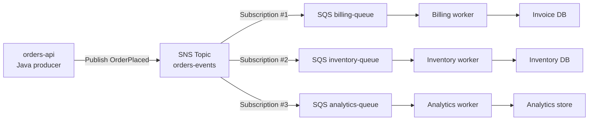
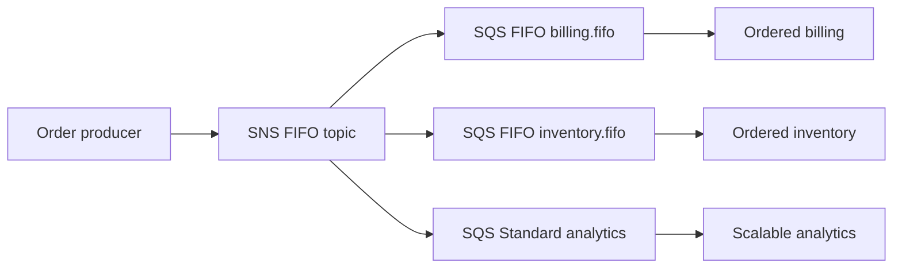
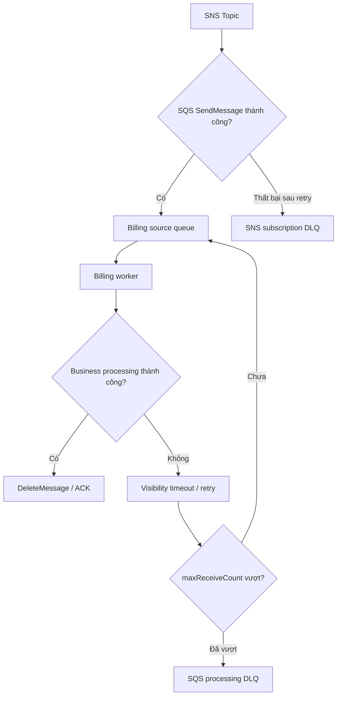
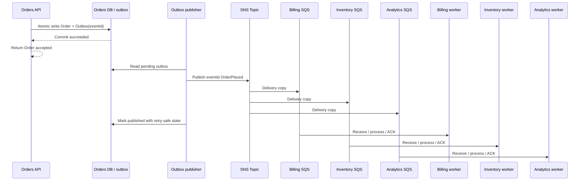

# Mô hình fan-out SNS đến nhiều hàng đợi SQS trên AWS

> **Chương:** Hàng đợi và thông báo  
> **Module:** `CLOUD_PROVIDERS_AWS`  
> **Bối cảnh:** Xây dựng kiến trúc sự kiện cho ứng dụng Java trên AWS, kết hợp Amazon Simple Notification Service (SNS) và Amazon Simple Queue Service (SQS). Người học thực hành cách phân phối một sự kiện đến nhiều hệ thống độc lập, chọn Standard/FIFO, lọc thông điệp, xử lý lỗi và replay, giới hạn IAM/KMS, giám sát, phục hồi và kiểm soát chi phí.

## Mục tiêu học tập

Sau bài này, người học có thể:

1. Giải thích **publish–subscribe**, **fan-out**, **topic**, **subscription**, **queue**, **producer** và **consumer**; phân biệt SNS đẩy sự kiện với SQS lưu và cho consumer chủ động nhận.
2. Thiết kế một SNS topic phát sự kiện cho **nhiều SQS queues** độc lập, để từng nhóm nghiệp vụ scale, retry, dừng và triển khai riêng.
3. Phân biệt **SNS Standard + SQS Standard** với **SNS FIFO + SQS FIFO/Standard**, hiểu thứ tự, message groups, deduplication và giới hạn của lời hứa “exactly once”.
4. Cấu hình **subscription filter policies** theo `MessageAttributes` hoặc `MessageBody` và chọn **raw message delivery** khi phù hợp.
5. Viết **SQS queue resource policy** chỉ cho phép SNS topic cụ thể gửi thông điệp và phân biệt IAM của publisher, subscriber và consumer.
6. Hiểu **hai tầng dead-letter queue (DLQ)**: SNS subscription DLQ khi SNS **không giao được** message vào SQS, và SQS redrive DLQ khi **consumer xử lý thất bại**.
7. Thiết kế consumer Java/Lambda idempotent với visibility timeout, retries, partial batch response, poison-message handling và backpressure.
8. Chẩn đoán lỗi fan-out bằng AWS CLI, CloudWatch metrics/logs, IAM/KMS và subscription state; kiểm thử cross-account và encrypted queue.
9. Tính trade-off về số bản sao message, độ trễ, chi phí per-request, retention và nguy cơ nghẽn downstream.

## 1. Vấn đề: một sự kiện, nhiều nhóm cần xử lý

Giả sử ứng dụng thương mại điện tử phát sự kiện **`OrderPlaced`** khi đơn hàng được xác nhận. Ba dịch vụ độc lập cần nhận sự kiện:

- **Billing:** chuẩn bị hóa đơn, tính thuế.
- **Inventory:** giữ chỗ/trừ tồn kho.
- **Analytics:** tổng hợp dashboard và đo hiệu quả chiến dịch.

Nếu publisher gửi trực tiếp qua HTTP lần lượt đến ba dịch vụ:

```text
orders-api
  ├─ HTTP → billing
  ├─ HTTP → inventory
  └─ HTTP → analytics
```

thì publisher phải biết địa chỉ, timeout, hợp đồng API và trạng thái của từng consumer. Khi analytics chậm hoặc ngừng hoạt động, ứng dụng tạo đơn có nguy cơ bị tăng latency hoặc cần một cơ chế retry phức tạp.

**SNS → SQS fan-out** là cách tách rời trách nhiệm:



Một lần publish hợp lệ có thể tạo **một bản sao message trên mỗi SQS subscription thỏa điều kiện**. Từng queue lưu message riêng và từng consumer quản lý tiến độ của mình.

### 1.1 Fan-out không phải load balancing

Đừng nhầm:

| Mô hình | Thông điệp được gửi tới ai? | Ví dụ |
|---|---|---|
| **Fan-out SNS → 3 SQS queues** | **Mỗi queue phù hợp** nhận một bản sao riêng | Billing, Inventory, Analytics đều xử lý `OrderPlaced` |
| **Competing consumers trên một SQS queue** | Nhiều workers **chia nhau** đọc message từ **cùng một queue** | 10 billing workers phân chia các hóa đơn cần tạo |
| **SNS subscription filtering** | Chỉ các subscriptions khớp policy nhận bản sao | Inventory chỉ nhận OrderPlaced/OrderCancelled |
| **Direct HTTP integration** | Producer tự gọi backend | RPC cần kết quả ngay |
| **EventBridge rules → targets** | Event routing theo pattern, nhiều targets | Tích hợp nhiều nguồn/sự kiện AWS hoặc SaaS |

Đặt **hai workers cùng đọc một SQS queue** không tạo hai bản sao đáng tin cho hai nghiệp vụ khác nhau. Khi một worker nhận và xóa message, worker kia thường không còn nhận được cùng message đó.

### 1.2 Ba ý nghĩa của “thành công”

1. **Producer → SNS:** `Publish` thành công có nghĩa SNS đã chấp nhận message theo API.
2. **SNS → SQS:** SNS giao từng bản sao tới subscriptions phù hợp; một subscription có thể fail dù các subscription khác thành công.
3. **SQS → Consumer:** Worker nhận, xử lý và **acknowledge bằng `DeleteMessage`** hoặc event source mapping xóa sau khi Lambda xử lý thành công.

**Không đồng nhất ba bước.** `Publish` trả MessageId không chứng minh Billing, Inventory và Analytics đều hoàn thành tác vụ nghiệp vụ.

## 2. Vai trò của SNS và SQS trong cùng kiến trúc

### 2.1 SNS: topic và subscription

Amazon SNS là dịch vụ **publish–subscribe**. Producer gửi message đến **topic ARN**; SNS phân phối tới các **subscriptions** như SQS, Lambda, HTTPS, Firehose hoặc email/SMS theo loại topic/tính năng được hỗ trợ.

Một subscription SNS → SQS gồm:

- **TopicArn**: nơi publisher gửi sự kiện.
- **Protocol: sqs**: endpoint là SQS.
- **Endpoint**: **Queue ARN**, không phải Queue URL.
- **SubscriptionArn**: định danh subscription để chỉnh policy/raw/DLQ.
- **FilterPolicy** và `FilterPolicyScope`: tùy chọn lọc.
- **RawMessageDelivery**: tùy chọn cách đóng gói message.
- **RedrivePolicy**: tùy chọn SNS subscription DLQ nếu giao hàng thất bại.

Không dùng `SubscriptionArn` làm nơi `Publish`; publisher cần **TopicArn**.

### 2.2 SQS: lưu, ẩn tạm, xóa

Amazon SQS là **queue**, giúp decouple producer và consumer theo thời gian.

Một consumer:

1. Gọi `ReceiveMessage` hoặc được Lambda event source mapping polling hộ.
2. Nhận message và **receipt handle**.
3. Message tạm ẩn trong **visibility timeout**.
4. Consumer xử lý nghiệp vụ thành công.
5. Gọi `DeleteMessage` bằng **receipt handle mới nhất**; với Lambda mapping, dịch vụ có thể xóa sau khi handler trả success.
6. Nếu không xóa, message xuất hiện lại khi hết visibility timeout, có thể bị xử lý lại.

SQS **không phải một bảng lưu trạng thái giao dịch bền mãi mãi**: retention có giới hạn. Mặc định retention thường **4 ngày**, có thể cấu hình tối đa **14 ngày**; hãy lưu business state ở DynamoDB/RDS/S3 theo nhu cầu.

### 2.3 Kiểu tài nguyên và định danh

| Tài nguyên | Ví dụ minh họa | Dùng ở đâu? |
|---|---|---|
| SNS Topic ARN | `arn:aws:sns:ap-southeast-1:111122223333:orders-events` | `Publish.topicArn`, subscription, SQS policy SourceArn |
| SQS Queue ARN | `arn:aws:sqs:ap-southeast-1:111122223333:orders-billing` | Subscription Endpoint, IAM resource ARN |
| SQS Queue URL | `https://sqs.ap-southeast-1.amazonaws.com/111122223333/orders-billing` | `ReceiveMessage`, `DeleteMessage`, `GetQueueAttributes` |
| SNS Subscription ARN | `arn:aws:sns:ap-southeast-1:111122223333:orders-events:xxxxxxxx-xxxx-xxxx-xxxx-xxxxxxxxxxxx` | `SetSubscriptionAttributes` |
| MessageId SNS | UUID do `Publish` trả về | Trace sự kiện tại tầng SNS, không phải business event ID |
| MessageId SQS | ID thông điệp tại SQS | Theo dõi delivery/receipt; không nên là khóa nghiệp vụ duy nhất |

Tất cả ARN/URLs trên là **dữ liệu giả**, không chứng minh tài nguyên tồn tại.

## 3. Vì sao mỗi consumer cần một queue?

Nếu một consumer ngừng chạy:

- Billing queue vẫn tiếp tục có thể nhận message khi **Billing worker dừng**.
- Inventory worker có thể tiếp tục xử lý bình thường trên queue riêng.
- Analytics có thể triển khai version mới, replay backlog hoặc tăng concurrency mà không làm thay đổi số message chờ của Billing.
- Sự cố logic xử lý của một consumer có thể đưa message vào **SQS DLQ của queue đó**, thay vì chặn cả hệ thống.

### 3.1 Sự cách ly không tuyệt đối

Một topic SNS vẫn là **điểm phụ thuộc chung**. Khi producer không thể publish, hoặc topic permission/quota/KMS cấu hình sai, nhiều downstream cùng thiếu sự kiện.

Mỗi queue còn chịu rủi ro:

- **Subscription bị xóa hoặc chưa confirm**: không có message mới.
- **Queue policy không cho SNS gửi**: message không được giao.
- **KMS key policy sai**: SNS không gửi được vào encrypted queue.
- **Subscription filter không khớp**: bị lọc hợp lệ, không được giao.
- **SQS retention hết**: backlog chưa xử lý có thể biến mất.
- **Consumer xử lý không idempotent**: duplicate gây side effect trùng.

Do đó kiến trúc cần quan sát cả **SNS delivery** lẫn **SQS processing**.

### 3.2 Ví dụ failure isolation

Giả sử 10.000 sự kiện `OrderPlaced` trong 15 phút:

| Thành phần | Trạng thái | Hậu quả |
|---|---|---|
| SNS topic | Publish và delivery hoạt động | Các subscriptions nhận sự kiện phù hợp |
| Billing queue/worker | Healthy | Xử lý hóa đơn theo năng lực |
| Inventory queue/worker | Healthy | Cập nhật tồn kho độc lập |
| Analytics queue | Nhận message, worker bị crash | Message chờ tăng, không làm Billing/Inventory phải dừng |
| Analytics DLQ | Bắt poison messages sau retry | Giữ bằng chứng lỗi để sửa và redrive |

Đây là **eventual consistency** giữa các nghiệp vụ. Không có một distributed transaction tự động chạy qua cả ba queues/workers.

Nếu bắt buộc thanh toán và tồn kho phải commit atomically trước khi xác nhận đơn, không thể chỉ dựa vào fan-out; cần thiết kế transaction/saga/compensation và business state rõ ràng.

## 4. Standard hay FIFO: chọn đúng delivery semantics

Có hai loại SNS topic thường dùng: **Standard** và **FIFO**. SQS cũng có **Standard** và **FIFO** queues.

### 4.1 Bảng lựa chọn

| Kết hợp | Có được hỗ trợ? | Semantics chính | Khi nào phù hợp? |
|---|---|---|---|
| **SNS Standard → SQS Standard** | Có | At-least-once, best-effort ordering | Event notifications, analytics, workloads chịu được duplicate/reorder |
| **SNS FIFO → SQS FIFO** | Có | Thứ tự theo message group và dedup trong giới hạn dịch vụ | Thứ tự thao tác theo order/customer, ledger workflow cần ordering |
| **SNS FIFO → SQS Standard** | Có | Queue Standard có thể duplicate/out-of-order | Một topic cần fan-out cho cả consumer nhạy ordering lẫn consumer không cần |
| **SNS Standard → SQS FIFO** | Không phải pattern subscription hỗ trợ chuẩn để đạt FIFO guarantees | Không dùng làm giải pháp “biến Standard thành FIFO” | Dùng SNS FIFO nếu cần FIFO end-to-end |

**SNS FIFO → SQS FIFO** giảm rủi ro duplicate ở tầng messaging nhưng **không đảm bảo exactly-once execution của business handler**. Ví dụ worker ghi DB xong rồi timeout trước khi delete message; message có thể bị xử lý lại. Luôn có idempotency ở tầng consumer.

### 4.2 Standard: thứ tự không được cam kết

Với Standard topics/queues:

- Producer có thể publish A rồi B, consumer nhận B trước A.
- Duplicate delivery có thể xảy ra dù publisher chỉ publish một lần.
- Một message có thể được xử lý bởi một worker nhiều lần do visibility timeout/retry.
- SQS cung cấp năng lực mở rộng cao, phù hợp nhiều event-driven applications.

Nếu business logic yêu cầu `OrderPlaced` phải xử lý trước `OrderCancelled` theo cùng order, **không** chỉ giả định thứ tự publish trên Standard.

### 4.3 FIFO: MessageGroupId và MessageDeduplicationId

SNS FIFO topic tên kết thúc bằng `.fifo`; SQS FIFO queue cũng kết thúc bằng `.fifo`.

Producer publish FIFO event thường cần:

- **`MessageGroupId`**: xác định luồng có thứ tự, ví dụ `order-O-1001` hoặc `customer-42`.
- **`MessageDeduplicationId`**: định danh để SNS/SQS loại các bản gửi lại trong **cửa sổ dedup 5 phút**, trừ khi dùng content-based deduplication theo điều kiện.

```text
MessageGroupId=order-O-1001

OrderPlaced(v1)   → PaymentCaptured(v2) → OrderShipped(v3)

MessageGroupId=order-O-1002

OrderPlaced(v1)   → OrderCancelled(v2)
```

Thứ tự chỉ được bảo vệ **trong từng message group**; các groups khác nhau có thể xử lý đồng thời.

### 4.4 Một message group cho tất cả orders là điểm nghẽn

Nếu đặt:

```text
MessageGroupId = "orders"
```

mọi thông điệp bị xếp vào cùng một luồng thứ tự, có thể hạn chế concurrency. Khi phù hợp, chọn group theo **aggregate business key**:

```text
MessageGroupId = "order-" + orderId
```

Như vậy cùng order giữ thứ tự, nhiều orders có thể xử lý song song. Chọn key sai cũng có rủi ro: nếu yêu cầu sequencing xuyên nhiều orders cùng một account, group theo orderId có thể không đáp ứng.

### 4.5 Dedup không phải cơ chế chống xử lý trùng bền vững

FIFO dedup thường giữ ID khoảng **5 phút**. Nếu publisher retry sau 10 phút với ID khác, hoặc ứng dụng replay sự kiện, consumer vẫn có thể xử lý lại.

Do đó:

- Dùng **`eventId` ổn định** do nguồn nghiệp vụ cấp.
- Lưu processed event IDs/aggregate version trong DB với conditional write.
- Không dùng `MessageId` mới từ từng lần publish làm khóa chống duplicate logic.
- Không dùng solely SQS FIFO dedup để thay idempotency/transaction control.
- Nếu content-based dedup dùng hash của **message body**, thay đổi timestamp hoặc metadata trong body có thể làm hash khác dù event nghiệp vụ giống nhau.

### 4.6 FIFO topic có thể gửi vào SQS Standard queue

Một topic `orders-events.fifo` có thể fan-out:



**Không suy rằng analytics queue sẽ giữ thứ tự chỉ vì nguồn là SNS FIFO.** Consumer của SQS Standard vẫn chịu at-least-once và best-effort ordering.

### 4.7 High throughput FIFO và hạn chế cấu hình

Với SNS FIFO, `FifoThroughputScope` có thể là `Topic` hoặc `MessageGroup` để thay đổi phạm vi dedup và thông lượng. AWS hỗ trợ chế độ high-throughput FIFO theo cấu hình, có giới hạn/đơn giá theo Region và account.

**Lưu ý theo tài liệu hiện hành:** Khi chuyển `FifoThroughputScope` sang `MessageGroup`, việc trở lại `Topic` có thể **không được hỗ trợ**; đừng đổi tùy tiện khi thử trên production. Các FIFO queues nhận message cũng phải có throughput config phù hợp nếu lưu lượng lớn.

## 5. Hợp đồng sự kiện: producer và consumers phải thống nhất

Bất kể Standard/FIFO, tốt nhất publish một **business event envelope** do ứng dụng quản lý. Ví dụ `OrderPlaced`:

```json
{
  "eventId": "evt-9a7b2e",
  "eventType": "OrderPlaced",
  "schemaVersion": 1,
  "aggregateType": "Order",
  "aggregateId": "O-1001",
  "occurredAt": "2026-11-20T03:00:00Z",
  "tenantId": "tenant-a",
  "data": {
    "orderId": "O-1001",
    "totalAmountMinor": 150000,
    "currency": "VND"
  }
}
```

Các IDs và dữ liệu trong bài là giả định. **Không publish card details, raw access token, password hoặc PII không cần thiết** chỉ để consumer có thể xử lý một event.

### 5.1 Những trường nên có

| Trường | Ý nghĩa | Tại sao quan trọng? |
|---|---|---|
| `eventId` | ID duy nhất, ổn định cho business event | Idempotency/correlation |
| `eventType` | Loại sự kiện nghiệp vụ | Filter và dispatcher |
| `schemaVersion` | Version của payload contract | Backward compatibility |
| `aggregateId` | Resource/order/customer cụ thể | Message grouping, stale event detection |
| `occurredAt` | Thời điểm xảy ra tại nguồn | Audit và xử lý event đến trễ |
| `tenantId` | Phân vùng tenant khi cần | Authorization, isolation, routing |
| `data` | Payload tối thiểu để consumer xử lý | Tránh coupling không cần thiết |

`occurredAt` không tự xác thực thứ tự; đồng hồ phân tán có thể lệch. Nếu cần causal sequence, thêm **aggregate version** tăng đơn điệu hoặc sequence number từ hệ thống dữ liệu nguồn.

### 5.2 Ai sở hữu schema?

Producer nên sở hữu ý nghĩa sự kiện và duy trì **contract versioning**. Consumer phải chịu được:

- Trường optional mới.
- Unknown event type nếu subscribed quá rộng.
- Out-of-order và retry/duplicate.
- Lệch phiên bản khi deploy khác thời điểm.
- Event cũ được replay sau nhiều ngày/tháng.

Không thay nghĩa `OrderPlaced` từ “đơn đã tạo” thành “đơn đã thanh toán” mà vẫn giữ nguyên tên và schema version.

### 5.3 Publish event sau khi commit dữ liệu

Một anti-pattern:

```text
1. Publish OrderPlaced lên SNS thành công
2. Save order vào DynamoDB
3. DynamoDB write fail
→ Consumers nhận OrderPlaced, nhưng Order chưa tồn tại
```

Đảo thứ tự cũng có rủi ro:

```text
1. Save order thành công
2. Publish SNS fail
→ Order có trong DB, nhưng consumers không nhận event
```

Giải pháp thực tế: **Transactional Outbox** hoặc một cơ chế reliable event emission phù hợp, ví dụ ghi Order + outbox record trong **cùng DynamoDB transaction** hoặc database transaction, sau đó worker/stream đọc outbox và publish SNS với retry/idempotency.

### 5.4 Eventual consistency được thiết kế, không phải lỗi

Sau một lần publish, Billing/Inventory/Analytics có thể hoàn thành vào các thời điểm khác nhau. API phản hồi `Order accepted` không có nghĩa toàn bộ side effects đã hoàn tất.

Cần định nghĩa business states như `PENDING_INVENTORY`, `PENDING_BILLING`, `COMPLETED` hoặc `COMPENSATION_REQUIRED` và expose tiến độ phù hợp.

## 6. SNS envelope mặc định và Raw Message Delivery

Khi một SNS topic gửi vào SQS, consumer đọc **SQS message body**. Nhưng body này **không giống nhau** trong mọi subscription.

### 6.1 Raw Message Delivery tắt: SQS body là SNS notification envelope

Ví dụ SQS body (rút gọn):

```json
{
  "Type": "Notification",
  "MessageId": "5d3bc5d2-example",
  "TopicArn": "arn:aws:sns:ap-southeast-1:111122223333:orders-events",
  "Subject": "OrderPlaced",
  "Message": "{\"eventId\":\"evt-9a7b2e\",\"eventType\":\"OrderPlaced\",\"schemaVersion\":1,\"data\":{\"orderId\":\"O-1001\"}}",
  "Timestamp": "2026-11-20T03:00:01Z",
  "MessageAttributes": {
    "eventType": {
      "Type": "String",
      "Value": "OrderPlaced"
    }
  }
}
```

Ở đây `Message` là **chuỗi JSON đã escape**, không phải object. Consumer cần:

1. Parse SQS `body` thành SNS envelope.
2. Lấy field `Message`.
3. Parse `Message` thành business event.

**Không dùng `Type: Notification` để suy rằng mọi message chắc chắn đến từ SNS topic mà bạn tin tưởng.** Hạn chế `sqs:SendMessage` ở queue policy và xác minh source theo kiến trúc.

### 6.2 Raw Message Delivery bật: SQS body chính là message publisher gửi

Ví dụ:

```json
{
  "eventId": "evt-9a7b2e",
  "eventType": "OrderPlaced",
  "schemaVersion": 1,
  "data": {
    "orderId": "O-1001"
  }
}
```

Consumer chỉ parse một lần. SNS metadata envelope (như `TopicArn`/`Timestamp`/`Signature`) **không nằm trong message body**.

Điều này đơn giản hóa handlers, nhưng cần tự đưa `eventId`, `eventType`, `source` và `traceId` vào business payload/attributes nếu cần quan sát. Nếu bật raw cho một queue nhưng không bật cho queue khác, **hai consumers phải dùng parsers khác nhau**.

### 6.3 So sánh

| Tiêu chí | Raw=false | Raw=true |
|---|---|---|
| SQS body | SNS envelope JSON | Message nguyên gốc |
| Business event parse | Parse outer → `Message` → inner | Parse body |
| Có SNS metadata trong body | Có | Không |
| Tiện khi consumer là existing JSON handler | Cần adapter | Có |
| Message attributes | Có trong SNS envelope | Chuyển thành SQS message attributes theo hỗ trợ |
| Giới hạn SNS → SQS attributes | Theo giới hạn SNS/integration | **Tối đa 10 message attributes** |

**Giới hạn quan trọng:** Với SQS subscriptions bật raw delivery, nếu SNS publish **hơn 10 message attributes**, SNS coi đây là lỗi phía client và có thể **discard message cho subscription đó**. Nếu cần hơn 10 attributes, tắt raw delivery hoặc thiết kế lại metadata để ít attributes hơn.

### 6.4 Một Java consumer phải biết subscription contract

Không nên viết:

```java
OrderEvent event = mapper.readValue(sqsMessage.body(), OrderEvent.class);
```

rồi giả định đúng với mọi queue. Nếu raw=false, class `OrderEvent` không khớp outer envelope. Có thể tạo adapter có cấu hình riêng, hoặc chuẩn hóa raw=true trên các queues được kiểm soát.

## 7. Subscription filter policy: gửi đúng loại sự kiện đến đúng queue

Trong fan-out, không nhất thiết mọi consumer cần mọi message. **SNS message filtering** giúp loại thông điệp không liên quan **trước khi** giao tới SQS.

Ví dụ:

- Billing: nhận `OrderPlaced`, `OrderRefunded`.
- Inventory: nhận `OrderPlaced`, `OrderCancelled`.
- Analytics: nhận mọi event.

### 7.1 Filter theo MessageAttributes

Publisher thêm SNS message attributes:

```json
{
  "eventType": {
    "DataType": "String",
    "StringValue": "OrderPlaced"
  },
  "schemaVersion": {
    "DataType": "Number",
    "StringValue": "1"
  }
}
```

Billing subscription `FilterPolicy`:

```json
{
  "eventType": [
    "OrderPlaced",
    "OrderRefunded"
  ]
}
```

Inventory subscription:

```json
{
  "eventType": [
    "OrderPlaced",
    "OrderCancelled"
  ]
}
```

Analytics không có filter policy nên mặc định nhận mọi thông điệp được SNS giao theo subscription.

### 7.2 FilterPolicyScope

Subscription attribute `FilterPolicyScope` có hai lựa chọn:

| Giá trị | Dữ liệu được xét | Khi nào dùng? |
|---|---|---|
| `MessageAttributes` (mặc định) | SNS message attributes ở ngoài body | Publisher kiểm soát structured metadata, chi phí parse thấp |
| `MessageBody` | Các thuộc tính của **JSON object trong message body** | Event đã có `eventType`/`tenantId` trong payload; không muốn lặp attributes |

Với body filtering, payload phải có cấu trúc JSON hợp lệ để SNS đánh giá. Nếu publisher gửi plain text không phải JSON object theo yêu cầu filter, subscription có thể không nhận message dù body chứa chuỗi `OrderPlaced`.

### 7.3 Filter theo MessageBody

Nếu body là event JSON ở mục 5, subscription có thể có:

```json
{
  "eventType": ["OrderPlaced"],
  "tenantId": ["tenant-a", "tenant-b"]
}
```

Điều kiện chung là **AND** giữa các keys: `eventType` phải match **và** `tenantId` phải thuộc danh sách. Trong từng list values là **OR**. AWS cũng hỗ trợ các operators như `anything-but`, `prefix`, `suffix`, `numeric`, `exists`, `cidr` theo syntax tài liệu.

**Đừng dùng SNS filter policy như biện pháp bảo mật tenant duy nhất.** Nếu publisher có quyền đưa `tenantId=tenant-a` giả, nó có thể làm event đi vào queue tenant-a. Consumer vẫn phải validate identity và tenant authorization trước khi ghi dữ liệu.

### 7.4 Filter thay đổi không có hiệu lực tức thời

Theo tài liệu AWS, **thêm/sửa filter policy có thể mất tới 15 phút** để áp dụng đầy đủ. Trong khoảng này, các message có thể được lọc theo policy cũ hoặc mới.

Khi deploy một filter mới:

1. Tạo contract tests cho attributes/body.
2. Deploy publisher version hỗ trợ event types/attributes mới **trước** hoặc theo kế hoạch tương thích.
3. Chỉnh filter policy qua IaC.
4. Theo dõi delivered/filtered counts và queue depth.
5. Test bằng các events thử nghiệm riêng, chờ propagation nếu cần.
6. Không dùng một lần publish vài giây sau thay đổi làm bằng chứng filter đã ổn định.

### 7.5 Filtered message không phải lỗi delivery

Nếu subscription chỉ nhận `OrderPlaced` nhưng SNS publish `OrderCancelled`, việc subscription **không nhận** event là hành vi đúng. Nó không đi vào SNS subscription DLQ và không phải `NumberOfNotificationsFailed`.

**Đừng sử dụng DLQ để “thu hồi” những event do filter cố tình loại bỏ.** Nếu analytics cần mọi event, tạo subscription không filter hoặc archive theo thiết kế.

### 7.6 Một message có thể đến nhiều queues hoặc không queue nào

Định nghĩa tập subscribers độc lập với loại event. Không có quy tắc “chỉ một subscriber được match” trừ khi policy được thiết kế như vậy. Một `OrderPlaced` có thể match Billing, Inventory và Analytics. Một `UnknownEvent` có thể chỉ đến Analytics hoặc không đến queue nào nếu tất cả đều có filter.

## 8. Hai DLQ hoàn toàn khác nhau trong SNS → SQS

Đây là điểm vận hành quan trọng nhất của mô hình fan-out.

### 8.1 SNS subscription DLQ: SNS không giao được message vào SQS

Ví dụ SNS cố giao `OrderPlaced` đến `billing-queue` nhưng:

- SQS queue bị xóa.
- Queue resource policy từ chối `sqs:SendMessage`.
- Encrypted queue KMS key policy không cho SNS sử dụng.
- Destination gặp lỗi và SNS hết retry theo cơ chế delivery.

Bạn có thể cấu hình **SNS subscription redrive policy**:

```json
{
  "deadLetterTargetArn": "arn:aws:sqs:ap-southeast-1:111122223333:orders-billing-subscription-dlq"
}
```

Khi SNS **hết khả năng giao thành công** theo quy tắc dịch vụ, thông điệp có thể được gửi tới **subscription DLQ** để điều tra/re-drive thủ công. Subscription DLQ bản thân cũng cần IAM/KMS/queue policy đúng.

**Theo tài liệu:** subscription DLQ là SQS queue cùng **Account và Region** với SNS subscription. Với FIFO topic subscriptions, DLQ phải là **SQS FIFO**; với Standard topic subscriptions, DLQ là **SQS Standard**.

### 8.2 SQS queue DLQ: consumer không xử lý thành công

Giả sử SNS đã giao message thành công tới `billing-queue`, nhưng Billing worker luôn lỗi vì JSON không hợp lệ.

Cấu hình SQS source queue `RedrivePolicy`:

```json
{
  "deadLetterTargetArn": "arn:aws:sqs:ap-southeast-1:111122223333:orders-billing-processing-dlq",
  "maxReceiveCount": 5
}
```

Sau khi được nhận/thử xử lý vượt ngưỡng redrive, SQS chuyển message sang **processing DLQ**. **SNS subscription DLQ không thấy lỗi này** vì SNS đã giao tới SQS thành công.

### 8.3 So sánh hai tầng lỗi



| Hạng mục | SNS subscription DLQ | SQS processing DLQ |
|---|---|---|
| Chủ sở hữu cấu hình | **SNS subscription** `RedrivePolicy` | **SQS source queue** `RedrivePolicy` |
| Lỗi bắt được | SNS không giao được tới endpoint | Consumer không hoàn tất xử lý message |
| Không bắt được | Java worker parse lỗi sau khi SQS đã nhận | SNS không giao được message vào SQS |
| Kiểm tra | SNS delivery errors, subscription state, queue/KMS policy | Receive count, visibility, worker logs, poison message |
| Replay | Sửa delivery rồi tái gửi/redrive có kiểm soát | SQS DLQ redrive hoặc consumer repair |
| Quan hệ | Hai lớp độc lập | Có thể dùng đồng thời |

**Không dùng chung một DLQ cho mọi mục đích** nếu việc phân biệt nguyên nhân, quyền truy cập, retention và replay rất quan trọng. Đặt tên `*-subscription-dlq` và `*-processing-dlq` để giảm nhầm lẫn.

### 8.4 Redrive khác replay archive

- **SQS DLQ redrive:** đưa message từ dead-letter queue về source hoặc destination phù hợp, xử lý lỗi cũ.
- **SNS FIFO archive/replay:** lưu message từ topic theo archive policy và phát lại theo window cho subscription.
- **Producer re-publish:** ứng dụng phát lại event với business eventId ổn định.

Ba cách có semantics, IAM, chi phí và nguy cơ duplicate khác nhau. Cần quy trình review trước khi replay một loạt events đã từng gây thay đổi dữ liệu.

## 9. IAM: topic policy, queue policy và consumer role

Một fan-out hoạt động cần **ít nhất ba ranh giới quyền**:

1. **Publisher IAM role** được `sns:Publish` đến đúng topic.
2. **SQS queue resource policy** cho `sns.amazonaws.com` quyền `sqs:SendMessage` từ đúng topic.
3. **Consumer IAM role** được `sqs:ReceiveMessage`, `sqs:DeleteMessage` và `sqs:ChangeMessageVisibility` (nếu cần) trên đúng queue.

Không cấp một role `sns:*` và `sqs:*` trên `Resource:"*"` chỉ để mọi thứ chạy.

### 9.1 Publisher role policy mẫu

```json
{
  "Version": "2012-10-17",
  "Statement": [
    {
      "Sid": "PublishOrderEvents",
      "Effect": "Allow",
      "Action": "sns:Publish",
      "Resource": "arn:aws:sns:ap-southeast-1:111122223333:orders-events"
    }
  ]
}
```

Ứng dụng Java trên ECS dùng **task role**, trên Lambda dùng **Lambda execution role**, trên EKS có thể dùng **EKS Pod Identity/IRSA**. Không cấp access key dài hạn trong Docker image hay source repository.

### 9.2 Queue policy cho SNS topic cụ thể

Ví dụ resource policy gắn vào `orders-billing`:

```json
{
  "Version": "2012-10-17",
  "Statement": [
    {
      "Sid": "AllowOnlyOrdersTopicToSend",
      "Effect": "Allow",
      "Principal": {
        "Service": "sns.amazonaws.com"
      },
      "Action": "sqs:SendMessage",
      "Resource": "arn:aws:sqs:ap-southeast-1:111122223333:orders-billing",
      "Condition": {
        "ArnEquals": {
          "aws:SourceArn": "arn:aws:sns:ap-southeast-1:111122223333:orders-events"
        }
      }
    }
  ]
}
```

**`aws:SourceArn` giảm confused deputy risk**: nếu thiếu condition, những SNS topics khác có thể sử dụng quyền rộng đó trong những tình huống không mong muốn.

Với nhiều topics gửi vào một queue, có thể liệt kê ARNs được duyệt thay vì mở rộng sang mọi SNS topic. Nếu cần `aws:SourceAccount` theo mô hình cross-account, phải đánh giá cụ thể quyền và context để không vô tình chặn traffic hợp lệ.

### 9.3 Consumer role policy mẫu

```json
{
  "Version": "2012-10-17",
  "Statement": [
    {
      "Sid": "ConsumeBillingQueue",
      "Effect": "Allow",
      "Action": [
        "sqs:ReceiveMessage",
        "sqs:DeleteMessage",
        "sqs:ChangeMessageVisibility",
        "sqs:GetQueueAttributes"
      ],
      "Resource": "arn:aws:sqs:ap-southeast-1:111122223333:orders-billing"
    }
  ]
}
```

Consumer **không cần** `sns:Publish` chỉ để đọc message fan-out từ queue. Tương tự, SNS service principal **không cần** `sqs:ReceiveMessage`.

### 9.4 Chính sách topic khi cross-account

Nếu publisher thuộc một AWS account khác, cần đánh giá **SNS topic resource policy** cho phép role/account tương ứng gọi `sns:Publish`, ngoài identity policy của publisher. Nếu queue nằm khác account, topic owner có thể cần cho queue owner `sns:Subscribe`.

Không nhầm:

- **SNS topic policy:** ai được publish/subscribe/manage topic?
- **SQS queue policy:** SNS topic/service nào được send message vào queue?
- **IAM consumer role:** worker nào được nhận/xóa message?

## 10. Encryption, KMS và dữ liệu nhạy cảm

### 10.1 Encrypt SNS và SQS

- SNS topic có thể bật **server-side encryption (SSE)**.
- SQS queues cũng có thể bật SSE, dùng loại key hỗ trợ.
- TLS bảo vệ kết nối API.
- KMS key policy phải cho đúng principals sử dụng key khi dịch vụ mã hóa/giải mã.

Khi **SNS gửi đến một SQS queue được mã hóa bằng customer managed KMS key**, key policy của SQS queue cần cho **SNS service principal** dùng `kms:GenerateDataKey` và `kms:Decrypt` theo yêu cầu AWS. Consumer cũng cần quyền KMS để giải mã khi nhận message, tùy loại key/đường truy cập.

### 10.2 Ví dụ statement trên SQS customer managed KMS key

```json
{
  "Sid": "AllowSnsToUseEncryptedQueueKey",
  "Effect": "Allow",
  "Principal": {
    "Service": "sns.amazonaws.com"
  },
  "Action": [
    "kms:GenerateDataKey",
    "kms:Decrypt"
  ],
  "Resource": "*"
}
```

Đây là **fragment trong KMS key policy**, không phải SQS queue resource policy hay IAM policy gắn vào publisher. `Resource:"*"` trong key policy có ngữ cảnh resource chính là key đó. Với production, đánh giá thêm `aws:SourceArn`/`aws:SourceAccount`, `kms:ViaService` hoặc encryption context theo mô hình AWS hỗ trợ để tránh quyền sử dụng key quá rộng.

**Đừng dùng mẫu này nguyên xi nếu tổ chức có key policy constraints, cross-account hoặc customer-managed compliance rules khác.** Thử delivery bằng event không nhạy cảm sau khi thay policy.

### 10.3 Chỉ message body được mã hóa thế nào?

Theo tài liệu SNS/SQS FIFO encryption, **message body** được mã hóa theo dịch vụ, nhưng **message attributes, resource metadata và metrics không phải toàn bộ được mã hóa giống body**. Vì vậy:

- Không đặt token, mật khẩu, số thẻ, email nhạy cảm vào **message attributes** chỉ vì topic/queue có SSE.
- Không để PII trong tên topic/queue, CloudWatch metric dimensions hoặc `eventType` quá chi tiết.
- Không log toàn bộ SNS envelope/Raw body chứa thông tin nhạy cảm.
- Phân loại dữ liệu, retention và quyền truy cập theo từng queue.

### 10.4 VPC endpoints và networking

Ứng dụng Java trong private subnet có thể gọi SNS/SQS qua **interface VPC endpoints (AWS PrivateLink)** hoặc NAT theo kiến trúc. Worker trong Lambda/ECS/EKS cần:

- DNS/Private DNS và VPC endpoint security group phù hợp.
- IAM và **VPC endpoint policy** không chặn API.
- TLS/HTTPS 443.
- Kết nối tới DynamoDB/S3/KMS và downstream services nếu xử lý yêu cầu.

**SNS giao message tới SQS qua hạ tầng AWS service-to-service**, không đòi consumer worker mở một HTTP listener để nhận từng message từ SNS. Queue resource policy vẫn phải cho phép delivery đúng topic.

## 11. Cross-account, cross-Region và subscription confirmation

### 11.1 Cross-account: topic Account A, SQS Account B

Ví dụ:

```text
Account A: sns:orders-events
Account B: sqs:orders-billing
```

Cần phối hợp:

1. Topic policy ở Account A cho queue owner/đúng principal subscribe nếu cần.
2. Queue policy ở Account B cho SNS topic ARN của Account A `sqs:SendMessage`.
3. IAM role người quản trị subscription có `sns:Subscribe` và quyền liên quan.
4. KMS key policies phù hợp nếu queue/topic encrypted.
5. **Subscription confirmation** đúng ownership flow.

Theo AWS, khi **queue owner tự tạo subscription** đến topic đã cho phép, subscription thường được xác nhận tự động. Khi **một principal không sở hữu queue** tạo subscription, có thể ở trạng thái **`PendingConfirmation`** và cần queue owner/subscription owner thực hiện xác nhận theo quy trình.

**Không nhầm Subscription ARN “PendingConfirmation” với ARN hợp lệ.** Khi chưa confirm, không được giả định message được giao.

### 11.2 Cross-Region

SNS có thể subscribe SQS queue ở Region khác qua khả năng hỗ trợ của dịch vụ. Cần kiểm tra:

- Topic/queue policies cho cross-Region.
- KMS keys ở từng Region, encryption permissions.
- Delivery quotas/latency và data transfer pricing.
- Disaster recovery và tách biệt sự cố Region.

**Publisher chỉ publish vào topic endpoint/ARN của Region phù hợp với API call**; cross-Region delivery là một cơ chế subscription, không có nghĩa có thể gửi một request `Publish` tới bất kỳ SNS regional endpoint nào rồi tự route sang topic Region khác.

### 11.3 Cross-account không tự tăng security

Tách Account giúp giảm blast radius và ownership rõ ràng, nhưng cần:

- Ít principals được phép subscribe/publish.
- Queue policy giới hạn exact SNS TopicArn.
- IAM role của queue consumer chỉ đọc queue của team mình.
- CloudTrail/CloudWatch được tập trung quan sát đủ mức.
- KMS key policies trong cả hai Accounts không mở wildcard.

## 12. Thiết lập fan-out bằng Infrastructure as Code

Với kiến trúc này, **IaC được khuyến nghị** vì có nhiều tài nguyên phụ thuộc: topic, queues, DLQs, queue policies, subscriptions và filter policies. Khi quản lý thủ công, dễ tạo subscription mà quên SQS policy hoặc xóa QueuePolicy làm delivery ngừng hoạt động.

### 12.1 CloudFormation mẫu: một topic, hai SQS queues

Ví dụ YAML dưới đây minh họa **SNS Standard → hai SQS Standard queues**. Billing nhận `OrderPlaced` và `OrderRefunded`; Analytics nhận mọi event.

```yaml
AWSTemplateFormatVersion: '2010-09-09'
Description: SNS to SQS fan-out sample for learning

Resources:
  OrdersTopic:
    Type: AWS::SNS::Topic
    Properties:
      TopicName: orders-events-demo

  BillingDlq:
    Type: AWS::SQS::Queue
    Properties:
      QueueName: orders-billing-processing-dlq-demo
      MessageRetentionPeriod: 1209600

  BillingQueue:
    Type: AWS::SQS::Queue
    Properties:
      QueueName: orders-billing-demo
      VisibilityTimeout: 120
      MessageRetentionPeriod: 345600
      RedrivePolicy:
        deadLetterTargetArn: !GetAtt BillingDlq.Arn
        maxReceiveCount: 5

  AnalyticsQueue:
    Type: AWS::SQS::Queue
    Properties:
      QueueName: orders-analytics-demo
      VisibilityTimeout: 120
      MessageRetentionPeriod: 345600

  BillingQueuePolicy:
    Type: AWS::SQS::QueuePolicy
    Properties:
      Queues:
        - !Ref BillingQueue
      PolicyDocument:
        Version: '2012-10-17'
        Statement:
          - Sid: AllowOrdersTopic
            Effect: Allow
            Principal:
              Service: sns.amazonaws.com
            Action: sqs:SendMessage
            Resource: !GetAtt BillingQueue.Arn
            Condition:
              ArnEquals:
                aws:SourceArn: !Ref OrdersTopic

  AnalyticsQueuePolicy:
    Type: AWS::SQS::QueuePolicy
    Properties:
      Queues:
        - !Ref AnalyticsQueue
      PolicyDocument:
        Version: '2012-10-17'
        Statement:
          - Sid: AllowOrdersTopic
            Effect: Allow
            Principal:
              Service: sns.amazonaws.com
            Action: sqs:SendMessage
            Resource: !GetAtt AnalyticsQueue.Arn
            Condition:
              ArnEquals:
                aws:SourceArn: !Ref OrdersTopic

  BillingSubscription:
    Type: AWS::SNS::Subscription
    DependsOn: BillingQueuePolicy
    Properties:
      TopicArn: !Ref OrdersTopic
      Protocol: sqs
      Endpoint: !GetAtt BillingQueue.Arn
      RawMessageDelivery: true
      FilterPolicyScope: MessageAttributes
      FilterPolicy:
        eventType:
          - OrderPlaced
          - OrderRefunded

  AnalyticsSubscription:
    Type: AWS::SNS::Subscription
    DependsOn: AnalyticsQueuePolicy
    Properties:
      TopicArn: !Ref OrdersTopic
      Protocol: sqs
      Endpoint: !GetAtt AnalyticsQueue.Arn
      RawMessageDelivery: true

Outputs:
  TopicArn:
    Value: !Ref OrdersTopic
  BillingQueueUrl:
    Value: !Ref BillingQueue
  AnalyticsQueueUrl:
    Value: !Ref AnalyticsQueue
```

**Đây là stack học tập, chưa phải production:** không có KMS encryption, SNS subscription DLQs, explicit redrive allow policy, full monitoring/alarms, tags, IAM producer/consumer roles hoặc org guardrails. Những queues và topic ở cùng Account/Region của stack. Queue/Topic names phải duy nhất và không được trùng với tài nguyên tồn tại.

### 12.2 Vì sao `DependsOn` có ích?

`BillingSubscription` phụ thuộc `BillingQueuePolicy` để tránh trường hợp SNS subscription được tạo trước khi queue cho phép topic gửi message. Với CloudFormation, việc update policy/queue/subscription vẫn cần test; không có nghĩa mọi thay đổi đã đồng bộ ngay tại mọi vùng của dịch vụ.

### 12.3 Triển khai thử có thay đổi tài nguyên

Sau khi lưu template thành `fanout-demo.yaml` trong môi trường thực hành:

```bash
aws cloudformation deploy \
  --template-file fanout-demo.yaml \
  --stack-name sns-sqs-fanout-lab \
  --region ap-southeast-1
```

**Cảnh báo:** Lệnh này tạo SNS/SQS resources và phát sinh phí theo sử dụng. Không chạy trên Account production khi chưa review và phê duyệt. Worker viết bài này **không thực thi** các lệnh mẫu.

### 12.4 Thêm SNS subscription delivery DLQ vào CloudFormation

Để bắt lỗi **SNS không giao được** vào Billing queue, tạo một **BillingSubscriptionDlq** riêng, cấp queue/KMS policy cho SNS topic; sau đó thêm:

```yaml
BillingSubscription:
  Type: AWS::SNS::Subscription
  Properties:
    TopicArn: !Ref OrdersTopic
    Protocol: sqs
    Endpoint: !GetAtt BillingQueue.Arn
    RedrivePolicy:
      deadLetterTargetArn: !GetAtt BillingSubscriptionDlq.Arn
```

Đây chỉ là **fragment minh họa**, không phải bản thay thế đầy đủ của resource `BillingSubscription` ở trên; nếu dùng thật phải **giữ** `FilterPolicy`, `FilterPolicyScope`, `RawMessageDelivery`, `DependsOn` và chính sách delivery liên quan.

### 12.5 Khi nào dùng CDK hoặc Terraform?

- Có nhiều Accounts/Regions, lặp lại mô hình fan-out theo team.
- Cần tự động tạo queue resource policies và KMS key policies.
- Muốn khóa changes qua code review, policy-as-code, security scans.
- Muốn quản lý DLQ redrive allow policy, alarm, dashboards, retention, tags.
- Muốn tránh drift do thay subscription filter trong Console.

IaC không thay runtime monitoring hay integration tests; nó chỉ làm cấu hình có thể lặp lại và kiểm soát được.

## 13. AWS CLI: quan sát topic, queues và subscriptions

Các lệnh dưới đây chỉ đọc metadata. Tên ARN/queue là **placeholder**.

### 13.1 Kiểm tra tài khoản và topic

```bash
aws sts get-caller-identity

aws sns get-topic-attributes \
  --topic-arn arn:aws:sns:ap-southeast-1:111122223333:orders-events-demo \
  --region ap-southeast-1 \
  --query 'Attributes.{TopicArn:TopicArn,FifoTopic:FifoTopic,ContentBasedDeduplication:ContentBasedDeduplication,KmsMasterKeyId:KmsMasterKeyId,MaximumMessageSize:MaximumMessageSize}' \
  --output json
```

`FifoTopic`/`ContentBasedDeduplication` có thể vắng mặt ở Standard topic; kiểm tra config thực tế thay vì tự suy.

### 13.2 Xem subscriptions

```bash
aws sns list-subscriptions-by-topic \
  --topic-arn arn:aws:sns:ap-southeast-1:111122223333:orders-events-demo \
  --region ap-southeast-1 \
  --query 'Subscriptions[].{Arn:SubscriptionArn,Protocol:Protocol,Endpoint:Endpoint}' \
  --output table
```

Xác minh tất cả queues cần nhận đã được subscribe. Nếu subscription ở `PendingConfirmation`, phải xử lý confirmation theo ownership đúng.

### 13.3 Xem raw/filter/DLQ của subscription

```bash
aws sns get-subscription-attributes \
  --subscription-arn arn:aws:sns:ap-southeast-1:111122223333:orders-events-demo:11111111-2222-3333-4444-555555555555 \
  --region ap-southeast-1 \
  --query 'Attributes.{TopicArn:TopicArn,Endpoint:Endpoint,RawMessageDelivery:RawMessageDelivery,FilterPolicy:FilterPolicy,FilterPolicyScope:FilterPolicyScope,RedrivePolicy:RedrivePolicy}' \
  --output json
```

Nếu `FilterPolicy` vắng mặt, subscription nhận mọi message phù hợp theo các điều kiện còn lại. Nếu filter đang thay đổi, nhớ thời gian eventual consistency.

### 13.4 Kiểm tra queue ARN và policy

```bash
aws sqs get-queue-attributes \
  --queue-url https://sqs.ap-southeast-1.amazonaws.com/111122223333/orders-billing-demo \
  --attribute-names QueueArn Policy RedrivePolicy VisibilityTimeout MessageRetentionPeriod KmsMasterKeyId \
  --region ap-southeast-1 \
  --output json
```

`Policy` được trả về như **JSON string**, cần parse để kiểm tra exact `SourceArn` và `sqs:SendMessage`. Nếu không có policy hoặc policy sai, SNS có thể không giao được dù subscription ARN tồn tại.

### 13.5 Test publish (thay đổi dữ liệu)

```bash
aws sns publish \
  --topic-arn arn:aws:sns:ap-southeast-1:111122223333:orders-events-demo \
  --message '{"eventId":"evt-test-001","eventType":"OrderPlaced","schemaVersion":1,"data":{"orderId":"O-TEST-001"}}' \
  --message-attributes 'eventType={DataType=String,StringValue=OrderPlaced}' \
  --region ap-southeast-1
```

**Cảnh báo:** Publish tạo một sự kiện có thể được **mọi consumer thật** xử lý. Chỉ dùng với sandbox/consumer test và một eventId không đụng nghiệp vụ production. JSON quoting ở trên dành cho Bash; PowerShell/Windows có thể cần `file://event.json` và file JSON attributes được chuẩn bị trước.

### 13.6 Nhận message thử (có side effect về visibility)

```bash
aws sqs receive-message \
  --queue-url https://sqs.ap-southeast-1.amazonaws.com/111122223333/orders-billing-demo \
  --max-number-of-messages 1 \
  --wait-time-seconds 5 \
  --message-system-attribute-names ApproximateReceiveCount \
  --message-attribute-names All \
  --region ap-southeast-1
```

`ReceiveMessage` **không phải thao tác read-only tuyệt đối**: nó làm message tạm ẩn và tăng receive count, có thể ảnh hưởng consumer thật và redrive. Dùng queue sandbox hoặc môi trường không có workers cạnh tranh.

**Không xóa message chỉ để chứng minh đã nhìn thấy nó.** Xóa chỉ khi consumer đã xử lý business side effects thành công.

## 14. AWS SDK for Java v2: producer publish một event

Giả sử `orders-api` đã commit Order + outbox record, một outbox publisher worker tạo message và gọi SNS.

### 14.1 Java SNS publisher

```java
package example.events;

import java.util.Map;
import software.amazon.awssdk.regions.Region;
import software.amazon.awssdk.services.sns.SnsClient;
import software.amazon.awssdk.services.sns.model.MessageAttributeValue;
import software.amazon.awssdk.services.sns.model.PublishRequest;
import software.amazon.awssdk.services.sns.model.PublishResponse;

public final class OrderEventPublisher implements AutoCloseable {
    private static final String TOPIC_ARN =
        "arn:aws:sns:ap-southeast-1:111122223333:orders-events-demo";

    private final SnsClient sns = SnsClient.builder()
        .region(Region.AP_SOUTHEAST_1)
        .build();

    public String publishOrderPlaced(String eventJson) {
        PublishRequest request = PublishRequest.builder()
            .topicArn(TOPIC_ARN)
            .message(eventJson)
            .messageAttributes(Map.of(
                "eventType",
                MessageAttributeValue.builder()
                    .dataType("String")
                    .stringValue("OrderPlaced")
                    .build()
            ))
            .build();

        PublishResponse response = sns.publish(request);
        return response.messageId();
    }

    @Override
    public void close() {
        sns.close();
    }
}
```

Mẫu cần Maven/Gradle dependency `software.amazon.awssdk:sns`. `eventJson` phải được serialize đúng schema từ dữ liệu **đã commit**; không nối chuỗi JSON thủ công từ input không được validate.

**Production improvements:**

- Reuse `SnsClient` qua các invocations/process requests thay vì tạo một client mỗi event.
- Dùng AWS SDK default credentials provider chain qua Lambda execution role/ECS task role/EKS Pod Identity; không hardcode keys.
- Đặt API call/connection timeouts, retries và metrics phù hợp.
- Outbox worker cần đánh dấu record `PUBLISHED` sau khi có bằng chứng publish, nhưng vẫn chịu duplicate nếu publish thành công rồi worker crash trước khi cập nhật outbox; consumer phải idempotent.
- Publish `MessageId` không phải bằng chứng mọi subscribers xử lý xong.
- Đặt `eventType` trong body **và** SNS message attributes nếu filter theo attributes.

### 14.2 Producer publish FIFO

Nếu topic là `orders-events.fifo`, cần group và dedup:

```java
PublishRequest request = PublishRequest.builder()
    .topicArn(
        "arn:aws:sns:ap-southeast-1:111122223333:orders-events.fifo")
    .message(eventJson)
    .messageGroupId("order-O-1001")
    .messageDeduplicationId("evt-9a7b2e")
    .build();
```

`messageDeduplicationId` phải ổn định với cùng event nghiệp vụ. Nếu content-based dedup đã bật trên topic thì field này có thể không bắt buộc, nhưng explicit business eventId thường dễ kiểm soát hơn khi payload chứa metadata thay đổi.

## 15. Java consumer đọc SQS và xử lý idempotent

Consumer có thể chạy trên **ECS service**, **EKS Deployment**, **EC2 worker** hoặc **Lambda với SQS event source mapping**.

### 15.1 Java SQS poller — minh họa SDK v2

```java
package example.events;

import java.util.List;
import software.amazon.awssdk.regions.Region;
import software.amazon.awssdk.services.sqs.SqsClient;
import software.amazon.awssdk.services.sqs.model.DeleteMessageRequest;
import software.amazon.awssdk.services.sqs.model.Message;
import software.amazon.awssdk.services.sqs.model.ReceiveMessageRequest;

public final class BillingWorker {
    private static final String QUEUE_URL =
        "https://sqs.ap-southeast-1.amazonaws.com/111122223333/orders-billing-demo";

    private static void process(String body) {
        // Production: parse JSON, validate schemaVersion/eventType,
        // enforce idempotency with a durable DB conditional write,
        // then commit business side effects.
        if (body == null || body.isBlank()) {
            throw new IllegalArgumentException("Empty event body");
        }
    }

    public static void main(String[] args) {
        try (SqsClient sqs = SqsClient.builder()
                .region(Region.AP_SOUTHEAST_1)
                .build()) {

            while (!Thread.currentThread().isInterrupted()) {
                List<Message> messages = sqs.receiveMessage(
                    ReceiveMessageRequest.builder()
                        .queueUrl(QUEUE_URL)
                        .maxNumberOfMessages(10)
                        .waitTimeSeconds(20)
                        .build()
                ).messages();

                for (Message message : messages) {
                    try {
                        process(message.body());

                        // Delete only AFTER durable processing succeeded.
                        sqs.deleteMessage(DeleteMessageRequest.builder()
                            .queueUrl(QUEUE_URL)
                            .receiptHandle(message.receiptHandle())
                            .build());
                    } catch (Exception e) {
                        System.err.println(
                            "Message processing failed; will retry");
                        // Do not print message body, credentials or PII.
                        // Message becomes visible again after timeout.
                    }
                }
            }
        }
    }
}
```

Đây là **skeleton cho học tập**, không phải consumer production hoàn chỉnh. Cần implement signal handling, thread interruption/shutdown, retries có giới hạn, observability, JSON validation, outbox/inbox idempotency, connection pooling, metric emission và backpressure.

### 15.2 Vì sao phải xóa bằng receipt handle?

Khi nhận message, SQS trả **ReceiptHandle** mới cho lần receive đó. `DeleteMessage` dùng receipt handle, **không phải `MessageId`**. Nếu message được nhận nhiều lần, receipt handle cũ không nên được dùng để ack.

### 15.3 Idempotency qua DynamoDB conditional write

Mẫu thiết kế:

```text
PK = "consumer#billing#evt-9a7b2e"
status = "PROCESSING" / "DONE"
expiry = TTL timestamp

On message:
  1. Validate event schema + tenant + business key.
  2. Try conditional write to acquire processing key.
  3. If DONE already exists: ACK safely; no duplicate invoice.
  4. If PROCESSING: check lease/recovery, don't delete blindly.
  5. Execute business transaction (prefer atomic with inbox record).
  6. Mark DONE atomically or with repairable compensation.
  7. Delete SQS message only after durable success.
```

**Cẩn trọng:** Việc đặt `PROCESSING` rồi crash trước khi commit business side effect có thể gây “permanent skip” nếu retry coi mọi record tồn tại là DONE. Cần lease timeout, transactional inbox, idempotent business key hoặc recovery state machine. TTL không thay thế transaction correctness.

### 15.4 Standard queue và FIFO queue xử lý khác nhau

- Standard có thể nhận nhiều messages cùng eventId và đảo thứ tự; consumer tự kiểm tra aggregate version.
- FIFO giữ sequencing theo message group trong giới hạn queue, nhưng một poison message có thể chặn tiến trình group.
- Không tăng concurrency vượt nhu cầu DB hoặc rate limits của downstream.
- Nếu worker lâu hơn visibility timeout, cần `ChangeMessageVisibility` theo giới hạn SQS (tối đa khoảng 12 giờ từ receive) hoặc chia tác vụ.
- Nếu nghiệp vụ kéo dài nhiều giờ, nên tạo job trong Step Functions/AWS Batch/ECS task riêng và chỉ ack SQS khi có một durable handoff đúng semantics.

## 16. Lambda event source mapping cho SQS subscriptions

Một kiến trúc phổ biến:

```text
SNS topic
  → SQS billing queue
  → Lambda event source mapping
  → BillingHandler
  → DynamoDB/RDS
```

**SNS không invoke billing Lambda trực tiếp trong mô hình này**. SNS giao SQS; Lambda service poll SQS và invoke function bằng batch event.

### 16.1 Hai lần định dạng dữ liệu

Nếu subscription **RawMessageDelivery=false**, Lambda event chứa:

```json
{
  "Records": [
    {
      "messageId": "sqs-id-1",
      "receiptHandle": "receipt-handle",
      "body": "{\"Type\":\"Notification\",\"Message\":\"{\\\"eventId\\\":\\\"evt-1\\\",\\\"eventType\\\":\\\"OrderPlaced\\\"}\"}",
      "eventSource": "aws:sqs"
    }
  ]
}
```

Nếu **RawMessageDelivery=true**, `Records[].body` chứa trực tiếp JSON business event:

```json
{
  "Records": [
    {
      "messageId": "sqs-id-1",
      "body": "{\"eventId\":\"evt-1\",\"eventType\":\"OrderPlaced\"}",
      "eventSource": "aws:sqs"
    }
  ]
}
```

**Lambda SQS event source mapping luôn có outer `Records[]`**, bất kể SNS raw=true hay false. Raw delivery chỉ ảnh hưởng **body bên trong từng SQS record**.

### 16.2 Batch retry và duplicate

Mặc định, nếu Lambda nhận batch 10 SQS messages rồi handler throw exception, **toàn batch** có thể được xử lý lại sau visibility timeout, kể cả 9 messages đã thành công trước đó.

Khi bật `FunctionResponseTypes=["ReportBatchItemFailures"]` trên event source mapping, Lambda có thể xử lý **partial batch response** để chỉ retry những records được báo lỗi.

Response:

```json
{
  "batchItemFailures": [
    {
      "itemIdentifier": "sqs-message-id-that-failed"
    }
  ]
}
```

**Dùng SQS messageId** trong `itemIdentifier`, không dùng business `eventId` hoặc receipt handle.

### 16.3 FIFO batch failure phải bảo toàn thứ tự

Với SQS FIFO, nếu message #3 trong batch fail, handler nên **dừng xử lý những message sau nó** và trả lại danh sách message lỗi + **chưa xử lý** theo khuyến nghị AWS. Nếu vẫn xử lý #4/#5 rồi ACK, bạn có thể phá ràng buộc nghiệp vụ về thứ tự.

Với Java, có thể dùng **Powertools for AWS Lambda Batch Processing** để hỗ trợ partial batch logic và idempotency, nhưng phải kiểm tra version, FIFO semantics và các dữ liệu kinh doanh đặc thù.

### 16.4 Visibility timeout và Lambda timeout

AWS yêu cầu Lambda function timeout **không vượt quá visibility timeout của SQS queue** khi cấu hình event source mapping. Với polling/batch, nên chừa thời gian cho retry/throttling và batching; AWS thường khuyến nghị visibility timeout **ít nhất khoảng 6 lần Lambda timeout**, cộng batching window khi áp dụng.

Ví dụ:

```text
Lambda Timeout = 30s
SQS VisibilityTimeout = 180s hoặc lớn hơn theo workload
SQS maxReceiveCount = 5 (mẫu)
```

Các con số minh họa, không phải luôn tối ưu. Nếu message có thể xử lý 3 phút nhưng Lambda timeout chỉ 30 giây, cần tối ưu tác vụ hoặc thiết kế long-running worker.

### 16.5 Một consumer có thể giảm concurrency độc lập

Billing có thể được giới hạn Lambda reserved concurrency hoặc event source mapping maximum concurrency để bảo vệ DB. Analytics có thể scale mạnh hơn. Đây là lợi ích chính của **queue riêng cho từng nghiệp vụ**.

Cần phối hợp `MaximumConcurrency` của mappings và `ReservedConcurrentExecutions` của function, nếu không vẫn có nguy cơ throttles và backlog tăng.

## 17. Monitoring từ SNS đến consumer: không chỉ đếm Publish

### 17.1 Các metrics quan trọng

| Giai đoạn | Dịch vụ / metric | Trả lời điều gì? |
|---|---|---|
| Publish | SNS `NumberOfMessagesPublished` | Producer có publish event không? |
| Delivery | SNS `NumberOfNotificationsDelivered` | SNS đã giao được bao nhiêu notifications? |
| Delivery errors | SNS `NumberOfNotificationsFailed` | Subscription nào bị lỗi giao hàng? |
| Filter | SNS filtered metrics theo loại | Event có bị filter out theo policy không? |
| Backlog | SQS `ApproximateNumberOfMessagesVisible` | Bao nhiêu messages đang chờ xử lý? |
| In-flight | SQS `ApproximateNumberOfMessagesNotVisible` | Bao nhiêu messages đã nhận nhưng chưa ack? |
| Age | SQS `ApproximateAgeOfOldestMessage` | Consumer có đang trễ so với SLO không? |
| DLQ | SQS số message visible trong từng DLQ | Có poison message hay delivery failures không? |
| Worker | Lambda `Errors`/`Throttles`/`Duration` hoặc ECS metrics | Consumer có lỗi hoặc thiếu capacity không? |
| Business | Event accepted vs invoice generated vs stock reserved | Sự kiện có hoàn thành **nghiệp vụ** không? |

Các metrics SQS là **approximate** và có độ trễ; đừng dùng `Visible=0` tại một thời điểm làm bằng chứng không bao giờ mất message. Kết hợp eventId correlation, DLQ alerts, business status và reconciliation jobs.

### 17.2 Trace và correlation

Gắn `eventId`, `traceId`, `aggregateId` hoặc correlation ID vào business payload. SNS `MessageId` và từng SQS `messageId` có thể khác nhau giữa các bản sao, nên **business eventId ổn định** là khóa tương quan cross-services tốt hơn.

Một event có thể xuất hiện trong:

```text
orders-api: "eventId=evt-9a7b2e published"
SNS metrics: notifications delivered to 3 subscriptions
billing-worker: "eventId=evt-9a7b2e invoice_created"
inventory-worker: "eventId=evt-9a7b2e stock_reserved"
analytics-worker: "eventId=evt-9a7b2e metric_written"
```

Không log toàn bộ order PII/card details. Khi dùng distributed tracing, hãy hiểu SNS/SQS có ranh giới async: cần propagation trace context phù hợp SDK/OTel/X-Ray.

### 17.3 Alarms và SLO

Khuyến nghị:

- Alarm nếu **SNS NumberOfNotificationsFailed > 0** đáng kể.
- Alarm **SQS AgeOfOldestMessage** vượt SLO xử lý.
- Alarm **DLQ visible > 0** cho cả SNS delivery DLQ và SQS processing DLQ.
- Alarm Lambda/ECS consumer errors, throttles, CPU/memory và backlog growth.
- Dashboard **số events published** vs **số business actions completed** theo thời gian có độ trễ hợp lý.
- Kiểm tra retention window đủ dài để ứng phó sự cố ngoài giờ.

### 17.4 Reconciliation là lớp bảo vệ cuối cùng

Dù có SNS/SQS, các sự cố triển khai/sai filter/policy có thể khiến hệ thống thiếu side effects. Thiết kế **reconciliation job** định kỳ so sánh orders đã commit với billing/inventory status và phát lại những event thiếu theo idempotent business key.

Đây là cách giảm xác suất “silent data loss” khi metrics không bao phủ toàn bộ hành vi nghiệp vụ.

## 18. Performance và kiểm soát chi phí

### 18.1 Một publish có thể tạo nhiều billable actions

Giả sử:

```text
1,000,000 OrderPlaced events/tháng
3 SQS subscriptions không filter
Mỗi event được giao cho 3 queues
→ Có thể có ~3,000,000 deliveries vào SQS
```

Chi phí có thể gồm:

- SNS Publish requests, filter/notifications theo biểu giá.
- SQS Send/Receive/Delete requests và batching.
- KMS API usage khi bật SSE với customer managed keys.
- Lambda invocations/duration hoặc ECS/EC2 workers.
- CloudWatch Logs/alarms, network egress nếu có.
- SNS FIFO archive/replay fee khi bật.
- DLQ retention/redrive/replay và business downstream APIs.

**Không tính chỉ một lần SNS Publish** mà bỏ qua ba queues và ba consumers. Tuy nhiên số requests thực tế phụ thuộc batching, retry, filter matches và service pricing hiện hành.

### 18.2 Filter giúp giảm downstream workload

Nếu Analytics nhận mọi event nhưng Billing chỉ nhận 10% event types, filter đúng có thể giảm số SQS messages và processor invocations ở Billing. Nhưng filter sai hoặc thay đổi không tương thích có thể **bỏ sót business events**; cần contract tests.

### 18.3 Batch và long polling

- SQS long polling tối đa **20 giây** giúp giảm empty receives so với short polling liên tục.
- SQS receive có thể trả tối đa **10 messages** mỗi request theo API thông dụng.
- Với Lambda SQS event source mapping, cấu hình batch size có giới hạn theo Standard/FIFO; Standard có thể nhiều hơn 10 trong mapping (theo quotas), FIFO batch tối đa 10.
- Batch giảm số API calls nhưng tăng nguy cơ retry lại nhiều events nếu không có partial failures/idempotency.
- Batching quá lớn tăng latency và memory consumption.

### 18.4 Payload size hiện hành của SNS

Theo tài liệu AWS cập nhật, SNS topic có **MaximumMessageSize**:

- **Mặc định 256 KiB**.
- Có thể tăng lên **1 MiB** cho các loại endpoint được hỗ trợ (gồm SQS, Lambda, Firehose) bằng topic attribute `MaximumMessageSize`, với giới hạn cấu hình như tổng số subscriptions hỗ trợ.
- Một topic tăng hơn 256 KiB có giới hạn loại endpoints/tổng subscriptions; kiểm tra docs trước khi thay đổi.
- Nếu payload vượt giới hạn, dùng **S3 claim-check pattern**: lưu large payload ở S3, SNS chỉ phát key/URI + checksum/metadata, consumer được cấp IAM truy cập S3.

Đừng lưu secret trong S3 object hay đưa pre-signed URL quá rộng/TTL dài vào message; truyền S3 object key với quyền IAM theo producer/consumer.

### 18.5 FIFO archive/replay và chi phí

SNS FIFO topics hỗ trợ **archive** message tại topic và **replay** theo subscription trong khoảng retention **tối đa 365 ngày**, khi tính năng được bật. Chủ topic cấu hình `ArchivePolicy`; subscriber có thể yêu cầu replay bằng `ReplayPolicy` theo quyền/contract.

SNS Standard **không có cùng built-in replay**. Có thể tạo archive qua Firehose/S3 hoặc outbox/stream riêng nếu cần replay Standard.

**Không coi FIFO archive là một database transaction log miễn phí**. Replay có thể làm consumer xử lý lại events đã thành công, phải giữ idempotency và kiểm tra các thay đổi schema qua thời gian.

## 19. Kiến trúc thực tế: OrderPlaced fan-out ba đội

### 19.1 Bản đồ trách nhiệm

| Thành phần | Owner | Vai trò | Failure tolerance |
|---|---|---|---|
| `orders-api`/outbox publisher | Orders team | Ghi Order + publish event đáng tin | Không mất event khi DB commit |
| SNS `orders-events` | Platform/Orders | Route events đến subscribers | Theo dõi delivery/filter failures |
| `billing-queue` | Billing team | Buffer hóa đơn | Cần idempotency, DLQ |
| `inventory-queue` | Inventory team | Buffer tồn kho | Cần sequence theo order, DLQ |
| `analytics-queue` | Data team | Buffer phân tích | Chấp nhận eventual consistency dài hơn |
| DLQs | Từng đội + Platform | Phân loại delivery/processing failure | Có runbook redrive/replay |
| CloudWatch/Reconciliation | Platform + Business | End-to-end observability | Phát hiện missing side effects |

### 19.2 Lựa chọn Standard hay FIFO cho ứng dụng này

Nếu event chỉ là `OrderPlaced`, xử lý không yêu cầu chặt thứ tự, **SNS Standard + SQS Standard** đơn giản, chi phí/throughput phù hợp.

Nếu có `OrderPlaced`, `OrderPaid`, `OrderCancelled` và Inventory/Billing cần xử lý **đúng thứ tự theo order**, cân nhắc **SNS FIFO + SQS FIFO** cho những consumer đó, có thể vẫn gửi SQS Standard cho Analytics.

### 19.3 Sequence theo order và outbox



Outbox publication có thể **lặp lại** (publisher crash sau publish nhưng trước mark) nên các consumers phải idempotent. Sơ đồ là mô hình logic: ACK thật ở SQS là DeleteMessage (hoặc Lambda mapping xóa thành công).

### 19.4 Failure scenario: Analytics dừng 3 giờ

Khi Analytics worker bị dừng:

1. SNS tiếp tục giao events vào Analytics queue nếu policy/KMS hoạt động.
2. `ApproximateNumberOfMessagesVisible` và `ApproximateAgeOfOldestMessage` tăng.
3. Billing và Inventory vẫn xử lý queue riêng.
4. Khi Analytics sửa lỗi, worker scale-out hoặc tăng Lambda concurrency có kiểm soát.
5. Nếu backlog vượt SQS retention, dữ liệu có thể mất; phải có archive/replay/reconciliation đủ dài.
6. Nếu gặp poison message, nó sẽ được chuyển processing DLQ thay vì chặn toàn bộ queue (tùy Standard/FIFO và chính sách redrive).

### 19.5 Failure scenario: Queue policy của Billing bị thay sai

1. SNS không thể `SendMessage` vào Billing queue.
2. Billing queue backlog không tăng dù producer publish bình thường.
3. SNS delivery failure metric/log có thể chỉ ra bị từ chối.
4. Nếu có SNS subscription DLQ, message không giao được có thể vào DLQ sau retries.
5. Sửa queue policy/KMS, xác nhận subscription và route.
6. Redrive subscription DLQ/replay events từ archive/outbox theo quy trình và kiểm tra idempotency.

**Đừng chỉ tăng Billing workers**: sự cố này xảy ra **trước khi message vào queue**.

## 20. Troubleshooting theo triệu chứng

| Triệu chứng | Nguyên nhân khả dĩ | Kiểm tra |
|---|---|---|
| `Publish` thành công, Billing không thấy message | Filter mismatch, subscription chưa confirm, queue policy/KMS deny | `list-subscriptions-by-topic`, filter attrs, SNS delivery metrics |
| Chỉ Analytics nhận, Inventory không nhận | Filter policy nhầm `MessageAttributes`/`MessageBody` | `get-subscription-attributes` và publish payload |
| Consumer parse JSON lỗi ngay | Raw=false nhưng parser mong business JSON trực tiếp | Kiểm tra `RawMessageDelivery` và SNS envelope |
| Raw=true mà message bị discard | Hơn 10 message attributes | Giảm attrs hoặc tắt raw |
| SQS queue nhận trùng event | At-least-once, visibility timeout/retry, publisher retry | Business eventId, inbox idempotency, receive count |
| Messages out-of-order | Standard queues, concurrency, groups sai | Loại topic/queue, `MessageGroupId` và processing order |
| FIFO group bị “kẹt” | Một message fail, chưa ack, retry/visibility | Consumer logs, message group, DLQ và batch strategy |
| SNS subscription DLQ tăng | SNS không giao được vào queue | Queue policy, KMS, deleted queue, cross-account permission |
| SQS processing DLQ tăng | Java/Lambda handler lỗi lặp | Poison message, schema mismatch, dependency, maxReceiveCount |
| Queue AgeOfOldestMessage tăng | Worker thiếu capacity, downstream chậm | Lambda Errors/Throttles, ECS replicas, DB/APIs |
| Lambda batch xử lý lại 9 message thành công | Một record lỗi khiến whole batch retry | `ReportBatchItemFailures` + idempotency |
| Không tạo được cross-account subscription | Topic policy/queue policy thiếu, pending confirmation | Topic owner & queue owner ownership flow |
| Encrypted queue nhận chậm/không nhận | KMS key policy thiếu SNS/consumer rights | KMS key policy, CloudTrail, SNS failure metrics |
| Filter mới test ngay không hoạt động | Propagation tới 15 phút | Chờ eventual consistency, theo dõi filter metrics |
| Message quá lớn bị từ chối | `MaximumMessageSize` thấp hơn payload+attrs | Topic attribute; S3 claim-check |
| Chi phí tăng đột ngột | Fanout quá rộng, retry storms, no long polling, KMS calls | Cost Explorer/Budgets, per-queue metrics |
| Mọi queues nhận thiếu events | Producer publish/outbox lỗi, SNS topic policy/quota | Publisher logs, SNS Published vs DB outbox reconciliation |

### 20.1 Trình tự điều tra hiệu quả

1. Xác định **Account, Region, SNS TopicArn, SubscriptionArn, SQS QueueArn/URL** và loại Standard/FIFO.
2. Kiểm tra publisher có gọi `Publish` thành công không; so business `eventId` và SNS `MessageId`.
3. Xem danh sách subscriptions và tình trạng confirmation.
4. Xem `FilterPolicyScope`, `FilterPolicy` và payload/attributes; phân biệt filtered với delivery failed.
5. Xem `RawMessageDelivery` để giải thích shape SQS body.
6. Kiểm tra SQS resource policy `sns.amazonaws.com` + `SourceArn`, KMS key policy và queue encryption.
7. Xem SNS delivery failures/subscription DLQ nếu message chưa vào queue.
8. Nếu đã vào queue, xem SQS Visible/NotVisible/Age/ReceiveCount và processing DLQ.
9. Xem worker logs, Lambda errors, SQS batch partial failures, IAM và dependency (DB).
10. Khi sửa, publish một **test event có eventId riêng** và xác nhận business side effects, không chỉ queue depth.

## 21. Kịch bản kiểm thử trước khi production

### 21.1 Test matrix

| Ca kiểm thử | Điều kiện | Kỳ vọng |
|---|---|---|
| Fan-out cơ bản | Publish OrderPlaced | Billing, Inventory và Analytics mỗi queue nhận một bản sao phù hợp |
| Subscription filter | Publish OrderRefunded | Billing + Analytics nhận, Inventory bị lọc |
| Raw=true | Publish JSON business | SQS body chứa business JSON, không có SNS envelope |
| Raw=false | Publish cùng event | SQS body chứa SNS envelope, `Message` là string |
| FilterPolicyScope=MessageBody | Attributes thiếu, body có eventType | Subscription match theo body |
| Filter thay đổi | Vừa cập nhật filter | Test eventual consistency và cảnh báo mismatched |
| Delivery permission denied | Gỡ queue policy trong staging có kiểm soát | SNS delivery fails / subscription DLQ |
| KMS deny | Chặn key usage trong staging | Delivery failure có thể xác định từ logs |
| Consumer exception | Billing worker throw | SQS message retry sau visibility |
| Poison message | Fail hơn maxReceiveCount | Processing DLQ nhận message |
| Lambda SQS partial failure | 1/5 events fail | Chỉ failed records retry nếu mapping/batch response đúng |
| FIFO ordering | 3 events cùng order group | Giữ thứ tự trong group |
| FIFO concurrent groups | Nhiều orders | Có thể xử lý song song |
| Idempotency | Publish cùng eventId hai lần ngoài dedup window | Chỉ một side effect business |
| Analytics outage | Dừng Analytics worker | Billing/Inventory không bị chặn, backlog analytics tăng |
| Cross-account | Queue owner subscribe | Policy/confirmation hoạt động |
| Replay/redrive | Sửa code rồi redrive DLQ | Không tạo side effects trùng |
| Retention | Backlog kéo dài | Có alarm/backup trước khi expire |

### 21.2 Performance test có ý nghĩa

Đo:

- `T_publish_accept`: thời gian producer nhận ack từ SNS.
- `T_delivery_to_queue`: độ trễ từ publish đến queue.
- `T_queue_to_consumer_start`: chờ polling/scale-up.
- `T_business_commit`: từ event đến invoice/stock/analytics được ghi.
- % events được lọc, % lỗi SNS delivery, SQS retries và DLQ.
- Chi phí cho **một OrderPlaced hoàn tất ở ba consumers**, không chỉ Publish API.

Đừng lấy latency trung bình làm đủ cho SLA; cần percentiles và tail behavior khi deployment, network congestion hoặc quota bị giới hạn.

## 22. Bài tập tự kiểm tra

**Bài 1 — Fan-out vs competing consumers.** Một SQS queue được 3 Java workers cùng poll. Có phải mỗi worker đều xử lý mọi message? Muốn ba nghiệp vụ riêng đều nhận `OrderPlaced` thì thiết kế lại như thế nào?

**Bài 2 — SNS/SQS khác nhau.** Publisher `Publish` trả `MessageId` nhưng Billing DB chưa có invoice. Điều này nhất thiết là lỗi SNS không? Nêu ba lớp cần kiểm tra.

**Bài 3 — Standard/FIFO.** Một hệ thống đòi `OrderPlaced` đến trước `OrderCancelled` cho từng order, nhưng không cần thứ tự giữa các orders. Chọn SNS/SQS types và `MessageGroupId` thế nào?

**Bài 4 — Dedup.** Producer publish cùng business event hai lần cách nhau 15 phút. SQS FIFO dedup có đủ để ngăn xuất hai hóa đơn không? Đề xuất durable idempotency.

**Bài 5 — Raw delivery.** Billing queue dùng raw=false, handler đọc `Records[].body` trực tiếp thành `OrderEvent` và lỗi. Cần parse theo mấy bước? Nếu raw=true có khác không?

**Bài 6 — Attribute limit.** SNS message có 12 message attributes, subscription SQS bật raw=true. Vì sao có thể bị discard? Cách sửa?

**Bài 7 — Filter.** Billing filter theo `MessageAttributes.eventType=["OrderPlaced"]` nhưng publisher chỉ đặt `eventType` trong JSON body. Vì sao không giao message? Cần đổi gì?

**Bài 8 — DLQ hai tầng.** (a) KMS key policy chặn SNS gửi vào SQS, (b) Java worker parse event lỗi sau khi nhận. Mỗi lỗi đi vào DLQ nào nếu được cấu hình đúng?

**Bài 9 — Queue resource policy.** Vì sao `Principal=sns.amazonaws.com` không nên được cấp `sqs:SendMessage` không có `SourceArn`?

**Bài 10 — Cross-account.** SNS topic Account A, queue Account B. Ai nên tạo subscription để được tự confirm? Những permissions nào cần cấp ở hai phía?

**Bài 11 — Lambda batch.** Lambda nhận 10 SQS messages và lỗi ở item 7 sau khi commit 6 messages. Mặc định sẽ xảy ra gì? Cách dùng `ReportBatchItemFailures`?

**Bài 12 — FIFO partial failure.** Trong batch FIFO, item #3 lỗi. Có nên tiếp tục xử lý #4–#10 và báo mỗi #3 failed không? Vì sao?

**Bài 13 — Transactional outbox.** Nếu ghi Order vào DB thành công nhưng Publish SNS fail, làm sao đảm bảo có thể phát lại event mà không tạo đơn thứ hai?

**Bài 14 — Chi phí.** Một triệu events được publish, có 4 SQS subscriptions nhận tất cả. Vì sao chỉ dự toán một triệu SNS requests là chưa đủ?

**Bài 15 — Retention.** Analytics worker dừng 16 ngày trong khi SQS retention tối đa 14 ngày. Có thể chỉ dựa vào queue để phục hồi đầy đủ không? Phương án nào phù hợp?

**Bài 16 — KMS.** Queue đã có policy cho SNS gửi nhưng encrypted queue vẫn không nhận. Cần kiểm tra thêm policy nào và actions gì?

**Bài 17 — Message body vs attributes.** Vì sao không nên đưa API token hoặc email nhạy cảm vào SNS message attribute, dù topic bật SSE?

**Bài 18 — Schema evolution.** Consumer cũ không biết `schemaVersion=3`. Nên xử lý thế nào để không silently drop hoặc retry vô hạn?

**Bài 19 — Sự cố đồng bộ.** Billing queue backlog tăng nhưng Inventory bình thường. Chỉ nhìn SNS `NumberOfMessagesPublished` có chẩn đoán được không? Metrics nào cần xem?

**Bài 20 — Replay.** Khi replay events từ SNS FIFO archive, có thể tạo business side effects hai lần không? Vì sao không dựa vào FIFO dedup 5 phút để tránh?

<details>
<summary>Gợi ý đáp án</summary>

1. Không; competing consumers chia workload một queue. Cần 3 SQS queues, mỗi queue một SNS subscription.
2. Không. Xem publisher→SNS, SNS→SQS và SQS→Billing consumer/DB.
3. SNS FIFO→SQS FIFO; group theo `orderId`, dedup theo `eventId`, tách group giữa orders.
4. Không; dedup window hữu hạn. Dùng eventId, conditional write/idempotent transaction/inbox.
5. Raw=false: parse SQS body thành SNS envelope rồi parse `Message`; raw=true: parse body trực tiếp business event.
6. Raw SNS→SQS tối đa 10 attributes; giảm attributes hoặc tắt raw.
7. Filter mặc định xét attributes; thêm publisher message attribute hoặc chuyển `FilterPolicyScope=MessageBody` và dùng JSON body hợp lệ.
8. (a) SNS subscription delivery DLQ; (b) SQS processing DLQ.
9. Thiếu SourceArn tạo confused deputy/excess access; giới hạn exact topic ARN.
10. Queue owner subscribe khi topic cho phép; topic policy, queue policy, IAM, KMS và ownership confirmation.
11. Cả batch có thể retry; bật partial failures và trả itemIdentifier là SQS messageId cho failed records, vẫn cần idempotency.
12. Không. FIFO nên dừng ở lỗi đầu và báo các failed/unprocessed records để giữ order.
13. Ghi Order+outbox atomically; publisher retry outbox, consumer xử lý idempotent.
14. Mỗi event fanout 4 deliveries, cộng SQS receive/delete, workers/KMS/logs và retries.
15. Không; SQS retention tối đa 14 ngày. Cần SNS FIFO archive (nếu dùng), Firehose/S3 archive, outbox hoặc reconciliation với độ bền yêu cầu.
16. Customer managed KMS key policy cần cho SNS service principal `kms:GenerateDataKey` và `kms:Decrypt`, consumer cũng cần decrypt theo cơ chế.
17. Attributes/metadata có thể không được mã hóa như message body; giữ secrets ở nơi bảo vệ phù hợp.
18. Tương thích ngược nếu có thể; unknown version → DLQ/repair workflow và alert, không silently discard hoặc infinite retry.
19. Xem Billing queue Visible/Age/NotVisible/DLQ, worker errors/throttles, SNS delivered/failed/filter.
20. Có; replay là một lần delivery mới, có thể nằm ngoài dedup window. Cần business eventId và durable idempotency.

</details>

## 23. Checklist triển khai production

- [ ] Đã phân biệt **fan-out SNS** với **competing consumers** trên một SQS queue.
- [ ] Có **mỗi nghiệp vụ một queue** nếu cần xử lý độc lập và retry/retention riêng.
- [ ] Topic/queue Standard hay FIFO được chọn theo **ordering/idempotency** thực tế.
- [ ] Nếu dùng FIFO, `MessageGroupId` chọn theo business aggregate phù hợp và `MessageDeduplicationId` ổn định.
- [ ] Event có `eventId`, `eventType`, `schemaVersion` và business keys đáng tin.
- [ ] Dùng reliable publish (outbox) khi DB commit và event publish phải nhất quán.
- [ ] Subscription filter policies được test cho cả attributes/body và thời gian propagation.
- [ ] RawMessageDelivery được thống nhất với consumer parser; không gửi >10 attrs khi raw=true.
- [ ] SQS queue resource policy chỉ cho SNS topic được duyệt `sqs:SendMessage` với `aws:SourceArn`.
- [ ] Publisher role chỉ có `sns:Publish`; consumer role chỉ có SQS read/delete và downstream permissions cần.
- [ ] SNS/SQS encryption, KMS key policy, TLS và data classification đã được kiểm tra.
- [ ] Không đặt secrets/PII không cần thiết trong SNS attributes, topic names hoặc logs.
- [ ] Có **SNS subscription DLQ** cho delivery failure quan trọng.
- [ ] Có **SQS processing DLQ** và `maxReceiveCount` hợp lý cho consumer failures.
- [ ] Visibility timeout, retention và long polling được chọn theo worker duration/batch.
- [ ] Lambda SQS mapping có partial batch failures/idempotency và concurrency controls khi cần.
- [ ] Consumer xử lý đúng Standard duplicate/out-of-order hoặc FIFO per-group ordering.
- [ ] Có alarms cho SNS delivery failures, SQS AgeOfOldestMessage, DLQ count và worker failures.
- [ ] Có runbook replay/redrive và reconciliation business state.
- [ ] Cross-account/cross-Region policies, subscription confirmation và data transfer đã được review nếu dùng.
- [ ] Có test stop worker, permission deny, KMS deny, poison message, event duplication và replay.
- [ ] Có tags, budgets và dashboard chi phí SNS/SQS/KMS/Lambda/ECS/CloudWatch theo từng consumer.
- [ ] Có IaC và quy trình deploy/rollback subscription/filter/queue policies an toàn.

## Tài liệu AWS chính thức

- [Amazon SNS — Fanout notifications to Amazon SQS queues](https://docs.aws.amazon.com/sns/latest/dg/sns-sqs-as-subscriber.html)
- [Amazon SNS — Subscribe an SQS queue to a topic](https://docs.aws.amazon.com/sns/latest/dg/subscribe-sqs-queue-to-sns-topic.html)
- [Amazon SQS — Subscribe a queue to an SNS topic](https://docs.aws.amazon.com/AWSSimpleQueueService/latest/SQSDeveloperGuide/sqs-configure-subscribe-queue-sns-topic.html)
- [Amazon SNS — Message filtering](https://docs.aws.amazon.com/sns/latest/dg/sns-message-filtering.html)
- [Amazon SNS — Filter policy scope](https://docs.aws.amazon.com/sns/latest/dg/sns-message-filtering-scope.html)
- [Amazon SNS — Filter policies](https://docs.aws.amazon.com/sns/latest/dg/sns-subscription-filter-policies.html)
- [Amazon SNS — Raw message delivery](https://docs.aws.amazon.com/sns/latest/dg/sns-large-payload-raw-message-delivery.html)
- [Amazon SNS — Message attributes](https://docs.aws.amazon.com/sns/latest/dg/sns-message-attributes.html)
- [Amazon SNS — FIFO topic delivery](https://docs.aws.amazon.com/sns/latest/dg/fifo-message-delivery.html)
- [Amazon SNS — FIFO ordering](https://docs.aws.amazon.com/sns/latest/dg/fifo-topic-message-ordering.html)
- [Amazon SNS — High-throughput FIFO](https://docs.aws.amazon.com/sns/latest/dg/fifo-high-throughput.html)
- [Amazon SNS — Subscription dead-letter queues](https://docs.aws.amazon.com/sns/latest/dg/sns-dead-letter-queues.html)
- [Amazon SNS — Encrypted SNS topics and SQS subscriptions](https://docs.aws.amazon.com/sns/latest/dg/sns-enable-encryption-for-topic-sqs-queue-subscriptions.html)
- [Amazon SQS — Least-privilege permissions for encrypted queues](https://docs.aws.amazon.com/AWSSimpleQueueService/latest/SQSDeveloperGuide/sqs-least-privilege-policy.html)
- [Amazon SQS — Queue visibility timeout](https://docs.aws.amazon.com/AWSSimpleQueueService/latest/SQSDeveloperGuide/sqs-visibility-timeout.html)
- [Amazon SQS — SQS dead-letter queues](https://docs.aws.amazon.com/AWSSimpleQueueService/latest/SQSDeveloperGuide/sqs-dead-letter-queues.html)
- [AWS Lambda — Use Lambda with Amazon SQS](https://docs.aws.amazon.com/lambda/latest/dg/with-sqs.html)
- [AWS Lambda — SQS partial batch failures](https://docs.aws.amazon.com/lambda/latest/dg/services-sqs-errorhandling.html)
- [Amazon SNS — Archive and replay FIFO messages](https://docs.aws.amazon.com/sns/latest/dg/fifo-message-archiving-replay.html)
- [Amazon SNS — Large messages up to configured MaximumMessageSize](https://docs.aws.amazon.com/sns/latest/dg/large-message-payloads.html)
- [Amazon SNS — Monitoring with CloudWatch](https://docs.aws.amazon.com/sns/latest/dg/sns-monitoring-using-cloudwatch.html)
- [AWS CloudFormation — AWS::SNS::Subscription](https://docs.aws.amazon.com/AWSCloudFormation/latest/TemplateReference/aws-resource-sns-subscription.html)
- [AWS CloudFormation — AWS::SQS::QueuePolicy](https://docs.aws.amazon.com/AWSCloudFormation/latest/TemplateReference/aws-resource-sqs-queuepolicy.html)

**Điểm cần ghi nhớ:** **Fan-out SNS → nhiều SQS queues** giúp một sự kiện đến nhiều consumer độc lập, mỗi nhóm có buffer, retry, scaling và DLQ riêng. **SNS Publish success không đồng nghĩa mọi nghiệp vụ đã hoàn tất**; cần tách delivery từ processing, thiết kế **idempotency và outbox**, chọn **Standard/FIFO** đúng yêu cầu, dùng **subscription filters + raw delivery** có kiểm soát, phân biệt **SNS subscription DLQ với SQS processing DLQ**, khóa IAM/KMS và theo dõi end-to-end bằng metrics, logs, replay và reconciliation.

