# Amazon MQ với ActiveMQ, RabbitMQ và giao thức messaging

Trong hệ thống phân tán, một HTTP request có thể kích hoạt nhiều công việc: ghi đơn hàng, tạo hóa đơn, trừ tồn kho, gửi email hoặc cập nhật hệ thống cũ. Nếu tất cả được gọi đồng bộ, một dịch vụ chậm hoặc ngừng hoạt động có thể làm cả giao dịch thất bại. **Message broker** cho phép producer gửi message đến một điểm trung gian, để consumer xử lý độc lập và phục hồi khi backend tạm thời không sẵn sàng.

**Amazon MQ** là dịch vụ broker được AWS quản lý dành cho ứng dụng cần giữ khả năng tương thích với **Apache ActiveMQ** hoặc **RabbitMQ**, cùng những giao thức/API messaging đã dùng. AWS hỗ trợ cấp phát và quản lý hạ tầng broker, bảo trì/khả dụng theo deployment; nhưng ứng dụng vẫn phải thiết kế **acknowledgment, retry, dead-letter, idempotency, quyền truy cập, giám sát và chi phí**.

Bài thuộc chương **Hàng đợi và thông báo** của mô-đun **CLOUD_PROVIDERS_AWS**. Kiến thức kết nối Region/Availability Zone, IAM, VPC, tính toán EC2/ECS/EKS/Lambda, lưu trữ, cơ sở dữ liệu và giám sát để người học biết khi nào nên dùng broker thay vì các dịch vụ AWS-native như SQS/SNS.

> **Phạm vi và lưu ý phiên bản:** Các tính năng RabbitMQ trên Amazon MQ **thay đổi theo phiên bản**. Tài liệu AWS hiện hành hỗ trợ RabbitMQ 4.2/4.3 cùng một số khả năng mới như **AMQP 1.0 và JMS qua RabbitMQ JMS client**, trong khi broker RabbitMQ 3.x có giới hạn khác. Không giả định mọi plugin/giao thức của RabbitMQ tự quản đều khả dụng trên Amazon MQ. Luôn kiểm tra engine version, instance family và danh sách tính năng hỗ trợ trước khi tạo hoặc nâng cấp broker.

## 1. Mục tiêu học tập

Sau bài học, bạn có thể:

1. Mô tả kiến trúc **producer → broker → queue/exchange/topic → consumer** và phân biệt messaging bất đồng bộ với HTTP đồng bộ.
2. Phân biệt **Amazon MQ**, **Amazon SQS**, **Amazon SNS**, EventBridge theo tương thích giao thức, quản trị broker, fan-out và đặc điểm tải.
3. Chọn **ActiveMQ** khi cần giao thức/API legacy (JMS, OpenWire, STOMP, MQTT) và **RabbitMQ** khi cần AMQP routing/exchange/bindings hoặc hệ sinh thái RabbitMQ.
4. Giải thích **JMS là API** chứ không phải giao thức wire, phân biệt AMQP 0-9-1 với AMQP 1.0.
5. So sánh **ActiveMQ single-instance/active-standby** với **RabbitMQ single-instance/cluster đa AZ**, và vai trò EBS/EFS/quorum queues.
6. Thiết kế queue/exchange, routing key, consumer acknowledgments, publisher confirms, durable messages và retry/DLQ.
7. Viết producer/consumer Java sử dụng **RabbitMQ Java client** với TLS, manual acknowledgment và publisher confirms.
8. Viết ví dụ **ActiveMQ Classic JMS** để sản xuất/nhận message qua OpenWire TLS, đồng thời nhận diện tương thích JMS `javax.jms`/`jakarta.jms`.
9. Thiết kế IAM control plane, broker users/vhosts/permissions, security groups, Secrets Manager, TLS và chứng chỉ.
10. Sử dụng Console/AWS CLI để kiểm tra broker, endpoint, trạng thái và phiên bản; nhận diện lệnh có thể phát sinh chi phí.
11. Theo dõi throughput, queue depth, unacknowledged messages, memory/disk alarms, connections và consumer failures.
12. Lập phương án phục hồi, thay phiên bản broker, xử lý message lặp và giới hạn chi phí cho một hệ thống Java đa AZ.

## 2. Vì sao cần message broker?

### 2.1. HTTP đồng bộ tạo liên kết chặt

Ví dụ Java API nhận `POST /orders`:

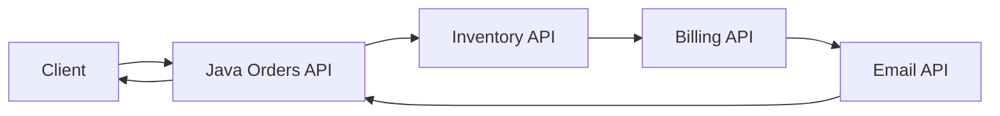

Nếu `Email API` lỗi, API có thể bị timeout dù đơn hàng đã được ghi. Các hệ thống càng nhiều tầng càng khó quản lý latency, retries và khả năng phục hồi.

### 2.2. Tách bằng message broker

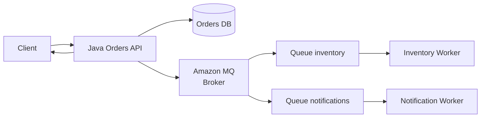

Producer có thể gửi message `OrderCreated` rồi trả kết quả HTTP. Consumer xử lý theo tốc độ riêng; khi consumer chậm, message tồn đọng trong queue (trong giới hạn broker).

**Đây là decoupling, không phải phép màu về độ tin cậy.** Broker vẫn có giới hạn CPU, memory, disk, connection, message retention và network. Một message được nhận ở broker chưa có nghĩa nghiệp vụ đã xử lý thành công. Phần lớn ứng dụng cần **at-least-once processing và idempotency**.

### 2.3. Thuật ngữ nền tảng

| Thuật ngữ | Ý nghĩa | Ví dụ |
| --- | --- | --- |
| **Producer / publisher** | Gửi message tới broker | Java Orders API |
| **Consumer / subscriber** | Nhận và xử lý message | Inventory Worker |
| **Broker** | Server trung gian giữ/định tuyến message | Amazon MQ broker |
| **Queue** | Hàng đợi giữ message cho consumer(s) | `orders.created.q` |
| **Topic / exchange** | Đích publish và phân phối message | JMS topic; RabbitMQ topic exchange |
| **Routing key / binding** | Quy tắc chuyển message tới queue trong RabbitMQ | `orders.created` |
| **Acknowledgment (ack)** | Consumer xác nhận đã xử lý/nhận theo semantics | ACK sau commit DB |
| **Nack / reject / redelivery** | Từ chối hoặc yêu cầu xử lý lại | Lỗi transient |
| **Dead-letter queue (DLQ)** | Nơi cách ly message không xử lý được | `orders.failed.q` |
| **Durable / persistent** | Tính chất survive broker restart theo cơ chế engine | Durable queue + persistent message |
| **Idempotency** | Xử lý trùng mà không gây double side effect | `eventId` duy nhất |
| **Back pressure** | Giảm tốc producer/điều tiết consumer khi hệ thống nghẽn | Memory/disk flow control |

## 3. Amazon MQ khác SQS, SNS và EventBridge

| Tiêu chí | **Amazon MQ** | **Amazon SQS** | **Amazon SNS** | **Amazon EventBridge** |
| --- | --- | --- | --- | --- |
| Mô hình | Managed **message broker** | Managed queue service | Managed pub/sub notification | Managed event bus/routing |
| Giao thức chuẩn broker | **Có**, tùy ActiveMQ/RabbitMQ | Không dùng JMS/OpenWire/AMQP socket broker trực tiếp | Không | Không |
| Phải chọn broker instance/type? | **Có** | Không | Không | Không |
| Queue consumer | Có | Có | Fan-out tới subscribers (ví dụ SQS) | Route tới targets |
| Pub/sub/topic/exchange | Có theo engine | Ghép với SNS nếu fan-out | **Có** | Event rules/patterns |
| Legacy JMS/OpenWire | **Phù hợp** | Cần sửa ứng dụng/adapter hoặc JMS library cho SQS với semantics khác | Không tương đương | Không tương đương |
| Khả năng vận hành | Theo dõi broker CPU/RAM/disk, version | AWS vận hành queue fleet | AWS vận hành topic fleet | AWS vận hành event bus |
| Chi phí chính | Broker instance-hours + storage/data transfer | Requests và dữ liệu theo giá | Publish/deliveries và dữ liệu | Events/rules/targets theo giá |
| Trường hợp dùng | Migration từ broker, protocol compatibility | Worker jobs/decoupling AWS-native | Notifications/fan-out | Domain events và integration routing |

**Bắt đầu dự án mới với queue đơn giản**: SQS thường dễ vận hành hơn; SQS+SNS phù hợp fan-out. **Amazon MQ** phù hợp khi code đang dùng ActiveMQ/RabbitMQ/JMS hoặc cần semantics/routing của broker cụ thể. Không chuyển sang MQ chỉ để mô phỏng một hàng đợi SQS cơ bản.

**Không coi các dịch vụ là thay thế 1:1:** SQS có visibility timeout và receive/delete APIs; ActiveMQ/RabbitMQ có connection/session/ack/channel/exchange semantics riêng. Migration cần thay client, retry, observability, ordering và authorization.

## 4. Kiến trúc quản lý của Amazon MQ

### 4.1. Control plane và data plane

Amazon MQ có hai lớp:

- **Control plane AWS**: tạo/sửa broker, quản lý engine version/configuration, network, logs, KMS, maintenance qua Console/API/AWS CLI. Quyền kiểm soát bằng **IAM**.
- **Messaging data plane**: producer/consumer kết nối vào endpoint broker bằng **protocol client** (OpenWire/AMQP...), đăng nhập broker và được cấp quyền truy cập queue/exchange/vhost.

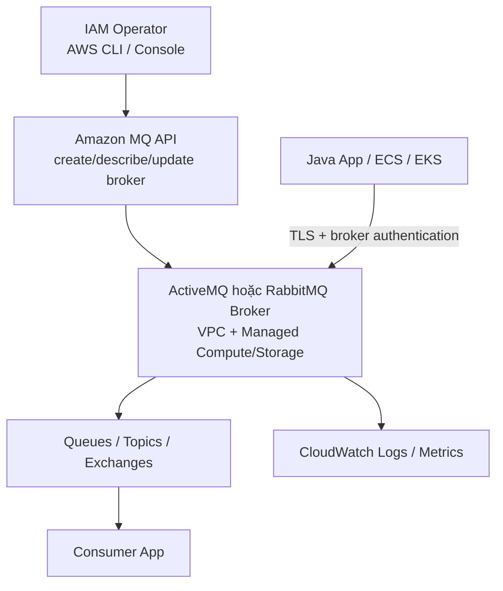

**Đừng nhầm quyền `mq:DescribeBroker` với quyền consume message.** IAM authorization cho API quản lý không tự cho một AMQP connection quyền đọc queue. RabbitMQ phiên bản mới có lựa chọn authn/authz tích hợp IAM/OAuth theo cấu hình; cần phân biệt đó là **broker authentication được chủ động bật**, không phải hành vi mặc định của mọi broker.

### 4.2. Trách nhiệm được chia sẻ

| AWS quản lý theo dịch vụ | Bạn vẫn cần quản lý |
| --- | --- |
| Provision broker instance và storage | Chọn engine, version, instance type, deployment mode |
| Hạ tầng broker, một phần patch/bảo trì | Lập kế hoạch maintenance, kiểm tra phiên bản client |
| Availability/failover theo deployment mode | Reconnect/backoff, backlog, side-effect idempotency |
| TLS endpoint/encryption at rest | Security group, broker permissions, TLS validation |
| Metrics/log integrations | Alarms, log redaction, queue-specific operations |
| AWS API/IAM resource management | Broker users/vhosts/queues/exchanges, secret rotation |
| Quản lý một phần configuration | Thiết kế broker config, queue topology, retention, retry/DLX |

## 5. Chọn ActiveMQ hay RabbitMQ

| Câu hỏi | **Amazon MQ for ActiveMQ** | **Amazon MQ for RabbitMQ** |
| --- | --- | --- |
| Workload legacy Java dùng ActiveMQ Classic/JMS? | **Lựa chọn tự nhiên** | Có thể dùng JMS **trên RabbitMQ 4** với RabbitMQ JMS client, nhưng phải kiểm tra giới hạn |
| Code dùng OpenWire? | **Có** | Không |
| Code dùng STOMP/MQTT trên Amazon MQ? | **Có** | Không nằm trong danh sách wire-level protocols được AWS công bố cho managed RabbitMQ |
| Code đang dùng RabbitMQ AMQP 0-9-1? | Không phải client tương thích trực tiếp | **Có** |
| Cần exchange direct/topic/fanout/headers, routing/bindings? | Có destinations/JMS semantics riêng | **Điểm mạnh RabbitMQ** |
| Cần AMQP 1.0 native? | ActiveMQ hỗ trợ AMQP | **RabbitMQ 4** hỗ trợ AMQP 1.0, cần đúng client/version |
| Cần JMS 1.1/2.0/3.1? | ActiveMQ Classic JMS clients theo version/API tương thích | RabbitMQ 4 + RabbitMQ JMS client với một số giới hạn |
| HA trong Region | Active/standby ở hai AZ | RabbitMQ cluster ba nodes ở ba AZ và quorum queues |
| Client library | ActiveMQ client, JMS provider, STOMP/MQTT/AMQP libraries | RabbitMQ Java AMQP client, RabbitMQ JMS client theo version |
| Messaging model | Queue, topic, durable subscriptions, JMS semantics | Exchange → bindings → queues; ACK/confirm, vhosts |

**Không chuyển từ ActiveMQ sang RabbitMQ chỉ bằng thay URL broker.** Destination semantics, transaction support, selectors, client ACK, consumer redelivery, persistence và topology khác nhau. Đặc biệt, RabbitMQ JMS client **không hỗ trợ mọi API JMS như ActiveMQ**.

## 6. Giao thức messaging: API khác wire protocol

### 6.1. JMS là Java API, không phải một giao thức dây

**Java Message Service (JMS)** chuẩn hóa interface Java như `ConnectionFactory`, `Session`/`JMSContext`, `MessageProducer`, `MessageConsumer`, `Queue` và `Topic`. Để kết nối broker, bạn cần **JMS provider/client library**, phía dưới sử dụng protocol cụ thể.

Ví dụ:

- Ứng dụng sử dụng **ActiveMQ Classic JMS client** thường truyền dữ liệu qua **OpenWire**.
- Ứng dụng sử dụng **RabbitMQ JMS client** trên **Amazon MQ RabbitMQ 4** dựa trên khả năng RabbitMQ/AMQP với plugin JMS topic exchange hỗ trợ.
- **JMS 1.1, 2.0, 3.1** có khác biệt API/package/semantics; cần kiểm tra framework và client version.

**Không thể mở một kết nối MQTT rồi gửi Java `JMS Message` không qua provider tương thích.**

### 6.2. Các protocol quan trọng

| Protocol/API | Amazon MQ ActiveMQ | Amazon MQ RabbitMQ | Ý nghĩa |
| --- | --- | --- | --- |
| **OpenWire** | Có | Không | Protocol chính của ActiveMQ Classic client |
| **AMQP 0-9-1** | Không phải RabbitMQ protocol thay thế trực tiếp | Có | Exchange, queue, bindings, channels |
| **AMQP 1.0** | Có theo engine/connector | Có với **RabbitMQ 4** | Protocol khác AMQP 0-9-1; chọn client hỗ trợ |
| **STOMP** | Có, cả qua WebSocket | Không theo managed broker supported list | Text frames, đa ngôn ngữ |
| **MQTT** | Có, cả qua WebSocket | Không theo managed broker supported list | Pub/sub, IoT lightweight semantics |
| **JMS 1.1** | Có qua provider phù hợp | Có qua RabbitMQ JMS client **4.x** | Java messaging API |
| **JMS 2.0 / 3.1** | Phụ thuộc provider/engine và namespace compatibility | RabbitMQ **4.x** qua RabbitMQ JMS client, có giới hạn | Java/Jakarta messaging API |
| **HTTP broker management** | ActiveMQ web console | RabbitMQ web console/management API | Không phải kênh AMQP/OpenWire gửi message bình thường |

**AMQP 0-9-1 và AMQP 1.0 không wire-compatible.** Có cùng chữ AMQP nhưng client/mapping và kiến trúc protocol khác nhau. Một thư viện RabbitMQ Java AMQP client truyền 0-9-1 không tự dùng được AMQP 1.0.

### 6.3. Những cập nhật quan trọng ở RabbitMQ 4

Theo tài liệu AWS hiện hành:

- **RabbitMQ 4.2/4.3** được Amazon MQ hỗ trợ trên **`mq.m7g`** instance family phù hợp.
- Port **5671 (AMQPS)** dùng cho **AMQP 0-9-1**, và với RabbitMQ 4 cũng hỗ trợ **AMQP 1.0**.
- RabbitMQ 4 bổ sung **RabbitMQ JMS client** cho **JMS 1.1, 2.0 và 3.1**, nhờ JMS topic exchange plugin được dịch vụ bật sẵn.
- Một số JMS APIs **không hỗ trợ**: **XA transactions**, server sessions, selectors cho JMS Queue destination, `NoLocal` subscription và `JMSProducer.setDeliveryDelay`.
- RabbitMQ 4.2 đặt **quorum** làm default queue type trong cấu hình Amazon MQ; bản cũ không nhất thiết vậy.
- RabbitMQ 4.x có giới hạn về **CloudWatch per-queue metrics**, nên xem management API/Prometheus.
- Amazon MQ cho RabbitMQ **không hỗ trợ RabbitMQ streams**; đừng tạo stream để thử lưu dữ liệu.

**Tham khảo phiên bản trước khi triển khai:** [Supported RabbitMQ protocols](https://docs.aws.amazon.com/amazon-mq/latest/developer-guide/rabbitmq-supported-protocols.html), [RabbitMQ JMS support](https://docs.aws.amazon.com/amazon-mq/latest/developer-guide/rabbitmq-jms-support.html) và [RabbitMQ 4 limitations](https://docs.aws.amazon.com/amazon-mq/latest/developer-guide/rabbitmq-4.html).

## 7. ActiveMQ: queue, topic và JMS semantics

### 7.1. Queue (point-to-point)

Một **queue** giữ các messages để consumer xử lý. Nhiều consumers có thể chia việc theo pattern **competing consumers**.

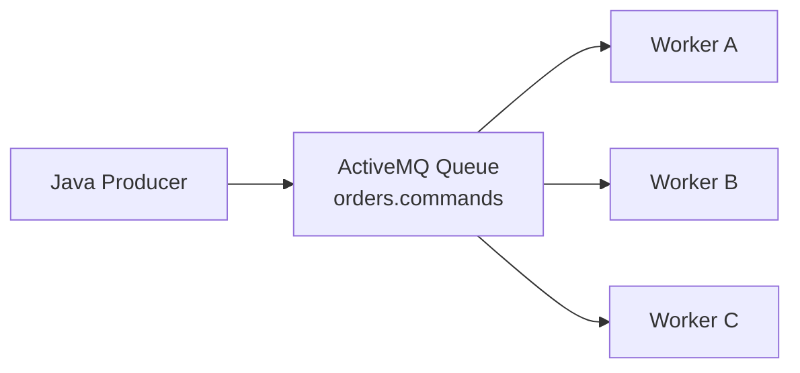

Thông thường một message được giao để một consumer xử lý tại một thời điểm. Nhưng nếu consumer không ACK/trạng thái session thất bại, message có thể **redeliver** cho consumer khác. Ứng dụng phải chấp nhận khả năng duplicate.

### 7.2. Topic (publish/subscribe)

**JMS Topic** cho phép nhiều subscribers nhận event:

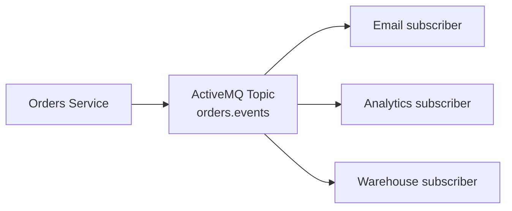

Với **durable subscription**, broker có thể giữ messages cho subscriber khi offline theo chính sách và cấu hình. Nhưng durable subscription không tự bảo vệ khỏi retention/disk limits hoặc consumer không kịp xử lý.

**Topic không giống queue:** Một queue chia việc cho competing consumers, còn topic có thể fan-out mỗi message tới nhiều subscriptions.

### 7.3. JMS session và acknowledgment

Một JMS application có thể dùng:

| Chế độ | Ý nghĩa | Chú ý |
| --- | --- | --- |
| `AUTO_ACKNOWLEDGE` | Session/client xác nhận theo semantics JMS provider sau khi receive/listener thành công | Dễ dùng, vẫn phải xử lý lỗi/duplicate |
| `CLIENT_ACKNOWLEDGE` | Client gọi `acknowledge()` | Trong JMS 1.1, ACK một message có thể xác nhận **mọi messages đã được nhận trên cùng Session** |
| `DUPS_OK_ACKNOWLEDGE` | Provider được phép lùi/ghép ACK, có thể gây duplicates | Chỉ khi ứng dụng chịu được duplicate |
| **Transacted Session** | Commit/rollback messages trong session | **Không đồng nghĩa** distributed XA với database |

Không nhầm **JMS transaction trên broker** với **ACID transaction xuyên broker + RDS**. Nếu một đơn hàng đã commit DB nhưng publish MQ thất bại, cần **transactional outbox** hoặc quy trình reconciliation.

## 8. Amazon MQ for ActiveMQ: deployment và lưu trữ

### 8.1. Single instance

Một broker chạy trong **một AZ**. Với Amazon MQ for ActiveMQ có thể dùng **EBS** hoặc **EFS** theo loại broker/instance được hỗ trợ. Single instance đơn giản hơn, phù hợp thử nghiệm hoặc workload chấp nhận giới hạn failover.

### 8.2. Active/standby multi-AZ

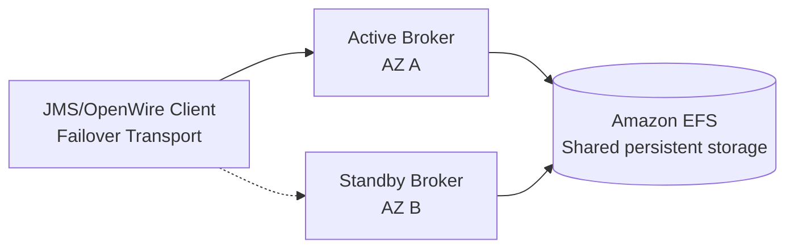

- Hai brokers trong **hai Availability Zones**; thường chỉ **một** nhận traffic tại một thời điểm.
- Sử dụng **EFS** cho shared persistent storage.
- Khi broker active hỏng/bảo trì, standby tiếp quản sau một thời gian; ứng dụng cần reconnect.
- Amazon MQ cung cấp **cặp endpoints** cho protocol; client ActiveMQ nên dùng **Failover Transport** với cả hai.
- **EBS không hỗ trợ ActiveMQ active/standby deployment**; EBS có đặc điểm single-AZ.
- Engine ActiveMQ managed trên Amazon MQ dùng **KahaDB** cho persistent store; không giả định tự cấu hình JDBC store.

Lưu trữ và topology ảnh hưởng throughput/latency. Không mặc định active/standby EFS có hiệu năng/chi phí y hệt single-instance EBS.

### 8.3. ActiveMQ Failover Transport

Ví dụ OpenWire TLS endpoint URIs thực tế lấy từ `DescribeBroker`, sau đó cấu hình:

```text
failover:(ssl://BROKER_ENDPOINT_1:61617,ssl://BROKER_ENDPOINT_2:61617)?randomize=false
```

- `ssl://`: TLS trên ActiveMQ OpenWire listener.
- Cặp endpoints lấy từ AWS, **không tự ghép DNS/port theo broker ID**.
- Client phải cấu hình truststore/certificate validation và timeout phù hợp.
- Failover có thể làm kết nối tạm ngắt, xử lý lại message; **producer không được giả định send đã thành công hoặc thất bại tuyệt đối** nếu connection mất đúng lúc broker nhận message.

## 9. RabbitMQ: exchange, bindings, queue và vhost

RabbitMQ AMQP 0-9-1 có mô hình nổi bật:

1. Producer publish message tới **exchange** với **routing key**.
2. Exchange xét **bindings** và quyết định queue đích.
3. Consumer subscribe một hoặc nhiều queues.
4. Broker giao message, consumer **ack/nack** theo kết quả xử lý.

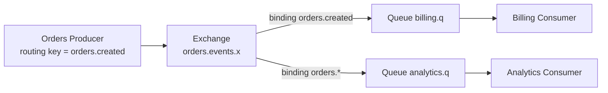

Ví dụ giả định exchange loại **topic**: hai bindings khớp cùng routing key sẽ cho message đến **hai queues**, nhưng vẫn chỉ một lần vào mỗi queue.

### 9.1. Các loại exchange chính

| Loại exchange | Quy tắc routing | Khi nào dùng |
| --- | --- | --- |
| **Direct** | Routing key khớp binding key | Phân việc theo loại sự kiện cụ thể |
| **Topic** | Pattern với `*` (một token), `#` (không hoặc nhiều tokens) | Domain events như `orders.*`, `orders.#` |
| **Fanout** | Gửi tới tất cả queues được bind, bỏ qua routing key | Broadcast thông báo |
| **Headers** | Dựa trên headers/binding arguments | Routing theo metadata chuyên biệt |
| **Default exchange** | Direct exchange tên trống, queues được bind tự động theo tên queue | Demo gửi trực tiếp theo queue name |

**Đừng nhầm RabbitMQ topic exchange với JMS topic.** Chúng cùng phục vụ pub/sub nhưng client API, binding semantics, subscription durability và triển khai khác nhau.

### 9.2. Virtual host (vhost) và permissions

RabbitMQ dùng **vhost** để cô lập namespace của exchanges/queues và phân quyền:

- Producer/consumer chỉ được đọc/ghi/configure những vhost/resources được cấp phép.
- Có thể tạo user riêng cho application, môi trường và chức năng.
- Không dùng tài khoản administrator cho mọi microservice.
- Một user có thể cần permissions `configure`, `write` và `read` trên resource patterns nhất định.
- Nếu ứng dụng chỉ publish vào exchange đã provision, không nhất thiết được quyền tự tạo queue/exchange.

Vhost `/` thường là default nhưng production có thể dùng `/orders` hoặc `orders-prod`; tên vhost trong connection URL phải được **URL-encoded** đúng khi cần.

## 10. Amazon MQ for RabbitMQ: single instance và cluster

### 10.1. Single-instance broker

- Một RabbitMQ broker node trong một AZ.
- Endpoint được dịch vụ đặt phía sau network load balancer; data dùng EBS.
- Không cung cấp HA multi-AZ cùng cấp như cluster.
- Hữu ích cho sandbox, dev hoặc workload chịu được thời gian gián đoạn.

### 10.2. Cluster multi-AZ

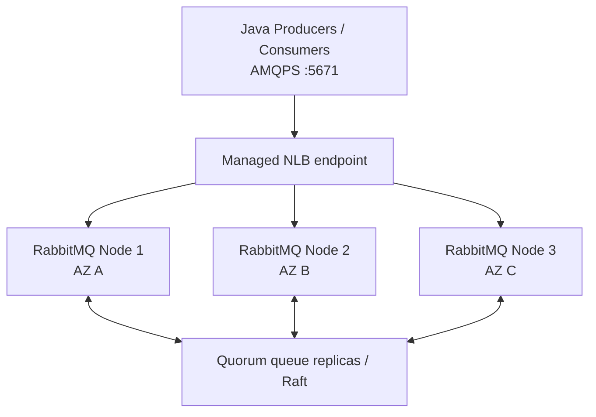

- Cluster deployment có **ba nodes** trải trên **ba AZ**.
- Ứng dụng kết nối qua broker endpoint do Amazon MQ cung cấp.
- RabbitMQ trao đổi topology state, queues/users theo cơ chế dịch vụ/engine.
- Để message queue có khả năng chịu lỗi node, **quorum queues** là lựa chọn được khuyến nghị cho production phù hợp.
- Cluster **không làm mỗi classic queue tự có ba bản sao an toàn**; loại queue và cấu hình replication vẫn quan trọng.

### 10.3. Quorum queue và Raft

**Quorum queue** lưu dữ liệu với một leader và followers, sử dụng **Raft majority consensus**. Trong cluster ba nodes, khi một node lỗi và quorum vẫn đủ, leader có thể được bầu lại.

| Thuộc tính | Quorum queue | Classic queue |
| --- | --- | --- |
| Khả năng replication/majority | Có trong cluster | Không giống quorum replication |
| Phù hợp dữ liệu cần bền vững | **Được AWS khuyến nghị** | Không phải mặc định cho HA production ở RabbitMQ 4 |
| Chi phí tài nguyên | Có replication/consensus overhead | Thường ít overhead hơn tùy workload |
| Poison handling | Có cơ chế delivery limit/TTL/DLX theo version | Phụ thuộc cấu hình queue/policies |
| Backlog rất dài | Cần sizing thận trọng | Không được dùng như lời giải vô hạn backlog |
| Thay queue type in-place | Không nên giả định có thể chỉnh tùy ý | Migration thường cần queue mới |

**RabbitMQ 4.2 trên Amazon MQ mặc định tạo quorum queue nếu không chỉ định type.** Nhưng hãy khai báo **`x-queue-type=quorum`** có chủ đích trong thiết kế để tránh phụ thuộc defaults giữa environments/versions. **RabbitMQ 4.3** có những khả năng bổ sung (ví dụ delayed retry/quorum priority) nhưng phải kiểm tra API/limits theo version trước khi dùng.

### 10.4. Không dùng RabbitMQ streams trên Amazon MQ

Dù RabbitMQ open source có **Streams**, **Amazon MQ for RabbitMQ không hỗ trợ streams** theo hướng dẫn AWS. Không thiết kế long-term event log, replay vô hạn hoặc Kafka-compatible stream trên một feature không được dịch vụ hỗ trợ; khi cần event streaming, đánh giá **Amazon MSK/Kinesis**.

## 11. Giao nhận tin nhắn: ACK, confirm, retry và idempotency

### 11.1. Publisher confirms khác consumer acknowledgments

| Tín hiệu | Ai phát? | Chứng minh gì? | Không chứng minh |
| --- | --- | --- | --- |
| **Publisher confirm** | Broker → producer | Broker đã xử lý publish theo semantics/quy tắc xác nhận | Consumer đã xử lý xong nghiệp vụ |
| **Consumer ACK** | Consumer → broker | Consumer chấp nhận/xác nhận delivery | DB/side effect chắc chắn đúng nếu code ACK quá sớm |
| **NACK/reject** | Consumer → broker | Consumer từ chối delivery, có thể requeue/dead-letter | Message tự được xử lý thành công |
| **RabbitMQ mandatory return** | Broker → producer | Message không route được tới queue nào trong điều kiện áp dụng | Không thay publisher confirms |
| **DLQ/dead-letter** | Broker routing | Message cách ly do reject/expiration/delivery limit | Không tự sửa poison data |

**Một publisher confirm có thể thành công dù message không được route tới queue** nếu producer không dùng `mandatory`/return handling hoặc topology sai. Do đó, sản xuất message đáng tin cậy cần **cả publisher confirms, routing validation và xử lý message trả về**.

### 11.2. Vì sao phải chấp nhận duplicate?

Ví dụ:

1. Consumer nhận `OrderCreated(eventId=E123)`.
2. Consumer ghi hoàn tất email/log/database.
3. Consumer crash **trước khi gửi ACK**.
4. Broker redeliver E123.
5. Nếu consumer không kiểm tra `eventId`, nghiệp vụ có thể bị chạy hai lần.

Giải pháp:

- Gắn `eventId`/`messageId` đủ duy nhất.
- Ghi nhận đã xử lý vào **inbox/dedup table** có unique constraint.
- Thực hiện side effects và dedup trong transaction phù hợp khi có thể.
- ACK **sau** khi đảm bảo công việc/dedup đã commit.
- Dùng idempotency key cho calls tới payment/email/third-party APIs khi được hỗ trợ.

**Không cam kết “exactly once side effects” chỉ vì broker dùng persistent messages hoặc quorum queues.** Mô hình thực tế phổ biến là **at-least-once delivery + idempotent consumer**.

### 11.3. Retry và poison messages

Phân loại lỗi:

| Loại lỗi | Ví dụ | Hành động |
| --- | --- | --- |
| **Transient** | DB timeout, API 503 | Retry có backoff và **giới hạn lần** |
| **Permanent validation** | Schema sai, thiếu bắt buộc | Dead-letter/quarantine, không retry vô hạn |
| **Unauthorized** | Service account thiếu permission | Báo vận hành, chỉ retry khi cấu hình đã sửa |
| **Unknown** | Lỗi chưa rõ | Retry có giới hạn, ghi correlation ID và DLQ |
| **Duplicate event** | `eventId` đã xử lý | Bỏ qua side effect, ACK an toàn |

**NACK với requeue=true liên tục** có thể gây vòng lặp nóng, CPU/network cao và làm backlog ngày càng lớn. Dùng **bounded retries**, delay/TTL/DLX hoặc khả năng quorum delayed retry theo engine version được hỗ trợ; sau giới hạn chuyển message sang queue lỗi.

### 11.4. Dead-letter exchange (RabbitMQ)

Một mô hình đơn giản:

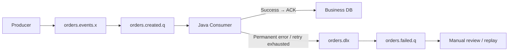

Cấu hình **dead-letter exchange** có thể đặt bằng broker policy; tài liệu RabbitMQ khuyến nghị dùng **policies** thay vì hard-code `x-dead-letter-exchange` vào ứng dụng trong nhiều trường hợp, vì sửa queue declaration arguments có thể yêu cầu tạo lại queue. **Không xóa queue production đang chứa messages** chỉ để đổi DLX arguments.

## 12. Java RabbitMQ Producer: AMQPS, durable queue và confirm

### 12.1. Chuẩn bị

Giả sử RabbitMQ cluster Amazon MQ đã được provision:

- Endpoint DNS lấy từ `DescribeBroker`, ví dụ `b-EXAMPLE.mq.ap-southeast-1.amazonaws.com`.
- Port **5671** cho **AMQPS**.
- Vhost/username/password hoặc phương thức authentication khác được cấu hình.
- User có quyền publish/declare topology trong vhost test.
- Code Java 17+ có dependency **`com.rabbitmq:amqp-client`** phiên bản được nhóm duyệt/tương thích broker.

Ví dụ Maven (thay version bằng bản client còn được hỗ trợ, không copy bất kỳ phiên bản lỗi thời nào từ tutorial cũ):

```xml
<dependency>
    <groupId>com.rabbitmq</groupId>
    <artifactId>amqp-client</artifactId>
    <version>REPLACE_WITH_TESTED_VERSION</version>
</dependency>
```

### 12.2. Producer mẫu

```java
package example.mq;

import com.rabbitmq.client.AMQP;
import com.rabbitmq.client.Channel;
import com.rabbitmq.client.Connection;
import com.rabbitmq.client.ConnectionFactory;

import java.nio.charset.StandardCharsets;
import java.util.Map;
import java.util.UUID;
import java.util.concurrent.atomic.AtomicBoolean;

public final class RabbitOrdersPublisher {
    private static final String EXCHANGE = "orders.events.x";
    private static final String QUEUE = "orders.created.q";

    public static void main(String[] args) throws Exception {
        ConnectionFactory factory = new ConnectionFactory();
        factory.setHost(required("MQ_HOST")); // DNS từ DescribeBroker
        factory.setPort(5671);
        factory.setUsername(required("MQ_USERNAME"));
        factory.setPassword(required("MQ_PASSWORD"));
        factory.setVirtualHost(System.getenv().getOrDefault("MQ_VHOST", "/"));
        factory.useSslProtocol();
        factory.enableHostnameVerification(); // Không vô hiệu TLS hostname check
        factory.setAutomaticRecoveryEnabled(true);
        factory.setRequestedHeartbeat(30);

        try (Connection connection = factory.newConnection("java-orders-publisher");
             Channel channel = connection.createChannel()) {

            channel.exchangeDeclare(EXCHANGE, "direct", true);

            Map<String, Object> queueArgs = Map.of(
                "x-queue-type", "quorum"
            );
            channel.queueDeclare(QUEUE, true, false, false, queueArgs);
            channel.queueBind(QUEUE, EXCHANGE, "orders.created");

            AtomicBoolean returned = new AtomicBoolean(false);
            channel.addReturnListener((replyCode, replyText, exchange,
                                       routingKey, properties, body) ->
                returned.set(true));

            channel.confirmSelect(); // Bật publisher confirms

            String eventId = UUID.randomUUID().toString();
            String payload = "{\"eventId\":\"" + eventId
                + "\",\"orderId\":\"order-42\",\"type\":\"OrderCreated\"}";

            AMQP.BasicProperties properties = new AMQP.BasicProperties.Builder()
                .contentType("application/json")
                .deliveryMode(2)  // persistent message
                .messageId(eventId)
                .build();

            // mandatory=true: broker trả message không có route hợp lệ.
            channel.basicPublish(EXCHANGE, "orders.created", true,
                properties, payload.getBytes(StandardCharsets.UTF_8));

            channel.waitForConfirmsOrDie(10000);

            if (returned.get()) {
                throw new IllegalStateException(
                    "Message was returned: no matching queue binding");
            }
            System.out.println("Confirmed publish eventId=" + eventId);
        }
    }

    private static String required(String name) {
        String value = System.getenv(name);
        if (value == null || value.isBlank()) {
            throw new IllegalArgumentException("Missing environment variable " + name);
        }
        return value;
    }
}
```

**Cảnh báo trước khi chạy:**

- Code chỉ minh họa trên **RabbitMQ 4 cluster** được quyền tạo **quorum queue**. Broker/user có sẵn queue cùng tên nhưng khác loại/arguments sẽ trả lỗi inequivalent arguments. Production nên provision topology bằng IaC/operations và để ứng dụng chỉ publish.
- Password phải đến từ **Secrets Manager/runtime secret injection**, không hard-code/git/log. Các env vars dùng cho lab ở sandbox; với production hãy đặt policy rotation.
- Publisher confirms tăng tin cậy nhưng không thay **transactional outbox** nếu việc ghi DB và publish MQ phải đồng bộ về mặt nghiệp vụ.
- Với publishers nhiều threads hoặc nhiều inflight messages, cần **sequence numbers, publisher confirms asynchronous handling, connection/channel pools và concurrency correctness**; ví dụ synchronous một message không đại diện cho hiệu năng production.
- Không bật `trust-all` SSL hoặc tắt hostname verification để sửa lỗi TLS.

### 12.3. Khi connection đứt sau publish

Giả sử broker đã nhận message nhưng network disconnect trước khi client nhận confirm. Producer **không thể biết chắc** publish đã thành công hay chưa. Retry có thể tạo message trùng. Chính vì vậy **eventId**, outbox, consumer idempotency và reconciliation là một phần của mô hình tin cậy.

## 13. Java RabbitMQ Consumer: manual ACK và DLQ

Ví dụ consumer xử lý một queue, chỉ ACK sau khi nghiệp vụ hoàn tất:

```java
package example.mq;

import com.rabbitmq.client.Channel;
import com.rabbitmq.client.Connection;
import com.rabbitmq.client.ConnectionFactory;
import java.nio.charset.StandardCharsets;
import java.util.concurrent.CountDownLatch;

public final class RabbitOrdersConsumer {
    private static final String QUEUE = "orders.created.q";

    public static void main(String[] args) throws Exception {
        ConnectionFactory factory = new ConnectionFactory();
        factory.setHost(required("MQ_HOST"));
        factory.setPort(5671);
        factory.setUsername(required("MQ_USERNAME"));
        factory.setPassword(required("MQ_PASSWORD"));
        factory.setVirtualHost(System.getenv().getOrDefault("MQ_VHOST", "/"));
        factory.useSslProtocol();
        factory.enableHostnameVerification();
        factory.setAutomaticRecoveryEnabled(true);
        factory.setRequestedHeartbeat(30);

        try (Connection connection = factory.newConnection("java-orders-consumer");
             Channel channel = connection.createChannel()) {
            channel.basicQos(20); // Giới hạn unacknowledged deliveries

            channel.basicConsume(QUEUE, false, (consumerTag, delivery) -> {
                long tag = delivery.getEnvelope().getDeliveryTag();
                String payload = new String(
                    delivery.getBody(), StandardCharsets.UTF_8);
                try {
                    // THAY BẰNG nghiệp vụ có validation và idempotency
                    // ở DB với eventId/messageId, commit trước ACK.
                    System.out.println("Processing: " + payload);
                    channel.basicAck(tag, false);
                } catch (Exception error) {
                    // requeue=false: chỉ tới DLQ nếu DLX đã cấu hình.
                    // Nếu KHÔNG có DLX, message có thể bị loại bỏ!
                    channel.basicNack(tag, false, false);
                }
            }, consumerTag -> { });

            System.out.println("Consuming from " + QUEUE);
            new CountDownLatch(1).await();
        }
    }

    private static String required(String name) {
        String value = System.getenv(name);
        if (value == null || value.isBlank()) {
            throw new IllegalArgumentException("Missing environment variable " + name);
        }
        return value;
    }
}
```

**Thiết kế production cần bổ sung:**

1. **Validate JSON/schema** trước side effect.
2. Đọc `eventId`, kiểm tra unique constraint của inbox/dedup store.
3. Phân biệt transient/permanent errors; lỗi tạm thời đi qua retry có backoff và **retry limit**, không NACK requeue mãi.
4. **Cấu hình DLX/DLQ trước khi chạy**: nếu `basicNack(..., requeue=false)` mà không có dead-letter routing thì message có thể bị bỏ.
5. Quản lý connection/channel thread-safety: một channel không được dùng đồng thời tùy tiện từ nhiều application threads.
6. Bật consumer instrumentation và metrics như processing latency, successful/failed attempts, redelivery rate, DLQ depth.
7. Chạy nhiều consumers để scale, nhưng thiết kế ordering/idempotency và prefetch tương ứng.

**`basicQos(20)`** điều chỉnh số messages chưa ACK mà consumer có thể giữ (theo QoS semantics của client/broker). Giá trị không phải “20 messages mỗi giây”.

## 14. Java ActiveMQ Classic JMS: producer/consumer qua OpenWire

### 14.1. Dependency và API namespace

Với ứng dụng đang dùng ActiveMQ Classic 5.x và **JMS 1.1 `javax.jms`**, dependency điển hình:

```xml
<dependency>
    <groupId>org.apache.activemq</groupId>
    <artifactId>activemq-client</artifactId>
    <version>REPLACE_WITH_COMPATIBLE_ACTIVEMQ_CLIENT_VERSION</version>
</dependency>
```

**Tương thích quan trọng:** `javax.jms` và `jakarta.jms` là **hai namespace khác nhau**. Spring Boot 3/Spring Framework 6 thường dùng Jakarta APIs. Nếu migrates ứng dụng, phải chọn client/provider cùng namespace và phiên bản ActiveMQ phù hợp. Không chỉ đổi một dòng import từ `javax.jms` sang `jakarta.jms` mà bỏ qua dependency/JMS provider compatibility.

### 14.2. JMS Producer

```java
package example.mq;

import org.apache.activemq.ActiveMQConnectionFactory;
import javax.jms.Connection;
import javax.jms.DeliveryMode;
import javax.jms.MessageProducer;
import javax.jms.Queue;
import javax.jms.Session;
import javax.jms.TextMessage;

public final class ActiveMqOrdersProducer {
    public static void main(String[] args) throws Exception {
        String username = required("MQ_USERNAME");
        String password = required("MQ_PASSWORD");

        // Ví dụ URI từ AWS DescribeBroker, cặp endpoints cho active/standby.
        String failoverUri = required("MQ_OPENWIRE_URI");

        ActiveMQConnectionFactory factory =
            new ActiveMQConnectionFactory(username, password, failoverUri);

        Connection connection = factory.createConnection();
        try {
            Session session =
                connection.createSession(false, Session.AUTO_ACKNOWLEDGE);
            try {
                Queue queue = session.createQueue("orders.commands");
                MessageProducer producer = session.createProducer(queue);
                try {
                    producer.setDeliveryMode(DeliveryMode.PERSISTENT);
                    TextMessage message =
                        session.createTextMessage("{\"eventId\":\"E123\"}");
                    message.setStringProperty("eventType", "OrderCreated");
                    producer.send(message);
                } finally {
                    producer.close();
                }
            } finally {
                session.close();
            }
        } finally {
            connection.close();
        }
    }

    private static String required(String name) {
        String value = System.getenv(name);
        if (value == null || value.isBlank()) {
            throw new IllegalArgumentException("Missing " + name);
        }
        return value;
    }
}
```

**Kết nối phải dùng TLS**, ví dụ:

```text
MQ_OPENWIRE_URI=failover:(ssl://BROKER_1:61617,ssl://BROKER_2:61617)?randomize=false
```

Brokers/endpoints phải đúng từ Amazon MQ. **Kiểm tra TLS truststore và hostname verification theo ActiveMQ client version**; đừng tắt xác minh chứng chỉ nếu gặp lỗi trust.

### 14.3. JMS Consumer với client acknowledgment

```java
package example.mq;

import org.apache.activemq.ActiveMQConnectionFactory;
import javax.jms.Connection;
import javax.jms.Message;
import javax.jms.MessageConsumer;
import javax.jms.Queue;
import javax.jms.Session;
import javax.jms.TextMessage;

public final class ActiveMqOrdersConsumer {
    public static void main(String[] args) throws Exception {
        ActiveMQConnectionFactory factory =
            new ActiveMQConnectionFactory(
                required("MQ_USERNAME"),
                required("MQ_PASSWORD"),
                required("MQ_OPENWIRE_URI"));

        Connection connection = factory.createConnection();
        try {
            Session session =
                connection.createSession(false, Session.CLIENT_ACKNOWLEDGE);
            try {
                Queue queue = session.createQueue("orders.commands");
                MessageConsumer consumer = session.createConsumer(queue);
                try {
                    connection.start();
                    Message message = consumer.receive(10000);
                    if (message instanceof TextMessage text) {
                        // Thay bằng transaction/idempotent business processing.
                        System.out.println(text.getText());

                        // ACK SAU khi side effect commit thành công.
                        message.acknowledge();
                    }
                } finally {
                    consumer.close();
                }
            } finally {
                session.close();
            }
        } finally {
            connection.close();
        }
    }

    private static String required(String name) {
        String value = System.getenv(name);
        if (value == null || value.isBlank()) {
            throw new IllegalArgumentException("Missing " + name);
        }
        return value;
    }
}
```

Ví dụ sử dụng **JMS client namespace cũ `javax.jms`** và một lần receive. Với nhiều messages trên cùng `Session.CLIENT_ACKNOWLEDGE`, `message.acknowledge()` có thể xác nhận **tất cả** deliveries đã nhận trước đó trên session, không chỉ một message. Nếu cần transaction/chế độ ACK khác, thiết kế theo JMS provider thực tế. Không coi session transaction là XA transaction bao trùm RDS và broker.

## 15. Spring Boot: chọn Spring AMQP hay Spring JMS

| Ứng dụng | Thư viện/framework | Điểm cần kiểm tra |
| --- | --- | --- |
| Java service + RabbitMQ AMQP 0-9-1 | **Spring AMQP / Spring Rabbit** | ConnectionFactory, TLS, listeners, queues/exchanges, retry |
| Legacy Java + ActiveMQ Classic | **Spring JMS** | JMS provider, `javax`/`jakarta` compatibility, transactions |
| RabbitMQ 4 + JMS client | RabbitMQ JMS client, có thể tích hợp Spring JMS theo khả năng | JMS API subset, plugin, version |
| Node.js/Python + RabbitMQ | RabbitMQ AMQP libraries | Cùng wire protocol, không cần JMS |
| IoT sender dùng MQTT | ActiveMQ MQTT endpoint hoặc AWS IoT Core tùy nhu cầu | QoS, MQTT topics và quy mô IoT |

### 15.1. Spring Rabbit consumer (minh họa)

```java
package example.mq;

import org.springframework.amqp.rabbit.annotation.RabbitListener;
import org.springframework.stereotype.Component;

@Component
public class OrdersListener {
    @RabbitListener(queues = "orders.created.q")
    public void onOrderCreated(String json) {
        // Validate schema, deduplicate eventId, commit business side effect.
        // ACK/retry do listener container configuration quyết định.
        System.out.println("Order event length=" + json.length());
    }
}
```

Không coi annotation đơn lẻ đã bảo đảm retry/ACK/DLQ. Cần thiết lập **listener container acknowledgment mode**, retry backoff, error handler/recoverer, prefetch và concurrency phù hợp. Nếu framework auto-ACK sau listener thành công, phải bảo đảm DB commit/transaction thực sự đã hoàn tất theo thứ tự an toàn.

### 15.2. Spring JMS consumer (minh họa)

```java
package example.mq;

import org.springframework.jms.annotation.JmsListener;
import org.springframework.stereotype.Component;

@Component
public class LegacyOrdersListener {
    @JmsListener(destination = "orders.commands")
    public void onCommand(String body) {
        // Xử lý theo JMS listener container transaction/ack settings.
        System.out.println("JMS message length=" + body.length());
    }
}
```

Hai examples **không tự chạy** nếu thiếu dependency, connection properties, broker credentials và container configuration. Với Spring Boot mới, chọn provider **Jakarta-compatible** khi yêu cầu.

## 16. Networking VPC, ports và TLS

### 16.1. Đường dữ liệu trong private VPC

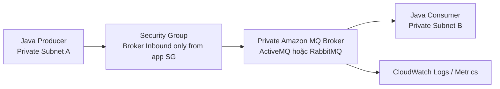

Khuyến nghị:

- Tạo broker với **public accessibility disabled** trừ khi có yêu cầu đã được phê duyệt.
- Đặt producers/consumers trong VPC hoặc kết nối qua VPN/Direct Connect/network được cấp phép.
- Security group của broker chỉ cho **application security groups/CIDRs** được phép vào đúng protocol ports.
- Tách quyền management console/API khỏi quyền message producer/consumer.
- Quản lý route tables, DNS resolution, NACL, AZ, VPC peering/Transit Gateway khi multi-VPC.
- Không mở port broker hoặc admin UI ra `0.0.0.0/0` chỉ để debug.

### 16.2. Các port quan trọng

| Engine | Protocol/interface | Cổng TLS thông dụng trên Amazon MQ |
| --- | --- | --- |
| **ActiveMQ** | OpenWire over TLS | **61617** |
| **ActiveMQ** | AMQP over TLS | **5671** |
| **ActiveMQ** | MQTT over TLS | **8883** |
| **ActiveMQ** | STOMP over TLS | **61614** |
| **ActiveMQ** | MQTT/STOMP over WebSocket | **61619** theo listener |
| **ActiveMQ** | Web console | HTTPS endpoint/port theo cấu hình AWS (thường 8162) |
| **RabbitMQ** | AMQP 0-9-1/AMQP 1.0 (RabbitMQ 4) | **5671** |
| **RabbitMQ** | Management console/API | **443** hoặc **15671** |

**Không tự ghép port vào hostname** khi AWS Console/`DescribeBroker` cung cấp endpoint URI đầy đủ. Protocol support còn phụ thuộc engine version, URI và TLS settings.

### 16.3. TLS không chỉ là “có ssl://”

Client phải:

1. Dùng broker **FQDN được AWS công bố** làm server identity.
2. Xác minh certificate chain/truststore, hostname và `subjectAltName`.
3. Chọn TLS protocol/cipher phù hợp, không tắt TLS validation.
4. Xác định security groups/ports và DNS đúng.
5. Kiểm tra certificate rotation; không pin một server certificate sẽ hết hạn/được thay.
6. Với RabbitMQ, cấu hình Java client `enableHostnameVerification()` nếu dùng thư viện tương ứng.
7. Đừng thay broker FQDN bằng IP hoặc custom alias không được certificate hỗ trợ.

Amazon MQ đang chuyển đổi một số broker certificates từ regional wildcard sang **per-broker certificate**; dùng đúng endpoint FQDN để tránh lỗi sau certificate rotation.

### 16.4. Broker credentials và IAM

- **Default ActiveMQ**: broker users/groups và authorization map, hoặc LDAP auth theo tính năng.
- **Default RabbitMQ**: internal broker users và quyền trên vhost/exchange/queue.
- **RabbitMQ 4/một số phiên bản/cấu hình**: các lựa chọn OAuth2, IAM outbound federation, LDAP, HTTP auth hoặc mTLS client certificate được AWS hỗ trợ theo điều kiện cụ thể.
- **IAM cho AWS MQ API**: quản lý broker/config; không đồng nghĩa có quyền AMQP/OpenWire consume message theo cơ chế default.

**ActiveMQ có thể không có authorization map bị hạn chế mặc định**, khiến một broker user được xác thực có quyền quá rộng. Hãy cấu hình **authorization map/group permissions** thích hợp, kiểm tra console group `activemq-webconsole` khi điều chỉnh policy.

Secrets nên lấy từ **AWS Secrets Manager/Parameter Store** qua IAM role của **ứng dụng**, truyền an toàn cho client, và có rotation plan. Không hard-code password vào source, command line shared hoặc container image.

## 17. Phát hành message đáng tin cậy: outbox và inbox

### 17.1. Vấn đề dual write

Giả sử Java API:

```text
1. INSERT order INTO RDS      -> COMMIT
2. PUBLISH OrderCreated -> Amazon MQ
```

Nếu process crash giữa bước 1 và 2, order tồn tại nhưng **không có event**. Nếu đảo thứ tự, consumer có thể nhận event cho order chưa commit.

### 17.2. Transactional outbox

Một thiết kế thực tế:

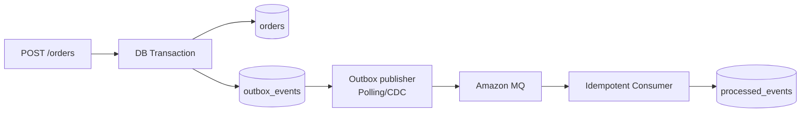

- Ghi order và outbox event **cùng transaction RDS**.
- Relay publish event sang MQ, đợi confirm rồi đánh dấu đã gửi.
- Nếu relay crash, có thể publish lặp → consumer deduplicate theo eventId.
- Consumer ghi `processed_events` với unique constraint cùng transaction business update khi phù hợp.
- Message được ACK sau khi commit/đã nhận diện duplicate.
- Có job reconciliation, retries giới hạn và DLQ handling.

**Outbox không biến broker thành exactly-once network protocol**. Nó giúp tránh mất event do dual write bằng cách cho phép publish lại an toàn.

### 17.3. Ordering có bảo đảm không?

Ordering phụ thuộc:

- Cấu trúc queue, số producers, consumer concurrency.
- Requeue/redelivery, retries và dead-letter/replay.
- Partitioning/sharding theo `aggregateId`.
- RabbitMQ exchange/binding, queue type và consumer behavior.
- JMS Message Groups/quy tắc provider nếu dùng ActiveMQ.

**Một queue không đảm bảo mọi side effect được thực thi đúng trình tự toàn cục** khi nhiều consumers xử lý song song hoặc có redelivery. Nếu nghiệp vụ cần ordering theo đơn hàng, dùng `orderId`/sequence/version để kiểm soát per-aggregate processing.

## 18. HA, maintenance và disaster recovery

### 18.1. Khi broker failover, client phải làm gì?

- **ActiveMQ active/standby**: client dùng **Failover Transport**, chấp nhận một giai đoạn mất kết nối, reconnect và redelivery.
- **RabbitMQ cluster**: RabbitMQ Java client có **automatic network recovery** cho kết nối bị gián đoạn theo cấu hình, nhưng initial connection failures cần retry có backoff.
- Sau reconnect, phải xác minh topology/consumers/channel state và xử lý inflight messages không chắc đã ACK.
- Timeout, exponential backoff + jitter, circuit breaker và producer buffer cần giới hạn để tránh tự tạo quá tải.
- **Không retry vô hạn** nếu broker memory/disk alarm hoặc authorization bị từ chối.

### 18.2. HA trong AZ không đồng nghĩa DR cross-Region

| Vấn đề | HA multi-AZ | Disaster recovery multi-Region |
| --- | --- | --- |
| Broker node lỗi | Standby/quorum phục hồi trong Region | Không nhất thiết cần cross-region |
| Toàn AZ lỗi | Thiết kế multi-AZ giúp duy trì service | Vẫn phụ thuộc phần còn lại Region |
| Toàn Region gặp sự cố | **Không giải quyết đầy đủ** | Cần kiến trúc Region dự phòng, replication/routing |
| Message backlog nhất quán | Theo broker engine và queue type | Phải tính asynchronous replication, lag, RPO |
| Client connection URI | Có thể giữ endpoint/HA pair | Thường cần chuyển broker endpoint |
| DB side effects | Cần DB HA riêng | Cần database replication và chiến lược consistency |

Amazon MQ có một số khả năng **cross-region replication** theo engine/version và cấu hình; hãy kiểm tra tài liệu chính thức trước khi cam kết RPO/RTO. Broker replication **không tự đồng bộ RDS**, không bảo đảm chỉ một lần gửi email/thanh toán sau failover giữa Regions.

### 18.3. Nâng cấp engine version

Trước khi nâng RabbitMQ 3.x → 4.x hoặc ActiveMQ engine:

1. Đọc release notes/breaking changes và danh sách supported engine versions.
2. Kiểm tra instance family, plugins, queue types, client libraries, JMS compatibility.
3. Kiểm thử staging với message real-shape và tải gần production.
4. Lập kế hoạch maintenance/downtime/reconnect; **in-place major version upgrade RabbitMQ 3.13 → 4.2 có giai đoạn broker downtime** theo AWS.
5. Backup/recovery plan và khả năng rollback thực tế, đặc biệt khi thay message schema/queue type.
6. Giám sát queue depths, unacked counts, consumer lag, memory/disk và application errors.
7. Chỉ điều chỉnh production khi có owner, approval và kế hoạch thông báo khách hàng.

Không tự suy đoán RabbitMQ 4.3 hỗ trợ mọi feature/plugin đã có ở open-source RabbitMQ 4.3. Amazon MQ quản lý plugin availability và service restrictions.

## 19. Tạo broker trên AWS Console

> **Cảnh báo chi phí:** Broker có **phí theo giờ** trong lúc tồn tại, kể cả không có messages. Cluster/active-standby và storage có chi phí đáng kể. Chỉ tạo khi có sandbox và ngân sách được phê duyệt; các bài đọc-only bên dưới không yêu cầu tạo broker.

### 19.1. Chọn engine và deployment

1. Mở [Amazon MQ Console](https://console.aws.amazon.com/amazon-mq/) trong **AWS account/Region** được cấp.
2. Chọn **Create brokers**.
3. Chọn **Apache ActiveMQ** hoặc **RabbitMQ** dựa trên **protocol/client compatibility**.
4. Chọn version được AWS hỗ trợ tại Region, kiểm tra client compatibility và maintenance policy.
5. Chọn **Single-instance** cho sandbox hoặc **ActiveMQ active/standby / RabbitMQ cluster** nếu cần HA.
6. Chọn instance type, storage/deployment mode phù hợp (ActiveMQ EFS/EBS constraints; RabbitMQ EBS/cluster).
7. Đặt broker name **không chứa PII/secret**.
8. Chọn VPC/subnets/AZs/security groups, **disable public accessibility** nếu không có yêu cầu đã duyệt.
9. Tạo broker user initial admin credential qua cơ chế an toàn, lưu secret có kiểm soát.
10. Chọn encryption/KMS options, maintenance window, CloudWatch logging, tags, monitoring.
11. Review chi phí/quotas và tạo broker.
12. Khi broker `RUNNING`, lưu **endpoint(s) do AWS cấp**, test connectivity từ VPC client được phép.

### 19.2. Hai hướng cấu hình mẫu

| Thuộc tính | ActiveMQ JMS migration | RabbitMQ order events |
| --- | --- | --- |
| Engine | ActiveMQ Classic version hỗ trợ | RabbitMQ 4.3/4.2 version hỗ trợ |
| Deployment | Active/standby multi-AZ | 3-node cluster multi-AZ |
| Data | EFS shared store | EBS-backed nodes + quorum queues |
| Protocol | OpenWire TLS `61617` | AMQP 0-9-1 TLS `5671` |
| App | Java JMS client | RabbitMQ Java client/Spring AMQP |
| Client HA | Failover Transport pair | Automatic network recovery + retry |
| Message pattern | Queue + durable topics | Topic/direct exchanges + quorum queues |
| Secrets | Broker user credentials/LDAP | Internal user/vhost or configured federation |
| Monitoring | Heap, queue depth, connections | Memory/disk, ready/unacked, quorum health |

## 20. AWS CLI: đọc broker và phiên bản an toàn

Dùng AWS CLI v2, đúng IAM profile và Region:

```bash
# Kiểm tra danh tính.
aws sts get-caller-identity --profile training

# Danh sách broker trong Region.
aws mq list-brokers \
  --region ap-southeast-1 \
  --profile training

# Xem broker detail, engine, deployment, endpoints, VPC/SG.
aws mq describe-broker \
  --broker-id b-EXAMPLE-BROKER-ID \
  --region ap-southeast-1 \
  --profile training

# Xem instance types/options được hỗ trợ cho engine.
aws mq describe-broker-instance-options \
  --engine-type RABBITMQ \
  --region ap-southeast-1 \
  --profile training

# Xem engine types và versions.
aws mq describe-broker-engine-types \
  --region ap-southeast-1 \
  --profile training
```

`b-EXAMPLE-BROKER-ID` chỉ là placeholder. Kết quả `describe-broker` có thể chứa broker endpoint, SG/VPC, usernames/config metadata; **không lưu credentials vào tickets/logs**. Nếu broker không hiện, trước tiên xem account/Region/IAM permission.

### 20.1. Trường cần ghi nhận từ describe-broker

| Trường | Ý nghĩa |
| --- | --- |
| `EngineType` / `EngineVersion` | ActiveMQ/RabbitMQ và version |
| `DeploymentMode` | SINGLE_INSTANCE, ACTIVE_STANDBY_MULTI_AZ hoặc CLUSTER_MULTI_AZ tùy engine |
| `BrokerState` | RUNNING, CREATING, FAILED, v.v. |
| `HostInstanceType` | Broker compute sizing |
| `StorageType` | Kiểu storage khi áp dụng |
| `Endpoints` | Broker connection URLs **do AWS cung cấp** |
| `SubnetIds` / `SecurityGroups` | Kết nối network trong VPC |
| `PubliclyAccessible` | Có public access không |
| `Logs` / `MaintenanceWindowStartTime` | Observability và maintenance |
| `EncryptionOptions` | KMS encryption at rest |

Không thay đổi subnet/VPC broker in-place nếu API/service không hỗ trợ; nhiều trường hợp cần **tạo broker mới và migrate client/queues**. Không sửa hạ tầng trực tiếp trong bài read-only.

### 20.2. Broker creation/configuration có tác động

Các lệnh như `aws mq create-broker`, `update-broker`, `reboot-broker`, `delete-broker` có thể làm phát sinh chi phí hoặc gián đoạn dịch vụ. Chỉ chạy trên sandbox đã được cấp phép, có owner và rollback/cleanup plan. **Không đưa broker password dưới dạng command-line argument** dễ bị ghi vào history/process logs; dùng phương án Secrets Manager/IaC với xử lý secret an toàn được duyệt.

## 21. Monitoring và alerting: những gì cần xem

### 21.1. ActiveMQ metrics

| Tín hiệu | Ý nghĩa | Hành động |
| --- | --- | --- |
| `CpuUtilization` | Mức sử dụng CPU | Xem peak, throughput, instance sizing |
| `HeapUsage` | JVM heap pressure | Kiểm tra memory, queue depth, GC |
| Queue/topic destination metrics | Backlog/enqueue/dequeue/consumer activity theo hỗ trợ | Tìm consumer chậm hoặc mất |
| Connections | Client lifecycle, churn | Xem reconnect loop, leak |
| Broker log/restart/maintenance | Engine errors, policy, failover | Đối chiếu app errors và thời gian sự kiện |

Một ActiveMQ broker tồn tại không có nghĩa queue đang drain đúng SLA. Theo dõi **tuổi message lớn nhất, backlog/processing latency và xử lý DLQ** cùng metrics broker.

### 21.2. RabbitMQ metrics

| Tín hiệu | Ý nghĩa | Khi cần báo động |
| --- | --- | --- |
| `SystemCpuUtilization` | CPU broker node | Cao kéo dài ảnh hưởng throughput |
| `RabbitMQMemUsed` vs `RabbitMQMemLimit` | Memory high watermark | Gần giới hạn có thể block publishes |
| `RabbitMQDiskFree` vs `RabbitMQDiskFreeLimit` | Disk free watermark | Thấp có thể block producer traffic |
| `ConnectionCount` / `ChannelCount` | Số kết nối/channels | Churn/leak đột biến |
| `ConsumerCount` | Số consumers | Giảm về 0 khi workload cần consumer |
| `MessageReadyCount` | Messages chờ giao | Backlog tăng |
| `MessageUnacknowledgedCount` | Đã giao nhưng chờ ACK | Consumer chậm/treo hoặc prefetch quá lớn |
| RabbitMQ management/Prometheus | Per-queue, routing, quorum, Raft metrics | Quan sát chi tiết theo version |

**Đặc biệt RabbitMQ 4.x:** Amazon MQ **không xuất per-queue metrics theo dimensions `Queue`/`VirtualHost` qua CloudWatch giống RabbitMQ 3.x**. Xem **RabbitMQ management API** hoặc **Prometheus endpoints** (RabbitMQ 4.2+) cho chi tiết từng queue. CloudWatch vẫn cung cấp một số broker/node metrics.

### 21.3. Nguyên nhân sâu của backlog

```text
Producer rate:    900 msg/s
Consumer rate:    600 msg/s
Backlog growth:   ~300 msg/s
After 10 minutes: ~180,000 messages extra
```

Đây là phép tính minh họa khi tốc độ gần ổn định; thực tế có traffic bursts, redelivery và batch size.

**Thêm broker nodes không luôn làm consumer nhanh hơn**: cần đo DB capacity, số consumers, queue parallelism, prefetch, CPU, QoS và processing latency. Tăng consumers có thể khiến DB nghẽn nếu mỗi consumer mở quá nhiều connections.

### 21.4. Logs và kiểm toán

- **CloudWatch Logs**: broker general/audit logs theo engine/support; kiểm tra log retention.
- **CloudWatch Alarms**: memory/disk/CPU/queue backlog/consumer gaps.
- **CloudTrail**: ai tạo, sửa, reboot broker/config trên AWS control plane.
- **Application structured logs**: `eventId`, queue, processing status, duration, retryCount, correlation ID — **không log message chứa PII/secrets**.
- **Tracing**: propagate trace ID khi publish/consume; không giả định distributed trace tự nối chỉ vì broker trung gian.

## 22. Bảo mật theo nguyên tắc least privilege

### 22.1. IAM + broker auth

**Tách bốn lớp quyền:**

1. IAM Operator: được xem/tạo/sửa broker theo role.
2. Broker administrator: quản lý vhosts/users/queues/exchanges hoặc console.
3. Producer: được **write** tới exchanges/destinations được phép.
4. Consumer: được **read** từ queues cần thiết, không có quyền thay topology nếu không cần.

### 22.2. Secret và TLS

- Đặt broker trong **private VPC**, đóng public access khi không cần.
- SG chỉ cho phép **đúng protocol port** từ workloads được ủy quyền.
- Bật **TLS** và kiểm tra server FQDN/certificate.
- Dữ liệu broker được **encryption at rest** qua KMS theo cấu hình.
- Không dùng admin password cho service application.
- Secrets lưu trong Secrets Manager; kiểm soát IAM `GetSecretValue`, KMS grants và rotation plan.
- Tránh dùng `guest/guest` hoặc default credentials trong production.
- Phân quyền theo namespace/vhost/queue và broker policies.
- Khi dùng OAuth2/IAM federation/mTLS ở RabbitMQ, kiểm tra **engine version, plugin/config, scope mapping và fallback auth** — không nghĩ chỉ bật một checkbox là an toàn.

### 22.3. Message-level security

- Không phát thông tin PII/token/mật khẩu vào message nếu không bắt buộc.
- Thiết kế schema version, data classification, retention/expiry và encryption bổ sung khi compliance yêu cầu.
- Producer/consumer phải validate schema; xem event data là **untrusted input**.
- Nếu nội dung chứa secret/PII, hạn chế quyền đọc/log/preview ở management UI và DLQ.
- DLQ giữ dữ liệu lỗi có thể nhạy cảm; áp chính sách retention/ops access riêng.
- Khi consumer gọi external service, dùng role IAM theo workloads, không sử dụng broker credentials như AWS credentials.

## 23. Chi phí và capacity planning

### 23.1. Những thành phần chi phí chính

| Hạng mục | Ghi chú |
| --- | --- |
| **Broker instance-hours** | Tính theo engine, instance type và số broker nodes (single/active-standby/cluster) |
| **Broker storage** | EBS/EFS và dung lượng sử dụng theo cấu hình/dịch vụ |
| **Data transfer** | Giữa AZ/Region/VPC và egress theo bảng giá |
| **CloudWatch Logs/metrics** | Log ingestion, retention, monitoring, dashboards |
| **KMS/Secrets Manager** | Khi dùng customer managed keys/secrets |
| **Networking** | NAT, VPN/Direct Connect, endpoints, load balancers phụ trợ nếu có |
| **Application compute** | ECS/EC2/EKS/Lambda producers/consumers |
| **Data stores** | RDS/DynamoDB/S3, outbox/inbox/DLQ operations |

**Một RabbitMQ cluster có ba nodes không có cùng chi phí một single-instance broker.** ActiveMQ active/standby cũng có chi phí capacity/storage khác. Tạo broker dev và không gửi message vẫn có thể bị tính broker-hours.

Tham khảo [Amazon MQ pricing](https://aws.amazon.com/amazon-mq/pricing/) và [AWS Pricing Calculator](https://calculator.aws/).

### 23.2. Ước lượng backlog và storage

Giả sử:

- 200 messages/giây.
- Kích thước mỗi message trung bình 2 KiB.
- Consumers ngừng hoạt động 20 phút.

Backlog tăng thô:

\[
200 \times 1{,}200 = 240{,}000\ \text{messages}
\]

Dung lượng payload thô:

\[
240{,}000 \times 2\ \mathrm{KiB}
= 480{,}000\ \mathrm{KiB}
\approx 469\ \mathrm{MiB}
\]

**Đây không phải disk requirement cuối cùng.** Cần cộng headers/metadata, replication, journal/queue indices, persistence overhead, fragmentation, retry/DLQ, HA replicas và margin. Mức memory/disk pressure có thể xuất hiện trước khi disk đầy.

### 23.3. Công thức chọn consumer capacity

Giả sử mỗi worker xử lý **25 messages/giây** ổn định và peak producers gửi **300 messages/giây**:

\[
N_{\text{consumers}}
\gtrsim
\left\lceil \frac{300}{25}\right\rceil=12
\]

Cần bổ sung hệ số dự phòng cho AZ loss, lỗi downstream, retry và variation. **12 consumers** chỉ là phép tính thô, không đảm bảo broker/DB xử lý được 300 msg/s.

### 23.4. Khi nào chi phí khiến nên chọn dịch vụ khác?

Nếu ứng dụng không dùng protocol compatibility, không cần JMS, không cần RabbitMQ exchange routing, đội ngũ không muốn vận hành broker memory/disk/version, thì **SQS/SNS/EventBridge** có thể phù hợp và kinh tế hơn cho new workloads. Amazon MQ là dịch vụ được quản lý nhưng vẫn là **broker capacity**, không phải serverless queue với quy mô vô hạn.

## 24. Troubleshooting: phân biệt lỗi connection và lỗi messaging

| Triệu chứng | Nguyên nhân thường gặp | Kiểm tra |
| --- | --- | --- |
| Connect timeout | SG/NACL/route/VPC/DNS sai | App subnet/VPC, broker endpoint, port |
| TLS handshake failure | Truststore/cert/hostname không hợp lệ | FQDN từ AWS, certificate validation, TLS |
| AMQP `ACCESS_REFUSED` | Username/password, vhost, permissions sai | Broker users, vhost `read/write/configure` |
| AMQP `PRECONDITION_FAILED` khi queueDeclare | Queue đã tồn tại nhưng type/durable/arguments khác | Queue definition thực tế; không xóa bừa |
| OpenWire failover không hoạt động | Client chỉ dùng một endpoint/URI sai | Failover Transport và cả hai endpoints |
| JMS `ClassNotFound`/`NoClassDefFoundError` | `javax.jms`/`jakarta.jms` hoặc dependency clash | JMS provider/version, Spring Boot compatibility |
| RabbitMQ producer confirm nhưng consumer không thấy message | Exchange binding/routing key sai, không xử lý mandatory return | Exchange type, bindings, routing key |
| Queue depth tăng | Consumer chậm/downstream nghẽn | Processing latency, consumers, DB/CPU |
| Unacked tăng cao | Consumer giữ messages, prefetch lớn, ACK lỗi | `basicQos`, ACK code, network |
| Redelivery loop | NACK requeue=true không giới hạn | Bounded retry, DLX/DLQ, poison |
| DLQ không có message dù NACK false | Không cấu hình DLX hoặc routing không tới DLQ | Policies, DLX bindings |
| Publish bị block | Memory/disk alarm | `RabbitMQMemUsed/Limit` và `DiskFree/Limit` |
| Quorum queue mất availability | Không có Raft majority hoặc node/AZ lỗi | Cluster health, replicas, Raft metrics |
| Classic queue mất message khi node failure | Không có replication như quorum | Queue type, durability, backup |
| Client reconnect nhưng duplicate | Publish confirm/ACK mất trong failover | Idempotency, eventId, outbox |
| RabbitMQ 4 per-queue CloudWatch metrics trống | Thay đổi support của engine 4 | Management API/Prometheus |
| MQTT/STOMP client không nối RabbitMQ | Protocol không trong managed RabbitMQ supported list | Chọn ActiveMQ hoặc khác |
| Java app không truy cập S3 | Broker credentials không phải IAM role của app | Workload IAM, SDK config |
| API worker xử lý chậm sau scale-out | DB connection pool/third-party quota quá tải | Downstream saturation, retries |
| Broker cost tăng | Broker cluster/active standby, storage/logs | Cost Explorer, owner, cleanup |

### Quy trình tìm nguyên nhân theo lớp

1. **Đúng môi trường?** AWS account/Region, broker state, engine/version.
2. **Đúng giao thức?** AMQP 0-9-1 vs AMQP 1.0, OpenWire, JMS namespace.
3. **Network?** VPC, subnet, private/public access, SG/NACL, DNS, TLS.
4. **Auth?** Broker user/password, vhost/permissions, OAuth/IAM/mTLS nếu đã cấu hình.
5. **Topology?** Exchange type, bindings/routing keys, queue names/type, durable/autoDelete.
6. **Publish?** Publisher confirm, mandatory returns, persistent delivery mode.
7. **Consume?** Consumer count, prefetch, ACK/NACK, retries, DLX/DLQ.
8. **Downstream?** DB transactions, external APIs, idempotency and message schema.
9. **Broker health?** Memory/disk alarms, node/cluster/quorum status, maintenance.
10. **Cost & operations?** Backlog, versions, logs, incident timeline và ngân sách.

**Không mở broker ra Internet, tắt TLS verification, xóa queue có backlog hoặc tăng MaxConnections mù quáng** để chữa lỗi chưa xác định.

## 25. Thực hành theo tình huống (không cần tạo broker trả phí)

### 25.1. Bối cảnh

Một doanh nghiệp vận hành:

- **Legacy Java accounting** sử dụng JMS/ActiveMQ Classic, cần transaction-oriented commands.
- **Orders API** Spring Boot 3, phát `OrderCreated` cho billing và analytics.
- **Notification Worker** xử lý email, có thể lỗi tạm thời khi nhà cung cấp email chập chờn.
- **Reporting** muốn xem số event/ngày.
- Hệ thống yêu cầu network private, ít nhất hai AZ cho ứng dụng, giám sát và chi phí có owner.

### 25.2. Bài A — Chọn engine và dịch vụ

| Nhu cầu | Lựa chọn gợi ý | Vì sao |
| --- | --- | --- |
| Giữ code dùng ActiveMQ JMS/OpenWire | **Amazon MQ for ActiveMQ** | Client/protocol compatibility |
| Microservices dùng AMQP exchanges/bindings | **Amazon MQ for RabbitMQ** | Direct/topic/fanout routing |
| Queue đơn giản AWS-native, không phụ thuộc broker | **Amazon SQS** | Không chọn broker instance |
| Fan-out events tới nhiều SQS queues | **SNS + SQS** | Managed pub/sub + queue |
| GraphQL/subscriptions | AppSync hoặc service phù hợp | Không phải mặc định MQ |
| Event integration với rules/schemas | **EventBridge** | Event routing API |
| Long-term event stream/replay | MSK/Kinesis | Không dùng RabbitMQ Streams trên Amazon MQ |

**Câu hỏi:** nếu legacy Java không còn phụ thuộc JMS/ActiveMQ và chỉ cần async job queue, tại sao nên đánh giá SQS trước khi mua broker lớn?

### 25.3. Bài B — Tạo sơ đồ RabbitMQ routing

Yêu cầu:

- Producer phát `orders.created` và `orders.cancelled`.
- Billing chỉ cần `orders.created`.
- Analytics cần mọi `orders.*`.
- Notification cần `orders.created` và có DLQ riêng.

Hãy chọn exchange **topic** `orders.events.x` và bindings:

```text
orders.events.x [topic]
  -> billing.q      binding: orders.created
  -> analytics.q    binding: orders.*
  -> notification.q binding: orders.created

notification.q failures
  -> orders.dlx
  -> notification.failed.q
```

Bổ sung:

- Queue type quorum theo cluster/version hỗ trợ.
- Publisher confirms + mandatory returns.
- Bounded retries + DLX policy.
- Idempotency eventId.
- Metrics ready/unacked, DLQ depth và consumer processing lag.

### 25.4. Bài C — Tìm duplicate và mất message

Cho quy trình:

```text
1. Orders API commits Order 42 in RDS.
2. Orders API publishes OrderCreated E42.
3. Consumer writes audit entry.
4. Consumer crashes before ACK.
5. Broker redelivers E42.
```

Trả lời:

1. Vì sao audit entry có thể bị ghi hai lần?
2. Dùng `eventId=E42` và unique constraint thế nào?
3. ACK ở bước nào để giảm nguy cơ mất side effect?
4. Nếu API crash giữa DB commit và publish MQ, transactional outbox giải quyết ra sao?
5. Vì sao publisher confirm không chứng minh consumer đã xử lý?

### 25.5. Bài D — Thiết kế HA

Chọn phương án:

- ActiveMQ legacy production cần hai AZ: **active/standby** và Failover Transport.
- RabbitMQ production cần chịu lỗi một node/AZ: **3-node cluster + quorum queues**.
- Dev sandbox chấp nhận downtime: **single-instance**, nhưng có backup/cleanup owner.

Thảo luận: khi cả Region mất, vì sao những cấu hình trên chưa đủ để bảo đảm RPO=0 và service tiếp tục hoạt động ngay?

### 25.6. Bài E — Tính nhanh backlog

Giả sử queue có **2.000 messages/phút**, consumers chỉ xử lý **1.400 messages/phút** trong 30 phút.

Tính:

\[
(2000-1400)\times 30 = 18{,}000\ \text{messages tồn đọng mới}
\]

Nếu mỗi message 4 KiB, payload thô khoảng **70 MiB**, chưa tính broker overhead và replication. Liệt kê các loại métrics/alarms cần thiết trước khi tăng consumers.

### 25.7. Bài F — Read-only broker inventory

Nếu được cấp sandbox có broker sẵn, chạy chỉ các lệnh đọc ở mục 20. Ghi:

```text
AWS Account / Region: ...
Broker name / ID (redacted): ...
Engine: ACTIVEMQ / RABBITMQ
Engine version: ...
Deployment: SINGLE_INSTANCE / ACTIVE_STANDBY_MULTI_AZ / CLUSTER_MULTI_AZ
Instance type / node count: ...
Storage: EBS/EFS ...
Publicly accessible: Yes/No
VPC / Subnets / AZs: ...
Security groups and allowed protocol ports: ...
Endpoints (redacted): ...
App protocol/client library: ...
Broker auth type / vhost / permissions: ...
Queue/exchange/topic topology: ...
Durability and ACK/confirm settings: ...
Retry policy / DLQ: ...
Monitoring: CPU/memory/disk/ready/unacked ...
Recovery/RPO/RTO plan: ...
Costs / owner / reviewer / date: ...
```

**Tiêu chí hoàn thành:** người học phân biệt đúng broker/engine/protocol, nêu rõ JMS không phải wire protocol, thiết kế RabbitMQ exchange routing, biết cấu hình ACK/confirm/retry/DLQ/idempotency, chọn đúng multi-AZ mode và xác định network/IAM/chi phí. Bài không yêu cầu tạo, reboot hoặc xóa broker thật.

## 26. Câu hỏi tự kiểm tra

1. Message broker giải quyết loại coupling nào mà HTTP đồng bộ thường gặp?
2. Amazon MQ khác SQS ở việc lựa chọn broker instance và wire protocol ra sao?
3. Khi nào chọn Amazon MQ ActiveMQ thay vì RabbitMQ?
4. JMS là một wire protocol hay Java API?
5. Vì sao AMQP 0-9-1 client không tự kết nối được như AMQP 1.0 client?
6. RabbitMQ 4 trên Amazon MQ hỗ trợ những JMS versions nào, với các giới hạn đáng chú ý gì?
7. RabbitMQ managed broker có hỗ trợ MQTT/STOMP trực tiếp giống ActiveMQ không?
8. Queue khác topic (ActiveMQ) và exchange (RabbitMQ) thế nào?
9. Direct/topic/fanout exchange xử lý routing key khác nhau ra sao?
10. `*` và `#` trong RabbitMQ topic binding có khác nhau không?
11. ActiveMQ active/standby dùng mấy AZ, storage nào và client cần failover thế nào?
12. RabbitMQ cluster multi-AZ có mấy nodes và vì sao nên dùng quorum queues?
13. Quorum queue dùng cơ chế leader/follower/majority nào?
14. RabbitMQ Streams có được Amazon MQ hỗ trợ không?
15. Publisher confirm có bảo đảm consumer đã xử lý xong DB transaction không?
16. Vì sao publish với confirm vẫn cần mandatory return handling?
17. ACK sau DB commit làm consumer tránh mất message nhưng có thể gây duplicate thế nào?
18. Làm sao xử lý consumer crash sau side effect nhưng trước ACK?
19. Khi nào dùng NACK requeue=true, và tại sao requeue vô hạn là nguy hiểm?
20. DLQ không nhận message sau NACK false có thể do nguyên nhân gì?
21. Transactional outbox giải quyết rủi ro gì giữa RDS và MQ?
22. Vhost/permissions RabbitMQ khác IAM `mq:DescribeBroker` ra sao?
23. Những cổng TLS nào thường dùng cho OpenWire và AMQPS?
24. Vì sao dùng broker FQDN thay IP/custom alias khi kiểm tra certificate?
25. Khi nào cần xem management API/Prometheus thay vì CloudWatch per-queue metrics ở RabbitMQ 4?
26. Tại sao broker cluster không làm dữ liệu RDS tự được replicate sang Region dự phòng?
27. Khi sizing broker, những hạng mục nào ngoài message payload cần tính?
28. Khi nào một hệ thống mới nên dùng SNS/SQS thay vì tự duy trì broker?

## 27. Tài liệu AWS và chuẩn chính thức

1. [Amazon MQ Developer Guide](https://docs.aws.amazon.com/amazon-mq/latest/developer-guide/).
2. [Amazon MQ for ActiveMQ brokers](https://docs.aws.amazon.com/amazon-mq/latest/developer-guide/amazon-mq-basic-elements.html).
3. [ActiveMQ deployment options](https://docs.aws.amazon.com/amazon-mq/latest/developer-guide/amazon-mq-broker-architecture.html).
4. [ActiveMQ storage types](https://docs.aws.amazon.com/amazon-mq/latest/developer-guide/broker-storage.html).
5. [Amazon MQ for RabbitMQ](https://docs.aws.amazon.com/amazon-mq/latest/developer-guide/working-with-rabbitmq.html).
6. [RabbitMQ deployment options](https://docs.aws.amazon.com/amazon-mq/latest/developer-guide/rabbitmq-broker-architecture.html).
7. [Amazon MQ RabbitMQ supported protocols](https://docs.aws.amazon.com/amazon-mq/latest/developer-guide/rabbitmq-supported-protocols.html).
8. [RabbitMQ JMS support](https://docs.aws.amazon.com/amazon-mq/latest/developer-guide/rabbitmq-jms-support.html).
9. [RabbitMQ 4 support and limitations](https://docs.aws.amazon.com/amazon-mq/latest/developer-guide/rabbitmq-4.html).
10. [RabbitMQ engine versions and support](https://docs.aws.amazon.com/amazon-mq/latest/developer-guide/rabbitmq-version-management.html).
11. [RabbitMQ quorum queues](https://docs.aws.amazon.com/amazon-mq/latest/developer-guide/quorum-queues.html).
12. [RabbitMQ best practices](https://docs.aws.amazon.com/amazon-mq/latest/developer-guide/best-practices-broker-setup.html).
13. [RabbitMQ network resilience](https://docs.aws.amazon.com/amazon-mq/latest/developer-guide/best-practices-network-resilience.html).
14. [Amazon MQ broker authentication and authorization](https://docs.aws.amazon.com/amazon-mq/latest/developer-guide/amazon-mq-access.html).
15. [Amazon MQ security best practices](https://docs.aws.amazon.com/amazon-mq/latest/developer-guide/using-amazon-mq-securely.html).
16. [Amazon MQ TLS certificates](https://docs.aws.amazon.com/amazon-mq/latest/developer-guide/amazon-mq-certificates.html).
17. [RabbitMQ broker CloudWatch metrics](https://docs.aws.amazon.com/amazon-mq/latest/developer-guide/rabbitmq-logging-monitoring.html).
18. [RabbitMQ Prometheus metrics](https://docs.aws.amazon.com/amazon-mq/latest/developer-guide/rabbitmq-prometheus-metrics.html).
19. [Amazon MQ logging and monitoring](https://docs.aws.amazon.com/amazon-mq/latest/developer-guide/security-logging-monitoring.html).
20. [AWS CLI MQ](https://docs.aws.amazon.com/cli/latest/reference/mq/).
21. [Amazon MQ pricing](https://aws.amazon.com/amazon-mq/pricing/).
22. [Amazon SQS vs SNS vs MQ](https://docs.aws.amazon.com/AWSSimpleQueueService/latest/SQSDeveloperGuide/welcome.html).
23. [RabbitMQ exchange routing (RabbitMQ docs)](https://www.rabbitmq.com/docs/exchanges).
24. [RabbitMQ publisher confirms (RabbitMQ docs)](https://www.rabbitmq.com/docs/confirms).
25. [RabbitMQ dead lettering (RabbitMQ docs)](https://www.rabbitmq.com/docs/dlx).

> **Ghi nhớ:** **Amazon MQ** là message broker được quản lý chứ không phải hàng đợi serverless vô hạn. **ActiveMQ** phù hợp migration JMS/OpenWire/STOMP/MQTT; **RabbitMQ** mạnh về AMQP exchanges/queues/bindings và quorum queues, đồng thời RabbitMQ 4 bổ sung AMQP 1.0/JMS với giới hạn cụ thể. Để hệ thống Java tin cậy cần kết hợp **TLS + phân quyền broker, publisher confirms, consumer ACK, bounded retry/DLQ, idempotency/outbox, multi-AZ, monitoring và dự toán chi phí**.
