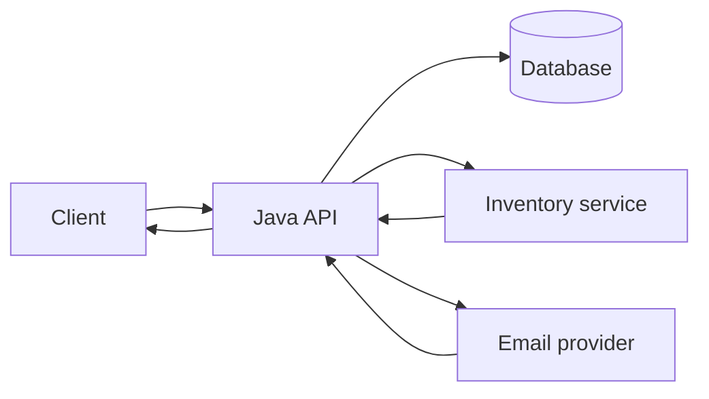
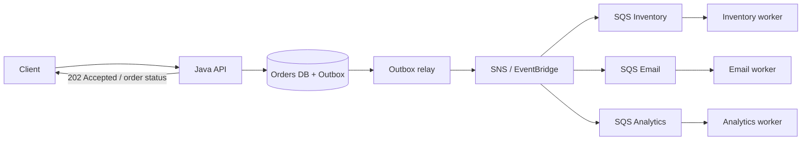
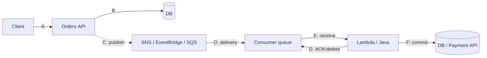
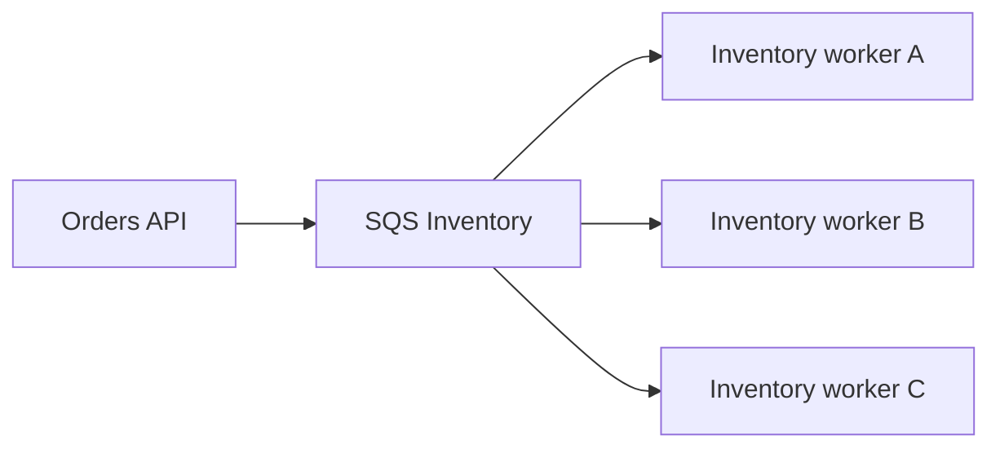
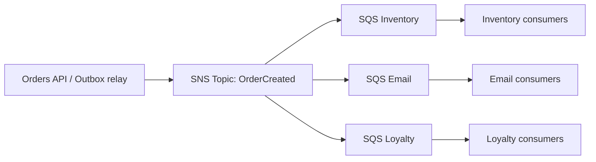
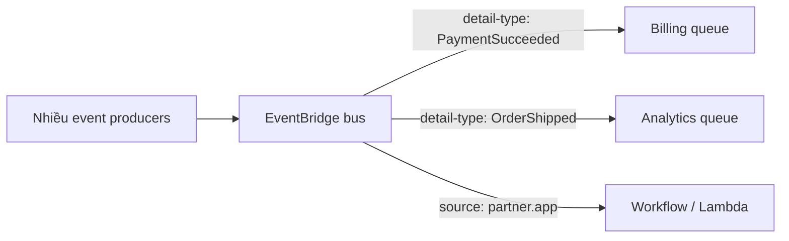
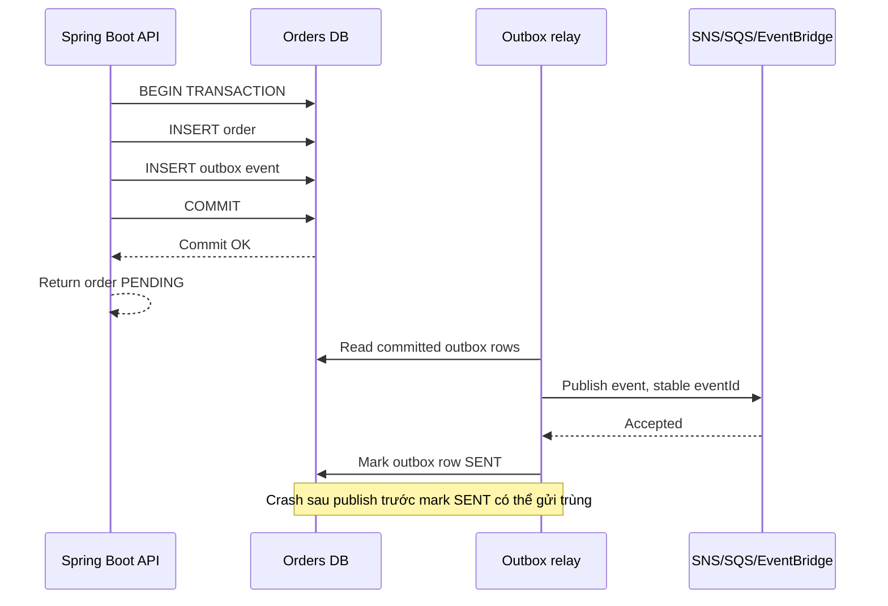
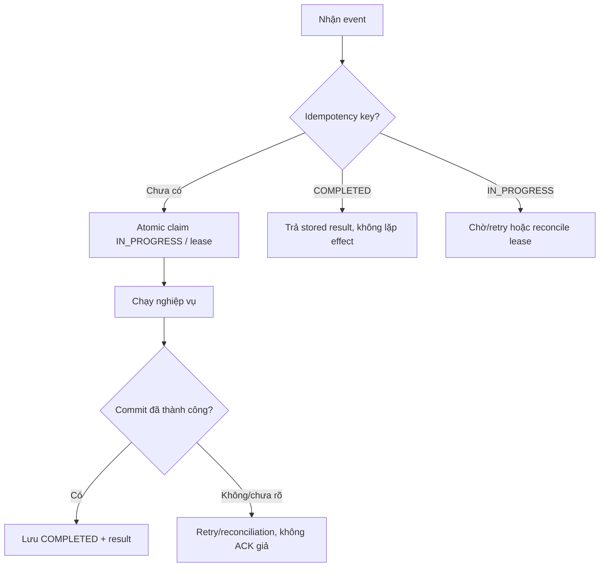
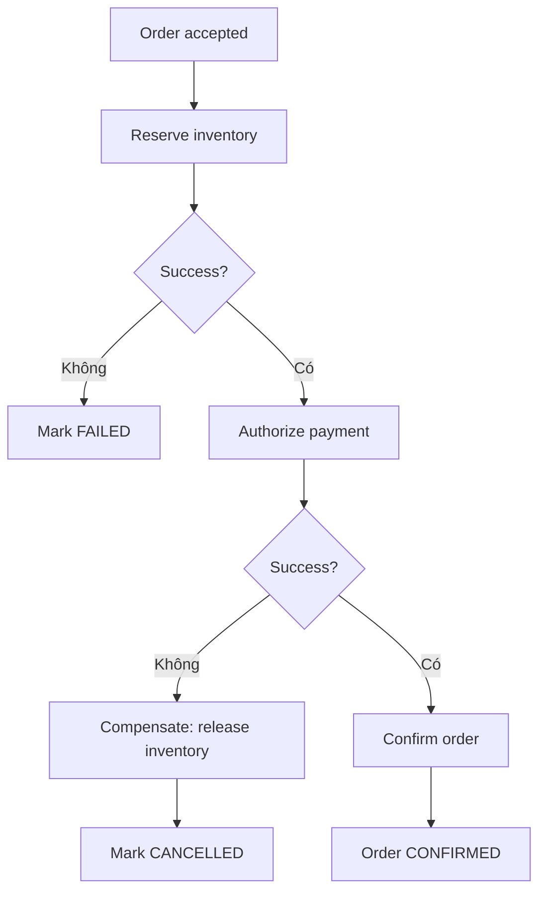
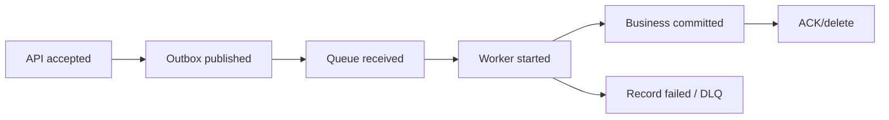

# Thiết kế xử lý bất đồng bộ với bảo đảm giao nhận phù hợp trên AWS

Một hệ thống thương mại điện tử chạy **Java Spring Boot** nhận đơn hàng qua API. Sau khi lưu đơn, hệ thống cần trừ tồn kho, gửi email, tính điểm thưởng và cập nhật báo cáo. Nếu mọi việc được thực hiện đồng bộ trong HTTP request, một dịch vụ email chậm có thể khiến khách hàng chờ lâu hoặc nhận lỗi dù đơn hàng đã được lưu thành công. Giải pháp thường là phát **event/message** và để các **consumers** xử lý bất đồng bộ.

Nhưng “đưa vào queue” chưa giải quyết hết bài toán độ tin cậy. Điều gì xảy ra khi:

- Database đã commit nhưng producer **chưa kịp gửi** message?
- SQS đã nhận message nhưng response xác nhận gửi **bị mất**, producer gửi lại?
- Consumer đã trừ tồn kho nhưng **crash trước khi xóa** SQS message?
- Một event `OrderShipped` đến trước `OrderPaid`?
- Một fan-out subscriber hỏng trong khi các subscribers khác thành công?
- Khách hàng hủy thanh toán trong khi workflow vẫn chờ kết quả từ bên thứ ba?

Thiết kế tốt không dừng ở việc chọn **Amazon SQS**, **Amazon SNS** hay **Amazon EventBridge**. Phải chọn **bảo đảm giao nhận phù hợp** cho từng nhánh: **at-most-once**, **at-least-once**, thứ tự trong phạm vi hợp lệ, giới hạn deduplication, **idempotency**, xử lý lỗi, quan sát và khôi phục.

Bài học thuộc chương **Hàng đợi và thông báo** trong module **CLOUD_PROVIDERS_AWS**. Nội dung kết nối IAM, VPC, vùng sẵn sàng AZ, EC2/ECS/EKS, Lambda, lưu trữ, cơ sở dữ liệu, tích hợp và serverless để triển khai ứng dụng vừa an toàn, có thể mở rộng, theo dõi và phục hồi, vừa kiểm soát được chi phí.

## 1. Mục tiêu học tập

Sau bài này, bạn có thể:

1. Phân biệt **delivery guarantee**, **processing guarantee**, **ordering**, **durability** và **business consistency**.
2. Giải thích vì sao **at-least-once** thường phù hợp cho tác vụ quan trọng và vì sao **exactly-once side effect end-to-end** không tự có từ queue.
3. Chọn đúng **SQS Standard**, **SQS FIFO**, **SNS Standard/FIFO**, **EventBridge**, **Lambda** hoặc **Step Functions** theo fan-out, định tuyến, workflow và thứ tự.
4. Nhận diện **dual-write problem** và triển khai ý tưởng **transactional outbox**.
5. Thiết kế consumer Java dùng **ack/delete sau commit**, idempotency key và DynamoDB conditional writes.
6. Cấu hình **Lambda SQS partial batch response**, xử lý lỗi riêng từng message, bảo toàn thứ tự FIFO.
7. Xây dựng retry/backoff/visibility timeout, **DLQ**, redrive và quy trình xử lý poison message.
8. Kiểm soát concurrency, backpressure, SLO, bảo mật IAM/KMS/VPC và chi phí.
9. Kiểm thử lỗi tại mọi ranh giới: trước/sau commit, trước/sau publish/ack, outage và replay.
10. Dùng sơ đồ, bảng quyết định, ví dụ Java/IaC và checklist để chọn một kiến trúc có thể vận hành trong production.

## 2. Vì sao cần bất đồng bộ?

Xử lý đồng bộ có đường đi đơn giản:



Nếu inventory hoặc email chậm, HTTP request có thể timeout. Retry từ client có thể tạo đơn hoặc side effect trùng nếu API không idempotent.

Mô hình bất đồng bộ tách **tiếp nhận** khỏi **thực hiện**:



**Lợi ích:**

- **Decoupling:** producer không cần biết consumer đang chạy ở EC2, ECS, EKS hay Lambda.
- **Buffering:** queue hấp thụ traffic burst trong khi consumers xử lý dần.
- **Independent scaling:** inventory và email có throughput/concurrency khác nhau.
- **Resilience:** consumer có thể tạm dừng mà API vẫn nhận đơn khi queue và downstream trong giới hạn.
- **Fan-out:** một sự kiện được phân phối cho nhiều mục đích mà không nhân bản logic ở producer.

**Đánh đổi:** dữ liệu **eventually consistent**, có thể có duplicate/out-of-order, thêm IAM/network/logging, backlog, retry/DLQ và trách nhiệm vận hành.

### 2.1. Async không có nghĩa “đã hoàn thành”

API trả `202 Accepted` hoặc trạng thái `PENDING` thường chỉ có nghĩa **đã chấp nhận công việc và lưu bền vững ý định xử lý**, chứ chưa bảo đảm email đã gửi hay tồn kho đã trừ.

Nếu API trả “đơn hàng hoàn tất” ngay sau khi `SendMessage` thành công, người dùng có thể hiểu nhầm về trạng thái thực. Nên cung cấp `orderId`, trạng thái xử lý và API/query để xem kết quả; có thể dùng WebSocket/SNS/mobile push khi cần cập nhật.

## 3. Ba kiểu bảo đảm giao nhận thường gặp

### 3.1. At-most-once

**At-most-once** nghĩa là một event được giao/xử lý **không quá một lần** theo phạm vi mô hình; có thể **bị mất** khi gặp lỗi.

Ví dụ sơ đồ tự xây “đọc message rồi ACK ngay, sau đó xử lý”:

```text
Receive M1
   ├─ ACK/delete ngay
   ├─ Worker crash
   └─ Business operation chưa chạy → mất việc
```

Cách này có thể chấp nhận cho **telemetry best effort** hoặc tín hiệu tạm thời mà mất một vài mẫu không ảnh hưởng nghiệp vụ, nhưng không phù hợp cho thanh toán/ghi sổ.

**Chú ý:** không phải chỉ cần cấu hình retry = 0 là sẽ có at-most-once end-to-end; các đường publisher, broker, SDK và downstream vẫn cần xét riêng.

### 3.2. At-least-once

**At-least-once** nghĩa là hệ thống cố gắng giao event **một hoặc nhiều lần**, dưới những giới hạn về retention, quyền, retry/quota và tình trạng dịch vụ đã cấu hình. Cái giá là **duplicates**.

```text
Receive M1
   ├─ Write database thành công
   ├─ Worker crash trước ACK/delete
   ├─ Message xuất hiện lại sau visibility timeout
   └─ M1 bị xử lý lại nếu không có idempotency
```

Đây là mô hình thực tế của **SQS Standard** và nhiều tích hợp event-driven AWS. Với nghiệp vụ quan trọng, **at-least-once delivery + idempotent processing + DLQ/recovery** thường hữu dụng hơn cố ép mạng luôn giao đúng một lần.

### 3.3. Exactly-once: phải hỏi “chính xác ở lớp nào?”

Cụm từ **exactly-once** chỉ có ý nghĩa khi chỉ rõ **phạm vi bảo đảm**:

- **Producer deduplication:** hệ thống queue không lưu hai bản trùng cùng dedup ID trong một khoảng thời gian.
- **Workflow execution semantics:** orchestrator có thể bảo đảm cách thực thi một state machine theo hợp đồng riêng.
- **Database write:** một `INSERT ... ON CONFLICT` hoặc conditional write có thể ghi record duy nhất.
- **Business side effect:** chỉ trừ tiền/tồn kho **một lần** dù consumer được gọi lại.

Một hệ thống gồm **SQS → Lambda → DynamoDB → payment API** không trở thành exactly-once business process chỉ vì chọn **FIFO**. Dữ liệu ở nhiều dịch vụ không nằm trong một transaction chung; **crash giữa hai side effects** vẫn là bài toán cần thiết kế.

### 3.4. Bảng lựa chọn bảo đảm

| Yêu cầu nghiệp vụ | Bảo đảm nên nhắm tới | Cơ chế cần có |
|---|---|---|
| Event telemetry có thể mất một số mẫu | Best effort/at-most-once chấp nhận được trong phạm vi rõ | Không retry tràn lan, đo tỷ lệ mất |
| Gửi email chào mừng | At-least-once + chống gửi email trùng khi cần | Queue, retry, idempotency theo `welcomeEmail:customerId` |
| Cập nhật tồn kho | At-least-once + effect idempotent, có thể cần thứ tự | Business key, conditional update, DLQ |
| Thanh toán | Hiệu quả tương đương một side effect (effectively-once) | Payment idempotency key, reconciliation, audit |
| Trạng thái đơn hàng theo phiên bản | Có kiểm soát thứ tự/phiên bản | FIFO theo aggregate ID hoặc optimistic concurrency |
| Tổng hợp analytics | At-least-once + dedupe/aggregation policy | Event ID, checkpoint, watermark |
| Workflow dài nhiều bước | Bền vững, có retry/compensation rõ | Step Functions Standard hoặc orchestration phù hợp |

**Nên viết SLO bằng ngôn ngữ nghiệp vụ:** “99,9% đơn được xử lý trong 2 phút, không được trừ tiền hai lần; mọi đơn thất bại phải có trạng thái/đường xử lý” rõ hơn “queue exactly-once”.

## 4. Đánh giá từng ranh giới giao nhận

Một hệ thống gồm nhiều ranh giới:



Hỏi lần lượt:

| Ranh giới | Câu hỏi quan trọng |
|---|---|
| **A Client → API** | Client timeout và gửi lại sẽ tạo hai orders không? Có idempotency key cho API không? |
| **B API → DB** | Ghi order có transaction/unique constraint không? |
| **C DB → event publish** | DB commit thành công nhưng publish thất bại thì event có mất không? |
| **D Broker/router → queue** | Mỗi target nhận bản riêng? Filtering/retry policy/DLQ nằm ở đâu? |
| **E Queue → worker** | Worker nhận trùng, hết visibility hoặc bị throttle thế nào? |
| **F Worker → business data** | Side effect đã xảy ra nhưng response bị mất thì sao? |
| **G Worker → delete/ACK** | Nếu commit rồi crash trước delete thì xử lý lại có an toàn không? |

**Không thể lấy guarantee ở ranh giới D để kết luận toàn hệ thống từ A đến G an toàn.** Mỗi ranh giới cần bảo đảm và cơ chế khôi phục riêng.

## 5. Chọn dịch vụ AWS theo mục tiêu

| Dịch vụ/tính năng | Mẫu giao tiếp | Thứ tự/duplicate | Khi nên chọn |
|---|---|---|---|
| **SQS Standard** | Queue, competing consumers | At-least-once, best-effort order, có duplicate | Công việc nền độc lập, throughput cao, chấp nhận xử lý đảo thứ tự |
| **SQS FIFO** | Queue theo `MessageGroupId` | Thứ tự trong group, gửi dedup trong 5 phút; vẫn cần idem ở consumer | Đơn hàng, tài khoản, workflow cần thứ tự theo aggregate |
| **SNS Standard** | Topic pub/sub fan-out | Delivery/retry phụ thuộc protocol, không bảo đảm strict ordering | Một event gửi nhiều subscribers độc lập |
| **SNS FIFO + SQS FIFO** | Ordered fan-out | Thứ tự/dedup theo group và điều kiện hỗ trợ | Nhiều consumer cùng cần ordered events |
| **SNS FIFO + SQS Standard** | Fan-out, subscriber không cần FIFO | Delivery có thể duplicate/out-of-order ở Standard queue | Một topic chung, subscriber chọn guarantee khác nhau |
| **EventBridge event bus/rules** | Event routing, filtering, SaaS/AWS integrations | Delivery/retry theo rule/target; không là global FIFO queue | Định tuyến theo event type, nguồn, account và mục tiêu |
| **Lambda async invocation** | Async function queue do Lambda quản lý | Retry/age của Lambda, duplicate có thể xảy ra | Công việc event-driven ngắn, retry theo function |
| **Step Functions Standard** | Workflow orchestration bền vững | Exactly-once **workflow execution semantics** theo điều kiện; task Retry có thể gọi lại | Business process nhiều bước, chờ callback, audit/compensation |
| **Step Functions Express** | Workflow ngắn, volume cao | Async Express at-least-once, sync Express at-most-once **execution** | Event transform/high-volume ngắn |
| **Kinesis / DynamoDB Streams** | Ordered records theo shard | Checkpoint, stream replay/retention | CDC, phân tích dòng sự kiện, thứ tự theo shard |

**Không nhầm:** Lambda SQS trigger không phải Lambda async invocation queue; Lambda **poll** SQS qua event source mapping, nên chính sách retry chủ yếu nằm ở queue/visibility/ESM.

Nguồn chính thức: [SQS Standard queues](https://docs.aws.amazon.com/AWSSimpleQueueService/latest/SQSDeveloperGuide/standard-queues.html), [SNS FIFO message delivery](https://docs.aws.amazon.com/sns/latest/dg/fifo-message-delivery.html), [Choosing Step Functions workflow type](https://docs.aws.amazon.com/step-functions/latest/dg/choosing-workflow-type.html).

## 6. Ba kiến trúc bất đồng bộ cần phân biệt

### 6.1. Point-to-point work queue



Các workers **cạnh tranh nhận** công việc trong cùng queue. Mục tiêu là **mỗi message được một worker hoàn tất**, nhưng giao lại có thể xảy ra; cần idempotency. **Không phải** mỗi worker đều nhận một bản của message.

### 6.2. Pub/sub fan-out



Mỗi subscription tới **một queue riêng** nhận bản của event khi phù hợp; từng nhánh có tốc độ, DLQ và quy tắc retry độc lập. Nếu Email xử lý lỗi, Inventory không phải retry cùng message chỉ vì email thất bại.

**Cẩn thận:** lỗi **SNS → SQS delivery** khác lỗi **consumer xử lý sau khi message đã vào SQS**. Cần thiết kế DLQ ở đúng nơi.

### 6.3. Rule-based event routing



EventBridge phù hợp khi tổ chức muốn dùng schema/event contract, rules, target retry và tích hợp AWS/SaaS, thay vì publisher biết từng queue/topic. **EventBridge rules không tạo global ordering guarantee** cho các events từ mọi producer.

### 6.4. Saga/workflow dài

```text
Order accepted → Reserve inventory → Authorize payment
      ↓ failure                         ↓ success
Release reservation              Confirm shipment
      ↓                                 ↓
Mark cancelled                    Mark completed
```

Nếu tác vụ có các bước chờ lâu hoặc compensation phức tạp, **Step Functions Standard** có thể rõ ràng và dễ audit hơn chuỗi queues tự điều phối. Dù vậy, mỗi task gọi external API vẫn cần idempotency.

## 7. SQS Standard: throughput lớn, giao nhận ít nhất một lần

**SQS Standard** có throughput rất lớn và cố gắng duy trì thứ tự gửi nhưng **không bảo đảm thứ tự**, có thể giao duplicate vì kiến trúc phân tán.

### 7.1. Phù hợp khi

- Công việc nền có thể xử lý độc lập: resize ảnh, gửi email có dedupe, indexing/search, analytics.
- Phân công nhiều worker và muốn scale theo backlog.
- Thứ tự tương đối ít quan trọng, hoặc có **version checks** ở consumer.
- Ưu tiên đơn giản/throughput hơn FIFO semantics.

### 7.2. Không phù hợp trực tiếp khi

Một entity có chuỗi `Debit 100 → Refund 100 → Debit 50` mà việc đảo thứ tự có thể gây hậu quả không thể sửa. Khi đó cần FIFO theo account hoặc bảo vệ ở database bằng version/ledger/order constraints.

**Lưu ý hiện hành:** SQS Standard cũng có thể dùng `MessageGroupId` cho các tính năng như fair queues trong những trường hợp được hỗ trợ, nhưng **không biến Standard thành FIFO ordered queue**.

### 7.3. SQS nhận xong có nghĩa gì?

`SendMessage` thành công chứng tỏ message được SQS chấp nhận theo hợp đồng lưu trữ của dịch vụ, **không có nghĩa consumer đã hoàn thành**. Producer không nên tự gán order status = `FULFILLED` khi chỉ mới có SQS acknowledgment.

## 8. SQS FIFO: đảm bảo thứ tự theo nhóm, dedup trong cửa sổ

**SQS FIFO** cung cấp:

- Ordering theo `MessageGroupId`.
- **Deduplication interval 5 phút** theo `MessageDeduplicationId` hoặc content-based deduplication.
- Các messages thuộc một group không được giao cho consumer khác để xử lý đan xen theo ngữ nghĩa FIFO cho đến khi xử lý/xóa hoặc hết visibility phù hợp.
- Song song giữa **nhiều message groups**, không có global order trên mọi groups.

### 8.1. Hai ID phải hiểu

| ID | Chức năng | Ví dụ |
|---|---|---|
| `MessageGroupId` | Nhóm cần giữ thứ tự | `ORDER#123`, `ACCOUNT#8` |
| `MessageDeduplicationId` | Xác định lần gửi lặp để lọc trong cửa sổ dedup | `event-id-abc-001` |

**Đừng dùng `customerId` làm MessageGroupId duy nhất** nếu mỗi customer có quá nhiều thao tác độc lập và muốn concurrency cao; có thể chọn `aggregateId` phù hợp với ranh giới thứ tự thật.

### 8.2. Giới hạn của 5 phút

```text
12:00 Producer gửi eventId=e-101 → SQS FIFO chấp nhận
12:02 Producer retry e-101        → trùng, SQS dedup trong 5 phút
12:08 Producer retry e-101        → ngoài 5 phút, có thể là message mới
```

Content-based deduplication dùng hash **message body**, không bao gồm **message attributes**. Nếu cùng body nhưng attributes chứa thao tác khác, có thể bị coi trùng; nếu body chứa timestamp mới, cùng nghiệp vụ lại thành hash khác. Khi quan trọng, **cấp MessageDeduplicationId ổn định ở producer**.

**Không suy ra FIFO là business exactly-once.** Duplicate processing vẫn có thể xảy ra nếu consumer commit rồi crash trước delete hoặc hết visibility và được receive lại.

Nguồn: [SQS FIFO exactly-once processing scope](https://docs.aws.amazon.com/AWSSimpleQueueService/latest/SQSDeveloperGuide/FIFO-queues-exactly-once-processing.html), [Recovering from outages](https://docs.aws.amazon.com/AWSSimpleQueueService/latest/SQSDeveloperGuide/designing-for-outage-recovery-scenarios.html).

### 8.3. SNS FIFO có những giới hạn gì?

SNS FIFO topic có thể fan-out tới **SQS FIFO** hoặc **SQS Standard** queues. Muốn giữ FIFO tới consumer, các subscription đích phải là **FIFO SQS queues**; Standard queue vẫn có thể duplicate và đảo thứ tự.

SNS FIFO **không giao trực tiếp** tới email/SMS/HTTP(S) endpoints như SNS Standard theo khả năng hỗ trợ được tài liệu nêu; nếu cần Lambda consumer, cấu hình **SNS FIFO → SQS (FIFO nếu cần thứ tự) → Lambda event source mapping**.

**Subscription filter** làm thay đổi tập sự kiện mà consumer nhận, nên không thể hứa mọi sự kiện từ topic đều xuất hiện ở một subscriber. Với SNS FIFO, điều kiện đảm bảo giao nhận chính xác còn phụ thuộc vào filter, quyền, retry, mạng và hành vi consumer — đọc hợp đồng AWS thay vì đồng nhất với SQS FIFO.

Nguồn: [SNS FIFO message delivery](https://docs.aws.amazon.com/sns/latest/dg/fifo-message-delivery.html), [SNS FIFO deduplication](https://docs.aws.amazon.com/sns/latest/dg/fifo-message-dedup.html).

## 9. Event contract quan trọng hơn định dạng JSON đẹp

Một event nên mô tả **sự thật đã xảy ra** hoặc một **command** rõ ràng, không trộn ngữ nghĩa.

Ví dụ event `OrderAccepted`:

```json
{
  "eventId": "01JYXEVTEXAMPLE",
  "eventType": "OrderAccepted",
  "eventVersion": 2,
  "aggregateType": "Order",
  "aggregateId": "ORD-123",
  "aggregateVersion": 7,
  "tenantId": "tenant-a",
  "occurredAt": "2026-11-20T02:00:00Z",
  "correlationId": "req-20261120-abc",
  "causationId": "command-create-order-123",
  "data": {
    "customerId": "CUS-900",
    "totalMinorUnits": 159900,
    "currency": "VND"
  }
}
```

### 9.1. Vai trò của từng trường

| Trường | Vì sao cần |
|---|---|
| `eventId` | Định danh event ổn định khi publish retry và duplicate delivery |
| `eventType` | Consumer biết handler nào xử lý |
| `eventVersion` | Nâng cấp schema mà không phá consumer cũ |
| `aggregateId` | Khóa nghiệp vụ để chọn MessageGroupId hoặc kiểm tra trạng thái |
| `aggregateVersion` | Phát hiện event cũ/đảo thứ tự và optimistic concurrency |
| `tenantId` | Ranh giới dữ liệu và IAM/authorization nghiệp vụ |
| `occurredAt` | Audit và phân tích độ trễ, **không làm nguồn thứ tự tuyệt đối** |
| `correlationId` | Liên kết HTTP request, DB transaction, event và logs |
| `causationId` | Event này sinh ra từ command/event nào |
| `data` | Payload nhỏ gọn, không đẩy secrets/PII không cần thiết vào queue |

### 9.2. Event hay command?

- **Event**: `OrderAccepted`, `PaymentCaptured` — sự thật quá khứ, có thể có nhiều subscribers.
- **Command**: `ReserveInventory`, `SendEmail` — yêu cầu một handler làm công việc; có thể cần kết quả/ack.

Khi producer phát command tới topic có nhiều subscribers cùng thực hiện side effect, có thể vô tình gọi nhiều lần một thao tác chỉ nên làm một lần. Phân biệt **work queue một consumer group** với **pub/sub nhiều consumers độc lập**.

### 9.3. Schema evolution

- Ưu tiên thêm trường optional có default hoặc giá trị hợp lý.
- Giữ event version, hỗ trợ consumer phiên bản cũ trong thời gian migration.
- Khi bỏ hoặc đổi ý nghĩa trường, cân nhắc **event type/version mới** và giai đoạn song song.
- Không dùng “không nhận ra version → ACK thành công” khiến mất dữ liệu.
- Với event cần bảo mật/tuân thủ, chỉ gửi ID và tham chiếu thay vì toàn bộ hồ sơ cá nhân.

## 10. Ranh giới ACK: khi nào mới được xóa message?

Đối với Java worker tự poll SQS:

```text
1. Receive message + receipt handle
2. Validate event và tenant
3. Check durable idempotency state
4. Execute/commit durable business effect
5. Record result / audit nếu cần
6. DeleteMessage bằng receipt handle của lần receive
```

**Delete trước bước 4 gây mất công việc nếu crash.** Delete sau bước 4 có thể khiến message xử lý lại nếu crash giữa bước 4–6; vì vậy idempotency **không thể bỏ**.

| Crash window | Điều có thể xảy ra | Phòng ngừa |
|---|---|---|
| Trước receive | Message còn queue | Poll lại |
| Sau receive, trước business write | Hết visibility và retry | Thời hạn visibility đúng |
| Sau business write, trước DeleteMessage | Duplicate processing | Durable idempotency |
| DeleteMessage request thành công nhưng response bị mất | Worker tưởng thất bại, không chắc message đã xóa | Dựa vào trạng thái nghiệp vụ, không suy luận chắc chắn |
| Producer publish thành công nhưng mất ACK | Producer retry gửi trùng | Stable event ID, FIFO dedup và consumer idem |
| Receiver thấy lỗi từ downstream nhưng downstream đã commit | Outcome không xác định | Provider idem key, lookup/reconciliation |

**Receipt handle** là token của **lần receive**, không phải event ID. Khi delete phải dùng receipt handle mới nhất của message; không lưu receipt handle làm business dedupe key.

## 11. Dual-write problem ở phía producer

Trường hợp thường gặp trong Java Spring:

```java
@Transactional
public Order createOrder(CreateOrderCommand cmd) {
    Order order = repository.save(new Order(cmd));
    sqs.sendMessage(...);     // Gửi tới hệ thống KHÁC database
    return order;
}
```

Annotation `@Transactional` chỉ bảo đảm transaction của database được cấu hình, **không bao bọc SQS** trong cùng ACID transaction.

Có hai cửa sổ lỗi:

- **DB commit, SQS publish fail:** đơn tồn tại nhưng inventory/analytics không biết.
- **SQS publish, DB rollback:** consumer thấy event về đơn không tồn tại.

Đây là **dual-write problem**. Không có thứ tự “DB trước hay SQS trước” nào loại bỏ hoàn toàn lỗi.

### 11.1. Transactional outbox giải quyết thế nào?

Trong **cùng database transaction**, lưu:

1. Order/business row.
2. Một outbox row ghi **ý định phát event**, gồm `eventId`, payload/schema và trạng thái.

Worker riêng hoặc CDC relay đọc những row **đã commit** rồi gửi lên broker. Nếu relay crash sau publish nhưng trước đánh dấu `SENT`, có thể gửi lại — **consumer vẫn cần idempotency**.



Nguồn: [AWS Prescriptive Guidance — Transactional outbox pattern](https://docs.aws.amazon.com/prescriptive-guidance/latest/cloud-design-patterns/transactional-outbox.html).

## 12. Transactional outbox trong PostgreSQL/Spring Boot

### 12.1. Mô hình SQL tối giản

```sql
CREATE TABLE orders (
    id              VARCHAR(64) PRIMARY KEY,
    tenant_id       VARCHAR(64) NOT NULL,
    status          VARCHAR(32) NOT NULL,
    version         BIGINT NOT NULL DEFAULT 1
);

CREATE TABLE outbox_events (
    event_id        VARCHAR(64) PRIMARY KEY,
    aggregate_id    VARCHAR(64) NOT NULL,
    aggregate_version BIGINT NOT NULL,
    event_type      VARCHAR(100) NOT NULL,
    payload_json    TEXT NOT NULL,
    status          VARCHAR(20) NOT NULL DEFAULT 'PENDING',
    created_at      TIMESTAMPTZ NOT NULL DEFAULT now(),
    sent_at         TIMESTAMPTZ
);

CREATE INDEX idx_outbox_pending
    ON outbox_events (status, created_at);
```

Mẫu này **không phải schema production đầy đủ**: cần indexes theo workload, retention, lease/lock cho relay nhiều instances, auditing, encryption và migration.

### 12.2. Ghi Order và Outbox trong cùng transaction

```java
@Service
public class OrderApplicationService {

    private final OrderRepository orders;
    private final OutboxRepository outbox;

    public OrderApplicationService(
            OrderRepository orders, OutboxRepository outbox) {
        this.orders = orders;
        this.outbox = outbox;
    }

    @Transactional
    public Order accept(CreateOrderCommand command) {
        // API-level idempotency: ensure command.requestId is unique
        // for this business operation, not just one HTTP request attempt.
        Order order = orders.save(Order.from(command));

        OutboxEvent event = OutboxEvent.orderAccepted(
            command.eventId(), order.getId(), order.getVersion()
        );
        outbox.save(event);

        return order;
    }
}
```

`OrderRepository`, `OutboxRepository` và domain classes là interfaces/types của ứng dụng, **không được cung cấp bởi AWS SDK**. Ví dụ thể hiện ranh giới transaction, không phải chương trình tự chạy nếu chưa cài đặt các thành phần đó.

**Điều kiện quan trọng:** cả hai repositories phải sử dụng **cùng transaction manager/database** được `@Transactional` quản lý. Nếu một repository ghi sang DynamoDB còn repository kia vào RDS, annotation không tạo transaction chung.

### 12.3. Outbox relay phải có thể gửi lại

Relay đáng tin:

1. Claim các rows `PENDING` qua lock hoặc lease có timeout, chống hai relay gửi đồng thời không kiểm soát.
2. Publish với **event ID ổn định** và attributes rõ ràng.
3. Chỉ mark `SENT` **sau khi broker xác nhận accepted**.
4. Nếu publish/mark thất bại, retry có giới hạn và backoff.
5. Giữ audit/counter, dọn dữ liệu `SENT` theo retention.
6. Không dùng lock dài xuyên cuộc gọi mạng nếu có thể tránh; thiết kế lease, crash recovery và retry concurrency.

**Dù có claim/lease, relay vẫn có thể gửi duplicate** khi crash sau publish mà chưa mark SENT. Đó là hành vi cần thiết kế chống trùng ở consumer.

### 12.4. Alternative: CDC / DynamoDB Streams

Nếu dữ liệu ở DynamoDB, có thể dùng **DynamoDB Streams** để phát hiện item thay đổi rồi đưa ra EventBridge/SQS qua Lambda. Với sự kiện đại diện cho thao tác nghiệp vụ, cần xác định rõ nguồn sự thật/định dạng, version và idempotency. CDC là một cách triển khai event relay nhưng **không tự bảo đảm business operation xảy ra một lần**.

## 13. Java SDK v2: publish vào SQS FIFO

Ví dụ một producer đã có `eventId` **ổn định** cho sự kiện cùng thao tác, gửi vào FIFO queue:

```java
import software.amazon.awssdk.services.sqs.SqsClient;
import software.amazon.awssdk.services.sqs.model.SendMessageRequest;
import software.amazon.awssdk.services.sqs.model.SendMessageResponse;

public final class OrderEventPublisher {
    private final SqsClient sqs;
    private final String fifoQueueUrl;

    public OrderEventPublisher(SqsClient sqs, String fifoQueueUrl) {
        this.sqs = sqs;
        this.fifoQueueUrl = fifoQueueUrl;
    }

    public String publishOrderEvent(
            String orderId, String stableEventId, String jsonPayload) {

        if (orderId == null || orderId.isBlank()
                || stableEventId == null || stableEventId.isBlank()) {
            throw new IllegalArgumentException("Missing identity");
        }

        SendMessageResponse accepted = sqs.sendMessage(
            SendMessageRequest.builder()
                .queueUrl(fifoQueueUrl)
                .messageGroupId("ORDER#" + orderId)
                .messageDeduplicationId(stableEventId)
                .messageBody(jsonPayload)
                .build()
        );
        return accepted.messageId();
    }
}
```

**Giả định:** queue có tên dạng `orders.fifo`, `jsonPayload` là JSON đã validate và producer có `sqs:SendMessage` vào đúng ARN. Mọi lần retry của **cùng event** phải dùng cùng `stableEventId`; không tạo UUID mới mỗi retry.

**Điểm cần nhớ:**

- Trả `messageId` nghĩa là **SQS đã nhận**, không phải handler đã hoàn tất.
- Nếu không cần thứ tự, SQS Standard đơn giản hơn; Standard không đòi `MessageDeduplicationId`/group như FIFO.
- Không dùng ID duy nhất mỗi lần gửi lại vì sẽ vô hiệu hóa deduplication.
- Không tin dedup window 5 phút làm bằng chứng ngăn duplicate sau nhiều ngày hoặc DLQ replay.
- IAM role/credentials lấy qua AWS SDK default credentials provider chain phù hợp; không hardcode AWS access keys.

## 14. Java worker: ACK sau durable processing

Worker EC2/ECS/EKS có thể dùng **SqsClient** và long polling. Một interface nghiệp vụ bắt buộc thực hiện **durable side effect idempotent**:

```java
public interface IdempotentOrderProcessor {
    // Throws on any business failure; returns only after durable commit.
    void process(String eventJson);
}
```

SQS polling skeleton:

```java
import java.util.List;
import software.amazon.awssdk.services.sqs.SqsClient;
import software.amazon.awssdk.services.sqs.model.DeleteMessageRequest;
import software.amazon.awssdk.services.sqs.model.Message;
import software.amazon.awssdk.services.sqs.model.ReceiveMessageRequest;

public final class InventoryConsumer {
    private final SqsClient sqs;
    private final String queueUrl;
    private final IdempotentOrderProcessor processor;

    public InventoryConsumer(
            SqsClient sqs, String queueUrl,
            IdempotentOrderProcessor processor) {
        this.sqs = sqs;
        this.queueUrl = queueUrl;
        this.processor = processor;
    }

    public void pollOnce() {
        List<Message> messages = sqs.receiveMessage(
            ReceiveMessageRequest.builder()
                .queueUrl(queueUrl)
                .waitTimeSeconds(20)
                .maxNumberOfMessages(10)
                .build()
        ).messages();

        for (Message m : messages) {
            try {
                // Commit must happen inside processor.
                processor.process(m.body());

                sqs.deleteMessage(
                    DeleteMessageRequest.builder()
                        .queueUrl(queueUrl)
                        .receiptHandle(m.receiptHandle())
                        .build()
                );
            } catch (Exception failure) {
                // Leave message for visibility timeout / DLQ.
                // Log identifiers, not full secret/PII payload.
                System.err.println("Failed message " + m.messageId()
                        + "; cause=" + failure.getClass().getSimpleName());
            }
        }
    }
}
```

**Mẫu không chạy tự động** nếu chưa inject `IdempotentOrderProcessor` thực hiện đúng logic. Không triển khai bằng cách thay `processor.process` thành `System.out.println` rồi tự xóa mọi message: in log **không phải commit nghiệp vụ**.

### 14.1. Về visibility timeout

Nếu xử lý mất 80 giây nhưng queue visibility timeout là 30 giây, message có thể được giao lại khi worker đầu vẫn xử lý. Chọn timeout phù hợp p99 và dùng `ChangeMessageVisibility` nếu công việc dài; không gia hạn vô hạn mà không có circuit breaker và TTL.

Với Lambda SQS ESM, AWS khuyến nghị visibility timeout ít nhất **6 × Lambda function timeout** cộng **batch window** khi có. Đây là cấu hình vận hành để giảm retry/throttling, không thay idempotency.

## 15. Lambda + SQS: bảo đảm tại mức từng record

Lambda **poll** SQS theo batch. Nếu một record thất bại và handler throw toàn invocation, **mọi record trong batch có thể retry**, kể cả các records đã xử lý thành công.

Khi ESM được bật:

```text
FunctionResponseTypes = [ReportBatchItemFailures]
```

Lambda handler có thể trả **partial success**: chỉ những **SQS message IDs** bị lỗi được giữ lại để retry.

### 15.1. Java Lambda handler cho Standard queue

```java
import com.amazonaws.services.lambda.runtime.Context;
import com.amazonaws.services.lambda.runtime.RequestHandler;
import com.amazonaws.services.lambda.runtime.events.SQSEvent;
import com.amazonaws.services.lambda.runtime.events.SQSBatchResponse;

import java.util.ArrayList;
import java.util.List;

public final class OrdersSqsLambda
        implements RequestHandler<SQSEvent, SQSBatchResponse> {

    private final IdempotentOrderProcessor processor;

    public OrdersSqsLambda() {
        // In real Lambda setup, initialize an injected production
        // processor with AWS SDK clients and durable idempotency store.
        this.processor = event -> {
            throw new UnsupportedOperationException(
                "Wire real business processing before deployment");
        };
    }

    @Override
    public SQSBatchResponse handleRequest(SQSEvent event, Context ctx) {
        List<SQSBatchResponse.BatchItemFailure> failures = new ArrayList<>();

        for (SQSEvent.SQSMessage message : event.getRecords()) {
            try {
                processor.process(message.getBody());
            } catch (Exception error) {
                ctx.getLogger().log(
                    "Record failed " + message.getMessageId()
                    + ", type=" + error.getClass().getSimpleName()
                );
                failures.add(
                    new SQSBatchResponse.BatchItemFailure(message.getMessageId())
                );
            }
        }
        return new SQSBatchResponse(failures);
    }
}
```

**Mẫu cố ý ném lỗi cho đến khi có business processor thật**, để không ACK giả và làm mất messages khi người học copy nguyên. Trong production phải nối logic vào Java handler và thêm dependencies `aws-lambda-java-core`, `aws-lambda-java-events`, IAM/KMS/VPC và kiểm thử tích hợp.

**Quan trọng:** bật `ReportBatchItemFailures` ở **event source mapping**. Nếu handler trả danh sách failed IDs nhưng mapping không bật option, phản hồi không được hiểu như partial success và messages lỗi có thể bị xóa. Nếu handler **throw exception ra ngoài**, cả batch được coi là thất bại.

### 15.2. FIFO: stop-on-first-error

Với SQS FIFO, để giữ thứ tự, **dừng ở record lỗi đầu tiên** rồi report **record đó + tất cả records chưa xử lý**.

```text
FIFO batch: A1 A2 A3 A4
            ✓  ✗  -  -

Response:
{
  "batchItemFailures": [
    {"itemIdentifier": "A2"},
    {"itemIdentifier": "A3"},
    {"itemIdentifier": "A4"}
  ]
}
```

Không dùng code chạy song song các records cùng `MessageGroupId`, hoặc dừng vòng lặp nhưng bỏ quên IDs chưa xử lý: Lambda có thể hiểu những records đó thành công và xóa khỏi queue.

### 15.3. Partial response không loại bỏ duplicates

Đối với SQS, **Lambda Errors metric** có thể không tăng khi một invocation trả `batchItemFailures` hợp lệ. Hãy phát business metrics về số records thành công/thất bại và quan sát queue age, DLQ, throttles.

Nguồn: [Lambda SQS event source mapping](https://docs.aws.amazon.com/lambda/latest/dg/with-sqs.html), [Partial batch responses](https://docs.aws.amazon.com/lambda/latest/dg/services-sqs-errorhandling.html).

## 16. Idempotency: xác định “một lần” ở business layer

**Idempotency** nghĩa là xử lý lại cùng một **logical operation** không tạo thêm side effect không mong muốn. Ví dụ `ReserveInventory(orderId=123)` chạy hai lần nhưng tồn kho chỉ trừ một lần.

### 16.1. Khóa chống trùng

| Ứng viên | Hợp lý? | Giải thích |
|---|---|---|
| `tenantId:orderId:ReserveInventory` | Có khi phản ánh đúng duy nhất một reservation | Giữ ổn định qua queue retry/replay |
| `paymentIntentId` | Có nếu payment provider sử dụng để dedupe | Cần cùng key ở provider |
| `producerEventId` | Có nếu producer giữ cố định trên mọi resend | Không được tạo lại sau timeout |
| SQS `messageId` | Chỉ định danh SQS message, không đủ cho business replay | New send/DLQ redrive có thể cấp ID mới |
| `customerId` | Không | Một khách có nhiều orders hợp lệ |
| Hash raw JSON | Chỉ khi canonical payload cố định | Timestamp/attribute order có thể khác |

**Tránh xung đột giữa tenants**: business key luôn cần namespace hoặc tenant khi dữ liệu đa tenant.

### 16.2. DynamoDB conditional claim

Giả sử `ProcessedOperations` có primary key `operationId`.

```java
import java.util.Map;
import software.amazon.awssdk.services.dynamodb.DynamoDbClient;
import software.amazon.awssdk.services.dynamodb.model.AttributeValue;
import software.amazon.awssdk.services.dynamodb.model.PutItemRequest;

public final class IdempotencyClaims {
    private final DynamoDbClient ddb;
    public IdempotencyClaims(DynamoDbClient ddb) {
        this.ddb = ddb;
    }

    public void claim(String tenantId, String operationId) {
        String key = tenantId + "#" + operationId;

        ddb.putItem(PutItemRequest.builder()
            .tableName("ProcessedOperations")
            .item(Map.of(
                "operationId", AttributeValue.fromS(key),
                "state", AttributeValue.fromS("IN_PROGRESS")
            ))
            .conditionExpression("attribute_not_exists(operationId)")
            .build());
    }
}
```

Nếu hai invocations tranh cùng key, một conditional put thành công, lần còn lại nhận `ConditionalCheckFailedException`. **Không xử lý exception này bằng “return success” một cách mù quáng**: cần đọc record, so sánh input fingerprint/tenant, kiểm tra `COMPLETED` hay `IN_PROGRESS` và hành động tương ứng.

### 16.3. State machine thực tế



Các tình huống phải thiết kế:

- **Crash sau claim, trước effect:** lease timeout cho phép xử lý lại.
- **Effect thành công, crash trước COMPLETED:** không thể suy luận chỉ từ record IN_PROGRESS. External API nên hỗ trợ **idempotency key** hoặc lookup để reconcile.
- **COMPLETED nhưng ACK bị mất:** duplicate consumer trả kết quả đã lưu.
- **Cùng key nhưng payload khác:** báo conflict, không gộp nhầm hai operations.
- **TTL hết hạn trước DLQ replay:** operation có thể chạy lại; TTL theo business/replay horizon.

**Exactly-once end-to-end** là tuyên bố rất mạnh. Trong thực tế, mục tiêu thường là **effectively-once business effects** thông qua conditional writes/unique constraints, external idem keys và reconciliation.

## 17. Thứ tự xử lý: FIFO, phiên bản và eventual consistency

### 17.1. Thứ tự queue không tự là thứ tự nghiệp vụ

Giả sử hai services publish `OrderPaid(version=8)` và `OrderCancelled(version=9)` vào những queues khác nhau. Mặc dù mỗi queue là FIFO, consumer tổng hợp có thể thấy **version 9 trước 8** vì đường mạng/retry/processing latency khác nhau.

**Giải pháp:** nếu thứ tự quan trọng xuyên services, thiết kế một nguồn event có sequence bền vững hoặc áp dụng **aggregateVersion** và trạng thái có điều kiện ở nơi lưu.

### 17.2. Optimistic concurrency check

Giả sử DynamoDB item `orders/ORD-123` có `version=9`.

- Event `version=8` đến sau → không áp dụng nếu sẽ làm trạng thái đi lùi.
- Event `version=10` đến → chỉ apply nếu expected current version thỏa policy.
- Event `version=12` đến khi 10/11 chưa thấy → có thể chờ/retry/reconcile theo mô hình nghiệp vụ.

Một quy tắc `ignore version <= current` có thể phù hợp **state snapshot updates**, nhưng không nhất thiết đúng cho **ledger/events tích lũy**, nơi mỗi event mang giá trị gia tăng riêng và không được bỏ qua. Phải định nghĩa rõ event semantics.

### 17.3. FIFO và DLQ có thể phá thứ tự workflow

Nếu message `ReserveInventory` bị đưa sang DLQ rồi message `ChargePayment` cùng group tiếp tục, hệ thống có thể charge khi chưa reserve. AWS khuyến nghị cân nhắc không dùng DLQ với FIFO nếu **bắt buộc bảo toàn tuyệt đối thứ tự workflow**.

Cần chọn mô hình:

- Block group và sửa nguồn lỗi.
- Saga orchestration với điều kiện chuyển bước.
- Cách ly **cả aggregate workflow**, không chỉ một message.
- Compensation/reconciliation cho messages đã vượt qua.

## 18. Retry, timeout, backoff và DLQ

### 18.1. Không coi mọi lỗi là retryable

| Lỗi | Ví dụ | Hướng xử lý |
|---|---|---|
| **Transient** | HTTP 429/503, DB throttling, timeout mạng | Retry + exponential backoff/jitter, giới hạn concurrency |
| **Permanent data** | JSON hỏng, thiếu field, schema version unsupported | Quarantine/DLQ, sửa producer/consumer |
| **Permission/config** | IAM AccessDenied, sai KMS policy, missing secret | Alert/sửa config; retry không tự chữa |
| **Unknown outcome** | Charge API timeout sau khi provider đã nhận | Idempotency key/reconcile; không tự gửi lệnh mới |
| **Capacity** | RDS pool cạn, quá quota Lambda | Backpressure/circuit breaker, resize nếu cần |
| **Dependency business reject** | Insufficient funds, stock unavailable | Lưu business outcome hợp lệ; không retry vô hạn |

### 18.2. SQS redrive policy

Trên **source queue**:

```json
{
  "deadLetterTargetArn": "arn:aws:sqs:ap-southeast-1:111122223333:orders-dlq",
  "maxReceiveCount": "5"
}
```

Trên **DLQ**, có thể hạn chế `RedriveAllowPolicy` để chỉ một số source queues được phép dùng DLQ. Những messages không xử lý thành công sau số lần nhận đủ ngưỡng có thể được SQS chuyển vào DLQ.

**DLQ không tự replay sau khi sửa bug.** Cần runbook, xác minh fix, giới hạn redrive rate và idempotency.

### 18.3. Retention và visibility

- SQS retention cấu hình từ **1 phút đến 14 ngày**.
- Visibility timeout không làm message “đã xử lý”; chỉ ẩn trong một khoảng thời gian.
- Với **Standard DLQ**, original enqueue timestamp giữ cho mục đích expiry; đặt DLQ retention **dài hơn** source retention.
- Với **FIFO DLQ**, enqueue timestamp đặt lại khi chuyển vào DLQ.
- Đừng đợi gần ngày hết hạn mới điều tra backlog.

### 18.4. Không lẫn các lớp DLQ/retry

| Source/Integration | Cơ chế lỗi |
|---|---|
| **SQS → Lambda/worker** | SQS source redrive policy, DLQ, Lambda ESM partial batch |
| **SNS → SQS subscription** | SNS subscription delivery retry/DLQ khi không giao tới SQS |
| **EventBridge rule → target** | Rule target retry policy + DLQ khi delivery thất bại |
| **Lambda async invocation** | Lambda async retry/maximum event age + async destination/DLQ |
| **Kinesis/DynamoDB Streams → Lambda** | Stream ESM retry/record age/bisection/on-failure destinations |

**SQS DLQ** và **SNS subscription DLQ** có thể cùng tồn tại nhưng bắt lỗi ở **hai chặng khác nhau**. Nếu SNS đã đưa event vào SQS thành công còn Java consumer thất bại, SQS source DLQ mới là nơi liên quan tới lỗi xử lý.

Nguồn: [SQS DLQs](https://docs.aws.amazon.com/AWSSimpleQueueService/latest/SQSDeveloperGuide/sqs-dead-letter-queues.html), [SNS DLQs](https://docs.aws.amazon.com/sns/latest/dg/sns-dead-letter-queues.html), [Lambda asynchronous retries](https://docs.aws.amazon.com/lambda/latest/dg/invocation-async-error-handling.html).

## 19. Retry ở EventBridge và Step Functions khác SQS

### 19.1. EventBridge delivery failure

EventBridge gửi event từ rule tới target theo **target retry policy** và khi retries/age bị vượt có thể gửi vào **SQS DLQ** nếu cấu hình. Những lệnh `PutEvents` có response per-entry; producer cần kiểm tra **`FailedEntryCount`** và retry đúng failed entries nếu xảy ra lỗi.

**Điều quan trọng:** “EventBridge đã gửi tới SQS target” khác “consumer SQS đã xử lý thành công”. Điều đó tương tự SNS delivery vs business processing.

**Đừng hardcode một default retry duy nhất cho mọi loại EventBridge bus/target**. Classic rule targets và những loại event-bus subscriber/target mới có thể có default khác nhau theo tài liệu hiện hành; phải xác định đúng loại tài nguyên và kiểm tra `RetryPolicy`/DLQ trong IaC và Console.

### 19.2. Step Functions execution guarantee

AWS phân biệt:

- **Standard:** exactly-once **workflow execution** theo hợp đồng, trừ khi state có `Retry` hoặc xử lý khác; state history bền vững.
- **Asynchronous Express:** at-least-once workflow execution.
- **Synchronous Express:** at-most-once workflow execution.

Đây là **execution semantics**, không phải cam kết thanh toán external chỉ chạy đúng một lần. Một state có retry có thể gọi Lambda/HTTP API nhiều lần; task ở dịch vụ ngoài cần idempotency.

Nguồn: [Step Functions workflow types](https://docs.aws.amazon.com/step-functions/latest/dg/choosing-workflow-type.html).

## 20. Saga và compensation khi không có distributed transaction

Một đơn hàng bao gồm ba tác vụ:

1. Reserve inventory.
2. Authorize payment.
3. Confirm order.

Nếu payment không thành công sau khi đã reserve, cần **ReleaseInventory**. Đây là **compensating action**, không phải rollback ACID toàn hệ thống.



**Thiết kế saga phải xử lý:** mỗi step idempotent, retry policy, compensation cũng có thể fail, unknown outcome của payment, deadline/timeouts, đối soát các trạng thái treo và quan sát theo correlation ID.

Với workflow dài nhiều bước, Step Functions Standard thường giúp hiển thị state transitions và rõ logic failure/retry hơn một chuỗi consumer tự gửi commands vòng quanh. Chọn theo throughput, latency, chi phí state transitions và độ phức tạp, không xem orchestrator thay thế domain consistency.

## 21. Backpressure, concurrency và capacity planning

### 21.1. Vì sao chỉ tăng consumer không giải quyết hết?

Nếu producer tạo 1.500 messages/giây nhưng database xử lý bền vững tối đa 700/giây, backlog sẽ tăng khoảng **800 messages/giây** khi không có giới hạn/điều chỉnh.

```text
Tốc độ backlog tăng (xấp xỉ) =
    Producer input rate
  - Successful consumer completion rate
  ± Retry/re-drive/other effects
```

Tăng Lambda concurrency có thể khiến RDS connections cạn và 5xx tăng; lúc đó consumer rate thực tế còn giảm hơn.

### 21.2. Các nút điều chỉnh

| Nút | Chức năng | Rủi ro khi điều chỉnh mù |
|---|---|---|
| SQS `BatchSize` | Số messages tối đa trong một Lambda invocation | Batch lớn tăng latency/memory/retry waste |
| SQS batch window | Gom thêm messages trước invoke | Tăng độ trễ ở tải thấp |
| Lambda reserved concurrency | Giới hạn toàn function | Nếu thấp hơn tổng mappings, phát sinh throttling/backlog |
| SQS ESM `MaximumConcurrency` | Giới hạn theo mapping trong chế độ hỗ trợ | Quá thấp tăng queue age; quá cao quá tải DB |
| Worker count/threads | Song song các consumers EC2/ECS/EKS | Có thể quá nhiều DB connections |
| Visibility timeout | Thời gian xử lý trước khi message hiện lại | Quá ngắn tạo duplicate concurrent, quá dài retry chậm |
| Retry backoff/circuit breaker | Giảm áp lực khi downstream lỗi | Quá mạnh làm tăng thời gian hoàn tất |
| FIFO MessageGroupId | Đơn vị ordering/concurrency | Quá ít groups làm nghẽn |
| DLQ maxReceiveCount | Giới hạn lần nhận sai | Quá nhỏ bỏ qua transient recovery, quá lớn retry storm |

### 21.3. Bài tính năng lực sơ bộ

Giả định 600 messages/giây, mỗi message mất trung bình 0,1 giây để xử lý tuần tự:

```text
Mỗi worker xử lý lý tưởng ≈ 1 / 0,1 = 10 messages/giây
Số workers đồng thời tối thiểu ≈ 600 / 10 = 60
```

Đây mới là **lý thuyết**, chưa tính p95/p99, serialization, cold starts, network latency, retries và downstream quotas. Nếu downstream chỉ xử lý tối đa 450/giây, thiết kế 60 workers **không làm downstream tự nâng lên 600**. Cần bảo vệ bằng concurrency/rate limits, autoscaling có điều kiện và SLO chờ.

### 21.4. Mục tiêu xử lý trễ

Thay vì chỉ đặt “queue depth phải nhỏ”, hãy xác định:

- `P95 time to process event <= 30s` cho notifications.
- `P99 OrderAccepted → InventoryReserved <= 2m`.
- `Zero duplicate payment charges` theo đối soát.
- `DLQ message triage within 1h` theo incident severity.

Queue depth có ích, nhưng **age** và **end-to-end business latency** phản ánh trải nghiệm hơn.

## 22. Bảo mật ở producer, broker và consumer

### 22.1. IAM least privilege

| Thành phần | Quyền thông thường | Không nên cấp |
|---|---|---|
| Java producer SQS | `sqs:SendMessage` vào đúng queue ARN | `sqs:*` trên mọi queues |
| SNS publisher | `sns:Publish` vào đúng topic ARN | Quản trị topic không cần thiết |
| EventBridge publisher | `events:PutEvents` vào đúng event bus | Quyền đổi rules/targets |
| Java consumer SQS | `sqs:ReceiveMessage`, `sqs:DeleteMessage`, `sqs:GetQueueAttributes` | Xóa DLQ hoặc quản trị queue không cần |
| Lambda role | Quyền source/target, log, KMS tối thiểu | Wide-admin role |
| Outbox relay | DB read/update đúng bảng + publish đúng ARN | Ghi tùy ý mọi database/topic |
| DLQ operator | Quyền đọc/redrive có kiểm soát | `sqs:*` toàn account |

**Resource policies** quan trọng khi SNS/EventBridge/service principal gửi vào SQS, hoặc khi cross-account. Queue policy dùng `aws:SourceArn`/`aws:SourceAccount` khi phù hợp để tránh confused deputy, nhưng phải kiểm tra ngữ nghĩa riêng của integration.

### 22.2. Encryption và dữ liệu

- Mã hóa SQS/SNS bằng cơ chế AWS-managed hoặc customer-managed KMS keys theo chính sách.
- Khi dùng SSE-KMS, kiểm tra **KMS key policy** cho producers, consumers và service principals cần thiết.
- Không nhúng access keys, JWT, card data hay secrets vào message nếu không cần.
- Thay payload lớn/nhạy cảm bằng **S3 object reference** với IAM/quyền và lifecycle kiểm soát.
- Gắn `tenantId` vào event envelope và xác minh authorization ở consumer, không tin hoàn toàn người phát.
- Giữ DLQ access chặt hơn queue thông thường vì chứa payload lỗi có thể nhạy cảm.

### 22.3. VPC networking

SQS/SNS/EventBridge là các AWS services ngoài VPC data plane. Worker trong **private subnet** cần đường đến APIs phù hợp qua **NAT** hoặc **VPC interface endpoints** (theo support). SQS-triggered Lambda ESM poll SQS ở phía dịch vụ Lambda, nên **không bắt buộc** gắn SQS VPC endpoint cho function chỉ để nhận batch; nhưng **code function tự gọi SQS API** trong private VPC vẫn cần đường egress phù hợp.

Thêm VPC endpoint **không thay quyền IAM**; SG/endpoint policy và private DNS phải cấu hình đúng. Tính phí NAT/interface endpoints trước khi lựa chọn.

## 23. Quan sát giao nhận: đo điều gì để không nhầm lẫn?

### 23.1. Theo dõi từ đầu tới cuối



Mỗi bước cần **business counters hoặc audit trace**; không nên coi `Lambda Invocations` = số business operations thành công.

### 23.2. Metrics cần có

| Nguồn | Metrics/tín hiệu | Câu hỏi |
|---|---|---|
| Producer/outbox | Pending outbox rows, oldest pending age, publish failures | Có order đã commit nhưng chưa được publish không? |
| SQS source | `ApproximateNumberOfMessagesVisible`, `NotVisible` | Backlog/in-flight ra sao? |
| SQS source | `ApproximateAgeOfOldestMessage` | Có thông điệp nào quá SLO xử lý? |
| SQS DLQ | `ApproximateNumberOfMessagesVisible` | Có công việc bị cách ly chưa xử lý? |
| SQS API | `NumberOfMessagesSent/Received/Deleted` | Tốc độ/duplicate attempts; **không bằng business success tuyệt đối** |
| Lambda | `Errors`, `Throttles`, `Duration`, concurrency | Invocation có bị timeout/throttle? |
| Lambda app | **RecordsProcessed, RecordsFailed, DuplicateSkipped** | Partial batch errors có tăng dù Lambda Errors=0? |
| SNS | Delivery failures, DLQ activity | Có lỗi fan-out tới một subscriber? |
| EventBridge | Matched/Triggered/FailedInvocations, DLQ messages | Event không được giao tới target nào? |
| DynamoDB/RDS | Throttle, conditional conflicts, DB latency | Idempotency/DB có là bottleneck? |
| End-to-end | Time-to-completion, pending orders, unreconciled side effects | Business SLO có đạt? |

### 23.3. Correlation/trace

Log nên chứa những ID vừa đủ, không lộ payload:

```json
{
  "level": "WARN",
  "component": "inventory-worker",
  "eventId": "01JYXEVTEXAMPLE",
  "tenantId": "tenant-a",
  "aggregateId": "ORD-123",
  "aggregateVersion": 7,
  "correlationId": "req-20261120-abc",
  "attempt": 3,
  "errorType": "InventoryServiceTimeout",
  "retryable": true
}
```

Dùng CloudWatch Logs, X-Ray/OpenTelemetry theo mô hình triển khai; với các bước async, trace context cần được **truyền có kiểm soát trong message attributes/envelope**, không suy ra tự nối liền hoàn toàn giữa các dịch vụ.

### 23.4. Alert và ownership

- DLQ messages > ngưỡng, có on-call và runbook.
- Oldest message age vượt SLO.
- Outbox pending age tăng, relay dừng.
- Record failure rate/duplicates tăng sau deploy.
- Retry/429/5xx downstream tăng.
- Message mất theo đối soát producer accepted vs final business completions.
- Chi phí SQS/Lambda/NAT/CloudWatch bất thường.

## 24. Chi phí: phải tính cả retry và fan-out

Một mô hình ước tính:

```text
Tổng chi phí xử lý bất đồng bộ =
    SQS requests + transfer/storage + DLQ/replay
  + SNS publish + fan-out deliveries
  + EventBridge ingest/target deliveries nếu dùng
  + Lambda invocations + GB-seconds
  + RDS/DynamoDB/S3 + idempotency reads/writes
  + Step Functions transitions/executions (nếu có)
  + NAT/interface endpoints, KMS, logs/traces/alarms
  + chi phí duplicate/poison/reconciliation/nhân sự
```

Ví dụ 100.000 orders/ngày, mỗi order tạo một event fan-out tới **3 SQS queues**:

- Ít nhất khoảng **100.000 publisher events/ngày** nếu dùng một topic/bus.
- Tối thiểu xấp xỉ **300.000 queue messages được phân phối** vào ba subscriber queues khi tất cả events đều match/được deliver.
- Nếu mỗi consumer có 1% record retry, request/compute tăng; nếu một message hỏng tạo 5 lần nhận trước DLQ, phải tính thêm retries.
- Các messages có thể được batch/long poll, nên số API calls **không bằng đúng** số message trong mọi tình huống.

**Không lấy số lượng SNS topic publishes làm tổng lượng công việc** khi fan-out đến nhiều destinations. Giới hạn số subscribers theo nhu cầu, dùng filters đúng và đo traffic thực tế trước khi tối ưu.

### 24.1. Chi phí so với rủi ro nghiệp vụ

Một DynamoDB write cho idempotency có thể thêm chi phí nhỏ nhưng bảo vệ khỏi **trừ tồn kho/thanh toán trùng**; bỏ dedupe để giảm tiền read/write có thể khiến chi phí nghiệp vụ lớn hơn rất nhiều.

Ngược lại, không phải mọi telemetry event đều cần Step Functions Standard + transaction journal. Chọn giải pháp **tương xứng với giá trị dữ liệu và khả năng mất/trùng cho phép**.

## 25. IaC mẫu: SNS Standard → SQS Standard + DLQ

Ví dụ CloudFormation minh họa tạo một **SNS Standard topic**, một **SQS Standard subscription queue** và DLQ cho **lỗi xử lý consumer**. Mọi tài nguyên nằm trong cùng AWS account/Region.

```yaml
AWSTemplateFormatVersion: '2010-09-09'
Description: Async notification with SNS fan-out target queue and SQS DLQ

Resources:
  DomainEventsTopic:
    Type: AWS::SNS::Topic
    Properties:
      TopicName: domain-events

  NotificationDlq:
    Type: AWS::SQS::Queue
    Properties:
      QueueName: notification-dlq
      MessageRetentionPeriod: 1209600  # 14 days
      SqsManagedSseEnabled: true
      RedriveAllowPolicy:
        redrivePermission: byQueue
        sourceQueueArns:
          - !Sub 'arn:${AWS::Partition}:sqs:${AWS::Region}:${AWS::AccountId}:notification-jobs'

  NotificationQueue:
    Type: AWS::SQS::Queue
    Properties:
      QueueName: notification-jobs
      VisibilityTimeout: 180
      MessageRetentionPeriod: 345600  # 4 days
      ReceiveMessageWaitTimeSeconds: 20
      SqsManagedSseEnabled: true
      RedrivePolicy:
        deadLetterTargetArn: !GetAtt NotificationDlq.Arn
        maxReceiveCount: 5

  TopicToQueuePolicy:
    Type: AWS::SQS::QueuePolicy
    Properties:
      Queues:
        - !Ref NotificationQueue
      PolicyDocument:
        Version: '2012-10-17'
        Statement:
          - Sid: AllowOnlyThisTopicPublish
            Effect: Allow
            Principal:
              Service: sns.amazonaws.com
            Action: sqs:SendMessage
            Resource: !GetAtt NotificationQueue.Arn
            Condition:
              ArnEquals:
                aws:SourceArn: !Ref DomainEventsTopic

  NotificationSubscription:
    Type: AWS::SNS::Subscription
    DependsOn: TopicToQueuePolicy
    Properties:
      TopicArn: !Ref DomainEventsTopic
      Protocol: sqs
      Endpoint: !GetAtt NotificationQueue.Arn
      RawMessageDelivery: true

Outputs:
  TopicArn:
    Value: !Ref DomainEventsTopic
  QueueUrl:
    Value: !Ref NotificationQueue
  DlqArn:
    Value: !GetAtt NotificationDlq.Arn
```

**Giải thích:**

1. SNS topic làm **publisher entry point**.
2. Queue policy chỉ cho service principal `sns.amazonaws.com` từ đúng topic ARN gửi messages vào `NotificationQueue`.
3. Queue source có `RedrivePolicy` tới DLQ sau số lần receive.
4. DLQ `RedriveAllowPolicy` chỉ cho `notification-jobs` làm nguồn hợp lệ.
5. `RawMessageDelivery: true` để SQS body nhận message nội dung gốc thay vì SNS JSON envelope; consumer phải xử lý theo contract đã chọn.
6. `SqsManagedSseEnabled: true` là **SSE-SQS**, khác SSE-KMS dùng customer-managed KMS key.
7. `!Sub` dùng source queue ARN theo tên biết trước để tránh vòng tham chiếu giữa DLQ và source queue.

**Đây là mẫu triển khai học tập:** còn cần IAM publisher/consumer, CloudWatch alarms, tags, phù hợp với stack naming/quota, retention/deletion policies và kiểm tra topic ownership. SNS **delivery failures trước khi vào queue** cần SNS subscription DLQ riêng nếu yêu cầu; `NotificationDlq` trong mẫu chỉ lưu **consumer processing failures của SQS**.

### 25.1. Khi đổi sang FIFO

Không đổi chỉ tên `.fifo` rồi cho rằng xong. Cần:

- `FifoTopic: true` cho SNS FIFO topic theo khả năng cấu hình và naming.
- `FifoQueue: true` cho **cả source queue và DLQ**, names kết thúc `.fifo`.
- Publisher gửi `MessageGroupId` và `MessageDeduplicationId` ổn định hoặc dùng dedup config được hỗ trợ.
- Subscription queues dùng FIFO nếu muốn giữ FIFO.
- Đánh giá subscription filters, business ordering, DLQ impact và throughput quotas.

## 26. AWS CLI kiểm tra chỉ đọc

Mọi lệnh dưới đây dùng tên/ARN giả định; chạy trong AWS account/Region đã được cấp phép. Chỉ gọi APIs dạng `list`/`describe`/`get`.

```bash
# Định danh AWS caller
aws sts get-caller-identity

# Xem trạng thái và thuộc tính source SQS queue
aws sqs get-queue-attributes \
  --queue-url https://sqs.ap-southeast-1.amazonaws.com/111122223333/notification-jobs \
  --attribute-names RedrivePolicy VisibilityTimeout MessageRetentionPeriod \
  --region ap-southeast-1

# DLQ permission và backlog (giá trị approximate)
aws sqs get-queue-attributes \
  --queue-url https://sqs.ap-southeast-1.amazonaws.com/111122223333/notification-dlq \
  --attribute-names RedriveAllowPolicy ApproximateNumberOfMessages \
  --region ap-southeast-1

# Subscription đã tạo và delivery endpoint
aws sns list-subscriptions-by-topic \
  --topic-arn arn:aws:sns:ap-southeast-1:111122223333:domain-events \
  --region ap-southeast-1

# Lambda source mapping (nếu SQS consumer là Lambda)
aws lambda list-event-source-mappings \
  --function-name notification-consumer \
  --region ap-southeast-1

# Rules cho một EventBridge bus cụ thể
aws events list-rules \
  --event-bus-name default \
  --region ap-southeast-1
```

**Không dùng `ReceiveMessage` trên production DLQ chỉ để “xem thử”** mà chưa hiểu visibility/ownership: thao tác đó làm message tạm ẩn và tăng receive count, có thể ảnh hưởng incident triage. Đọc metadata/metrics trước, trích mẫu trên môi trường hoặc quy trình được phê duyệt.

## 27. Xử lý sự cố theo ranh giới lỗi

| Triệu chứng | Nơi có thể hỏng | Hướng điều tra |
|---|---|---|
| Đơn hàng có trong DB nhưng không có event | Dual write producer, outbox relay | Transaction log, outbox pending age, publish failures |
| SQS queue tăng mà Lambda Errors thấp | Partial batch failures, throttling, downstream chậm | RecordFailures metric, queue age, ESM config |
| Consumer xử lý đơn hai lần | Commit trước ACK, visibility, producer retry sau dedup window | Idempotency store, business key, receive count |
| SQS FIFO mất thứ tự nghiệp vụ | Sai MessageGroupId hoặc DLQ làm bỏ qua bước | Group key, event version, DLQ workflow |
| SNS publish thành công nhưng một queue thiếu event | Subscription filter/queue policy/delivery error | SNS metrics, subscription filter, resource policy/KMS |
| EventBridge events không tới target | Rule pattern, permissions, target retry/DLQ | Matched/FailedInvocations, FailedEntryCount, rule config |
| Payment bị charge hai lần | External API không nhận idem key, crash giữa effect và COMMITTED | Provider transaction IDs, reconciliation |
| API `202` nhưng công việc mãi PENDING | Outbox relay/queue/worker timeout/poison | End-to-end correlation, backlog, DLQ |
| Queue age tăng khi tăng concurrency | Downstream DB/API quá tải | 429/5xx, RDS pool, circuit breaker |
| SQS DLQ trống dù consumer lỗi | Catch + ACK giả, chưa đủ receives, retention | RedrivePolicy, handler return, receive count |
| Message bị xử lý lại sau DLQ replay | Idempotency TTL ngắn, dùng SQS messageId | Business operation ID và durable state |
| Lambda báo `AccessDenied` từ SQS/KMS | Role, queue resource policy, key policy | IAM evaluation, KMS principal, source ARN |
| Consumer private subnet gọi SQS timeout | NAT/VPC endpoint/private DNS/SG | VPC routes, endpoint policy, network logs |
| Version mới phá consumer cũ | Event contract/schema migration | EventVersion, rollout sequencing, compatibility |

### 27.1. Trình tự điều tra

1. Xác định **business operationId** và expected end state.
2. Đọc DB state và **outbox row**, có eventId ổn định không?
3. Xem producer publish result, EventBridge `FailedEntryCount` hoặc SNS/SQS errors.
4. Xem broker/routing/filter/permissions/DLQ của đúng target.
5. Xem consumer receive/processing logs, visibility, retry count, concurrency.
6. Kiểm tra **side effect có đã xảy ra** trước khi retry; không vội phát lại payment.
7. Xác định version/order/idempotency conflict.
8. Sửa code/data/config; canary replay và đối soát số công việc hoàn tất.

**Đừng “sửa” bằng cách xóa DLQ hoặc tắt IAM/validation** để làm dashboard xanh: có thể che giấu mất công việc hoặc mở rộng lỗ hổng bảo mật.

## 28. Bài thực hành và câu hỏi thiết kế

### Bài A — Chọn guarantee

Một ứng dụng thu thập số lần bấm nút không quan trọng, nhưng hệ thống thanh toán cần chống charge trùng.

**Đáp án:** telemetry có thể chọn mô hình best effort nếu mất mẫu được chấp nhận; thanh toán cần at-least-once processing cùng **business idempotency**, provider key, reconciliation và audit. Không dùng cùng policy cho hai workload chỉ để đồng nhất hạ tầng.

### Bài B — FIFO có nghĩa đúng một lần?

Producer gửi `eventId=e1` lên SQS FIFO lúc 09:00, retry lúc 09:02 và 09:10.

**Đáp án:** retry 09:02 trong dedup interval 5 phút bị dedup nếu ID trùng; 09:10 ngoài cửa sổ có thể được nhận như message mới. Consumer vẫn phải idempotent qua nhiều ngày/replay.

### Bài C — Crash sau DB write

Consumer đã ghi `InventoryReserved(order=123)` vào DynamoDB nhưng crash trước DeleteMessage; SQS giao lại message.

**Đáp án:** lần hai phải tìm thấy `operationId` đã **COMPLETED** và không trừ tồn kho thêm, rồi ACK message. Cần conditional writes/transactions hoặc idempotency state đúng, không dùng in-memory Set.

### Bài D — Dual write

Java API commit Order vào RDS rồi gọi `SendMessage`. SQS timeout và order đã tồn tại.

**Đáp án:** **transactional outbox** ghi Order + Outbox cùng DB transaction, relay publish và mark SENT sau broker ACK. Consumer dùng idempotency vì relay có thể publish trùng.

### Bài E — Fan-out

Một sự kiện `OrderAccepted` cần Inventory, Email và Analytics đều nhận, mỗi nhóm scale và retry độc lập.

**Đáp án:** SNS Standard topic → ba SQS Standard queues riêng hoặc EventBridge rules → các targets/queues theo tiêu chí routing. **Không** để cả ba workers cạnh tranh cùng một SQS queue vì như vậy mỗi message chỉ vào một consumer group, không phải cả ba.

### Bài F — Thứ tự ngân hàng

Một account có `Debit 100`, `Refund 100`, `Debit 50`, luôn cần giữ thứ tự và kiểm soát số dư.

**Đáp án:** cân nhắc SQS FIFO theo account/aggregate, **nhưng vẫn bắt buộc** account version/ledger constraints, idempotency và chính sách khi poison vào DLQ. Không dựa vào queue ordering để thay database consistency.

### Bài G — SNS delivery vs processing

SNS gửi message vào SQS thành công, Lambda consumer fail năm lần và message sang DLQ.

**Đáp án:** lỗi ở **SQS consumer**; SQS source redrive policy quyết định DLQ. SNS subscription DLQ chỉ xử lý khi **SNS không giao được vào SQS**, không phải lỗi sau khi consumer đã nhận.

### Bài H — Sizing/backpressure

Producer tạo 1.000 messages/giây; service payment chỉ chịu 300 calls/giây.

**Đáp án:** nếu consumer gọi payment mỗi message, scale tới 1.000/giây sẽ làm service quá tải. Dùng concurrency/rate limits, queue buffering, retry backoff và tăng capacity downstream hoặc thay business SLO. Backlog lý thuyết tăng khoảng 700/giây trong giai đoạn tải ổn định nếu throughput chỉ 300.

### Bài I — Step Functions Express vs Standard

Một pipeline telemetry xử lý hàng triệu events ngắn và có idempotent transform; một workflow hoàn tiền dài 3 ngày cần chờ phê duyệt.

**Đáp án:** Express phù hợp high-volume ngắn theo giới hạn execution semantics; Standard phù hợp workflow dài, durable/auditable và callback. Các bước external payment vẫn cần idempotency và reconciliation.

### Bài J — Phát lại DLQ an toàn

DLQ có 50.000 messages bị lỗi schema, consumer đã nâng cấp. Đội vận hành định redrive 500 messages/giây ngay.

**Đáp án:** thử canary, kiểm tra idempotency TTL, outbox/schema và khả năng downstream, bắt đầu thấp hơn rồi điều chỉnh. Theo dõi queue age, 5xx, DLQ trở lại và business results. **Không để redrive tự tạo retry storm**.

### Câu hỏi ôn tập

1. At-most-once cho phép mất event không?
2. At-least-once có cho phép duplicate không?
3. FIFO deduplication 5 phút bảo đảm payment không double charge trong 7 ngày không?
4. Vì sao queue ACK sau DB commit vẫn cần idempotency?
5. Transactional outbox giải quyết dual-write ở bước nào?
6. Outbox relay có thể publish trùng khi nào?
7. SQS work queue một nguồn với nhiều workers có phải fan-out không?
8. Khi muốn mỗi business team có bản event riêng nên dùng gì?
9. MessageGroupId quyết định thứ tự trong phạm vi nào?
10. ProducerEventId/SQS messageId có giống business operationId không?
11. Lambda partial success cần bật option gì?
12. FIFO Lambda batch fail một record giữa thì report gì?
13. DLQ của SNS subscription khác SQS source DLQ ở điểm nào?
14. Khi nào EventBridge target delivery thành công nhưng business processing vẫn thất bại?
15. Step Functions Standard exactly-once là ở phạm vi nào?
16. Những trạng thái cần có cho idempotency lock/commit?
17. Vì sao TTL idempotency ngắn hơn DLQ replay window nguy hiểm?
18. Khi dùng external payment, cần cơ chế nào ngoài DynamoDB marker?
19. CloudWatch Lambda Errors có thể bằng 0 dù business record failures > 0 không?
20. Vì sao queue age quan trọng hơn chỉ xem số messages visible?
21. Một producer cố gửi JSON sai schema nhiều lần, nên sửa ở producer hay chỉ tăng maxReceiveCount?
22. Vì sao concurrent consumers có thể làm DB quá tải khi queue backlog lớn?
23. Tại sao không log raw payment payload vào DLQ/debug logs?
24. Retry Storm có thể gây tăng chi phí nào?
25. Có thể chuyển SQS Standard đang tồn tại thành FIFO bằng thay setting không?

**Đáp án nhanh:** (1) có; (2) có; (3) không; (4) crash trước ACK gây giao lại; (5) cùng DB transaction ghi entity + outbox; (6) publish ACK rồi crash trước mark SENT; (7) không; (8) SNS topic fan-out hoặc EventBridge rules và queue riêng; (9) trong một FIFO message group; (10) không mặc định; (11) `ReportBatchItemFailures`; (12) failed + unprocessed IDs; (13) delivery vs processing; (14) target đã nhận nhưng downstream consumer lỗi; (15) execution của workflow, không tự bảo đảm external side effect; (16) ABSENT/IN_PROGRESS/COMPLETED và reconcile; (17) replay có thể trừ tiền/tồn kho lần nữa; (18) provider idempotency key và reconciliation; (19) có; (20) đo độ trễ/SLO; (21) sửa source/validation, DLQ triage; (22) số kết nối/API rate tăng vượt limits; (23) bảo mật/tuân thủ; (24) Lambda, SQS, DB, logging/network và business damages; (25) không, phải tạo queue FIFO mới và cập nhật producers/consumers.

## 29. Checklist đưa hệ thống vào production

- [ ] Đã định nghĩa **business guarantee/SLO** cho từng loại event/command, không chỉ slogan “exactly once”.
- [ ] Đã vẽ **mọi ranh giới** producer → DB → bus → queue → consumer → side effect → ACK.
- [ ] Đã chọn SQS Standard/FIFO theo **thứ tự thực tế** và khả năng xử lý duplicate.
- [ ] Nếu cần fan-out, mỗi nhóm consumer độc lập có **queue/target riêng** và retry/DLQ.
- [ ] Nếu cần routing theo event type/source/account, đã xem xét EventBridge.
- [ ] Nếu workflow dài hoặc cần compensation, đã đánh giá Step Functions Standard.
- [ ] Event có `eventId`, `eventVersion`, `aggregateId`, `aggregateVersion`, tenant/correlation IDs phù hợp.
- [ ] Đã xử lý **API idempotency** khi client gửi request lặp.
- [ ] Producer không dual-write DB/broker thiếu kiểm soát; dùng outbox/CDC khi cần.
- [ ] Outbox relay an toàn khi crash, có retry, lease/claim, metrics và duplicate tolerance.
- [ ] Consumer chỉ ACK/delete **sau durable business commit**.
- [ ] Business idempotency key ổn định qua producer retry, broker duplicate và DLQ redrive.
- [ ] External payment/email/vendor API có idem key hoặc reconciliation/duplicate policy.
- [ ] FIFO group và dedup IDs được thiết kế; hiểu giới hạn dedup 5 phút.
- [ ] Lambda SQS ESM bật `ReportBatchItemFailures` khi handler dùng partial responses.
- [ ] FIFO batch failure giữ thứ tự, không ACK records chưa xử lý.
- [ ] Visibility timeout, batch window, function timeout, retries/backoff và concurrency đã load test.
- [ ] Source/DLQ retention đủ cho triage/replay; có SOP poison message.
- [ ] Phân biệt SNS delivery DLQ, EventBridge target DLQ, SQS source DLQ và Lambda async failures.
- [ ] IAM, resource policies, KMS, VPC endpoints và least privilege được kiểm chứng.
- [ ] Có metrics ở mỗi ranh giới, alert DLQ/outbox age/queue age/record failures.
- [ ] Có trạng thái business PENDING/FAILED/COMPLETED và phương án reconciliation.
- [ ] Đã kiểm thử các crash windows: trước/sau publish, trước/sau commit, trước/sau ACK.
- [ ] Đã kiểm thử retry storm, downstream outage, quota, visibility và DLQ replay.
- [ ] Đã đánh giá multi-AZ/Region DR, backup của DB và event source of truth.
- [ ] Đã tính chi phí fan-out, duplicate/retry, Lambda, network, KMS, logging và storage.
- [ ] Có ownership/on-call, change approval, runbook rollback và quy trình review schema.

## 30. Tổng kết

Thiết kế bất đồng bộ đáng tin cậy không phải cuộc thi xem dịch vụ nào quảng cáo “exactly once”. Cần chọn **bảo đảm phù hợp với hậu quả nghiệp vụ**:

- **SQS Standard**: công việc nền throughput cao, **at-least-once** và không bảo đảm thứ tự — dùng idempotency.
- **SQS FIFO**: thứ tự theo **MessageGroupId**, dedup ở bước gửi trong cửa sổ **5 phút** — không thay business dedupe và transaction/ledger.
- **SNS**: fan-out tới nhiều subscribers độc lập; **SNS FIFO → SQS FIFO** khi cần ranh giới thứ tự, SNS Standard/EventBridge khi cần định tuyến linh hoạt.
- **EventBridge**: event routing/filtering và target retries; delivery tới target khác xử lý thành công của downstream.
- **Lambda**: event source mapping batch/partial failure, concurrency và visibility; luôn giả định duplicate/retry có thể xảy ra.
- **Step Functions**: orchestrate các business steps và compensation; execution guarantee của workflow không làm external side effects tự trở thành exactly-once.
- **Transactional outbox + durable idempotency + reconciliation**: giải quyết những cửa sổ lỗi mà broker không thể xử lý thay ứng dụng.

Từ hợp đồng event, bản đồ ranh giới, IAM/VPC, logs/metrics, DLQ và cost controls, nhóm Java có thể triển khai kiến trúc serverless/asynchronous trên AWS **phục hồi được khi có lỗi, không nhân đôi tác dụng phụ quan trọng và có số liệu để chứng minh SLO**.

### Tài liệu AWS chính thức

1. [Amazon SQS standard queues](https://docs.aws.amazon.com/AWSSimpleQueueService/latest/SQSDeveloperGuide/standard-queues.html)
2. [Amazon SQS FIFO exactly-once processing scope](https://docs.aws.amazon.com/AWSSimpleQueueService/latest/SQSDeveloperGuide/FIFO-queues-exactly-once-processing.html)
3. [SQS FIFO delivery logic and ordering](https://docs.aws.amazon.com/AWSSimpleQueueService/latest/SQSDeveloperGuide/FIFO-queues-understanding-logic.html)
4. [SQS outage recovery and deduplication interval](https://docs.aws.amazon.com/AWSSimpleQueueService/latest/SQSDeveloperGuide/designing-for-outage-recovery-scenarios.html)
5. [SQS dead-letter queues](https://docs.aws.amazon.com/AWSSimpleQueueService/latest/SQSDeveloperGuide/sqs-dead-letter-queues.html)
6. [SNS FIFO delivery to SQS queues](https://docs.aws.amazon.com/sns/latest/dg/fifo-message-delivery.html)
7. [SNS FIFO deduplication](https://docs.aws.amazon.com/sns/latest/dg/fifo-message-dedup.html)
8. [SNS subscription dead-letter queues](https://docs.aws.amazon.com/sns/latest/dg/sns-dead-letter-queues.html)
9. [EventBridge retry and dead-letter queues](https://docs.aws.amazon.com/eventbridge/latest/userguide/eb-rule-dlq.html)
10. [Lambda with Amazon SQS](https://docs.aws.amazon.com/lambda/latest/dg/with-sqs.html)
11. [Lambda SQS batch failures](https://docs.aws.amazon.com/lambda/latest/dg/services-sqs-errorhandling.html)
12. [Lambda asynchronous retries](https://docs.aws.amazon.com/lambda/latest/dg/invocation-async-error-handling.html)
13. [AWS Prescriptive Guidance: transactional outbox](https://docs.aws.amazon.com/prescriptive-guidance/latest/cloud-design-patterns/transactional-outbox.html)
14. [Choosing Step Functions workflow types](https://docs.aws.amazon.com/step-functions/latest/dg/choosing-workflow-type.html)
15. [Saga orchestration pattern](https://docs.aws.amazon.com/prescriptive-guidance/latest/cloud-design-patterns/saga-orchestration.html)
16. [AWS SDK for Java v2 — Amazon SQS examples](https://docs.aws.amazon.com/sdk-for-java/latest/developer-guide/java_sqs_code_examples.html)
17. [DynamoDB condition expressions](https://docs.aws.amazon.com/amazondynamodb/latest/developerguide/Expressions.ConditionExpressions.html)
18. [Amazon SQS pricing](https://aws.amazon.com/sqs/pricing/)
19. [Amazon SNS pricing](https://aws.amazon.com/sns/pricing/)
20. [Amazon EventBridge pricing](https://aws.amazon.com/eventbridge/pricing/)
21. [AWS Lambda pricing](https://aws.amazon.com/lambda/pricing/)
22. [AWS Well-Architected Reliability Pillar](https://docs.aws.amazon.com/wellarchitected/latest/reliability-pillar/welcome.html)
