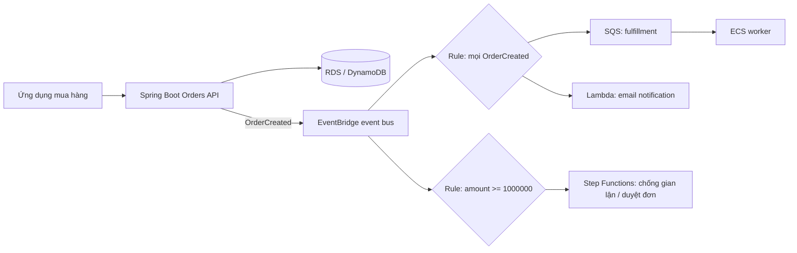
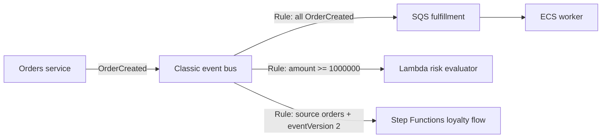
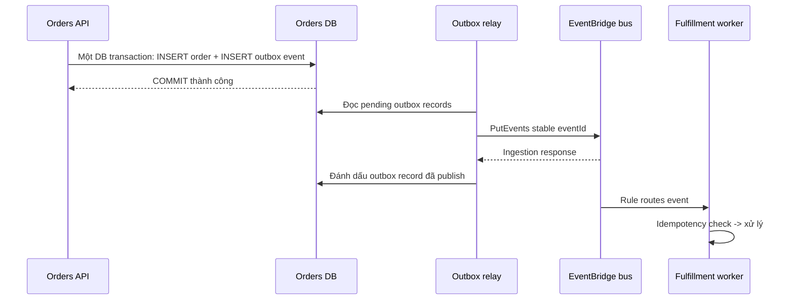
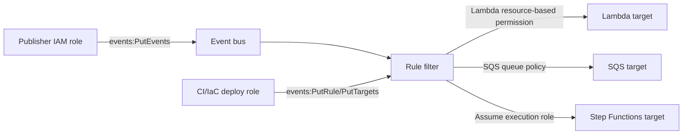
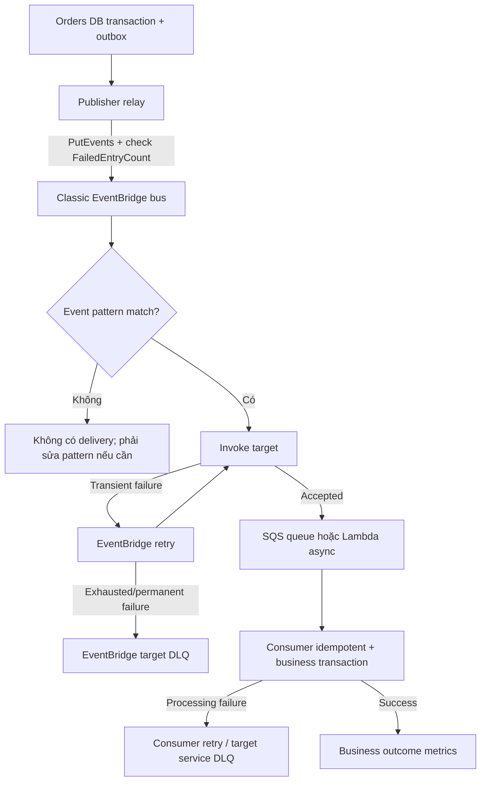
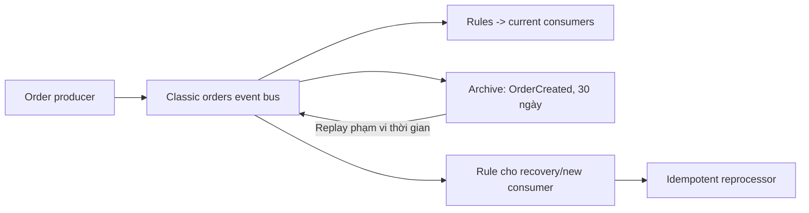
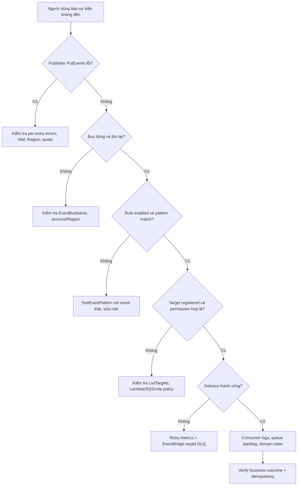

# EventBridge event bus, event pattern và rule

> **Chương:** Sự kiện và điều phối · **Mô-đun:** `CLOUD_PROVIDERS_AWS`

## 1. Từ lời gọi đồng bộ đến kiến trúc hướng sự kiện

Một cửa hàng trực tuyến xây ứng dụng Java Spring Boot để nhận đơn hàng. Khi đơn được tạo, hệ thống cần đồng thời gửi email, cập nhật điểm thưởng và báo kho chuẩn bị giao. Nếu API `POST /orders` gọi lần lượt cả ba dịch vụ, một dịch vụ gửi email chậm có thể làm cả request đặt hàng timeout. Bên cạnh đó, mỗi lần thêm consumer mới phải sửa code của dịch vụ đặt hàng.

**Amazon EventBridge** là dịch vụ tích hợp dựa trên sự kiện giúp producer **phát biểu sự kiện đã xảy ra**, event bus tiếp nhận, rồi cơ chế lọc/định tuyến quyết định consumer nào xử lý. Ví dụ sự kiện `OrderCreated` có thể đến từ một Spring Boot service chạy trên ECS; một rule gửi tới AWS Lambda cập nhật điểm, rule khác gửi tới Amazon SQS cho đội xử lý giao hàng.



Điều quan trọng:

- **Producer** biết điều gì vừa xảy ra; **không cần biết** tất cả consumers.
- **Event bus** nhận và định tuyến events trong AWS account/Region theo mô hình được chọn.
- **Event pattern** chỉ định điều kiện lọc trên những trường của event JSON.
- **Rule** trong mô hình *default/Classic* gắn với bus, khi match sẽ invoke **target(s)**.
- **Consumer** xử lý công việc nghiệp vụ, cần tự thiết kế idempotency, bảo mật, retry, quan sát và quyền truy cập.

EventBridge là **event router**, không tự là database giao dịch, hàng đợi bảo đảm FIFO, hay workflow engine có state. Một lần `PutEvents` thành công chỉ nói event được nhận bởi bus theo API response, **không bảo đảm** email đã gửi hoặc giao dịch thanh toán hoàn tất.

Trong mô-đun `CLOUD_PROVIDERS_AWS`, kiến thức này kết nối với **IAM, VPC/Region/AZ, Lambda, SQS, ECS, DynamoDB/RDS, Step Functions, CloudWatch, phục hồi và kiểm soát chi phí**.

**Mục tiêu học tập:** Sau bài này, người học có thể:

1. Phân biệt **event bus mặc định, custom bus Classic, partner bus** và **Custom Event Bus mới**.
2. Đọc cấu trúc sự kiện chuẩn, định nghĩa `source`, `detail-type`, `detail` và event contract có version.
3. Viết event patterns với exact, multiple values, numeric, prefix, suffix, anything-but, exists và `$or`.
4. Tạo rule và target qua AWS Console/CLI, kiểm tra match trước khi tạo, tránh rule loop.
5. Push custom events bằng CLI và Java AWS SDK v2, xử lý lỗi từng entry đúng cách.
6. Thiết kế IAM identity/resource policies, cross-account routing, input transformation và delivery permission.
7. Phân biệt **retry, DLQ, archive/replay, idempotency/outbox** và các giới hạn delivery.
8. Giám sát metrics, xử lý sự cố, tính chi phí, chọn đúng EventBridge/SNS/SQS/Pipes/Scheduler/Step Functions.

## 2. EventBridge có hơn một mô hình event bus

Tài liệu AWS hiện nay phân biệt **mô hình rule/target truyền thống** và **Custom Event Bus mới dùng subscriber**. Đây là điểm cần làm rõ ngay trước khi đọc mẫu AWS CLI.

### 2.1. Default event bus và Custom Event Bus – Classic

Trong mô hình **rule-based**:

1. Một event được gửi vào bus cụ thể.
2. EventBridge xét các **rules** thuộc bus đó; mỗi rule có event pattern.
3. Rule match sẽ gửi event tới một hoặc nhiều targets, **tối đa 5 targets/rule**.
4. Nhiều rules có thể cùng match một event; không phải cơ chế “rule đầu tiên thắng”.
5. Nếu **không có rule match**, EventBridge không gửi event đó tới target nào.

**Default event bus** có sẵn trong mỗi AWS account/Region, thường nhận các events từ các AWS services. **Custom Event Bus – Classic** do người dùng tạo để tách event domains hoặc quyền truy cập, ví dụ `shop-events-classic`. **Partner event bus** có thể nhận sự kiện từ các SaaS partner đã được tích hợp, theo source/bus configuration tương ứng.

Các lệnh trong bài như `aws events create-event-bus`, `put-rule`, `put-targets`, `test-event-pattern` và `put-events` được dùng để minh họa **mô hình Classic rule-based**.

### 2.2. Custom Event Bus mới (không đồng nhất với Classic)

AWS cung cấp **Custom Event Bus** mới (tách biệt với **Custom Event Bus – Classic**). Với hệ thống mới, tài liệu AWS khuyến khích xem xét Custom Event Bus trước. Các khái niệm định tuyến đổi đáng kể:

| Khía cạnh | Default / Custom Event Bus – Classic | Custom Event Bus mới |
| --- | --- | --- |
| Đơn vị chọn consumer | **Rule** + tối đa 5 targets. | **Subscriber**, mỗi subscriber có một target. |
| Ai quản lý subscription | Thường bus owner tạo/sửa rules. | Consumer có thể tự sở hữu subscribers, kể cả từ account được chia sẻ. |
| Event filtering | `EventPattern` trên rule. | Filter trên subscriber, phạm vi data/metadata theo API. |
| Data retention | Không mặc định giữ sự kiện để đọc lại; dùng **Archive** nếu cần. | **Retention tích hợp** trên bus theo cấu hình. |
| Replay | Replay từ archive về bus nguồn, có thể chọn rules. | Subscriber có **starting position** trên các events đã lưu. |
| Ordering | **Không bảo đảm thứ tự** qua Classic rules. | Hỗ trợ **FIFO theo event group trên từng subscriber** khi cấu hình đúng. |
| Deduplication | Producer/consumer tự xử lý; không có publish-time native dedup cho Classic bus. | Có publish-time deduplication theo key/content khi cấu hình. |
| Publish APIs | Classic `PutEvents` dạng JSON. | API thế hệ mới hỗ trợ `PutEvents` và `PutRawEvents` với khả năng định dạng rộng hơn. |
| Delivery metrics | Chủ yếu `AWS/Events`. | `AWS/EventsV2` và subscriber logs. |
| Retry mặc định | **Tới 24 giờ và 185 lần** trên Classic rule target. | **5 attempts hoặc 300 giây** theo mặc định subscriber; điều chỉnh nếu cần. |

Đừng copy lệnh `put-rule` hoặc cấu hình retry Classic vào **Custom Event Bus mới** và nghĩ rằng tạo subscriber. Cách định danh ARN, SDK/API và cấu hình khác; tham khảo tài liệu [What is the Custom Event Bus?](https://docs.aws.amazon.com/eventbridge/latest/userguide/eb-custom-bus-what-is.html) và [Migration from Classic](https://docs.aws.amazon.com/eventbridge/latest/userguide/eb-custom-bus-migrate.html).

**Phạm vi bài học:** Để học chính xác khái niệm **event pattern và rule**, phần thực hành dùng **default/Classic bus**, có thêm đối chiếu cách dùng subscriber trong mô hình mới. Với một dự án production mới, nên quyết định mô hình trước khi viết IaC.

### 2.3. EventBridge bus, SQS queue và EventBridge Pipes khác gì?

- **EventBridge bus:** phân phối events từ nhiều producers tới nhiều consumers bằng luật lọc/nội dung; Classic không mặc định lưu để consumer tự đọc như queue.
- **Amazon SQS:** queue buffer lưu message để workers xử lý sau, hỗ trợ retry qua visibility timeout và DLQ riêng; standard SQS thường at-least-once, FIFO queue có các bảo đảm riêng.
- **EventBridge Pipes:** thiết kế nối **một source → một target**, có filter/transform/enrichment, phù hợp kết nối stream/queue tới processor hoặc destination mà không cần biến mọi event thành broadcast.
- **EventBridge Scheduler:** tạo lịch one-time/recurring có time zones, flexible windows và retry; ưu tiên Scheduler cho công việc theo thời gian thay vì **scheduled rule legacy**.
- **AWS Step Functions:** điều phối **stateful workflow** với choice/retry/wait/compensation; EventBridge rule chỉ gửi sự kiện, không giữ trạng thái tiến trình nghiệp vụ.

## 3. Cấu trúc JSON của một EventBridge event

### 3.1. Các trường envelope chuẩn

Sau khi bus nhận một custom event, EventBridge cung cấp event envelope có các trường quen thuộc:

```json
{
  "version": "0",
  "id": "87f3d4ad-e38e-4f78-b1a5-5ae38cc712a0",
  "detail-type": "OrderCreated",
  "source": "com.example.shop.orders",
  "account": "111122223333",
  "time": "2026-11-20T03:00:00Z",
  "region": "ap-southeast-1",
  "resources": [],
  "detail": {
    "eventVersion": 1,
    "eventId": "evt-order-20261120-0001",
    "orderId": "ord-1001",
    "customerId": "cust-73",
    "status": "CREATED",
    "amount": 1250000,
    "currency": "VND"
  }
}
```

Các IDs, account, order và customer là **dữ liệu giả định**, không phải credentials. Phân biệt:

| Trường | Ai cung cấp / dùng làm gì? |
| --- | --- |
| `version` | Phiên bản **envelope EventBridge**, thường `"0"`. Không tự là schema version nghiệp vụ. |
| `id` | ID EventBridge cấp cho event đã tiếp nhận. Có ích correlation, nhưng không thay event ID từ domain/outbox. |
| `source` | Tên producer theo namespace, ví dụ `com.example.shop.orders` hoặc `aws.ec2`. |
| `detail-type` | Kiểu sự kiện, ví dụ `OrderCreated`, `PaymentCaptured` hoặc tên do AWS service phát. |
| `account` / `region` | Account/Region sự kiện liên quan theo envelope; hữu ích phân tách nguồn. |
| `time` | Event time, có thể do publisher khai báo; phải cân nhắc clock skew/late arrival. |
| `resources` | Danh sách ARNs tài nguyên liên quan nếu producer cung cấp. |
| `detail` | Payload nghiệp vụ, phải là **JSON** trong Classic `PutEvents`; khuyến nghị có `eventVersion` và `eventId`. |

**Event envelope không giống `PutEventsRequestEntry`:** Khi publish, client gửi `Source`, `DetailType`, `Detail`, `EventBusName` và các trường tùy chọn. Bus cấp các metadata còn lại. `Detail` trong API là **một chuỗi chứa JSON hợp lệ**, không phải object trực tiếp của SDK.

### 3.2. Event khác command

| Event | Command |
| --- | --- |
| `OrderCreated` — “đã có đơn hàng”. | `ReserveInventory` — “hãy giữ hàng”. |
| Mang ý nghĩa **sự thật đã xảy ra**. | Yêu cầu **thực hiện hành động**. |
| Có thể có nhiều consumers độc lập. | Thường có target/owner rõ ràng và kỳ vọng kết quả. |
| Producer không cần biết người nhận cụ thể. | Caller có thể cần response hoặc guarantee cụ thể. |

Không đưa kết quả trả lời đồng bộ của thanh toán vào EventBridge rồi coi đó là transaction đã commit. Nếu nghiệp vụ cần atomicity, phải thiết kế database transaction, saga/compensation hoặc use case dùng Step Functions phù hợp.

### 3.3. Đặt tên và phiên bản schema

Quy ước cho nhóm `orders`:

- `source` = `com.example.shop.orders`: ổn định theo bounded context, tránh đổi tùy ý khi rename class.
- `detail-type` = `OrderCreated`, `OrderCancelled`; dùng nhất quán kiểu PascalCase hoặc chuẩn tổ chức.
- `detail.eventVersion` = 1, 2… để consumer biết phiên bản contract, độc lập với envelope `version`.
- `detail.eventId` = ID nghiệp vụ **ổn định khi retry** để consumer deduplicate; không tạo ID mới cho cùng một giao dịch khi publisher retry.
- `detail.occurredAt` hoặc `time` để ghi thời điểm phát sinh; cần xử lý event trễ/out-of-order.
- `detail.correlationId`/`causationId` cho distributed tracing và incident investigation.

**Schema evolution:** thêm trường optional thường tương thích hơn đổi nghĩa/xóa trường. Consumer nên bỏ qua các thuộc tính không cần; nếu breaking change, dùng `eventVersion`/new `detail-type` và triển khai song song trong thời gian migration. AWS EventBridge Schema Registry có thể giúp khám phá và quản lý schemas theo khả năng hỗ trợ, nhưng không thay kiểm thử compatibility ở producer/consumer.

### 3.4. Bảo mật payload

EventBridge events có thể được **gửi tới nhiều targets** và xuất hiện ở logs/archives/DLQ theo cấu hình. Không đưa passwords, access tokens, payment card data hay PII nhạy cảm vào `detail` nếu consumer không cần. Thay vì đẩy toàn bộ object customer, cân nhắc chỉ truyền `customerId`/`orderId` và cho consumer gọi API đọc dữ liệu theo IAM/authorization riêng. Giới hạn quyền đọc bus, logs, archives và DLQ.

## 4. Event bus: nguồn, phạm vi và thiết kế tổ chức

### 4.1. Bus thuộc account/Region

Ví dụ một hệ thống có:

```text
AWS account: 111122223333 (ví dụ)
Region: ap-southeast-1
Default event bus: default
Classic custom bus: shop-events-classic
```

Một rule tạo trên `shop-events-classic` chỉ đánh giá những sự kiện được gửi **vào bus đó**. Nếu producer vô tình không khai báo `EventBusName` trong `PutEvents`, client có thể gửi tới **default bus**; một rule thuộc custom bus sẽ không match. Ngoài account/Region, **event source namespace/contract** còn quyết định rule có nhận event hay không.

### 4.2. Phân loại bus và cách chọn

| Loại bus | Nguồn và routing | Khi nào dùng |
| --- | --- | --- |
| **Default** | Bus có sẵn; chủ yếu nhận events từ AWS services và các custom events gửi đến. | Trigger khi EC2 thay trạng thái, ECS task state change, AWS Health và các tình huống tích hợp AWS. |
| **Classic custom** | Do bạn tạo và định nghĩa rules/targets. | Học event pattern/rule, ứng dụng đã dựa vào Classic IaC/API, phân tách môi trường/bounded context. |
| **Partner** | Nhận events từ SaaS providers được hỗ trợ qua kết nối partner. | Xử lý ticket/support/e-commerce SaaS events mà không xây polling. |
| **Custom Event Bus mới** | Subscribers do consumers quản lý, tích hợp retention/FIFO nhóm theo cấu hình. | Phát triển mới, chia sẻ bus qua AWS RAM, replay/consumption theo subscriber. |

**Không cần tạo một event bus cho mỗi event type.** Nên thiết kế bus dựa trên ranh giới domain, ownership, security, account/Region, cost và lifecycle. Ví dụ một bus cho `commerce-prod` nhận OrderCreated/OrderCancelled; nhiều rules chọn types. Nhưng với doanh nghiệp nhiều team/cross-account, có thể tách bus theo domain và dùng policies để ngăn app không thuộc domain publish/subscribe.

### 4.3. IAM resource policy cho bus

Event bus có **resource-based policy** để cho AWS principals/organizations phù hợp được `events:PutEvents`, `events:PutRule` hoặc `events:PutTargets` theo mô hình hỗ trợ. Cần phối hợp:

1. **Identity policy** trên role publisher/administrator, giới hạn actions và bus ARN.
2. **Resource policy** trên bus cho cross-account principal, account/organization conditions.
3. **SCP/permissions boundary** và AWS KMS policies khi bus dùng customer-managed keys.
4. **Target invocation permission** tách biệt (ví dụ Lambda resource-based policy hoặc SQS queue policy).

Cho phép publish lên bus **không đồng nghĩa** được gọi mọi target hoặc sửa routing rules. Nên phân quyền CI deploy, service publisher, application consumer và incident responder độc lập.

### 4.4. Một chiều sự kiện với nhiều consumers



Mỗi target có failure mode riêng. Ví dụ Lambda permission sai khiến risk evaluator không được gọi, trong khi SQS fulfillment vẫn nhận. Đừng đánh giá toàn sự kiện “thành công” chỉ vì một consumer đã xử lý xong.

## 5. Event pattern: bộ lọc JSON khai báo

**Event pattern** là JSON mô tả tập điều kiện phải thỏa để **rule match**. EventBridge so giá trị trên các trường của sự kiện, không chạy code tùy ý hay SQL. Một rule không có pattern lọc hợp lý có thể match nhiều events ngoài dự kiến, gây phí và tạo vòng lặp.

### 5.1. Ví dụ lọc `source` và `detail-type`

```json
{
  "source": ["com.example.shop.orders"],
  "detail-type": ["OrderCreated"]
}
```

Pattern này match bất kỳ event nào có **cả**:

- `source` chính xác `com.example.shop.orders`.
- `detail-type` chính xác `OrderCreated`.

Các thuộc tính khác như `detail.amount`, `region` hoặc `resources` không được nhắc tới thì **không bị kiểm tra**. Các giá trị ở các trường khác nhau là quan hệ **AND**. Nhiều giá trị trong cùng một mảng là **OR**:

```json
{
  "source": ["com.example.shop.orders", "com.example.shop.payments"],
  "detail-type": ["OrderCreated", "PaymentCaptured"]
}
```

Pattern thứ hai cho **bốn tổ hợp** (nếu producer thật sự có những tổ hợp đó), không tự ràng buộc OrderCreated chỉ đến từ orders và PaymentCaptured chỉ từ payments. Nếu cần logic “(source A và type A) **hoặc** (source B và type B)”, dùng `$or` hoặc tạo rules riêng.

### 5.2. So sánh theo `detail` và numeric

Chỉ chọn đơn vừa tạo với số tiền lớn hoặc bằng **1.000.000 VND**:

```json
{
  "source": ["com.example.shop.orders"],
  "detail-type": ["OrderCreated"],
  "detail": {
    "status": ["CREATED"],
    "currency": ["VND"],
    "amount": [
      { "numeric": [">=", 1000000] }
    ]
  }
}
```

Những điểm quan trọng:

- `amount` phải là **JSON number**, không phải chuỗi `"1250000"` nếu dùng operator `numeric`.
- Các trường khác cùng cấp trong `detail` là **AND**: status, currency, amount đều phải match.
- `numeric` có thể dùng các điều kiện `">"`, `">="`, `"<"`, `"<="`, `"="` kết hợp trong array; giá trị số lớn cần chú ý giới hạn IEEE 754 double (tính chính xác tới khoảng ±2^53).
- **Exact literal numeric** ngoài operator `numeric` có thể so theo biểu diễn chuỗi, nên `300` và `300.0` không nhất thiết match như nhau. Với số cần so theo giá trị, dùng `numeric` và test.
- Tránh float cho tiền khi yêu cầu chính xác tuyệt đối: gửi **integer cents/dong minor units** hoặc một contract rõ ràng và xử lý business rounding ở consumer.

### 5.3. Các toán tử lọc thường dùng

| Toán tử / cấu trúc | Ví dụ trong field pattern | Ý nghĩa |
| --- | --- | --- |
| **Exact** | `"status": ["CREATED"]` | Khớp đúng chữ hoa/thường và kiểu dữ liệu. |
| **Một trong nhiều giá trị** | `"status": ["CREATED", "PAID"]` | OR các lựa chọn cùng field. |
| **`prefix`** | `"orderId": [{"prefix":"ord-"}]` | Chuỗi bắt đầu bằng prefix. |
| **`suffix`** | `"fileName": [{"suffix":".csv"}]` | Chuỗi kết thúc bằng suffix. |
| **`anything-but`** | `"status": [{"anything-but":"CANCELLED"}]` | Có field và giá trị khác điều bị loại. |
| **`numeric`** | `"amount": [{"numeric":[">=",1000000]}]` | So sánh số trong khoảng. |
| **`exists`** | `"couponCode": [{"exists":true}]` | Có leaf field. |
| **Không tồn tại** | `"couponCode": [{"exists":false}]` | Không có leaf field. |
| **`equals-ignore-case`** | `"status":[{"equals-ignore-case":"created"}]` | Không phân biệt chữ hoa/thường khi so sánh chuỗi. |
| **`wildcard`** | `"key":[{"wildcard":"orders/*/receipt.pdf"}]` | Pattern wildcard; kiểm tra khả năng hỗ trợ và độ rộng. |
| **`cidr`** | `"clientIp":[{"cidr":"10.0.0.0/8"}]` | So IPv4/IPv6 với IP range. |
| **`null`** | `"reason":[null]` | Field có giá trị JSON `null`. |
| **Chuỗi rỗng** | `"reason":[""]` | Field có giá trị chuỗi rỗng, **không giống null/missing**. |

Một số toán tử có thể kết hợp lồng nhau theo cú pháp AWS; không dùng biểu thức JS hoặc regex tự chế trong event pattern. `exists` áp dụng cho **leaf nodes** theo semantics tài liệu AWS, không phải wildcard “mọi object”.

### 5.4. `$or` cho tổ hợp phụ thuộc nhau

Khi hai event types gắn với hai sources khác nhau:

```json
{
  "$or": [
    {
      "source": ["com.example.shop.orders"],
      "detail-type": ["OrderCreated"]
    },
    {
      "source": ["com.example.shop.payments"],
      "detail-type": ["PaymentCaptured"]
    }
  ]
}
```

`$or` giúp tránh tạo tổ hợp không mong muốn giữa hai field. Tuy nhiên, pattern quá rộng có thể làm rule nhận vô tình cả events nhạy cảm; nếu hai nghiệp vụ cần quyền/retention khác nhau, có thể dùng **hai rules riêng** để dễ quản lý và monitoring.

### 5.5. Mảng trong event và cách match

Giả sử event chứa:

```json
{
  "detail": {
    "tags": ["vip", "gift", "prepaid"]
  }
}
```

Pattern:

```json
{
  "detail": {
    "tags": ["vip", "priority"]
  }
}
```

Khi event field là một **mảng**, EventBridge match nếu có **phần giao không rỗng** giữa mảng giá trị pattern và mảng sự kiện. Ví dụ trên **match do `vip`**. Không hiểu nhiều phần tử pattern là tất cả đều phải xuất hiện trong event: điều kiện ở cùng field là OR.

### 5.6. Bốn bẫy thực tế

1. **Case-sensitive:** `OrderCreated` không khớp `ordercreated` trong exact match; dùng `equals-ignore-case` nếu contract thực sự cho phép.
2. **JSON null, empty string và missing là khác nhau:** `"reason":[null]` khác `"reason":[""]`, và `"exists":false` chỉ match khi field không tồn tại.
3. **Dấu chấm trong key:** EventBridge hiện có hành vi gộp nested keys bằng dấu `.` trong quá trình compile pattern. Một key `"state.status"` và nested `{"state":{"status":...}}` có thể được hiểu tương đương. Đây là chi tiết implementation **không nên phụ thuộc lâu dài**; tránh dùng dot trong JSON field names tự thiết kế.
4. **Duplicate JSON keys:** JSON như `{"source":["aws.s3"],"source":["aws.sns"]}` không phải “match cả hai”; khi compile có thể chỉ lấy giá trị cuối. Dùng arrays không trùng keys, kiểm tra schema/linter.

### 5.7. Event pattern là filter, không phải phân quyền

Một event pattern chỉ giúp **định tuyến**, không được dùng để xác thực producer. Ví dụ nếu publisher có quyền `events:PutEvents` và có thể tự điền `source="com.example.shop.payments"`, chúng có thể giả lập một PaymentCaptured nếu hệ thống không có IAM conditions/contract validation phù hợp. Hãy giới hạn publishers bằng **IAM và bus resource policy**, kiểm tra nguồn dữ liệu và những thao tác downstream có tác động tiền/tài khoản.

## 6. Kiểm thử event pattern trước khi đưa vào rule

### 6.1. Vì sao cần kiểm thử?

Rule quá hẹp có thể **bỏ sót events hợp lệ** (ví dụ producer gửi `status="created"` còn rule lọc `"CREATED"`). Rule quá rộng có thể gọi sai consumer, gửi dữ liệu không cần thiết hoặc sinh **event loop**. Do đó trước khi tạo rule cần có:

- Các **positive samples** nhất định phải match.
- Các **negative samples** không được match.
- Mẫu có missing field, null, empty string, array, sai kiểu dữ liệu, sai source, sai detail-type.
- Boundary tests cho numeric (`999999`, `1000000`, `1000001`).
- Kiểm tra event schemas nhiều versions và migration windows.

### 6.2. `TestEventPattern` API

Giả sử đã có hai tệp JSON **do người học tạo cục bộ**:

**`order-created-pattern.json`**:

```json
{
  "source": ["com.example.shop.orders"],
  "detail-type": ["OrderCreated"],
  "detail": {
    "status": ["CREATED"],
    "amount": [{ "numeric": [">=", 1000000] }]
  }
}
```

**`order-created-event.json`**:

```json
{
  "version": "0",
  "id": "87f3d4ad-e38e-4f78-b1a5-5ae38cc712a0",
  "detail-type": "OrderCreated",
  "source": "com.example.shop.orders",
  "account": "111122223333",
  "time": "2026-11-20T03:00:00Z",
  "region": "ap-southeast-1",
  "resources": [],
  "detail": {
    "orderId": "ord-1001",
    "status": "CREATED",
    "amount": 1250000,
    "currency": "VND"
  }
}
```

Kiểm thử **không phát sự kiện thật** và **không invoke target**:

```bash
aws events test-event-pattern \
  --region ap-southeast-1 \
  --event-pattern file://order-created-pattern.json \
  --event file://order-created-event.json
```

Kết quả kỳ vọng là `"Result": true`. Sau đó thay `amount` bằng `999999` trong **file test event của riêng bạn**, chạy lại và kỳ vọng `false`. Lệnh này chỉ đánh giá pattern; nếu tạo rule mà source thực gửi sang **bus khác**, test true vẫn không khiến rule chạy.

### 6.3. Test matrix minh họa

| Case | `source` | `detail-type` | `detail.status` | `detail.amount` | Kết quả |
| --- | --- | --- | --- | --- | --- |
| A | `com.example.shop.orders` | `OrderCreated` | `CREATED` | `1250000` | **Match** |
| B | `com.example.shop.orders` | `OrderCreated` | `CREATED` | `999999` | Không |
| C | `com.example.shop.orders` | `OrderCancelled` | `CREATED` | `1250000` | Không |
| D | `com.example.shop.payments` | `OrderCreated` | `CREATED` | `1250000` | Không |
| E | `com.example.shop.orders` | `OrderCreated` | `created` | `1250000` | Không (exact match case-sensitive). |
| F | `com.example.shop.orders` | `OrderCreated` | `CREATED` | `"1250000"` | Không (chuỗi, không phải numeric). |
| G | `com.example.shop.orders` | `OrderCreated` | *thiếu* | `1250000` | Không |

Các dữ liệu trên là giả định. Khi áp dụng rule production, so khớp với **event thật do publisher tạo** và contract, không chỉ mẫu tự soạn theo mong muốn của consumer.

## 7. Tạo Classic event bus, rule và target bằng AWS CLI

Các lệnh sau là ví dụ cho **default / Custom Event Bus – Classic**. Chạy trên AWS CloudShell/Bash với **AWS CLI v2** và account lab được phép. Những lệnh `create-event-bus`, `put-rule`, `put-targets`, `add-permission` và `put-events` là **thay đổi tài nguyên/đưa events vào hệ thống**; không chạy trên production nếu chưa được duyệt. Dùng IDs/ARNs giả định:

```text
AWS account: 111122223333
Region: ap-southeast-1
Bus: shop-events-classic
Rule: orders-created-notify
Lambda target: shop-order-notifier
```

Điều kiện: IAM role có các quyền theo bước; Lambda `shop-order-notifier` đã tồn tại trong cùng account/Region, nhận được JSON event và chỉ thực hiện tác động trên tài nguyên lab.

### 7.1. Kiểm tra account/Region trước khi thay đổi

```bash
aws sts get-caller-identity
aws events list-event-buses --region ap-southeast-1
aws events list-rules --region ap-southeast-1 --event-bus-name default
```

Nếu đã có bus/rule cùng tên, không tạo đè và không thay target ngoài phạm vi. `put-rule` có semantics cập nhật rule đã tồn tại; khi chỉ định lại pattern có thể thay thế logic đang chạy.

### 7.2. Tạo Classic bus cho domain orders

```bash
aws events create-event-bus \
  --region ap-southeast-1 \
  --name shop-events-classic
```

CLI trả `EventBusArn`, ví dụ:

```text
arn:aws:events:ap-southeast-1:111122223333:event-bus/shop-events-classic
```

Bus là tài nguyên cấp Region/account; tên `shop-events-classic` mang tính ví dụ. Với **Custom Event Bus mới**, resource ARN và API tạo bus thuộc mô hình v2, **không sao chép nguyên lệnh Classic này**.

### 7.3. Tạo rule với event pattern

Tệp `orders-rule-pattern.json` (được người học tạo trong thư mục lab, **không phải tệp của module này**):

```json
{
  "source": ["com.example.shop.orders"],
  "detail-type": ["OrderCreated"],
  "detail": {
    "status": ["CREATED"]
  }
}
```

Tạo rule:

```bash
aws events put-rule \
  --region ap-southeast-1 \
  --event-bus-name shop-events-classic \
  --name orders-created-notify \
  --description "Notify when an order has been created" \
  --event-pattern file://orders-rule-pattern.json \
  --state ENABLED
```

Những chú ý:

- Rule chỉ được gắn với **một event bus**.
- `--state ENABLED` cho phép rule xét events khi cấu hình có hiệu lực; nếu cần kiểm thử/duyệt trước, cân nhắc `DISABLED` rồi enable đúng thời điểm.
- `put-rule` chưa tự gửi event tới consumer; phải thêm **target** bằng `put-targets`.
- Rule ARN của custom Classic bus có dạng `arn:aws:events:REGION:ACCOUNT:rule/BUS_NAME/RULE_NAME`, khác rule ARN trên default bus vốn có dạng `rule/RULE_NAME`.

### 7.4. Cho EventBridge quyền invoke Lambda target

Với Lambda targets, dùng **resource-based permission trên Lambda** cho EventBridge rule:

```bash
aws lambda add-permission \
  --region ap-southeast-1 \
  --function-name shop-order-notifier \
  --statement-id AllowOrdersCreatedRule \
  --action lambda:InvokeFunction \
  --principal events.amazonaws.com \
  --source-arn arn:aws:events:ap-southeast-1:111122223333:rule/shop-events-classic/orders-created-notify
```

Việc thêm permission này không tạo trigger nếu `put-targets` chưa được gọi. `StatementId` cần duy nhất trong policy của function; nếu đã tồn tại, **không tự xóa/ghi đè** trên production.

Đăng ký target:

```bash
aws events put-targets \
  --region ap-southeast-1 \
  --event-bus-name shop-events-classic \
  --rule orders-created-notify \
  --targets 'Id=notify-lambda,Arn=arn:aws:lambda:ap-southeast-1:111122223333:function:shop-order-notifier'
```

Kết quả phải có `FailedEntryCount=0`. Cần kiểm tra `put-targets` trả về **entry failures** ngay cả khi lệnh AWS CLI exit thành công; nếu thất bại, đọc `FailedEntries`. Có thể thêm **SQS**, **Step Functions**, **SNS**, **ECS tasks**, API destinations… làm targets khác; quyền cho từng target type khác nhau (resource policy hoặc IAM execution role).

### 7.5. Kiểm tra rule/target đã lưu (chỉ đọc)

```bash
aws events describe-rule \
  --region ap-southeast-1 \
  --event-bus-name shop-events-classic \
  --name orders-created-notify

aws events list-targets-by-rule \
  --region ap-southeast-1 \
  --event-bus-name shop-events-classic \
  --rule orders-created-notify

aws lambda get-policy \
  --region ap-southeast-1 \
  --function-name shop-order-notifier
```

Trước khi phát test event, đảm bảo Lambda handler **không gửi email cho người thật** hoặc ghi dữ liệu production. Không dùng service account có quyền quá rộng chỉ để điều tra một rule.

### 7.6. Phát một custom event vào bus bằng `PutEvents`

Tạo `orders-events.json` trong thư mục lab:

```json
[
  {
    "Source": "com.example.shop.orders",
    "DetailType": "OrderCreated",
    "EventBusName": "shop-events-classic",
    "Detail": "{\"eventVersion\":1,\"eventId\":\"evt-lab-001\",\"orderId\":\"ord-lab-001\",\"status\":\"CREATED\",\"amount\":1250000,\"currency\":\"VND\"}"
  }
]
```

Chú ý `Detail` phải là **chuỗi JSON được escape** trong request object. AWS CLI:

```bash
aws events put-events \
  --region ap-southeast-1 \
  --entries file://orders-events.json
```

Kết quả ví dụ:

```json
{
  "FailedEntryCount": 0,
  "Entries": [
    {
      "EventId": "b2bca3fb-0741-45e8-bb7c-0ed719871300"
    }
  ]
}
```

Đây là **ID giả định**. Sau khi API nhận event, đợi delivery/monitor CloudWatch Lambda `Invocations` và logs để kiểm tra target thực sự được gọi. **`FailedEntryCount=0` không có nghĩa target xử lý thành công.**

### 7.7. Dọn lab đúng thứ tự

Khi được phép dọn tài nguyên lab, thực hiện theo thứ tự logic:

1. Disable rule để không nhận thêm event thực.
2. Remove rule targets.
3. Remove Lambda resource permission đã thêm.
4. Delete rule.
5. Delete Classic bus sau khi đã kiểm tra không còn rules/archives/policies phụ thuộc.

**Không đưa lệnh delete vào một script chạy tự động** trên tài khoản đang có người dùng thực, vì rule có thể là một phần đường xử lý đơn hàng. Dọn DLQ/CloudWatch logs/archive cần retention và owner approval riêng.

## 8. Java Spring Boot publisher với AWS SDK for Java 2.x

Spring Boot service có thể phát sự kiện sau khi tạo đơn hàng. Với AWS SDK v2, dùng **`software.amazon.awssdk: EventBridgeClient`** và operation `putEvents`. Không dùng AWS access keys hard-coded: ECS tasks dùng task IAM role, EC2 dùng instance profile, Lambda dùng execution role, CI dùng STS/role assumption.

### 8.1. Phát một event

Ví dụ service publisher đơn giản, giả định có dependency `software.amazon.awssdk:eventbridge` và SDK credential chain hợp lệ:

```java
import java.util.List;
import software.amazon.awssdk.regions.Region;
import software.amazon.awssdk.services.eventbridge.EventBridgeClient;
import software.amazon.awssdk.services.eventbridge.model.PutEventsRequest;
import software.amazon.awssdk.services.eventbridge.model.PutEventsRequestEntry;
import software.amazon.awssdk.services.eventbridge.model.PutEventsResponse;
import software.amazon.awssdk.services.eventbridge.model.PutEventsResultEntry;

public final class OrderEventPublisher implements AutoCloseable {
    private final EventBridgeClient client;
    private final String eventBusName;

    public OrderEventPublisher(String eventBusName) {
        this.eventBusName = eventBusName;
        this.client = EventBridgeClient.builder()
                .region(Region.AP_SOUTHEAST_1)
                .build();
    }

    public String publishOrderCreated(String jsonDetail) {
        // jsonDetail phải là một chuỗi JSON hợp lệ đã được serialize
        // bởi Jackson (không nối chuỗi từ input người dùng).
        PutEventsRequestEntry entry = PutEventsRequestEntry.builder()
                .eventBusName(eventBusName)
                .source("com.example.shop.orders")
                .detailType("OrderCreated")
                .detail(jsonDetail)
                .build();

        PutEventsResponse response = client.putEvents(
                PutEventsRequest.builder()
                        .entries(List.of(entry))
                        .build());

        if (response.failedEntryCount() != 0) {
            PutEventsResultEntry failure = response.entries().get(0);
            throw new IllegalStateException(
                    "EventBridge ingest failed: " + failure.errorCode());
        }
        String eventId = response.entries().get(0).eventId();
        if (eventId == null || eventId.isBlank()) {
            throw new IllegalStateException("No EventBridge event ID returned");
        }
        return eventId;
    }

    @Override
    public void close() {
        client.close();
    }
}
```

Ví dụ sử dụng Jackson để tạo `jsonDetail`:

```java
import com.fasterxml.jackson.databind.ObjectMapper;
import java.util.Map;

ObjectMapper mapper = new ObjectMapper();
String detail = mapper.writeValueAsString(Map.of(
        "eventVersion", 1,
        "eventId", "evt-lab-001",
        "orderId", "ord-lab-001",
        "status", "CREATED",
        "amount", 1250000,
        "currency", "VND"
));

try (OrderEventPublisher publisher =
             new OrderEventPublisher("shop-events-classic")) {
    String id = publisher.publishOrderCreated(detail);
    System.out.println("Published event id: " + id);
}
```

**Mục tiêu code:** minh họa mô hình SDK và cách kiểm tra `FailedEntryCount`, **không** phải đầy đủ pipeline production. Thực tế cần cấu hình Region/account từ environment, DI-managed client, JSON schema validation, structured logs không có PII, retry phù hợp, metrics/error budget và **transactional outbox** nếu nguồn là database.

### 8.2. `PutEvents` có thể thành công một phần

Một `PutEvents` request có thể chứa **tối đa 10 entries** trong Classic API, tổng size các entries nhỏ hơn 1 MiB theo quy định API. Response trả **`Entries` cùng thứ tự với request**, mỗi entry có `EventId` nếu thành công hoặc `ErrorCode`/`ErrorMessage` nếu không:

```json
{
  "FailedEntryCount": 1,
  "Entries": [
    {"EventId": "f0f0f0f0-1111-4111-8111-111111111111"},
    {
      "ErrorCode": "InternalFailure",
      "ErrorMessage": "Internal Service Failure"
    }
  ]
}
```

**Bẫy:** HTTP 200/API call không có nghĩa mọi entry đã được nhận. Trong production:

1. Giữ danh sách các request entries với stable domain event IDs.
2. Đối chiếu `Entries[i]` với request `entries[i]`.
3. Chỉ retry **entries bị lỗi retriable**, dùng exponential backoff + jitter và giới hạn attempts.
4. Với timeout hoặc kết quả response mơ hồ, có thể event đã được nhận; retry có thể sinh **trùng event** — consumer cần idempotency.
5. Ghi metrics số published/failed/retried theo bus/producer; không log toàn bộ event payload nếu có dữ liệu nhạy cảm.

Một tình huống dễ bỏ qua: với **Classic `PutEvents` gửi tới bus không tồn tại**, tài liệu AWS cảnh báo có thể trả HTTP 200 **và không tăng `FailedEntryCount`** dù event bị drop vì không có bus để match. Vì vậy **xác minh bus ARN/Region/account và existence** khi bootstrap/configuration, không chỉ dựa `EventId` để tuyên bố end-to-end success. Với **Custom Event Bus mới** dùng namespace/API khác, contract publish cũng khác, phải dùng đúng SDK/API tương ứng.

### 8.3. Không thể “commit đơn hàng + publish event” nguyên tử chỉ bằng hai lệnh

Giả sử:

```text
1) Database COMMIT order status=CREATED thành công
2) EventBridge PutEvents timeout hoặc thất bại
```

Nếu API trả lỗi mà khách retry tạo đơn, có thể xuất hiện **đơn trùng** hoặc đơn đã ghi nhưng không có sự kiện cho fulfillment. Ngược lại, nếu phát event trước DB commit rồi transaction rollback, consumer sẽ nhận event cho đơn chưa tồn tại.

**Transactional outbox pattern**:



Relay có thể là background job trên ECS/Lambda, CDC/Debezium hoặc mechanism khác, nhưng cần xử lý:

- Transaction cùng database giữa business row và outbox row.
- Stable eventId/retry count, trạng thái và lease/concurrency để tránh nhiều relays cùng làm vô tội vạ.
- Nếu relay đã publish nhưng chết trước khi ghi “sent”, có thể publish lại ⇒ **consumer idempotent**.
- Nếu downstream thất bại, EventBridge retry/DLQ và consumer retry độc lập với outbox của producer.
- Alert khi outbox backlog age tăng hoặc poison event quá nhiều lần.

EventBridge không thể tự biến hai hệ thống thành một distributed transaction ACID. Outbox giải quyết khoảng trống trước lúc publish, còn idempotency và reconciliation giải quyết phân phối at-least-once sau publish.

### 8.4. Mẫu consumer idempotent

Giả sử một SQS fulfillment worker nhận cùng `eventId` hai lần vì delivery/retry. Worker nên:

1. Kiểm tra event schema, source, detail-type, version và required fields.
2. Dùng `eventId` làm idempotency key, kết hợp domain/consumer namespace để không xung đột giữa các pipelines.
3. Dùng DynamoDB conditional write hoặc unique constraint trong RDS để đảm bảo xử lý một lần về **business effect**.
4. Khi nhận trùng, trả thành công/ack an toàn thay vì làm lại side effect.
5. Gắn correlation ID vào logs và kiểm tra trạng thái order trước khi gửi email/giữ hàng.

Chú ý một business event không phải một **command** có quyền mặc định: consumer phải kiểm tra nguồn đáng tin, không dùng một field `status=PAID` từ producer không được kiểm soát để cấp hàng không cần thanh toán.

## 9. Rule targets và input transformation

### 9.1. Mỗi target có một contract

| Target type Classic | EventBridge làm gì? | Permission cần xét |
| --- | --- | --- |
| **AWS Lambda** | Invoke function với event JSON hoặc transformed input. | Resource-based Lambda policy cho `events.amazonaws.com` và `SourceArn` của rule. |
| **Amazon SQS** | Gửi message vào queue để worker xử lý sau. | **Queue resource policy** cho EventBridge `sqs:SendMessage` theo rule ARN; KMS key policy nếu cần. |
| **Amazon SNS** | Publish message tới topic để fan-out. | SNS topic policy cho EventBridge. |
| **AWS Step Functions** | Start state machine execution để xử lý workflow. | IAM role mà EventBridge assume cho action, scope state machine ARN. |
| **Amazon ECS task** | Chạy task theo target parameters. | IAM role + `ecs:RunTask`, `iam:PassRole` đúng task execution/task role, networking/config phù hợp. |
| **Event bus khác** | Forward event sang bus cùng account hoặc cross-account/cross-Region. | Event bus resource policy và IAM role/permission theo trường hợp. |
| **API destination** | Gọi HTTPS endpoint bên ngoài qua EventBridge connection. | Role, connection/auth secret, throttling, retry/DLQ và bên ngoài có thể từ chối. |

**Không phải mọi target đều cần `RoleArn` theo cùng một cách.** Với Lambda/SNS/SQS thường sử dụng **resource-based policy** trên target; với Step Functions/ECS/API Destination cần cấu hình IAM role phù hợp. Khi cross-account/organization hoặc target type khác, kiểm tra [EventBridge target permissions](https://docs.aws.amazon.com/eventbridge/latest/userguide/eb-targets.html) cho đúng use case.

### 9.2. Một rule có nhiều targets — nên hay không?

Classic rule có tối đa **5 targets**. Nếu ba consumers có cùng event filter, việc dùng một rule và ba targets đơn giản hóa pattern; nhưng:

- Mỗi target có delivery policy/DLQ riêng, phải giám sát riêng.
- Thay đổi rule có thể tác động đồng thời nhiều team.
- Quyền của rule/target thuộc một owner có thể làm team khác bị phụ thuộc.
- Khi cần patterns và deployment lifecycle khác nhau, **một rule cho mỗi consumer** giúp tách ownership.

Không có khái niệm “target A chạy xong rồi mới gửi target B” chỉ vì targets được liệt kê theo thứ tự. Nếu cần thứ tự, state/compensation, dùng **Step Functions** hoặc workflow phù hợp.

### 9.3. Input transformer

Mặc định target nhận event đầy đủ. Khi chỉ cần một phần:

- **Constant input**: gửi JSON/string cố định (không còn toàn envelope).
- **Input path**: chọn một phần event với JSONPath được hỗ trợ.
- **Input transformer**: trích các values theo `InputPathsMap` và tạo payload mới theo `InputTemplate`.

Ví dụ với OrderCreated, target chỉ cần orderId và amount:

```json
{
  "InputPathsMap": {
    "order": "$.detail.orderId",
    "amount": "$.detail.amount"
  },
  "InputTemplate": "{\"orderId\":<order>,\"amount\":<amount>,\"source\":\"eventbridge\"}"
}
```

Khi EventBridge xử lý, target có thể nhận một JSON object tương đương:

```json
{
  "orderId": "ord-1001",
  "amount": 1250000,
  "source": "eventbridge"
}
```

**InputTransformer chỉ đổi dữ liệu gửi tới target**, không đổi event được tiếp nhận ở bus hoặc quyền truy cập. JSONPath hỗ trợ một **tập con**, không phải JSONPath library đầy đủ. Nếu field không tồn tại hoặc kiểu dữ liệu không như kỳ vọng, payload có thể không hợp lệ; phải dùng console sandbox/test samples. Với JSON object/array variables, xử lý dấu quote đúng theo tài liệu AWS để tránh biến object thành string hỏng. Đừng dùng transformer thay thế schema validation và business authorization.

### 9.4. Infinite event loop

Ví dụ:

```text
Rule: match mọi event source=com.example.shop.orders
Target Lambda: nhận rồi PutEvents lại event source=com.example.shop.orders
=> Rule nhận sự kiện mới lần nữa => vòng lặp
```

Hậu quả: đột biến requests/target invocations, quota throttling, chi phí và thậm chí ảnh hưởng các services khác. Cách phòng:

1. Rule dùng `source` và `detail-type` **cụ thể**, không chỉ match tất cả events.
2. Consumer phát **loại event mới** như `OrderEnriched`, không phát lại `OrderCreated` không có điều kiện.
3. Dùng `correlationId/causationId`, hop count hoặc idempotency guard nếu kiến trúc cần chaining.
4. AWS Budgets/CloudWatch alarms cho traffic spike, DLQ/retry và billing.
5. Nếu cần reprocess, dùng replay/dedicated workflow có guard, không thử bằng cách tái phát sự kiện không giới hạn.

## 10. IAM, cross-account/cross-Region và bảo mật bus

### 10.1. Các lớp quyền cần phân biệt



**Tình huống “publisher được PutEvents nhưng Lambda không chạy”** có thể do thiếu target permission, rule không match, rule disabled hoặc target lỗi. Đừng mở `lambda:InvokeFunction` cho publisher để sửa — publisher không trực tiếp invoke Lambda khi luồng đã đi qua EventBridge.

### 10.2. IAM policy cho publisher

Ví dụ identity policy trên ECS task role của Orders service:

```json
{
  "Version": "2012-10-17",
  "Statement": [
    {
      "Sid": "PublishOrdersEventsOnly",
      "Effect": "Allow",
      "Action": "events:PutEvents",
      "Resource": "arn:aws:events:ap-southeast-1:111122223333:event-bus/shop-events-classic",
      "Condition": {
        "StringEquals": {
          "events:source": "com.example.shop.orders"
        }
      }
    }
  ]
}
```

IAM condition key `events:source` có thể được dùng để giới hạn các giá trị `Source` được phép publish (theo khả năng/action hỗ trợ). Với nhiều domain events, có thể kết hợp conditions `events:detail-type` hoặc phân tách IAM roles/bus để giới hạn blast radius. **Đừng lấy thông tin `source` trong event làm bằng chứng xác thực độc lập** nếu một role rộng có thể gửi mọi `source`; identity+resource policy mới quyết định quyền.

Trong ECS, dùng **task role** cho ứng dụng publish EventBridge; trong Lambda dùng **execution role**; trên EC2 dùng instance profile; trong CI dùng role assumption/OIDC. Không nhúng AWS access key vào Docker image, JAR, Git hay EventBridge event detail.

### 10.3. IAM role dành cho quản trị rule

Deployment role cần các quyền như `events:PutRule`, `events:PutTargets`, `events:DescribeRule`, `events:ListTargetsByRule` để quản lý routing, và một số target-specific permissions như `lambda:AddPermission` hoặc `iam:PassRole` khi phù hợp. Không trộn quyền này với publisher role: một ứng dụng có quyền publish không nên tự sửa pattern để chuyển traffic đến một destination khác.

Theo dõi các thay đổi quản trị qua **AWS CloudTrail**, review deployment IaC/approval và rollback rules. Khi thực hiện `put-rule` trên rule đã tồn tại, EventBridge có thể thay pattern/rule state; cần bảo đảm diff được review trước khi chạy.

### 10.4. Gửi events cross-account

Ví dụ:

```text
Account A (Orders producer) 111122223333
    |
    | events:PutEvents hoặc Classic rule -> remote bus
    v
Account B (Analytics consumer) 444455556666
    EventBridge event bus -> rule -> SQS/Lambda analytics
```

Để account A gửi vào **Classic bus ở account B**, thường cần:

1. Account B có event bus (ví dụ `analytics-classic`) và **resource-based policy** cho phép principal/account/organization từ A publish events đã được giới hạn.
2. Publisher hoặc forwarding role ở A có identity policy `events:PutEvents` trên bus ARN ở B.
3. Nếu rule từ A target remote bus, thêm IAM role mà EventBridge assume khi cần (đặc biệt với AWS Organizations bus policies) và target ARN đúng.
4. Account B có rules/targets và **target permissions** riêng; A không tự điều khiển consumers của B nếu không có `PutRule/PutTargets`.
5. KMS encryption, Region endpoints và Service Control Policies không từ chối hoạt động.

Ví dụ **bus resource policy trong account B** ở mức minh họa:

```json
{
  "Version": "2012-10-17",
  "Statement": [
    {
      "Sid": "AllowOrdersAccountToPublish",
      "Effect": "Allow",
      "Principal": {
        "AWS": "arn:aws:iam::111122223333:root"
      },
      "Action": "events:PutEvents",
      "Resource": "arn:aws:events:ap-southeast-1:444455556666:event-bus/analytics-classic"
    }
  ]
}
```

**Cảnh báo:** `:root` ở Principal của policy cross-account nghĩa là phạm vi account, không giới hạn trực tiếp một role cụ thể trong account đó. Trong production nên giới hạn principal/organization, source/detail-type và các IAM conditions có hỗ trợ, đồng thời review identity policy ở A. Không cấp `events:PutRule` hoặc `PutTargets` cho external account chỉ vì họ cần publish.

**Với Custom Event Bus mới:** cách chia sẻ qua **AWS RAM**, consumer tạo **subscribers** trên bus được share; các bước/ARN/API khác Classic. Không mang nguyên bus policy/RAM từ mẫu Classic sang v2 mà không đối chiếu tài liệu [New Custom Event Bus](https://docs.aws.amazon.com/eventbridge/latest/userguide/eb-custom-bus-what-is.html).

### 10.5. Cross-Region routing

EventBridge có thể gửi event giữa Regions/accounts qua các cơ chế được hỗ trợ; không có nghĩa mọi bus tự động đồng bộ khi một Region lỗi. Cần xem:

- Endpoint/Region và bus ARN của publisher, rule và target.
- IAM roles, KMS key policies và bus policies ở **cả hai Regions**.
- Pricing cross-Region/data transfer, replication/DR requirements.
- Idempotency và out-of-order delivery nếu nguồn chính/phụ đều publish.
- Health checks và điểm chuyển luồng traffic khi Region A không sẵn sàng.

**Cross-Region event forwarding không thay thế DR hoàn chỉnh**: database, compute, schemas, permissions, subscribers và replay sources cũng phải sẵn sàng.

### 10.6. KMS, PII và permission boundaries

EventBridge có encryption at rest; khi dùng **customer-managed KMS keys** cho bus/archive theo tính năng, cấu hình key policy cho service/resource role cần thiết. Mã hóa at rest không thay việc redaction data và hạn chế quyền consumer:

1. Phân loại event fields PII/secrets.
2. Chọn ít dữ liệu nhất trong `detail` và input transformation.
3. Hạn chế publisher IAM actions, bus policy, subscriber/rule rights.
4. Chặn unauthorized recipients bằng target resource policies.
5. Bảo vệ CloudWatch logs, DLQ và archive retention.
6. Audit `PutRule`/`PutTargets`/policy updates bằng CloudTrail, theo dõi target ARN lạ.
7. Không để WAF/API public frontend gửi `PutEvents` trực tiếp bằng unrestricted AWS credentials.

## 11. Delivery guarantees, retry và dead-letter queues

### 11.1. EventBridge Classic có bảo đảm điều gì?

Classic EventBridge giúp chuyển sự kiện bất đồng bộ nhưng **không bảo đảm exactly-once delivery hoặc thứ tự toàn cục**. Consumer phải chấp nhận sự kiện có thể đến **ít nhất một lần**, bị gửi lại, đến trễ hoặc ra ngoài thứ tự. Sự kiện không match rule **không tự nằm trong DLQ**; nó đơn giản không có target theo cấu hình.

Phân biệt ba giai đoạn:

| Giai đoạn | Điều gì có thể thất bại? | Cơ chế |
| --- | --- | --- |
| **Publisher → bus** | `PutEvents` entry thất bại, bị throttled, bus/Region sai, request timeout. | Publisher retry + response per-entry check; outbox nếu có DB. |
| **Bus → target invocation** | Target không tồn tại, thiếu quyền, target unavailable, throttling. | EventBridge target retry policy và **DLQ per target**. |
| **Target xử lý nghiệp vụ** | Lambda/worker nhận được event nhưng logic thất bại, DB lỗi, SQS consumer xử lý sai. | Cơ chế retry/DLQ của **target service**, app idempotency và reconciliation. |

Chính sách retry của EventBridge xử lý **delivery failure tại boundary EventBridge → target**, không nhất thiết biết kết quả nghiệp vụ sau khi target **chấp nhận** sự kiện. Ví dụ EventBridge đẩy message vào SQS thành công, worker xử lý bị lỗi thì cần **SQS queue retry/DLQ** riêng, không phải EventBridge tự gửi lại như khi `SendMessage` thất bại.

### 11.2. Classic target retry policy

Với **default/Classic rules**, retry delivery mặc định:

- Tối đa **185 attempts**.
- **24 giờ** event age.
- Exponential backoff + jitter; dừng khi một trong hai giới hạn đạt trước.

Ví dụ cấu hình trên target:

```json
{
  "Id": "notify-lambda",
  "Arn": "arn:aws:lambda:ap-southeast-1:111122223333:function:shop-order-notifier",
  "RetryPolicy": {
    "MaximumRetryAttempts": 10,
    "MaximumEventAgeInSeconds": 3600
  }
}
```

Đây là **một target specification**, truyền trong `put-targets` theo CLI/API, không phải event pattern. Giảm retry từ mặc định xuống 10/1h có thể giảm backlog nhưng tăng số event bị chuyển sang DLQ; phải điều chỉnh theo RTO/downtime target và phản ứng on-call.

### 11.3. DLQ cho EventBridge rule target

Đặt **SQS Standard queue** làm **DLQ** cho một rule target. EventBridge gửi những events không thể chuyển tới target sau retry hoặc khi có failure không retry được:

```json
{
  "Id": "notify-lambda",
  "Arn": "arn:aws:lambda:ap-southeast-1:111122223333:function:shop-order-notifier",
  "DeadLetterConfig": {
    "Arn": "arn:aws:sqs:ap-southeast-1:111122223333:orders-events-dlq"
  }
}
```

**SQS DLQ cũng cần resource policy** cho `events.amazonaws.com` được gửi message, thường giới hạn theo rule ARN; nếu queue mã hóa với customer-managed KMS key, còn cần key permissions. Không chỉ thêm `DeadLetterConfig` vào target rồi cho rằng DLQ đã sẵn sàng.

**Một số lỗi không retry**, ví dụ target ARN không tồn tại hoặc permission permanently denied: EventBridge có thể chuyển thẳng sang DLQ nếu đã cấu hình. Nếu **không có DLQ**, event có thể bị drop sau khi delivery thất bại, không có bản copy phục hồi từ target.

DLQ message có các attributes giúp debug như `RULE_ARN`, `TARGET_ARN`, `ERROR_CODE`, `ERROR_MESSAGE`, `RETRY_ATTEMPTS` và metadata khác tùy loại failure. Chỉ người được phép mới đọc DLQ; payload có thể chứa PII.

### 11.4. Ba loại DLQ không được nhầm

| DLQ | Dùng khi nào? | Ai xử lý? |
| --- | --- | --- |
| **EventBridge rule target DLQ** | EventBridge **không deliver tới target**. | Platform/integration team. |
| **SQS source queue DLQ** | Worker đọc message rồi không hoàn tất sau maxReceiveCount. | Consumer/fulfillment owner. |
| **Lambda asynchronous failure destination/DLQ** | Lambda được gọi async nhưng handler không xử lý thành công sau retry/expiry. | Lambda application owner. |

Không trông chờ một DLQ duy nhất cho mọi điểm lỗi. Cần alert, runbook kiểm tra root cause, replay/redrive an toàn, **idempotency** và TTL retention phù hợp.

### 11.5. Custom Event Bus mới có retry khác

Với **Custom Event Bus mới**, subscriber `RetryPolicy` mặc định là **5 attempts hoặc 300 giây**; phạm vi có thể cấu hình tới `MaxRetryAttempts=185` hoặc `MaxEventAgeInSeconds=86400` theo API. Nếu migration từ Classic dựa vào 24 giờ retry, phải **cấu hình rõ ràng** trên subscriber.

Subscriber có `OnFailureConfiguration` (SQS DLQ) và metrics như `OnFailureDestinationDelivered`, `OnFailureDestinationFailed`, `EventsDropped` trong `AWS/EventsV2`. Một event vượt retry window mà không có failure destination có thể bị drop. Tài liệu: [Custom bus retries/DLQ](https://docs.aws.amazon.com/eventbridge/latest/userguide/eb-custom-bus-retry.html).

### 11.6. End-to-end reliability cần nhiều lớp



Để chứng minh “đơn đã được xử lý”, phải có **business outcome** hoặc trạng thái hoàn tất ở consumer, không chỉ `PutEvents` response, `MatchedEvents` hay `Invocations`.

## 12. Archive và replay: xử lý lại event có kiểm soát

### 12.1. Archive phục vụ mục đích gì?

Với **Classic event bus**, những events đã đi qua bus không tự động được lưu để truy vấn/replay về sau. **EventBridge Archive** cho phép lưu events từ một bus nguồn (có thể lọc bằng pattern) với retention theo ngày, rồi **replay** những events được lưu trở lại **chính bus nguồn**.



Những lợi ích:

- Khôi phục sự kiện trước đây khi consumer bị lỗi hoặc cần rebuild một read model.
- Thử chức năng mới bằng các events lịch sử trong môi trường/replay workflow được kiểm soát.
- Phục vụ điều tra trong thời gian retention đã chọn.

Những giới hạn:

- Archive được tạo **cho một source bus**; nó không tự lưu lại events trước thời điểm archive bắt đầu hoạt động.
- Mỗi archive có retention riêng, có phí; không phải backup vô hạn miễn phí.
- Archive/replay **không tự đảm bảo exactly-once, global ordering hoặc bồi hoàn side effects**.
- **Chỉ replay về bus nguồn** theo semantics Classic; có thể chọn rules đích trong replay.
- Việc đưa lại sự kiện cũ tới hệ thống live có thể gây **gửi email trùng, ghi dữ liệu trùng hoặc gọi thanh toán lần hai** nếu consumer không idempotent.

### 12.2. Retention và pattern của archive

Giả sử chỉ lưu OrderCreated trong 30 ngày. Archive có một event pattern:

```json
{
  "source": ["com.example.shop.orders"],
  "detail-type": ["OrderCreated"]
}
```

Tạo archive bằng AWS CLI sau khi được phê duyệt (tên bus/ARN là ví dụ):

```bash
aws events create-archive \
  --region ap-southeast-1 \
  --archive-name shop-orders-archive \
  --event-source-arn arn:aws:events:ap-southeast-1:111122223333:event-bus/shop-events-classic \
  --event-pattern file://orders-archive-pattern.json \
  --retention-days 30
```

Trong lệnh, `orders-archive-pattern.json` là file JSON người học tạo với nội dung pattern ở trên. Đây là **thao tác tạo tài nguyên và phát sinh chi phí**, không chạy nếu chưa có owner/budget. Nếu muốn retention vô hạn, xem ý nghĩa giá trị retention theo API và yêu cầu compliance, không mặc định chọn vô thời hạn.

### 12.3. Replay có thể tái kích hoạt nhiều consumers

Giả sử ngày 20/11 đội fulfillment muốn replay events từ 09:00–10:00 của ngày 19/11:

1. Xác định đúng source archive, time range và rules sẽ được replay.
2. Đảm bảo worker sử dụng **stable eventId** và idempotency, không tạo đơn/gửi hàng trùng.
3. Nếu phải tránh effects ở consumers khác, **chọn rules cụ thể** cho replay (theo khả năng AWS hỗ trợ) thay vì mặc định gửi đến tất cả.
4. Kiểm tra IAM permissions, quota, target capacity và DLQ/retry.
5. Ghi lại replay name, operator, time window, success/duplicate/error counts và business reconciliation.

EventBridge thêm trường metadata `replay-name` vào các events được replay. Archive do EventBridge quản lý có rule giúp **tránh re-archive events replayed**, thường dựa trên:

```json
{
  "replay-name": [
    { "exists": false }
  ]
}
```

Để tránh xử lý replay khi không mong muốn, bạn có thể cấu hình **consumer-specific rules** lọc hoặc loại replay tùy design; nhưng phải test đúng semantics. **Không tự thêm `{"replay-name":[{"exists":false}]}` vào mọi business rule** nếu nghiệp vụ cần xử lý các events replayed.

### 12.4. Replay không bảo đảm thứ tự ban đầu

Theo AWS, replay Classic xử lý sự kiện dựa trên khoảng thời gian và gửi theo **nhóm phút**, **không bảo đảm đúng thứ tự** events được đưa vào archive. Archive có thể mất ít phút để cập nhật; AWS khuyến nghị chờ khoảng **10 phút** trước khi replay gần thời điểm ingest nếu muốn bảo đảm sự kiện đã vào archive.

Nếu consumer yêu cầu đúng thứ tự tiền vào/ra hoặc stock reservation, dùng một domain-specific sequence/version, conditional updates, hoặc kiến trúc **FIFO/event-group** được hỗ trợ ở bus mới hay SQS FIFO phù hợp; không dựa vào event timestamp hoặc giả định EventBridge Classic giữ thứ tự.

### 12.5. DLQ redrive khác archive replay

| Cơ chế | Chứa dữ liệu gì? | Dùng khi nào? |
| --- | --- | --- |
| **Archive** | Events đã đi qua bus và match archive pattern, bất kể target delivery success. | Rebuild/reprocess lịch sử, kiểm thử consumer mới, điều tra. |
| **EventBridge target DLQ** | Events không được **deliver tới target cụ thể** sau failure/retry. | Sửa permission/availability/transform rồi redrive những event lỗi. |
| **Consumer DLQ** | Messages/invocations **consumer không xử lý xong**. | Sửa ứng dụng/data rồi retry/reconcile theo business logic. |
| **Custom Event Bus mới retention** | Events được giữ trên bus theo thời gian, subscribers có thể chọn starting position. | Consumer tự bootstrap/catch-up với retention integrated. |

Đừng thay DLQ bằng archive mà không có runbook: archive có thể replay cả sự kiện đã xử lý thành công và gây duplicate effects lớn hơn việc chỉ redrive những failures.

## 13. Quan sát EventBridge và truy vết end-to-end

### 13.1. Metrics của default/Classic event bus

Với Classic, CloudWatch namespace **`AWS/Events`** có metrics cho publish, matched rules và target delivery:

| Metric | Ý nghĩa | Khi nào xem |
| --- | --- | --- |
| `PutEventsApproximateCallCount` | Số call `PutEvents` gần đúng. | Producer throughput, biến động traffic. |
| `PutEventsFailedEntriesCount` | Số entries publish thất bại. | Producer/ingestion errors; đọc per-entry responses. |
| `PutEventsApproximateThrottledCount` | Số publish calls bị throttled. | Quota/producer backoff. |
| `MatchedEvents` | Số events match rules theo dimension. | Nếu publisher gửi mà target không chạy, rule có match không? |
| `TriggeredRules` | Số lần rule trigger match. | Kiểm tra hoạt động của rule. |
| `Invocations` | Số lần rule invokes targets theo semantics metric. | Định tuyến từ rule sang targets có hoạt động không? |
| `InvocationAttempts` | Số attempts invoke target. | Retry pressure và target availability. |
| `FailedInvocations` | Target invocations **thất bại vĩnh viễn**, không gồm những retries đã thành công. | Sự cố delivery nghiêm trọng. |
| `RetryInvocationAttempts` | Attempts invoke target do retries. | Target đang gặp lỗi transient/backoff. |
| `InvocationsSentToDlq` | Events/records được gửi đến target DLQ. | Cần xem và xử lý dead letters. |
| `InvocationsFailedToBeSentToDlq` | Gửi vào DLQ thất bại. | **Nguy cơ mất event**, kiểm tra SQS policy/KMS. |
| `IngestiontoInvocationStartLatency` | Trễ từ ingest tới lần target invocation đầu tiên. | Định tuyến chậm/target latency. |
| `ThrottledRules` | Rule execution bị throttled. | Service quotas/traffic spike, nguy cơ delivery trễ. |

Chọn **statistic Sum** cho count metrics, đúng period và dimensions `RuleName`, `EventBusName` khi có. Một số metrics **chỉ có data points khi có activity/failure**; không thấy `FailedInvocations` không chứng minh chưa từng lỗi nếu chưa kiểm tra thời gian/dimensions.

**Metrics đến CloudWatch theo best effort**, có thể trễ hoặc thiếu điểm. Vì vậy chúng là tín hiệu giám sát chứ không phải sổ cái giao dịch tuyệt đối. Dùng **business IDs/outbox/consumer status** để xác định đơn nào đã hoàn thành.

### 13.2. Metrics và subscriber logs ở Custom Event Bus mới

Custom Event Bus mới sử dụng namespace **`AWS/EventsV2`**, khác Classic:

| Metric | Ý nghĩa |
| --- | --- |
| `FilterEvaluated` / `FilterMatched` | Đã xét bao nhiêu events và bao nhiêu match filter subscriber. |
| `EventDeliveryAttempts` | Số delivery attempts tới subscriber. |
| `EventsDelivered` | Số events được deliver thành công theo metric. |
| `OnFailureDestinationDelivered` | Những events/records đã chuyển tới on-failure DLQ. |
| `OnFailureDestinationFailed` | Gửi on-failure destination thất bại. |
| `EventsDropped` | Events bị drop sau retry khi không có failure destination. |
| `ApproximateBacklogAge` | Tuổi gần đúng của events subscriber chưa deliver. |
| `EventTransformationFailures` | Transformer hoặc target input expression thất bại. |

**Subscriber logs** có thể bật theo `LogConfiguration.Level`; log records có outcome, attempts, final state và thông tin target. Cấu hình có thể chứa event payload (`IncludePayload`), vì vậy dùng mức log phù hợp và bảo vệ PII/secret trong CloudWatch Logs. Tài liệu: [Custom Event Bus observability](https://docs.aws.amazon.com/eventbridge/latest/userguide/eb-custom-bus-observability.html).

**Không nhầm** `AWS/Events` của Classic với `AWS/EventsV2` của Custom Bus: khác dimensions, tên metrics, default retry và cách định tuyến. Khi migration cần chuyển **dashboards/alarms** chứ không chỉ chuyển event pattern.

### 13.3. Trace một `OrderCreated` qua hệ thống

Thiết kế correlation:

```text
HTTP POST /orders             requestId=req-001
DB order row                  orderId=ord-1001
Outbox row                    eventId=evt-0001, correlationId=req-001
EventBridge PutEvents         EventId=<bus-generated-id>
Classic rule match            orders-created-notify
Lambda / SQS worker           eventId=evt-0001, orderId=ord-1001
Business result               fulfillmentStatus=QUEUED
```

Các bước điều tra:

1. Truy xuất order/outbox bằng `orderId` và `eventId`.
2. Đọc publisher logs và response `PutEvents`; xác minh account/Region/bus.
3. Kiểm tra rule pattern/test và CloudWatch `MatchedEvents`.
4. Kiểm tra target permission, `InvocationAttempts`, retry/DLQ.
5. Kiểm tra Lambda/SQS/ECS logs và trạng thái xử lý trong domain database.
6. Nếu target đã xử lý nhưng customer chưa thấy kết quả, kiểm tra async workflow, cache/API hoặc downstream dependency.

**Không phải mọi EventBridge target đều tự lan truyền distributed trace context.** Producer có thể đưa `traceparent`/`correlationId` phù hợp vào event detail và consumer tạo spans mới có liên kết; tránh log PII/credentials. Dùng X-Ray/OpenTelemetry, CloudWatch Logs và business metrics để liên kết các bước.

### 13.4. Alert phù hợp cho sự cố thật

| Cảnh báo | Gợi ý diễn giải | Phản ứng |
| --- | --- | --- |
| `PutEventsFailedEntriesCount` > baseline. | Publisher thất bại ingest. | Kiểm tra IAM, Region, quota, retry/outbox backlog. |
| `MatchedEvents` giảm bất thường nhưng producer vẫn phát. | Pattern/source/contract hoặc bus sai. | TestEventPattern, compare event sample và rule state. |
| `FailedInvocations` hoặc `InvocationsSentToDlq` > 0. | Target delivery lỗi vĩnh viễn. | Kiểm tra resource policy, target ARN, DLQ, redrive. |
| `InvocationsFailedToBeSentToDlq` > 0. | DLQ không nhận được event lỗi. | Ưu tiên khẩn cấp: SQS policy/KMS/quota, event loss risk. |
| `RetryInvocationAttempts`/latency tăng. | Target chậm hoặc tạm lỗi. | Scale target, kiểm tra downstream/timeouts. |
| Outbox backlog hoặc SQS queue age tăng. | Domain xử lý chậm/đứng, dù EventBridge metrics có thể xanh. | Consumer saturation, queue workers, DB/transactions. |
| `EventsDropped` (v2) > 0. | Subscriber hết retries không có DLQ. | Xử lý mất event, bổ sung on-failure config. |

Mỗi alarm cần **owner, runbook, account/Region, bus/rule/target identifier, threshold, period, và action**. Với traffic thấp, thiếu datapoints không thể đồng nhất “0 errors”; cần lựa chọn missing-data handling và synthetic traffic phù hợp.

## 14. Chi phí, giới hạn và khả năng mở rộng

### 14.1. Vì sao event-driven có thể tạo chi phí ngoài dự kiến?

Số sự kiện tăng theo **producer activity** và **số consumers**, không chỉ số request HTTP. Một `OrderCreated` khớp ba rules và mỗi rule có nhiều targets có thể tạo nhiều target invocations; nếu consumer phát thêm events, chuỗi mở rộng tiếp. Nếu vô tình tạo rule loop, tốc độ phát/tốn phí có thể tăng rất nhanh.

| Hạng mục | Chi phí hoặc quota liên quan | Cách quản lý |
| --- | --- | --- |
| **Classic custom events** | Events được publish, size tính theo đơn vị billing/giới hạn API và Region. | Giảm event detail không cần, hợp nhất những events rất nhỏ khi hợp lý, tránh dữ liệu trùng. |
| **Event delivery/targets** | Các quy tắc pricing phụ thuộc event source và loại target, API Destinations/cross-account/Region. | Tính số deliveries thực tế và downstream charges. |
| **Classic Archive** | Retained events và replay operations theo pricing. | Chỉ archive events cần, giới hạn retention và tránh replay không kiểm soát. |
| **Custom Event Bus mới** | Phí publish, deliveries tới subscribers và integrated retention. | Thiết kế filters đúng, định lượng retention và subscriber count. |
| **Lambda** | Invocation count, duration, concurrency/provisioned, CloudWatch Logs. | Giảm retried side effects, tune memory/runtime và fan-out. |
| **SQS/SNS/Step Functions** | Message requests, workflow transitions hoặc feature-specific pricing. | Giảm poison messages, tối ưu batching/retries, kiểm soát execution volume. |
| **CloudWatch/CloudTrail** | Custom metrics/log ingestion/storage/query và audit data events khi áp dụng. | Giảm payload logs, retention và metrics cardinality. |
| **Cross-Region/third-party** | Data transfer, API destination usage, vendor charges/rate limits. | Giữ event gần consumers, retry throttling, quota planning. |
| **KMS encryption** | KMS API requests/customer-managed keys theo cấu hình. | Dùng khi có compliance/security rationale và đo usage. |

**Không tự đưa ra giá cố định** như “EventBridge luôn $X cho 1 triệu events”; nhiều nguồn event/delivery/bus models có bảng giá khác nhau và thay đổi theo Region. Sử dụng [AWS EventBridge Pricing](https://aws.amazon.com/eventbridge/pricing/), AWS Cost Explorer và AWS Budgets với cost allocation tags/billing dimensions hiện có.

### 14.2. Giới hạn `PutEvents` và kích thước payload

Với Classic `PutEvents`:

- Tối đa **10 entries** trong một request.
- Tổng entry size **nhỏ hơn 1 MiB (1.048.576 bytes)**; một event đơn lẻ có thể chiếm gần toàn giới hạn đó.
- `Detail` là JSON string; không gửi binary lớn, file tải lên hoặc payload nhiều MB.
- Số request/s và rule/target quotas phụ thuộc Region/account; xem AWS Service Quotas.

Với **Custom Event Bus mới**, API v2 có định dạng và giới hạn khác, ví dụ `PutEvents` có thể hỗ trợ tối đa **100 entries** và `PutRawEvents` cho non-JSON formats. Không lấy giới hạn API Classic để thiết kế ingestion cho mô hình v2.

Nếu cần truyền ảnh, video, file lớn hoặc document, nên lưu trong **Amazon S3** và gửi **S3 object key/URI** cùng metadata tối thiểu. Consumer cần IAM permission riêng để đọc object và kiểm tra checksum/version; đừng gửi pre-signed URL dài hạn hoặc secret vào event detail.

### 14.3. Capacity của consumer ảnh hưởng tới SLA

EventBridge có thể route nhanh nhưng:

- Lambda target bị **reserved concurrency throttle** hoặc downstream DB chậm.
- SQS buffer tăng vì ECS workers thiếu capacity.
- Step Functions execution quota hoặc third-party API destination rate limit.
- EventBridge rules bị throttled khi có traffic burst hoặc cấu hình quá rộng.
- Cross-account bus policies/KMS làm delivery fail.

Capacity plan phải tính cả **fan-out multiplier**, thời gian xử lý, retries và peak traffic. Ví dụ 1.000 OrderCreated/s và 3 consumers có thể tạo nhiều invocation/message operations hơn 1.000/s; thêm retry và side effect càng cao. Không suy luận SLO end-to-end chỉ từ publish throughput.

### 14.4. AWS Budgets và guardrails chống event loop

Thiết lập:

1. Budget/alert chi phí EventBridge, Lambda, SQS và logs.
2. CloudWatch alarms về `PutEventsEntriesCount`/throughput, `MatchedEvents` tăng đột biến, target `Invocations` và retries.
3. Rule filters cụ thể theo `source`/`detail-type`, kiểm tra test matrix trước khi enable.
4. IAM policy ngăn một consumer phát lại event source/type tạo loop nếu không cần.
5. Consumer idempotency, hop count/causation ID và canary rollout cho routing changes.
6. On-call runbook có quyền **disable rule hoặc tạm dừng publisher** đúng thẩm quyền; hiểu tác động business events bị bỏ lỡ khi disable.

**Disable một rule trong Classic không lưu tự động những events bị bỏ lỡ để xử lý sau**. Nếu hệ thống cần backfill, phải có outbox/archive/source-of-truth và replay đúng quy trình.

## 15. Troubleshooting: đã publish nhưng target không nhận

### 15.1. Bảng chẩn đoán tổng quát

| Dấu hiệu | Câu hỏi cần trả lời | Công cụ/bước đầu |
| --- | --- | --- |
| `PutEvents` trả `AccessDeniedException`. | Publisher role có `events:PutEvents` đúng bus ARN và conditions? | STS identity, IAM simulation/CloudTrail, bus policy. |
| `PutEvents` HTTP 200 nhưng event không xuất hiện. | `FailedEntryCount` bao nhiêu? Bus có tồn tại/đúng Region? Rule có match? | `describe-event-bus`, `list-event-buses`, `test-event-pattern`, producer log. |
| `MatchedEvents=0`. | Event đi đúng bus chưa, pattern exact có sai source/detail-type/type/case? | `describe-rule`, test samples, event contract. |
| `MatchedEvents > 0` nhưng Lambda không chạy. | Target tồn tại/được đăng ký? Lambda policy có `SourceArn` đúng? | `list-targets-by-rule`, `lambda get-policy`, `FailedInvocations`. |
| Rule hoạt động nhưng SQS rỗng. | Queue policy/KMS cho EventBridge `SendMessage`? | SQS `get-queue-attributes`, CloudTrail, rule metrics/DLQ. |
| Không tạo rule mới được. | IAM quyền, bus tồn tại, pattern JSON hợp lệ, Service Quotas? | AWS CLI error, `test-event-pattern`, `describe-event-bus`. |
| `put-targets` có `FailedEntryCount>0`. | Target ARN, role, target params, KMS/permissions? | Xem `FailedEntries`, sửa đúng entry rồi retry. |
| Thất bại permanent sau retries. | Target unavailable/permission denied/quota? | `FailedInvocations`, `InvocationsSentToDlq`, DLQ attributes. |
| DLQ không nhận failures. | DLQ queue policy, ARN, KMS hoặc kích thước message? | `InvocationsFailedToBeSentToDlq`, queue metrics/policy. |
| Một event kích hoạt nhiều lần. | Multiple rules/targets, at-least-once retry, producer duplicate/outbox relay? | EventId + domain eventId, rules inventory, logs. |
| Target xử lý chậm nhưng EventBridge “xanh”. | Đã deliver tới queue nhưng consumer chậm? | SQS ApproximateAgeOfOldestMessage, Lambda/ECS logs, domain state. |
| Rule bật lại nhưng sự kiện cũ không đến. | Classic không giữ events khi rule disabled. | Outbox/archive/replay plan, không trông chờ tự backfill. |
| Replay gây xử lý trùng. | Consumers có idempotency theo eventId? Chọn đúng rules? | Replay details, domain duplicate detector, DLQ. |
| Metrics không thấy. | Namespace `AWS/Events` hay `AWS/EventsV2`? Đúng dimensions/period? | CloudWatch, bus model, subscriber log config. |
| Cross-account target không nhận. | Resource policy bus đích, IAM role nguồn, target ARN/Region, KMS/SCP? | Đọc policy hai account, STS identity/CloudTrail. |

### 15.2. Quy trình điều tra từ producer tới consumer



**Các bước chi tiết:**

1. Xác định **eventId, correlationId, eventVersion**, account/Region và bus model.
2. Kiểm tra **publisher** thực sự commit business data/outbox record; đối chiếu `PutEvents` response và `FailedEntryCount`.
3. Kiểm tra bus tồn tại và đúng `EventBusName`; nếu dùng Classic `PutEvents`, đừng tin mỗi HTTP 200.
4. Đọc `describe-rule`, `list-targets-by-rule`, `RuleState` và dùng `test-event-pattern` với event thật (đã ẩn PII).
5. Đọc CloudWatch `MatchedEvents`, `InvocationAttempts`, `FailedInvocations` và DLQ metrics đúng dimensions.
6. Kiểm tra target **resource policy/IAM role**; lỗi 403 không được sửa bằng cách mở quyền `*:*` cho mọi principal.
7. Nếu EventBridge đã gửi thành công, chuyển sang logs/metrics của Lambda, SQS, ECS, Step Functions hoặc API destination.
8. Xác minh kết quả **theo trạng thái nghiệp vụ**, lưu timeline và root cause; nếu cần redrive/replay, lên kế hoạch tránh duplicate side effects.

### 15.3. Case A: Pattern dùng `detailType` thay vì `detail-type`

Publisher gửi đúng envelope `"detail-type": "OrderCreated"`, nhưng rule lại dùng:

```json
{
  "source": ["com.example.shop.orders"],
  "detailType": ["OrderCreated"]
}
```

Pattern này không xét đúng **envelope field**; vì vậy không match như mong muốn. Phải dùng:

```json
{
  "source": ["com.example.shop.orders"],
  "detail-type": ["OrderCreated"]
}
```

AWS SDK request object dùng `detailType(...)` (camelCase trong Java), nhưng **event JSON envelope** dùng key `detail-type` (dấu gạch nối). Đây là lỗi thường gặp khi chuyển qua lại giữa SDK types và event pattern JSON.

### 15.4. Case B: Đã thêm Lambda target nhưng không có permission

`put-targets` thành công, `MatchedEvents` > 0, nhưng Lambda `Invocations` không tăng và EventBridge `FailedInvocations` xuất hiện. Kiểm tra:

```bash
aws events list-targets-by-rule \
  --region ap-southeast-1 \
  --event-bus-name shop-events-classic \
  --rule orders-created-notify

aws lambda get-policy \
  --region ap-southeast-1 \
  --function-name shop-order-notifier
```

Nếu Lambda policy không có statement cho `events.amazonaws.com` với `SourceArn` đúng **Classic custom bus rule ARN** (`...:rule/shop-events-classic/orders-created-notify`), EventBridge không được invoke. Thêm/sửa permission theo least privilege và kiểm tra lại; **không cho phép `Principal:"*"`** chỉ để xử lý lỗi.

### 15.5. Case C: Bus đúng nhưng event không có business outcome

EventBridge target SQS nhận message, queue `NumberOfMessagesSent` tăng, nhưng đơn vẫn chưa xuất kho. Đây là **consumer processing issue**, không phải event pattern. Điều tra:

- Worker ECS có chạy/đủ replicas? SQS queue depth và oldest message age?
- Message visibility timeout, retry count, consumer DLQ và batch error handling?
- DynamoDB/RDS permission, DB locks, transaction, idempotency?
- SQS standard queue có duplicate delivery/out-of-order? Có eventVersion/schema mismatch?
- Business operation có success log/trace hay chỉ log “received event”?

Đừng tạo thêm EventBridge rule để gửi lại mọi event khi consumer còn lỗi; có thể tăng duplicates và làm hàng đợi tắc hơn.

### 15.6. Case D: Đổi source nhưng quên cập nhật pattern

Nhóm refactor Java package từ `com.example.shop.orders` sang `com.example.orders` và tự đổi `source` trong `PutEvents`. Rule vẫn match source cũ, nên consumer ngừng nhận event. Giải pháp:

1. Quản lý event `source`/`detail-type` như **public contract**, không tự đổi theo tên package.
2. Nếu thật sự phải migrate, hỗ trợ cả hai sources trong rule trong một thời gian hoặc dual publish có idempotency.
3. Test cả event cũ/mới và cập nhật documentation/Schema Registry khi cần.
4. Theo dõi `MatchedEvents` và business outcome trong lúc rollout; có rollback plan.

### 15.7. Case E: Replay kích hoạt payments hai lần

Một archive lưu `PaymentCaptured`, người vận hành chọn **All rules** khi replay để rebuild báo cáo. Rule thanh toán cũng nhận lại event và gửi yêu cầu thu tiền lần nữa. Đây là lỗi **side-effect design**, không phải EventBridge duplication bug.

Biện pháp:

- Replay chỉ qua **rules phục vụ rebuild** nếu có thể.
- Consumer có **idempotency key** theo payment transaction ID.
- Không dùng replay trong production nếu chưa kiểm tra domain impact và approvals.
- Có runbook reconciliation/refund/incident theo chuẩn xử lý thanh toán.

## 16. Bài tập, câu hỏi và tình huống thiết kế

### Bài tập 1 — Thiết kế bus cho đơn hàng

Bạn có các services: Orders (Spring Boot/ECS), Fulfillment (ECS worker), Email (Lambda), FraudCheck (Step Functions), Analytics (S3/Redshift pipeline).

Hãy thiết kế:

1. Producer phát `OrderCreated` vào bus nào (default/Classic/new Custom)? Giải thích theo owner, tính tương thích API và khả năng replay.
2. Những event fields tối thiểu: `source`, `detail-type`, `eventVersion`, `eventId`, `orderId`, `amount` và correlation ID.
3. Ba rules riêng cho fulfillment, email và fraudcheck; điều kiện rule nào lọc `amount >= 1000000`?
4. Target IAM permissions và DLQ cho từng consumer.
5. Phương án xử lý nếu order DB COMMIT nhưng `PutEvents` thất bại.
6. Dashboard/alarms xác nhận đơn đi đến **business outcome**, không dừng ở `MatchedEvents`.

**Tiêu chí đạt:** phân biệt publish/route/process, không giả định exactly-once và có outbox/idempotency.

### Bài tập 2 — Viết và kiểm thử event patterns

Có bốn events:

| Event | source | detail-type | detail |
| --- | --- | --- | --- |
| A | `com.example.shop.orders` | `OrderCreated` | `status=CREATED, amount=1500000, currency=VND` |
| B | `com.example.shop.orders` | `OrderCreated` | `status=CANCELLED, amount=1500000, currency=VND` |
| C | `com.example.shop.orders` | `OrderCreated` | `status=CREATED, amount=950000, currency=VND` |
| D | `com.example.shop.payments` | `PaymentCaptured` | `status=PAID, amount=1500000, currency=VND` |

Hãy viết pattern match **chỉ A**, sau đó:

1. Tạo hai JSON files `pattern.json` và `event.json` cho `test-event-pattern`.
2. Giải thích vì sao B, C, D không match.
3. Viết pattern có `$or` match A hoặc D nhưng không match mọi tổ hợp source/detail-type.
4. Thử `amount` là string `"1500000"` và JSON number `1500000`.
5. Giải thích khác biệt giữa missing `couponCode`, `couponCode=null` và `couponCode=""`.
6. Nếu event `tags` là array, hãy dùng pattern match khi array có `vip`.

### Bài tập 3 — AWS CLI: từ bus đến Lambda target

Trên **AWS lab account được phép** (hoặc viết kế hoạch lệnh khi chưa có account):

1. Xác minh `aws sts get-caller-identity` và Region.
2. Tạo Classic bus `shop-events-classic`.
3. Tạo rule `orders-created-notify` với pattern chỉ chọn OrderCreated từ Orders.
4. Giải thích vì sao Lambda cần `add-permission` với `events.amazonaws.com` và source ARN đúng.
5. Dùng `put-targets` đăng ký Lambda; kiểm tra `FailedEntryCount`.
6. Dùng `put-events` publish event có JSON `Detail` escaped; phân biệt event ID với business event ID.
7. Kiểm tra `describe-rule`, `list-targets-by-rule`, CloudWatch/handler logs, và dọn lab có phê duyệt.

**Đừng chạy Lambda thật để gửi email/ghi dữ liệu production** trong bài thử. Nếu không có account lab, giải thích expected output và những thành phần cần tồn tại trước.

### Bài tập 4 — Thiết kế IAM cross-account

Account A vận hành Orders producer, account B sở hữu Analytics bus.

1. Vẽ sơ đồ IAM identity policy ở A và resource policy ở B.
2. Viết statement cho `events:PutEvents` vào bus ARN đúng account/Region.
3. Nếu dùng Classic rule để target cross-account bus, role/event bus policy cần gì?
4. Phân biệt cách chia sẻ **Custom Event Bus mới qua AWS RAM** với Classic.
5. Tại sao `source` trong JSON không tự xác thực producer?
6. Phân tích KMS key policies/SCP/cross-Region fees và blast radius.

### Bài tập 5 — Mất event và ba DLQs

Một OrderCreated event được `PutEvents` thành công, rule match và target SQS nhận message. ECS worker đọc SQS nhưng RDS timeout, sau đó message vào SQS DLQ.

1. EventBridge target DLQ có nhận event này không? Vì sao?
2. `PutEvents FailedEntryCount` và `MatchedEvents` có chứng minh business success không?
3. SQS visibility timeout/redrive policy và worker idempotency xử lý thế nào?
4. Nếu EventBridge không gửi được vào SQS do queue policy sai, DLQ nào ghi nhận?
5. Mô tả metrics/alarms tại cả publisher, bus, SQS và worker.
6. Vì sao outbox cần thiết khi database transaction và publish không atomic?

### Bài tập 6 — Retry khác nhau khi migration Classic → Custom

Trong Classic, một target đang dùng **24 giờ/185 attempts**. Khi chuyển sang Custom Event Bus mới, subscriber retry mặc định **300 giây/5 attempts**.

1. Nếu target outage kéo dài 10 phút, kết quả có thể khác thế nào?
2. Cần chọn `RetryPolicy` và SQS `OnFailureConfiguration` nào để giữ RTO mục tiêu?
3. Tại sao không copy nguyên `put-rule`/`put-targets` để tạo subscriber?
4. Chuyển dashboards từ `AWS/Events` sang `AWS/EventsV2` cần đổi metrics/labels nào?
5. Retention/replay/new bus event group FIFO có những trade-offs gì?
6. Khi nào nên giữ Classic vì hệ thống hiện có thay vì migration vội?

### Bài tập 7 — Archive/replay an toàn

Đội báo cáo muốn rebuild dữ liệu cho một khoảng 60 phút từ 3 ngày trước:

1. Archive có lưu đúng event types và time window chưa? Retention 30 ngày có đủ không?
2. Nếu dùng Classic replay, event sẽ được gửi về bus nào và có thể chọn rules nào?
3. `replay-name` xuất hiện trong event có ý nghĩa gì?
4. Vì sao replay không giữ thứ tự tuyệt đối và có thể tạo side effects trùng?
5. Thiết kế idempotent consumer và write-ahead checks cho reporting.
6. Đề xuất approval, monitoring, rollback/compensation và post-replay reconciliation.

### Bài tập 8 — Chọn dịch vụ đúng nhu cầu

Lập bảng lựa chọn một trong các dịch vụ **EventBridge bus, EventBridge Pipes, EventBridge Scheduler, Amazon SQS, Amazon SNS và Step Functions**:

- Mỗi đêm 02:00 tạo báo cáo theo timezone địa phương.
- Một event `OrderCreated` gửi cho năm microservices độc lập.
- Một SQS queue nhận events, cần lọc/enrich và chuyển đến một Lambda.
- Một API payment workflow có wait 15 phút, retry, compensation và kiểm soát state.
- Consumer cần FIFO message processing theo business key.
- Một hệ thống cần replay events 7 ngày trước cho subscriber mới.

Giải thích mỗi lựa chọn dựa trên **trigger, state, ordering, delivery/retention, IAM, chi phí và operational complexity**. Không mặc định mọi thứ đều cần EventBridge.

### Câu hỏi tự kiểm tra

1. Sự kiện khác lệnh (command) thế nào?
2. Default event bus, Custom Event Bus – Classic và Custom Event Bus mới khác nhau ra sao?
3. Rule là gì và liên hệ giữa pattern/rule/target?
4. Classic rule có thể có bao nhiêu targets?
5. Nếu một event match hai rules, có phải chỉ rule có thứ tự nhỏ hơn chạy không?
6. Event `source` và `detail-type` là hai field khác nhau như thế nào?
7. Vì sao `detail.eventVersion` không giống envelope `version`?
8. EventBridge pattern nhiều fields dùng AND hay OR? Nhiều values trong cùng field?
9. Numeric operator có match chuỗi `"1250000"` không?
10. Missing field, null và empty string khác nhau thế nào?
11. Vì sao phải chạy `test-event-pattern` trước khi enable rule?
12. CLI `PutEvents` dùng `Detail` kiểu JSON object hay string chứa JSON?
13. Một `PutEvents` Classic request tối đa bao nhiêu entries và bao nhiêu bytes?
14. Vì sao HTTP 200 + `FailedEntryCount=0` chưa chắc target đã xử lý event?
15. Khi nào `PutEvents` có thể trả success dù bus không tồn tại?
16. Lambda target cần permission loại nào để nhận event từ Classic rule?
17. `InputTransformer` có thay đổi event đã lưu tại bus không?
18. EventBridge có bảo đảm exactly-once và global FIFO trong Classic không?
19. Outbox giải quyết lỗ hổng gì giữa database commit và publish?
20. EventBridge target DLQ khác SQS consumer DLQ thế nào?
21. Retry mặc định Classic và Custom Event Bus mới khác nhau ra sao?
22. Archive/replay khác SQS queue retention như thế nào?
23. `replay-name` có thể giúp lọc events ra sao?
24. `AWS/Events` và `AWS/EventsV2` dùng cho mô hình nào?
25. Vì sao event pattern không thay thế IAM authorization?
26. Một rule loop có thể gây hậu quả gì và cần guardrails nào?

## 17. Tài liệu AWS chính thức và hướng tiếp tục

AWS phát triển EventBridge theo nhiều mô hình bus và API; kiểm tra **account, Region, bus type, IAM role, quota, pricing** trước triển khai. Các liên kết sau giúp xác minh trực tiếp cú pháp/semantics hiện hành.

### Event bus, rules, patterns

- [Amazon EventBridge — What is EventBridge?](https://docs.aws.amazon.com/eventbridge/latest/userguide/eb-what-is.html)
- [EventBridge default and Custom Event Bus – Classic](https://docs.aws.amazon.com/eventbridge/latest/userguide/eb-event-bus.html)
- [EventBridge — Rules](https://docs.aws.amazon.com/eventbridge/latest/userguide/eb-rules.html)
- [EventBridge — Event pattern syntax](https://docs.aws.amazon.com/eventbridge/latest/userguide/eb-create-pattern.html)
- [EventBridge — Comparison operators](https://docs.aws.amazon.com/eventbridge/latest/userguide/eb-create-pattern-operators.html)
- [EventBridge — Matching multiple values/arrays](https://docs.aws.amazon.com/eventbridge/latest/userguide/eb-event-patterns-arrays.html)
- [EventBridge — Null values and empty strings](https://docs.aws.amazon.com/eventbridge/latest/userguide/eb-event-patterns-null-values.html)
- [EventBridge — Target types and permissions](https://docs.aws.amazon.com/eventbridge/latest/userguide/eb-targets.html)
- [EventBridge — Input transformation](https://docs.aws.amazon.com/eventbridge/latest/userguide/eb-transform-target-input.html)

### Publishing, IAM, failure handling

- [EventBridge — Sending events with PutEvents](https://docs.aws.amazon.com/eventbridge/latest/userguide/eb-putevents.html)
- [EventBridge — PutEvents API](https://docs.aws.amazon.com/eventbridge/latest/APIReference/API_PutEvents.html)
- [EventBridge — Bus resource-based policies](https://docs.aws.amazon.com/eventbridge/latest/userguide/eb-event-bus-perms.html)
- [EventBridge — Retry policy for Classic rules](https://docs.aws.amazon.com/eventbridge/latest/userguide/eb-rule-retry-policy.html)
- [EventBridge — Classic rule dead-letter queues](https://docs.aws.amazon.com/eventbridge/latest/userguide/eb-rule-dlq.html)
- [EventBridge — Archive and replay](https://docs.aws.amazon.com/eventbridge/latest/userguide/eb-archive.html)
- [EventBridge — Monitor Classic bus metrics](https://docs.aws.amazon.com/eventbridge/latest/userguide/eb-monitoring.html)
- [EventBridge — Logs for event buses](https://docs.aws.amazon.com/eventbridge/latest/userguide/eb-event-logs-execution-steps.html)

### Custom Event Bus mới và các dịch vụ liên quan

- [EventBridge — What is the new Custom Event Bus?](https://docs.aws.amazon.com/eventbridge/latest/userguide/eb-custom-bus-what-is.html)
- [EventBridge — Migrating from Classic to new Custom Event Bus](https://docs.aws.amazon.com/eventbridge/latest/userguide/eb-custom-bus-migrate.html)
- [EventBridge — New bus retry policy and DLQ](https://docs.aws.amazon.com/eventbridge/latest/userguide/eb-custom-bus-retry.html)
- [EventBridge — Custom Event Bus observability](https://docs.aws.amazon.com/eventbridge/latest/userguide/eb-custom-bus-observability.html)
- [EventBridge — Custom Event Bus v2 PutEvents API](https://docs.aws.amazon.com/eventbridgev2/latest/APIReference/API_PutEvents.html)
- [EventBridge — Pipes](https://docs.aws.amazon.com/eventbridge/latest/userguide/eb-pipes.html)
- [EventBridge — Scheduler](https://docs.aws.amazon.com/scheduler/latest/UserGuide/what-is-scheduler.html)
- [AWS Step Functions — Developer Guide](https://docs.aws.amazon.com/step-functions/latest/dg/welcome.html)
- [Amazon EventBridge — Pricing](https://aws.amazon.com/eventbridge/pricing/)
- [Amazon EventBridge — Quotas](https://docs.aws.amazon.com/eventbridge/latest/userguide/eb-quota.html)

**Ghi nhớ:** **Bus** là nơi nhận sự kiện; **pattern** mô tả điều kiện lọc; **rule** trong default/Classic quyết định targets; còn **Custom Event Bus mới** dùng **subscribers**. Kiến trúc đáng tin cậy phải kết hợp **schema contract, IAM, outbox, idempotency, retry/DLQ, archive/replay, CloudWatch metrics và business reconciliation**. Một event được publish thành công chưa chứng minh nghiệp vụ phía sau đã hoàn tất.
