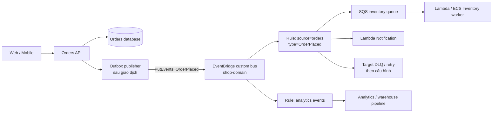
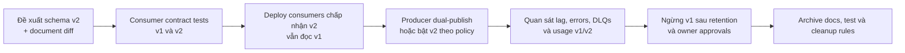
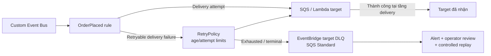
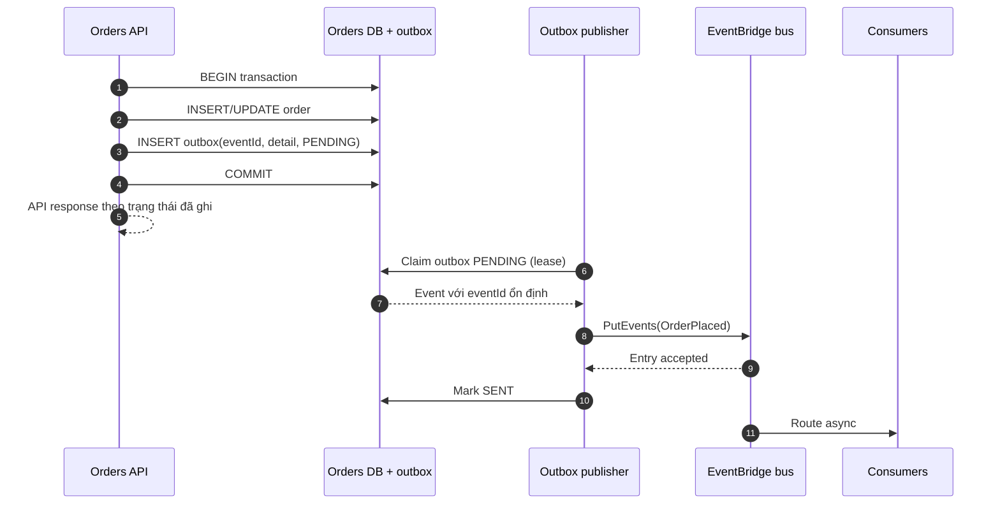
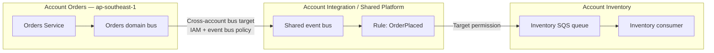
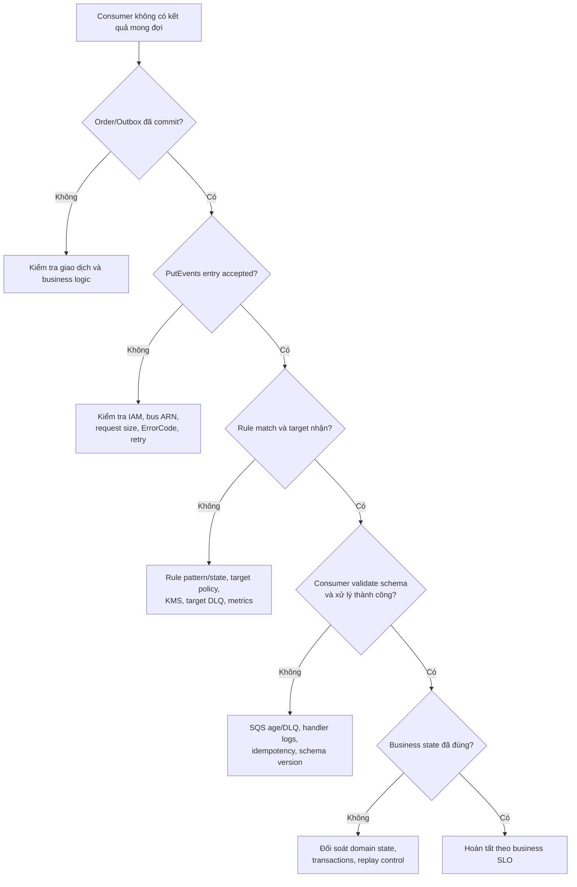

# Custom event và hợp đồng dữ liệu sự kiện trên Amazon EventBridge

Khi một dịch vụ hoàn tất việc tạo đơn hàng, cập nhật tồn kho hoặc ghi nhận thanh toán, các thành phần khác có thể cần biết **điều gì vừa xảy ra**. Một cách thiết kế là gọi trực tiếp từng API. Cách khác là dịch vụ phát **custom event** vào **Amazon EventBridge**, rồi nhiều consumer tự đăng ký xử lý sự kiện theo nhu cầu. Cách thứ hai giúp giảm phụ thuộc trực tiếp giữa các dịch vụ, nhưng tạo ra trách nhiệm mới: **event phải có tên, ý nghĩa, cấu trúc, phiên bản và cam kết tương thích rõ ràng**.

Bài học thuộc chương **Sự kiện và điều phối**, module **CLOUD_PROVIDERS_AWS**. Trong hệ sinh thái AWS từ Region/AZ, IAM, VPC, EC2/ECS/Lambda, lưu trữ S3, cơ sở dữ liệu, tích hợp đến giám sát và phục hồi, thiết kế sự kiện là cầu nối giữa hệ thống backend và các luồng bất đồng bộ. Người học sẽ biết **chọn khi nào phát custom event, xây hợp đồng dữ liệu (event contract), publish/routing bằng EventBridge, xử lý thay đổi schema và kiểm soát lỗi, bảo mật, chi phí**.

Tình huống xuyên suốt: hệ thống Shop có **Orders Service** phát sự kiện `OrderPlaced` sau khi tạo đơn. **Inventory**, **Notifications** và **Analytics** cần tiêu thụ cùng sự kiện, mỗi bên có lịch triển khai và yêu cầu riêng. Một event contract tốt cho phép thêm consumer và tiến hóa ứng dụng mà không làm các bên cũ hỏng đột ngột.

## 1. Kết quả học tập

Sau bài học, người học có thể:

1. Phân biệt **domain event**, **integration event**, **command**, **API request** và **event notification**.
2. Giải thích cấu trúc event EventBridge gồm `source`, `detail-type`, `detail` cùng các trường envelope như `id`, `time`, `region`, `account`.
3. Thiết kế hợp đồng với **business event ID**, schema version, aggregate ID, tenant context, timestamp, correlation ID và payload tối thiểu.
4. Viết **JSON Schema** cho một custom event, kiểm tra compatibility giữa các versions và phân biệt backward/forward compatibility.
5. Gửi sự kiện qua **PutEvents**, kiểm tra lỗi từng entry và tạo EventBridge rule để định tuyến theo event pattern.
6. Thiết kế idempotency, at-least-once delivery, retry, target DLQ, archive/replay và transactional outbox.
7. Quản lý schema registry/discovery, bảo mật sự kiện, audit, observability, quota và tổng chi phí.
8. Xây bộ **contract tests** giữa producer/consumer và xử lý thay đổi nhiều team an toàn.

## 2. Custom event là gì, khác command thế nào?

Một **domain event** diễn tả điều **đã xảy ra** trong nghiệp vụ. Khi phát ra cho các hệ thống khác qua bus, nó trở thành một **integration event** với hợp đồng công khai giữa producer và consumers.

| Loại thông điệp | Ý nghĩa | Ví dụ | Quan hệ giữa hai phía |
|---|---|---|---|
| **Event** | Một sự thật đã xảy ra | `OrderPlaced`, `PaymentCaptured` | Producer thông báo, consumer tự quyết định phản ứng |
| **Command** | Yêu cầu một hành động nên xảy ra | `ReserveInventory`, `SendReceipt` | Có đích nhận/trách nhiệm thực hiện tương đối rõ |
| **Synchronous API request** | Gọi chức năng và chờ response | `POST /orders` | Caller cần kết quả ngay |
| **Event notification** | Báo rằng có thay đổi, ít dữ liệu | `OrderChanged {orderId}` | Consumer có thể gọi API để lấy trạng thái hiện tại |
| **Event-carried state transfer** | Gửi trạng thái/dữ liệu cần để consumer xử lý | `OrderPlaced` kèm items, currency, total | Consumer giảm nhu cầu gọi ngược producer, nhưng contract lớn hơn |

**Nguyên tắc đặt tên:** ưu tiên **thì quá khứ**, giàu ngữ nghĩa nghiệp vụ: `OrderPlaced`, `ShipmentDispatched`, `RefundApproved`. Hạn chế những tên mơ hồ như `DataUpdated` hoặc ra lệnh như `SendEmail` rồi gọi đó là event. Một sự kiện không phải lời hứa rằng tất cả consumers đã chạy thành công.

### 2.1. Sự kiện diễn tả một sự thật bất biến

Nếu đơn hàng đã được đặt, event `OrderPlaced` không nên bị sửa nội dung sau khi publish. Nếu trạng thái thay đổi, phát event mới như `OrderCancelled`, `OrderPaid` hoặc `OrderShipped`. Consumer có thể nhận lặp hoặc nhận chậm; thay đổi trạng thái phải được xây dựa trên logic idempotent/ordering, không dựa vào giả định một dòng event duy nhất là trạng thái hiện tại.

### 2.2. Vì sao cần custom event?

Với ba consumers:

- Orders Service không phải tự gọi Inventory, Notifications và Analytics ở trong request HTTP.
- Một consumer lỗi không buộc request tạo đơn chờ tới khi consumer đó phục hồi.
- Mỗi đội có thể phát triển consumer độc lập nếu tuân thủ **event contract**.
- Có thể thêm rules/targets mới mà không sửa mã nguồn producer, trong phạm vi governance được duyệt.

Tuy vậy, hệ thống phải chấp nhận **eventual consistency**: lúc Order API trả kết quả, email, kho và dashboard có thể chưa cập nhật. Cần trạng thái nghiệp vụ, retry, đối soát và cách báo lỗi cho người dùng.

## 3. Kiến trúc event-driven với EventBridge

**Amazon EventBridge event bus** nhận events từ nguồn AWS, SaaS partners hoặc ứng dụng custom. **Rules** đánh giá event patterns, sau đó route sự kiện khớp tới **targets** được hỗ trợ như Lambda, SQS, Step Functions hoặc một event bus khác.



Sơ đồ phản ánh phân tách trách nhiệm, không thể hiện một giao dịch xuyên EventBridge/SQS/database. Với dữ liệu đơn hàng quan trọng, **transactional outbox** hoặc cơ chế phát từ change stream đáng tin cậy giải quyết rủi ro database commit thành công nhưng producer chết trước khi gọi `PutEvents`.

### 3.1. Bốn thành phần nền tảng

| Thành phần | Trách nhiệm | Ví dụ |
|---|---|---|
| **Producer** | Phát sự kiện đúng thời điểm, hợp đồng và tính nhất quán dữ liệu | Orders Service |
| **Event bus** | Nhận và định tuyến sự kiện | `shop-domain` |
| **Rule / pattern** | Chọn events theo envelope và detail fields | `source=["com.shop.orders"]`, `detail-type=["OrderPlaced"]` |
| **Target / consumer** | Thực thi tác vụ, kiểm tra schema và idempotency | Inventory SQS worker |

Producer **không nên biết** rule nào đang route tới consumer nào. Tuy nhiên, producer vẫn phải có owner, policy publish, versioning và observability để các consumers có thể dựa vào contract.

### 3.2. EventBridge không phải event store vô thời hạn

Event bus định tuyến sự kiện, **không tự lưu mỗi sự kiện mãi mãi** như một cơ sở dữ liệu nghiệp vụ. EventBridge có tính năng **archive và replay** khi được cấu hình, nhưng replay có phạm vi, chi phí và hành vi riêng; đừng mặc định có thể lấy lại mọi event từ nhiều tháng trước nếu chưa tạo archive đúng lúc.

Nếu một consumer cần backlog riêng và kiểm soát tốc độ, route event tới **SQS queue**. Nếu cần thứ tự/đọc lại theo stream semantics, cân nhắc **Kinesis, Kafka, DynamoDB Streams** hoặc thiết kế khác. Chọn công cụ theo retention, ordering, replay và throughput, không chỉ dựa trên từ “event”.

## 4. EventBridge event envelope: dữ liệu nào do AWS quản lý?

Một event trên EventBridge có dạng JSON:

```json
{
  "version": "0",
  "id": "d1a3b1c0-example-generated-id",
  "detail-type": "OrderPlaced",
  "source": "com.shop.orders",
  "account": "111122223333",
  "time": "2026-11-20T08:00:00Z",
  "region": "ap-southeast-1",
  "resources": [
    "arn:aws:dynamodb:ap-southeast-1:111122223333:table/Orders"
  ],
  "detail": {
    "schemaVersion": "1.0",
    "eventId": "evt-order-1001-created",
    "orderId": "ORD-1001",
    "occurredAt": "2026-11-20T07:59:59Z",
    "tenantId": "tenant-101",
    "currency": "VND",
    "totalMinorUnits": 125000
  }
}
```

Đây là **event minh họa**, không phải giá trị được AWS trả về thật. Chẳng hạn trường `id` thực tế được EventBridge sinh, còn `eventId` trong `detail` là business event ID do producer quản lý.

| Trường | Ai quản lý? | Ý nghĩa và lưu ý |
|---|---|---|
| `version` | EventBridge | Phiên bản envelope, hiện thường là `"0"`; **không phải business schema version** |
| `id` | EventBridge | ID của EventBridge event; không thay business event ID xuyên publish/replay |
| `detail-type` | Producer chọn khi PutEvents | Tên loại sự kiện, thường là sự kiện nghiệp vụ |
| `source` | Producer chọn | Namespace nguồn, ví dụ `com.shop.orders` |
| `account` | AWS | Account nơi sự kiện xuất hiện theo mô hình phân phối |
| `region` | AWS | Region của event bus/event |
| `time` | Producer cung cấp hoặc EventBridge điền theo API | Thời điểm envelope, không tự chứng minh thời điểm commit nghiệp vụ |
| `resources` | Producer tùy chọn | ARNs liên quan, chú ý không lộ thông tin nhạy cảm |
| `detail` | Producer | **Payload nghiệp vụ được contract hóa** |

**Hai chữ “version” cần phân biệt:** `version="0"` của EventBridge envelope và `detail.schemaVersion="1.0"` của hợp đồng nghiệp vụ là hai khái niệm khác nhau. Không dựa vào `version` để biết producer đã thêm/bỏ field trong `detail`.

### 4.1. Các trường trong PutEvents entry

Producer gửi `PutEventsRequestEntry` gồm các trường:

| Input property | Bắt buộc/ý nghĩa | Ví dụ |
|---|---|---|
| `Source` | Nguồn event theo namespace ứng dụng | `com.shop.orders` |
| `DetailType` | Loại event nghiệp vụ | `OrderPlaced` |
| `Detail` | **Chuỗi JSON hợp lệ**, không phải object truyền trực tiếp ở SDK entry | `"{\"orderId\":\"ORD-1001\"}"` |
| `EventBusName` | Tên/ARN bus, tùy config; nếu bỏ có thể tới default bus | `shop-domain` |
| `Time` | Thời điểm sự kiện tùy chọn | UTC timestamp |
| `Resources` | ARN resources liên quan tùy chọn | DynamoDB table ARN |
| `TraceHeader` | Truyền X-Ray trace context theo hỗ trợ | Tracing metadata, không phải authorization |

Hãy **luôn đặt `EventBusName` rõ ràng** trong production để tránh publish nhầm bus mặc định. Không tạo nguồn custom bắt đầu bằng `aws.`; namespace `aws.*` được dành cho sự kiện do dịch vụ AWS phát.

### 4.2. Nên đặt dữ liệu nào ở envelope, dữ liệu nào ở detail?

Đặt thông tin mà **EventBridge rules cần lọc chung** ở `source`/`detail-type`; đặt nghiệp vụ ở `detail`:

- `source`: tên ứng dụng/domain producer ổn định.
- `detail-type`: tên sự kiện, ví dụ `OrderPlaced`.
- `detail.schemaVersion`: phiên bản schema hợp đồng.
- `detail.orderId`, `tenantId`: entity context để consumer xử lý.
- `detail.traceId/correlationId`: thông tin quan sát không bí mật.
- `detail.eventId`: định danh ổn định để idempotent.

Không nhét toàn bộ bảng database vào `detail`. Dữ liệu thêm vào contract trở thành thứ các consumers có thể phụ thuộc và có thể bị ghi lại trong archives, DLQs và logs.

## 5. Hợp đồng dữ liệu sự kiện (event contract) là gì?

**Event contract** không chỉ là một mẫu JSON. Đó là thỏa thuận giữa producer và consumers về **ý nghĩa, cấu trúc, kiểu dữ liệu, thời điểm phát, tính tương thích, chính sách dữ liệu, semantics retry/ordering và owner**.

Một hợp đồng tối thiểu cần trả lời:

1. **Ý nghĩa:** `OrderPlaced` được phát ở bước nào? Khi người mua bấm nút hay sau khi transaction tạo order commit?
2. **Nguồn:** service/team nào sở hữu `source` và `detail-type`?
3. **Định danh:** đâu là business event ID, aggregate ID, tenant ID? Có ổn định qua retry không?
4. **Thời gian:** `occurredAt` là khi nào, khác `publishedAt` và `time` của envelope thế nào?
5. **Schema:** fields, types, required/optional, enum, format, unit và nullability?
6. **Version:** thay đổi backward-compatible hay breaking? Phân phối consumers cũ thế nào?
7. **Delivery:** at-least-once, duplication, ordering, retry và retention?
8. **Bảo mật:** dữ liệu nào là PII, secret, có cross-account/cross-Region không?
9. **Test/monitor:** contract được kiểm thử ở đâu, ai được cảnh báo khi vi phạm?
10. **Lifecycle:** deprecation policy và thời gian chuyển đổi khi có consumers ngoài đội?

### 5.1. Ví dụ hợp đồng OrderPlaced v1

| Thuộc tính | Cam kết |
|---|---|
| Contract ID | `com.shop.orders/OrderPlaced/1` |
| Producer owner | Orders Platform Team |
| Event bus | `shop-domain` trong account/Region được duyệt |
| Trigger | **Sau khi order được lưu thành công**, không phải lúc request mới nhận |
| `source` / `detail-type` | `com.shop.orders` / `OrderPlaced` |
| `schemaVersion` | `1.0` (string; version của detail) |
| Business event ID | `eventId` duy nhất cho sự kiện nghiệp vụ, giữ nguyên khi retry publish |
| Aggregate | `orderId` |
| Tenant | `tenantId` |
| Timestamp | `occurredAt` theo ISO 8601 UTC |
| Money | `totalMinorUnits` là số nguyên đơn vị nhỏ nhất và `currency` theo ISO 4217 |
| Semantics | At-least-once delivery; consumer cần idempotency, không giả định global ordering |
| Security | Không chứa raw payment card, password, access token, customer address |
| Deprecation | Có thông báo/dual-publish và thời gian chuyển đổi cho breaking changes |

**Lưu ý tiền tệ:** `totalMinorUnits` chỉ hữu ích khi các hệ thống thống nhất quy tắc minor unit của currency. Ví dụ VND thường dùng đơn vị nhỏ nhất ở mức đồng, nhưng currency khác có thể có số chữ số thập phân khác nhau. Không phát `amount: 125.000` dưới dạng floating point rồi để consumers tự suy đoán đơn vị.

### 5.2. Contract là API bất đồng bộ

Một khi consumer có thể deploy độc lập, **thay đổi tên field trong event** có mức độ rủi ro giống như thay đổi HTTP API response. Vì vậy hãy:

- Công bố schema và owner rõ ràng.
- Review thay đổi trước deploy.
- Áp dụng contract tests producer/consumer.
- Phân biệt thêm optional field với đổi ngữ nghĩa field cũ.
- Có lịch deprecation và migration thay vì âm thầm xóa field.

## 6. Chọn kiểu dữ liệu và required fields

Một event ổn định cần định nghĩa các quyết định nhỏ nhưng có ảnh hưởng lớn:

| Trường | Lựa chọn đề xuất | Vì sao |
|---|---|---|
| `eventId` | String định danh duy nhất, có tính ổn định xuyên retry | Dedupe độc lập EventBridge envelope |
| `schemaVersion` | String `"1.0"` hoặc integer có chính sách thống nhất | Chọn parser đúng version |
| `orderId` | String không phụ thuộc độ dài/format cơ sở dữ liệu | Tránh consumers tự parse ID |
| `occurredAt` | ISO 8601 UTC, ví dụ `2026-11-20T08:00:00Z` | Tránh lệch múi giờ |
| `tenantId` | String của tenant thuộc nguồn tin cậy | Phân quyền và phân vùng dữ liệu |
| `currency` | ISO 4217 currency code | Giải nghĩa monetary amount |
| `totalMinorUnits` | Integer (hoặc string nếu vượt giới hạn số an toàn giữa ngôn ngữ) | Tránh floating-point rounding |
| `items` | Array với object có schema rõ | Không dùng array vô danh phụ thuộc vị trí |
| `correlationId` | String ID tracing/luồng nghiệp vụ | Liên hệ logs nhiều dịch vụ |
| `metadata` | Object có owner và schema/limits | Tránh bucket dữ liệu không định nghĩa |

### 6.1. Required và optional

**Required field** phải luôn hiện diện theo contract, ví dụ `eventId`, `orderId`, `schemaVersion`. **Optional field** được phép thiếu, và consumers phải phân biệt “không có” với “có giá trị `null`” nếu schema quy định.

Đối với fields mới, nên thêm theo dạng **optional** hoặc có default semantics rõ, thay vì ép mọi consumer cũ nâng cấp ngay.

### 6.2. Enum mở hay đóng?

Nếu contract quy định:

```json
{
  "orderChannel": "WEB"
}
```

Consumer không nên âm thầm crash khi producer bổ sung `MOBILE_APP` nếu contract đã tuyên bố enum có thể mở rộng. Hai lựa chọn cần quyết định trước:

- **Closed enum:** danh sách giá trị cố định, thêm giá trị mới có thể là breaking change.
- **Open enum:** consumer phải có branch xử lý unknown values theo policy (lưu, bỏ qua, cảnh báo hoặc default rõ ràng).

Quy tắc “thêm field/enum luôn không phá tương thích” là **sai** nếu consumer dùng deserializer strict hoặc mapping thiếu default.

## 7. Định nghĩa hợp đồng bằng JSON Schema

**JSON Schema** cho phép mô tả kiểu dữ liệu, các trường required, cấu trúc nested objects, định dạng thời gian, giới hạn kích thước và những giá trị hợp lệ. Một schema là công cụ kiểm tra **cấu trúc**, không tự bảo đảm rằng sự kiện đã được phát ở đúng thời điểm nghiệp vụ hoặc có quyền truy cập đúng tenant.

### 7.1. JSON Schema cho `detail` của `OrderPlaced v1`

```json
{
  "$schema": "https://json-schema.org/draft/2020-12/schema",
  "$id": "https://schemas.example.com/orders/order-placed/v1.json",
  "title": "OrderPlaced v1",
  "description": "Order was committed successfully by Orders Service.",
  "type": "object",
  "required": [
    "schemaVersion",
    "eventId",
    "orderId",
    "tenantId",
    "occurredAt",
    "currency",
    "totalMinorUnits",
    "items"
  ],
  "properties": {
    "schemaVersion": {
      "type": "string",
      "const": "1.0"
    },
    "eventId": {
      "type": "string",
      "minLength": 1,
      "maxLength": 128
    },
    "orderId": {
      "type": "string",
      "minLength": 1,
      "maxLength": 128
    },
    "tenantId": {
      "type": "string",
      "minLength": 1,
      "maxLength": 128
    },
    "occurredAt": {
      "type": "string",
      "format": "date-time"
    },
    "currency": {
      "type": "string",
      "pattern": "^[A-Z]{3}$"
    },
    "totalMinorUnits": {
      "type": "integer",
      "minimum": 0
    },
    "items": {
      "type": "array",
      "minItems": 1,
      "maxItems": 500,
      "items": {
        "type": "object",
        "required": ["productId", "quantity", "unitPriceMinorUnits"],
        "properties": {
          "productId": {
            "type": "string",
            "minLength": 1
          },
          "quantity": {
            "type": "integer",
            "minimum": 1
          },
          "unitPriceMinorUnits": {
            "type": "integer",
            "minimum": 0
          }
        },
        "additionalProperties": true
      }
    },
    "correlationId": {
      "type": "string",
      "maxLength": 128
    },
    "promotionCode": {
      "type": "string",
      "maxLength": 64
    }
  },
  "additionalProperties": true
}
```

**Lưu ý học thuật và triển khai:**

- Schema trên dùng **JSON Schema draft 2020-12** làm ví dụ validator ở producer/consumer. **EventBridge Schemas Registry có dialect/cách biểu diễn riêng theo tính năng**, nên không giả định có thể nạp thẳng mọi keyword 2020-12 vào registry mà không chuyển đổi/kiểm thử khả năng hỗ trợ.
- `required` là danh sách fields **bắt buộc xuất hiện**, không phải danh sách fields được phép.
- `additionalProperties: true` cho phép thêm fields mà consumer tolerant có thể bỏ qua; đó là **chủ đích tương thích**, không có nghĩa cho phép schema trôi nổi không quản lý.
- `format: "date-time"` tùy validator có thể cần bật **format assertion** hoặc plugin tương ứng; không chỉ đặt keyword rồi mặc định mọi validator đều kiểm tra sâu.
- Schema không kiểm tra phép tính `totalMinorUnits` = tổng các dòng, hoặc currency có thực sự phù hợp merchant; cần business validation riêng.
- Đừng đưa thông tin bí mật hoặc payment card fields vào schema chỉ để “tiện truyền”.

### 7.2. Payload hợp lệ theo schema

```json
{
  "schemaVersion": "1.0",
  "eventId": "evt-order-1001-placed",
  "orderId": "ORD-1001",
  "tenantId": "tenant-101",
  "occurredAt": "2026-11-20T08:00:00Z",
  "currency": "VND",
  "totalMinorUnits": 125000,
  "items": [
    {
      "productId": "SKU-100",
      "quantity": 2,
      "unitPriceMinorUnits": 62500
    }
  ],
  "correlationId": "req-checkout-456"
}
```

Payload này phù hợp về **cấu trúc** và số tiền minh họa, nhưng để được publish đáng tin, producer vẫn phải lấy dữ liệu từ transaction kết thúc thành công và sử dụng `eventId` ổn định khi retry.

### 7.3. Payload sai cần bị chặn

```json
{
  "schemaVersion": "1.0",
  "eventId": "evt-invalid",
  "orderId": "ORD-1002",
  "tenantId": "tenant-101",
  "occurredAt": "yesterday",
  "currency": "VND",
  "totalMinorUnits": "125000",
  "items": []
}
```

Các lỗi: `totalMinorUnits` là **string** thay vì integer; `items` rỗng; `occurredAt` không phải timestamp ISO 8601 hợp lệ. Với validator có format assertion, lỗi thời gian cũng được phát hiện.

### 7.4. Schema phải được áp dụng ở đâu?

| Điểm kiểm tra | Mục tiêu | Hành vi khi không hợp lệ |
|---|---|---|
| **Producer trước publish** | Ngăn event sai hợp đồng đi lên bus | Log lỗi có kiểm soát, không publish; giữ outbox để xử lý |
| **CI producer contract test** | Phát hiện breaking changes trước release | Block merge/deploy |
| **Consumer lúc nhận** | Bảo vệ handler trước dữ liệu hỏng/chưa hỗ trợ | Quarantine/DLQ hoặc bỏ qua theo policy rõ |
| **CI consumer contract tests** | Đảm bảo consumer xử lý version và unknown fields | Block regression |
| **Schema registry/governance** | Catalog schema/ownership/version, hỗ trợ discoverability | Review và kiểm soát lifecycle |

**EventBridge rule lọc theo pattern không tự áp JSON Schema cho mọi event.** Một rule khớp `source` và `detail-type` có thể chuyển tiếp một `detail` thiếu required fields; schema validation cần được thiết kế ở producer, consumer hoặc lớp kiểm tra thích hợp.

## 8. Tiến hóa schema: backward, forward và breaking changes

Trong event-driven architecture, producer và consumer thường deploy **không đồng thời**. Cần biết liệu một consumer cũ có thể đọc event mới, và consumer mới có thể đọc events cũ còn nằm trong SQS/archive hay không.

### 8.1. Định nghĩa theo người đọc

| Tính tương thích | Đặt câu hỏi | Ví dụ |
|---|---|---|
| **Backward compatibility** | **Consumer mới** có đọc được event từ **producer cũ** không? | Consumer v2 chấp nhận events v1 còn trong queue |
| **Forward compatibility** | **Consumer cũ** có đọc được event từ **producer mới** không? | Consumer v1 bỏ qua optional field `promotionCode` |
| **Full compatibility** | Cả hai chiều đều được hỗ trợ | Cùng chấp nhận schema v1/v2 theo policy |
| **Breaking change** | Một phía không đọc/hiểu dữ liệu của phía còn lại | Đổi `totalMinorUnits` sang string, xóa `orderId` |

Các khái niệm có thể được diễn giải theo hướng writer/reader ở từng schema registry. **Trong bài này, tiêu chí cuối cùng là hành vi consumer thực tế**, bao gồm cả logic nghiệp vụ chứ không chỉ tính hợp lệ JSON.

### 8.2. Ma trận thay đổi thường gặp

| Thay đổi producer | Rủi ro với consumer cũ | Khuyến nghị |
|---|---|---|
| Thêm **optional** field mới | Thấp khi parser tolerant, cao nếu strict | Contract test với consumer cũ |
| Thêm **required** field mới | Consumer mới không đọc events cũ; consumer cũ strict cũng có thể lỗi | Tránh hoặc hỗ trợ default/migration |
| Xóa required field | Cao | Tạo major version hoặc dual-publish |
| Đổi field name | Cao | Thêm field mới, giữ cũ trong giai đoạn chuyển |
| Đổi type integer → string | Cao | Version mới và mapping |
| Đổi ý nghĩa field giữ nguyên tên | **Rất cao**, khó phát hiện bằng JSON Schema | Treat as breaking và đổi contract |
| Thêm enum value | Phụ thuộc consumer có fallback không | Tuyên bố open enum từ đầu hoặc version |
| Thêm nested optional object | Phụ thuộc parser | Keep old shape và test |
| Đổi unit từ đồng sang xu hoặc giây sang mili giây | Rất cao | Dùng field mới có tên unit rõ |
| Đổi thứ tự xuất hiện các JSON fields | Thường không ảnh hưởng chuẩn JSON | Không viết consumer phụ thuộc key ordering |
| Bổ sung một target EventBridge | Không đổi contract của producer | Kiểm tra downstream capacity, quyền và DLQ |

**Phân biệt tương thích cấu trúc với tương thích ngữ nghĩa:** hai events có thể đều valid JSON Schema nhưng khác ý nghĩa. Ví dụ v1 `OrderPlaced` phát sau transaction commit, v2 đổi sang phát trước khi thanh toán hoàn tất: đây là thay đổi **nghiệp vụ phá vỡ hợp đồng**, dù field names/types không đổi.

### 8.3. Ví dụ thêm field tương thích có điều kiện

Producer v1:

```json
{
  "schemaVersion": "1.0",
  "orderId": "ORD-1001",
  "currency": "VND",
  "totalMinorUnits": 125000
}
```

Producer v1.1:

```json
{
  "schemaVersion": "1.1",
  "orderId": "ORD-1001",
  "currency": "VND",
  "totalMinorUnits": 125000,
  "promotionCode": "WELCOME10"
}
```

Ví dụ trên **được rút gọn để tập trung vào tiến hóa**, chưa phải payload `OrderPlaced v1` đầy đủ ở phần 7. Consumer cũ chỉ phụ thuộc ba field chính và **bỏ qua unknown fields** có thể tiếp tục chạy. Consumer mới cần chấp nhận việc `promotionCode` vắng mặt ở các events v1 trong queue/archive.

### 8.4. Ví dụ breaking change không được phát âm thầm

```json
{
  "schemaVersion": "2.0",
  "orderId": "ORD-1001",
  "currency": "VND",
  "totalAmount": "125000.00"
}
```

Ở đây `totalMinorUnits` đã biến mất và được thay bằng một string `totalAmount` với ý nghĩa/đơn vị chưa rõ. Consumer v1 tính tổng hoặc ghi sổ tiền có thể lỗi, hoặc tệ hơn, **xử lý sai số tiền**. Cần công bố version mới và chuyển consumer an toàn, không chỉ đổi `schemaVersion` rồi mong hệ thống tự hiểu.

## 9. Chiến lược versioning và phối hợp release

Có một số cách thiết kế version:

| Chiến lược | Ví dụ | Đánh đổi |
|---|---|---|
| Version trong `detail.schemaVersion` | `OrderPlaced + 1.0` | Ít thay đổi rules; consumer phải kiểm tra version |
| Major version trong `detail-type` | `OrderPlacedV2` | Rules/targets dễ tách; thay đổi tên loại event |
| Version trong `source` | `com.shop.orders.v2` | Thay đổi namespace, nhiều rules/cấu hình |
| Version trong schema registry ID | Contract/catalog version | Cần đồng bộ runtime metadata và CI |

Không có một quy tắc duy nhất phù hợp mọi tổ chức. Một chính sách dễ dùng:

1. Giữ `source` ổn định theo bounded context.
2. Dùng tên event giàu ý nghĩa, ưu tiên giữ `detail-type` qua các thay đổi tương thích.
3. Lưu `schemaVersion` ở `detail`, và định nghĩa rõ major/minor semantics.
4. Với breaking change, **dual-publish** hoặc sử dụng `detail-type`/bus mới theo kế hoạch migration.
5. Có thời gian deprecation theo retention của SQS/archive và lịch deploy consumers.

### 9.1. Kế hoạch phát hành schema v2 an toàn



**Đặc biệt với dual-publish:** không cho hai versions của **cùng một sự kiện nghiệp vụ** vô tình dẫn đến **hai lần thực hiện side effect**. Consumers hoặc rules phải biết chọn version; một consumer subscribe cả v1 và v2 cần dedupe theo **business event ID** đã thống nhất.

### 9.2. Schema version khác event sequence

`schemaVersion="2.0"` chỉ nói **shape contract**, không phải event thứ 2 của một order. Nếu cần xử lý các thay đổi theo thứ tự, producer có thể đưa `aggregateVersion=3` hoặc `sequence=3` với ý nghĩa monotonic per aggregate. Tuy nhiên EventBridge standard routing không cam kết global order; consumers cần kiểm tra version, buffering/compensation hoặc chọn FIFO/stream khi thứ tự là yêu cầu cứng.

### 9.3. Hợp đồng có trạng thái deprecated

Một contract catalog tối thiểu nên có:

```yaml
contractId: com.shop.orders/OrderPlaced/1
producer: orders-service
source: com.shop.orders
detailType: OrderPlaced
schemaVersion: "1.0"
ownerTeam: orders-platform
status: active
deprecation:
  announcedAt: null
  sunsetAt: null
delivery:
  semantics: at-least-once
  ordering: not-guaranteed
  duplicateKey: detail.eventId
security:
  classification: internal
```

YAML là **ví dụ metadata trong bài giảng**, không phải tệp lesson info. Worker không tạo thêm metadata files; công ty nên giữ catalog này trong hệ thống quản lý contract/IaC có owner.

## 10. Phát custom event bằng EventBridge PutEvents

Trước hết cần có một **custom event bus** và IAM role cho producer. API **PutEvents** cho phép gửi nhiều entries trong một request (tối đa **10 entries mỗi call**), mỗi entry có thể thành công hoặc thất bại độc lập.

**Quan trọng:** HTTP 200 của `PutEvents` **không đồng nghĩa tất cả entries đều thành công**. Phải đọc `FailedEntryCount` và từng phần tử trong `Entries`. Khi retry failed entries, **giữ nguyên business `eventId`**, không tạo một sự kiện nghiệp vụ mới.

### 10.1. Tạo custom event bus trong sandbox

```bash
aws events create-event-bus \
  --name shop-domain \
  --region ap-southeast-1

aws events describe-event-bus \
  --name shop-domain \
  --region ap-southeast-1
```

Đây là lệnh thay đổi AWS resources, chỉ chạy trong account lab khi có quyền và ngân sách được phê duyệt. Nếu bus đã tồn tại, dùng `describe-event-bus` để xác nhận ARN, account/Region và policy thay vì tạo thêm bản trùng.

### 10.2. Tạo payload PutEvents CLI

Lưu nội dung sau vào **tệp thử nghiệm** `put-order-event.json` của người học:

```json
{
  "Entries": [
    {
      "Source": "com.shop.orders",
      "DetailType": "OrderPlaced",
      "EventBusName": "shop-domain",
      "Detail": "{\"schemaVersion\":\"1.0\",\"eventId\":\"evt-order-1001-placed\",\"orderId\":\"ORD-1001\",\"tenantId\":\"tenant-101\",\"occurredAt\":\"2026-11-20T08:00:00Z\",\"currency\":\"VND\",\"totalMinorUnits\":125000,\"items\":[{\"productId\":\"SKU-100\",\"quantity\":2,\"unitPriceMinorUnits\":62500}],\"correlationId\":\"req-checkout-456\"}"
    }
  ]
}
```

**Giải thích:** `Entries[0].Detail` là **string có chứa JSON serialized**, nên trong JSON request phải escape dấu nháy bên trong. Một lỗi phổ biến là truyền `Detail` như một JSON object trực tiếp khi SDK/API yêu cầu string, dẫn đến validation error.

Gọi:

```bash
aws events put-events \
  --cli-input-json file://put-order-event.json \
  --region ap-southeast-1
```

Phản hồi thành công minh họa:

```json
{
  "FailedEntryCount": 0,
  "Entries": [
    {
      "EventId": "11111111-2222-3333-4444-555555555555"
    }
  ]
}
```

`EventId` ở đây là **ID nhận sự kiện do EventBridge trả**, không phải `detail.eventId` của nghiệp vụ. Nếu producer retry cùng event do mạng bị gián đoạn, EventBridge có thể nhận thành công thêm một bản; consumer không được dùng EventId mới làm khóa chống lặp nghiệp vụ duy nhất.

### 10.3. Nếu một số entries thất bại

Phản hồi có thể giống:

```json
{
  "FailedEntryCount": 1,
  "Entries": [
    {
      "EventId": "11111111-2222-3333-4444-555555555555"
    },
    {
      "ErrorCode": "InternalFailure",
      "ErrorMessage": "Example transient failure"
    }
  ]
}
```

Thứ tự `Entries` trong response tương ứng **vị trí entries trong request**. Producer phải retry **đúng những entries có lỗi có thể retry**, không blindly resend toàn bộ batch đã một phần thành công. Với lỗi invalid event/schema/permission, sửa nguyên nhân thay vì retry vô hạn.

### 10.4. Ví dụ Python boto3 producer

```python
import json
import random
import time

import boto3

events = boto3.client("events", region_name="ap-southeast-1")


def publish_order_placed(order):
    # eventId phải là ID đã lưu cùng event/outbox,
    # KHÔNG tạo UUID mới ở mỗi lần retry.
    event = {
        "schemaVersion": "1.0",
        "eventId": order["eventId"],
        "orderId": order["orderId"],
        "tenantId": order["tenantId"],
        "occurredAt": order["occurredAt"],
        "currency": order["currency"],
        "totalMinorUnits": order["totalMinorUnits"],
        "items": order["items"],
    }
    if order.get("correlationId"):
        event["correlationId"] = order["correlationId"]
    request_entry = {
        "Source": "com.shop.orders",
        "DetailType": "OrderPlaced",
        "EventBusName": "shop-domain",
        "Detail": json.dumps(event, separators=(",", ":")),
    }

    for attempt in range(4):
        response = events.put_events(Entries=[request_entry])
        if response.get("FailedEntryCount", 0) == 0:
            return response["Entries"][0]["EventId"]

        result = response["Entries"][0]
        code = result.get("ErrorCode", "Unknown")
        if code not in {"InternalFailure", "ThrottlingException"}:
            raise RuntimeError(f"Non-retryable PutEvents entry error: {code}")

        if attempt == 3:
            raise RuntimeError(f"Event publish still failed: {code}")
        time.sleep(min(2 ** attempt, 8) + random.random() / 2)

    raise AssertionError("unreachable")
```

Code minh họa cách kiểm tra `FailedEntryCount` và lỗi từng entry; nó đọc `eventId` và `occurredAt` từ record gốc để **giữ nguyên khi retry**, đồng thời chỉ đưa optional `correlationId` vào payload khi có giá trị. Production cần thêm: validation JSON Schema trước khi publish, retry **cả AWS SDK/API transport errors phù hợp**, log có redaction, circuit breaker, outbox state và metrics.

### 10.5. Kích thước và quota

PutEvents có giới hạn số entries mỗi request, kích thước mỗi event/batch và throughput/quota theo Region/account. AWS đã mở rộng giới hạn kích thước cho một số API/tính năng theo thời gian; **không đưa file lớn hoặc binary data vào `detail`**. Đưa object vào **S3**, chỉ gửi `bucket/key/version/checksum` và quyền đọc thích hợp; đối chiếu **EventBridge quotas** hiện hành trước khi dự toán.

## 11. Định tuyến bằng EventBridge rule và event pattern

Khi producer gửi `OrderPlaced` vào `shop-domain`, một rule có thể lọc chỉ đúng sự kiện Shop:

```json
{
  "source": ["com.shop.orders"],
  "detail-type": ["OrderPlaced"],
  "detail": {
    "schemaVersion": ["1.0"]
  }
}
```

**Event pattern sử dụng đúng tên field và kiểu dữ liệu.** `detail-type` có dấu gạch nối, không phải `detailType` của PutEvents SDK. `schemaVersion` ở pattern là property của `detail`, không phải envelope `version`. EventBridge hỗ trợ nhiều comparison operators như prefix, suffix, anything-but, numeric và exists theo loại giá trị; không cần dùng wildcard mơ hồ khi equality đủ.

**Lưu ý khi nâng version:** rule này chỉ nhận `schemaVersion="1.0"`. Khi producer chuyển sang `1.1`, cần **cập nhật pattern trước** (ví dụ cho phép cả `"1.0"` và `"1.1"`), hoặc cố ý bỏ lọc version ở rule để consumer tự định tuyến theo hợp đồng. Nếu quên cập nhật, event mới có thể được EventBridge accepted nhưng **không đi tới consumer**, dù JSON hợp lệ.

### 11.1. Tạo rule

Giả sử lưu pattern ở file lab `order-placed-pattern.json`:

```bash
aws events put-rule \
  --name order-placed-to-inventory \
  --event-bus-name shop-domain \
  --event-pattern file://order-placed-pattern.json \
  --state ENABLED \
  --region ap-southeast-1
```

Rule chỉ định **những events nào được chọn**. Để có consumer thực sự, còn phải **gắn target** và cấp permissions cho EventBridge gọi target.

### 11.2. Route event vào SQS

```bash
aws events put-targets \
  --rule order-placed-to-inventory \
  --event-bus-name shop-domain \
  --targets "Id=inventory-queue,Arn=arn:aws:sqs:ap-southeast-1:111122223333:inventory-orders" \
  --region ap-southeast-1
```

**Lưu ý permission:** EventBridge cần được **SQS queue resource policy** cho phép `sqs:SendMessage` từ rule ARN phù hợp. Chỉ chạy `put-targets` mà queue không cho phép thì event có thể không được delivery. Đối với encrypted queue KMS, cần cấu hình KMS permissions tương ứng; nếu route qua cross-account bus, trust/resource policies còn phức tạp hơn.

### 11.3. Queue policy mẫu cho một rule

```json
{
  "Version": "2012-10-17",
  "Statement": [
    {
      "Sid": "AllowEventBridgeRuleToSend",
      "Effect": "Allow",
      "Principal": {
        "Service": "events.amazonaws.com"
      },
      "Action": "sqs:SendMessage",
      "Resource": "arn:aws:sqs:ap-southeast-1:111122223333:inventory-orders",
      "Condition": {
        "ArnEquals": {
          "aws:SourceArn": "arn:aws:events:ap-southeast-1:111122223333:rule/shop-domain/order-placed-to-inventory"
        }
      }
    }
  ]
}
```

Policy trên chỉ là một **statement mẫu**; khi áp dụng, phải **merge với queue policy hiện hữu** để tránh xóa quyền hợp lệ khác, kiểm tra chính xác rule ARN dạng bus-name/rule-name, SQS queue ARN và KMS key policy. Không gán `Principal: "*"` hoặc mở quyền toàn bộ account chỉ để “cho chạy được”.

### 11.4. Kiểm tra event pattern mà không gửi event thật

Trong lab, tạo file `sample-order-placed.json` chứa **event envelope đầy đủ** từ phần 4 rồi gọi:

```bash
aws events test-event-pattern \
  --event-pattern file://order-placed-pattern.json \
  --event file://sample-order-placed.json \
  --region ap-southeast-1
```

Lệnh trả boolean match trong trường hợp hợp lệ, giúp phát hiện pattern sai case/field. Tuy nhiên **test-event-pattern không kiểm tra target permissions hoặc việc business handler xử lý thành công**; phải thêm integration/end-to-end tests.

### 11.5. Một rule có thể phục vụ nhiều targets?

EventBridge rule có thể có nhiều targets trong giới hạn hiện hành, nhưng không phải lúc nào cũng nên để mọi consumer dùng chung retry/monitoring. Với hệ thống quan trọng:

- Ưu tiên một target SQS queue cho từng consumer độc lập cần backlog/ownership riêng.
- Mỗi target có permissions, retry policy và DLQ khi hỗ trợ.
- Không route cùng event hai lần đến consumer có side effect không idempotent.
- Nếu cần branching theo business outcome và timeout/compensation nhiều bước, cân nhắc **AWS Step Functions** hoặc workflow orchestration, thay vì biến EventBridge rule thành state machine.

## 12. Xử lý ở consumer: validate contract, idempotency và trạng thái nghiệp vụ

Một consumer tốt không chỉ parse JSON. Nó cần:

1. Xác nhận event thuộc đúng `source`/`detail-type` và **schema version hỗ trợ**.
2. Kiểm tra required fields, types và business invariants cần thiết.
3. Dedupe theo **business `detail.eventId`** hoặc cơ chế phù hợp.
4. Thực hiện side effect an toàn trước retry/crash.
5. Ghi outcome, metrics và correlation ID mà không log dữ liệu nhạy cảm.
6. Phân biệt **lỗi transient** và **lỗi permanent** để tránh retry vô hạn.

### 12.1. Phân biệt event envelope và SQS message wrapper

Khi EventBridge chuyển event tới SQS target mà không dùng Input Transformer, phần **SQS message body** thường là **toàn bộ EventBridge event JSON**. Lambda SQS event source mapping lại nhận một batch gồm các SQS records:

```text
Lambda event
└── Records[]
    └── record
        ├── messageId              <-- SQS transport ID
        ├── receiptHandle
        ├── attributes
        └── body                   <-- JSON string của EventBridge event
            ├── id                 <-- EventBridge event ID
            ├── source
            ├── detail-type
            └── detail
                ├── eventId        <-- business event ID cho idempotency
                └── orderId
```

Không nhầm `record.messageId` với `event.id` hay `event.detail.eventId`. Cả ba IDs có **vai trò khác nhau**. Nếu cùng một business event được publish lại sau transport failure, messageId/EventBridge id có thể đổi, còn `detail.eventId` nên giữ nguyên.

### 12.2. Handler Python cho SQS partial batch failure

Ví dụ sau minh họa cách đọc event, chặn sai contract và trả về failed message IDs để ESM xử lý lại các records chưa thành công:

```python
import json
import logging

logger = logging.getLogger()
logger.setLevel(logging.INFO)

SUPPORTED_VERSIONS = {"1.0", "1.1"}


def process_order_placed_once(detail):
    # Pseudocode: dùng DB conditional write/inbox table để claim eventId,
    # xử lý cùng transaction hoặc dùng downstream idempotency key.
    # Hàm này cần được cài đặt thật trong dịch vụ Inventory.
    raise NotImplementedError("Implement transactional/idempotent processing")


def lambda_handler(event, context):
    failures = []
    for record in event.get("Records", []):
        message_id = record["messageId"]
        try:
            envelope = json.loads(record["body"])
            if envelope.get("source") != "com.shop.orders":
                raise ValueError("Unexpected producer")
            if envelope.get("detail-type") != "OrderPlaced":
                raise ValueError("Unexpected event type")

            detail = envelope["detail"]
            if detail["schemaVersion"] not in SUPPORTED_VERSIONS:
                raise ValueError("Unsupported schema version")
            if not detail.get("eventId") or not detail.get("orderId"):
                raise ValueError("Missing required business fields")

            # Production: validate with full JSON Schema as well.
            process_order_placed_once(detail)
            logger.info(
                "Processed eventId=%s orderId=%s",
                detail["eventId"],
                detail["orderId"],
            )
        except Exception:
            logger.exception("Failed SQS messageId=%s", message_id)
            failures.append({"itemIdentifier": message_id})

    return {"batchItemFailures": failures}
```

**Đây là skeleton cần triển khai hàm `process_order_placed_once` trước khi chạy**; nó cố ý không thực hiện side effect thật. Nếu copy nguyên code vào Lambda, mọi message hợp lệ đều thất bại vì `NotImplementedError`. Trong production cần JSON Schema validation, phân loại permanent failures, structured logs/redaction, idempotency store và retry/backoff cho downstream. Đồng thời bật `ReportBatchItemFailures` ở SQS event source mapping; chỉ trả response JSON mà không cấu hình mapping là chưa đủ.

### 12.3. Event không hỗ trợ version nên xử lý thế nào?

| Trường hợp | Phương án |
|---|---|
| Version mới đã được công bố nhưng consumer chưa deploy | Giữ trong DLQ/quarantine, alert owner và lên lịch upgrade |
| Version bị lỗi cấu trúc nhưng có thể sửa ở producer | Ghi validation failure, dừng retry mù, xử lý corrective publish/replay |
| Unknown optional field trên compatible version | Bỏ qua theo contract tolerant reader |
| Missing required field | Reject/quarantine; không tự suy đoán dữ liệu |
| Event thuộc domain khác bị route nhầm | Kiểm tra rule/target config, ghi security/contract violation |

Với SQS, việc “quarantine” thường cần queue/DLQ và một worker/replayer riêng có quyền hạn; **trả success** cho poison message sẽ làm ESM xóa message nguồn, vì vậy chỉ làm thế khi đã chủ đích lưu vết hoặc chuyển dữ liệu đến một nơi xử lý khác **thành công**.

## 13. Delivery semantics: at-least-once không phải exactly-once

Với EventBridge rules, targets, SQS và Lambda, hãy thiết kế theo giả định **event/message có thể được giao ít nhất một lần và có thể bị trùng**. Duplicate có thể xảy ra do retry khi response ACK bị mất, producer gửi lại, target retry hoặc archive replay.

### 13.1. Bốn ID và cách dùng

| ID | Ai cấp? | Có thể thay khi retry/replay? | Vai trò |
|---|---|---|---|
| `orderId` | Orders domain | Thường giữ nguyên | Định danh aggregate |
| `detail.eventId` | Producer/outbox | **Phải giữ nguyên khi retry cùng event nghiệp vụ** | Dedupe business event |
| `event.id` | EventBridge | Có thể khác ở publish/replay khác | Truy vết lần delivery của EventBridge |
| `SQS messageId` | SQS | Có thể khác khi tạo message mới | Truy vết transport message |

Một `orderId` có thể có nhiều events hợp lệ: `OrderPlaced`, `OrderPaid`, `OrderCancelled`. Vì vậy chỉ dedupe theo `orderId` có thể **làm mất những sự kiện sau**. Khóa có thể là `eventId` duy nhất, hoặc cặp `aggregateId + eventType + aggregateVersion` nếu domain contract quy định như vậy.

### 13.2. Thiết kế bảng Inbox để chống lặp

Một consumer xử lý sự kiện vào database có thể dùng một bảng như:

```sql
CREATE TABLE processed_events (
    consumer_name VARCHAR(100) NOT NULL,
    event_id VARCHAR(128) NOT NULL,
    processed_at TIMESTAMPTZ NOT NULL DEFAULT NOW(),
    PRIMARY KEY (consumer_name, event_id)
);
```

Trường hợp side effect cũng nằm trong **cùng database transaction**, consumer có thể ghi `processed_events` và cập nhật business state nguyên tử:

```sql
BEGIN;

-- Pseudocode: chỉ một worker có thể INSERT cùng khóa nếu có unique PK.
INSERT INTO processed_events (consumer_name, event_id)
VALUES ('inventory-projection', :eventId);

UPDATE inventory_projection
SET reserved_units = reserved_units + :quantity
WHERE product_id = :productId;

COMMIT;
```

**Quan trọng:** ví dụ cần application code xử lý lỗi unique-key/dedupe và transaction rollback. Nếu record `processed_events` đã tồn tại, consumer coi duplicate và **không thực hiện side effect lần nữa**. Nếu update inventory bị lỗi, transaction phải rollback cả bản ghi processed event.

Khi side effect nằm ở **hệ thống ngoài** (gửi email, gọi payment gateway), một local DB transaction không thể làm mọi thao tác nguyên tử. Cần downstream idempotency key, workflow state, outbox/inbox hoặc cơ chế compensation phù hợp.

### 13.3. Dedupe key và thời gian giữ

- Lưu `eventId` ít nhất dài bằng khoảng thời gian có thể replay/duplicate theo nghiệp vụ, thường hơn SQS retention.
- Nếu dùng DynamoDB, có thể dùng **conditional put** và TTL, nhưng phải đảm bảo TTL không xóa record trước khi duplicate hợp lệ còn có thể xuất hiện.
- Dùng idempotency state `IN_PROGRESS`/`COMPLETED` khi processing có thể kéo dài/crash, với lease/recovery.
- Không lưu trạng thái “COMPLETED” trước khi side effect thực sự có thể được bảo đảm, nếu không một crash sẽ làm mất công việc.

### 13.4. Không có thứ tự toàn cục

EventBridge event bus không phải một log sắp xếp toàn cục theo `occurredAt`. Consumer có thể nhận:

```text
Thực tế trong Orders DB:
  OrderPlaced (aggregateVersion=1)
  OrderPaid   (aggregateVersion=2)
  OrderShipped(aggregateVersion=3)

Thứ tự delivery ở các targets:
  OrderPaid   (2)
  OrderPlaced (1)
  OrderShipped(3)
```

Nếu yêu cầu đúng thứ tự, cân nhắc:

1. Gắn `aggregateVersion` tăng dần và consumer kiểm tra expected version.
2. Dùng SQS FIFO theo `MessageGroupId=orderId` cho một luồng consumer phù hợp.
3. Dùng Kinesis/Kafka với partition key, checkpoint và retention semantics.
4. Thiết kế state machine bỏ qua event cũ hoặc đưa missing version vào buffer/retry.

**SQS FIFO chỉ giữ thứ tự theo message group trong điều kiện delivery/processing tương ứng**, không tự khôi phục thứ tự nếu producer đã gửi vào queue sai thứ tự. Một EventBridge → SQS FIFO pipeline cũng cần kiểm tra rằng **thứ tự thực tế được duy trì qua toàn bộ các bước**, không chỉ vì đích là FIFO.

## 14. Retry, target DLQ và phân loại lỗi ở EventBridge

**EventBridge rule target retry** xảy ra khi **EventBridge không giao sự kiện thành công tới target**. Nó là cơ chế khác với việc Lambda consumer đã nhận event nhưng code xử lý bị lỗi, hoặc SQS worker xử lý message rồi ném exception.

### 14.1. Ba tầng lỗi cần tách

| Tầng | Ví dụ | Nơi cấu hình retry và lưu lỗi |
|---|---|---|
| **Producer → EventBridge bus** | `PutEvents` throttling, entry error, network timeout | SDK retry/outbox publisher, `FailedEntryCount` |
| **EventBridge rule → target** | Target permission thiếu, target API throttle | EventBridge target RetryPolicy và target DLQ |
| **Target consumer xử lý nghiệp vụ** | Lambda exception, SQS worker DB timeout | Lambda async retry/destination, SQS visibility/redrive DLQ, consumer state |

Ví dụ EventBridge đã gửi thành công một event vào SQS, rồi Inventory worker xử lý bị lỗi: **EventBridge rule target đã hoàn thành nhiệm vụ**. EventBridge **không quay lại retry gửi event đến SQS** vì worker thất bại; việc retry thuộc SQS/Lambda consumer.

### 14.2. Retry policy của rule target

Các target hỗ trợ `RetryPolicy` với:

- `MaximumRetryAttempts`: giới hạn số lần retry của EventBridge khi delivery thất bại, trong giới hạn dịch vụ.
- `MaximumEventAgeInSeconds`: thời gian tối đa cho phép EventBridge tiếp tục thử delivery.

Mặc định EventBridge có thể retry trong tối đa **24 giờ**, với **185 lần thử lại** theo tài liệu dịch vụ. Đây không phải bảo đảm event luôn đến đích trong 24 giờ, vì lỗi không retryable hoặc target policy có thể khiến giao thất bại sớm hơn. Khi hết lần thử/tuổi, sự kiện có thể bị bỏ nếu không có DLQ đã cấu hình.

### 14.3. DLQ trên rule target

EventBridge có thể gửi sự kiện không giao được đến **Amazon SQS standard queue** được dùng làm rule target DLQ. Queue DLQ phải được cấu hình permissions cho EventBridge và đáp ứng các giới hạn của dịch vụ (bao gồm yêu cầu Region/cross-account theo kịch bản).



Nếu target là **SQS queue cho Inventory**, sẽ có hai loại DLQ cần phân biệt:

1. **EventBridge target DLQ**: nhận sự kiện EventBridge **không gửi được vào queue Inventory**.
2. **Inventory SQS queue DLQ**: nhận message **đã vào queue** nhưng worker liên tục xử lý lỗi và bị redrive.

Hai DLQ có **owner, metrics và runbook riêng**. Không gộp mọi lỗi vào một queue rồi không còn biết chúng xảy ra ở tầng nào.

### 14.4. DLQ không tự sửa lỗi

Một DLQ tốt cần:

- Tên/owner rõ, policy đọc/ghi giới hạn, mã hóa và retention phù hợp.
- Alarm khi có message và khi oldest age tăng.
- Metadata lý do delivery thất bại được lưu/chẩn đoán theo dịch vụ.
- Runbook xác định lỗi IAM, resource deleted, event format, quota hay downstream.
- Quy trình replay có idempotency, rate limit và đánh giá side effect đã xảy ra.

Không tự replay tất cả DLQ mỗi phút nếu gốc lỗi còn tồn tại; nó có thể tạo **retry storm** và tăng chi phí.

### 14.5. EventBridge và Lambda asynchronous invocation

EventBridge gọi Lambda target theo tích hợp của AWS và Lambda có mô hình **asynchronous event processing** tùy loại trigger/tích hợp. Vì vậy có thể tồn tại **hai lớp retry**: EventBridge retry khi delivery tới Lambda service thất bại, và Lambda retry khi handler thực thi lỗi sau khi event đã được chấp nhận. Đọc metrics và cấu hình đúng lớp thay vì kết luận số lần retry chỉ từ một màn hình.

## 15. Transactional outbox: không mất event khi database đã commit

Vấn đề kinh điển:

```text
1. Orders API INSERT order thành công.
2. Database COMMIT.
3. Process crash trước PutEvents.
4. Order tồn tại, nhưng Inventory không bao giờ nhận OrderPlaced.
```

Nếu đổi thứ tự để publish trước khi commit, có thể phát event cho **đơn hàng chưa tồn tại** khi transaction rollback. **Hai thao tác thuộc hai hệ thống khác nhau không tự atomic.**

### 15.1. Outbox pattern

Trong cùng transaction database:

1. Ghi/commit order record.
2. Ghi **outbox record** gồm eventId, schemaVersion, event payload, trạng thái PENDING.
3. Sau commit, publisher/CDC worker đọc outbox.
4. Gọi `PutEvents`, kiểm tra `FailedEntryCount`.
5. Mark outbox SENT khi AWS xác nhận nhận event.



### 15.2. SQL minh họa outbox table

```sql
CREATE TABLE event_outbox (
    event_id VARCHAR(128) PRIMARY KEY,
    aggregate_id VARCHAR(128) NOT NULL,
    event_type VARCHAR(100) NOT NULL,
    schema_version VARCHAR(20) NOT NULL,
    payload_json JSONB NOT NULL,
    status VARCHAR(20) NOT NULL DEFAULT 'PENDING',
    attempts INTEGER NOT NULL DEFAULT 0,
    created_at TIMESTAMPTZ NOT NULL DEFAULT NOW(),
    published_at TIMESTAMPTZ
);
```

SQL dùng PostgreSQL JSONB để minh họa, không áp dụng y nguyên lên DynamoDB. Với DynamoDB, có thể sử dụng **TransactWriteItems** cho order và outbox data trong phạm vi hỗ trợ, hoặc **DynamoDB Streams** để phát hiện thay đổi từ database rồi publish, kèm idempotency.

### 15.3. Outbox không tạo exactly-once

Publisher có thể:

1. Gọi EventBridge và **được accepted**.
2. Chết trước khi cập nhật outbox SENT.
3. Khi restart, đọc lại record PENDING và publish một lần nữa.

Đây là **at-least-once publishing**. Nó tốt hơn **mất event**, nhưng consumer vẫn phải idempotent theo `eventId`. Nếu muốn exactly-once business outcome, cần thiết kế transaction/inbox/downstream idempotency phù hợp chứ không thể chỉ bật một flag EventBridge.

### 15.4. Quản lý publisher concurrency

- Dùng atomic lease/claim hoặc row locking khi nhiều publisher cùng đọc outbox.
- Retry failed entries với backoff và giới hạn tuổi; không tạo eventId mới.
- Phân biệt lỗi permission/configuration và lỗi throttle/system.
- Có metric `outbox_pending_count`, `oldest_pending_age`, `publish_error_rate`.
- Khi lỗi lâu, giữ record, cảnh báo và hỗ trợ xử lý lại; không xóa PENDING vì “quá hạn”.
- Nếu dual-publish v1/v2, đánh dấu trạng thái publish của **từng version/destination** thay vì gộp mù vào một cờ SENT.

## 16. Archive, replay và khả năng phục hồi

**EventBridge archive** có thể lưu các events khớp điều kiện từ một event bus; **replay** cho phép gửi lại những events đã archive trong phạm vi được hỗ trợ. Đây là công cụ hữu ích khi consumer có bug hoặc cần xây lại projection, nhưng không thay thế database backup, outbox và các nguồn sự thật nghiệp vụ.

### 16.1. Khi nào cần archive/replay?

| Nhu cầu | Vì sao archive/replay hữu ích? | Cần điều kiện |
|---|---|---|
| Consumer mới cần xử lý dữ liệu lịch sử | Đọc lại sự kiện trong khoảng được lưu | Archive được bật từ trước, event phù hợp filter |
| Consumer lỗi một tuần | Replay sau khi sửa | Archive retention đủ lâu, kiểm soát quota/target |
| Rebuild analytics projection | Phát lại nguồn event | Consumer idempotent hoặc reset projection an toàn |
| Incident audit | Đối chiếu những gì đã được phát | Governance, access controls, retention |
| Khôi phục trạng thái nghiệp vụ | **Không nhất thiết đủ** | Event log phải đầy đủ, đúng thứ tự/semantics hoặc dùng DB snapshots |

### 16.2. Những giới hạn quan trọng

- Archive không tự có trước khi được tạo. Sự kiện cũ hơn thời điểm bật archive có thể không được lưu.
- Archive có filter/retention và chi phí; không phải event sourcing store hoàn chỉnh theo mặc định.
- Replay có thể khiến **rules/targets chạy lại**, tạo side effects trùng nếu consumer không idempotent.
- Events replayed có thể được xử lý trong một thứ tự/thời gian khác với live stream; **không dựa vào replay để phục hồi global ordering**.
- Cần giới hạn người có quyền tạo replay và theo dõi chi phí/khối lượng.

### 16.3. Quy trình replay an toàn

1. Xác định sự cố, contract version bị ảnh hưởng và khoảng thời gian cần replay.
2. Xác nhận consumer đã sửa và hỗ trợ idempotency.
3. Kiểm tra trạng thái DLQ/SQS/outbox để tránh replay cùng nội dung hai lần ngoài ý muốn.
4. Khoanh vùng rules/targets, tách consumer thử nghiệm nếu cần.
5. Thử replay trên tập nhỏ hoặc sandbox trước.
6. Theo dõi request rate, downstream quotas, DLQ, event lag và business outcome.
7. Đối soát kết quả với nguồn sự thật (orders database), lập audit record.

**Một replay có thể là hành động thay đổi dữ liệu**, không chỉ là “đọc log”. Nếu consumer có side effect như gửi email, tính thưởng hoặc trừ tồn kho, phải có quy trình phê duyệt và khả năng bù trừ.

## 17. EventBridge Schemas Registry và schema discovery

**EventBridge Schemas** cung cấp catalog cho schemas của events, gồm khả năng khám phá cấu trúc một số events qua **schema discovery**, quản lý registry và tạo **code bindings** theo ngôn ngữ được hỗ trợ. Nó giúp người học tìm contract và sinh types, nhưng **không thay thế định nghĩa ngữ nghĩa/compatibility và governance**.

### 17.1. Hai hướng quản lý schema

| Hướng | Cách hoạt động | Ưu/nhược |
|---|---|---|
| **Code-first / contract-first** | Team tự quản schema trong repository, review PR, publish lên registry | Có owner, review, tests và version rõ |
| **Schema discovery** | EventBridge quan sát các events thực để suy ra cấu trúc | Khởi tạo nhanh, nhưng chỉ phản ánh samples đã thấy; có rủi ro lộ dữ liệu/schema drift |

Nếu producer chỉ gửi trường `promotionCode` trong 1% events, discovery từ tập mẫu có thể không mô tả đúng toàn bộ optional/required semantics. **Schema được suy ra từ data không tự biết ý nghĩa nghiệp vụ** và không tự quyết định version compatibility.

### 17.2. Các bước governance khi dùng registry

1. Đặt tên registry/schema theo bounded context và event type.
2. Gắn owner, documentation, contract version, sample events (đã ẩn PII).
3. Kiểm soát quyền create/update schemas và schema discovery.
4. Kết hợp code bindings với CI contract tests, không chỉ compile types.
5. Rà soát schema field descriptions, units và nullability.
6. Theo dõi consumers đang phụ thuộc version nào trước breaking change.
7. Đảm bảo registry hỗ trợ đúng format/dialect/schema version thực tế.

### 17.3. Bảo mật của discovery

Schema discovery đọc event payloads để suy ra cấu trúc. Nếu events chứa thông tin nhạy cảm, phải đánh giá privacy/security trước khi bật, giới hạn phạm vi bus, IAM permissions và retention phù hợp. **Không bật discovery rộng trên production bus chỉ vì muốn có schema tự động**. Trong sản xuất, ưu tiên contract-reviewed payloads không chứa secrets/PII không cần thiết.

### 17.4. Không nhầm registry với runtime validation

Nếu một team đăng schema `OrderPlaced v1` lên registry nhưng producer gọi `PutEvents` với `totalMinorUnits` là string, **EventBridge không mặc định từ chối vì nó không khớp schema catalog**. Phải validate ở producer hoặc một lớp kiểm soát thích hợp. Consumers vẫn nên tự bảo vệ khi nhận events chưa hợp lệ.

## 18. IAM và quyền truy cập custom event bus

Custom event thường được phát bởi một **IAM principal** như ECS task role, Lambda execution role hoặc EC2 instance role. Quyền publish **khác** quyền tạo rule, sửa bus policy và đọc DLQ.

### 18.1. Identity policy tối thiểu cho producer

Ví dụ IAM policy cho role của Orders Service chỉ cho phép publish vào bus `shop-domain`:

```json
{
  "Version": "2012-10-17",
  "Statement": [
    {
      "Sid": "PutDomainEvents",
      "Effect": "Allow",
      "Action": "events:PutEvents",
      "Resource": "arn:aws:events:ap-southeast-1:111122223333:event-bus/shop-domain"
    }
  ]
}
```

Không gắn `events:*` trên `Resource: "*"` nếu producer chỉ cần gửi sự kiện. Vai trò tạo bus/rule/target, role publish và role đọc SQS DLQ nên tách theo trách nhiệm.

### 18.2. Identity của producer khác trường source

Trường `source="com.shop.orders"` trong PutEvents **do producer khai báo**. Nó **không phải bằng chứng mật mã** rằng sự kiện thực sự đến từ Orders Service. Một IAM principal có quyền `events:PutEvents` trên bus và không bị giới hạn điều kiện có thể thử phát event với `source`/`detail-type` khác.

Do đó:

1. IAM/resource-based policy chỉ cho **trusted producer roles** được publish.
2. Dùng IAM condition keys dành cho EventBridge khi phù hợp để giới hạn `source`/`detail-type` trong phạm vi mà AWS hỗ trợ.
3. Tách event buses nếu các domain có mức tin cậy khác nhau.
4. Đối với events nhạy cảm, consumer còn kiểm tra business authorization/tenant từ nguồn đáng tin, không chỉ dựa vào text `source`.
5. Log IAM principal phát event tại tầng phù hợp (CloudTrail/data events theo cấu hình hỗ trợ), kết hợp application event ID để điều tra.

**Một rule EventBridge pattern không phải access-control policy.** Nó chọn events để định tuyến, không thay IAM authorization của producer.

### 18.3. Least privilege ở các vai trò khác

| Vai trò | Quyền cần thiết | Không nên có mặc định |
|---|---|---|
| Orders producer | `events:PutEvents` đúng bus | `events:PutTargets`/`PutRule` trên mọi bus |
| Platform IaC deployer | Tạo/sửa bus, rules, targets, policies có review | Full admin ngoài phạm vi cần thiết |
| Rule → SQS target | Queue resource policy cho `sqs:SendMessage` từ đúng rule | Public queue write |
| SQS Inventory consumer | `sqs:ReceiveMessage`, `DeleteMessage`, `GetQueueAttributes` và KMS nếu cần | `sqs:*` trên mọi queues |
| DLQ investigator | Read/DLQ redrive trong phạm vi cụ thể | Quyền redrive hàng loạt production không phê duyệt |
| Contract/schema curator | Quản lý schema registry theo owner | Thay đổi rules/producer IAM role tùy ý |

### 18.4. Event bus encryption và resource policies

EventBridge, SQS, archive và các targets có những cơ chế encryption-at-rest và KMS khác nhau. Khi dùng customer-managed KMS key:

- Xác định dịch vụ nào cần encrypt/decrypt ở **mỗi bước**.
- Thiết kế key policy, IAM permissions và condition context phù hợp.
- Thử cả happy path, DLQ, replay và cross-account delivery.
- Không coi “bus encrypted” nghĩa là bản sao event ở target/log/archive tự dùng cùng KMS key.

Quyền đọc events/archives, chỉnh rule và thay event bus resource policy cũng là đặc quyền: chúng ảnh hưởng **luồng dữ liệu** và đôi khi là dữ liệu khách hàng.

## 19. Cross-account, cross-Region và multi-tenant event governance

Hệ thống AWS lớn có thể tách account theo **dev/staging/prod** hoặc theo domain: Orders, Payments, Analytics, Shared Platform. EventBridge có thể route events giữa event buses theo cơ chế cross-account/cross-Region được hỗ trợ; tuy nhiên trust boundaries và quota/phí cần được thiết kế tường minh.

### 19.1. Ví dụ multi-account



Khi route xuyên account:

- **Bên gửi** cần quyền thực hiện PutEvents/route tới bus đích theo cơ chế hỗ trợ.
- **Bus đích** cần **resource-based policy** tin cậy account/principal hoặc tổ chức (AWS Organizations) được duyệt.
- Khi EventBridge rule target là **event bus khác account/Region**, có thể cần **IAM role cho target** theo quy định loại nguồn/cross-account policy.
- Event bus ở mỗi account có owner quản trị và cơ chế kiểm toán; không phải một bus chung “ai cũng publish được”.
- Kiểm tra Region availability, đường đi target, KMS permissions và phí data transfer/events theo kiến trúc.

### 19.2. Phân tách môi trường

**Đừng cho event `OrderPlaced` từ dev tự đi vào consumer production.** Nên tách account/bus/IAM roles và filters rõ:

| Môi trường | Bus ví dụ | Ai được publish | Consumer |
|---|---|---|---|
| Dev | `shop-domain-dev` | Role dev sandbox | Dev Inventory/Notification |
| Staging | `shop-domain-staging` | CI/staging service roles | Staging consumers |
| Production | `shop-domain-prod` | Production service roles | Production consumers |

Thêm một field `environment:"prod"` vào payload **không thay thế account/IAM/bus isolation**; một producer bị chiếm quyền có thể khai giá trị đó sai nếu quyền publish quá rộng.

### 19.3. Multi-tenant event security

Một event chứa `tenantId="tenant-101"` có thể được route đến service dùng chung. Để tránh lộ dữ liệu tenant:

1. Producer lấy tenant từ authenticated business context, không copy bừa từ user request.
2. Contract dùng tenant ID nội bộ không nhạy cảm; tránh đưa PII/Secrets vào detail.
3. Consumer xác thực service principal/trust context và kiểm tra tenant membership/authorization trước khi cập nhật dữ liệu.
4. Storage queries, S3 objects, logs và DLQs có phân quyền theo tenant hoặc security boundary tương ứng.
5. Nếu tenant có yêu cầu isolation mạnh, cân nhắc account/queue/bus độc lập.

**Event pattern lọc `detail.tenantId` không phải biện pháp phân quyền đủ mạnh** nếu producer có thể gửi `tenantId` bất kỳ và consumer không kiểm tra danh tính/scope dữ liệu.

### 19.4. Cross-Region không tự mang theo consistency

Khi gửi event xuyên Region:

- Latency, failure modes, quotas và chi phí thay đổi.
- Event có thể được giao trễ/lặp, thứ tự không đồng nhất.
- Data residency/compliance có thể cấm gửi detail chứa PII sang Region khác.
- Nguồn dữ liệu và schema version cần được triển khai đồng bộ/compatible.
- Nếu region nguồn mất kết nối lâu, cần **outbox buffer/retry** hoặc DR plan; cross-Region target không tự đảm bảo mất Region sẽ không mất business event.

## 20. Quan sát sự kiện từ producer đến consumer

Một hệ thống có thể có `PutEvents FailedEntryCount=0` nhưng **consumer không xử lý nghiệp vụ thành công**. Cần tách **publish accepted**, **rule matched/delivered** và **business outcome completed**.

### 20.1. Correlation và trace context

| ID | Bắt đầu ở đâu | Sử dụng |
|---|---|---|
| `requestId` | HTTP/gateway | Theo request API |
| `correlationId` | Ở đầu use case nghiệp vụ | Nối một luồng đặt hàng qua nhiều services |
| `eventId` | Producer/outbox | Dedupe và đối soát một event |
| `orderId` | Orders domain | Xác định aggregate nghiệp vụ |
| `traceId` | Observability/tracing | Liên kết traces/spans theo hỗ trợ |
| `EventBridge event.id` | EventBridge | Điều tra delivery cụ thể |
| `SQS messageId` | SQS | Điều tra transport/retries |

Truyền `correlationId` và `eventId` từ producer tới consumers; **đừng tạo correlationId mới trên mỗi retry**. EventBridge hỗ trợ một số tracing context như `TraceHeader`, nhưng không giả định distributed tracing tự nối đúng qua mọi target/broker nếu không truyền context và thiết lập instrumentations phù hợp.

### 20.2. Ví dụ structured log được redacted

```json
{
  "timestamp": "2026-11-20T08:00:05Z",
  "service": "inventory-worker",
  "environment": "production",
  "eventId": "evt-order-1001-placed",
  "correlationId": "req-checkout-456",
  "orderId": "ORD-1001",
  "schemaVersion": "1.0",
  "eventType": "OrderPlaced",
  "processingResult": "RETRYABLE_FAILURE",
  "reasonCode": "INVENTORY_DB_TIMEOUT",
  "attempt": 2,
  "durationMs": 320
}
```

Không log full `detail` nếu nó có PII, nội dung tài chính hoặc secrets. Định nghĩa chuẩn fields chung giữa teams sẽ giúp truy vấn CloudWatch Logs, OpenTelemetry/X-Ray và incident dashboards tốt hơn.

### 20.3. Metrics theo từng tầng

| Tầng | Metric gợi ý | Lỗi thể hiện |
|---|---|---|
| **Outbox** | Pending count, oldest pending age, retry attempts | Commit thành công nhưng publish bị trì hoãn |
| **PutEvents** | Total entries, failed entries, error codes, latency | Producer chưa đưa events vào bus |
| **Rule/target** | Matched events, invocations, failed invocations, target DLQ messages | Event match nhưng không đến đích |
| **SQS** | Visible messages, age of oldest message, receive count, consumer DLQ depth | Target nhận rồi nhưng consumer chậm/lỗi |
| **Lambda/ECS consumer** | Processing errors, duration, throttles, success by event version | Logic bị lỗi hoặc capacity thiếu |
| **Business** | Orders placed vs inventory reserved, mismatch count | Trạng thái nghiệp vụ chưa nhất quán |
| **Schema** | Unknown schema version, schema validation failures | Producer/consumer contract drift |
| **Cost** | Event volume, target fan-out, DLQ storage/retries, network/log usage | Nguy cơ hóa đơn tăng |

Tên metrics AWS chính xác có thể thay đổi theo namespace/tính năng; trong hệ thống thực tế hãy đối chiếu **CloudWatch metrics của EventBridge/SQS/Lambda** với custom metrics do ứng dụng phát. Đừng dựa vào một biểu đồ `Invocations` để kết luận đơn hàng đã được xử lý xong.

### 20.4. Ba dashboard cần có

1. **Ingress/producer:** số order commits, số outbox pending, tỷ lệ `PutEvents` thành công/thất bại, độ trễ publish p95.
2. **Routing/transport:** rule matched, target failed invocations, target DLQ, SQS backlog và oldest message age.
3. **Business outcome:** bao nhiêu `OrderPlaced` đã dẫn đến `InventoryReserved`, thời gian hoàn tất p95/p99, số records cần reconciliation.

Mỗi dashboard cần owner và SLO. Ví dụ một SLA: 99% đơn hàng đã commit phải có trạng thái inventory terminal (reserved hoặc rejected có lý do) trong vòng năm phút — đây là **ví dụ mục tiêu do doanh nghiệp đặt**, không phải SLO AWS mặc định.

### 20.5. CloudTrail khác event processing logs

AWS CloudTrail hữu ích để audit các thao tác **quản trị** như thay event bus policy, tạo rule, thay targets và một số API data events theo phạm vi/tùy chọn hỗ trợ. Nhưng CloudTrail **không thay thế** logs ở Orders publisher và Inventory consumer, và không chứng minh một order đã fulfilled đúng. Thiết kế business audit riêng gắn `eventId` và kết quả.

## 21. Chi phí và hạn mức EventBridge

EventBridge tính phí theo loại sự kiện, số events được publish/delivered, routing và các tính năng như archive/replay, API destinations, cross-account/cross-Region hay schema discovery theo biểu giá hiện hành. Phần lớn hệ thống còn trả phí cho **Lambda/SQS/Kinesis/CloudWatch/NAT/KMS/data transfer**.

### 21.1. Các yếu tố cần dự toán

| Thành phần | Yếu tố chi phí | Cách giảm rủi ro |
|---|---|---|
| Custom events PutEvents | Số events/kích thước theo pricing rules | Gửi event cần thiết, bỏ payload trùng |
| Rule targets | Fan-out đến nhiều targets, invoke fees theo dịch vụ | Chỉ route đúng consumers |
| Target retries | Giao lại khi lỗi | Sửa lỗi IAM/quota, tránh retry storms |
| SQS queues/DLQs | API requests, messages, storage và retention | Batch, right-size retention, owner DLQ |
| Lambda/ECS consumers | Invoke count/duration/compute | Idempotency, batch hợp lý, autoscaling |
| Archive/replay | Storage, replay invocation volume | Archive filter/retention và quyền replay |
| Schema discovery | Usage/cost theo tính năng/tier hiện hành | Chỉ bật cho bus cần thiết, quản trị PII |
| Logs/tracing | Ingestion, retention, tracing | Structured logs, redaction, sampling |
| KMS/network | Key use, NAT/endpoints, cross-Region transfer | Đúng endpoint và placement |

### 21.2. Một công thức fan-out đơn giản

Giả sử Orders Service phát **100.000** `OrderPlaced` mỗi ngày, có ba consumers riêng: Inventory, Notifications và Analytics.

```text
Event gốc được publish: 100.000/ngày
Fan-out trung bình:       3 targets mỗi event
Số target deliveries lý tưởng:
    100.000 × 3 = 300.000/ngày

Chưa tính:
    - events khác và retries
    - SQS API requests / Lambda invocations
    - archive/replay
    - data transfer / logs / KMS
```

Đây là **ước lượng khối lượng**, không phải hóa đơn USD. Giá mỗi loại event/target/Region phụ thuộc biểu giá cập nhật, nên dùng **AWS Pricing Calculator/Cost Explorer** và quan sát thực tế.

### 21.3. Event loop nguy hiểm

Ví dụ:

```text
OrderPlaced -> Analytics Consumer -> publish OrderPlaced (sai)
      ^                                         |
      +-----------------------------------------+
```

Nếu consumer publish lại cùng event type/source vào bus mà rule vẫn match, có thể tạo **vòng lặp vô hạn** gây hóa đơn tăng và downstream overload.

Giải pháp:

- Phân biệt event producer owner và consumer projections; không re-emit business event cũ như mới.
- Đặt tên event cho hành động mới, ví dụ `AnalyticsProjectionUpdated` nếu thực sự cần phát.
- Rule patterns có nguồn/type chính xác và tránh rule tự route ngược.
- Dùng idempotency, rate limits, monitoring và **AWS Budgets**/cost anomaly alerts.
- Có runbook disable rule/target khi phát hiện loop, sau đó sửa IaC.

### 21.4. Hạn mức và thắt cổ chai

Kiểm tra chính xác theo **AWS Service Quotas** cho Region/account:

- Throughput PutEvents requests/entries và kích thước sự kiện.
- Số rules, targets và buses trên account/Region.
- Retry limits/target delivery age và concurrency downstream.
- SQS message size, retention và Lambda event source mapping scaling.
- Quota cross-account/cross-Region routing và archives/replays khi sử dụng.

Không giả định EventBridge sẽ nhận vô hạn events hoặc mọi event luôn đến SQS ngay lập tức khi downstream bị lỗi. Nên tải thử với event size và traffic profile thực tế, đo backlog, DLQ và p99 processing latency.

## 22. Ví dụ publish custom event với AWS SDK for Java v2

Trong module học AWS cho lập trình viên Java, backend có thể dùng **AWS SDK for Java v2** để tạo `PutEventsRequest`. Code chỉ cần xử lý **event đã được lưu trong outbox** và không tạo ID mới cho cùng một sự kiện khi retry.

### 22.1. Mẫu EventBridge producer Java

```java
package example.shop.events;

import java.time.Instant;
import java.util.List;
import java.util.Map;

import com.fasterxml.jackson.core.JsonProcessingException;
import com.fasterxml.jackson.databind.ObjectMapper;

import software.amazon.awssdk.regions.Region;
import software.amazon.awssdk.services.eventbridge.EventBridgeClient;
import software.amazon.awssdk.services.eventbridge.model.PutEventsRequest;
import software.amazon.awssdk.services.eventbridge.model.PutEventsRequestEntry;
import software.amazon.awssdk.services.eventbridge.model.PutEventsResponse;
import software.amazon.awssdk.services.eventbridge.model.PutEventsResultEntry;

public final class OrderEventPublisher {
    private static final ObjectMapper JSON = new ObjectMapper();

    private final EventBridgeClient events;
    private final String busName;

    public OrderEventPublisher(EventBridgeClient events, String busName) {
        this.events = events;
        this.busName = busName;
    }

    public String publishOrderPlaced(
            String eventId,
            String orderId,
            String tenantId,
            String occurredAt) throws JsonProcessingException {

        // eventId và occurredAt phải lấy từ outbox record, giữ nguyên khi retry.
        Map<String, Object> detail = Map.of(
                "schemaVersion", "1.0",
                "eventId", eventId,
                "orderId", orderId,
                "tenantId", tenantId,
                "occurredAt", occurredAt,
                "currency", "VND",
                "totalMinorUnits", 125000,
                "items", List.of(Map.of(
                        "productId", "SKU-100",
                        "quantity", 2,
                        "unitPriceMinorUnits", 62500))
        );

        PutEventsRequestEntry entry = PutEventsRequestEntry.builder()
                .eventBusName(busName)
                .source("com.shop.orders")
                .detailType("OrderPlaced")
                .detail(JSON.writeValueAsString(detail))
                .build();

        PutEventsResponse response = events.putEvents(
                PutEventsRequest.builder().entries(entry).build());

        if (response.failedEntryCount() > 0) {
            PutEventsResultEntry failed = response.entries().get(0);
            throw new IllegalStateException(
                    "EventBridge PutEvents entry failed: "
                    + failed.errorCode());
        }
        return response.entries().get(0).eventId();
    }

    public static void main(String[] args) throws Exception {
        try (EventBridgeClient client = EventBridgeClient.builder()
                .region(Region.AP_SOUTHEAST_1)
                .build()) {

            OrderEventPublisher publisher =
                    new OrderEventPublisher(client, "shop-domain");

            String eventBridgeId = publisher.publishOrderPlaced(
                    "evt-order-1001-placed",
                    "ORD-1001",
                    "tenant-101",
                    Instant.parse("2026-11-20T08:00:00Z").toString());
            System.out.println("Accepted eventId=" + eventBridgeId);
        }
    }
}
```

**Giới hạn ví dụ:** đây là sample minh họa AWS SDK và Jackson; chạy thật cần dependencies tương thích (EventBridge SDK module, Jackson), AWS credentials provider chain, IAM `events:PutEvents`, custom bus tồn tại và error handling. Logic sample dùng giá trị order cố định; production phải đọc **payload validated từ outbox**. Hàm ném lỗi khi entry fail, nhưng chưa có retry/backoff hoặc phân loại lỗi: những phần đó nên đặt ở publisher worker có state/lease, tránh retry mù trên thread xử lý HTTP.

### 22.2. Dùng AWS credentials đúng cách

| Nơi chạy Java | Nguồn credentials nên ưu tiên |
|---|---|
| ECS Fargate | **ECS task role** |
| EKS Pod | **EKS Pod Identity/IRSA** theo compute mode được hỗ trợ |
| EC2 | **EC2 instance profile role** |
| Lambda Java | **Lambda execution role** |
| Dev laptop | IAM Identity Center/STS profile đã được cấp quyền |
| CI/CD | Role assumption/OIDC federation có trust policy hạn chế |

Không hardcode `AWS_ACCESS_KEY_ID`/secret access key trong repository hoặc event payload. SDK default credentials chain chọn nguồn theo runtime, nhưng cần kiểm tra principal thật và giới hạn bus ARN trong policy.

### 22.3. Khi publish nhiều entries

AWS SDK cho phép truyền nhiều `PutEventsRequestEntry` trong một request; response entries **cùng thứ tự**. Ví dụ pseudocode:

```text
request.entries = [e1, e2, e3]
response.entries = [successId1, ErrorCode2, successId3]

ack(e1)
retry_only(e2)  # giữ business eventId cũ
ack(e3)
```

Nếu HTTP connection bị ngắt **trước khi nhận response**, producer có thể **không biết** entry nào đã được accepted. Trong tình huống ambiguous acknowledgment, ưu tiên retry với **business event ID ổn định** và consumer idempotent, không tự đánh dấu SENT hoặc sinh event mới.

## 23. Contract testing trong CI/CD

**Contract test** giúp phát hiện thay đổi schema/semantics không tương thích trước khi rollout. Bài kiểm thử nên tồn tại ở cả **producer repository** và **consumer integration tests**, thay vì chỉ validate một JSON object mẫu.

### 23.1. Các test layers

| Tầng | Cần kiểm thử | Ví dụ |
|---|---|---|
| Producer schema test | Payload đủ fields, đúng types/formats, không có PII bị cấm | `totalMinorUnits` integer |
| Producer semantic test | Event chỉ phát sau commit và giữ đúng business meaning | Không có `OrderPlaced` nếu checkout rollback |
| Consumer compatibility test | Consumer mới đọc được fixtures cũ còn trong queue | `promotionCode` optional |
| Negative compatibility test | Breaking change được phát hiện trong PR | Xóa `orderId` làm test fail |
| EventBridge pattern test | Rule match đúng event envelope | `test-event-pattern` |
| Target permission test | Rule thật gửi được đến target | SQS policy + KMS trong lab |
| End-to-end test | Event tới consumer tạo đúng business outcome | Inventory projection cập nhật một lần |
| Retry/idempotency test | Lặp lại event không tạo side effect trùng | Replay 3 lần cùng `eventId` |
| Version migration test | V1/V2 cùng tồn tại an toàn | Dual-read, controlled dual-publish |
| Security test | Role bị từ chối publish vào bus không được phép | IAM least privilege/cross-account policy |

### 23.2. Bộ fixtures versioned

Một nhóm có thể duy trì cấu trúc hợp đồng (ví dụ, **không yêu cầu worker tạo các file này**):

```text
event-contracts/
  orders/
    OrderPlaced/
      v1.schema.json
      fixtures/
        valid-minimal-v1.json
        valid-with-optional-v1.json
        invalid-missing-order-id.json
        invalid-total-as-string.json
      CHANGELOG.md
      consumer-compatibility.md
```

Mỗi fixture phải sử dụng **dữ liệu tổng hợp**, không copy đơn hàng/khách hàng thật từ production. Nếu lưu cả EventBridge envelope và detail schema, đặt tên tệp để không nhầm giữa các tầng:

- `eventbridge-envelope-valid.json`: dùng kiểm thử rule pattern.
- `order-placed-detail-valid.json`: dùng kiểm thử JSON Schema của `detail`.

### 23.3. Kiểm tra bằng jsonschema trong Python

Ví dụ script kiểm tra payload theo JSON Schema ở phần 7, dùng library `jsonschema`:

```python
import json
from pathlib import Path

from jsonschema import Draft202012Validator, FormatChecker

schema = json.loads(
    Path("event-contracts/orders/OrderPlaced/v1.schema.json")
    .read_text(encoding="utf-8")
)
payload = json.loads(
    Path("event-contracts/orders/OrderPlaced/fixtures/"
         "valid-minimal-v1.json")
    .read_text(encoding="utf-8")
)

Draft202012Validator.check_schema(schema)
validator = Draft202012Validator(
    schema,
    format_checker=FormatChecker(),
)
errors = sorted(
    validator.iter_errors(payload),
    key=lambda error: list(map(str, error.path)),
)
if errors:
    for error in errors:
        print("Schema violation:", error.message)
    raise SystemExit(1)
print("Contract shape valid")
```

Đây là code **mang tính minh họa trong bài học**; để thực thi phải lưu schema/fixture theo cấu trúc của dự án và cài dependency. Bài chưa chạy Python hoặc tạo các file test. **JSON Schema shape validation không bảo đảm business semantics**, nên thêm unit tests cho số tiền, event timing, versioning và tenant ownership.

### 23.4. Consumer-driven contract tests

Consumer Inventory có thể công bố rằng mình dựa vào:

- `source` = `com.shop.orders`.
- `detail-type` = `OrderPlaced`.
- `detail.schemaVersion` thuộc các phiên bản được hỗ trợ.
- `detail.eventId`/`orderId`/`tenantId` luôn tồn tại.
- `detail.items[].quantity` là integer dương.
- `detail.totalMinorUnits` là integer theo currency semantics.

Producer CI chạy **consumer fixture suite** trước khi thay schema. Đặc biệt test:

1. Consumer bỏ qua unknown optional fields.
2. Consumer mới xử lý events v1 từ DLQ/archive.
3. Consumer không được mất event khi một optional field bị bỏ.
4. Consumer có hành vi định nghĩa rõ khi thấy unknown `schemaVersion` hoặc enum value.
5. Một `eventId` giao lại nhiều lần không tạo duplicate side effect.

**Schema registry không thay thế consumer-driven tests**. Một field có thể hợp lệ về kiểu nhưng làm logic consumer sai do ý nghĩa thay đổi.

### 23.5. Đưa contract vào pipeline

```mermaid
flowchart LR
    PR["Pull request thay event contract"] --> LINT["Schema lint + validate fixtures"]
    LINT --> DIFF["Compatibility diff<br/>required/type/meaning"]
    DIFF --> CTEST["Consumer-driven tests"]
    CTEST --> SEC["Security/PII review"]
    SEC --> APPROVE["Owner approval"]
    APPROVE --> DEPLOY["Deploy consumer-first<br/>nếu cần"]
    DEPLOY --> PUB["Deploy producer / publish"]
    PUB --> MON["Observe metrics, lag,<br/>schema violations, DLQ"]
```



Với breaking changes, pipeline phải có nhánh migration v2/dual-publish theo phần 9. Đừng tự động phát v2 và xóa v1 trong một deploy nếu queue/archive còn events cũ hoặc consumers khác chưa sẵn sàng.

## 24. Chẩn đoán lỗi EventBridge custom events theo từng tầng

### 24.1. Bảng triệu chứng

| Triệu chứng | Nguyên nhân có khả năng | Cách kiểm tra |
|---|---|---|
| `PutEvents` API trả 200, nhưng một entry không accepted | Response `FailedEntryCount > 0` | Kiểm tra `Entries[i].ErrorCode/ErrorMessage` |
| Producer báo accepted nhưng không thấy target chạy | Sai bus, rule không khớp, rule disabled, target permission thiếu | `describe-event-bus`, `list-rules`, `test-event-pattern`, target metrics |
| Không thấy event từ app dù đã commit order | Outbox publisher lỗi/crash, không có outbox pattern | Outbox pending age, publisher logs, PutEvents error |
| Rule match nhưng SQS không có message | Queue policy thiếu `sqs:SendMessage` hoặc KMS chặn | Rule ARN, queue resource policy, target failed invocations/DLQ |
| Consumer nhận event nhưng schema validation fail | `detail` thiếu field, type sai, version mới chưa hỗ trợ | Contract diff, fixture tests, DLQ |
| Consumer xử lý trùng order | At-least-once, publisher retry, replay, thiếu idempotency | So `detail.eventId`, inbox state, side effects |
| Inventory áp sai thứ tự thanh toán/hoàn tất | Không có ordering guarantee xuyên pipeline | Aggregate version, stream/FIFO strategy, concurrency |
| EventBridge target DLQ rỗng nhưng Inventory DLQ có message | Target delivery thành công, consumer nghiệp vụ lỗi | Kiểm tra SQS redrive/worker logs, không sửa rule trước |
| Archive replay tạo email gửi lại | Consumer thiếu replay awareness/idempotency | Event ID, source eventId, side effect log |
| Events dev làm sai dữ liệu production | Bus/account/IAM policy tách môi trường không đúng | Bus ARN, caller role, rule pattern/target |
| Event schema discovery không thấy optional fields | Sample events chưa có field, discovery không hiểu semantics | Schema source-of-truth, fixtures/contracts |
| `orderId`/`tenantId` lộ trong log public | Logging không redacted, DLQ permissions rộng | Audit log pipelines, IAM/data classification |
| Fan-out tăng hóa đơn bất thường | Event loop, rule duplication, replay hoặc retry storms | Matched/target invocation metrics, budgets, producer IDs |

### 24.2. Debug theo flow



### 24.3. Lệnh AWS CLI chỉ đọc để điều tra

```bash
aws events describe-event-bus \
  --name shop-domain \
  --region ap-southeast-1

aws events describe-rule \
  --name order-placed-to-inventory \
  --event-bus-name shop-domain \
  --region ap-southeast-1

aws events list-targets-by-rule \
  --rule order-placed-to-inventory \
  --event-bus-name shop-domain \
  --region ap-southeast-1

aws sqs get-queue-attributes \
  --queue-url "https://sqs.ap-southeast-1.amazonaws.com/111122223333/inventory-orders" \
  --attribute-names ApproximateNumberOfMessages \
                    ApproximateNumberOfMessagesNotVisible \
                    ApproximateNumberOfMessagesDelayed \
  --region ap-southeast-1
```

Các giá trị SQS `Approximate*` là **ước lượng**, không phải số đếm transaction chính xác. Cần đối chiếu với consumer processing/outbox state và CloudWatch metrics, không dùng số message visible để khẳng định số order chưa hoàn tất.

### 24.4. Những kết luận sai phổ biến

| Kết luận vội vàng | Vì sao sai? | Kiểm tra đúng |
|---|---|---|
| “PutEvents HTTP 200 là mọi event thành công” | Batch có thể lỗi từng entry | `FailedEntryCount` và từng entry |
| “Rule match tức là đã xử lý xong” | Rule chỉ định tuyến, consumer có thể lỗi | Target DLQ/SQS DLQ/business state |
| “EventBridge lưu mọi event mãi mãi” | Không có archive mặc định vô hạn | Archive filter/retention và backup |
| “Schema registry tự chặn event sai” | Catalog không phải runtime validator mặc định | Producer/consumer validation |
| “SQS FIFO tự sửa thứ tự mọi thứ” | Producer/routing có thể đã sai thứ tự | Aggregate version và end-to-end ordering |
| “Source field chứng minh bên gửi” | String source do producer khai | IAM publisher trust và domain validation |
| “Replay chỉ chạy lại việc đọc” | Có thể kích hoạt side effects thật | Idempotency và replay approvals |
| “Add optional field luôn an toàn” | Consumer strict có thể reject unknown | Consumer-driven compatibility tests |

## 25. Lab thực hành: từ OrderPlaced custom event đến Inventory SQS

Lab này giúp người học **tự kiểm tra hợp đồng và đường đi sự kiện**. Chỉ thực hiện trong account **sandbox** có IAM permissions được duyệt. Các tài nguyên có thể phát sinh phí SQS/EventBridge/CloudWatch, nên đặt Budget/cảnh báo chi phí và dọn sau khi học.

### 25.1. Kiến trúc lab

```text
OrderPlaced JSON fixture
      │
      ▼
AWS CLI PutEvents
      │
      ▼
EventBridge custom bus: shop-domain
      │
      ▼
Rule: order-placed-to-inventory
      │
      ▼
SQS standard queue: inventory-orders
      │
      ├──> Consumer inspect / Lambda ESM worker
      │
      └──> SQS source DLQ for failed processing

EventBridge rule target delivery failures
      └──> EventBridge target DLQ (separate)
```

Các thành phần tùy chọn của lab như worker và hai DLQs phải được cấu hình đúng quyền; **EventBridge target DLQ và consumer SQS DLQ là hai loại lỗi khác nhau**. Để quan sát dễ, có thể bắt đầu với bus/rule/SQS rồi mới thêm worker.

### 25.2. Chuẩn bị và xác nhận account

```bash
aws sts get-caller-identity
aws events describe-event-bus \
  --name default \
  --region ap-southeast-1
```

Xác nhận role/account/Region là **sandbox**, không phải production. Chuẩn bị:

- AWS CLI cấu hình profile/STS được phép.
- Quyền quản lý custom bus/rule/targets trong môi trường lab.
- Quyền tạo/đọc SQS queue, sửa queue policy và KMS nếu có.
- JSON Schema/fixtures ở phần 7.
- Quyền xem CloudWatch metrics/logs nếu muốn kiểm tra toàn tuyến.

### 25.3. Tạo bus và queue

```bash
aws events create-event-bus \
  --name shop-domain \
  --region ap-southeast-1

aws sqs create-queue \
  --queue-name inventory-orders \
  --region ap-southeast-1

aws sqs get-queue-url \
  --queue-name inventory-orders \
  --region ap-southeast-1
```

Lưu queue URL/ARN thực tế của account lab. **Thay mọi ARN mẫu** trong các lệnh/policy ở bài bằng ARN đúng; không copy ID `111122223333` vào tài khoản khác. Dùng queue resource policy ở phần 11.3, merge với policy hiện tại để cho rule `order-placed-to-inventory` gửi message.

### 25.4. Tạo rule và target

Tạo `order-placed-pattern.json` theo phần 11:

```json
{
  "source": ["com.shop.orders"],
  "detail-type": ["OrderPlaced"],
  "detail": {
    "schemaVersion": ["1.0"]
  }
}
```

Sau đó:

```bash
aws events put-rule \
  --name order-placed-to-inventory \
  --event-bus-name shop-domain \
  --event-pattern file://order-placed-pattern.json \
  --state ENABLED \
  --region ap-southeast-1

aws events put-targets \
  --rule order-placed-to-inventory \
  --event-bus-name shop-domain \
  --targets "Id=inventory-queue,Arn=<YOUR_INVENTORY_SQS_ARN>" \
  --region ap-southeast-1
```

Lệnh `put-targets` có thể trả `FailedEntryCount` khi không gắn target thành công; phải kiểm tra response. Quyền gửi SQS phải được cấp bằng queue policy/resource policy trước khi kỳ vọng target delivery thành công.

### 25.5. Kiểm tra rule pattern trước khi publish

Tạo một envelope fixture đúng theo phần 4, ví dụ:

```json
{
  "version": "0",
  "id": "lab-envelope-1",
  "detail-type": "OrderPlaced",
  "source": "com.shop.orders",
  "account": "111122223333",
  "time": "2026-11-20T08:00:00Z",
  "region": "ap-southeast-1",
  "resources": [],
  "detail": {
    "schemaVersion": "1.0",
    "eventId": "evt-order-1001-placed",
    "orderId": "ORD-1001",
    "tenantId": "tenant-101",
    "occurredAt": "2026-11-20T08:00:00Z",
    "currency": "VND",
    "totalMinorUnits": 125000,
    "items": [
      {
        "productId": "SKU-100",
        "quantity": 2,
        "unitPriceMinorUnits": 62500
      }
    ]
  }
}
```

Lưu thành `lab-order-envelope.json`. Test:

```bash
aws events test-event-pattern \
  --event-pattern file://order-placed-pattern.json \
  --event file://lab-order-envelope.json \
  --region ap-southeast-1
```

Kết quả mong muốn là `Result: true`. Đổi `detail-type` thành `OrderCancelled` hoặc `detail.schemaVersion` thành `"2.0"` để xác minh rule **không match**. Đây là test filtering, chưa kiểm tra validation JSON Schema của detail.

### 25.6. Publish và nhận message

Lưu PutEvents JSON ở phần 10.2 dưới tên `put-order-event.json` rồi chạy:

```bash
aws events put-events \
  --cli-input-json file://put-order-event.json \
  --region ap-southeast-1
```

Kiểm tra `FailedEntryCount`, sau đó đọc SQS trong **môi trường lab không có consumer khác đang chạy**:

```bash
aws sqs receive-message \
  --queue-url "<YOUR_INVENTORY_SQS_QUEUE_URL>" \
  --max-number-of-messages 1 \
  --wait-time-seconds 10 \
  --message-system-attribute-names All \
  --region ap-southeast-1
```

SQS `ReceiveMessage` là thao tác đọc **có ảnh hưởng visibility timeout**; dùng trong sandbox/queue chuyên dụng, không chạy bừa trên production queue vì có thể cạnh tranh với worker thật. Message có thể không xuất hiện ngay do độ trễ delivery hoặc đã bị consumer khác nhận; kiểm tra metrics/target policies.

Nếu message xuất hiện, body phải phản ánh envelope và `detail.eventId` theo contract. Không nhầm metadata SQS với EventBridge event fields.

### 25.7. Kiểm thử tương thích

Tạo lần lượt các phiên bản:

1. **v1 đúng contract:** schemaVersion `1.0`, đầy đủ required fields.
2. **v1 thêm optional `promotionCode`:** rule vẫn match nếu pattern chỉ lọc schemaVersion, consumer tolerant chấp nhận.
3. **v1 sai type `totalMinorUnits="125000"`:** EventBridge có thể vẫn nhận nếu JSON valid; producer validator/consumer phải từ chối.
4. **v2 schemaVersion `2.0`:** rule `schemaVersion=["1.0"]` sẽ **không match**, đó là lọc theo version chứ không phải EventBridge lỗi.
5. **Duplicate:** gửi hai messages có cùng `detail.eventId`, kiểm tra consumer xử lý side effect một lần.

### 25.8. Kiểm thử retry và failure path

Trong sandbox, thử một trong các tình huống:

- Tạm thời làm target không thể nhận sự kiện bằng cách **cấu hình policy trong lab có kiểm soát**, rồi quan sát failed invocations và EventBridge target DLQ (nếu bật).
- Để message vào SQS, cho Lambda worker trả lỗi có kiểm soát, quan sát SQS source DLQ theo redrive policy.
- Deploy consumer version mới xử lý event cũ, xác minh backward compatibility.
- Thử archive/replay ở bus lab, kiểm tra idempotency trước khi replay toàn bộ.

Không cố tình thay IAM/KMS của production để “thử lỗi”. Mọi tình huống phải có phương án khôi phục quyền và dọn event rác.

### 25.9. Báo cáo lab nên chứng minh điều gì?

| Bằng chứng | Ý nghĩa |
|---|---|
| Screenshot/JSON `PutEvents FailedEntryCount=0` | Event được EventBridge accepted |
| Rule pattern và kết quả `test-event-pattern` | Route khớp nguồn/type/version |
| SQS message body đã redacted | Target thực sự nhận event |
| Schema validation pass/fail | Producer/consumer thực thi hợp đồng |
| Hai lần gửi cùng `eventId` | Consumer idempotency |
| Events v1 và v1.1 | Compatibility của consumer |
| Target DLQ/SQS DLQ theo lỗi khác nhau | Phân tầng retry và failure ownership |
| CloudWatch/outbox/business state | Theo dõi end-to-end thành công |

## 26. Bài tập tự đánh giá và đáp án gợi ý

### Bài tập A — Event hay command?

Phân loại:

| Thông điệp | Phân loại phù hợp | Lý do |
|---|---|---|
| `OrderPlaced` | Event | Đơn đã được tạo |
| `SendReceipt` | Command | Yêu cầu gửi hóa đơn |
| `PaymentCaptured` | Event | Tiền đã được ghi nhận |
| `ReserveInventory` | Command | Yêu cầu giữ tồn kho |
| `OrderShipped` | Event | Đơn đã bàn giao vận chuyển |

Một command cũng có thể được truyền bất đồng bộ, nhưng **nó vẫn là yêu cầu hành động**, khác một fact đã xảy ra.

### Bài tập B — Điền envelope và contract

Một developer viết:

```json
{
  "version": "1.0",
  "detailType": "OrderPlaced",
  "orderId": "ORD-1001"
}
```

Hãy tìm vấn đề nếu muốn gửi custom event qua EventBridge.

**Gợi ý:** đây không phải PutEvents entry đầy đủ và cũng không phải EventBridge envelope hợp lệ. PutEvents cần `Source`, `DetailType`, `Detail` dạng JSON string, `EventBusName` phù hợp; EventBridge sẽ thêm envelope `version="0"`, `id`, `account`, `region`, v.v. Nên để business `schemaVersion` ở `detail`, kèm `eventId`/`occurredAt` và các required fields.

### Bài tập C — Chọn idempotency key

Producer phát `OrderPlaced` một lần, bị mất response rồi retry. EventBridge có hai `event.id` khác nhau nhưng cùng `detail.eventId`.

**Đáp án:** consumer dedupe theo `detail.eventId` (hoặc business event identity đã thống nhất), không chỉ `event.id`. Giữ `orderId` như aggregate ID, vì một order còn có nhiều event types hợp lệ.

### Bài tập D — Nhận diện breaking change

Từ:

```json
{
  "orderId": "ORD-1001",
  "totalMinorUnits": 125000
}
```

thành:

```json
{
  "orderId": "ORD-1001",
  "totalAmount": 125000.0
}
```

**Đáp án:** đây là breaking change vì xóa field cũ, thay tên/type và làm mơ hồ unit. Nên thêm field mới theo contract migration có document, dual-read/dual-publish khi cần; không âm thầm sửa khi consumers cũ chưa được cập nhật.

### Bài tập E — Thêm optional field có luôn an toàn?

Producer v1.1 thêm `promotionCode`, consumer v1 dùng deserializer configured `FAIL_ON_UNKNOWN_PROPERTIES=true`.

**Đáp án:** consumer cũ có thể fail dù field mới optional. Cần chạy consumer-driven contract tests, chỉnh parser tolerant hoặc thay đổi rollout strategy. “Optional” trong schema không bảo đảm mọi consumer tự bỏ qua unknown fields.

### Bài tập F — PutEvents 200 nhưng thiếu consumer

Một publisher gửi batch ba events, HTTP response 200 và `FailedEntryCount=1`. Developer mark cả ba records trong outbox là SENT.

**Đáp án:** sai. Phải kiểm tra từng `Entries[i]` và chỉ mark entries accepted. Failed entry cần retry/alert theo ErrorCode; với timeout không nhận được response, phải giữ eventId và retry an toàn.

### Bài tập G — Sự kiện nhận sai thứ tự

Consumer thấy `OrderPaid aggregateVersion=2` trước `OrderPlaced aggregateVersion=1`. Nó tự tạo `OrderPlaced` giả để lấp chỗ trống.

**Đáp án:** đây là suy diễn nguy hiểm; không được tự giả event nghiệp vụ. Consumer nên lưu/buffer, retry, kiểm tra expected aggregate version hoặc fetch state đáng tin từ Orders API/DB theo thiết kế. Nếu cần thứ tự cứng, chọn FIFO/stream có semantics phù hợp và kiểm soát order tại producer.

### Bài tập H — DLQ nào nhận lỗi?

EventBridge gửi thành công event vào SQS. Sau đó Lambda worker đọc message, gọi Inventory DB lỗi sáu lần và SQS chuyển message vào DLQ.

**Đáp án:** đây là **SQS source queue DLQ**, không phải EventBridge rule target DLQ. Nếu EventBridge không gửi được message tới SQS do queue policy/KMS, lúc đó EventBridge target DLQ (nếu cấu hình) mới liên quan.

### Bài tập I — Tình huống commit thành công nhưng event mất

Orders API commit database, process crash trước PutEvents. Thiết kế ban đầu không có outbox.

**Đáp án:** dùng **transactional outbox** lưu event trong cùng database transaction với order, sau đó publisher phát với retry; nếu dùng DynamoDB có thể cân nhắc change streams + phát event theo đúng domain semantics. Consumer cần dedupe vì publisher có thể gửi lại sau ambiguous ACK.

### Bài tập J — Cross-tenant data leak

Role `analytics-dev` có quyền `events:PutEvents` trên production bus và phát `OrderPlaced` giả với `tenantId=tenant-enterprise`. Consumer tin `source=com.shop.orders` và ghi dữ liệu tenant.

**Đáp án:** lỗi trust boundary. Cần tách buses/accounts/IAM roles, hạn chế `events:PutEvents` và nguồn/type theo điều kiện hỗ trợ, kiểm tra danh tính producer/tenant context tại domain layer, kiểm toán và cảnh báo. Event `source` và `tenantId` là text do caller khai, không đủ làm chứng cứ authorization.

### Bài tập K — Tại sao replay gây email trùng?

Event `OrderPlaced` đã được consumer email xử lý vào thứ Hai, sau đó archive replay toàn bus vào thứ Tư. Customer nhận email lần nữa.

**Đáp án:** replay tái kích hoạt side effect vì consumer không chống lặp theo business `eventId` hoặc không phân biệt replay policy. Cần idempotency store giữ record đủ lâu, giới hạn targets khi replay và phê duyệt/đối soát, không chỉ dựa vào SQS messageId.

### Bài tập L — Thiết kế contract v2

Yêu cầu mới: `OrderPlaced` cần hỗ trợ nhiều phương thức giảm giá, currency precision rõ và một số tenant nhận thêm `fulfillmentChannel`.

**Bài làm cần gồm:**

1. Schema v1 hiện hành, danh sách consumers đang dùng.
2. Đề xuất v2/optional fields với description, required/nullable/units.
3. Ma trận backward/forward compatibility.
4. Consumer-driven fixtures và negative tests.
5. Lịch rollout consumer-first, dual-publish hoặc versioned detail-type.
6. Idempotency/replay khi có hai versions của cùng business event.
7. Security/PII review và scope IAM.
8. DLQ/monitoring/cost/cleanup plan.

**Tiêu chí chấm:** contract giữ ngữ nghĩa rõ, không bịa dữ liệu từ event, không giả định exactly-once/global ordering và có quy trình rollback không làm mất sự kiện.

## 27. Checklist production cho custom event và hợp đồng dữ liệu

### Event contract và ownership

- [ ] Event được đặt tên theo **sự thật nghiệp vụ đã xảy ra**, không dùng tên mơ hồ.
- [ ] Có owner team, contract ID, source, detail-type, schemaVersion và tài liệu meaning.
- [ ] Có business event ID ổn định xuyên publish/retry/replay.
- [ ] Có aggregate ID, tenant context, occurredAt và correlation ID theo nhu cầu.
- [ ] Required/optional fields, nullability, units, enums và datetime format được định nghĩa.
- [ ] Money dùng đơn vị rõ, tránh floating-point rounding giữa ngôn ngữ.
- [ ] JSON Schema hợp lệ theo dialect được validator/registry hỗ trợ.
- [ ] Producer validate schema **trước publish**, consumer validate trước side effect.
- [ ] Có kiểm thử ngữ nghĩa “khi nào phát event”, không chỉ kiểm thử JSON shape.
- [ ] Có dữ liệu fixture được tổng hợp, không chứa PII/secret thật.

### Versioning và compatibility

- [ ] Đã định nghĩa backward/forward/full compatibility theo consumer thực.
- [ ] Thêm optional fields vẫn được thử với strict/tolerant consumers.
- [ ] Breaking changes có version strategy và lịch migration.
- [ ] Consumer mới đọc được events cũ trong DLQ/archive theo retention.
- [ ] Có consumer-driven contract tests và pipeline approval.
- [ ] Dual-publish không gây double side effects; eventId được giữ nhất quán.
- [ ] Có contract changelog và lịch deprecation rõ owner.
- [ ] Schema Registry/discovery được cấu hình có governance, không coi là runtime validator mặc định.

### PutEvents, routing và IAM

- [ ] Producer có `events:PutEvents` tối thiểu trên đúng bus ARN.
- [ ] Production bus tách dev/staging và cross-account trust được review.
- [ ] Có kiểm soát source/detail-type khi cần và không tin text source làm danh tính.
- [ ] `Detail` là JSON serialized string hợp lệ, không vượt quota kích thước.
- [ ] `EventBusName` được đặt tường minh và bus tồn tại đúng account/Region.
- [ ] Producer xử lý `FailedEntryCount` và từng `Entries[i]`.
- [ ] Ambiguous ACK được xử lý với outbox/retry/idempotency, không silently mark SENT.
- [ ] Event patterns đã test bằng envelope thực, phân biệt `detail-type` và `DetailType`.
- [ ] Targets có IAM/resource policy/KMS phù hợp và target DLQ theo nhu cầu.
- [ ] Không có rule gây vòng lặp tự publish event đã tiêu thụ.

### Delivery, retry và recovery

- [ ] Consumer xử lý **at-least-once**, duplicate và delayed delivery.
- [ ] Không giả định EventBridge có global order; aggregate version/stream/FIFO dùng đúng khi cần.
- [ ] Có transactional outbox hoặc cơ chế tương đương khi business event không được phép mất.
- [ ] Có SQS queue và DLQ riêng cho consumer cần backlog độc lập.
- [ ] EventBridge target DLQ và SQS consumer DLQ không bị nhầm lẫn.
- [ ] Retry có backoff/age limits, poison messages có runbook/owner.
- [ ] Archive được bật có chủ đích với filter, retention và chi phí.
- [ ] Replay có approval, idempotency, rate limiting và đối soát dữ liệu.
- [ ] Có reconciliation giữa database source of truth và trạng thái consumer projections.
- [ ] Multi-AZ/Region/DR phù hợp RTO/RPO, không chỉ kỳ vọng bus tự phục hồi mọi trạng thái.

### Security, observability và chi phí

- [ ] Detail không chứa raw secrets/payment card/access token/PII không cần thiết.
- [ ] Event bus/queues/DLQ/archive/logs được phân quyền và mã hóa theo yêu cầu.
- [ ] Tenant ID không được copy từ untrusted user request rồi tin vô điều kiện.
- [ ] CorrelationId/eventId được truyền xuyên hệ thống; logs đã redacted.
- [ ] Có metrics producer accepted vs consumer business completed.
- [ ] Alert outbox oldest pending age, EventBridge failed target invocations, DLQ và SQS oldest age.
- [ ] Có schema validation failure/unknown version metrics theo consumer.
- [ ] Có CloudTrail/IaC audit cho bus policies/rules/targets.
- [ ] Có AWS Budgets, dự toán EventBridge fan-out, retries, SQS, Lambda, logs, archive và cross-Region.
- [ ] Đã diễn tập target permission failure, producer crash, duplicate, replay và schema migration.

## 28. Tổng kết kiến thức

Một **custom event** tốt phải là **sự thật nghiệp vụ đã hoàn tất** với tên và ngữ nghĩa rõ. Một **event contract** tốt phải giúp producer và consumers có thể triển khai độc lập mà vẫn hiểu cùng một thông điệp, kể cả khi schema tiến hóa theo thời gian.

```text
Domain transaction đã commit
       │
       ▼
Transactional outbox / reliable publisher
       │
       ├─ Validate contract schema + version + semantics
       ├─ PutEvents vào đúng EventBridge bus
       └─ Kiểm tra từng entry accepted/error
       │
       ▼
EventBridge rule (source / detail-type / detail)
       │
       ├─ Target SQS / Lambda / Step Functions / bus
       └─ Target retry + DLQ khi giao thất bại
       │
       ▼
Consumer
       ├─ Verify supported contract version
       ├─ Dedupe theo business eventId
       ├─ Business authorization + idempotent side effect
       └─ Retry / SQS DLQ / business outcome / reconciliation
```

**Năm nguyên tắc quan trọng nhất:**

1. **EventBridge envelope version khác business schemaVersion.** Dữ liệu nghiệp vụ sống trong `detail` và cần hợp đồng riêng.
2. **PutEvents accepted khác consumer đã xử lý thành công.** Theo dõi từng entry và toàn bộ chuỗi producer → rule → target → nghiệp vụ.
3. **Event có thể đến lặp và không có thứ tự toàn cục.** Dùng business eventId, aggregate version/idempotency và chọn queue/stream phù hợp khi cần ordering.
4. **Schema registry không thay thế contract tests.** Kiểm tra cả shape, version compatibility và ý nghĩa nghiệp vụ.
5. **Tính bền vững cần outbox, retry/DLQ, archive/replay và audit đúng lớp.** Không một cấu hình EventBridge đơn lẻ có thể bảo đảm giao dịch xuyên database và toàn bộ consumers chính xác một lần.

Trong module **CLOUD_PROVIDERS_AWS**, người học có thể vận dụng những nguyên tắc này để kết nối API trên EC2/ECS/Lambda, database, S3, EventBridge, SQS và Step Functions thành các hệ thống **an toàn, dễ mở rộng, có giám sát, phục hồi được khi sự kiện thất bại và kiểm soát chi phí**.

### Tài liệu AWS và chuẩn tham khảo

- [Amazon EventBridge — What is EventBridge?](https://docs.aws.amazon.com/eventbridge/latest/userguide/eb-what-is.html)
- [Amazon EventBridge — Event buses](https://docs.aws.amazon.com/eventbridge/latest/userguide/eb-event-bus.html)
- [Amazon EventBridge — Events and event envelopes](https://docs.aws.amazon.com/eventbridge/latest/userguide/eb-events.html)
- [Amazon EventBridge — Sending events with PutEvents](https://docs.aws.amazon.com/eventbridge/latest/userguide/eb-putevents.html)
- [Amazon EventBridge API — PutEvents](https://docs.aws.amazon.com/eventbridge/latest/APIReference/API_PutEvents.html)
- [Amazon EventBridge — Event patterns](https://docs.aws.amazon.com/eventbridge/latest/userguide/eb-event-patterns.html)
- [Amazon EventBridge — Content-based filtering](https://docs.aws.amazon.com/eventbridge/latest/userguide/eb-event-patterns-content-based-filtering.html)
- [Amazon EventBridge — Rule target retries](https://docs.aws.amazon.com/eventbridge/latest/userguide/eb-rule-retry-policy.html)
- [Amazon EventBridge — Dead-letter queues](https://docs.aws.amazon.com/eventbridge/latest/userguide/eb-rule-dlq.html)
- [Amazon EventBridge — Archive and replay](https://docs.aws.amazon.com/eventbridge/latest/userguide/eb-archives.html)
- [Amazon EventBridge — Replaying events](https://docs.aws.amazon.com/eventbridge/latest/userguide/eb-replay.html)
- [Amazon EventBridge — Schemas](https://docs.aws.amazon.com/eventbridge/latest/userguide/eb-schema.html)
- [Amazon EventBridge — Schema discovery](https://docs.aws.amazon.com/eventbridge/latest/userguide/eb-schema-discovery.html)
- [Amazon EventBridge — Permissions for event buses](https://docs.aws.amazon.com/eventbridge/latest/userguide/eb-event-bus-perms.html)
- [Amazon EventBridge — Cross-account events](https://docs.aws.amazon.com/eventbridge/latest/userguide/eb-cross-account.html)
- [Amazon EventBridge — Monitoring](https://docs.aws.amazon.com/eventbridge/latest/userguide/eb-monitoring.html)
- [Amazon EventBridge — Quotas](https://docs.aws.amazon.com/eventbridge/latest/userguide/eb-quota.html)
- [Amazon EventBridge Pricing](https://aws.amazon.com/eventbridge/pricing/)
- [Amazon SQS — Using dead-letter queues](https://docs.aws.amazon.com/AWSSimpleQueueService/latest/SQSDeveloperGuide/sqs-dead-letter-queues.html)
- [JSON Schema — Core specification](https://json-schema.org/draft/2020-12/json-schema-core)
- [AWS Well-Architected Framework](https://docs.aws.amazon.com/wellarchitected/latest/framework/welcome.html)
