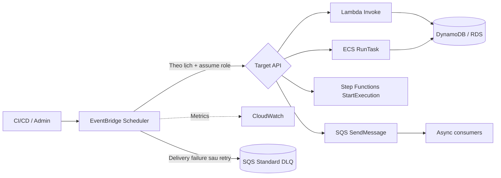
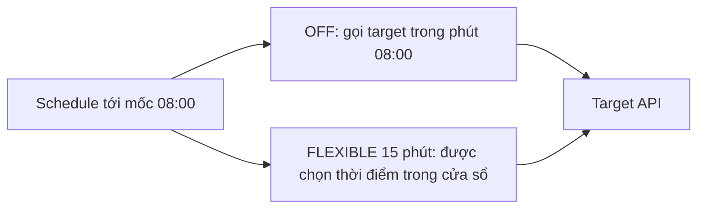
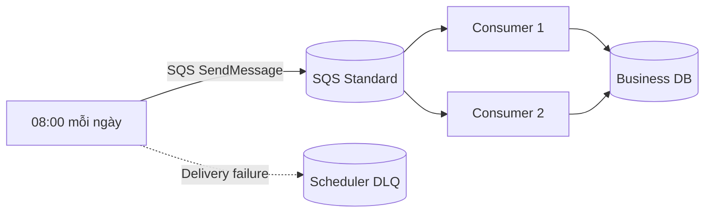
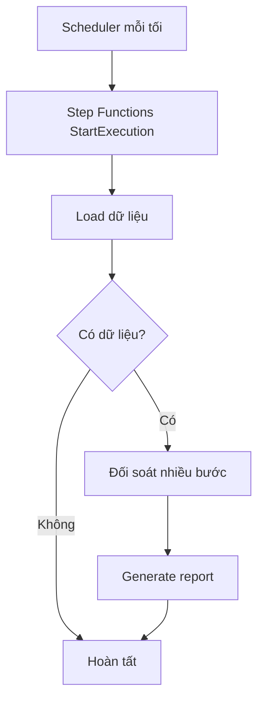
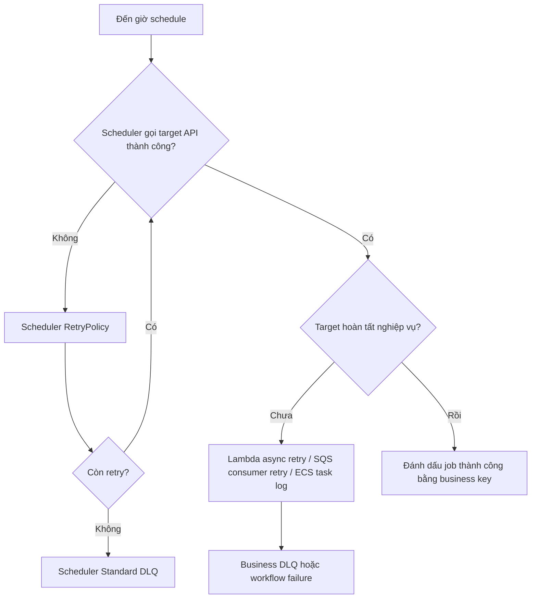
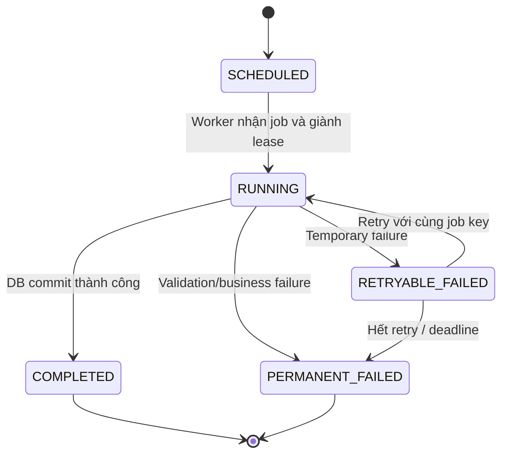
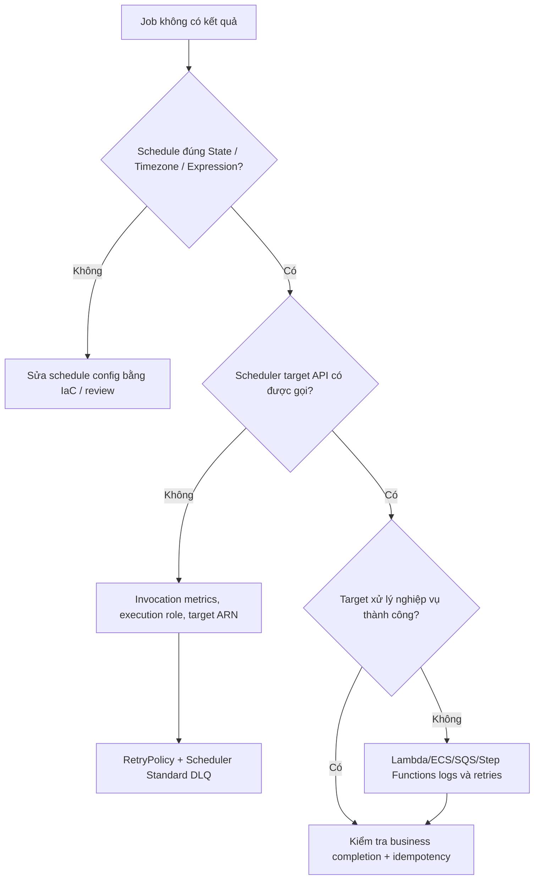

# EventBridge Scheduler và công việc theo lịch

## 1. Bài toán: chạy tác vụ đúng thời điểm mà không quản lý cron server

Một hệ thống thương mại điện tử có những công việc không bắt đầu trực tiếp từ HTTP request: tổng hợp doanh thu mỗi ngày lúc 08:00 theo giờ Việt Nam, gửi thông báo gia hạn gói dịch vụ tại một thời điểm xác định, dọn dữ liệu tạm mỗi 30 phút và khởi động một quy trình đối soát vào cuối tháng. Đội vận hành có thể cấu hình `cron` trên EC2, nhưng khi máy chủ bị thay, giờ hệ điều hành sai, quá trình deployment bị gián đoạn hoặc số lượng lịch tăng lên hàng nghìn, việc duy trì một “cron server” đáng tin cậy không còn đơn giản.

**Amazon EventBridge Scheduler** là dịch vụ serverless quản lý **lịch gọi AWS API targets**, không cần tự vận hành máy chủ lập lịch. Một schedule được định nghĩa bằng **biểu thức thời gian**, **múi giờ**, **target** và **IAM execution role**; tùy yêu cầu có thêm **flexible time window**, **retry policy**, **dead-letter queue (DLQ)**, **schedule group**, **StartDate/EndDate** và **action after completion**.

Bài này nằm trong chương **Sự kiện và điều phối** của lộ trình **CLOUD_PROVIDERS_AWS**. Lộ trình bao quát Region/AZ, IAM, VPC, compute, lưu trữ, cơ sở dữ liệu, tích hợp và serverless; mục tiêu là chọn dịch vụ, triển khai an toàn, có giám sát, phục hồi và kiểm soát chi phí. EventBridge Scheduler kết nối các thành phần đó: nó quyết định *khi nào* bắt đầu, còn **Lambda, ECS, SQS, Step Functions** hoặc AWS service target quyết định *làm gì* và *làm thế nào để hoàn tất*.

Sau bài học, bạn sẽ có thể:

- Phân biệt lịch **`rate(...)`**, **`cron(...)`** và **`at(...)`**, cùng cú pháp cron sáu trường của AWS.
- Thiết kế lịch theo **IANA time zone**, hiểu **daylight saving time (DST)** và độ chính xác ở cấp phút.
- Chọn **templated target** hoặc **universal AWS SDK target**; gửi payload tới Lambda, SQS, Step Functions hoặc khởi động ECS task.
- Cấu hình **execution role**, retry, **SQS Standard DLQ**, giám sát CloudWatch và CloudTrail.
- Dùng AWS CLI tạo, đọc, cập nhật, vô hiệu hóa và xóa lịch một cách có kiểm soát.
- Thiết kế job **idempotent**, hạn chế chạy trùng, xử lý quá tải, đánh giá khả năng phục hồi và chi phí.

## 2. EventBridge Scheduler hoạt động ra sao?

Về mặt kiến trúc, Scheduler là **bộ hẹn giờ để gọi API**, không phải môi trường chạy code. Nó không chứa vòng lặp xử lý dữ liệu dài hạn như một ECS task và cũng không tự thực hiện các bước nghiệp vụ như Step Functions.



### 2.1. Các thành phần cấu hình

| Thành phần | Vai trò | Ví dụ |
| --- | --- | --- |
| **Schedule name** | Định danh lịch trong một group | `daily-reconcile` |
| **Schedule group** | Nhóm logic để tổ chức/tag/IAM | `shop-production` |
| **Schedule expression** | Lịch một lần hoặc lặp lại | `cron(0 8 ? * MON-FRI *)` |
| **Schedule expression timezone** | Múi giờ dùng để diễn giải thời gian | `Asia/Ho_Chi_Minh` |
| **Flexible time window** | Cho phép dịch thời điểm gọi trong cửa sổ có giới hạn | OFF hoặc FLEXIBLE/15 phút |
| **Target Arn/Input** | AWS API target và payload | ARN Lambda/queue/state machine |
| **Execution role** | IAM role Scheduler assume khi gọi target | `scheduler-shop-jobs-role` |
| **Retry policy** | Số lần thử lại và tuổi tối đa khi target API lỗi | 3 retries, tối đa 3600 giây |
| **Dead-letter queue** | Lưu thông tin lần gọi thất bại khi không thể giao target | SQS **Standard** queue |
| **State** | ENABLED hoặc DISABLED | Dừng lịch mà không xóa cấu hình |
| **Action after completion** | NONE hoặc DELETE | Dọn lịch một lần sau khi hoàn tất |

**Luồng quản trị** khác **luồng thực thi**: principal trong CI/CD tạo schedule phải có quyền quản trị Scheduler và **`iam:PassRole`** được giới hạn; đến giờ chạy, **Scheduler assume execution role** và gọi AWS API của target. Không nên dùng quyền quản trị rộng của CI/CD làm quyền runtime cho mọi lịch.

### 2.2. At-least-once delivery không phải exactly-once execution

EventBridge Scheduler hỗ trợ **at-least-once target delivery**. Một target có thể được gọi lại nếu attempt đầu tiên thất bại hoặc không được ghi nhận thành công. Ví dụ:

1. Đến giờ 08:00, Scheduler gọi `sqs:SendMessage` để đẩy job.
2. SQS nhận message, nhưng kết nối gặp sự cố trước khi Scheduler nhận xác nhận.
3. Scheduler retry và có thể gửi thêm message tương đương.

Nếu target là Lambda, lời gọi được chấp nhận thành công **không chứng minh logic Lambda đã commit thành công**. Nếu Lambda được gọi bất đồng bộ, Lambda còn có cơ chế retries riêng; SQS consumers cũng có thể xử lý lại message. Vì thế, mọi job quan trọng nên có **business idempotency key**, quản lý trạng thái và cảnh báo khi thất bại. Scheduler **không tự tạo transaction exactly-once** trên RDS, S3 hoặc external services.

## 3. Chọn Schedule type: rate, cron hay at?

EventBridge Scheduler hỗ trợ **ba loại lịch**:

| Loại | Cú pháp | Phù hợp | Lưu ý |
| --- | --- | --- | --- |
| **Rate-based** | `rate(15 minutes)`, `rate(1 day)` | Chạy theo khoảng thời gian đều đặn | Không tự mang ý nghĩa “08:00 giờ địa phương mỗi ngày” |
| **Cron-based** | `cron(0 8 ? * MON-FRI *)` | Chạy tại khung giờ/ngày cụ thể theo calendar | Phụ thuộc time zone và quy tắc DST |
| **One-time** | `at(2027-01-15T09:30:00)` | Một tác vụ hẹn một ngày/giờ | Cân nhắc xóa schedule sau khi hoàn tất |

**Rate/cron** là recurrent schedules; **at** là one-time schedule. Một cron expression mô tả thời điểm theo lịch, không định nghĩa cơ chế retry của target. Một `rate(1 day)` tính theo thời lượng, còn `cron(...)` gắn với các trường ngày/giờ theo calendar: hai lựa chọn có thể khác nhau khi đi qua DST.

### 3.1. Rate expression

```text
rate(5 minutes)     # Mỗi 5 phút
rate(1 hour)        # Khoảng mỗi giờ
rate(2 days)        # Mỗi 2 ngày, theo khoảng thời gian
```

Cú pháp là `rate(value unit)`, với đơn vị **minutes, hours, days** (số ít hoặc số nhiều theo giá trị). Giá trị phải dương. Nếu không cấu hình `StartDate`, rate schedule bắt đầu hoạt động theo quy tắc Scheduler ngay sau khi tạo/kích hoạt; **không đảm bảo nó sẽ chạy đúng ở phút 00 của giờ**.

Ví dụ một job theo nhịp 30 phút để đồng bộ cache, không cần chạy đúng 08:00 hay 08:30 trên đồng hồ. `rate(30 minutes)` đơn giản và đủ.

### 3.2. Cron expression có sáu trường

EventBridge Scheduler dùng cú pháp tương đương:

```text
cron(minutes hours day-of-month month day-of-week year)
```

| Trường | Ví dụ | Ý nghĩa |
| --- | --- | --- |
| Minutes | `0` hoặc `30` | Phút trong giờ |
| Hours | `8` hoặc `22` | Giờ 0–23 |
| Day-of-month | `1`, `L` hoặc `?` | Ngày trong tháng |
| Month | `*`, `JAN` | Tháng |
| Day-of-week | `MON-FRI` hoặc `?` | Thứ trong tuần |
| Year | `*` hoặc `2027` | Năm |

Ví dụ:

```text
cron(0 8 ? * MON-FRI *)     # 08:00, thứ Hai–thứ Sáu
cron(30 23 * * ? *)        # 23:30 mỗi ngày
cron(0 2 1 * ? *)          # 02:00 ngày 1 hàng tháng
cron(0 9 ? * MON *)        # 09:00 mỗi thứ Hai
```

**Không được viết đồng thời “ngày-trong-tháng” và “thứ-trong-tuần” thành hai điều kiện được chỉ định.** Khi chọn day-of-week, trường day-of-month thường dùng `?`; khi chọn ngày trong tháng, day-of-week dùng `?`. Khác với Linux crontab 5 trường, Scheduler yêu cầu **6 trường bao gồm year**. Sử dụng các wildcard như `, - * / ? L W #` phải đúng trường được hỗ trợ; kiểm tra expression bằng AWS console/IaC trước production.

### 3.3. Một lần tại thời điểm xác định

```text
at(2027-01-15T09:30:00)
```

Thời gian trong `at(...)` được diễn giải theo `ScheduleExpressionTimezone`. Với `Asia/Ho_Chi_Minh`, ví dụ trên mang nghĩa **09:30 ngày 15/01/2027 theo giờ Việt Nam**. **Không gắn đuôi `Z` vào chuỗi at để ngầm coi là UTC** khi đã chọn timezone; dùng đúng cú pháp và trường timezone của Scheduler.

Với one-time schedule, `StartDate`/`EndDate` không thay đổi thời điểm `at(...)`. Một one-time schedule được gọi xong **vẫn có thể nằm trong quota schedule** nếu không xóa. Đặt `ActionAfterCompletion=DELETE` khi bạn muốn tự dọn cấu hình sau lần invoke cuối, hoặc xóa thủ công theo chính sách lưu vết.

## 4. Múi giờ, DST và độ chính xác theo phút

### 4.1. Time zone là giá trị IANA

Scheduler hỗ trợ `ScheduleExpressionTimezone` theo **IANA Time Zone Database**, ví dụ:

- `Asia/Ho_Chi_Minh`: giờ Việt Nam, không có DST hiện hành.
- `America/New_York`: có thay đổi giờ mùa hè.
- `Europe/Berlin`: có DST theo mùa.
- `UTC`: lịch theo giờ UTC.

Nếu mục tiêu là “chạy đúng 08:00 giờ của nhân viên Việt Nam”, nên dùng **cron và `Asia/Ho_Chi_Minh`**, thay vì chuyển cứng 08:00 thành UTC trong mã ứng dụng rồi mong mọi hoạt động theo múi giờ khác không thay đổi.

### 4.2. Daylight saving time: giờ có thể không tồn tại hoặc lặp lại

Tại các múi giờ có DST, có ngày đồng hồ **nhảy qua** một giờ và có ngày **lặp lại** một giờ. Với cron schedule, AWS quy định:

- Nếu giờ/phút lịch **không tồn tại** trong ngày chuyển sang DST, schedule **bỏ qua lần chạy đó**.
- Khi giờ/phút lịch **lặp lại** lúc kết thúc DST, schedule **chạy một lần**, không chạy hai lần cho cùng khung giờ local.
- Với `rate(1 days)`, nhịp được tính như thời lượng 24 giờ, không nhất thiết trùng giờ local sau khi chuyển DST.

Ví dụ, “02:30 mỗi ngày tại New York” có thể không diễn ra vào ngày đồng hồ nhảy từ 02:00 đến 03:00. Nếu nghiệp vụ yêu cầu kết sổ **đúng một lần mỗi ngày theo calendar** bất kể DST, cần cơ chế business calendar, lưu `businessDate`, chạy bù khi cần và idempotency; không chỉ dựa vào biểu thức cron.

### 4.3. Precision 60 giây

EventBridge Scheduler có **độ chính xác 60 giây** cho việc gọi target. Một schedule ở 08:00 với flexible window OFF có thể bắt đầu target API trong khoảng **08:00:00–08:00:59** theo giờ schedule, chưa tính độ trễ của target và backend.

Điều này khác với yêu cầu **deadline đúng đến từng giây hoặc mili giây**. Nếu hệ thống đấu giá bắt buộc đóng phiên vào đúng `08:00:00.000`, nên dùng database/business timestamp làm nguồn quyết định và xem Scheduler như tác nhân kích hoạt/đối soát, không như đồng hồ quyết định tính hợp lệ.

### 4.4. Vì sao không kiểm thử DST bằng giờ Việt Nam?

Múi giờ Việt Nam hiện không đổi DST, nên cron 08:00 theo `Asia/Ho_Chi_Minh` thuận tiện cho báo cáo nội bộ. Nếu sản phẩm phục vụ khách hàng quốc tế, **mỗi người dùng có timezone khác**, cần lưu timezone IANA cùng preference; không thể tạo một cron UTC cố định rồi mặc định mọi khách nhận thông báo 08:00 local.

## 5. Flexible time window: phân tán tải thay vì dồn đúng một phút

Scheduler cho phép cấu hình:

| Mode | Ý nghĩa | Trường liên quan |
| --- | --- | --- |
| **OFF** | Cố gắng gọi target trong phút của thời điểm lịch | `{"Mode":"OFF"}` |
| **FLEXIBLE** | Cho phép Scheduler chọn thời điểm trong cửa sổ trễ có giới hạn | `{"Mode":"FLEXIBLE","MaximumWindowInMinutes":15}` |

`MaximumWindowInMinutes` hỗ trợ tối đa **1440 phút** theo API; chỉ cấu hình khi dùng FLEXIBLE. Window không có nghĩa job được chạy sớm tùy ý trước thời điểm được lên lịch; Scheduler điều phối trong khoảng thời gian đã chỉ định.



**Khi nên bật FLEXIBLE:** hàng nghìn tác vụ tạo báo cáo/nhắc việc cùng đến 08:00 và có thể hoàn tất trong khoảng 15–30 phút; phân tán lần gọi giúp giảm tải đột biến lên Lambda concurrency, Step Functions state transitions hoặc database.

**Khi nên OFF:** yêu cầu thời gian thông báo hoặc xử lý gần mốc đã định, có SLO thời điểm gọi tương ứng. Ngay cả OFF cũng **không đảm bảo chính xác tới giây** hoặc target business processing bắt đầu ngay lập tức.

## 6. EventBridge Scheduler khác EventBridge Rules và Step Functions

| Lựa chọn | Bài toán chính | Khác biệt nổi bật |
| --- | --- | --- |
| **EventBridge Scheduler** | Một lần/theo lịch, nhiều schedule độc lập, timezone, retry/DLQ | Dùng `rate/cron/at`, flexible window, schedule groups |
| **EventBridge scheduled rules** | Lịch kế thừa gắn với EventBridge rule | Ít khả năng lịch/timezone hơn; AWS khuyến nghị Scheduler cho scheduling mới |
| **EventBridge event bus rule** | Phân phối sự kiện theo event pattern | Kích hoạt khi **có sự kiện**, không thay scheduler |
| **AWS Step Functions Wait state** | Chờ trong một workflow đã bắt đầu, điều phối nhiều bước | Dành cho orchestration bên trong một execution |
| **SQS delay** | Trì hoãn một message ngắn | Không thay thế lịch một lần xa trong tương lai hoặc cron theo calendar |
| **Lambda + EC2 cron** | Job lập lịch tự quản lý | Phải vận hành timer/host, HA và xử lý thiếu lần chạy |

Ví dụ: một đơn hàng chưa thanh toán sau 30 phút cần hủy. Có thể tạo **one-time schedule theo orderId** gọi SQS/Lambda, hoặc dùng Step Functions Wait trong một workflow trạng thái đơn hàng đã tồn tại. Lựa chọn tùy **số lượng lịch, thời gian đợi, chi phí mỗi execution, nghiệp vụ hủy/tái đặt lịch và khả năng quan sát**. Không dùng cron quét toàn bộ database mỗi phút nếu một schedule riêng cho từng order phù hợp hơn, nhưng cũng không tự tạo hàng triệu lịch không dọn khi chính sách/chi phí không cho phép.

## 7. Targets: Scheduler gọi AWS API nào?

Scheduler có hai mô hình **target**:

1. **Templated target:** AWS định nghĩa sẵn một số thao tác phổ biến, cho phép khai báo trực tiếp ARN của resource; ví dụ **Lambda Invoke, SQS SendMessage, Step Functions StartExecution, ECS RunTask, SNS Publish, EventBridge PutEvents** và các targets trong danh sách được hỗ trợ.
2. **Universal target:** gọi một AWS SDK API action thuộc phạm vi được hỗ trợ, dùng ARN đặc biệt `arn:aws:scheduler:::aws-sdk:service:apiAction` và **Input** chứa JSON parameters cho action đó.

**Không thể chỉ truyền ARN của mọi AWS service rồi mặc định Scheduler biết hành động nào cần gọi.** Templated target chỉ hỗ trợ tập thao tác cố định; với universal target, phải chỉ ra chính xác service/action và payload hợp lệ, cùng IAM permission phù hợp.

### 7.1. Templated target tới SQS

Scheduler gọi **`sqs:SendMessage`** vào queue và đưa `Input` thành message body. Trường hợp lý tưởng: hàng ngày lúc 08:00 Scheduler gửi **một job description** vào queue; nhiều ECS/Lambda consumers xử lý khi có khả năng, thay vì để hàng nghìn business operations dồn vào một Lambda đồng bộ.



Nếu target là **SQS FIFO**, cấu hình templated target yêu cầu `SqsParameters.MessageGroupId`; tài liệu API còn yêu cầu FIFO target queue **bật content-based deduplication**. Lý do: Scheduler templated parameters **không cung cấp trường MessageDeduplicationId riêng** như một lệnh SQS SendMessage do ứng dụng tự gọi. Cần thiết kế message body và group ID ổn định; không suy luận Scheduler tự giải quyết exactly-once business processing.

**Phân biệt hai DLQ:** Scheduler DLQ chứa **thông tin không giao target API được**; queue consumer DLQ chứa **messages đã giao thành công nhưng consumer xử lý nhiều lần không thành công**. Hai tầng lỗi này khác nhau, cần có hai runbooks riêng.

### 7.2. Lambda target

Khi cấu hình Lambda target, execution role của schedule cần quyền **`lambda:InvokeFunction`** trên function ARN/alias được phê duyệt. Payload `Input` phải hợp với contract Lambda handler (JSON nếu dùng templated Lambda theo API contract).

```json
{
  "task": "daily-reconciliation",
  "businessDate": "2027-01-14",
  "scheduleKey": "reconcile-shop-v1",
  "source": "eventbridge-scheduler"
}
```

Payload trên chỉ là ví dụ minh họa. Đối với cron lặp hằng ngày, **đừng hardcode một businessDate cố định** rồi chạy mãi mỗi ngày. Có thể để Lambda xác định business date theo timezone đã định hoặc dùng context attributes/đầu vào do producer cấu hình. Nếu đầu việc dễ gây xử lý trùng, handler phải dùng business date + job name làm **idempotency key**.

**Lambda asynchronous invocation:** Scheduler được coi là giao target thành công khi **Lambda Invoke API chấp nhận lời gọi**; không đồng nghĩa function code đã hoàn tất. Lambda có retries/on-failure destinations/DLQ riêng cho invocation bất đồng bộ. Để quan sát nghiệp vụ, theo dõi **Lambda Errors/Throttles**, log ứng dụng và bảng trạng thái job, không chỉ Scheduler `TargetErrorCount`.

### 7.3. Step Functions target

Scheduler có thể gọi **`states:StartExecution`** của một State Machine, phù hợp công việc nhiều bước có retry, phân nhánh, waits và observability ở cấp workflow:



Khi `StartExecution` được chấp nhận, **workflow có thể còn chạy trong nhiều giờ**. Cần theo dõi Step Functions execution status, retries, timeouts và dữ liệu output. Với tác vụ liên quan tài chính, ưu tiên **idempotent workflow**; nếu dùng Standard Workflows, có thể thiết kế **execution name** và business key hợp lệ để hạn chế khởi chạy trùng theo cơ chế được hỗ trợ.

### 7.4. ECS task target

Scheduler có **templated ECS RunTask** với `EcsParameters`:

- `TaskDefinitionArn`: task definition cần chạy.
- `LaunchType` hoặc `CapacityProviderStrategy` theo ECS configuration.
- `NetworkConfiguration`: bắt buộc khi task dùng `awsvpc`, ví dụ ECS Fargate.
- `TaskCount`, `PlatformVersion` và một số tham số khác khi hỗ trợ.

Khi dùng Fargate, task cần **private subnets/SG, image ECR, execution role, task role, CPU/memory** đúng và đường network tới những dependencies. Scheduler role cần **`ecs:RunTask`** và **`iam:PassRole`** giới hạn các task roles liên quan. Không cấp quyền toàn ECS account chỉ để chạy một scheduled task.

**`ecs:RunTask` thành công không bảo đảm container đã xử lý xong.** ECS task có thể được tạo nhưng dừng vì image pull, database timeout, OOM, app exception hoặc Spot interruption. Theo dõi ECS task state/stoppedReason, CloudWatch Logs và business status/DLQ riêng.

### 7.5. Universal target

Universal target cho phép gọi một action mà templated target không cung cấp bằng ARN dạng:

```text
arn:aws:scheduler:::aws-sdk:<service>:<apiAction>

Ví dụ:
arn:aws:scheduler:::aws-sdk:sqs:sendMessage
arn:aws:scheduler:::aws-sdk:sfn:startExecution
```

Payload `Input` phải là **JSON được API action đó chấp nhận**, ví dụ universal SQS sendMessage cần `QueueUrl`, `MessageBody` và những tham số bắt buộc cho FIFO/Delay nếu dùng. **Scheduler không xác thực tính hợp lệ của toàn bộ Input với action tại thời điểm tạo schedule**; có thể tạo thành công nhưng mỗi lần kích hoạt lại lỗi vì thiếu tham số.

Universal targets có **danh sách API actions không hỗ trợ**; tránh giả định “mọi thao tác SDK đều có thể hẹn giờ”. Đọc tài liệu `Using universal targets`, schema API và thử trong sandbox có DLQ trước khi đưa vào production.

## 8. IAM: Schedule execution role, `iam:PassRole` và quyền target

### 8.1. Ba chủ thể thường bị nhầm

| Chủ thể | Khi nào dùng? | Quyền cần thiết |
| --- | --- | --- |
| **Người dùng/CI tạo schedule** | `CreateSchedule`, `UpdateSchedule`, `DeleteSchedule` | Scheduler API permissions, `iam:PassRole` đúng role |
| **Scheduler execution role** | Scheduler assume role khi đến lịch | Permission gọi target API, ví dụ `sqs:SendMessage` hoặc `lambda:InvokeFunction` |
| **Backend runtime role** | Lambda/ECS/Step Functions tự xử lý công việc | Quyền đọc/ghi database/S3/queue tương ứng |

Nếu target Lambda cần đọc DynamoDB, **không nhất thiết cấp DynamoDB cho Scheduler execution role**. Scheduler chỉ cần Invoke; Lambda execution role mới cần DynamoDB. Tương tự, ECS task role giữ quyền nghiệp vụ, còn Scheduler execution role giữ RunTask/PassRole.

### 8.2. Trust policy của Scheduler role

Ví dụ file `scheduler-trust-policy.json`:

```json
{
  "Version": "2012-10-17",
  "Statement": [
    {
      "Sid": "AllowSchedulerToAssume",
      "Effect": "Allow",
      "Principal": {
        "Service": "scheduler.amazonaws.com"
      },
      "Action": "sts:AssumeRole"
    }
  ]
}
```

Đây là **trust policy tối giản để giảng giải principal**. Production nên đánh giá điều kiện ngăn **confused deputy** bằng `aws:SourceAccount` và `aws:SourceArn` theo tài liệu AWS, thường ràng buộc **schedule group ARN**, không dùng ARN của một schedule đơn lẻ khi tài liệu yêu cầu group. Kiểm tra policy mẫu và định dạng ARN đúng Region/account trước khi thêm condition.

### 8.3. Permission policy cho target SQS và DLQ

Một execution role ví dụ chỉ gửi job vào một queue và gửi lỗi invocation vào Scheduler DLQ:

```json
{
  "Version": "2012-10-17",
  "Statement": [
    {
      "Sid": "SendScheduledJob",
      "Effect": "Allow",
      "Action": "sqs:SendMessage",
      "Resource": "arn:aws:sqs:ap-southeast-1:111122223333:shop-jobs"
    },
    {
      "Sid": "SendUndeliveredEventToDLQ",
      "Effect": "Allow",
      "Action": "sqs:SendMessage",
      "Resource": "arn:aws:sqs:ap-southeast-1:111122223333:scheduler-failures"
    }
  ]
}
```

Nếu target/DLQ ở account khác, cần đồng thời kiểm tra **SQS queue resource policy** và **KMS key policy** nếu queue mã hóa SSE-KMS; identity policy đơn lẻ có thể không đủ.

**Bảo vệ `iam:PassRole`:** người có quyền tạo schedule mà có thể PassRole một role quản trị rộng có thể biến lịch thành kênh gọi AWS API ngoài ý muốn. Nên hạn chế vai trò, Resource ARN, IAM condition `iam:PassedToService` phù hợp và policy quản trị Scheduler theo nhóm/tên/tag.

## 9. Thực hành CLI: tạo schedule gửi job vào SQS Standard

Đây là bài thực hành minh họa cho tài khoản **sandbox**. Những lệnh `create-*`, `update-*` và `delete-*` tác động đến tài nguyên AWS thật. Các account IDs, ARNs và tên queue được đặt để minh họa, **không chạy nguyên placeholder trên production**.

### 9.1. Điều kiện trước khi tạo schedule

Trước khi chạy:

1. Có **SQS Standard queue** `shop-jobs` (target); đây là nơi workers sẽ nhận công việc.
2. Có **SQS Standard DLQ** `scheduler-failures`, khác với DLQ xử lý thất bại của worker.
3. IAM execution role `scheduler-send-sqs-role` có trust policy cho `scheduler.amazonaws.com` và `sqs:SendMessage` tới đúng target/DLQ.
4. IAM principal đang chạy AWS CLI có quyền tạo schedule/đọc schedule và `iam:PassRole` cho execution role.
5. Đã quyết định giờ local, retry policy, retention DLQ và downstream idempotency.

```bash
# Kiểm tra danh tính và Region trước khi tạo lịch
aws sts get-caller-identity

# Xem group, schedule đã có trong sandbox
aws scheduler list-schedule-groups --region ap-southeast-1
aws scheduler list-schedules --region ap-southeast-1

# Đọc target queue, không tạo mới
aws sqs get-queue-url \
  --queue-name shop-jobs \
  --region ap-southeast-1
```

Trong bài, sử dụng **group mặc định** để bớt bước cấu hình; ở production nên tạo schedule groups theo ứng dụng/môi trường để phân quyền, tagging và quan sát.

### 9.2. File JSON target

Lưu file `sqs-schedule-target.json`:

```json
{
  "Arn": "arn:aws:sqs:ap-southeast-1:111122223333:shop-jobs",
  "RoleArn": "arn:aws:iam::111122223333:role/scheduler-send-sqs-role",
  "Input": "{\"jobType\":\"daily-reconciliation\",\"source\":\"scheduler\",\"jobVersion\":1}",
  "RetryPolicy": {
    "MaximumRetryAttempts": 3,
    "MaximumEventAgeInSeconds": 3600
  },
  "DeadLetterConfig": {
    "Arn": "arn:aws:sqs:ap-southeast-1:111122223333:scheduler-failures"
  }
}
```

Đây là **templatized SQS target**: `Arn` là **queue ARN**, không phải Queue URL; `Input` là một **string chứa nội dung message**, ở đây là JSON string. `RetryPolicy` áp dụng cho **Scheduler target delivery failure**, không cho lỗi worker nghiệp vụ sau khi nhận message.

### 9.3. Cron 08:00 các ngày làm việc tại Việt Nam

```bash
aws scheduler create-schedule \
  --name shop-daily-reconciliation \
  --schedule-expression 'cron(0 8 ? * MON-FRI *)' \
  --schedule-expression-timezone Asia/Ho_Chi_Minh \
  --flexible-time-window '{"Mode":"OFF"}' \
  --target file://sqs-schedule-target.json \
  --state ENABLED \
  --region ap-southeast-1
```

Lệnh dùng cron theo **giờ Việt Nam**, không cần quy đổi thủ công UTC. Scheduler có **60-second precision** khi gọi API. `MON-FRI` là **thứ Hai đến thứ Sáu**, **không đồng nghĩa ngày làm việc chính thức của công ty**: ngày lễ và lịch nghỉ phải được backend/business calendar xử lý hoặc schedule được điều chỉnh theo quy trình.

**Payload recurring có `jobVersion=1` nhưng không có `businessDate` cố định**, vì một schedule chạy nhiều ngày phải sinh **job idempotency key theo lần chạy**. Worker có thể lấy business date từ thời điểm thực thi và timezone quy định, hoặc nhận context attributes phù hợp nếu cấu hình. Nếu window/retry qua ngày, đừng suy ra business date chỉ từ thời điểm consumer nhận.

### 9.4. Readback và kiểm tra

```bash
aws scheduler get-schedule \
  --name shop-daily-reconciliation \
  --region ap-southeast-1

aws scheduler list-schedules \
  --name-prefix shop-daily \
  --region ap-southeast-1
```

Đối chiếu `ScheduleExpression`, `ScheduleExpressionTimezone`, `FlexibleTimeWindow`, `State`, `Target.RoleArn`, `Target.Arn`, RetryPolicy và DLQ ARN. Sau khi đến lịch, quan sát **CloudWatch `AWS/Scheduler`**, metrics target SQS và application logs để xác minh job đã thực thi.

### 9.5. Rate schedule mỗi 30 phút

Ví dụ một lịch không ràng buộc mốc 08:00:

```bash
aws scheduler create-schedule \
  --name shop-refresh-cache \
  --schedule-expression 'rate(30 minutes)' \
  --flexible-time-window '{"Mode":"FLEXIBLE","MaximumWindowInMinutes":10}' \
  --target file://sqs-schedule-target.json \
  --state ENABLED \
  --region ap-southeast-1
```

Với `rate(30 minutes)` và FLEXIBLE 10 phút, job không cần bắt đầu đúng phút thứ 00/30 trên đồng hồ. Nếu ứng dụng yêu cầu một hàng rào thời gian cứng, hãy thiết kế ở backend thay vì chỉ dựa vào window.

## 10. One-time schedule, tự xóa và chống lịch tồn đọng

Một khách hàng đặt lịch giao hàng vào 09:30 ngày 15/01/2027. Doanh nghiệp muốn gửi tín hiệu kiểm tra trạng thái giao hàng tại thời điểm đó, chỉ **một lần**.

```bash
aws scheduler create-schedule \
  --name order-101-followup-20270115 \
  --schedule-expression 'at(2027-01-15T09:30:00)' \
  --schedule-expression-timezone Asia/Ho_Chi_Minh \
  --flexible-time-window '{"Mode":"OFF"}' \
  --action-after-completion DELETE \
  --target file://sqs-schedule-target.json \
  --state ENABLED \
  --region ap-southeast-1
```

**Lưu ý:** trong ví dụ chung `sqs-schedule-target.json` đang có `jobType=daily-reconciliation`. Với đơn hàng thực tế, hãy tạo **target Input dành riêng cho order**, ví dụ:

```json
{
  "jobType": "check-delivery",
  "orderId": "101",
  "scheduleKey": "order-101-followup-20270115",
  "dueAt": "2027-01-15T09:30:00+07:00"
}
```

Tệp cấu hình target đưa vào Scheduler phải chứa payload này ở trường `Input` (là **JSON string**), thay vì dùng nguyên file job đối soát. Dùng tên schedule chứa **business ID** có thể hữu ích cho vận hành nhưng cân nhắc riêng tư và AWS API naming restrictions; không đưa PII nhạy cảm vào tên, tags, log hoặc ARN.

### 10.1. ActionAfterCompletion=DELETE

`--action-after-completion DELETE` giúp Scheduler **xóa schedule khi hoàn thành lần gọi cuối**. Với one-time schedule, việc hoàn thành được tính theo cơ chế thực thi target của Scheduler, **không phải** đợi mọi công việc bất đồng bộ được xử lý xong trong SQS/Lambda/Step Functions.

Nếu one-time schedule **không có auto-delete**, lịch đã chạy vẫn tồn tại và **vẫn có thể được tính trong quota schedules**. Đối với một hệ thống tạo hàng triệu lời nhắc một lần, quên dọn lịch có thể làm hệ thống chạm quota và tăng công vận hành. Bật DELETE hoặc có quy trình cleanup phù hợp, đồng thời lưu lịch sử kinh doanh ở database/audit logs thay vì kỳ vọng schedule resource tồn tại mãi.

Với lịch **recurring**, auto-delete chỉ có ý nghĩa khi có **EndDate** xác định lần invoke cuối. Nếu recurring schedule không có EndDate, nó tiếp tục chạy và không tự xóa chỉ vì `ActionAfterCompletion=DELETE`.

### 10.2. Hủy hoặc dời một lời nhắc

Nếu khách hàng hủy đơn trước thời điểm follow-up:

- Xóa schedule tương ứng, hoặc vô hiệu hóa và cập nhật theo chính sách.
- Đánh dấu **trạng thái đơn trong database** là không còn được phép gửi lời nhắc.
- Consumer **kiểm tra trạng thái mới nhất** trước khi phát email/thay đổi dữ liệu.

**Race condition:** Scheduler có thể đã giao lời gọi đến SQS/Lambda ngay trước khi bạn xóa hoặc disable schedule. Xóa resource **không thu hồi** message đã vào queue và không hủy ECS task đã được khởi động. Vì vậy, **business state/version check** trong consumer mới là lớp bảo vệ cuối cùng.

### 10.3. Re-enable one-time schedule đã qua hạn

AWS lưu ý khi một **one-time schedule từng bị DISABLED** được kích hoạt lại **sau thời điểm đã hẹn**, nó **có thể invoke target ngay**. Không dùng hành động bật lại như một thao tác “chỉ để kiểm tra” nếu target tạo giao dịch, gửi email hàng loạt hoặc xóa tài nguyên.

Trước khi enable, đọc `get-schedule`, xác minh `at(...)`/timezone/state và quyết định liệu lời gọi muộn còn có ý nghĩa hay không. Nếu quá hạn, tạo lịch mới theo phiên bản nghiệp vụ hoặc hủy an toàn thay vì tự động chạy bù thiếu đánh giá.

## 11. Schedule groups, tagging và phân chia môi trường

**Schedule group** giúp phân tổ chức schedules và làm đơn vị gắn **tags, IAM scoping và CloudWatch metrics**. Mỗi schedule thuộc một group (nếu không chỉ định, thuộc `default`).

Ví dụ:

```text
Group shop-development
  - daily-reconcile-dev
  - report-preview

Group shop-production
  - daily-reconcile-prod
  - order-followup-101

Group infrastructure-maintenance
  - nightly-cleanup
```

Một chiến lược đặt tên nên có **application + environment + business purpose**, nhưng không chứa thông tin cá nhân nhạy cảm. Schedule group không tự tạo AWS account isolation; với môi trường quan trọng, có thể tách **AWS accounts** hoặc IAM boundaries để tránh dev schedule tác động production target.

### 11.1. Tạo group và đặt lịch vào group

```bash
aws scheduler create-schedule-group \
  --name shop-production \
  --region ap-southeast-1

aws scheduler create-schedule \
  --name daily-reconcile-prod \
  --group-name shop-production \
  --schedule-expression 'cron(0 8 ? * MON-FRI *)' \
  --schedule-expression-timezone Asia/Ho_Chi_Minh \
  --flexible-time-window '{"Mode":"OFF"}' \
  --target file://sqs-schedule-target.json \
  --region ap-southeast-1

aws scheduler get-schedule \
  --name daily-reconcile-prod \
  --group-name shop-production \
  --region ap-southeast-1
```

Lệnh trên giả định group chưa tồn tại. Khi quản lý bằng IaC, nên xác định group lifecycle và tag policy, tránh tạo trùng. Phải chỉ định đúng `--group-name` trong các lệnh đọc/cập nhật/xóa; nếu bỏ group name, API thường dùng group `default` và có thể báo không tìm thấy lịch dù schedule tồn tại trong group khác.

### 11.2. Quản lý tags và quyền theo group

Tags thường áp dụng cho schedule groups; IAM permission có thể ràng buộc tài nguyên `schedule-group` và `schedule` theo ARN, name patterns và conditions trong phạm vi API hỗ trợ. Ví dụ dùng group `shop-production` để chỉ đội platform có quyền sửa lịch production. Các target roles vẫn cần giới hạn riêng, bởi group tag **không tự ngăn** role gọi một resource không được phép nếu IAM policy cho quá rộng.

### 11.3. Idempotent schedule provisioning

AWS API `CreateSchedule` hỗ trợ **ClientToken** để tránh tạo trùng thao tác API do retry quản trị; tên schedule là duy nhất trong group. Tuy nhiên, client token chỉ hỗ trợ **idempotency của lệnh tạo schedule**, không đảm bảo job nghiệp vụ không chạy hai lần khi target delivery retry. Không nhầm client token với business idempotency key ở phần consumer.

## 12. Cập nhật, tạm dừng và xóa schedule an toàn

### 12.1. Luôn đọc trước khi cập nhật

```bash
aws scheduler get-schedule \
  --name daily-reconcile-prod \
  --group-name shop-production \
  --region ap-southeast-1
```

**`UpdateSchedule` là thao tác thay thế cấu hình theo input**, không phải patch chỉ trường bạn muốn đổi. Bạn phải truyền các trường bắt buộc như `ScheduleExpression`, `Target` và `FlexibleTimeWindow`; những trường cũ bị bỏ qua trong yêu cầu có thể trở về null/default theo API. Nếu chỉ muốn đổi `State` mà quên `ScheduleExpressionTimezone`, `Target.RetryPolicy` hoặc `DeadLetterConfig`, lịch có thể bị đổi múi giờ hoặc mất cơ chế phục hồi.

### 12.2. Ví dụ disable bằng UpdateSchedule có đủ required fields

Sau khi sao lưu/đối chiếu đầy đủ các tùy chọn hiện hành của schedule, ví dụ:

```bash
aws scheduler update-schedule \
  --name daily-reconcile-prod \
  --group-name shop-production \
  --schedule-expression 'cron(0 8 ? * MON-FRI *)' \
  --schedule-expression-timezone Asia/Ho_Chi_Minh \
  --flexible-time-window '{"Mode":"OFF"}' \
  --target file://sqs-schedule-target.json \
  --state DISABLED \
  --region ap-southeast-1
```

**Đây không phải lệnh an toàn để sao chép nguyên cho mọi lịch**: nếu schedule đang có `StartDate`, `EndDate`, `ActionAfterCompletion`, `KmsKeyArn`, `Description` hoặc cấu hình target khác, phải **bảo toàn** các trường đó khi update. Đối với production, dùng IaC/provider phù hợp và quản lý version cấu hình đầy đủ, tránh thao tác tay cắt mất retry/DLQ.

Sau update:

```bash
aws scheduler get-schedule \
  --name daily-reconcile-prod \
  --group-name shop-production \
  --region ap-southeast-1
```

Khi cập nhật sát thời điểm lịch chạy, AWS lưu ý **thay đổi có thể chưa phản ánh ngay**. Có thể vẫn có một invocation dựa trên cấu hình cũ ở ranh giới thời gian. Thiết kế consumer có kiểm tra business state, không dùng disable như cơ chế “ngăn tuyệt đối mọi tác động đang in-flight”.

### 12.3. Xóa lịch không còn dùng

```bash
# Lệnh ghi, chỉ thực hiện sau khi kiểm tra ảnh hưởng đến nghiệp vụ
aws scheduler delete-schedule \
  --name daily-reconcile-prod \
  --group-name shop-production \
  --region ap-southeast-1
```

Xóa schedule làm ngừng các lần trigger tương lai theo cơ chế dịch vụ; **không hoàn tác** target requests đã nhận hoặc job đã vào queue. Cân nhắc giữ lịch sử cấu hình trong Git/IaC và audit logs trước khi xóa. Để xóa group, phải xử lý đúng lifecycle schedules thuộc group đó.

## 13. Retry policy: khôi phục lỗi giao target chứ không sửa lỗi nghiệp vụ

Scheduler target có thể trả lỗi tạm thời vì API throttling, target chưa sẵn sàng, IAM/KMS từ chối hoặc resource không tồn tại. Khi một lần gọi thất bại, Scheduler có thể **retry với cơ chế chờ tăng dần** cho tới khi gặp giới hạn đầu tiên:

- `MaximumRetryAttempts`: số lần retry tối đa (giới hạn API **0–185**).
- `MaximumEventAgeInSeconds`: thời gian tối đa một event còn được thử lại (**60–86.400 giây**, tức tối đa 24 giờ).

Tới khi **một trong hai điều kiện đã hết**, Scheduler ngừng retry và nếu cấu hình DLQ sẽ cố gửi thông tin thất bại đến đó. Không chọn mặc định “retry 185 lần trong 24 giờ” cho mọi nghiệp vụ; ví dụ giao việc gửi tin nhắn OTP sau 24 giờ có thể vô nghĩa hoặc gây trải nghiệm xấu.

| Target failure | Cách xử lý nên xét |
| --- | --- |
| Throttle tạm thời của API | Backoff, điều chỉnh quota/burst/flexible window |
| Target resource bị xóa/đổi ARN | Sửa cấu hình/ARN, xem DLQ, chạy bù nếu cần |
| IAM AccessDenied | Sửa execution role/queue policy/KMS key, không cấp `*` toàn account |
| Target API chấp nhận nhưng worker lỗi sau đó | **Không phải Scheduler delivery retry**; xem Lambda/Step Functions/ECS/SQS retry |
| Event quá hạn nghiệp vụ | Hạn chế MaximumEventAge, DLQ/alert và consumer kiểm tra deadline |

### 13.1. Retry không thay thế idempotency

Giả sử Scheduler gọi Lambda, backend ghi sổ thành công, nhưng response acknowledgment không rõ ràng. Scheduler hoặc tầng Lambda có thể thử lại tùy integration. Nếu job tạo hóa đơn thiếu idempotency, có thể tạo **hai hóa đơn** cho cùng business date. Dùng khóa như `reconcile:<shopId>:<businessDate>` và unique constraint/conditional write/transaction trong database.

**Không tự tạo business key chỉ bằng thời gian `now()` ở từng lần retry**, vì hai attempts sẽ có key khác nhau. Sử dụng scheduled slot, entity ID, business date/version hoặc một key ổn định được ghi từ trước.

### 13.2. Scheduler DLQ phải là SQS Standard

Theo tài liệu EventBridge Scheduler, **DLQ của Scheduler bắt buộc là SQS Standard queue**; **không hỗ trợ SQS FIFO queue làm Scheduler DLQ**. Điều này không cấm bạn đặt **FIFO queue làm primary target** khi cấu hình templated SQS hợp lệ, mà chỉ nói về **queue chứa sự kiện giao target thất bại**.

```text
Scheduler ----> Primary target: SQS Standard hoặc SQS FIFO / Lambda / ECS...
      |
      +----> Sau delivery retries thất bại:
               SQS Standard DLQ (scheduler-failures)
```

DLQ của Scheduler lưu thông tin lỗi **target API invocation**, không phải bản sao “tất cả business jobs đã lỗi trong worker”. Thiết lập retention DLQ, IAM queue policy và quy trình đọc/replay có kiểm soát. Nếu DLQ tự nó cũng gửi thất bại, cần CloudWatch alarm tương ứng.

### 13.3. Tạo DLQ và cấu hình target

```bash
# Tạo DLQ riêng cho Scheduler: tên KHÔNG kết thúc .fifo
aws sqs create-queue \
  --queue-name scheduler-failures \
  --attributes MessageRetentionPeriod=1209600 \
  --region ap-southeast-1

# Sau khi nhận URL thật, đọc ARN để đưa vào target.DeadLetterConfig.Arn
aws sqs get-queue-attributes \
  --queue-url 'SCHEDULER_DLQ_URL_HERE' \
  --attribute-names QueueArn \
  --region ap-southeast-1
```

File `sqs-schedule-target.json` ở phần 9 đã chứa:

```json
{
  "RetryPolicy": {
    "MaximumRetryAttempts": 3,
    "MaximumEventAgeInSeconds": 3600
  },
  "DeadLetterConfig": {
    "Arn": "arn:aws:sqs:ap-southeast-1:111122223333:scheduler-failures"
  }
}
```

Đây chỉ là **đoạn trích**, **không phải đối tượng Target đầy đủ** (còn cần `Arn` và `RoleArn` khi tạo schedule). DLQ phải tồn tại, role cần quyền `sqs:SendMessage` tới DLQ, queue policy/KMS key policy phải cho phép nếu account/encryption khác.

### 13.4. Redrive phải tính đến hiệu lực thời gian

Một event được gửi vào DLQ vì target không tồn tại lúc 08:00 có thể **không còn hợp lệ** lúc 15:00. Đừng redrive vô điều kiện tất cả messages:

1. Đọc metadata về schedule ARN, target ARN, retry condition và error code.
2. Kiểm tra target đã được sửa, credentials/KMS/queue policy đúng.
3. Kiểm tra **deadline/TTL/business date** và liệu tác vụ còn được phép thực thi không.
4. Gửi lại với **cùng business idempotency key**, ghi nhận audit và đo outcome.
5. Xóa message khỏi DLQ sau khi xử lý lại thành công theo runbook.

## 14. Nhận diện nhiều tầng lỗi: Scheduler, Lambda, SQS và ECS



Đây là lý do **CloudWatch metric `InvocationAttemptCount` không phải số business jobs thành công**. Một schedule gọi SQS thành công có thể được tính là giao target thành công dù queue backlog kéo dài 12 giờ. Muốn cam kết SLO end-to-end, phải theo dõi **queue age, consumer failures, workflow execution status và business completion records**.

## 15. Observability: CloudWatch, CloudTrail và business telemetry

Amazon EventBridge Scheduler có metrics trong namespace **`AWS/Scheduler`**, bao gồm cấp account và theo **ScheduleGroup**. Không mặc định có một metric chi tiết cho **từng schedule name** theo cách mọi người mong đợi; hãy gắn **job key, schedule ARN, trace/correlation ID** vào logs của target khi cần phân tích lịch cụ thể.

### 15.1. Các metrics Scheduler quan trọng

| Metric `AWS/Scheduler` | Diễn giải | Khi cảnh báo |
| --- | --- | --- |
| `InvocationAttemptCount` | Số lần Scheduler cố gọi target | Khi tăng đột biến so với số lịch dự kiến |
| `TargetErrorCount` | Target trả lỗi cho lần gọi API | Khi xuất hiện lỗi delivery, IAM, resource hoặc network/throttle |
| `TargetErrorThrottledCount` | Target API throttled invocation | Khi bursts vượt quota/downstream limits |
| `InvocationThrottleCount` | Scheduler throttle do giới hạn của chính dịch vụ Scheduler | Cần xem Service Quotas và phân tán lịch |
| `InvocationDroppedCount` | Scheduler bỏ event sau khi hết retry policy | **Cảnh báo nghiêm trọng** vì mất cơ hội giao target |
| `InvocationsSentToDeadLetterCount` | Gửi event lỗi vào Scheduler DLQ thành công | Điều tra lý do failure và kế hoạch replay |
| `InvocationsFailedToBeSentToDeadLetterCount` | Scheduler gửi vào DLQ không thành công | **Cảnh báo nghiêm trọng**: cả đường dự phòng cũng lỗi |

Các metrics thường được tổng hợp theo group/account; **`InvocationAttemptCount` có retries** và không phải số business transactions duy nhất. Khi thiết kế alarms, dùng statistic và period phù hợp, phân tách dev/prod theo ScheduleGroup để không bị che bởi lịch thử nghiệm.

### 15.2. Kiểm tra CloudWatch qua AWS CLI

Ví dụ một yêu cầu **chỉ đọc**, thay ngày/giờ UTC và group thật:

```bash
aws cloudwatch get-metric-statistics \
  --namespace AWS/Scheduler \
  --metric-name TargetErrorCount \
  --dimensions Name=ScheduleGroup,Value=shop-production \
  --start-time '2026-11-20T00:00:00Z' \
  --end-time '2026-11-20T01:00:00Z' \
  --period 300 \
  --statistics Sum \
  --region ap-southeast-1
```

Với một schedule chạy 08:00 Việt Nam, khoảng thời gian UTC tương ứng cần được tính đúng; lệnh ví dụ đang truy vấn **khung thời gian minh họa**, không bảo đảm có dữ liệu thực trong tài khoản. CloudWatch metrics có độ trễ và yêu cầu dimension đúng. Có thể dùng CloudWatch dashboards/alarms kết hợp SNS hoặc workflow incident response.

### 15.3. CloudTrail và quyền quản trị

**AWS CloudTrail** hỗ trợ audit các API quản trị Scheduler như tạo/cập nhật/xóa schedule. Một đợt production bị mất job có thể do lịch đã bị DISABLED, timezone thay đổi hoặc role bị sửa; CloudTrail giúp kiểm tra **ai đã gọi API và lúc nào**.

CloudTrail không phải bảng kết quả nghiệp vụ. Nó **không** chứng minh một ECS task chạy xong hay một invoice được ghi thành công. Để theo dõi end-to-end, nên có một bảng job executions:

```text
job_key                 business_date    status      attempt  finished_at
daily-reconcile:2027-01-14  2027-01-14    COMPLETED   1        ...
daily-reconcile:2027-01-15  2027-01-15    FAILED      2        ...
```

Đội vận hành có thể so **schedule dự kiến** và **jobs thực hoàn tất** theo calendar, tìm các ngày không có completion record và chạy bù có kiểm soát.

### 15.4. Đánh giá trễ lịch: planned vs actual

Đừng đo SLO chỉ bằng “có invocation”. Có ít nhất ba thời điểm:

| Timestamp | Ai ghi nhận? | Mục đích |
| --- | --- | --- |
| **scheduled_for** | Business calendar / schedule definition | Thời điểm lý tưởng theo nghiệp vụ |
| **received_at** | Lambda/SQS consumer/ECS worker | Độ trễ giao lời gọi và backlog |
| **completed_at** | Business transaction/Job DB | Độ trễ hoàn tất và SLO thực tế |

Ví dụ job dự kiến 08:00, Scheduler gửi message 08:00:45, queue có backlog và consumer nhận 08:04, job hoàn tất 08:07. Nếu SLO là “hoàn tất trước 08:10”, hệ thống đạt; nếu SLO là “gửi thông báo trước 08:02”, hệ thống trễ. Hai loại SLO không thể chỉ đo từ `AWS/Scheduler` metrics.

## 16. Thiết kế job idempotent và tránh overlap

### 16.1. Duplicate invocation là một tình huống hợp lệ

Nếu Schedule A cứ 5 phút kích hoạt một job chạy 8 phút, **hai lần chạy có thể overlap**, dù Scheduler chỉ kích hoạt đúng mỗi slot một lần. Nếu retry hoặc hệ thống target bất đồng bộ, cùng một business slot còn có thể bị xử lý trùng.

Các biện pháp:

- Dùng **stable job key**: tên job + customer/account + business slot + version.
- Trước khi commit, lưu **idempotency record** bằng unique constraint, DynamoDB conditional update hoặc database transaction.
- Dùng **lease/lock có timeout và heartbeat** nếu chỉ cho phép một worker active tại một thời điểm.
- Đảm bảo lock có **fencing token/version** nếu stale worker có thể tiếp tục sau khi hết lease.
- Với workflow dài, dùng Step Functions, ECS tasks hoặc queue/workers có điều phối phù hợp, không coi Scheduler như một distributed lock manager.

### 16.2. Một mô hình state machine cho job



Khi job đã ở `COMPLETED`, một invocation lặp cùng key nên trả về **đã hoàn tất** mà không tạo thêm side effects. Nếu job cần gửi email, payment hoặc gọi nhà cung cấp bên ngoài, sử dụng provider idempotency keys hoặc outbox/ledger phù hợp; một database lock không thể rollback những side effects bên ngoài đã phát sinh.

### 16.3. Ví dụ pseudo-code với transaction

```text
run(jobName, businessDate, tenantId):
  key = jobName + ":" + businessDate + ":" + tenantId

  nếu jobStore[key] == COMPLETED:
      return success (không làm lại)

  giành lease theo conditional update / version
  kiểm tra deadline, business status, authorization

  BEGIN TRANSACTION
      áp dụng thay đổi nghiệp vụ một cách có thể retry
      cập nhật jobStore[key] = COMPLETED
  COMMIT

  phát outbox events cần thiết (nếu có)
```

Đây là mô hình tư duy: thiết kế thật cần transaction isolation, lease expiry, unique constraints và cơ chế recover nếu worker chết sau commit nhưng trước khi phản hồi Scheduler/Lambda. Không dùng `Date.now()` tùy ý làm khóa mới mỗi retry; đó không phải idempotency.

## 17. Ví dụ Java với AWS SDK for Java 2.x

Vì đây là module trong lộ trình học Java và AWS, ngoài CLI có thể dùng **AWS SDK for Java 2.x** để tạo schedule. Cần khai báo dependency `software.amazon.awssdk:scheduler` cùng phiên bản SDK được dự án chấp nhận. Đoạn code bên dưới là **minh họa**, không chạy tự động và chỉ dành cho tài khoản sandbox.

```java
import software.amazon.awssdk.regions.Region;
import software.amazon.awssdk.services.scheduler.SchedulerClient;
import software.amazon.awssdk.services.scheduler.model.ActionAfterCompletion;
import software.amazon.awssdk.services.scheduler.model.CreateScheduleRequest;
import software.amazon.awssdk.services.scheduler.model.FlexibleTimeWindow;
import software.amazon.awssdk.services.scheduler.model.FlexibleTimeWindowMode;
import software.amazon.awssdk.services.scheduler.model.Target;

public class CreateFollowupSchedule {
    public static void main(String[] args) {
        String queueArn = "arn:aws:sqs:ap-southeast-1:111122223333:shop-jobs";
        String roleArn = "arn:aws:iam::111122223333:role/scheduler-send-sqs-role";

        try (SchedulerClient scheduler = SchedulerClient.builder()
                .region(Region.AP_SOUTHEAST_1)
                .build()) {

            CreateScheduleRequest request = CreateScheduleRequest.builder()
                    .name("order-101-followup-20270115")
                    .scheduleExpression("at(2027-01-15T09:30:00)")
                    .scheduleExpressionTimezone("Asia/Ho_Chi_Minh")
                    .actionAfterCompletion(ActionAfterCompletion.DELETE)
                    .flexibleTimeWindow(FlexibleTimeWindow.builder()
                            .mode(FlexibleTimeWindowMode.OFF)
                            .build())
                    .target(Target.builder()
                            .arn(queueArn)
                            .roleArn(roleArn)
                            .input("{\"jobType\":\"check-delivery\",\"orderId\":\"101\"}")
                            .build())
                    .build();

            var response = scheduler.createSchedule(request);
            System.out.println("Schedule ARN: " + response.scheduleArn());
        }
    }
}
```

**Đừng dùng mẫu này để thực sự tạo lịch năm 2027 trên production** khi chưa có yêu cầu và tài nguyên thật. Code đang dùng account ID/queue/role giả định, không tạo IAM role, DLQ hay SQS queue; cũng không có xử lý lỗi API, idempotent schedule create token, logging và validation đầu vào. Mã nguồn thật nên áp dụng dependency management, retry policies/IaC, kiểm tra quyền `iam:PassRole` và tests cho timezone/DST.

### 17.1. Khi nào chọn IaC thay vì gọi API trong application?

| Trường hợp | Công cụ phù hợp |
| --- | --- |
| Lịch hệ thống cố định (báo cáo mỗi ngày) | CloudFormation/CDK/Terraform và CI/CD |
| Lịch một lần phát sinh bởi người dùng (reminder/order) | Application gọi Scheduler API có kiểm soát |
| Nhiều schedules cùng pattern nhưng khác payload | Template/Factory, groups, naming, idempotency token |
| Lịch thay đổi theo business calendar/pháp lý | Application/domain service với audit và validation |

Sử dụng IaC cho schedules nền tảng giúp review/rollback và tránh drift. Với hàng triệu lịch một lần do người dùng tạo, không nhất thiết đặt mỗi lịch vào một file IaC được commit thủ công; application nên quản lý lifecycle và business state, vẫn áp dụng IAM và guardrails tương đương.

## 18. Chi phí, quotas và khả năng mở rộng

### 18.1. Số schedule không bằng số invocation

Một doanh nghiệp có thể có **1.000.000 one-time schedules**, mỗi schedule gọi target một lần; một hệ thống khác có **một schedule chạy mỗi phút**, tức khoảng **43.200 lần/tháng** trong tháng 30 ngày. Giá và quota cần xem cả:

- **Số schedules đang tồn tại**, gồm one-time schedules đã chạy nhưng chưa dọn.
- **Số target invocations** và retries theo thời gian.
- **Tốc độ Create/Update/Delete/Get/List APIs** khi quản lý lịch số lượng lớn.
- **Tần suất đồng thời** khi rất nhiều lịch đến cùng phút (burst).
- **Giá backend**: Lambda duration, ECS Fargate CPU/memory, Step Functions transitions/executions, SQS requests, CloudWatch logs, KMS, networking.

Một flexible time window có thể **giảm đỉnh tải** ở target khi lịch không cần chính xác đến phút, nhưng không làm biến mất tổng số công việc phải xử lý.

### 18.2. Không hardcode quota/thông lượng cho mọi Region

Quota mặc định của EventBridge Scheduler có thể phụ thuộc Region/account, có quota điều chỉnh được và quota cố định. Thay vì ghi một con số “Scheduler luôn cho phép X schedules” vào thiết kế production, hãy xem:

1. **AWS Service Quotas** tại Region/account đang triển khai.
2. Khả năng tăng quota nếu có thể yêu cầu.
3. Rate limits của Scheduler APIs và target APIs, ví dụ Lambda/ECS/SQS.
4. Số lịch sẽ còn tồn tại khi one-time schedules không tự xóa.
5. Cost Explorer/Budgets và thông báo ngân sách.

### 18.3. Nguyên tắc tối ưu chi phí

| Quyết định | Lợi ích | Rủi ro/đánh đổi |
| --- | --- | --- |
| `ActionAfterCompletion=DELETE` cho one-time schedules | Giảm tồn đọng lịch và tránh chạm quota | Không thể lấy schedule resource cũ làm lịch sử business; cần audit riêng |
| Dùng SQS làm target trung gian | Hấp thụ burst, retry consumer độc lập | Thêm chi phí queue và độ trễ |
| FLEXIBLE window | Phân bố target API calls | Có thể không phù hợp deadline chặt |
| Tối ưu cron/rate frequency | Giảm invocations không cần thiết | Độ trễ phát hiện/cập nhật dữ liệu tăng |
| Giảm log payload và retention | Giảm chi phí/vấn đề PII | Cần giữ correlation ID và metadata đủ điều tra |
| Tách schedules theo groups | Phân quyền và quan sát tốt hơn | Tăng yêu cầu quản lý naming/IaC |

**Giá Scheduler và các dịch vụ liên quan thay đổi theo Region/thời điểm.** Sử dụng bảng giá EventBridge Scheduler và AWS Pricing Calculator, không suy ra tổng chi phí từ một nhãn “serverless” hoặc miễn phí mặc định.

## 19. Troubleshooting và runbook cho lịch không chạy

### 19.1. Các lỗi thường gặp

| Triệu chứng | Nghi vấn | Hướng kiểm tra |
| --- | --- | --- |
| 08:00 nhưng không thấy job | Timezone sai, State DISABLED, cron sai, holiday logic hoặc precision/window | `get-schedule`, ScheduleExpressionTimezone, State, FlexibleTimeWindow |
| Job chạy trễ vài chục giây | Scheduler có precision 60 giây | Kiểm tra SLO; không coi đây là lỗi mặc định |
| Job chạy cách giờ dự kiến 1 giờ vào mùa DST | Chọn UTC hoặc sai timezone; cron vs rate khác nhau | IANA time zone, DST transition, `rate(1 days)` |
| Một one-time schedule đã chạy vẫn còn tồn tại | Không bật `ActionAfterCompletion=DELETE` | `get-schedule` và cleanup/IaC |
| Enable one-time đã quá hạn gây invocation | Lịch at cũ đã qua thời điểm, AWS có thể gọi ngay | Kiểm tra at/State/operation trước khi enable |
| `TargetErrorCount` tăng, Lambda/SQS không được gọi | Role thiếu permission, target ARN sai, KMS/queue policy | Execution role trust/permissions, CloudTrail và DLQ metadata |
| Universal target tạo thành công nhưng lần nào cũng fail | `Input` thiếu tham số API hoặc operation không được hỗ trợ | API action schema, Scheduler DLQ error code |
| `InvocationThrottleCount` tăng | Scheduler invocation throughput quota bị chạm | Service Quotas, flexible window, phân tán lịch |
| Target API chấp nhận nhưng job không có kết quả | Lambda async failure, ECS task crashed, SQS backlog | Target service metrics/logs, business job state |
| Scheduler DLQ có message | Exhausted retry policy/delivery failure | Đọc DLQ metadata, sửa lỗi, replay an toàn |
| `InvocationsFailedToBeSentToDeadLetterCount` tăng | DLQ không tồn tại, thiếu quyền hoặc KMS deny | DLQ ARN, SQS policy, execution role, KMS key policy |
| Cập nhật lịch làm mất timezone hoặc DLQ | `UpdateSchedule` thay thế cấu hình, không phải patch | So sánh cấu hình trước/sau, khôi phục IaC |
| Job chạy hai lần / gửi email trùng | At-least-once delivery, retry, overlap hoặc thiếu idempotency | Business key, job ledger, consumer lease/transaction |
| Một lịch gọi ECS nhưng không có output | ECS RunTask được chấp nhận nhưng task STOPPED | ECS task lastStatus/stoppedReason, CloudWatch Logs, image/SG/IAM |

### 19.2. Sơ đồ tìm lỗi theo tầng



### 19.3. Lệnh quan sát không thay đổi tài nguyên

```bash
aws sts get-caller-identity

# Lịch trong một group cụ thể
aws scheduler get-schedule \
  --name daily-reconcile-prod \
  --group-name shop-production \
  --region ap-southeast-1

aws scheduler list-schedules \
  --group-name shop-production \
  --region ap-southeast-1

# Kiểm tra target queue
aws sqs get-queue-attributes \
  --queue-url 'SHOP_JOBS_QUEUE_URL_HERE' \
  --attribute-names ApproximateNumberOfMessages ApproximateNumberOfMessagesNotVisible \
  --region ap-southeast-1

# Kiểm tra Lambda hoặc ECS khi đó là target thật
aws lambda get-function \
  --function-name daily-reconcile \
  --region ap-southeast-1

aws ecs list-tasks \
  --cluster shop-production \
  --region ap-southeast-1
```

Những lệnh trên phần lớn là read-only, nhưng vẫn cần IAM permission phù hợp. **Đọc DLQ bằng `ReceiveMessage` không hoàn toàn là read-only** vì thao tác đó làm message invisible trong visibility timeout; hãy phối hợp với worker/on-call để không tranh chấp xử lý.

### 19.4. Đọc Scheduler DLQ không làm mất message

Trong incident thực tế, nếu cần lấy message:

```bash
# Chỉ dùng trên DLQ được phê duyệt; thao tác ReceiveMessage
# thay đổi visibility của message đang đọc.
aws sqs receive-message \
  --queue-url 'SCHEDULER_DLQ_URL_HERE' \
  --wait-time-seconds 10 \
  --max-number-of-messages 1 \
  --message-system-attribute-names All \
  --message-attribute-names All \
  --region ap-southeast-1
```

Đọc error code, target ARN, retry attempts và exhausted retry condition trước khi xử lý. **Không tự gọi `DeleteMessage`** khi chưa lưu lại bằng chứng và chưa xử lý nguyên nhân; không replay toàn DLQ nếu business deadline đã qua.

## 20. Case study: hệ thống đối soát và nhắc gia hạn

Giả sử công ty có hai nhóm công việc:

**A. Đối soát hàng ngày:** 08:00 giờ Việt Nam, hệ thống tổng hợp giao dịch ngày trước, tạo báo cáo trên S3 và thông báo cho đội tài chính khi hoàn tất. Job có thể kéo dài 20 phút.

**B. Nhắc gia hạn:** mỗi khách hàng có thời điểm hết hạn riêng, cần gửi lời nhắc một lần trước 24 giờ và có thể hủy nếu đã gia hạn.

### 20.1. Kiến trúc đề xuất

```mermaid
flowchart TB
    CRON[Scheduler cron 08:00 Asia/Ho_Chi_Minh] --> SQS[(SQS Standard: reconciliation jobs)]
    SQS --> WORKER[Lambda / ECS recon workers]
    WORKER --> JOBDB[(Job ledger + business DB)]
    WORKER --> S3[(S3 reports)]
    S3 --> SNS[SNS / Email notification]
    API[Subscription API] -->|Create/Cancel schedule| ONE[One-time Scheduler at(...) for renewal]
    ONE --> REMQ[(SQS reminders)]
    REMQ --> REMW[Reminder worker]
    REMW --> JOBDB
    CRON -. Delivery failure .-> DLQ[(Scheduler Standard DLQ)]
    ONE -. Delivery failure .-> DLQ
```

### 20.2. Luồng đối soát

1. Đặt cron `cron(0 8 ? * MON-FRI *)` với `Asia/Ho_Chi_Minh`; nếu cần cả cuối tuần dùng cron khác. Ngày nghỉ lễ theo business calendar phải được xử lý riêng.
2. Scheduler gửi **job description** vào SQS Standard, với retry và Scheduler DLQ riêng.
3. Workers nhận job, tính `businessDate` từ **schedule slot/đầu vào được xác nhận**, khóa `reconcile:shop:YYYY-MM-DD`, kiểm tra ledger.
4. Nếu job đang chạy, hệ thống quyết định skip/queue/retry theo lease; không tạo hai báo cáo tài chính vì Scheduler retry.
5. Worker ghi kết quả bền vững vào database/S3 theo transaction/outbox phù hợp, cập nhật COMPLETED.
6. CloudWatch alarms kiểm tra đến 08:10 có job được giao, và đến 08:45 có record COMPLETED. Hai alarms phản ánh **delivery** và **business completion** khác nhau.

### 20.3. Luồng nhắc gia hạn

1. API ghi trạng thái subscription và due date theo UTC, đồng thời lưu **user time zone** khi nghiệp vụ yêu cầu diễn giải theo local calendar.
2. Tạo one-time schedule `at(...)`, chọn timezone hoặc chuyển đúng instant theo UTC, đặt `ActionAfterCompletion=DELETE`.
3. Đưa `subscriptionId + reminderVersion + dueAt` vào target payload làm idempotency key ổn định.
4. Nếu người dùng gia hạn/hủy, cập nhật DB **trước**, rồi cố xóa/vô hiệu hóa schedule. Worker luôn kiểm tra DB để tránh gửi lời nhắc không còn hợp lệ.
5. Khi Scheduler gửi trùng hoặc worker retry, ledger xác định reminder đã gửi hay chưa; tránh gửi lại nếu đã hoàn tất.

### 20.4. Kiểm thử trước production

| Test | Kỳ vọng |
| --- | --- |
| Cron 08:00 Việt Nam | Target được gọi trong phút 08:00 khi OFF, không cam kết giây 00 |
| Target SQS tạm lỗi API | Scheduler retry, có metric; hết giới hạn thì Scheduler DLQ |
| SQS nhận job nhưng worker lỗi | Lỗi nằm trong SQS consumer/DLQ, không phải Scheduler DLQ |
| Job 20 phút bị retry/overlap | Business key và lease ngăn commit trùng |
| Cùng reminder được invoke hai lần | Idempotency ledger cho cùng reminderVersion |
| Khách hàng gia hạn trước deadline | Schedule được hủy hoặc worker bỏ qua khi kiểm tra trạng thái mới nhất |
| One-time schedule hoàn tất | Schedule tự xóa khi có DELETE, audit vẫn trong hệ thống của công ty |
| Update schedule sát giờ chạy | Consumer vẫn an toàn nếu invocation cấu hình cũ đến trễ |
| KMS key bị khóa/queue policy deny | Alarms phát hiện target errors và DLQ delivery failure |
| Một AZ của workers lỗi | Queue/workers phục hồi theo HA, có backlog/age monitoring |

## 21. Checklist triển khai production

1. **Chọn schedule type:** `rate` cho khoảng thời gian đều, `cron` cho lịch calendar, `at` cho một lần.
2. **Xác định timezone/IANA và DST:** mỗi lịch có đơn vị giờ rõ ràng; business calendar/holidays không được suy ra tự động từ MON-FRI.
3. **Định nghĩa SLO:** thời điểm target invocation, thời hạn job completion, RTO/RPO và các trường hợp chạy bù.
4. **Đặt flexible time window:** OFF khi cần gần mốc thời gian; FLEXIBLE khi có thể phân tải.
5. **Chọn target:** templated target nếu có thao tác phù hợp, universal target chỉ khi action được hỗ trợ và Input hợp lệ.
6. **Đặt execution role tối thiểu:** trust `scheduler.amazonaws.com`, target API permissions, DLQ/KMS quyền, principal tạo schedule có `iam:PassRole` giới hạn.
7. **Thiết kế idempotency:** job key, business date/version, transaction, lease/fencing token khi cần, không dựa vào at-least-once như exactly-once.
8. **Chọn retries:** tối đa lần thử và tuổi event phù hợp deadline nghiệp vụ; không giao việc đã quá hạn mà thiếu validation.
9. **Bật Scheduler Standard DLQ:** kiểm tra queue policy/KMS, retention, runbook, cảnh báo cả gửi DLQ thất bại.
10. **Giám sát hai tầng:** `AWS/Scheduler` invocation/dropped/target errors + Lambda/ECS/SQS/Step Functions outcome và job ledger.
11. **Quản lý lifecycle:** group, tags, IoC/IaC, State, StartDate/EndDate, one-time `ActionAfterCompletion=DELETE` hoặc cleanup.
12. **Kiểm soát chi phí/quota:** số schedules và invocation API, burst, backend cost, CloudWatch logs, KMS, SQS, VPC/network.
13. **Kiểm thử thay đổi:** UpdateSchedule bảo toàn mọi fields, thay đổi sát giờ có thể vẫn còn invocation cũ, disable/delete không thu hồi job in-flight.
14. **Phục hồi:** thử target outage, IAM deny, DLQ replay, worker crash, duplicate invocation, region/service incident theo khả năng hỗ trợ.

## 22. Câu hỏi tự kiểm tra

**Câu 1.** Nên dùng `rate(1 day)` hay `cron(0 8 * * ? *)` nếu yêu cầu chạy đúng 08:00 giờ Việt Nam mỗi ngày?

**Gợi ý:** `cron(...)` với `ScheduleExpressionTimezone=Asia/Ho_Chi_Minh` diễn đạt rõ giờ local. `rate(1 day)` biểu diễn khoảng 24 giờ, không tự cố định 08:00 local từ thời điểm tạo.

**Câu 2.** `cron(0 8 * * MON-FRI *)` có nên dùng để chọn thứ Hai–thứ Sáu không?

**Gợi ý:** Không hợp lệ/không đúng quy tắc khai báo đồng thời ngày-trong-tháng và thứ-trong-tuần. Dùng `cron(0 8 ? * MON-FRI *)`.

**Câu 3.** `at(2027-01-15T09:30:00)` cùng `Asia/Ho_Chi_Minh` nghĩa là 09:30 UTC hay 09:30 local?

**Gợi ý:** 09:30 **giờ địa phương Việt Nam**, theo timezone cấu hình, không phải UTC.

**Câu 4.** Một lịch OFF tại 08:00 có bắt buộc Lambda bắt đầu lúc `08:00:00.000`?

**Gợi ý:** Không. Scheduler có precision 60 giây cho target invocation; Lambda/ECS/SQS cũng có độ trễ riêng.

**Câu 5.** Target SQS nhận message thành công nhưng consumer thất bại sau đó. Scheduler RetryPolicy và Scheduler DLQ có tự xử lý lỗi nghiệp vụ này không?

**Gợi ý:** Không. Scheduler đã giao target API thành công; lỗi ở SQS consumer/Lambda/workflow cần cơ chế retry/DLQ và monitoring riêng.

**Câu 6.** Tại sao bật `ActionAfterCompletion=DELETE` cho hàng triệu one-time schedules?

**Gợi ý:** One-time schedules đã hoàn tất nhưng chưa xóa vẫn có thể chiếm quota. Đừng dùng schedule resource làm nơi lưu lịch sử business lâu dài.

**Câu 7.** Scheduler DLQ có thể là SQS FIFO không?

**Gợi ý:** Không. **Scheduler DLQ phải là SQS Standard**; target chính có thể là FIFO nếu cấu hình yêu cầu được đáp ứng.

**Câu 8.** Tại sao `UpdateSchedule` cần được review kỹ ngay cả khi chỉ muốn disable?

**Gợi ý:** Nó **thay thế cấu hình**; không khai báo lại fields đang dùng có thể làm mất timezone, retry/DLQ và tùy chọn khác.

**Câu 9.** Job chạy 8 phút nhưng schedule kích hoạt mỗi 5 phút. Có nguy cơ gì?

**Gợi ý:** Hai execution có thể overlap; dùng business key/lease/fencing token hoặc điều phối bằng Step Functions/queue/worker.

**Câu 10.** Một universal target được tạo thành công nhưng `TargetErrorCount` tăng ở mọi lần chạy; nguyên nhân có thể là gì?

**Gợi ý:** ARN action/`Input` sai schema, thiếu API parameters, target không tồn tại hoặc IAM/KMS deny. Scheduler có thể không validate toàn bộ universal Input khi tạo.

**Câu 11.** `InvocationAttemptCount=100` có chứng minh 100 báo cáo hoàn tất không?

**Gợi ý:** Không. Metric đếm delivery attempts, có retry; cần kiểm tra backend success và job ledger.

**Câu 12.** Khi khách hủy lịch nhắc sau khi Scheduler đã gửi message vào queue, xóa schedule còn tác dụng gì với message đó?

**Gợi ý:** Không thu hồi message đã giao. Worker phải kiểm tra trạng thái subscription mới nhất và idempotency key.

## 23. Ghi nhớ

**EventBridge Scheduler** là công cụ hẹn giờ managed cho AWS API targets. Nó hỗ trợ **`rate` (khoảng thời gian), `cron` (lịch theo calendar) và `at` (một lần)**; dùng **timezone IANA**, xử lý DST theo quy định dịch vụ, có **60-second invocation precision**, optional flexible time window, retry/DLQ, groups, trạng thái ENABLED/DISABLED và auto-delete.

**Target API được gọi thành công không có nghĩa công việc nghiệp vụ đã hoàn tất.** Scheduler có **at-least-once delivery**, nên backend cần idempotency, kiểm soát overlap, ledger và alarms. **Execution role** là danh tính Scheduler dùng gọi target; **Lambda/ECS/Step Functions roles** là danh tính ứng dụng xử lý nghiệp vụ. **Scheduler DLQ phải dùng SQS Standard**, còn lỗi worker/Lambda workflow cần được giám sát và xử lý tại đúng tầng.

Thiết kế production tốt cần trả lời cả bốn câu hỏi: **khi nào bắt đầu, gọi target nào, làm sao retry/recover khi thất bại và xác nhận kết quả nghiệp vụ ở đâu**. Khi trả lời đầy đủ, Scheduler có thể thay nhiều cron servers tự quản lý mà vẫn bảo đảm khả năng phục hồi, bảo mật và chi phí hợp lý.

### Tài liệu AWS tham khảo

- [EventBridge Scheduler — What is EventBridge Scheduler?](https://docs.aws.amazon.com/scheduler/latest/UserGuide/what-is-scheduler.html)
- [EventBridge Scheduler — Schedule types: rate, cron, at, time zones và DST](https://docs.aws.amazon.com/scheduler/latest/UserGuide/schedule-types.html)
- [EventBridge Scheduler — Getting started](https://docs.aws.amazon.com/scheduler/latest/UserGuide/getting-started.html)
- [EventBridge Scheduler — Managing schedules](https://docs.aws.amazon.com/scheduler/latest/UserGuide/managing-schedule.html)
- [EventBridge Scheduler — Flexible time windows](https://docs.aws.amazon.com/scheduler/latest/UserGuide/managing-schedule-flexible-time-windows.html)
- [EventBridge Scheduler — Schedule groups](https://docs.aws.amazon.com/scheduler/latest/UserGuide/managing-schedule-group-create.html)
- [EventBridge Scheduler — Schedule state changes](https://docs.aws.amazon.com/scheduler/latest/UserGuide/managing-schedule-state.html)
- [EventBridge Scheduler — Delete schedules and auto-delete](https://docs.aws.amazon.com/scheduler/latest/UserGuide/managing-schedule-delete.html)
- [EventBridge Scheduler — Targets overview](https://docs.aws.amazon.com/scheduler/latest/UserGuide/managing-targets.html)
- [EventBridge Scheduler — Templated targets](https://docs.aws.amazon.com/scheduler/latest/UserGuide/managing-targets-templated.html)
- [EventBridge Scheduler — Universal targets](https://docs.aws.amazon.com/scheduler/latest/UserGuide/managing-targets-universal.html)
- [EventBridge Scheduler — ECS target EcsParameters](https://docs.aws.amazon.com/scheduler/latest/APIReference/API_EcsParameters.html)
- [EventBridge Scheduler — FIFO SQS target SqsParameters](https://docs.aws.amazon.com/scheduler/latest/APIReference/API_SqsParameters.html)
- [EventBridge Scheduler — Configure a schedule DLQ](https://docs.aws.amazon.com/scheduler/latest/UserGuide/configuring-schedule-dlq.html)
- [EventBridge Scheduler — CloudWatch metrics](https://docs.aws.amazon.com/scheduler/latest/UserGuide/monitoring-cloudwatch.html)
- [EventBridge Scheduler — Troubleshooting](https://docs.aws.amazon.com/scheduler/latest/UserGuide/troubleshooting.html)
- [EventBridge Scheduler — CreateSchedule API](https://docs.aws.amazon.com/scheduler/latest/APIReference/API_CreateSchedule.html)
- [AWS CLI — scheduler create-schedule](https://docs.aws.amazon.com/cli/latest/reference/scheduler/create-schedule.html)
- [AWS Lambda — Async invocation retries](https://docs.aws.amazon.com/lambda/latest/dg/invocation-async-error-handling.html)
- [EventBridge Scheduler pricing](https://aws.amazon.com/eventbridge/pricing/)


