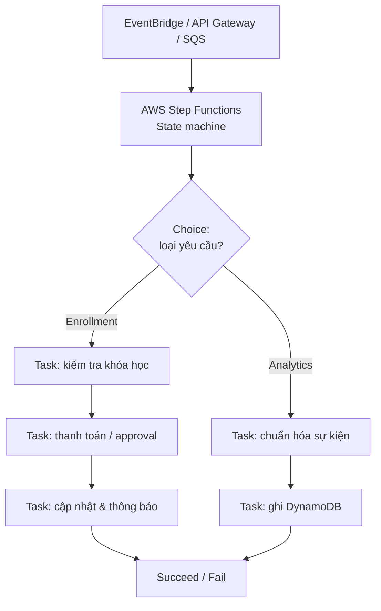
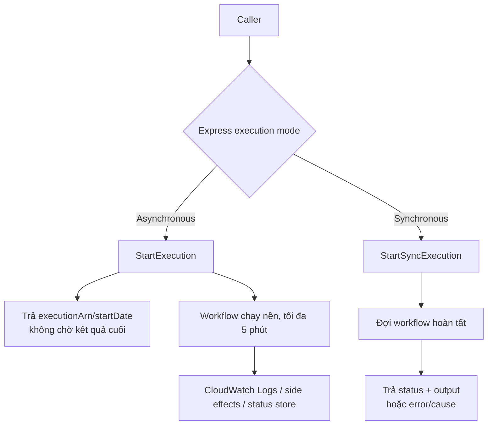
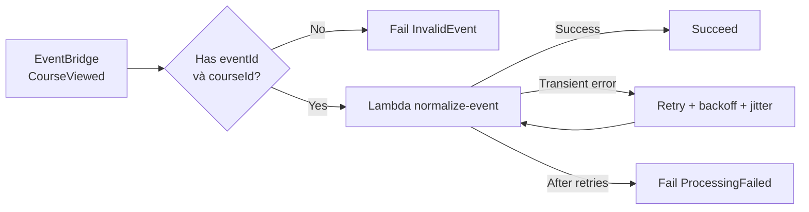
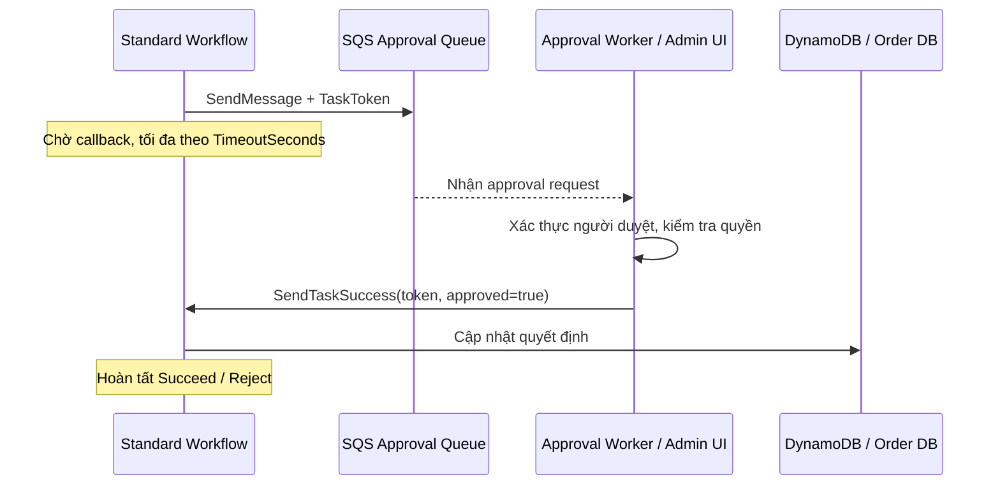
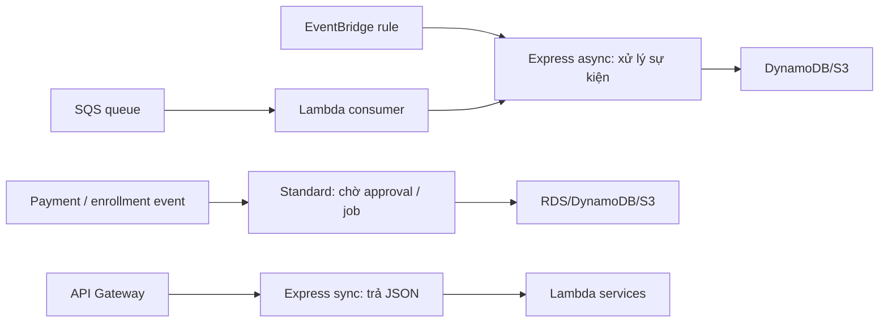
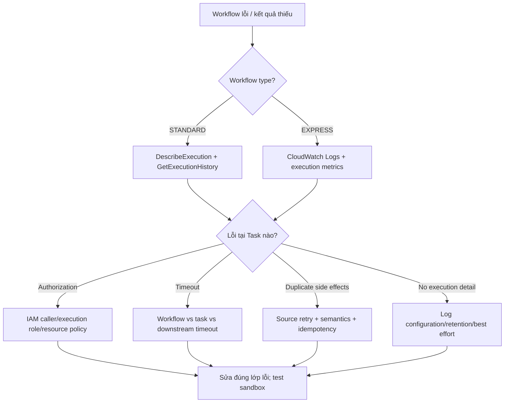

# Step Functions Standard và Express Workflow

> **Học phần:** CLOUD_PROVIDERS_AWS  
> **Chương:** Sự kiện và điều phối  
> **Bài học:** Step Functions Standard và Express Workflow  
> **Phạm vi:** AWS Step Functions, Amazon States Language (ASL), AWS Lambda, Amazon EventBridge, Amazon SQS, Amazon ECS và các tác vụ ứng dụng Java/Spring Boot.  
> **Bối cảnh:** Chọn workflow orchestration phù hợp độ dài nghiệp vụ, semantics, retry, giám sát, tính sẵn sàng và chi phí trong hệ sinh thái AWS.

## 1. Bài toán: từ chuỗi lệnh trong Java đến workflow có thể quan sát

Một nền tảng học trực tuyến có quy trình xử lý đăng ký khóa học:

1. Nhận yêu cầu `EnrollCourse` từ web/mobile qua API.
2. Kiểm tra tài khoản học viên và tình trạng khóa học.
3. Giữ chỗ hoặc ghi nhận đơn đăng ký.
4. Yêu cầu thanh toán qua hệ thống có xác nhận bất đồng bộ.
5. Phát thông báo, cập nhật DynamoDB/RDS và ghi lại kết quả.

Một luồng khác nhận hàng triệu sự kiện `CourseViewed`/`VideoProgressed` từ EventBridge hoặc SQS. Nó chỉ cần chuẩn hóa sự kiện, kiểm tra dữ liệu, tăng bộ đếm và kết thúc trong vài giây.

Cả hai đều có nhiều bước, nhưng **đòi hỏi vận hành khác nhau**:

| Luồng | Mục tiêu nổi bật |
|---|---|
| Đăng ký/đơn hàng/thanh toán | Phục hồi được, chờ bên ngoài nhiều giờ/ngày, audit, tránh side effect lặp |
| Thu thập tương tác người dùng | Throughput cao, latency thấp, nhiều executions ngắn, xử lý được bản sao sự kiện |
| Xử lý CSV/ảnh | Chạy nhiều bước có nhánh, song song và retry |
| Cấp phát tài nguyên cloud | Chờ ECS/AWS Batch/EMR job hoàn thành, có rollback/compensation |

Đặt mọi bước vào một Spring Boot controller với `Thread.sleep` và retry trong request handler làm tăng rủi ro timeout, mất trạng thái khi container bị thay, không nhìn thấy bước lỗi và khó mở rộng. **AWS Step Functions** cung cấp state machine để điều phối các bước đó, nhưng bạn phải chọn **Standard** hay **Express** ngay khi tạo.

**Sau bài học, người học có thể:**

1. So sánh Standard và Express về thời gian, semantics, tích hợp, logging và giá.
2. Phân biệt **Express asynchronous** và **Express synchronous**.
3. Viết ASL JSON với `Task`, `Choice`, `Retry`, `Catch`, `Map` và `Parallel`.
4. Chọn pattern `Request Response`, `.sync` hay `.waitForTaskToken`.
5. Bảo vệ nghiệp vụ bằng idempotency, timeouts, DLQ và compensating actions.
6. Tạo, chạy, quan sát workflows bằng Console, AWS CLI, SAM và AWS SDK for Java 2.x.
7. Thiết kế IAM execution role theo least privilege, logging không lộ PII.
8. Đo metrics, tính chi phí và nêu lý do chọn loại workflow cho từng tình huống.

## 2. Khái niệm cốt lõi của Step Functions

**State machine** là tài nguyên AWS lưu **định nghĩa luồng xử lý** bằng Amazon States Language (ASL). **Execution** là một lần chạy state machine với input JSON riêng. **State** là một bước trong sơ đồ.



Một số trạng thái thông dụng:

| State type | Ý nghĩa | Ví dụ |
|---|---|---|
| `Task` | Gọi AWS service/Lambda/HTTP task/worker hỗ trợ | Gọi Lambda kiểm tra course |
| `Choice` | Rẽ nhánh theo dữ liệu | Nếu `approved=true` thì xác nhận |
| `Pass` | Biến đổi hoặc đưa dữ liệu đi qua | Chuẩn hóa object nhỏ |
| `Wait` | Chờ thời gian/đến mốc thời gian | Chờ 30 giây rồi kiểm tra |
| `Parallel` | Chạy nhiều nhánh độc lập | Kiểm tra fraud và điểm học viên |
| `Map` | Lặp lại xử lý trên collection | Xử lý danh sách các khóa học |
| `Succeed` | Kết thúc thành công | Đã ghi nhận đơn |
| `Fail` | Kết thúc thất bại có thông báo | Sai dữ liệu đầu vào |

**Điểm quan trọng:** Step Functions **điều phối** và truyền dữ liệu giữa các tác vụ; code nghiệp vụ có thể ở Lambda, ECS, DynamoDB, API hoặc dịch vụ khác. Không có nghĩa mọi trạng thái chạy một máy chủ Java dài hạn do Step Functions quản lý.

## 3. Standard so với Express: bảng quyết định

Tại thời điểm **20/11/2026**, theo AWS Step Functions documentation:

| Tiêu chí | **Standard Workflow** | **Express Workflow** |
|---|---|---|
| Thời gian mỗi execution tối đa | **1 năm** | **5 phút (300 giây)** |
| Semantics workflow | **Exactly-once** theo mô hình AWS, trừ Retry do định nghĩa/luồng thất bại được điều phối | **Async: at-least-once; Sync: at-most-once** |
| Trạng thái giữa các bước | Được lưu bền vững | Không được persist qua từng state transition như Standard |
| Phù hợp | Thanh toán/đơn hàng, approval, batch dài, audit | High-volume events, microservice orchestration ngắn |
| Service integration | Request Response, các pattern `.sync` và `.waitForTaskToken` khi service hỗ trợ | **Chỉ Request Response**; không `.sync`/`.waitForTaskToken` |
| Distributed Map | Có | **Không** |
| Activities (worker polling) | Có | **Không** |
| Execution history | Lưu tại Step Functions, API/Console; tối đa **25.000 events** cho một execution | Lịch sử trong **CloudWatch Logs nếu bật**, không có native execution history như Standard |
| History sau khi hoàn tất | Thường truy xuất trong **90 ngày** sau khi hoàn tất | Theo CloudWatch Logs retention và khả năng delivery |
| Billing cốt lõi | **Số state transitions**, gồm retries | **Số executions + duration + memory sử dụng** |
| Mức độ throughput | Có giới hạn API starts và state transition theo quota/Region | Phù hợp tốc độ cao; vẫn có throttling/quota cho API starts và backend |
| Có thể đổi type tại chỗ? | **Không** | **Không** |

**Không hiểu "exactly-once" là tuyệt đối không bao giờ bị trùng side effects.** Khi Task retry, kết quả lời gọi bên ngoài có thể không rõ (ví dụ database đã commit nhưng response mất); ngay cả Standard cũng cần idempotency cho tác vụ thanh toán/ghi dữ liệu.

### 3.1. Type bất biến

Bạn chọn `STANDARD` hoặc `EXPRESS` **khi tạo state machine**. AWS không hỗ trợ sửa thuộc tính type sau đó. Nếu cần chuyển từ Standard sang Express:

1. Tạo **state machine mới** loại Express.
2. Rà soát ASL: bỏ `.sync`, callback, Activities và Distributed Map không tương thích.
3. Rà soát retry/idempotency, logging, IAM và giới hạn 5 phút.
4. Chuyển event sources/callers sang ARN mới qua deployment có kiểm soát.
5. Giữ quy trình rollback và dọn tài nguyên cũ sau khi chắc chắn.

Không chỉ sửa một field trong CloudFormation và trông chờ ARN cũ giữ nguyên mà không ảnh hưởng callers.

### 3.2. Giới hạn 5 phút không có nghĩa API đồng bộ có thể chờ 5 phút

Express execution tối đa 300 giây, nhưng **HTTP client, API Gateway integration, browser và AWS SDK read timeout** có thể ngắn hơn. Với `StartSyncExecution` từ Step Functions Console, AWS ghi nhận **request hết hạn sau 60 giây**; muốn kiểm thử execution đồng bộ lâu hơn, dùng SDK hoặc CLI trong giới hạn dịch vụ và client timeout phù hợp.

## 4. Exactly-once, at-least-once và at-most-once khác gì?

| Semantics | Ý nghĩa về workflow execution | Rủi ro thực tế |
|---|---|---|
| **Exactly-once (Standard)** | Step Functions lưu trạng thái và không tự lặp cùng workflow step theo cách Express async có thể làm, ngoài các retries do bạn đặt | External API có thể xử lý side effect rồi mất response; retry có thể gọi lại |
| **At-least-once (Async Express)** | Một execution có thể được thực thi nhiều hơn một lần | Nếu `chargeCard` không idempotent, có thể thu tiền trùng |
| **At-most-once (Sync Express)** | Với một execution synchronous, AWS không tự lặp toàn bộ execution theo mô hình async | Caller retry sau timeout không rõ kết quả vẫn có thể tạo execution mới |

**Idempotent operation** là thao tác có thể nhận cùng một yêu cầu nhiều lần mà **không tạo thêm tác dụng phụ ngoài một kết quả hợp lệ**. Ví dụ:

- `PUT /orders/{orderId}/status=CONFIRMED` với kiểm soát version.
- DynamoDB conditional write theo `eventId` để đánh dấu đã xử lý.
- S3 object key xác định theo job ID, có version/checksum.
- Lưu `paymentIdempotencyKey` và ràng buộc duy nhất trước khi gọi PSP.

**Ví dụ sai:**

```text
Nhận sự kiện enrollment-123 -> tăng seatCounter thêm 1
Sự kiện bị gửi lại -> tăng seatCounter thêm 1
=> Một enrollment chiếm 2 chỗ.
```

**Ví dụ tốt hơn:**

```text
Lưu idempotency key enrollment-123 bằng conditional write.
Nếu key chưa có:
  transaction cập nhật trạng thái đăng ký + chỗ còn lại.
Nếu key đã có:
  trả trạng thái hiện có, không trừ thêm chỗ.
```

Cần xét atomicity: chỉ ghi marker `processed` trước khi xử lý mà không có transaction/khả năng recover cũng có thể **bỏ sót** tác vụ nếu hệ thống chết giữa chừng.

### 4.1. StartExecution idempotency không thay thế business idempotency

Với **Standard**, `StartExecution` là idempotent khi caller dùng **cùng execution name và input** cho một execution **đang chạy**; AWS trả lại kết quả khởi chạy cũ. Nếu execution đã đóng hoặc input thay đổi, AWS có thể trả `ExecutionAlreadyExists`. Có thể dùng lại tên sau khoảng **90 ngày** theo điều kiện AWS.

Với **Express**, `StartExecution` **không idempotent**. Một lần caller retry có thể bắt đầu execution mới.

**Không đưa tên execution từ user input chưa validate** hoặc kết luận workflow exactly-once thay thế uniqueness constraint ở database.

## 5. Express có hai cách chạy: async và sync



### 5.1. Asynchronous Express

- Dùng `StartExecution`.
- Trả confirmation workflow đã được bắt đầu, **không trả output cuối**.
- Phù hợp EventBridge/SQS, telemetry, async event enrichment, backend không cần đợi kết quả.
- Execution semantics **at-least-once**, cần idempotency ở Task và downstream.
- Muốn biết kết quả, ghi trạng thái bền vững vào DynamoDB/S3 hoặc dùng CloudWatch Logs để debug; **không xây status API phụ thuộc duy nhất log delivery best effort**.

### 5.2. Synchronous Express

- Dùng `StartSyncExecution`; caller chờ kết quả.
- Response có `status` như `SUCCEEDED`, `FAILED`, `TIMED_OUT` và `output`/`error`/`cause` tương ứng.
- Execution semantics **at-most-once** trong một call được xử lý, nhưng client có thể timeout và gửi lại yêu cầu mới.
- API có thể trả **HTTP 200 ngay cả khi workflow thất bại**; phải kiểm tra field `status`, không chỉ HTTP status.
- Có thể kết nối với API Gateway/Lambda cho microservice workflow ngắn, nhưng phải so mọi timeout ở các lớp.

### 5.3. Tại sao không dùng Express cho human approval?

Human approval có thể chờ hàng giờ/ngày; Express chỉ chạy tối đa 5 phút và không hỗ trợ callback pattern `.waitForTaskToken`. Với chờ người quản lý duyệt học viên, **Standard** là lựa chọn tự nhiên.

## 6. Amazon States Language (ASL) và dữ liệu giữa các bước

ASL mô tả state machine dưới dạng **JSON**; AWS Workflow Studio có thể giúp thiết kế bằng giao diện đồ họa rồi xem/sửa definition. ASL hỗ trợ **JSONPath** và **JSONata** theo cấu hình `QueryLanguage` tương ứng. Những ví dụ bên dưới **dùng JSONPath** để dễ kiểm tra và tái sử dụng.

Một state machine tối giản:

```json
{
  "Comment": "Pass-only lab: can be Standard or Express",
  "StartAt": "ValidateFlag",
  "States": {
    "ValidateFlag": {
      "Type": "Choice",
      "Choices": [
        {
          "Variable": "$.enabled",
          "BooleanEquals": true,
          "Next": "Accepted"
        }
      ],
      "Default": "Rejected"
    },
    "Accepted": {
      "Type": "Pass",
      "Result": {
        "status": "ACCEPTED"
      },
      "End": true
    },
    "Rejected": {
      "Type": "Fail",
      "Error": "FlagNotEnabled",
      "Cause": "enabled must be true"
    }
  }
}
```

Input:

```json
{
  "enabled": true,
  "courseId": "java-101"
}
```

Kết quả thành công trong ví dụ `Pass.Result` là object `{"status":"ACCEPTED"}`. `Pass` với `Result` và không `ResultPath` mặc định **thay nội dung state**; nếu muốn giữ `courseId`, phải thiết kế output path phù hợp.

### 6.1. Những trường ASL JSONPath quan trọng

| Trường | Chức năng |
|---|---|
| `StartAt` | State đầu tiên |
| `States` | Tập states trong definition |
| `Type` | Loại state |
| `Next` | State tiếp theo |
| `End: true` | Kết thúc branch/state machine |
| `InputPath` | Chọn phần input đưa vào state |
| `Parameters` | Tạo tham số truyền cho service/task |
| `ResultSelector` | Chọn/biến đổi kết quả Task |
| `ResultPath` | Gắn kết quả vào input, thay vì ghi đè mọi thứ |
| `OutputPath` | Chọn phần output chuyển sang state sau |
| `Retry` | Lỗi nào retry, khoảng cách và số lần |
| `Catch` | Chuyển sang nhánh xử lý lỗi |
| `TimeoutSeconds` | Timeout của execution hoặc Task tùy vị trí |
| `Comment` | Diễn giải để bảo trì |

Trong JSONPath, key kết thúc bằng `.$` thường cho phép chỉ định **JSONPath expression** thay vì một string literal. Ví dụ `"Payload.$": "$"` chuyển toàn bộ state input sang Lambda.

**Không trộn syntax JSONata và JSONPath tùy ý trong cùng một state**. Với JSONata, các trường như `Arguments`/`Output` và biểu thức có cú pháp khác; cần chọn `QueryLanguage` và tra documentation tương ứng.

### 6.2. Giới hạn kích thước dữ liệu

AWS giới hạn input/output của **một task, state hoặc execution** ở **256 KiB** dạng chuỗi UTF-8 (theo quota hiện hành). Không nhét toàn bộ file CSV, ảnh hoặc file PDF trong state JSON.

Thiết kế phù hợp:

```json
{
  "jobId": "job-2026-0001",
  "bucket": "course-data-example",
  "key": "input/report-0001.csv",
  "tenantId": "school-01"
}
```

Task đọc object từ S3, ghi kết quả lại S3, rồi chỉ truyền **ARN/key/status/checksum**. Cách này giảm payload size, log PII và memory consumption của Express.

## 7. Ví dụ ASL: xử lý sự kiện ngắn bằng Express

Sự kiện `CourseViewed` đi vào workflow, được xác minh có `eventId`/`courseId`, rồi gọi Lambda chuẩn hóa dữ liệu. Handler phải **idempotent theo eventId** vì async Express có thể chạy lại.



**ASL JSON minh họa hợp lệ**, có thể dùng cho Express hoặc Standard vì chỉ dùng request-response Lambda invocation:

```json
{
  "Comment": "Course view event processing; Lambda handler must be idempotent",
  "StartAt": "CheckInput",
  "TimeoutSeconds": 240,
  "States": {
    "CheckInput": {
      "Type": "Choice",
      "Choices": [
        {
          "And": [
            {"Variable": "$.eventId", "IsPresent": true},
            {"Variable": "$.courseId", "IsPresent": true}
          ],
          "Next": "NormalizeEvent"
        }
      ],
      "Default": "InvalidInput"
    },
    "NormalizeEvent": {
      "Type": "Task",
      "Resource": "arn:aws:states:::lambda:invoke",
      "Parameters": {
        "FunctionName": "arn:aws:lambda:ap-southeast-1:123456789012:function:normalize-course-event",
        "Payload.$": "$"
      },
      "ResultPath": "$.normalization",
      "Retry": [
        {
          "ErrorEquals": [
            "Lambda.ServiceException",
            "Lambda.AWSLambdaException",
            "Lambda.SdkClientException",
            "Lambda.TooManyRequestsException"
          ],
          "IntervalSeconds": 2,
          "BackoffRate": 2,
          "MaxAttempts": 3,
          "JitterStrategy": "FULL"
        }
      ],
      "Catch": [
        {
          "ErrorEquals": ["States.ALL"],
          "ResultPath": "$.processingError",
          "Next": "ProcessingFailed"
        }
      ],
      "Next": "Done"
    },
    "Done": {
      "Type": "Succeed"
    },
    "InvalidInput": {
      "Type": "Fail",
      "Error": "InvalidEvent",
      "Cause": "eventId or courseId missing"
    },
    "ProcessingFailed": {
      "Type": "Fail",
      "Error": "NormalizeFailed",
      "Cause": "Event could not be processed"
    }
  }
}
```

**Chú ý quan trọng:**

- ARN Lambda trong ASL là **giả định**. Trước khi deploy, thay bằng ARN từ account/Region thật.
- `TimeoutSeconds: 240` ở state machine thấp hơn giới hạn Express 300 giây, tạo thêm biên. Lambda được gọi cũng có timeout riêng.
- `Retry` của Task **có thể thực thi Lambda nhiều lần**, vì vậy yêu cầu idempotency áp dụng ngay cả nếu chạy Standard.
- `ResultPath: "$.normalization"` giữ lại input trước đó và gắn response Lambda vào trường `normalization`. Với optimized Lambda integration, response có cấu trúc chứa `Payload`.
- `JitterStrategy: "FULL"` giúp trải rộng retries; không retry lỗi input sai hoặc business validation chỉ bằng cách tăng số lần.
- Nếu có nhu cầu theo dõi kết quả nghiệp vụ ở hệ thống bên ngoài, Lambda phải ghi một bản ghi trạng thái vào storage bền vững; CloudWatch logs không phải message queue.

## 8. Standard: chờ phê duyệt bằng callback Task Token

Giả sử đăng ký một khóa học có giá trị lớn cần quản trị viên kiểm tra trong tối đa 24 giờ. **Standard Workflow** có thể dùng `.waitForTaskToken` gửi một message vào SQS rồi đợi bên ngoài gọi `SendTaskSuccess`/`SendTaskFailure`.



ASL Standard mẫu:

```json
{
  "Comment": "Human approval must use Standard Workflow",
  "StartAt": "WaitForApproval",
  "TimeoutSeconds": 172800,
  "States": {
    "WaitForApproval": {
      "Type": "Task",
      "Resource": "arn:aws:states:::sqs:sendMessage.waitForTaskToken",
      "Parameters": {
        "QueueUrl": "https://sqs.ap-southeast-1.amazonaws.com/123456789012/course-approvals",
        "MessageBody": {
          "orderId.$": "$.orderId",
          "taskToken.$": "$$.Task.Token"
        }
      },
      "TimeoutSeconds": 86400,
      "ResultPath": "$.approval",
      "Catch": [
        {
          "ErrorEquals": ["States.ALL"],
          "ResultPath": "$.approvalError",
          "Next": "ApprovalTimedOut"
        }
      ],
      "Next": "CheckDecision"
    },
    "CheckDecision": {
      "Type": "Choice",
      "Choices": [
        {
          "Variable": "$.approval.approved",
          "BooleanEquals": true,
          "Next": "Approved"
        }
      ],
      "Default": "Rejected"
    },
    "Approved": {
      "Type": "Succeed"
    },
    "Rejected": {
      "Type": "Fail",
      "Error": "ApprovalRejected"
    },
    "ApprovalTimedOut": {
      "Type": "Fail",
      "Error": "ApprovalUnavailable"
    }
  }
}
```

Worker có quyền callback có thể gọi AWS CLI sau khi **đã xác thực** quyết định của người duyệt:

```bash
# Chỉ chạy trong sandbox, với token lấy từ message hợp lệ.
# Không log, gửi email hoặc đưa task token vào hệ thống không tin cậy.
aws stepfunctions send-task-success \
  --task-token 'TASK_TOKEN_FROM_SQS' \
  --task-output '{"approved":true}' \
  --region ap-southeast-1
```

**Phân biệt:** `--task-output` là tham số của Step Functions `send-task-success`; `--output` của AWS CLI chỉ chọn định dạng in kết quả. Bài lab cần thay token placeholder bằng token thật theo cơ chế an toàn, không dùng token trong file chia sẻ.

**Bảo mật Task Token:** Task token là **bearer capability** đủ để hoàn thành/chặn một task trong giới hạn quyền AWS API. Không cho người dùng cuối trực tiếp gọi `SendTaskSuccess` nếu chưa có backend xác thực người duyệt và kiểm tra role/tenant.

### 8.1. Timeout, heartbeat và callback

- `TimeoutSeconds` giới hạn thời gian Task chờ callback.
- `HeartbeatSeconds` có thể buộc worker báo nó còn hoạt động bằng `SendTaskHeartbeat`, **nhưng** không nên đặt heartbeat mỗi phút cho workflow chờ duyệt một ngày nếu không có một worker thực sự gửi heartbeat.
- Timeout callback làm Task thất bại; callback token cũ có thể không còn hợp lệ sau timeout/retry.
- Với thao tác thanh toán nhạy cảm, thêm kiểm tra trạng thái transaction và idempotency khi hoàn tất.

**Express không hỗ trợ `.waitForTaskToken`** dù dùng synchronous execution.

## 9. Standard: chờ một ECS/Batch job hoàn thành với .sync

Một tình huống khác: xuất báo cáo lớn bằng Amazon ECS/Fargate, có thể chạy hơn 5 phút. Nếu state machine cần biết khi job kết thúc trước khi chuyển bước, dùng integration `.sync` **trên Standard**.

Ví dụ **mảnh ASL** minh họa (không phải state machine độc lập):

```json
{
  "RunReportTask": {
    "Type": "Task",
    "Resource": "arn:aws:states:::ecs:runTask.sync",
    "Parameters": {
      "Cluster": "arn:aws:ecs:ap-southeast-1:123456789012:cluster/course-jobs",
      "TaskDefinition": "course-report-task:3",
      "LaunchType": "FARGATE",
      "NetworkConfiguration": {
        "AwsvpcConfiguration": {
          "Subnets": ["subnet-01234567", "subnet-89abcdef"],
          "SecurityGroups": ["sg-0123456789abcdef0"],
          "AssignPublicIp": "DISABLED"
        }
      }
    },
    "TimeoutSeconds": 3600,
    "ResultPath": "$.reportResult",
    "Next": "PersistReport"
  }
}
```

Mảnh này phải được đặt vào `States` cùng một state `PersistReport` hợp lệ. ECS task definition, private subnet routes, IAM `ecs:RunTask`/`iam:PassRole` và quyền cho Step Functions theo dõi task cần được thiết lập thực.

**Điểm tinh tế:** `Resource: "arn:aws:states:::ecs:runTask"` trong Express là **Request Response**: Step Functions đi tiếp sau khi nhận kết quả API `RunTask`, **không đợi container xử lý xong**. Thay đổi từ `runTask.sync` thành `runTask` để "chạy được Express" làm thay đổi ngữ nghĩa nghiệp vụ, không phải một tối ưu tương đương.

Đối với `.sync`, Step Functions theo dõi job bằng AWS APIs/EventBridge trong những trường hợp được hỗ trợ. Khi workflow bị hủy, AWS thực hiện **best-effort** attempt để hủy job; không bảo đảm mọi downstream job đã bị hủy. Hãy xem trạng thái thực của ECS task và cơ chế cleanup.

## 10. Service integrations: chọn đúng pattern

Có ba pattern:

| Pattern | Cách viết resource | Standard | Express |
|---|---|---|---|
| **Request Response** | `arn:aws:states:::lambda:invoke` hoặc `...:ecs:runTask` | Có | Có |
| **Run a Job** | Resource có suffix `.sync` khi service hỗ trợ | Có | **Không** |
| **Wait for Callback** | Resource có suffix `.waitForTaskToken` khi service hỗ trợ | Có | **Không** |

**Lưu ý:** Không phải mọi AWS integration đều hỗ trợ `.sync` hoặc callback. Kiểm tra bảng tích hợp chính thức theo dịch vụ/API. AWS SDK service integrations nhiều trăm services hỗ trợ request-response; riêng việc chờ job cần một trong các integration patterns mà AWS đã cung cấp.

### 10.1. Tình huống thực tế

| Nhu cầu | Pattern/loại workflow |
|---|---|
| Gọi Lambda xử lý validation trong vài giây | Standard hoặc Express, request-response |
| Ghi DynamoDB và chuyển bước khi API PutItem trả | Standard hoặc Express, request-response |
| Chờ ECS job chạy 25 phút rồi làm bước tiếp | **Standard + ecs:runTask.sync** |
| Chờ người duyệt hồ sơ trong hai ngày | **Standard + .waitForTaskToken** |
| Chạy hàng trăm nghìn events/ngày, mỗi event 1–3 giây | **Async Express** |
| Trả kết quả microservice orchestration nhanh về caller | **Sync Express** nếu timeout các lớp phù hợp |
| Duyệt nhiều triệu objects qua Distributed Map | **Standard** là parent orchestration với Distributed Map |
| Polling worker với Step Functions Activities | **Standard** |

## 11. Retry, Catch và lỗi nghiệp vụ

### 11.1. Retry cho lỗi tạm thời

Ví dụ một Task Lambda có retry:

```json
{
  "Retry": [
    {
      "ErrorEquals": [
        "Lambda.ServiceException",
        "Lambda.AWSLambdaException",
        "Lambda.SdkClientException",
        "Lambda.TooManyRequestsException"
      ],
      "IntervalSeconds": 2,
      "BackoffRate": 2,
      "MaxAttempts": 3,
      "MaxDelaySeconds": 20,
      "JitterStrategy": "FULL"
    }
  ]
}
```

Chỉ là **mảnh cấu hình** đưa vào Task phù hợp. `MaxAttempts: 3` là số lần **retry**, không tính lần thử đầu tiên. Trong production, đặt giới hạn retries để không tạo retry storm khi downstream bị lỗi, kết hợp monitoring và backpressure.

### 11.2. Catch và phân biệt lỗi

| Lỗi | Cách xử lý |
|---|---|
| Throttle/5xx của service | Retry giới hạn và jitter |
| Sai input/schema | Fail nhanh, không retry vô hạn |
| Không đủ IAM permissions | Sửa policy, không retry khi chưa đổi quyền |
| Resource không tồn tại | Kiểm tra ID/deployment, thường lỗi không tự phục hồi |
| Timeout của Task | Ghi trạng thái, idempotent compensation/recovery |
| Callback không về | Task timeout, thông báo và người vận hành can thiệp |
| Kết quả payment không rõ | Tra payment transaction status trước khi retry |

`States.ALL` là catch-all error name cho retrier/catcher **trong những điều kiện AWS cho phép**. Không giả định mọi lỗi như `States.DataLimitExceeded` hay một số runtime failures đều được `States.ALL` xử lý như lỗi ứng dụng thông thường. Thiết kế lỗi bắt buộc dựa trên semantics thật của Step Functions.

### 11.3. Bất đồng bộ nghĩa là có duplicate và out-of-order

EventBridge, SQS và một số event sources có thể giao/trigger lại. Async Express có thể chạy nhiều lần. Vì vậy:

- Lưu `eventId`/`orderId` trong DynamoDB/RDS với uniqueness constraints.
- Dùng DynamoDB `ConditionExpression attribute_not_exists(pk)` khi tạo marker xử lý.
- Khi có side effect nhiều bước, dùng transaction hoặc trạng thái `PENDING → DONE/FAILED` với recovery.
- Đừng gửi hai lần thông báo thanh toán nếu đã có `notificationId` xử lý.
- Cần quan tâm thứ tự sự kiện; việc chạy đồng thời nhiều workflows không mặc nhiên theo thứ tự business events.

**Compensation (Saga):** Nếu `ReserveSeat` thành công nhưng `ChargePayment` thất bại, workflow có thể gọi `ReleaseSeat`. Compensation cần idempotent và có thể thất bại riêng; không phải rollback ACID xuyên dịch vụ.

## 12. Map, Parallel và Distributed Map

### 12.1. Parallel

`Parallel` chạy nhiều branches độc lập, sau đó đồng bộ kết quả theo model state. Ví dụ kiểm tra entitlement và fraud đồng thời:

```json
{
  "Type": "Parallel",
  "Branches": [
    {
      "StartAt": "CheckEntitlement",
      "States": {
        "CheckEntitlement": {
          "Type": "Pass",
          "Result": {"allowed": true},
          "End": true
        }
      }
    },
    {
      "StartAt": "CheckFraud",
      "States": {
        "CheckFraud": {
          "Type": "Pass",
          "Result": {"risk": "low"},
          "End": true
        }
      }
    }
  ],
  "End": true
}
```

Mảnh này có thể tồn tại trong Standard hoặc Express. `Parallel` không có nghĩa hai nhánh có thứ tự hoàn thành xác định, và không làm các side effects trở thành atomic transaction.

### 12.2. Map Inline

`Map` trong chế độ Inline giúp xử lý tập phần tử có giới hạn nằm trong input execution. Nếu array lớn, nguy cơ đụng **256 KiB payload**, **25.000 execution history events** của Standard, quá nhiều transitions hoặc chi phí.

- Hạn chế `MaxConcurrency` theo downstream capacity.
- Thiết kế retry/idempotency trên từng item.
- Không đưa hàng chục nghìn records trực tiếp vào JSON state nếu vượt quota.
- Sử dụng S3 references/ItemReader khi cần mô hình phân tán.

### 12.3. Distributed Map chỉ Standard

**Distributed Map** phù hợp big datasets với nguồn từ S3 và child workflows, có Map Runs và khả năng fan-out lớn. Chế độ Distributed Map **không được hỗ trợ trong Express state machine**, mặc dù một **Standard parent** có thể dùng Express child executions trong một số mô hình.

Khi dùng Distributed Map:

- Kiểm soát concurrency để không quá tải DynamoDB/RDS.
- Lưu input/output ở S3 thay vì nhét mọi item vào state JSON.
- Theo dõi Map Run và khả năng retry/redrive theo giới hạn.
- Tính phí parent Standard transitions **và child workflow executions** theo loại.
- Dùng IAM để giới hạn quyền gọi nested state machines và S3.

## 13. Trigger workflows từ EventBridge, SQS và API Gateway



### 13.1. EventBridge rule → Step Functions

EventBridge có thể target một state machine với đúng execution role và IAM permission:

- Rule filter theo `source` và `detail-type`.
- Chuyển event input (có thể dùng input transformer).
- Target state machine ARN phải đúng.
- IAM role/permissions cho EventBridge start execution.
- EventBridge retry/DLQ strategy cần theo dõi; **targeting không tự bảo đảm exactly-once end-to-end**.

Với high-volume independent events, **Async Express** thường là ứng viên tốt. Với money flow/callback chờ lâu, **Standard** thường hợp lý.

### 13.2. SQS

SQS là message queue, không giống orchestrator. Khi nguồn là SQS, có thể:

1. Dùng Lambda consumer đọc batch và start state machine.
2. Dùng tích hợp EventBridge Pipes (nếu phù hợp loại nguồn/target) để đưa message tới workflow.
3. Để một Standard workflow sử dụng service integration gửi/nhận message theo pattern được hỗ trợ.

Cần thiết kế:

- Visibility timeout, batch size, partial batch response khi consumer Lambda.
- Queue DLQ và giới hạn max receive count.
- Idempotency key lấy từ event/message business ID; SQS message ID có thể không phải identity nghiệp vụ bất biến.
- Chịu tải của backend khi chạy hàng nghìn executions.

**Đừng coi SQS + Express là exactly-once**. Retry có thể xuất hiện ở source và execution semantics.

### 13.3. API Gateway

Với API đồng bộ, API Gateway có thể gọi `StartSyncExecution` cho Express để nhận kết quả mà không cần một Lambda chỉ làm orchestration. Tuy nhiên:

- API Gateway integration timeout có thể **ngắn hơn 300 giây**.
- Nếu Step Functions output là status `FAILED` nhưng AWS API request trả HTTP 200, integration phải **mapping status** đúng sang mã HTTP.
- Phải bảo vệ API bằng IAM/JWT/Lambda authorizer theo yêu cầu, throttle và validate input.
- Nếu tác vụ kéo dài vài phút, nên trả **202 Accepted + job ID**, dùng Standard/asynchronous execution và endpoint tra status thay vì giữ HTTP request mở.

## 14. Java: gọi Standard và Express bằng AWS SDK for Java 2.x

Một backend Java/Spring Boot trên ECS/Lambda có thể gọi Step Functions bằng **AWS SDK for Java 2.x**, dùng **IAM task role/execution role** thay vì access keys hard-coded.

Dependencies ví dụ: `software.amazon.awssdk:sfn` và các SDK dependencies qua BOM. Mã Java 17 minh họa:

```java
package example.course.workflow;

import software.amazon.awssdk.regions.Region;
import software.amazon.awssdk.services.sfn.SfnClient;
import software.amazon.awssdk.services.sfn.model.StartExecutionRequest;
import software.amazon.awssdk.services.sfn.model.StartExecutionResponse;
import software.amazon.awssdk.services.sfn.model.StartSyncExecutionRequest;
import software.amazon.awssdk.services.sfn.model.StartSyncExecutionResponse;

public final class StartWorkflowExample {
    private static final Region REGION = Region.AP_SOUTHEAST_1;

    public static void main(String[] args) {
        String standardArn =
            "arn:aws:states:ap-southeast-1:123456789012:stateMachine:course-enrollment-standard";
        String expressArn =
            "arn:aws:states:ap-southeast-1:123456789012:stateMachine:course-event-express";

        try (SfnClient sfn = SfnClient.builder().region(REGION).build()) {
            // Standard: bắt đầu workflow; response chưa chứa kết quả cuối.
            StartExecutionResponse started = sfn.startExecution(
                StartExecutionRequest.builder()
                    .stateMachineArn(standardArn)
                    .name("enrollment-2026-000001")
                    .input("{\"orderId\":\"order-001\"}")
                    .build());

            System.out.println("Standard execution ARN: "
                + started.executionArn());

            // Express Sync: đợi kết quả qua API StartSyncExecution.
            StartSyncExecutionResponse sync = sfn.startSyncExecution(
                StartSyncExecutionRequest.builder()
                    .stateMachineArn(expressArn)
                    .input("{\"enabled\":true,\"eventId\":\"event-001\"}")
                    .build());

            // Không coi HTTP 200 là workflow thành công.
            if (!"SUCCEEDED".equals(sync.statusAsString())) {
                throw new IllegalStateException(
                    "Express failed, status=" + sync.statusAsString()
                    + ", error=" + sync.error());
            }

            System.out.println("Express output: " + sync.output());
        }
    }
}
```

**Điều kiện để chạy:** Hai state machines có ARN thật và trạng thái `ACTIVE`; role của backend có `states:StartExecution` cho Standard và `states:StartSyncExecution` cho Express; input phù hợp ASL; SDK được cấu hình Region/IAM đúng.

**Cẩn trọng:**

- `StartExecution` không đợi Standard hoàn tất, dù bạn dùng Java synchronous SDK method.
- `StartSyncExecution` là **Express-only**, không dùng cho Standard.
- `sync.statusAsString()` phải được kiểm tra; không chỉ nhìn response HTTP.
- Với client/proxy timeout trước khi nhận sync response, cần idempotency key nếu caller retry.
- Không in output có PII, access token hay dữ liệu thẻ thanh toán ra log Production.
- Đối với các API sync vài giây, nên cấu hình SDK HTTP read timeout phù hợp và đo cả latency network.

### 14.1. Java Lambda handler cho bước Task

Mỗi `Task` có thể gọi một Lambda Java 17:

```java
package example.course.workflow;

import com.amazonaws.services.lambda.runtime.Context;
import com.amazonaws.services.lambda.runtime.RequestHandler;
import java.util.Map;

public final class ValidateEnrollmentHandler
        implements RequestHandler<Map<String, Object>, Map<String, Object>> {

    @Override
    public Map<String, Object> handleRequest(
            Map<String, Object> event, Context context) {

        Object raw = event.get("orderId");
        String orderId = raw == null ? "" : raw.toString();

        if (orderId.isBlank()) {
            throw new IllegalArgumentException("orderId is required");
        }

        // Production: xác minh quyền, trạng thái, tenant,
        // uniqueness/idempotency trong database trước side effects.
        return Map.of(
            "orderId", orderId,
            "valid", true,
            "checked", true);
    }
}
```

Mã này chỉ là validator mẫu, **chưa thực hiện database uniqueness**. Khi đưa vào production, dùng idempotency/checkpoint và ghi audit đúng quy trình.

## 15. AWS Console: tạo và chạy hai state machines

### 15.1. Lab Standard Workflow

1. Đăng nhập AWS account sandbox và kiểm tra Region.
2. Mở **AWS Step Functions → State machines → Create state machine**.
3. Chọn Workflow Studio hoặc viết code definition.
4. Chọn **Standard**, đặt tên `course-enrollment-standard`.
5. Dán ASL Pass/Choice đơn giản ở mục 6 hoặc callback ASL ở mục 8 **khi có đủ SQS queue/role**.
6. Chọn/tạo **IAM execution role** với quyền đúng Task integrations.
7. Chọn logging/tracing theo chính sách dự án; không bật ghi input/output nhạy cảm nếu không cần.
8. Tạo và chạy bằng **Start execution** với input sandbox.
9. Quan sát đồ thị execution, Input/Output, event history, duration và trạng thái.
10. Nếu dùng callback, xác minh worker thực sự gửi task token đúng; không để execution treo.

### 15.2. Lab Express Workflow

1. Tạo state machine khác, chọn **Express**, đặt tên `course-event-express`.
2. Dùng ASL ngắn (mục 6 hoặc 7), không dùng callback/.sync.
3. **Bật CloudWatch Logs** cho Express với log group và retention policy phù hợp.
4. Chọn log level `ALL` trong lab để nhìn toàn bộ execution events; cân nhắc `ERROR`/`FATAL` trong môi trường nhiều dữ liệu nếu không cần full trace.
5. Cấu hình `IncludeExecutionData=false` nếu muốn tránh ghi raw input/output vào log.
6. Tạo, chạy một input hợp lệ và một input invalid.
7. Quan sát kết quả trên console/CloudWatch Logs.
8. Thử `StartSyncExecution` từ CLI/SDK; kiểm tra field `status`.
9. Đọc biểu đồ execution count/duration/memory và đánh giá khả năng đo được lỗi.
10. Dọn state machines/log groups thử nghiệm sau khi xác định không có workflows khác phụ thuộc.

**Cần biết:** Express history trong Step Functions Console **phụ thuộc CloudWatch Logs**, vốn được gửi **best effort**. Không thiết kế tính đúng nghiệp vụ phụ thuộc vào log đến đầy đủ/đúng giờ. Nếu cần audit bất biến, chọn Standard hoặc ghi records bền vững theo nghiệp vụ.

## 16. AWS CLI: tạo, chạy và kiểm tra

### 16.1. Kiểm tra account và chuẩn bị definition

Lệnh mẫu dùng **AWS CLI v2** trong một môi trường có quyền, ví dụ Linux/macOS terminal:

```bash
aws sts get-caller-identity
aws stepfunctions list-state-machines --region ap-southeast-1
```

Đặt nội dung ASL JSON mẫu vào file triển khai `workflow-standard.asl.json` hoặc `workflow-express.asl.json` theo quy trình local, rồi xác thực:

```bash
aws stepfunctions validate-state-machine-definition \
  --definition file://workflow-standard.asl.json \
  --region ap-southeast-1
```

Lệnh validation kiểm tra definition theo cơ chế AWS, **không chứng minh IAM role có quyền**, Lambda có thật hoặc nghiệp vụ idempotent.

### 16.2. Tạo Standard state machine

```bash
aws stepfunctions create-state-machine \
  --name course-enrollment-standard \
  --type STANDARD \
  --definition file://workflow-standard.asl.json \
  --role-arn arn:aws:iam::123456789012:role/CourseStepFunctionsRole \
  --region ap-southeast-1
```

Đây là lệnh **ghi tài nguyên có thể phát sinh phí khi chạy**. Execution role phải trust `states.amazonaws.com` và có quyền đúng với ASL. Nếu dùng Pass-only state machine, quyền gọi Lambda/SQS chưa cần; nếu dùng Task integration, phải bổ sung.

### 16.3. Chạy Standard và xem history

```bash
aws stepfunctions start-execution \
  --state-machine-arn arn:aws:states:ap-southeast-1:123456789012:stateMachine:course-enrollment-standard \
  --name enrollment-2026-000001 \
  --input '{"enabled":true,"orderId":"order-001"}' \
  --region ap-southeast-1
```

Lấy `executionArn` từ output:

```bash
aws stepfunctions describe-execution \
  --execution-arn arn:aws:states:ap-southeast-1:123456789012:execution:course-enrollment-standard:enrollment-2026-000001 \
  --region ap-southeast-1

aws stepfunctions get-execution-history \
  --execution-arn arn:aws:states:ap-southeast-1:123456789012:execution:course-enrollment-standard:enrollment-2026-000001 \
  --region ap-southeast-1
```

Nếu definition dùng callback/Wait, kết quả có thể vẫn `RUNNING`. Chỉ mở callback token theo quy trình đã thiết kế; đừng gọi `StopExecution` lên workflow Production để thử câu lệnh.

### 16.4. Tạo và chạy Express

Sau khi đã có ASL thích hợp cho Express:

```bash
aws stepfunctions create-state-machine \
  --name course-event-express \
  --type EXPRESS \
  --definition file://workflow-express.asl.json \
  --role-arn arn:aws:iam::123456789012:role/CourseStepFunctionsRole \
  --region ap-southeast-1
```

**Lưu ý thực hành:** CLI mẫu này chỉ tạo state machine. Nếu muốn xem Express execution history, phải **bật CloudWatch Logs** khi tạo hoặc qua `update-state-machine --logging-configuration` theo cấu trúc phù hợp và cấp quyền logging trước khi chạy lab. Không tạo Express không logging rồi ngạc nhiên vì console không có history.

Async Express:

```bash
aws stepfunctions start-execution \
  --state-machine-arn arn:aws:states:ap-southeast-1:123456789012:stateMachine:course-event-express \
  --input '{"eventId":"event-001","courseId":"java-101"}' \
  --region ap-southeast-1
```

Sync Express:

```bash
aws stepfunctions start-sync-execution \
  --state-machine-arn arn:aws:states:ap-southeast-1:123456789012:stateMachine:course-event-express \
  --input '{"eventId":"event-002","courseId":"java-101"}' \
  --region ap-southeast-1
```

Đọc `status` trong JSON output. **HTTP 200 không có nghĩa `status=SUCCEEDED`**.

### 16.5. Khi không thấy Express execution history

Đừng gọi `get-execution-history` của Standard rồi nghĩ nó phải trả đầy đủ log của Express. Với Express:

- Bật CloudWatch logging từ trước.
- Dùng **Step Functions Console** xem execution details dựa trên logs hoặc truy vấn **CloudWatch Logs Insights**.
- Kiểm tra logging level, IAM `logs:CreateLogDelivery` và liên quan, log group ARN, resource policy quotas/retention.
- Log delivery là **best effort**, không dùng để bảo đảm business-state audit.

## 17. AWS SAM/CloudFormation: khai báo workflow type có kiểm soát

AWS SAM resource `AWS::Serverless::StateMachine` hỗ trợ `Type: STANDARD` hoặc `Type: EXPRESS`.

Mẫu **fragment** áp dụng cho một dự án có IAM role và log group đã được tạo phù hợp:

```yaml
Transform: AWS::Serverless-2016-10-31
Resources:
  CourseStandard:
    Type: AWS::Serverless::StateMachine
    Properties:
      Name: course-standard-demo
      Type: STANDARD
      Role: arn:aws:iam::123456789012:role/CourseStepFunctionsRole
      Definition:
        StartAt: Accepted
        States:
          Accepted:
            Type: Pass
            Result:
              status: accepted
            End: true

  CourseExpress:
    Type: AWS::Serverless::StateMachine
    Properties:
      Name: course-express-demo
      Type: EXPRESS
      Role: arn:aws:iam::123456789012:role/CourseStepFunctionsRole
      Definition:
        StartAt: Accepted
        States:
          Accepted:
            Type: Pass
            Result:
              status: accepted
            End: true
      Logging:
        Level: ALL
        IncludeExecutionData: false
        Destinations:
          - CloudWatchLogsLogGroup:
              LogGroupArn: arn:aws:logs:ap-southeast-1:123456789012:log-group:/aws/vendedlogs/states/course-express:*
```

**Lưu ý:** Đây là *fragment*, IAM role và CloudWatch log group phải **tồn tại hoặc được khai báo thêm**, đồng thời execution role phải có logging permissions được AWS yêu cầu. ARN/tên ở đây giả định; cần kiểm tra CloudFormation syntax và AWS SAM CLI hỗ trợ tại thời điểm triển khai. Không chỉ thêm `Logging` rồi nghĩ AWS tự tạo log group, IAM permissions và retention nếu các tài nguyên đó chưa có.

### 17.1. Ưu điểm của IaC

- Giữ ASL, workflow type, IAM, logging và tags trong source control.
- Review security changes trước deploy.
- Tạo môi trường dev/staging/production nhất quán.
- Quản lý state machine versions và aliases để triển khai có kiểm soát.
- Dễ rollback khi state definition thay đổi.

**Workflow type bất biến:** Một thay đổi `Type: STANDARD → EXPRESS` cần kế hoạch thay tài nguyên/chuyển callers, không chỉ thử update trực tiếp như memory của Lambda.

## 18. IAM, logging và dữ liệu nhạy cảm

### 18.1. Execution role: Step Functions được phép làm gì?

Mỗi state machine cần **execution role** được trust bởi service `states.amazonaws.com`. IAM role chỉ nên có các quyền mà các Task thực sự dùng.

Trust policy mẫu:

```json
{
  "Version": "2012-10-17",
  "Statement": [
    {
      "Effect": "Allow",
      "Principal": {
        "Service": "states.amazonaws.com"
      },
      "Action": "sts:AssumeRole",
      "Condition": {
        "ArnLike": {
          "aws:SourceArn": "arn:aws:states:ap-southeast-1:123456789012:stateMachine:*"
        },
        "StringEquals": {
          "aws:SourceAccount": "123456789012"
        }
      }
    }
  ]
}
```

Conditions `aws:SourceArn`/`aws:SourceAccount` hạn chế confused-deputy risk theo hướng dẫn AWS; trong môi trường thực có thể thu hẹp resource pattern hơn nữa khi phù hợp.

Permission policy để Step Functions gọi đúng một Lambda:

```json
{
  "Version": "2012-10-17",
  "Statement": [
    {
      "Sid": "InvokeEventNormalizer",
      "Effect": "Allow",
      "Action": "lambda:InvokeFunction",
      "Resource": "arn:aws:lambda:ap-southeast-1:123456789012:function:normalize-course-event"
    }
  ]
}
```

Nếu state machine còn gửi SQS, chạy ECS/Batch, cập nhật DynamoDB hoặc dùng callback, bổ sung đúng actions/resources, `iam:PassRole` (nếu cần), KMS và resource policies. Không cấp `AdministratorAccess` chỉ vì Task trả `AccessDenied`.

### 18.2. Caller role khác execution role

| Vai trò | Ví dụ | Quyền |
|---|---|---|
| **Caller** | Lambda/ECS/Java backend khởi chạy state machine | `states:StartExecution` hoặc `states:StartSyncExecution` trên ARN phù hợp |
| **Execution role** | State machine chạy Tasks | `lambda:InvokeFunction`, `sqs:SendMessage`, `ecs:RunTask`... |
| **Worker callback role** | Approval worker gọi task token | `states:SendTaskSuccess`/`SendTaskFailure` theo model IAM hỗ trợ |
| **Operator** | Người xem histories/logs | Quyền đọc state machine và logs, giới hạn theo chức năng |
| **CloudWatch Logs delivery** | Tính năng gửi logs | Các `logs:*LogDelivery` và log-related permissions theo AWS documentation |

**Đừng nhầm:** Việc user có `states:StartExecution` **không cấp cho user trực tiếp** `lambda:InvokeFunction`. Step Functions dùng execution role của state machine để gọi Task integrations.

### 18.3. Input/output có thể chứa dữ liệu nhạy cảm

ASL input/output có thể chứa thông tin người dùng, tên email, access tokens hoặc identifiers. Khi bật `IncludeExecutionData=true`, logs có thể ghi toàn bộ inputs/outputs tùy log level.

Biện pháp:

1. Không truyền password, JWT, session credentials và dữ liệu thẻ nguyên vẹn vào workflow input.
2. Lưu payload nhạy cảm ở S3/database được bảo vệ; truyền reference ID.
3. Bật encryption/KMS phù hợp với khả năng và policy AWS.
4. Giới hạn quyền IAM đọc execution history và CloudWatch logs.
5. Đặt retention/lifecycle và đánh giá chi phí logging.
6. Khi callback, task token là **sensitive bearer token**, không được log cho mọi user.

**CloudWatch logging cho Express là best effort**; nếu yêu cầu audit chắc chắn thì dùng Standard hoặc ghi trạng thái transaction vào datastore được thiết kế cho độ bền cần thiết.

## 19. Giám sát, metrics và troubleshooting

### 19.1. Các metrics cần quan sát

| Nguồn | Metric/signal | Ý nghĩa |
|---|---|---|
| Step Functions | `ExecutionsStarted` | Số executions được khởi chạy |
| Step Functions | `ExecutionsSucceeded` | Workflows hoàn tất thành công |
| Step Functions | `ExecutionsFailed` | Workflows thất bại |
| Step Functions | `ExecutionsTimedOut` | Vượt execution timeout |
| Step Functions | `ExecutionTime` | Duration workflow |
| Step Functions | `ExecutionThrottled` | Standard state transition throttling khi áp dụng |
| Express | `ExpressExecutionMemory`, `ExpressExecutionBilledMemory` | Memory used/billed để hiểu duration billing |
| AWS Lambda | `Errors`, `Duration`, `Throttles` | Nút thắt ở tasks |
| SQS | `ApproximateAgeOfOldestMessage`, DLQ depth | Backlog/retries |
| DynamoDB/RDS | Throttling, latency, transactions | Downstream limits |

CloudWatch metric names và dimensions cần được kiểm tra theo API/service thực tế. Một workflow báo `SUCCEEDED` chưa chứng minh downstream business record hợp lệ nếu Task đã trả sai output; nên có application-level success metrics.

### 19.2. Standard history so với Express logging

**Standard:**

- Execution details/history được Step Functions lưu và có thể truy xuất qua API/Console cho executions hoàn tất trong **90 ngày**.
- AWS hỗ trợ **redrive** những executions Standard không hoàn tất thành công trong cửa sổ được hỗ trợ (hiện tối đa **14 ngày** kể từ khi hoàn tất).
- Một execution Standard có giới hạn **25.000 history events**; tránh workflow với vòng lặp quá dài hoặc khối lượng ghi history không kiểm soát.
- Có thể bật CloudWatch Logs bổ sung, nhưng không bắt buộc chỉ để xem native history.

**Express:**

- Execution history **không được lưu trong Step Functions** như Standard.
- Console/Logs Insights lấy dữ liệu từ **CloudWatch log group** được cấu hình.
- Log level `ALL` giúp phân tích từng state nhưng tốn storage/ingestion và có nguy cơ ghi input/output nhạy cảm.
- Nếu logging `OFF` hoặc logs bị xóa, Console có thể không hiển thị execution details.
- CloudWatch Logs delivery không được bảo đảm 100%; không coi absence of logs = không có execution.

### 19.3. Bảng sự cố thường gặp

| Hiện tượng | Nguyên nhân có thể | Cách kiểm tra |
|---|---|---|
| `StartSyncExecution` bị từ chối cho Standard | API chỉ dành cho Express | Kiểm tra state machine type; dùng StartExecution cho Standard |
| Standard `ExecutionAlreadyExists` | Trùng name với execution đã đóng hoặc input khác trong khoảng 90 ngày | Execution name, input, idempotency strategy |
| Express event được xử lý hai lần | Async Express at-least-once, source retry hoặc Task Retry | Idempotency marker, event ID, SQS/EventBridge retries |
| Express hết hạn đúng 5 phút | Giới hạn execution 300 giây | Split workflow hoặc chuyển Standard |
| Workflow treo chờ callback | Không ai gọi SendTaskSuccess, token sai, timeout quá dài | SQS message, worker logs, token lifetime, IAM |
| Express không chạy `ecs:runTask.sync` | Express chỉ hỗ trợ Request Response | Chọn Standard hoặc thiết kế callback/event-driven khác |
| Không thấy Express execution trên Console | Chưa bật logs, level/permission/retention sai | CloudWatch log group, logging config, IAM |
| `AccessDenied` khi Lambda Task | Execution role thiếu InvokeFunction hoặc resource policy | IAM execution role, Lambda ARN/alias, service permissions |
| `States.DataLimitExceeded` | Payload vượt 256 KiB | Đưa dữ liệu lớn ra S3, giữ key trong state |
| Dừng Standard nhưng ECS job vẫn chạy | .sync cancel là best effort | Kiểm tra ECS task và cleanup policy |
| Workflows thất bại khi downstream throttled | Retry/backoff thiếu hoặc concurrency quá cao | Step Functions Retry, service quotas, CloudWatch metrics |
| `StartSyncExecution` HTTP 200 nhưng ứng dụng trả kết quả lỗi | Client không đọc field `status` | Kiểm tra output/error/cause, mapping API |
| Chi phí Express tăng mạnh | Workflow chạy lâu, Parallel/Map payload lớn, memory billed tăng | Duration, ExpressBilledMemory, payload size |
| Standard vượt ngân sách | Nhiều state transitions/retries/Wait loops | ASL design, Retry count, transitions metrics |
| Logs bị lộ PII | IncludeExecutionData hoặc Lambda logging raw input | Log config, redaction, IAM readers, retention |

### 19.4. Sơ đồ điều tra



## 20. Tối ưu chi phí: transitions so với requests/duration/memory

### 20.1. Standard Workflow tính theo state transitions

Theo [AWS Step Functions Pricing](https://aws.amazon.com/step-functions/pricing/), Standard được tính phí theo **số state transitions**, gồm transitions do retries phát sinh. AWS cung cấp **4.000 transitions miễn phí/tháng** theo điều kiện Free Tier hiện hành.

Một phép tính **minh họa**:

```text
100.000 workflow executions/tháng
× 5 transitions/execution
= 500.000 transitions/tháng

Nếu mỗi execution trung bình 2 retries thêm:
100.000 × (5 + 2)
= 700.000 transitions/tháng

Billable transitions (giả sử đủ điều kiện Free Tier)
= total transitions - 4.000
```

Đây là đơn vị usage; **giá/transitions** phải tra Region và thời điểm thực. Một workflow chờ người duyệt 2 ngày không tự tạo phí duration kiểu Express, nhưng integrations, logs và các dịch vụ khác vẫn có phí.

### 20.2. Express tính theo requests và thời lượng/memory

Express tính phí dựa trên:

- **Số lần workflow execution bắt đầu**, kể cả console tests theo điều kiện.
- **Duration** tính từ lúc execution bắt đầu đến lúc kết thúc/hủy và **làm tròn lên các khoảng 100 ms**.
- **Memory used** bởi workflow; AWS tính theo **bội số 64 MB**. Memory này dựa trên definition, input/payload và Map/Parallel; **không phải MemorySize của Lambda Task**.
- Phí CloudWatch Logs và các tích hợp khác tính riêng.

Ví dụ **minh họa** giả sử 100.000 executions, mỗi execution **4 giây**, billed memory **64 MB**:

```text
Workflow duration in GB-seconds
= 100.000 × 4 giây × (64 MB / 1024 MB)
= 25.000 GB-seconds

Tổng Express
= 100.000 request units × đơn giá request theo Region
  + 25.000 GB-seconds × đơn giá duration/memory theo Region
  + CloudWatch Logs/Lambda/other service costs
```

Nếu payload/Map/Parallel làm memory từ ~64 MB tăng qua ngưỡng **128 MB billed**, duration fee có thể tăng đáng kể dù số executions giữ nguyên.

**Không nhân Express usage với Lambda GB-second price.** Lambda và Step Functions Express là các dịch vụ tính phí khác nhau.

### 20.3. Khi nào Express rẻ hơn Standard?

Giả sử 1 triệu executions mỗi tháng, workflow gồm nhiều bước ngắn. Nếu Standard tạo rất nhiều transitions, Express có thể giảm orchestration cost cho những execution hoàn tất trong năm phút với idempotent actions. Nhưng nếu Express chạy gần 5 phút, sử dụng payload lớn/Map/Parallel hoặc ghi logs chi tiết, chi phí Express có thể lớn hơn.

Chọn dựa trên:

1. Semantics và **khả năng chấp nhận duplicate**.
2. Time limit và job/approval patterns.
3. Số executions × transitions.
4. Express duration × billed workflow memory.
5. CloudWatch Logs và các Task integrations.
6. Throughput, scaling và quota.
7. Chi phí engineering cho idempotency và vận hành.

**Chi phí là tiêu chí sau khi đã loại các lựa chọn không đáp ứng tính đúng nghiệp vụ.** Không dùng Express cho approval một ngày chỉ vì giá request thấp.

## 21. Bài thực hành tổng hợp

### 21.1. Đề bài A: xử lý sự kiện `CourseViewed`

**Input mẫu:**

```json
{
  "eventId": "event-course-0001",
  "courseId": "java-101",
  "userId": "user-sandbox-17",
  "eventType": "CourseViewed",
  "occurredAt": "2026-11-20T02:30:00Z"
}
```

Nhiệm vụ:

1. Chọn **Async Express** và giải thích tại sao semantics `at-least-once` chấp nhận được.
2. Tạo ASL `Choice → Lambda Task → Succeed/Fail` dựa trên mục 7.
3. Ghi kết quả vào DynamoDB bằng một key `eventId` duy nhất để chống duplicate.
4. Cấu hình `Retry` với jitter và `Catch` cho lỗi có thể phục hồi.
5. Bật CloudWatch Logs, `IncludeExecutionData=false` khi có PII.
6. Chạy input hợp lệ, input thiếu `eventId`, và gửi lặp cùng event hai lần.
7. Kiểm tra DynamoDB **không tăng bộ đếm hai lần**.
8. Ghi lại metrics ExecutionsSucceeded/Failed, duration và chi phí dự kiến.

### 21.2. Đề bài B: approval cho enrollment/payment

Tình huống: một học viên mua khóa học đặc biệt, giảng viên cần duyệt trong tối đa 24 giờ; bước sau có thể chạy ECS Batch job 20 phút.

Nhiệm vụ:

1. Chọn **Standard**, không Express.
2. Thiết kế `.waitForTaskToken` qua SQS, backend approval xác thực giảng viên.
3. Sau approve, dùng `ecs:runTask.sync` theo dõi job dài.
4. Dùng `orderId/paymentId` làm idempotency keys khi ghi RDS và gọi thanh toán.
5. Nếu approval timeout, ghi trạng thái và gửi notification; không để dữ liệu ở trạng thái “đang xử lý” vô hạn.
6. Quan sát Standard execution history và minh họa compensation khi một bước thất bại.
7. Liệt kê IAM actions cần thiết của execution role và callback role, cùng cách bảo vệ Task Token.
8. Đề xuất backup/audit/RPO/RTO và cách rollback phiên bản mới.

### 21.3. Ma trận tiêu chí đạt

| Tiêu chí | Kiểm tra |
|---|---|
| Đúng workflow type | Standard cho chờ > 5 phút/callback/.sync; Express cho ngắn, volume cao |
| Semantics | Phân biệt Standard exactly-once với Async Express at-least-once và Sync Express at-most-once |
| Idempotency | Không tạo duplicate payment/enrollment khi retry |
| ASL | Các states, `Retry`, `Catch`, timeout, JSONPaths hợp lệ |
| IAM | Caller role và state machine execution role tách biệt, quyền tối thiểu |
| Observability | Standard history hoặc Express CloudWatch Logs phù hợp |
| Security | Không log secrets/PII/task tokens, giữ business authorization |
| Chi phí | Phân biệt transitions với requests/duration/billed memory |
| Resilience | Retry hạn chế, DLQ, compensation, downstream quota |
| Cleanup | Xóa resources sandbox khi không còn dùng, không xóa shared queue/log group |

### 21.4. Câu hỏi tự kiểm tra

**1. Standard và Express có thể đổi loại bằng UpdateStateMachine không?**  
Không. Workflow type bất biến sau khi tạo; phải lập state machine mới và chuyển callers.

**2. Standard chạy tối đa bao lâu?**  
Theo quota thông thường, **một năm** cho mỗi execution.

**3. Express chạy tối đa bao lâu?**  
**Năm phút (300 giây)**, kể cả sync và async.

**4. Async Express có bảo đảm exactly-once không?**  
Không. **At-least-once**; phải dùng idempotency.

**5. Sync Express là at-most-once, vậy caller retry có thể tạo duplicate execution không?**  
Có. Mỗi API retry sau timeout có thể tạo execution mới; vẫn cần business idempotency.

**6. Express có dùng `ecs:runTask.sync` không?**  
Không. Chỉ hỗ trợ Request Response; nếu muốn chờ ECS job hoàn tất, dùng Standard.

**7. Muốn chờ người quản trị duyệt 2 ngày thì dùng gì?**  
Standard với callback `.waitForTaskToken` hoặc mô hình phù hợp.

**8. Express có `GetExecutionHistory` native như Standard không?**  
Không. Execution history của Express dựa vào CloudWatch Logs nếu được bật.

**9. Standard một execution có giới hạn lịch sử bao nhiêu events?**  
**25.000 history events** theo quota hiện hành.

**10. Dùng `StartSyncExecution` cho Standard được không?**  
Không. API này dành cho Synchronous Express.

**11. StartSyncExecution trả HTTP 200 có chắc workflow thành công không?**  
Không. Cần đọc `status`, `output`/`error`/`cause`.

**12. `Retry` có thể khiến Task chạy lại ngay cả trong Standard không?**  
Có. Exactly-once orchestration không thay thế idempotency của side effects.

**13. Express memory billed là memory của Lambda task?**  
Không. Đây là memory dùng bởi **workflow orchestration**, tính theo chunks; Lambda có phí và memory riêng.

**14. Một input JSON 1 MiB có nên đưa thẳng vào Step Functions state?**  
Không. State input/output bị giới hạn **256 KiB**; dùng S3 key/reference.

**15. Vì sao không dùng CloudWatch Logs Express làm cơ sở dữ liệu kết quả duy nhất?**  
Log delivery best effort và retention/permissions khác; cần datastore bền vững nếu business status quan trọng.

**16. Khi Standard StopExecution, mọi ECS task chạy dưới `.sync` chắc chắn dừng?**  
Không. AWS cancellation là best effort; phải xác minh và có cleanup.

## 22. Tổng kết và tài liệu tham khảo chính thức

**AWS Step Functions Standard** thích hợp cho orchestration **kéo dài, cần state bền vững/audit, callback, chờ job hoặc Distributed Map**. **AWS Step Functions Express** thích hợp cho **khối lượng sự kiện lớn, workflows ngắn tối đa năm phút**; lựa chọn **async (at-least-once)** hay **sync (at-most-once)** phụ thuộc cách caller nhận kết quả và chấp nhận duplicate. Hai loại đều có ASL, Task/Choice/Retry/Catch và service integrations, nhưng **không cùng execution semantics, logging hay billing**.

Một workflow tốt không chỉ "chạy được": phải có idempotency, timeouts, IAM least privilege, business authorization, quan sát lỗi, trạng thái bền vững và dự toán chi phí theo đúng model. Với dữ liệu lớn, truyền **S3 references** thay vì payload; với nghiệp vụ thanh toán, chọn loại workflow theo tính đúng **trước** khi tối ưu chi phí.

### Tài liệu AWS chính thức

- [AWS Step Functions — Choosing workflow type](https://docs.aws.amazon.com/step-functions/latest/dg/choosing-workflow-type.html)
- [AWS Step Functions — What is Step Functions?](https://docs.aws.amazon.com/step-functions/latest/dg/welcome.html)
- [AWS Step Functions — State machines and ASL](https://docs.aws.amazon.com/step-functions/latest/dg/concepts-statemachines.html)
- [AWS Step Functions — Workflow state types](https://docs.aws.amazon.com/step-functions/latest/dg/workflow-states.html)
- [AWS Step Functions — ASL specification](https://states-language.net/spec.html)
- [AWS Step Functions — Service integration patterns](https://docs.aws.amazon.com/step-functions/latest/dg/connect-to-resource.html)
- [AWS Step Functions — Service quotas](https://docs.aws.amazon.com/step-functions/latest/dg/service-quotas.html)
- [AWS Step Functions — Standard and Express console execution history](https://docs.aws.amazon.com/step-functions/latest/dg/concepts-view-execution-details.html)
- [AWS Step Functions — CloudWatch logging](https://docs.aws.amazon.com/step-functions/latest/dg/cw-logs.html)
- [AWS Step Functions — StartExecution API and idempotency](https://docs.aws.amazon.com/step-functions/latest/apireference/API_StartExecution.html)
- [AWS Step Functions — StartSyncExecution API response](https://docs.aws.amazon.com/step-functions/latest/apireference/API_StartSyncExecution.html)
- [AWS Step Functions — Best practices](https://docs.aws.amazon.com/step-functions/latest/dg/sfn-best-practices.html)
- [AWS Step Functions — Using callback task token](https://docs.aws.amazon.com/step-functions/latest/dg/connect-to-resource.html)
- [AWS Step Functions — IAM execution role](https://docs.aws.amazon.com/step-functions/latest/dg/procedure-create-iam-role.html)
- [AWS Step Functions — Testing state machines](https://docs.aws.amazon.com/step-functions/latest/dg/test-state.html)
- [AWS Step Functions — Step Functions Local (unsupported)](https://docs.aws.amazon.com/step-functions/latest/dg/sfn-local.html)
- [AWS SAM — StateMachine resource Type STANDARD/EXPRESS](https://docs.aws.amazon.com/serverless-application-model/latest/developerguide/sam-resource-statemachine.html)
- [AWS CLI — send-task-success](https://docs.aws.amazon.com/cli/latest/reference/stepfunctions/send-task-success.html)
- [AWS Step Functions — Pricing](https://aws.amazon.com/step-functions/pricing/)

> **Lưu ý thực hành:** Account IDs, ARNs, role names, Lambda functions, queues, object keys, execution names và chi phí tính toán trong bài đều là **giả lập**. Chỉ chạy commands ghi/tạo/xóa tài nguyên trong sandbox được cấp quyền, bảo vệ business data và callback task tokens, dùng credentials tạm theo IAM role, kiểm tra Region/quotas/pricing trước khi triển khai production.
