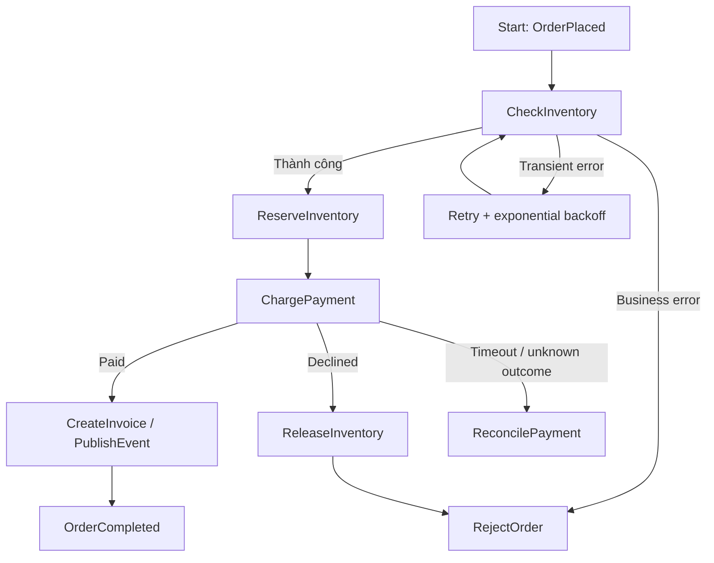
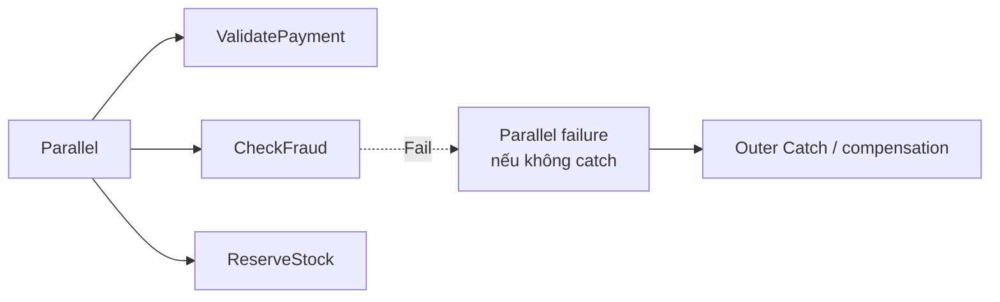
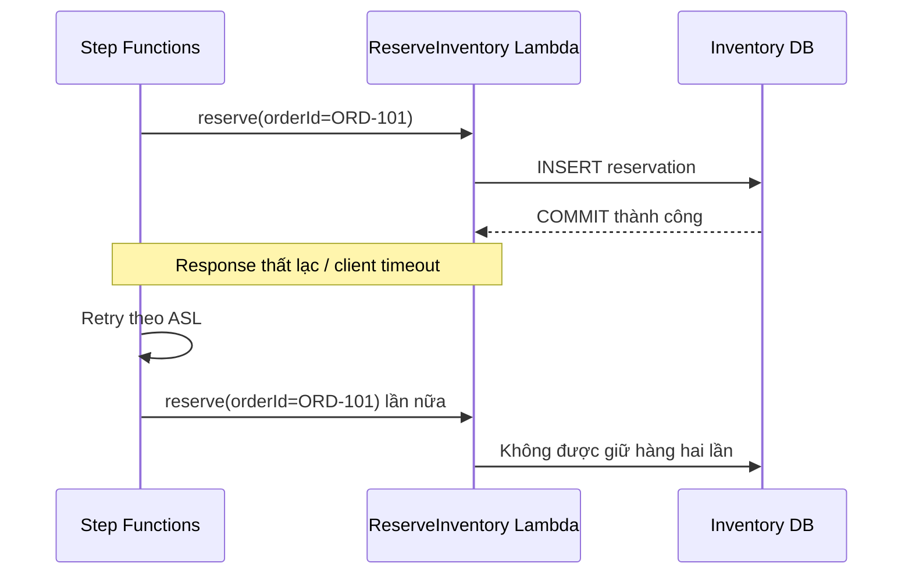
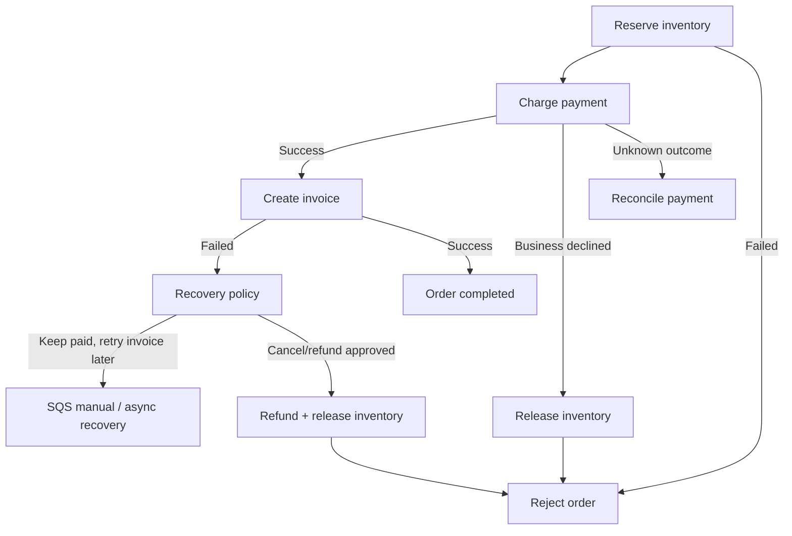
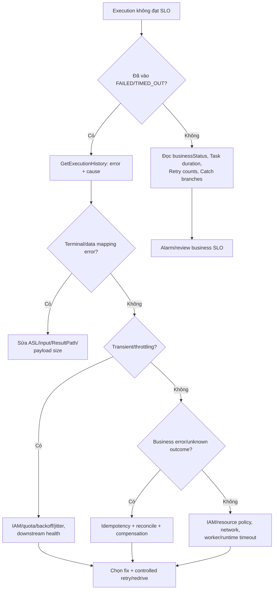
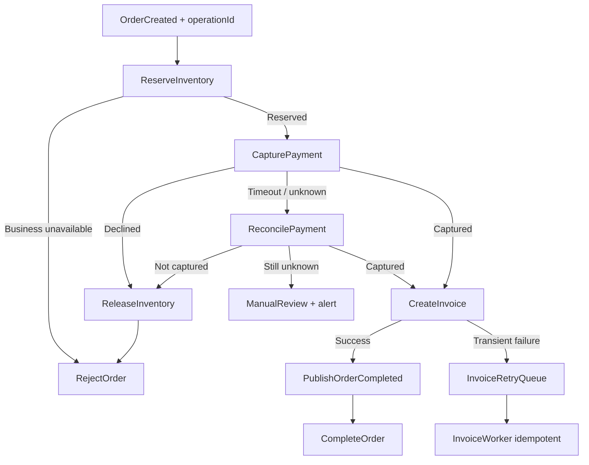

# Retry, Catch, timeout và xử lý lỗi workflow

## Mục tiêu học tập

Sau bài học, bạn có thể:

1. Giải thích sự khác nhau giữa **retry một thao tác**, **catch và chuyển nhánh xử lý**, **timeout của một Task**, **heartbeat timeout** và **timeout toàn execution** trong AWS Step Functions.
2. Viết và đọc **Amazon States Language (ASL)** với `Retry`, `Catch`, `ErrorEquals`, `ResultPath`, `TimeoutSeconds`, `HeartbeatSeconds`, `Fail`, `Choice`, `Wait` và `Parallel`/`Map`.
3. Phân loại lỗi **transient**, **throttling**, **business/permanent**, **IAM**, **input/schema**, **timeout** để chọn retry, fail-fast, compensation hay DLQ hợp lý.
4. Thiết kế **exponential backoff + jitter**, giới hạn số lần retry và chi phí, bảo đảm **idempotency** khi một Task có side effect.
5. Nhận diện những lỗi không được một `States.ALL` mặc định cứu, và phân biệt **Step Functions service integration timeout** với **timeout của Lambda/ECS/HTTP API**.
6. Xây dựng một workflow có đường **thành công**, **business error**, **retryable dependency error**, **timeout** và **fallback**, kiểm thử bằng AWS CLI/TestState, rồi xem execution history.
7. Hiểu **Standard vs Express**, **redrive failed Standard executions trong cửa sổ 14 ngày**, giới hạn redrive và chiến lược **saga/compensation** khi nhiều bước đã commit.
8. Đề xuất log/metric/alarm, least-privilege IAM, khả năng phục hồi, quota và tối ưu chi phí cho ứng dụng AWS chạy Lambda, Java API, ECS và EventBridge.

## 1. Bài toán: đặt hàng qua workflow nhiều bước

Một hệ thống Java/Spring Boot nhận yêu cầu đặt hàng và bắt đầu quy trình:

1. Kiểm tra tồn kho.
2. Giữ hàng (reserve inventory).
3. Thu tiền qua nhà cung cấp thanh toán.
4. Phát lệnh tạo hóa đơn và gửi thông báo.

Từng bước có failure mode khác nhau:

- API tồn kho trả **HTTP 503** vì quá tải trong vài giây: nên retry với backoff.
- Gateway thanh toán trả **card declined**: đây là **quyết định nghiệp vụ**, retry liên tục không có ích.
- Worker giữ hàng bị timeout sau khi đã ghi database: **có thể side effect đã xảy ra** dù Step Functions không nhận response.
- Lambda thiếu `dynamodb:UpdateItem`: retry không sửa được IAM policy; nên fail sớm, báo người vận hành.
- Sau khi giữ hàng và thu tiền thành công, bước tạo hóa đơn thất bại: cần **compensation** hoặc xử lý bất đồng bộ có kiểm soát, không tự rollback database của các hệ thống bên ngoài.

AWS Step Functions cho phép mô tả **thứ tự, điều kiện, timeout, retry và nhánh lỗi** dưới dạng một **state machine**; các Task có thể gọi Lambda, DynamoDB, ECS, SQS, SNS, HTTP API hoặc workflow con.



Sơ đồ phân biệt **retry** (lặp lại thao tác có thể phục hồi), **catch** (chuyển xử lý sang nhánh khác) và **compensation** (tạo thao tác nghiệp vụ đảo ngược). Một biểu đồ đẹp không tự bảo đảm nhất quán: phải kết hợp **idempotency keys**, dữ liệu bền vững, giới hạn retry và kiểm soát side effects.

## 2. Step Functions và Amazon States Language

### 2.1. ASL là gì?

**Amazon States Language (ASL)** mô tả state machine ở định dạng JSON (hoặc cấu trúc tương đương khi dùng IaC). Một workflow nhỏ:

```json
{
  "Comment": "Workflow minh họa không cần gọi dịch vụ ngoài",
  "QueryLanguage": "JSONPath",
  "StartAt": "Validate",
  "States": {
    "Validate": {
      "Type": "Pass",
      "Result": {
        "isValid": true
      },
      "ResultPath": "$.validation",
      "Next": "Done"
    },
    "Done": {
      "Type": "Succeed"
    }
  }
}
```

- `StartAt`: state bắt đầu.
- `States`: các bước và chuyển tiếp.
- `Type`: loại state (ví dụ `Task`, `Choice`, `Wait`, `Parallel`, `Map`, `Pass`, `Succeed`, `Fail`).
- `Next` hoặc `End: true`: bước kế tiếp hoặc điểm kết thúc.
- `QueryLanguage`: quy tắc xử lý dữ liệu. Bài này dùng **JSONPath** để trình bày `ResultPath`/`Parameters`; **JSONata** có cú pháp dữ liệu khác.

**Không đồng nhất lỗi của Step Functions với exception Java:** ASL nhận **error name** và **cause** từ state/integration. Worker có thể là Lambda Java, Node.js, ECS hoặc một AWS SDK API.

### 2.2. State nào được Retry/Catch?

`Retry` và `Catch` được áp dụng trực tiếp cho **`Task`, `Parallel` và `Map`** theo ASL. `Pass`, `Wait`, `Choice` và `Succeed`/`Fail` không phải nơi thêm bộ retrier/catcher cho một tác vụ bên ngoài.

| Loại state | Tình huống dùng | Liên quan lỗi |
| --- | --- | --- |
| `Task` | Gọi Lambda/ECS/AWS SDK/HTTP/Activity. | Thường cần Retry/Catch, timeout. |
| `Parallel` | Chạy nhiều branches. | Một branch fail không xử lý có thể làm Parallel fail. |
| `Map` | Xử lý nhiều items. | Cần xử lý lỗi item/batch, đặc biệt Distributed Map. |
| `Choice` | Rẽ nhánh theo dữ liệu/kết quả. | Thiếu `Default` khi không có nhánh phù hợp có thể làm execution lỗi. |
| `Wait` | Chờ một khoảng thời gian/thời điểm. | Hữu ích cho business delay, không thay Retry mặc định. |
| `Fail` | Kết thúc execution ở trạng thái FAILED, nêu tên lỗi/nguyên nhân. | Thể hiện lỗi có chủ đích; không “ném exception” tới Task đã qua. |
| `Succeed` | Kết thúc execution thành công. | Không có lỗi cần catch. |

### 2.3. Retry, Catch, timeout là ba câu hỏi khác nhau

| Cơ chế | Câu hỏi | Hệ quả |
| --- | --- | --- |
| **Retry** | Có nên thử lại **cùng state** sau lỗi nhất định? | Step Functions chạy lại Task/Parallel/Map theo chính sách. |
| **Catch** | Sau lỗi chưa xử lý/hết retries, cần **đi state nào**? | Chuyển tiếp sang fallback, compensation, notification hoặc Fail. |
| **TimeoutSeconds** | Một Task được chờ **tối đa bao lâu**? | Quá giới hạn tạo lỗi timeout của state, nhưng side effect bên ngoài có thể vẫn tiếp tục. |
| **HeartbeatSeconds** | Worker callback/activity có còn **báo sống** định kỳ không? | Thiếu heartbeat tạo lỗi heartbeat timeout. |
| **State machine TimeoutSeconds** | Cả execution được chạy tối đa bao lâu? | Hết hạn, execution TIMED_OUT; không phải lỗi mà một Task `Catch` chắc chắn cứu được. |

## 3. Phân loại lỗi trước khi chọn hành động

Không nên viết một retrier `States.ALL` cho mọi thao tác với 100 lần thử. Những lỗi không thể khắc phục bằng thời gian chờ chỉ làm tăng tải, chi phí và độ trễ.

| Loại lỗi | Ví dụ | Chính sách hợp lý |
| --- | --- | --- |
| **Transient/network** | Timeout ngắn, kết nối bị reset, DNS/retryable 5xx. | Retry với **backoff + jitter**, giới hạn số lần/thời gian. |
| **Throttling/quota tạm thời** | `Lambda.TooManyRequestsException`, HTTP 429, DynamoDB throttling. | Retry có jitter, giảm concurrency, theo dõi quota. |
| **Business/permanent** | `OrderRejected`, `InvalidAddress`, thẻ bị từ chối. | **Không retry mặc định**; Catch chuyển sang nhánh nghiệp vụ. |
| **Authentication/authorization** | `AccessDenied`, `States.Permissions`, IAM trust/resource policy sai. | Fail-fast, cảnh báo, sửa role/policy; không retry vô hạn. |
| **Schema/data mapping** | JSONPath không tìm thấy path, type sai, payload quá lớn. | Sửa input/definition, validate; nhiều lỗi mang tính terminal. |
| **Dependency chưa chắc side effect** | Payment request timeout, ECS job đứt kết nối. | Reconcile theo transaction ID/idempotency key trước retry. |
| **Worker crash** | ECS container exit, Lambda runtime error. | Phân tích exception, quyết định retry có an toàn hay không. |
| **Timeout toàn execution** | State machine chạy quá giới hạn. | Thiết kế SLA, cleanup/reconciliation ngoài luồng, có thể redrive nếu đủ điều kiện. |

**Định nghĩa “retryable” là một quyết định nghiệp vụ**, không phải chỉ phân loại HTTP status. Ví dụ giao dịch thanh toán trả `503` sau khi thu tiền là trường hợp **unknown outcome**; retry lại bằng một request ID mới có thể thu tiền hai lần. Hãy dùng provider idempotency key và truy vấn trạng thái giao dịch trước khi xử lý tiếp.

## 4. Tên lỗi ASL và thứ tự so khớp

AWS Step Functions so sánh `ErrorEquals` bằng **chuỗi có phân biệt chữ hoa/thường**. Tên bắt đầu bằng `States.` được dành cho hệ thống, ứng dụng không được tự tạo error name mới với prefix này.

### 4.1. Các tên lỗi quan trọng

| Error name | Ý nghĩa | Chiến lược |
| --- | --- | --- |
| `States.ALL` | Wildcard cho nhiều lỗi, phải đứng **một mình** trong `ErrorEquals` và ở retrier/catcher cuối. | Dùng làm fallback có kiểm soát; **không bắt** một số lỗi terminal. |
| `States.TaskFailed` | Wildcard lỗi Task, **không khớp `States.Timeout`**. | Có thể dùng cho fallback task, nhưng không thay explicit timeout. |
| `States.Timeout` | Task chạy quá `TimeoutSeconds` hoặc không heartbeat theo giới hạn; cũng có thể là toàn execution timeout. | Retry hạn chế hoặc Catch theo mức state nếu tác vụ an toàn. |
| `States.HeartbeatTimeout` | Không gửi heartbeat trong thời gian cấu hình. | Cần worker health, task token/callback logic và kiểm tra hung process. |
| `States.Permissions` | Step Functions không đủ quyền thực hiện Task. | Sửa IAM/role/resource policy. |
| `States.Runtime` | Lỗi runtime do xử lý dữ liệu không phù hợp (ví dụ input path/null). | **Không thể retry/catch bằng States.ALL**, sửa definition/input. |
| `States.DataLimitExceeded` | Input/output/result vượt quota payload. | `States.ALL` **không bắt**; phải giảm kích thước hoặc xử lý riêng theo tài liệu. |
| `States.ExceedToleratedFailureThreshold` | Distributed Map có số/tỷ lệ item lỗi vượt threshold. | Điều tra item failures, ResultWriter và tolerance. |
| `States.ItemReaderFailed` | Distributed Map không đọc được nguồn items. | Kiểm tra S3/IAM/input format. |
| `States.ResultWriterFailed` | Distributed Map không thể ghi kết quả. | Kiểm tra S3 destination, quyền và dữ liệu. |
| `States.Http.Socket` | HTTP Task hết hạn ở giới hạn kết nối của dịch vụ. | Tối ưu API hoặc chuyển pattern xử lý bất đồng bộ. |
| `Lambda.TooManyRequestsException` | Lambda invoke bị throttled. | Retry có jitter, giảm concurrency/điều chỉnh quota. |
| `Lambda.ServiceException` / `Lambda.SdkClientException` | Lỗi tạm thời phía Lambda service/SDK. | Retry giới hạn; kiểm tra health/logs. |
| `OrderRejected`, `InvalidInput` | Lỗi do ứng dụng định nghĩa. | Catch đúng tên; không retry trừ khi business xác nhận an toàn. |

**Lưu ý về `States.DataLimitExceeded`:** AWS mô tả đây là lỗi terminal mà `States.ALL` **không bắt**; tài liệu mới có đề cập dùng tên lỗi cụ thể trong `ErrorEquals` đối với một số tình huống, nhưng không nên xây recovery dựa vào việc gửi lại nguyên payload quá lớn. Khắc phục gốc bằng dữ liệu gọn, `ResultPath`/`OutputPath` hoặc S3 reference.

**Với Lambda runtime timeout**, error name thực tế có thể là `Sandbox.Timedout`, `Lambda.Unknown` hoặc error tích hợp tương ứng tùy runtime. Đừng đoán một tên cố định khi chưa xem execution history; kiểm tra error đã quan sát và xem thêm `States.TaskFailed`/`States.Timeout` theo đúng mục tiêu.

### 4.2. Vì sao vị trí retrier/catcher quan trọng?

Step Functions duyệt các đối tượng trong `Retry` **theo thứ tự** và chọn **retrier đầu tiên** khớp error name; tương tự với `Catch`. Trường hợp `States.ALL` nên để cuối như fallback. Một rule quá rộng đặt lên đầu có thể chặn rule cụ thể phía sau.

```json
"Retry": [
  {
    "ErrorEquals": ["Lambda.TooManyRequestsException", "Lambda.ServiceException"],
    "IntervalSeconds": 2,
    "MaxAttempts": 3,
    "BackoffRate": 2,
    "JitterStrategy": "FULL"
  },
  {
    "ErrorEquals": ["OrderRejected"],
    "MaxAttempts": 0
  }
],
"Catch": [
  {
    "ErrorEquals": ["OrderRejected"],
    "ResultPath": "$.failure",
    "Next": "NotifyCustomer"
  },
  {
    "ErrorEquals": ["States.ALL"],
    "ResultPath": "$.failure",
    "Next": "EscalateFailure"
  }
]
```

Đoạn trên là **fragment** gắn vào một `Task` JSONPath, chưa phải một state machine hoàn chỉnh. `MaxAttempts: 0` nêu rõ **không retry** lỗi từ chối đơn hàng; sau đó `Catch` điều hướng theo quy tắc. Vì `States.ALL` không bao phủ mọi lỗi, nên vẫn phải thiết kế observability cho execution thất bại không qua catcher.

## 5. Retry: exponential backoff, giới hạn và jitter

### 5.1. Cấu trúc retrier

```json
{
  "ErrorEquals": [
    "Lambda.ServiceException",
    "Lambda.SdkClientException",
    "Lambda.TooManyRequestsException"
  ],
  "IntervalSeconds": 2,
  "MaxAttempts": 3,
  "BackoffRate": 2,
  "MaxDelaySeconds": 10,
  "JitterStrategy": "FULL"
}
```

| Trường | Ý nghĩa |
| --- | --- |
| `ErrorEquals` | Danh sách tên lỗi cần retry. Bắt buộc, so khớp chính xác hoặc dùng wildcard theo quy tắc. |
| `IntervalSeconds` | Khoảng chờ trước retry đầu tiên, **mặc định 1 giây**. |
| `MaxAttempts` | **Số lần thử lại**, **mặc định 3**, **không tính lần chạy đầu tiên**. `0` nghĩa là không thử lại. |
| `BackoffRate` | Hệ số nhân khoảng chờ, **mặc định 2.0**. |
| `MaxDelaySeconds` | Trần khoảng chờ khi backoff tăng, tránh interval quá lớn. |
| `JitterStrategy` | `FULL` rải delay ngẫu nhiên trong khoảng 0…delay tính được; `NONE` là mặc định. |

Ví dụ `IntervalSeconds=2`, `MaxAttempts=3`, `BackoffRate=2`, `MaxDelaySeconds=5`:

| Lần | Hành động | Chờ **trước** lần này nếu `JitterStrategy=NONE` |
| --- | --- | --- |
| 1 | Lần chạy đầu tiên | 0 giây |
| 2 | Retry #1 | 2 giây |
| 3 | Retry #2 | 4 giây |
| 4 | Retry #3 | 5 giây (thay vì 8) |
| 5 | Không còn retry | Chuyển Catch hoặc fail execution |

Tổng cộng **tối đa 4 lần thực thi Task** (1 ban đầu + 3 retries) cho retrier này. Khi bật `FULL` jitter, mỗi khoảng chờ được random từ 0 tới trần tương ứng; không cộng cố định 11 giây.

### 5.2. Retry budgets

Retry nên có một **ngân sách** gắn với SLA và chi phí:

1. **Số lần:** tối đa bao nhiêu attempts trước khi Catch?
2. **Thời gian:** tổng backoff cộng thời gian chạy mỗi attempt có vượt `TimeoutSeconds` của bước và execution SLA không?
3. **Concurrency:** nhiều executions cùng retry có tạo **retry storm** lên RDS/payment provider không?
4. **Side effects:** các attempts có an toàn nếu bước trước đã commit?
5. **Quota/cost:** mỗi lần gọi Lambda, DynamoDB, ECS, HTTP API hoặc gửi SNS có chi phí và quota riêng.

**Backoff + jitter** giảm herd effect khi hàng nghìn executions cùng thất bại vì dịch vụ phía sau. Nếu dependency quá tải lâu, dùng SQS buffer, concurrency limit, circuit breaker ở application, hoặc tạm ngừng nhận traffic mới thay vì tăng `MaxAttempts` vô hạn.

### 5.3. Error names và retry khi Lambda fail

Trong một `Task` gọi Lambda, có hai nhóm:

- **Lambda service integration error**: throttling, service exception, SDK/client service lỗi; thường có thể thử lại.
- **Function code error**: handler ném exception như `InvalidOrderError`; có thể là lỗi vĩnh viễn hoặc tạm thời tùy nghiệp vụ.

Ví dụ retrier cho Lambda transient:

```json
"Retry": [
  {
    "ErrorEquals": [
      "Lambda.ServiceException",
      "Lambda.AWSLambdaException",
      "Lambda.SdkClientException",
      "Lambda.TooManyRequestsException"
    ],
    "IntervalSeconds": 2,
    "MaxAttempts": 4,
    "BackoffRate": 2,
    "MaxDelaySeconds": 20,
    "JitterStrategy": "FULL"
  }
]
```

Không tự coi **mọi** Lambda exception là transient. Một lỗi schema như `InvalidAddress` hoặc `PaymentDeclined` sẽ thất bại y hệt sau 4 retries, chỉ làm tăng latency và số lượt chạy.

## 6. Catch: chuyển lỗi thành một nhánh xử lý có chủ đích

Khi một state phát sinh lỗi, Step Functions **đánh giá `Retry` trước**. Nếu không có retrier phù hợp hoặc đã hết attempts, hệ thống xét `Catch`; nếu không có catcher phù hợp, lỗi được đẩy ra khỏi state và có thể khiến execution thất bại.

### 6.1. Cấu trúc catcher

```json
"Catch": [
  {
    "ErrorEquals": ["OrderRejected"],
    "ResultPath": "$.failure",
    "Next": "NotifyOrderRejected"
  },
  {
    "ErrorEquals": ["States.Timeout", "States.HeartbeatTimeout"],
    "ResultPath": "$.failure",
    "Next": "CheckExternalOutcome"
  },
  {
    "ErrorEquals": ["States.ALL"],
    "ResultPath": "$.failure",
    "Next": "EscalateToOperations"
  }
]
```

- `ErrorEquals`: danh sách error names catcher xử lý.
- `Next`: state **đích** khi catch; phải tồn tại trong `States` cùng phạm vi state machine/branch.
- `ResultPath`: với **JSONPath**, chỉ định chỗ đặt error object vào input của bước kế; tránh mất `orderId`/`correlationId`.
- `States.ALL` phải **đứng một mình** trong `ErrorEquals` và ở catcher cuối, không cứu được mọi lỗi terminal.

**Catch không phải Java `try/catch` chạy trong cùng process**. Nó là nhánh điều phối **sau khi Task thất bại**. Nếu thao tác ngoài AWS đã có side effect, Catch chỉ biết về lỗi quan sát được, không tự hoàn tác side effect đó.

### 6.2. Error output và ResultPath

Giả sử state nhận input:

```json
{
  "orderId": "ORD-101",
  "amount": 125000,
  "currency": "VND"
}
```

Task thất bại với error object:

```json
{
  "Error": "PaymentProviderUnavailable",
  "Cause": "HTTP 503 from payment provider"
}
```

Nếu Catch có `"ResultPath": "$.failure"`, input của nhánh fallback sẽ gồm **cả dữ liệu đơn hàng và lỗi**:

```json
{
  "orderId": "ORD-101",
  "amount": 125000,
  "currency": "VND",
  "failure": {
    "Error": "PaymentProviderUnavailable",
    "Cause": "HTTP 503 from payment provider"
  }
}
```

| `ResultPath` | Hệ quả thường gặp |
| --- | --- |
| `"$.failure"` | Thêm/ghi đè field `failure` trong input, giúp bước sau vẫn có `orderId`. |
| `"$"` hoặc bỏ `ResultPath` | **Error object thay toàn bộ input** trong trường hợp Catch; dễ làm mất thông tin nghiệp vụ. |
| `null` | Không đưa error output vào data, giữ input cũ (bỏ chi tiết lỗi). |

`ResultPath` chỉ nhận **reference path** chỉ đến một vị trí, không phải biểu thức JSONPath lọc nhiều nodes. Trong luồng **JSONata**, việc định hình input/output dùng `Assign`/`Output` và biểu thức JSONata khác; không copy nguyên `ResultPath` từ bài học này sang JSONata machine mà không điều chỉnh.

### 6.3. Lưu ý Cause không phải lúc nào cũng là JSON

`Cause` có thể là chuỗi mô tả từ dịch vụ, exception stack hoặc JSON được serialize dưới dạng **string**. Không mặc định rằng có thể dùng `$.failure.Cause.message`.

Nếu Cause là **một chuỗi JSON hợp lệ**, ASL JSONPath có thể dùng `States.StringToJson` để chuyển thành object trước khi truy cập field; tuy nhiên dữ liệu từ nhiều integrations có thể **không phải JSON chuẩn**. Để bảo vệ workflow, nên truyền error code chuẩn hóa từ application và chỉ parse Cause sau khi xác minh định dạng.

**Không ghi toàn bộ `Cause` vào SNS/email/log công khai** khi exception có thể chứa secrets, tokens, request payload hoặc thông tin khách hàng.

### 6.4. Catch không đồng nghĩa recovery đã thành công

Ví dụ sau khi không thể thu tiền, workflow đi `ReleaseInventory`:

- Nếu trả hàng thành công, hệ thống có thể kết thúc với business state `ORDER_CANCELLED`.
- Nếu trả hàng thất bại, **không** được đưa execution tới `Succeed` giả vờ rằng đã hoàn tất.
- Nên có nhánh `Fail`/manual remediation, audit event, DLQ hoặc compensation queue cho thao tác không phục hồi tự động.

Một execution kết thúc `SUCCEEDED` chỉ nói **state machine đi tới Succeed/End không lỗi**, không tự chứng minh **đơn hàng được giao thành công**. Thiết kế output gồm `businessStatus` rõ ràng để dashboards không nhầm.

## 7. Timeout và heartbeat: phát hiện tác vụ bị treo

### 7.1. Task TimeoutSeconds

```json
{
  "Type": "Task",
  "Resource": "arn:aws:states:::lambda:invoke",
  "Parameters": {
    "FunctionName": "arn:aws:lambda:ap-southeast-1:111122223333:function:validate-order",
    "Payload.$": "$"
  },
  "TimeoutSeconds": 15,
  "ResultPath": "$.validation",
  "Next": "NextStep"
}
```

`TimeoutSeconds=15` giới hạn **thời gian Step Functions chờ Task**, **không tự sửa timeout bên trong Lambda** hay cắt ngay process/chuyển transaction của một external system trong mọi trường hợp. Với các service integrations, timeout của API dịch vụ hoặc backend có thể chặt hơn giới hạn state.

Các mức cần tính:

1. **Client/API timeout** (HTTP, SDK, ALB): có thể hết hạn trước khi worker ngừng xử lý.
2. **Worker timeout** (Lambda function timeout, ECS job deadline, application timeout): phụ thuộc dịch vụ.
3. **Step Functions Task timeout:** lỗi khi điều phối chờ quá `TimeoutSeconds`.
4. **Execution timeout:** giới hạn cả state machine; không thể “cứu” bằng việc bắt timeout ở một Task.

Nếu Step Functions nhận `States.Timeout` sau một payment request, **không tự kết luận thanh toán chưa thành công**. Cần reconcile trạng thái payment theo idempotency key trước khi retry/compensate.

### 7.2. Task heartbeat

**Heartbeat** là tín hiệu “tác vụ vẫn đang hoạt động”, đặc biệt hữu ích với **Activity workers**, callback `.waitForTaskToken` và một số integration chạy dài.

Ví dụ callback Task:

```json
{
  "Type": "Task",
  "Resource": "arn:aws:states:::sqs:sendMessage.waitForTaskToken",
  "Parameters": {
    "QueueUrl": "https://sqs.ap-southeast-1.amazonaws.com/111122223333/approval-jobs",
    "MessageBody": {
      "orderId.$": "$.orderId",
      "taskToken.$": "$$.Task.Token"
    }
  },
  "HeartbeatSeconds": 30,
  "TimeoutSeconds": 3600,
  "ResultPath": "$.approval",
  "Next": "FinalizeOrder"
}
```

Trong **JSONPath**, `$$.Task.Token` lấy task token từ Step Functions Context object. Consumer/worker nhận message chứa token, xử lý nghiệp vụ rồi gọi:

```bash
# Ví dụ cú pháp, không dùng token thật từ production trong lệnh/log công khai
aws stepfunctions send-task-heartbeat \
  --task-token "<real-task-token>" \
  --region ap-southeast-1

aws stepfunctions send-task-success \
  --task-token "<real-task-token>" \
  --task-output '{"approved":true}' \
  --region ap-southeast-1
```

`SendTaskHeartbeat` **reset đồng hồ heartbeat**, **không reset `TimeoutSeconds`**. Sau 3600 giây, Task vẫn hết thời gian tối đa dù worker gửi heartbeat đều đặn. Để báo lỗi chủ động, worker có thể dùng `SendTaskFailure` với error name/cause thích hợp.

**Security:** task token là thông tin nhạy cảm trao quyền hoàn thành/chấm dứt Task; không log token hoặc đưa token ra public HTTP response. Hạn chế IAM `states:SendTaskSuccess`/`SendTaskFailure`/`SendTaskHeartbeat` cho worker role đúng nhu cầu.

### 7.3. TimeoutSecondsPath/HeartbeatSecondsPath

Nếu dùng **JSONPath**, Task có thể lấy giới hạn động từ input:

```json
{
  "Type": "Task",
  "Resource": "arn:aws:states:::sqs:sendMessage.waitForTaskToken",
  "Parameters": {
    "QueueUrl": "https://sqs.ap-southeast-1.amazonaws.com/111122223333/approval-jobs",
    "MessageBody": {
      "taskToken.$": "$$.Task.Token"
    }
  },
  "TimeoutSecondsPath": "$.limits.taskSeconds",
  "HeartbeatSecondsPath": "$.limits.heartbeatSeconds",
  "End": true
}
```

Input mẫu:

```json
{
  "limits": {
    "taskSeconds": 600,
    "heartbeatSeconds": 30
  }
}
```

- Giá trị phải là **số nguyên dương**; heartbeat phải **nhỏ hơn** task timeout.
- Không dùng đồng thời `TimeoutSeconds` **và** `TimeoutSecondsPath` trên một Task; tương tự cặp `HeartbeatSeconds`/`HeartbeatSecondsPath`.
- Input thiếu path hoặc kiểu dữ liệu sai có thể làm workflow lỗi **ở bước ánh xạ**, khác với worker timeout.

### 7.4. Giới hạn của HTTP Task và integrations

**Step Functions HTTP Task** có thời gian chờ socket tối đa **60 giây**. Đặt `TimeoutSeconds=120` không kéo dài được giới hạn 60 giây của HTTP Task. Nếu API đối tác xử lý lâu hơn, chuyển sang **async request + callback/polling** (trong workflow type hỗ trợ) hoặc SQS/Step Functions task-token pattern.

Với `.sync` integrations như ECS/Batch/Glue:

- Step Functions chờ job hoàn tất; có thể timeout/stop execution.
- Khi Task bị abort hoặc nhánh Parallel/Map khác fail, Step Functions **cố gắng cancel job theo best effort**, không bảo đảm hủy thành công (quyền IAM/độ trễ API/lỗi dịch vụ).
- Phải theo dõi **trạng thái của job ngoài Step Functions** và reconcile trước khi tạo job mới hoặc compensation.

## 8. Standard và Express: chọn workflow type theo độ dài và semantics

| Đặc điểm | Standard Workflow | Express Workflow |
| --- | --- | --- |
| Thời gian tối đa | **1 năm**. | **5 phút**. |
| Execution semantics | **Exactly-once execution scheduling** ở mức workflow theo điều kiện, ngoại trừ Retry/redrive và side effects. | **Asynchronous Express: at-least-once; Synchronous Express: at-most-once**. |
| Callback `.waitForTaskToken` | **Có** ở các integrations hỗ trợ. | **Không**. |
| Run a Job `.sync` | **Có** ở các integrations hỗ trợ. | **Không**. |
| Activity tasks | **Có**. | **Không**. |
| Lịch sử execution | Có execution history qua Step Functions API, được giữ theo retention. | Dựa nhiều vào CloudWatch Logs khi bật logging. |
| Redrive execution | **Có** khi đủ điều kiện trong cửa sổ 14 ngày. | **Không** hỗ trợ redrive execution thông thường; Distributed Map child workflow có quy định riêng. |
| Cách tính phí điển hình | Theo **state transitions**. | Theo **số executions, duration và memory**. |
| Phù hợp | Đơn hàng, payment saga, phê duyệt, batch dài, audit. | Event processing lưu lượng rất cao, xử lý ngắn và idempotent. |

**Không thể đổi Standard ↔ Express chỉ bằng cập nhật thuộc tính một state machine đã tạo.** Muốn chuyển loại cần tạo state machine mới và kiểm chứng integrations, duration/SLA, semantics và billing.

### “Exactly-once” ở Standard có phải là business exactly-once?

Không. AWS nói Standard workflow có execution model **exactly-once**, nhưng:

- Một Task có `Retry` có thể được invoke nhiều lần có chủ đích.
- Một integration/network timeout có thể xảy ra **sau khi external service đã commit**.
- Bạn có thể **redrive** failed execution, chạy lại bước chưa hoàn tất.
- Một sự kiện từ EventBridge/SQS có thể làm producer khởi chạy **nhiều executions** nếu không có dedup ở nguồn.

Vì vậy **payment capture, order creation và inventory reservation** vẫn cần idempotency key/inbox/outbox hoặc conditional writes, không chỉ dựa vào tên “Standard exactly-once”.

### Vì sao Express không phù hợp approval chờ nhiều giờ?

Express giới hạn **5 phút** và không hỗ trợ `.waitForTaskToken`. Một workflow chờ người duyệt invoice trong 2 ngày cần **Standard**, hoặc tách thành event-driven state transitions trong dịch vụ khác có persistence/TTL phù hợp.

## 9. Lỗi trong Parallel và Map: không chỉ một Task

### 9.1. Parallel



Trong `Parallel`, một branch **bị fail không được xử lý** có thể khiến cả Parallel state thất bại, và AWS có thể cố hủy công việc các branch còn lại theo integration. Nhưng cancellation là **best effort** đối với những external jobs đã khởi chạy.

Có hai hướng:

1. **Catch bên trong từng branch** để chuyển thành kết quả business có cấu trúc (ví dụ `{"status":"REJECTED"}`), cho các branch còn lại tiếp tục khi hợp lý.
2. **Catch ở Parallel ngoài** để chuyển sang compensation/hệ thống alert khi bất kỳ branch quan trọng nào fail.

**Không nên đặt Parallel cho các bước phải theo thứ tự bắt buộc** như “ReserveInventory rồi ChargePayment”: nếu chạy song song, payment có thể thu trước khi biết hết hàng, tăng độ phức tạp compensation.

### 9.2. Inline Map

Inline Map lặp một workflow con cho mỗi item trong collection. Nếu một iteration bị lỗi không catch, toàn `Map` có thể fail. Retry ở cấp Map có thể khiến **nhiều items được chạy lại**, kể cả những items có side effect đã thực hiện, tùy tình huống.

Nếu các items độc lập và cho phép partial failure, có thể **Catch trong ItemProcessor** và trả kết quả lỗi của từng item thay vì làm tất cả fail. Với batches lớn, cân nhắc **Distributed Map**, hỗ trợ **tolerated failure count/percentage** và ResultWriter theo phạm vi tính năng.

### 9.3. Distributed Map

Các lỗi thường gặp:

- `States.ExceedToleratedFailureThreshold`: số/tỷ lệ failed items vượt `ToleratedFailureCount`/`ToleratedFailurePercentage`.
- `States.ItemReaderFailed`: lỗi đọc S3/nguồn danh sách.
- `States.ResultWriterFailed`: lỗi ghi output items vào destination.

Khi xử lý thất bại, dùng **item-level idempotency**, đọc failure report/Map Run history, và hiểu **redrive Map Run** có những quy tắc khác giữa Standard/Express child workflows. **Không tự “retry whole Map”** nếu nó tạo hóa đơn hoặc gửi email cho nhiều items đã hoàn tất.

## 10. Idempotency: nền tảng để retry mà không tạo side effect trùng

### 10.1. Một lần retry có thể làm gì?

Trường hợp worker giữ hàng:



Lúc Step Functions thấy timeout, database có thể đã commit. Vì vậy **không chỉ rely vào Retry/Catch**; cần biến thao tác nghiệp vụ thành **idempotent**.

### 10.2. Idempotency key

Ví dụ:

```json
{
  "orderId": "ORD-101",
  "operationId": "reserve-inventory-ORD-101-v1",
  "sku": "SKU-900",
  "quantity": 2
}
```

Ở backend:

1. Kiểm tra `operationId` đã thành công, đang xử lý hay chưa tồn tại.
2. Tạo reservation với **unique key/conditional write** ở DynamoDB hoặc unique constraint tại RDS.
3. Nếu đã thành công, trả **kết quả cũ** cho lần gọi lại.
4. Nếu đang xử lý/unknown, dùng trạng thái xử lý và retry/reconcile thay vì lặp hiệu ứng.
5. Lưu đủ lâu so với tổng retry window, redrive và sự kiện được publish lại.

Ví dụ pseudo-SQL:

```sql
-- Ý tưởng: unique operation_id bảo vệ trùng tác vụ.
CREATE TABLE inventory_reservations (
    operation_id VARCHAR(120) PRIMARY KEY,
    order_id     VARCHAR(80) NOT NULL,
    sku          VARCHAR(80) NOT NULL,
    quantity     INT NOT NULL,
    status       VARCHAR(30) NOT NULL
);
```

Điều kiện cạnh tranh cần giải quyết **trong cùng transaction**, không chỉ check trước rồi insert sau. Với DynamoDB, dùng `ConditionExpression` hoặc transaction write; với RDS, unique key/transaction isolation phù hợp.

### 10.3. Tránh đặt retry hai tầng không kiểm soát

Một request có thể được retry ở:

- AWS SDK HTTP client bên trong Lambda/Java worker.
- Ứng dụng Java tự retry.
- Step Functions `Retry`.
- SQS/EventBridge/Lambda async invocation từ hệ thống khởi động workflow.

Nếu mỗi tầng có 3 attempts, số lần gọi external API có thể tăng theo **tích các tầng**, không phải chỉ 3. Nên chọn rõ **đâu là tầng sở hữu retry** cho từng lỗi, dùng deadline chung và metrics phân biệt external call attempts với state execution attempts.

### 10.4. Không dùng execution ARN làm business id duy nhất khi nguồn có thể gọi lại

`ExecutionArn` hữu ích cho tracing và audit, nhưng EventBridge/SQS/producers có thể gửi lại cùng business event bằng **execution mới**. Dùng `orderId`/`paymentTransactionId`/`operationId` làm khóa dedup bền vững và liên kết execution ARN với khóa đó.

## 11. Compensation / Saga: thất bại sau khi một bước đã commit

**Saga** là chuỗi local transactions và **compensating actions** khi cần hoàn tác ở mức nghiệp vụ. Step Functions điều phối saga, nhưng không tự roll back RDS, S3, DynamoDB, ECS hoặc payment provider khi workflow fail.

### 11.1. Ví dụ reserve → charge → finalize



**Compensation không giống rollback database transaction:**

- `ReserveInventory` có compensation `ReleaseInventory`.
- `ChargePayment` có thể có compensation `RefundPayment`, nhưng refund có thể mất thời gian, phát sinh phí hoặc không đồng bộ với charge.
- `SendEmail` không thể “unsend” email đã giao, nên thiết kế thông báo correction/dedup.
- `ShipPackage` có thể yêu cầu reverse logistics, không thể hoàn tác bằng API.

### 11.2. Ghi dấu các bước đã commit

Để compensation an toàn, lưu:

```json
{
  "orderId": "ORD-101",
  "reservationId": "res-8811",
  "paymentTransactionId": "pay-5222",
  "businessStatus": "PAYMENT_CAPTURED_INVOICE_PENDING"
}
```

Mỗi bước nên có **status bền vững** và operation id, để khi Catch/fail/redrive:

1. Biết bước nào **chắc chắn đã commit**.
2. Biết bước nào **đang unknown** và cần reconciliation.
3. Biết compensation nào đã chạy hoặc cần retry.
4. Không hoàn tác những bước chưa thực hiện.

### 11.3. Khi compensation cũng thất bại

`ReleaseInventory` hoặc `RefundPayment` cũng có thể lỗi tạm thời. Cho compensation một **Retry/Catch riêng**, với giới hạn, backoff và monitoring. Nếu không phục hồi:

- Ghi sự cố vào SQS DLQ/operational queue theo mẫu riêng.
- Phát EventBridge/SNS alarm hoặc tạo support task.
- Đưa order vào `REQUIRES_MANUAL_REVIEW` và tránh xác nhận đã hoàn tất.
- Gắn `executionArn`, `orderId`, `correlationId` để nhóm xử lý tra cứu.

Không tự xóa execution history/payload khi chưa giải quyết dữ liệu nghiệp vụ. Một compensating action **phải idempotent** vì chính nó cũng có thể được retry/redrive.

### 11.4. Bước xử lý lỗi cũng phải có lỗi riêng

`Catch` chuyển sang `NotifyOps` không có nghĩa `NotifyOps` chắc chắn thành công. Nếu SNS topic permission sai, nhánh báo lỗi cũng fail. Với cảnh báo quan trọng, xem xét **CloudWatch/EventBridge Execution Failed rule** độc lập với chính workflow, tránh tất cả cảnh báo phụ thuộc vào một Task notification trong workflow.

## 12. Redrive: chạy lại failed Standard execution có kiểm soát

AWS Step Functions hỗ trợ **redrive một Standard Workflow execution** ở trạng thái **FAILED**, **ABORTED** hoặc **TIMED_OUT** nếu thỏa điều kiện. Cửa sổ redrive là **14 ngày kể từ khi execution kết thúc**, không phải từ khi bạn phát hiện lỗi.

### 12.1. Khác với StartExecution

| Hành động | Ý nghĩa | Nguy cơ |
| --- | --- | --- |
| `StartExecution` mới | Bắt đầu **execution mới** với input/name mới. | Có thể chạy lại **toàn bộ workflow**, lặp business side effects. |
| `RedriveExecution` | Tiếp tục **failed execution** tại bước chưa hoàn thành, dùng execution ARN/input/definition gốc. | Bước lỗi được chạy lại, nhưng side effect đã commit có thể chưa được Step Functions ghi nhận. |
| Redrive một `Map`/`Parallel` | Theo loại Map, chủ yếu rerun **failed/aborted iterations/branches**; có ngoại lệ khi lỗi payload limit. | Phải kiểm tra các items/branches đã commit. |

**Redrive không mặc định chạy lại toàn bộ những bước đã thành công**. Step Functions giữ results/history của các bước thành công, tiếp tục bước gặp lỗi theo quy tắc redrive. Khi redrive một `Task`, `Parallel` hoặc `Inline Map` có retrier, **số retry đã dùng được reset về 0** cho bước được chạy lại.

### 12.2. Điều kiện redrive quan trọng

- Workflow type **Standard**; Express execution thông thường **không** hỗ trợ `RedriveExecution`.
- Execution không ở `SUCCEEDED` và vẫn nằm trong **14 ngày** từ khi kết thúc.
- Execution gốc được bắt đầu sau mốc hỗ trợ tính năng (từ **15/11/2023**).
- Tổng thời gian mở theo quota **1 năm** chưa vượt và history có **dưới 24.999 events** trước khi redrive.
- Cần quyền IAM phù hợp và xem khả năng service integrations còn hoạt động.
- Redrive dùng **state machine definition/version/alias gốc**; nếu bạn vừa sửa definition để fix bug, **redrive không tự dùng bản mới**. Muốn chạy code/logic definition mới, cần thiết kế execution mới hoặc đổi phiên bản dependencies mà definition cũ trỏ tới nếu phù hợp.

### 12.3. Một runbook redrive an toàn

Trước khi gọi:

1. Đọc `DescribeExecution`/`GetExecutionHistory`, xác định state lỗi, attempts đã chạy và output/input đang lưu.
2. Xác minh **IAM/cấu hình dependency đã sửa**, hoặc điều kiện transient đã hết.
3. Đối chiếu **business idempotency state**: payment/reservation có unknown outcome không? Có thể phải reconcile trước.
4. Đánh giá số retries mới và side effects khi các bước lỗi được rerun.
5. Chọn người phê duyệt/biên bản thay đổi cho giao dịch nhạy cảm.

Lệnh **chỉ minh họa**, không dùng execution ARN production khi chưa có phép:

```bash
aws stepfunctions describe-execution \
  --execution-arn \
    arn:aws:states:ap-southeast-1:111122223333:execution:order-workflow:ORD-101 \
  --region ap-southeast-1

aws stepfunctions get-execution-history \
  --execution-arn \
    arn:aws:states:ap-southeast-1:111122223333:execution:order-workflow:ORD-101 \
  --region ap-southeast-1

# Thay ARN bằng execution đã kiểm tra và được cho phép redrive.
aws stepfunctions redrive-execution \
  --execution-arn \
    arn:aws:states:ap-southeast-1:111122223333:execution:order-workflow:ORD-101 \
  --region ap-southeast-1
```

Phải quan sát **trạng thái mới và business outcome** sau redrive; API trả về thành công không có nghĩa workflow đã hoàn thành mọi task.

### 12.4. Những ranh giới redrive dễ bị bỏ qua

- Một execution redrive bị lỗi `States.DataLimitExceeded` ở `Parallel/Map` có thể **rerun cả những branches/items đã thành công** theo tài liệu AWS; không mặc định mọi redrive chỉ chạy phần lỗi.
- Với **Distributed Map**, quy trình redrive có thể tác động Map Run/child executions, và Express child workflows được khởi chạy lại theo cơ chế riêng.
- Nếu một state đã `Succeed`, execution đó không phải ứng viên redrive.
- Nếu original definition trỏ đến **unqualified Lambda ARN**, code ở `$LATEST` có thể thay đổi ngoài workflow; để audit/rollback chặt nên tham chiếu **Lambda version/alias** theo quy trình.
- Redrive reset task timeout và execution timeout counters theo phạm vi AWS mô tả, nhưng không “xóa” việc database đã được ghi hay email đã được gửi ở ngoài AWS.

## 13. Thực hành CloudFormation: workflow với Retry, Catch và timeout

Lab này tạo một **Step Functions Standard state machine** và **Lambda mô phỏng** để thấy bốn đường đi:

| Input `mode` | Lambda làm gì? | Kết quả kỳ vọng |
| --- | --- | --- |
| `success` | Trả kết quả ngay. | State `Completed`, execution `SUCCEEDED`. |
| `business` | Ném `BusinessRuleError`. | `Catch` đi `Rejected`, execution `SUCCEEDED` với `businessStatus=REJECTED`. |
| `transient` | Luôn ném `TransientDependencyError`. | Thử lần đầu + **2 retries**, sau đó `Catch` đi `TechnicalFailure`, execution `FAILED`. |
| `slow` | Chờ 6 giây trước khi trả. | Task `TimeoutSeconds=3`, `Catch` đi `NeedsReconciliation`; execution `SUCCEEDED` với trạng thái cần kiểm tra. |

**Quan trọng:** trong lab `businessStatus=REJECTED` và `REQUIRES_RECONCILIATION` là kết quả business được xử lý có chủ đích, dù trạng thái kỹ thuật của Step Functions execution là `SUCCEEDED`. Hệ thống giám sát phải xem **cả execution status lẫn businessStatus**, không chỉ màu xanh của execution.

### 13.1. Template CloudFormation tự chứa

Lưu thành `retry-catch-lab.yml` trong **thư mục lab riêng** của bạn. Các resource tạo ra có thể phát sinh chi phí. **Không chạy template trên production**.

```yaml
AWSTemplateFormatVersion: '2010-09-09'
Description: Step Functions Retry Catch and timeout lesson lab

Resources:
  DemoLambdaRole:
    Type: AWS::IAM::Role
    Properties:
      AssumeRolePolicyDocument:
        Version: '2012-10-17'
        Statement:
          - Effect: Allow
            Principal:
              Service: lambda.amazonaws.com
            Action: sts:AssumeRole
      ManagedPolicyArns:
        - arn:aws:iam::aws:policy/service-role/AWSLambdaBasicExecutionRole

  DemoWorker:
    Type: AWS::Lambda::Function
    Properties:
      Runtime: nodejs22.x
      Handler: index.handler
      Role: !GetAtt DemoLambdaRole.Arn
      Timeout: 10
      MemorySize: 128
      Code:
        ZipFile: |
          exports.handler = async (event) => {
            const mode = event.mode ?? "success";
            if (mode === "business") {
              const err = new Error("Business rule rejected order");
              err.name = "BusinessRuleError";
              throw err;
            }
            if (mode === "transient") {
              const err = new Error("Dependency temporarily unavailable");
              err.name = "TransientDependencyError";
              throw err;
            }
            if (mode === "slow") {
              await new Promise((resolve) => setTimeout(resolve, 6000));
            }
            return { accepted: true, orderId: event.orderId };
          };

  WorkflowRole:
    Type: AWS::IAM::Role
    Properties:
      AssumeRolePolicyDocument:
        Version: '2012-10-17'
        Statement:
          - Effect: Allow
            Principal:
              Service: states.amazonaws.com
            Action: sts:AssumeRole
      Policies:
        - PolicyName: InvokeOnlyDemoWorker
          PolicyDocument:
            Version: '2012-10-17'
            Statement:
              - Effect: Allow
                Action: lambda:InvokeFunction
                Resource: !GetAtt DemoWorker.Arn

  DemoWorkflow:
    Type: AWS::StepFunctions::StateMachine
    Properties:
      StateMachineType: STANDARD
      RoleArn: !GetAtt WorkflowRole.Arn
      Definition:
        Comment: Workflow lesson, JSONPath, not payment production logic
        QueryLanguage: JSONPath
        StartAt: ProcessOrder
        TimeoutSeconds: 90
        States:
          ProcessOrder:
            Type: Task
            Resource: arn:aws:states:::lambda:invoke
            Parameters:
              FunctionName: !GetAtt DemoWorker.Arn
              Payload.$: "$"
            ResultSelector:
              result.$: "$.Payload"
            ResultPath: "$.worker"
            TimeoutSeconds: 3
            Retry:
              - ErrorEquals:
                  - TransientDependencyError
                  - Lambda.ServiceException
                  - Lambda.SdkClientException
                  - Lambda.TooManyRequestsException
                IntervalSeconds: 1
                MaxAttempts: 2
                BackoffRate: 2
                MaxDelaySeconds: 4
                JitterStrategy: FULL
            Catch:
              - ErrorEquals:
                  - BusinessRuleError
                ResultPath: "$.failure"
                Next: Rejected
              - ErrorEquals:
                  - States.Timeout
                ResultPath: "$.failure"
                Next: NeedsReconciliation
              - ErrorEquals:
                  - States.ALL
                ResultPath: "$.failure"
                Next: TechnicalFailure
            Next: Completed

          Completed:
            Type: Pass
            Parameters:
              businessStatus: COMPLETED
              orderId.$: "$.orderId"
              workerOutput.$: "$.worker.result"
            End: true

          Rejected:
            Type: Pass
            Parameters:
              businessStatus: REJECTED
              orderId.$: "$.orderId"
              errorName.$: "$.failure.Error"
            End: true

          NeedsReconciliation:
            Type: Pass
            Parameters:
              businessStatus: REQUIRES_RECONCILIATION
              orderId.$: "$.orderId"
              errorName.$: "$.failure.Error"
            End: true

          TechnicalFailure:
            Type: Fail
            Error: UnrecoverableTechnicalFailure
            Cause: Retry budget exhausted or unhandled task failure

Outputs:
  StateMachineArn:
    Value: !Ref DemoWorkflow
  FunctionArn:
    Value: !GetAtt DemoWorker.Arn
```

### 13.2. Giải thích kiến trúc lab

1. **DemoWorker** chỉ mô phỏng lỗi; không gọi RDS, thanh toán hay S3, vì vậy retry trong lab không tạo side effect nghiệp vụ.
2. **DemoLambdaRole** có `AWSLambdaBasicExecutionRole` để ghi CloudWatch Logs; template không cấp quyền S3/DynamoDB.
3. **WorkflowRole** chỉ có `lambda:InvokeFunction` trên ARN function lab, không cần `AdministratorAccess`.
4. `ProcessOrder` dùng optimized integration `arn:aws:states:::lambda:invoke`. `Payload.$: "$"` truyền nguyên input JSON vào function.
5. `ResultSelector` lấy `$.Payload` từ response Lambda; `ResultPath` đặt vào `$.worker`, giữ `orderId` cho `Completed`.
6. `Retry` chỉ thử lại `TransientDependencyError` và những lỗi Lambda service/throttling cụ thể.
7. `Catch` ưu tiên business error, sau đó `States.Timeout`, cuối cùng `States.ALL`.
8. `TechnicalFailure` là `Fail` nên execution thất bại thật; còn `Rejected`/`NeedsReconciliation` là `Pass` kết thúc thành công về mặt điều phối, với businessStatus khác `COMPLETED`.
9. `TimeoutSeconds=3` là timeout **Step Functions Task**, còn Lambda có `Timeout=10`; nếu Lambda `slow` tiếp tục sau thời điểm Step Functions đã catch, đây là bài học về **unknown outcome**.
10. Template chưa cấu hình alarms, EventBridge failure notifications, X-Ray hoặc Secrets Manager, nên chỉ phù hợp minh họa trong lab.

### 13.3. Triển khai vào account lab

Trước khi tạo tài nguyên:

```bash
aws sts get-caller-identity
aws configure get region
```

Chọn account thử nghiệm, dùng `ap-southeast-1` làm ví dụ và kiểm tra IAM role triển khai có quyền CloudFormation, Lambda, Step Functions và `iam:PassRole`. Sau đó:

```bash
aws cloudformation deploy \
  --template-file retry-catch-lab.yml \
  --stack-name retry-catch-lab \
  --capabilities CAPABILITY_IAM \
  --region ap-southeast-1

aws cloudformation describe-stacks \
  --stack-name retry-catch-lab \
  --region ap-southeast-1 \
  --query 'Stacks[0].Outputs' \
  --output table
```

**Không dùng ARN/ID minh họa** từ bài; lấy `StateMachineArn` và `FunctionArn` do CloudFormation trả về. Nếu role mới tạo chưa được STS/IAM propagate, triển khai có thể cần kiểm tra trust policy và thử lại phù hợp; không cấp quyền rộng chỉ để che lỗi.

### 13.4. Gọi từng ca kiểm thử

Ví dụ trong Bash (PowerShell cần chỉnh cú pháp biến và dấu quote):

```bash
REGION="ap-southeast-1"
STATE_MACHINE_ARN="$(aws cloudformation describe-stacks \
  --stack-name retry-catch-lab --region "$REGION" \
  --query "Stacks[0].Outputs[?OutputKey=='StateMachineArn'].OutputValue | [0]" \
  --output text)"

aws stepfunctions start-execution \
  --state-machine-arn "$STATE_MACHINE_ARN" \
  --name "success-$(date +%s)-$RANDOM" \
  --input '{"orderId":"ORD-101","mode":"success"}' \
  --region "$REGION"

aws stepfunctions start-execution \
  --state-machine-arn "$STATE_MACHINE_ARN" \
  --name "business-$(date +%s)-$RANDOM" \
  --input '{"orderId":"ORD-102","mode":"business"}' \
  --region "$REGION"

aws stepfunctions start-execution \
  --state-machine-arn "$STATE_MACHINE_ARN" \
  --name "transient-$(date +%s)-$RANDOM" \
  --input '{"orderId":"ORD-103","mode":"transient"}' \
  --region "$REGION"

aws stepfunctions start-execution \
  --state-machine-arn "$STATE_MACHINE_ARN" \
  --name "slow-$(date +%s)-$RANDOM" \
  --input '{"orderId":"ORD-104","mode":"slow"}' \
  --region "$REGION"
```

`StartExecution` trả về **execution ARN** và start date, không đồng nghĩa workflow đã xong. Lưu execution ARNs thực tế của từng lần chạy.

**Một điểm cần quan sát:** `business` không được retry vì `BusinessRuleError` không nằm trong retrier; `transient` có tối đa **3 lượt gọi Lambda** (lần đầu + 2 retries); `slow` timeout ở Task 3 giây và đi vào nhánh cần reconciliation.

### 13.5. Quan sát executions

```bash
aws stepfunctions describe-execution \
  --execution-arn "<real-execution-arn>" \
  --region ap-southeast-1 \
  --query '{Status:status,Start:startDate,Stop:stopDate,Input:input,Output:output,Error:error,Cause:cause}'

aws stepfunctions get-execution-history \
  --execution-arn "<real-execution-arn>" \
  --region ap-southeast-1 \
  --query 'events[].{Type:type,When:timestamp,Id:id,Previous:previousEventId}' \
  --output table
```

Trong AWS Console → Step Functions → State Machines → `DemoWorkflow` → Execution details, xem graph/timeline và mục **Retries & redrives** để thấy `TaskFailed`/`TaskTimedOut`/`TaskScheduled`/`TaskSucceeded`. Với `business`/`slow`, xem **output businessStatus**; với `transient`, xem error và cause của execution FAILED.

### 13.6. Redrive failed lab execution

Với execution `transient` đã `FAILED`, `redrive-execution` đủ điều kiện có thể chạy lại Task. Vì Lambda cố tình **luôn thất bại** ở mode này, redrive **không tự sửa lỗi** mà lại dùng retry budget:

```bash
aws stepfunctions redrive-execution \
  --execution-arn "<failed-transient-execution-arn>" \
  --region ap-southeast-1
```

Nếu muốn thể hiện recovery, hãy **thay logic mock/khắc phục dependency** theo quy trình riêng rồi kiểm tra bản definition và function version mà execution gốc gọi. Không redrive liên tục để “hy vọng hết lỗi” khi failure là deterministic.

### 13.7. Dọn tài nguyên lab

Chỉ thực hiện nếu stack này **thuộc lab riêng** và không còn execution đang chạy hoặc dữ liệu cần lưu:

```bash
aws cloudformation delete-stack \
  --stack-name retry-catch-lab \
  --region ap-southeast-1
```

Kiểm tra stack đã xóa và log group Lambda có còn không. CloudWatch log group được Lambda tạo động không nhất thiết bị xóa cùng stack; nếu cần dọn, phải xác minh đó là log group lab, không xóa log production. **Không xóa IAM roles/state machines được ứng dụng khác sử dụng.**

## 14. Kiểm thử workflow và xử lý dữ liệu trước production

### 14.1. Validate định nghĩa trước khi triển khai

AWS Step Functions có API **`ValidateStateMachineDefinition`** để kiểm tra cú pháp/cảnh báo ASL mà **không cần tạo state machine**:

```bash
# Với file JSON ASL đã được xuất/tạo riêng (không phải YAML CFN ở mục 13)
aws stepfunctions validate-state-machine-definition \
  --definition file://order-workflow.asl.json \
  --type STANDARD \
  --region ap-southeast-1
```

Kết quả có `result=OK` hoặc `FAIL`, cùng diagnostics nếu có. API có thể bổ sung/thay đổi diagnostic codes theo thời gian; CI nên dùng **result** làm tiêu chí chính, không phụ thuộc vào wording/thứ tự warnings. **Một definition hợp lệ không chứng minh role, network hay ứng dụng bên ngoài hoạt động**.

**Phân biệt file:** `retry-catch-lab.yml` ở mục 13 là **CloudFormation template**, không truyền nguyên vào `--definition`; ASL là object dưới thuộc tính `DemoWorkflow.Properties.Definition`. Có thể lấy JSON ASL từ `aws stepfunctions describe-state-machine --query definition --output text` sau khi tạo hoặc duy trì file ASL độc lập trong IaC.

### 14.2. TestState

**TestState API** cho phép thử một state (không cần tạo state machine) và xem request, response, dữ liệu đầu vào/đầu ra và một số lỗi; hữu ích để kiểm tra `InputPath`, `Parameters`, `ResultSelector`, `ResultPath` và service integration.

```bash
# Đây là một state "Pass" hoàn chỉnh được đưa trực tiếp vào TestState.
aws stepfunctions test-state \
  --definition '{"Type":"Pass","Result":{"ok":true},"End":true}' \
  --input '{"orderId":"ORD-101"}' \
  --region ap-southeast-1
```

Với Task gọi AWS service, TestState **có thể thực hiện API thật và tạo side effect**, tùy stage/input và IAM role; không chạy các Task payment, delete S3 hay update database trên tài nguyên production chỉ để test. Đội triển khai cần dùng role hạn chế, tài nguyên giả lập/staging và case data an toàn.

**Không coi Step Functions Local là môi trường chính thức ngang tính năng cloud:** tài liệu AWS hiện hành đánh dấu Step Functions Local là **unsupported** và không tương đương với optimized integrations, cross-account, Distributed Map. Ưu tiên TestState, state machine lab/staging và integration tests.

### 14.3. Test matrix tối thiểu

| Case | Input/phản hồi | Mong đợi |
| --- | --- | --- |
| Happy path | Lambda trả thành công. | `Completed`, output đúng, không có retry. |
| Transient 1 lần | Mock fail một lần rồi thành công. | Một retry có jitter, business operation không trùng. |
| Throttling lâu | Lambda/DynamoDB `TooManyRequests` lặp lại. | Hết retry budget → Catch/fail, alarm và rate limiting. |
| Business error | `OrderRejected`/`PaymentDeclined`. | Không retry, đi nhánh từ chối/giải phóng tài nguyên. |
| Task timeout | Worker chạy lâu hơn `TimeoutSeconds`. | Có `States.Timeout`, reconcile outcome, không giả định side effect chưa xảy ra. |
| Heartbeat timeout | Worker callback không gửi heartbeat. | Task fail/tokens không còn hợp lệ, retry/alert có giới hạn. |
| IAM error | Thiếu `lambda:InvokeFunction` hoặc KMS. | Fail và alert; không lặp gọi vô hạn. |
| Data path sai | `ResultPath`/`Parameters` thiếu path. | Execution báo lỗi data mapping; xem input shape. |
| Parallel branch fail | Một branch fail trước khi các branch khác xong. | Catch/compensation và kiểm tra external tasks có bị cancel thực sự không. |
| Redrive | Failed Standard execution trong 14 ngày. | Rerun đúng state lỗi, giữ thành công cũ, idempotency vẫn đạt. |
| Duplicate event | Producer gửi cùng business event hai lần. | Chỉ một business transaction nhờ inbox/idempotency. |

### 14.4. Kiểm thử Java producer gọi StartExecution

Một Java/Spring Boot service có thể gọi Step Functions bằng **AWS SDK for Java 2.x**. Ví dụ sau minh họa cách truyền `orderId` và `idempotencyKey`, không cần tự viết HTTP SigV4:

```java
import java.util.UUID;
import software.amazon.awssdk.regions.Region;
import software.amazon.awssdk.services.sfn.SfnClient;
import software.amazon.awssdk.services.sfn.model.StartExecutionRequest;
import software.amazon.awssdk.services.sfn.model.StartExecutionResponse;

public final class OrderWorkflowStarter {
    public static void main(String[] args) {
        String stateMachineArn = System.getenv("ORDER_WORKFLOW_ARN");
        if (stateMachineArn == null || stateMachineArn.isBlank()) {
            throw new IllegalArgumentException("ORDER_WORKFLOW_ARN is required");
        }

        String orderId = "ORD-101"; // Lấy từ request đã validate trong ứng dụng thật.
        String executionName = orderId + "-" + UUID.randomUUID();
        String input = """
                {
                  "orderId": "ORD-101",
                  "operationId": "charge-payment-ORD-101-v1",
                  "mode": "success"
                }
                """;

        try (SfnClient client = SfnClient.builder()
                .region(Region.AP_SOUTHEAST_1)
                .build()) {
            StartExecutionResponse response = client.startExecution(
                    StartExecutionRequest.builder()
                            .stateMachineArn(stateMachineArn)
                            .name(executionName)
                            .input(input)
                            .build());
            System.out.println("Execution ARN: " + response.executionArn());
        }
    }
}
```

**Phân biệt execution name và business idempotency:** UUID trong `executionName` tránh trùng tên nhưng **không tự ngăn** hai executions cho cùng `orderId`. Với Standard, `StartExecution` có quy tắc idempotency theo **name + input** khi execution còn chạy và chính sách tên tương ứng; không nên phụ thuộc vào điều đó làm lớp kiểm soát trùng payment lâu dài. Production cần reservation/transaction idempotency trong DB/provider, deterministic business event key và monitoring execution correlation.

SDK lấy AWS credentials qua **default provider chain** từ workload role; không hardcode access keys trong code. Role của Java API chỉ cần `states:StartExecution` trên state machine được phép. Nó không cần assume **Step Functions workflow execution role**.

## 15. Observability: nhận biết retry storm, timeout và business failure

### 15.1. CloudWatch metrics của Step Functions

Namespace `AWS/States` có các metrics hữu ích, tùy workflow type:

| Metric | Điều cần giám sát |
| --- | --- |
| `ExecutionsStarted` | Tần suất khởi chạy, spike sau event replay hoặc lỗi upstream. |
| `ExecutionsSucceeded` | Số executions kết thúc thành công về mặt ASL. |
| `ExecutionsFailed` | Workflow failed do lỗi chưa được xử lý hoặc state `Fail`. |
| `ExecutionsTimedOut` | Workflow vượt timeout; xem SLA và hung tasks. |
| `ExecutionsAborted` | Execution bị dừng/hủy theo thao tác hoặc lỗi liên quan. |
| `ExecutionTime` | Thời gian hoàn tất; theo dõi P95/P99 cho từng luồng business. |
| `ExecutionThrottled` | State transitions bị throttle trong Standard theo quota áp dụng. |
| `OpenExecutionCount` | Số Standard executions đang mở, hữu ích với workflow chạy dài. |

Một **Catch xử lý lỗi rồi đi `Succeed`** khiến `ExecutionsSucceeded` tăng, kể cả `businessStatus=REJECTED` hoặc `REQUIRES_RECONCILIATION`. Vì thế cần **custom business metrics/events** bên cạnh metrics Step Functions:

```text
orders_workflow_completed_total
orders_workflow_rejected_total
orders_payment_unknown_total
orders_compensation_failed_total
orders_reconcile_pending_total
workflow_retries_by_error_total
```

Đây là **tên metric ứng dụng đề xuất**, không phải CloudWatch metrics AWS tự tạo. Có thể xuất từ Lambda/worker, EMF hoặc CloudWatch custom metrics theo policy và chi phí.

### 15.2. Execution history và logs

**Standard** lưu execution history có thể truy vấn bằng `GetExecutionHistory` trong khoảng retention theo chính sách AWS (thông thường **90 ngày sau khi hoàn tất**), gồm các sự kiện state entered/exited, Task scheduled/succeeded/failed/timed-out, retries và redrives.

**Express** dựa vào **CloudWatch Logs** để theo dõi chi tiết executions khi bật logging. Log level, retention, encryption, quyền CloudWatch Logs và việc có log input/output là lựa chọn của bạn. Nếu chưa bật logging, việc điều tra một Express execution đã kết thúc có thể khó hơn Standard.

Với dữ liệu nhạy cảm:

- Không log `taskToken`, mật khẩu, API keys hoặc toàn bộ payment payload.
- Đặt CloudWatch Logs `IncludeExecutionData=false` khi yêu cầu privacy phù hợp, hoặc redaction trước khi gửi event.
- Lưu `orderId`, `correlationId`, `executionArn`, `stateName`, `errorCode` và duration để ghép trace.
- Cấu hình IAM least privilege cho người xem logs và retention tránh lưu PII quá lâu.

### 15.3. EventBridge cảnh báo execution status

Step Functions có thể phát **execution status change events** tới Amazon EventBridge cho Standard workflows. Mẫu pattern minh họa:

```json
{
  "source": ["aws.states"],
  "detail-type": ["Step Functions Execution Status Change"],
  "detail": {
    "status": ["FAILED", "TIMED_OUT", "ABORTED"]
  }
}
```

Đặt rule với target SNS/SQS/Lambda/incident management được phép, IAM/resource policies đúng và DLQ cho **EventBridge target delivery** nếu cần. Dùng `stateMachineArn` trong event pattern để tránh mọi workflow cùng account bắn alert vào một kênh gây nhiễu.

**EventBridge status change không thay thế business alarm** đối với những executions `SUCCEEDED` nhưng `businessStatus=REJECTED/REQUIRES_RECONCILIATION`. Với những nhánh này, phát **business event** riêng hoặc custom metric rõ ràng.

### 15.4. Dấu hiệu phải điều tra sớm

- Retry attempts tăng khi dependency có 5xx/throttling; Lambda invocations tăng vượt business requests.
- Timeout events tăng trong lúc API downstream vẫn xử lý jobs dài.
- Execution duration sát SLA, có nhiều workflow chờ callback không nhận `SendTaskHeartbeat`.
- Failed tasks tăng nhưng execution `SUCCEEDED` giữ nguyên vì Catch fallback luôn kết thúc thành công.
- Redrive nhiều lần mà không có correction action.
- Distributed Map tolerated failures tăng, ResultWriter lỗi hoặc payload/history tiệm cận quota.

**Không đợi tới khi state machine đã `FAILED`** mới biết workflow có vấn đề: một luồng Retry/Catch xử lý đủ để hoàn tất về mặt kỹ thuật vẫn có thể che hàng loạt giao dịch lỗi nghiệp vụ.

## 16. IAM, quota, tính khả dụng và chi phí

### 16.1. Các role IAM khác nhau

| Principal/role | Quyền cần | Không nên cấp |
| --- | --- | --- |
| **Workflow execution role** | `lambda:InvokeFunction`, `ecs:RunTask`, `dynamodb:UpdateItem`, `sqs:SendMessage`... trên resource đúng với Task. | `AdministratorAccess` hoặc toàn bộ `*:*`. |
| **Lambda/ECS Task role** | Quyền mà **code worker** cần, như đọc S3, ghi DynamoDB, Secrets Manager/KMS. | Quyền `states:StartExecution` cho mọi workflow nếu không dùng. |
| **Java API / event producer role** | `states:StartExecution` trên workflow, quyền publish EventBridge nếu cần. | Quyền sửa workflow/assume execution role. |
| **Callback worker role** | `states:SendTaskSuccess`, `states:SendTaskFailure`, `states:SendTaskHeartbeat` trong phạm vi hỗ trợ và token được cấp. | Quyền Start/Stop/Update mọi state machines. |
| **Deployment CI role** | `states:CreateStateMachine`, `states:UpdateStateMachine`, `iam:PassRole` được giới hạn, Lambda/CloudFormation tương ứng. | `iam:PassRole` trên mọi IAM role. |

Step Functions execution role với optimized integrations có thể cần thêm permissions để **describe/cancel** external jobs, ví dụ `ecs:StopTask`, `batch:DescribeJobs`, `states:StopExecution`, cùng EventBridge rule permissions cho `.sync`. Hãy dựa vào tài liệu integration cụ thể, không đoán role quyền từ `Resource` rồi cấp rộng.

### 16.2. Data size và execution history quotas

Các giới hạn quan trọng:

- Payload của Step Functions input/output và Task request/response theo quota dịch vụ: **256 KiB** là ngưỡng thường gặp cho execution/state data.
- **Standard execution history** tối đa **25.000 events** trong một execution; loops/retries/long-running Map có thể nhanh chóng chạm giới hạn.
- **Standard** tối đa **1 năm**; **Express** tối đa **5 phút**.
- HTTP Task socket timeout thường tối đa **60 giây**, dù Task timeout khai báo lớn hơn.
- Quota **state transition rate**, **API action rate** và **Standard open executions** có thể gây throttling; kiểm tra Service Quotas theo Region và thời điểm.

**Giải pháp payload lớn:** lưu document/result ở S3, truyền `s3://bucket/key` hoặc object ARN + version ID và IAM permissions phù hợp, không đưa toàn bộ PDF/CSV/JSON hàng MB qua state input/output. Dùng `ResultSelector`/`ResultPath`/`OutputPath` để tránh tích lũy các response không cần thiết.

### 16.3. Chi phí của Retry, Wait và logging

| Thành phần | Chi phí chính |
| --- | --- |
| Standard workflow | Theo **state transitions**; retries/redrives là transitions thêm. |
| Express workflow | Theo **executions, thời lượng và memory** sử dụng. |
| Lambda/ECS/Batch/HTTP calls | Mỗi attempt có thể phát sinh phí riêng của integration/worker. |
| CloudWatch Logs/X-Ray | Ingest, retention, traces, metrics và alarms. |
| SNS/SQS/EventBridge cho alarm/recovery | Publish/delivery/API calls, DLQ, KMS, network endpoints. |
| S3/DB/Secrets Manager | Storage, reads/writes, KMS API và những tài nguyên mà Task gọi. |

Một `MaxAttempts=5` không chỉ tăng Step Functions costs: nó có thể gọi Lambda/HTTP API **6 lần**, viết nhiều DB records nếu thiếu idempotency, gửi SMS/email nhiều lần và làm tăng phí downstream.

Để kiểm soát chi phí:

1. Retry **chỉ các lỗi recoverable**.
2. Giới hạn `MaxAttempts`/`MaxDelaySeconds` theo SLA; dùng jitter.
3. Dùng SQS buffers và concurrency caps nếu downstream có rate limit.
4. Đo `ExecutionTime`/Task duration và service budgets trước/sau thay đổi.
5. Tắt debug logging quá rộng và đặt retention hợp lý sau cửa sổ điều tra.

### 16.4. Kế hoạch phục hồi/HA

AWS Step Functions là dịch vụ managed trong một **Region**. Kịch bản chịu lỗi AZ/Region cần kế hoạch riêng:

- Các Tasks chạy Lambda/ECS/DB có đủ AZ, retry và failover phù hợp.
- Với DR Region, triển khai state machine/IAM/integrations **tương đương ở Region đích** qua IaC.
- Dữ liệu RDS/DynamoDB/S3/secret/KMS và event source cần replication/khôi phục tương ứng RPO/RTO.
- Sử dụng `orderId`/`operationId` để chống trùng nếu EventBridge/API Gateway chuyển hướng sự kiện và khởi chạy execution mới ở Region khác.
- Không coi Step Functions history là backup của dữ liệu giao dịch bên ngoài.

## 17. Troubleshooting: đi từ error name tới nguyên nhân

| Triệu chứng | Nguyên nhân thường gặp | Kiểm tra và hướng xử lý |
| --- | --- | --- |
| Execution `FAILED` ngay ở Task đầu | Execution role không có IAM permission, ARN sai, Lambda không tồn tại. | `DescribeExecution`/history, `States.Permissions`, `lambda:InvokeFunction` và resource policy. |
| Nhiều `TaskFailed` liên tiếp | Code Lambda ném exception hoặc service integration lỗi. | Phân biệt app error với Lambda service error trong Cause/logs. |
| `Retry` không chạy dù Task fail | Error name không khớp chính xác, retrier đầu tiên bắt lỗi với `MaxAttempts=0`, hoặc lỗi terminal. | Xem `ErrorEquals`, thứ tự retriers, execution history, `States.Runtime`/`DataLimitExceeded`. |
| `Catch States.ALL` không cứu được execution | Lỗi như `States.Runtime`/`States.DataLimitExceeded` hoặc timeout toàn state machine. | Sửa JSONPath/size, giới hạn dữ liệu, kiểm tra workflow timeout thay vì thêm wildcard. |
| `ResultPath` làm mất `orderId` | Catch mặc định thay cả input bằng error object. | Dùng `"ResultPath": "$.failure"`, test input/output. |
| `States.Timeout` xảy ra dù Lambda đã ghi DB | Timeout Step Functions tới trước response, worker side effect vẫn có thể thành công. | Reconcile DB/external transaction bằng idempotency key; không retry tùy tiện. |
| `States.HeartbeatTimeout` | Activity/callback worker không gửi `SendTaskHeartbeat` kịp hoặc token đã hết hạn. | Worker logs, heartbeat interval/permissions, network, task token lifetime. |
| HTTP Task lỗi sau ~60s | Socket timeout giới hạn của HTTP Task. | Chuyển sang asynchronous API/callback/polling; tăng `TimeoutSeconds` không kéo dài socket. |
| Lambda `TooManyRequestsException` | Reserved/account concurrency hoặc request spikes. | Jitter/backoff, concurrency budgets, quota, giảm producer rate. |
| Task AWS SDK gọi DynamoDB bị throttled | Partition/hot key/RCU-WCU hoặc IAM limits. | CloudWatch DynamoDB, SDK retries, rate limit, idempotency. |
| Parallel/Map lỗi dù vài branches đã thành công | Một branch/iteration fail và lỗi lan ra parent. | Catch nội bộ hoặc cấp parent; cảnh giác khi redrive/rerun side effects. |
| `States.ExceedToleratedFailureThreshold` | Distributed Map có quá nhiều items thất bại. | Tolerated failure settings, Map Run failures, item-level logs/schema. |
| Redrive không chạy definition vừa sửa | Redrive dùng **definition/version gốc**. | Xem execution association, tạo execution mới nếu cần logic mới. |
| Redrive không cho phép | Express workflow, quá 14 ngày, history limit, execution không hợp lệ. | `DescribeExecution.redriveStatus`/`redriveStatusReason`, loại workflow và lịch sử. |
| Saga đã `SUCCEEDED` nhưng đơn vẫn lỗi | Catch/Fallback trả businessStatus thất bại nhưng kết thúc bằng `Pass/End`. | Theo dõi custom business metrics/status, không chỉ `ExecutionsSucceeded`. |
| Workflow chạy mãi | Thiếu Task/execution timeout, callback không phản hồi, Choice loop. | Đặt deadline, heartbeat, alerters, kiểm tra event history và quota. |
| Lỗi bất ngờ sau khi chuyển JSONPath sang JSONata | Cú pháp mapping khác, `ResultPath` không phù hợp. | Review `QueryLanguage` và chuyển sang `Assign`/`Output` theo tài liệu JSONata. |

### 17.1. Luồng điều tra



### 17.2. Ba câu cần trả lời trước redrive

1. **Tác vụ đã có side effect chưa?** Trả lời bằng transaction ID, audit log và DB/external provider, không chỉ bằng trạng thái Task.
2. **Đã sửa được nguyên nhân chưa?** Nếu IAM policy vẫn thiếu hoặc API vẫn deterministic 400, redrive chỉ lặp lỗi.
3. **Redrive có chạy đúng logic mình mong đợi không?** Kiểm tra definition/version/alias **gốc**, failed state và số retries sẽ được cấp lại.

**Không khắc phục lỗi bằng cách tăng `MaxAttempts` lên rất cao**, cấp role `AdministratorAccess` hoặc bỏ timeout khi chưa có business reconciliation. Những cách này có thể che lỗi, tăng chi phí hoặc kéo dài tác vụ treo.

## 18. Tình huống thiết kế: hoàn tất đơn hàng có bồi hoàn

### 18.1. Bối cảnh

Một doanh nghiệp có:

- **Java Order API** nhận tối đa **8.000 requests/phút** trong đợt khuyến mãi.
- **Inventory Lambda** reserve stock trong DynamoDB.
- **Payment integration** gọi đối tác HTTPS có thể trả 429/503, timeout hoặc declined.
- **Invoice worker** chạy trên ECS Fargate, đôi khi mất 3 phút xử lý.
- **EventBridge/SNS/SQS** phát sự kiện thành công/thất bại tới downstream.
- Yêu cầu: không thu tiền/giữ hàng hai lần, SLO phần lớn đơn hoàn tất trong 2 phút, vẫn có phương án xử lý invoice lâu, có thể audit và khôi phục lỗi.

### 18.2. Lựa chọn workflow type

Nên cân nhắc **Standard** cho workflow order chính vì:

- Có các Task dài (ECS invoice), cần `.sync` hoặc callback theo tích hợp.
- Có bồi hoàn nhiều bước và đòi hỏi execution history/redrive.
- Payment cần reconciliation và audit chặt, không chỉ event processing tối đa 5 phút.

Một số bước fanout/ngắn có thể là **Express child workflow** hoặc event bus consumer riêng nếu idempotent; không buộc toàn bộ hệ thống dùng Standard cho mọi tác vụ.

### 18.3. Thiết kế lỗi chi tiết

| State | Timeout/retry/catch | Hành động khi thất bại |
| --- | --- | --- |
| `ReserveInventory` | Timeout ngắn, retry throttling/transient; idempotency operationId. | Nếu hết retries, reject/alert; không ghi đơn “đã giữ hàng” khi unknown. |
| `CapturePayment` | Timeout dựa SLA provider, retry **chỉ khi idempotency key được provider hỗ trợ**. | Declined → release stock; unknown → reconcile trước refund/retry. |
| `CreateInvoice` | ECS `.sync` với task timeout, IAM monitoring; có thể chuyển sang SQS jobs. | Nếu failure sau payment, đánh dấu `INVOICE_PENDING` và retry có kiểm soát thay vì tự refund mọi trường hợp. |
| `PublishOrderCompleted` | Retry EventBridge/SNS publish lỗi transient; outbox phù hợp. | Nếu publish thất bại, tránh đánh dấu trạng thái “downstream nhận event”. |
| `ReleaseInventory` | Compensation idempotent, retry giới hạn, alert nếu không phục hồi. | Đưa vào manual review queue với orderId/reservationId. |

### 18.4. Một luồng xử lý đề xuất



### 18.5. Những quyết định quan trọng

1. **Không retry PaymentDeclined** như một lỗi kết nối.
2. **Không retry CapturePayment với operationId mới** nếu provider chưa xác nhận trạng thái cũ.
3. **Không bắt mọi lỗi bằng `States.ALL` rồi đi `Succeed`** nếu không có businessStatus và hệ thống giám sát đúng.
4. **Không để invoice failure bắt buộc refund payment** nếu nghiệp vụ cho phép invoice delayed; có thể dùng SQS queue bền vững, DLQ và reconciliation workflow.
5. **Không chạy tất cả side effects trong Parallel** khi có quan hệ thứ tự bắt buộc.
6. **Không để redrive là phương án khôi phục duy nhất**: 14 ngày là giới hạn cho Standard failed executions, có thể cần outbox/manual replay sau đó.

### 18.6. Kịch bản kiểm thử

- Simulate DynamoDB throttling ở phút cao điểm: retry jitter tăng nhưng không vượt concurrency budget.
- Payment trả 503 **sau khi đã charge**: business reconciliation xác minh chỉ một transaction.
- Worker ECS chạy lâu hơn Task timeout: xác minh job ngoài còn sống/được hủy hay không.
- Callback worker quên heartbeat: Task có lỗi đúng, token không dùng lại sau khi timeout.
- Một nhánh Parallel đã thành công, nhánh khác fail: compensation và redrive không lặp side effects.
- Tạo payload quá lớn/JSONPath sai: không kỳ vọng `States.ALL` cứu lỗi terminal.
- Đổi definition, thử redrive failed Standard execution: xác minh vẫn dùng bản gốc.
- Cố tình cho Catch đi `REQUIRES_MANUAL_REVIEW` và kết thúc `SUCCEEDED`: business alarm vẫn bật.

## 19. Các ngộ nhận thường gặp

**Ngộ nhận 1: “`MaxAttempts=3` nghĩa là Task chạy tối đa 3 lần.”**

Không. Đó là **3 lần retry thêm**, nên một lần gọi ban đầu + tối đa 3 retries = **4 lượt**.

**Ngộ nhận 2: “`States.ALL` bắt được bất kỳ lỗi nào.”**

Không. Các lỗi như `States.Runtime` và `States.DataLimitExceeded` không được wildcard này bắt; nên sửa dữ liệu/definition/size thay vì catch-all vô điều kiện.

**Ngộ nhận 3: “`States.TaskFailed` bao gồm `States.Timeout`.”**

Không. `States.TaskFailed` là wildcard lỗi Task **trừ timeout**; cần rule timeout riêng nếu muốn.

**Ngộ nhận 4: “`Catch` chạy trước `Retry`.”**

Không. Step Functions đánh giá retriers trước; chỉ khi lỗi không được retry hoặc retry budget đã hết mới vào Catch.

**Ngộ nhận 5: “Không viết `ResultPath` trong Catch thì input order được giữ nguyên.”**

Không. Với JSONPath, mặc định là `"$"`, nên error output có thể thay toàn bộ input và làm mất `orderId`.

**Ngộ nhận 6: “Task timeout sẽ rollback hoặc dừng luôn external API request.”**

Không chắc. Backend có thể đã commit hoặc còn đang chạy; phải reconcile và bảo vệ idempotency.

**Ngộ nhận 7: “Heartbeat liên tục giúp Task không bao giờ timeout.”**

Không. `SendTaskHeartbeat` reset **heartbeat clock**, không reset giới hạn `TimeoutSeconds`.

**Ngộ nhận 8: “Express workflow có thể chờ người duyệt 2 ngày.”**

Không. Express tối đa **5 phút**, không hỗ trợ callback `.waitForTaskToken` như Standard.

**Ngộ nhận 9: “Standard exactly-once bảo đảm không thu tiền hai lần.”**

Không. Retry/redrive/external timeout/duplicate upstream event vẫn có thể tạo side effects trùng nếu không có business idempotency.

**Ngộ nhận 10: “Chỉ cần thêm Retry là workflow luôn tự khôi phục.”**

Không. IAM/schema/permanent business errors cần sửa nguyên nhân/compensation/alert, không chỉ chờ.

**Ngộ nhận 11: “Parallel fail sẽ chắc chắn hủy mọi ECS job ở các nhánh khác.”**

Không. Cancel external jobs là **best effort**, phụ thuộc integration/IAM/network; cần theo dõi jobs thực.

**Ngộ nhận 12: “Redrive dùng definition mới nhất.”**

Không. Redrive dùng **definition/version gốc** và tiếp tục failed execution; nếu đã sửa workflow logic, nên tạo execution mới có kế hoạch.

**Ngộ nhận 13: “Bất kỳ failed execution nào cũng redrive được bất kể đã qua bao lâu.”**

Không. Standard failed/aborted/timed-out execution chỉ đủ điều kiện trong **14 ngày** và còn các quota/giới hạn.

**Ngộ nhận 14: “Sau khi Catch đi Pass/End thì đơn hàng đã hoàn thành.”**

Không. Execution `SUCCEEDED` chỉ phản ánh điều phối; cần `businessStatus` và custom metrics để phân biệt rejected/reconciliation/completed.

**Ngộ nhận 15: “EventBridge DLQ và Step Functions Catch là cùng một thứ.”**

Không. EventBridge target DLQ lưu **sự kiện giao tới target thất bại**, còn Catch xử lý **lỗi bên trong workflow** đã khởi chạy; cần quan sát cả hai.

**Ngộ nhận 16: “Tăng Retry lên 100 giúp giảm rủi ro mất dữ liệu.”**

Không. Nó có thể gây retry storm, làm tăng chi phí, latency và duplicate side effects. Dữ liệu cần outbox/inbox/idempotency và recovery queue.

## 20. Câu hỏi tự kiểm tra

**Câu 1.** Khi Task có `MaxAttempts=2`, Task có thể được gọi tối đa bao nhiêu lần?

**Đáp án:** **3 lần** (lần đầu + 2 retries) nếu cùng retrier liên tục khớp lỗi.

**Câu 2.** Vì sao nên dùng `JitterStrategy=FULL` khi dependency trả HTTP 429 cho hàng nghìn executions?

**Đáp án:** Jitter phân tán thời điểm retry, giảm tình trạng mọi execution đồng loạt tạo spike mới, đặc biệt khi dùng exponential backoff.

**Câu 3.** `Catch` có `ResultPath="$.failure"` giúp điều gì?

**Đáp án:** Giữ input business như `orderId`, bổ sung error object dưới `failure` để fallback/compensation dùng dữ liệu đó.

**Câu 4.** `States.ALL` có xử lý được `States.Runtime` không?

**Đáp án:** **Không.** Phải sửa lỗi mapping/definition/input; không dùng wildcard làm cơ chế recovery cho lỗi runtime này.

**Câu 5.** Lỗi `States.Timeout` sau khi gọi payment API có chứng minh payment chưa thành công không?

**Đáp án:** **Không.** Cần kiểm tra provider/database theo idempotency key/transaction ID để biết trạng thái thực tế.

**Câu 6.** Heartbeat và Task timeout khác nhau thế nào?

**Đáp án:** Heartbeat xác định worker còn sống, `SendTaskHeartbeat` reset khoảng heartbeat; `TimeoutSeconds` vẫn giới hạn tổng thời gian Task.

**Câu 7.** Khi nào chọn Standard thay vì Express?

**Đáp án:** Khi cần workflow lâu hơn 5 phút, audit history, callback `.waitForTaskToken`, job `.sync` hoặc recovery/redrive Standard.

**Câu 8.** Một `Parallel` có hai branches, branch A đã gửi email, branch B lỗi. Redrive có thể có rủi ro gì?

**Đáp án:** Tùy failure/redrive behavior, một số branches có thể được chạy lại; cần **idempotency** và kiểm tra side effects bên ngoài, không coi cancel là bảo đảm.

**Câu 9.** Vì sao `SendTaskHeartbeat` không được log task token?

**Đáp án:** Token là thông tin trao quyền hoàn tất/báo lỗi Task; lộ token có thể cho tác nhân khác can thiệp workflow.

**Câu 10.** `StartExecution` với execution name mới có thể chạy hai orders giống nhau không?

**Đáp án:** Có thể tạo nhiều executions cho cùng business event; cần unique business key/outbox/inbox/provider idempotency.

**Câu 11.** Redrive Standard execution có giới hạn thời gian bao lâu và có dùng definition mới không?

**Đáp án:** **14 ngày từ khi execution kết thúc** nếu đủ điều kiện; **không** dùng definition mới mà dùng bản gốc.

**Câu 12.** Cần thêm metric gì nếu execution `SUCCEEDED` nhưng payment vẫn `REQUIRES_RECONCILIATION`?

**Đáp án:** Metric/event business như `orders_payment_unknown_total`, `reconcile_pending_total` và alarm tương ứng, ngoài `ExecutionsFailed` của Step Functions.

**Câu 13.** Khi nào cần compensation thay vì retry?

**Đáp án:** Khi bước trước đã commit và bước sau khiến giao dịch không thể hoàn tất; cần hành động nghiệp vụ như release inventory/refund, có thể cùng retry riêng cho compensation.

**Câu 14.** Workflow có payload JSON 700 KiB gặp lỗi dữ liệu. Giải pháp nào phù hợp?

**Đáp án:** Đưa payload lớn vào S3, truyền object reference/ID và dùng `ResultPath`/`OutputPath` giảm state data; không chỉ Catch `States.ALL`.

**Câu 15.** TestState/ValidateStateMachineDefinition có thay thế hoàn toàn staging integration test không?

**Đáp án:** Không. Validation/TestState kiểm tra cấu trúc và từng state; vẫn phải test quyền IAM, AWS integrations, lỗi mạng, idempotency, chi phí và end-to-end business behavior.

## Tài liệu AWS chính thức

- [AWS Step Functions — Error names, Retry, Catch](https://docs.aws.amazon.com/step-functions/latest/dg/concepts-error-handling.html)
- [AWS Step Functions — Task state, TimeoutSeconds và HeartbeatSeconds](https://docs.aws.amazon.com/step-functions/latest/dg/state-task.html)
- [AWS Step Functions — Handling error conditions tutorial](https://docs.aws.amazon.com/step-functions/latest/dg/tutorial-handling-error-conditions.html)
- [AWS Step Functions — ResultPath and Catch](https://docs.aws.amazon.com/step-functions/latest/dg/input-output-resultpath.html)
- [AWS Step Functions — Amazon States Language structure](https://docs.aws.amazon.com/step-functions/latest/dg/statemachine-structure.html)
- [AWS Step Functions — Choosing Standard or Express](https://docs.aws.amazon.com/step-functions/latest/dg/choosing-workflow-type.html)
- [AWS Step Functions — Redriving executions](https://docs.aws.amazon.com/step-functions/latest/dg/redrive-executions.html)
- [AWS Step Functions — Redriving Map Runs](https://docs.aws.amazon.com/step-functions/latest/dg/redrive-map-run.html)
- [AWS Step Functions — Service integration patterns](https://docs.aws.amazon.com/step-functions/latest/dg/connect-to-resource.html)
- [AWS Step Functions — Lambda integration](https://docs.aws.amazon.com/step-functions/latest/dg/connect-lambda.html)
- [AWS Step Functions — Step Functions service quotas](https://docs.aws.amazon.com/step-functions/latest/dg/service-quotas.html)
- [AWS Step Functions — Best practices](https://docs.aws.amazon.com/step-functions/latest/dg/sfn-best-practices.html)
- [AWS Step Functions — Testing and debugging](https://docs.aws.amazon.com/step-functions/latest/dg/test-and-debug.html)
- [AWS Step Functions — TestState API](https://docs.aws.amazon.com/step-functions/latest/apireference/API_TestState.html)
- [AWS Step Functions — ValidateStateMachineDefinition API](https://docs.aws.amazon.com/step-functions/latest/apireference/API_ValidateStateMachineDefinition.html)
- [AWS Step Functions — SendTaskHeartbeat](https://docs.aws.amazon.com/step-functions/latest/apireference/API_SendTaskHeartbeat.html)
- [AWS Step Functions — RedriveExecution API](https://docs.aws.amazon.com/step-functions/latest/apireference/API_RedriveExecution.html)
- [AWS Step Functions — Troubleshooting](https://docs.aws.amazon.com/step-functions/latest/dg/troubleshooting.html)
- [AWS Step Functions — CloudFormation StateMachine](https://docs.aws.amazon.com/AWSCloudFormation/latest/TemplateReference/aws-resource-stepfunctions-statemachine.html)
- [AWS Step Functions — EventBridge execution status changes](https://docs.aws.amazon.com/step-functions/latest/dg/eventbridge-integration.html)
- [AWS Step Functions Pricing](https://aws.amazon.com/step-functions/pricing/)

**Ghi nhớ:** Dùng **Retry** khi lỗi có thể phục hồi và thao tác an toàn để chạy lại; dùng **Catch** để chuyển vào business fallback, compensation hoặc alert; dùng **TimeoutSeconds/HeartbeatSeconds** để phát hiện bước chờ quá lâu. Giới hạn retries bằng **backoff + jitter + budget**, không xem timeout là bằng chứng external action chưa commit, và xây **idempotency/reconciliation** cho mọi bước có side effect. Với Standard, redrive trong **14 ngày** là công cụ vận hành hữu ích nhưng không thay thế thiết kế Saga, audit, monitoring, DR và kiểm soát chi phí.
