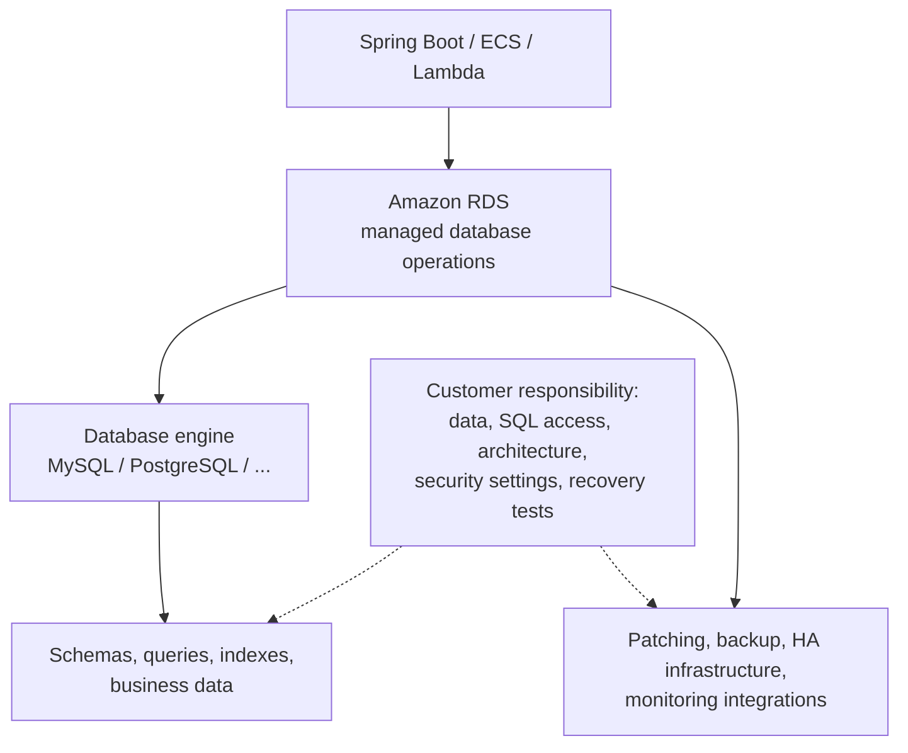
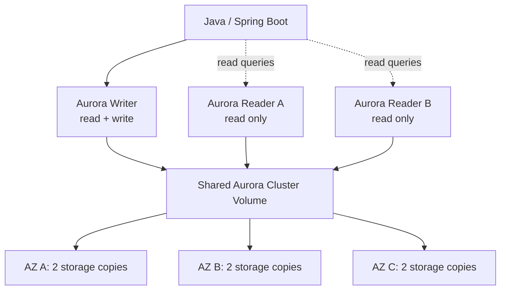
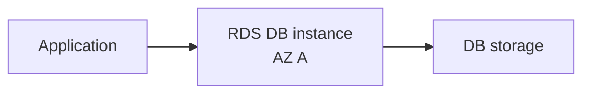
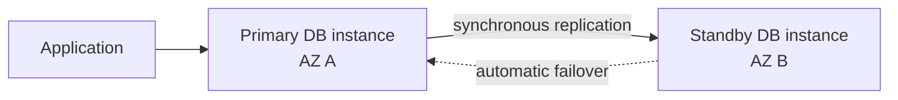
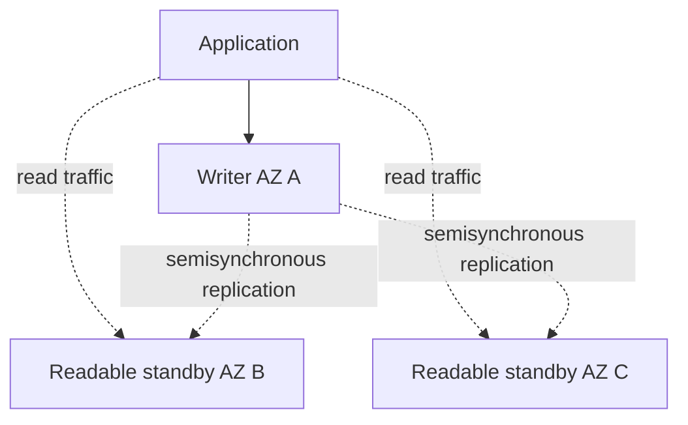
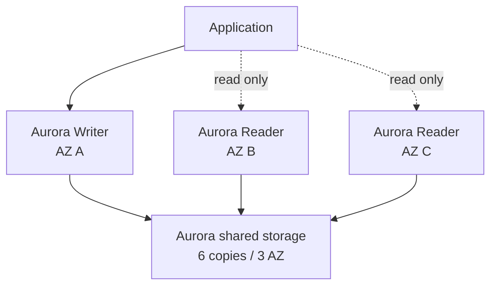
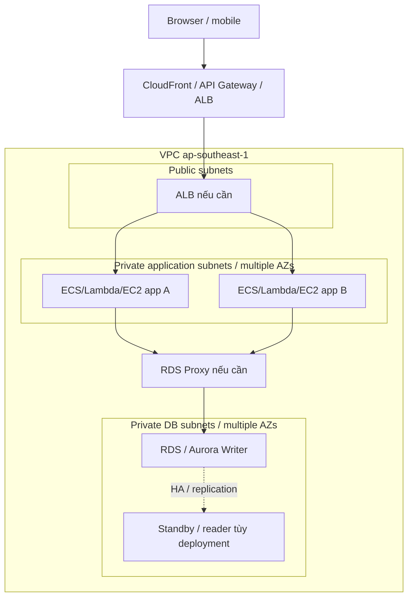
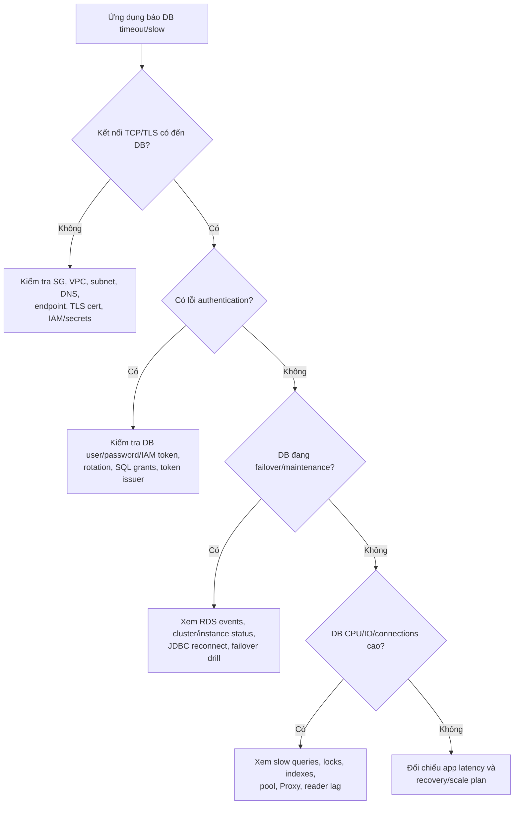
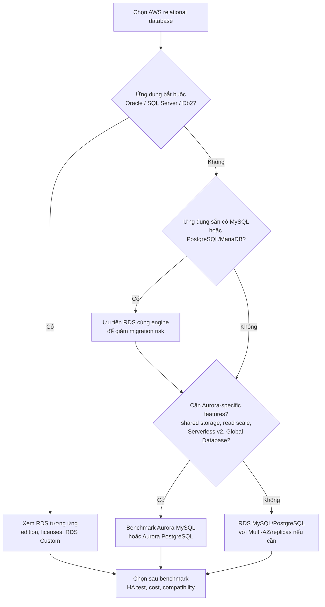

# Lựa chọn RDS engine và Amazon Aurora trên AWS

> **Chương:** Cơ sở dữ liệu RDS và Aurora  
> **Module:** CLOUD_PROVIDERS_AWS  
> **Mục tiêu:** lựa chọn đúng database engine và mô hình triển khai trong Amazon Relational Database Service (RDS), phân biệt Amazon Aurora với RDS chạy engine truyền thống, hiểu tương thích SQL, hiệu năng, High Availability (HA), đọc mở rộng, sao lưu, bảo mật, chi phí và quy trình chuyển đổi dữ liệu.
>
> **Phạm vi:** Amazon RDS for MySQL, PostgreSQL, MariaDB, Oracle, Microsoft SQL Server, IBM Db2 và Amazon Aurora MySQL-Compatible/Aurora PostgreSQL-Compatible. Phiên bản engine, tính năng, quota và instance class thay đổi theo Region/thời điểm; luôn xác nhận qua AWS Console, CLI và tài liệu cho phiên bản đang triển khai.

## 1. Vì sao chọn database engine lại là quyết định kiến trúc?

Một công ty thương mại điện tử triển khai dịch vụ Java/Spring Boot trên AWS. Các team đưa ra bốn đề xuất:

- Team A chọn **Amazon RDS for PostgreSQL** vì ứng dụng mới dùng SQL chuẩn, JSONB và các extensions phù hợp.
- Team B chọn **Amazon RDS for MySQL** vì code và dữ liệu kế thừa đang dùng MySQL, chi phí/nhân lực vận hành đã quen.
- Team C muốn **Amazon Aurora PostgreSQL-Compatible** để tách read traffic, dùng nhiều Aurora Replicas và storage phân tán đa AZ.
- Team D muốn **Amazon RDS for SQL Server** vì hệ thống báo cáo đã sử dụng T-SQL, stored procedures và công cụ Microsoft.

Không thể chỉ hỏi “database nào nhanh nhất?” mà phải hỏi:

1. **Ứng dụng đang phụ thuộc SQL dialect, driver, extension hay tính năng vendor nào?**
2. **Write/read ratio và mô hình truy cập thực tế là gì?**
3. **Nếu một Availability Zone lỗi, RTO và RPO yêu cầu bao nhiêu?**
4. **Có cần nhiều readers, scale compute động hay Global Database?**
5. **Đội ngũ hiểu engine nào và chấp nhận migration risk tới mức nào?**
6. **Tổng chi phí sau khi cộng compute, storage, I/O, backup, licensing và network là bao nhiêu?**

**Tư tưởng chính:** *RDS* là dịch vụ quản lý database với nhiều engines; *Aurora* là một **database engine family do AWS phát triển**, tương thích MySQL/PostgreSQL ở những mức được công bố, có kiến trúc lưu trữ/phục hồi riêng. Aurora **không phải tùy chọn bật lên trên mọi RDS engine**.

### 1.1. Một ví dụ workload để dùng xuyên suốt

Giả định ứng dụng `shop-api` cần:

| Yêu cầu | Giá trị tham khảo |
|---|---|
| Ngôn ngữ backend | Java 21, Spring Boot, JDBC/Hibernate |
| Dữ liệu | Orders, order items, payments, inventory |
| RPS | 150 RPS giờ thường, 1.000 RPS trong chiến dịch |
| Read/write | 80% đọc, 20% ghi |
| Dữ liệu ban đầu | 250 GiB, tăng 20 GiB/tháng |
| Dừng ứng dụng | Production cần HA trong Region |
| RPO | Gần 0 khi lỗi một AZ; chính sách backup cho lỗi logic |
| RTO | Phải đo qua failover drill, không chỉ đọc số liệu quảng cáo |
| Security | Private network, TLS, KMS, secrets rotation, audit |
| Budget | Có trần ngân sách; tránh overprovision |

Đây chỉ là **dữ liệu giả định** để minh họa, không phải benchmark hoặc bảo đảm hiệu năng của một engine.

## 2. Amazon RDS quản lý gì và không quản lý gì?

Amazon RDS giúp giảm gánh nặng vận hành nhiều công việc:

- Tạo và quản lý DB instances/cluster resources.
- Provision compute và storage.
- Tự động backup theo cấu hình, khôi phục theo thời điểm trong khoảng retention.
- Theo dõi health, CloudWatch metrics, RDS events.
- Thiết lập Multi-AZ và tự động failover cho mô hình được hỗ trợ.
- Cập nhật engine/OS theo maintenance window và chính sách được chọn.
- Tích hợp với VPC, security groups, AWS KMS, IAM, Secrets Manager.

Nhưng RDS **không tự làm thay** những việc sau:

- Thiết kế schema, indexes, query plans và transaction boundaries.
- Phân quyền SQL roles và data ownership/tenant isolation.
- Xử lý database migrations/backward compatibility của ứng dụng.
- Thiết kế connection pooling, retries và circuit breakers.
- Chọn backup retention và **thử khôi phục** định kỳ.
- Theo dõi slow queries, locks, deadlocks, storage growth.
- Chọn instance class, storage configuration, version lifecycle, quota và kiểm soát phí.
- Đảm bảo dữ liệu không bị xóa do câu SQL sai hoặc compromised credentials.



**Phân biệt:** RDS là managed service chứ không phải “database bất tử” hoặc “DBA không còn cần thiết”. Đội phát triển/vận hành vẫn sở hữu tính đúng đắn của dữ liệu và application-level recovery.

## 3. Sáu RDS engines truyền thống và hai Aurora editions

### 3.1. Tổng quan

| Lựa chọn | Mức tương thích/đặc trưng | Bài toán thường gặp | Điều cần kiểm tra kỹ |
|---|---|---|---|
| **RDS for MySQL** | MySQL SQL dialect, InnoDB, MySQL drivers/tools | Web apps, transactional systems, migrate MySQL hiện hữu | Version, character set/collation, features, replica lag |
| **RDS for PostgreSQL** | PostgreSQL SQL/JSONB, extensions theo danh sách hỗ trợ | New services, dữ liệu quan hệ phức tạp, GIS/extensions | Extension availability, upgrade compatibility |
| **RDS for MariaDB** | MariaDB, nguồn gốc MySQL nhưng đã phát triển riêng | Workload đang chạy MariaDB | Không coi MariaDB và MySQL hoàn toàn giống nhau |
| **RDS for Oracle** | Oracle Database engine và editions được hỗ trợ | Enterprise ứng dụng phụ thuộc PL/SQL/Oracle features | Licensing, edition, options, charset, migration complexity |
| **RDS for SQL Server** | Microsoft SQL Server, T-SQL và SQL Server ecosystem | .NET/Windows reporting, T-SQL/SQL Server workload | License, edition, feature availability, HA limits |
| **RDS for Db2** | IBM Db2 engine | Enterprise Db2 apps/data | Edition/licensing, DB instance types, dependencies |
| **Aurora MySQL-Compatible** | AWS-developed engine tương thích MySQL | MySQL workload cần cluster storage, HA, read scale | Compatibility by Aurora version, storage/I/O cost |
| **Aurora PostgreSQL-Compatible** | AWS-developed engine tương thích PostgreSQL | PostgreSQL workload cần Aurora capabilities | Extensions/features, engine version mapping, costs |

RDS Console thường tách **engine type** (RDS MySQL/PostgreSQL/... hoặc Amazon Aurora) và **edition/engine version**. Cách đặt tên “PostgreSQL-compatible” không đồng nghĩa chạy **bit-for-bit PostgreSQL upstream**.

### 3.2. Mỗi engine vẫn có phiên bản

Ví dụ:

- RDS PostgreSQL version theo nhánh upstream được AWS hỗ trợ.
- Aurora PostgreSQL-Compatible version tương ứng một nhánh PostgreSQL được hỗ trợ, nhưng patching/lifecycle của Aurora độc lập.
- Aurora MySQL-Compatible và RDS MySQL có nhánh phiên bản tương ứng nhưng **mã phiên bản và patch cadence không một-một**.
- SQL Server/Oracle/Db2 có editions và licensing model tác động cả feature lẫn chi phí.

**Không tạo DB bằng `--engine-version latest` theo suy đoán.** Dùng CLI để kiểm tra bản version thực có sẵn và đã được phép tạo trong Region/tài khoản.

## 4. Khi nào chọn RDS for MySQL?

### 4.1. Lợi thế

RDS for MySQL là lựa chọn thực dụng khi:

- Ứng dụng hiện tại đã chạy MySQL, có schema, stored routines, SQL dialect và operational knowledge.
- Đội backend sử dụng JDBC MySQL Connector/J, Hibernate dialect MySQL.
- Workload là OLTP đọc/ghi thông thường; chưa cần tính năng Aurora đặc thù.
- Chi phí và yêu cầu HA có thể đáp ứng bằng **Single-AZ/Multi-AZ DB instance** hoặc **Multi-AZ DB cluster** theo Region/version.
- Muốn di chuyển từ MySQL on-prem/EC2 sang RDS với thay đổi ít nhất.

### 4.2. Rủi ro cần xem

- MySQL version/parameter defaults khác giữa môi trường hiện hữu và RDS.
- Character set, collation, case sensitivity và time zones.
- SQL modes, transaction isolation, replication configuration.
- Khác biệt về **SUPER/FILE hoặc quyền quản trị hệ thống** vì RDS không cho full host/database superuser kiểu máy tự quản.
- Khối lượng đọc có thể cần **read replicas**; replicas có thể lag.
- Nhiều connections từ Lambda/ECS có thể làm DB memory/CPU quá tải.

**Không nên dùng Aurora chỉ vì tên nghe “cao cấp”** nếu lợi ích chưa bù chi phí và migration risk.

## 5. Khi nào chọn RDS for PostgreSQL?

RDS for PostgreSQL thường phù hợp với:

- API/service mới cần PostgreSQL SQL features, JSONB, window functions, materialized views và transactional consistency.
- Các bài toán GIS dùng PostGIS **nếu version/extension được hỗ trợ**.
- Đội data/backend quen `EXPLAIN ANALYZE`, pg_stat_statements và cách tối ưu PostgreSQL.
- Muốn bám gần ecosystem PostgreSQL, xuất/nhập logic qua `pg_dump`/`pg_restore`.
- Ứng dụng cần extension cụ thể nằm trong danh sách được AWS hỗ trợ cho RDS PostgreSQL.

### 5.1. RDS PostgreSQL không phải máy PostgreSQL có root

Quyền `rds_superuser` khác tài khoản `postgres` siêu quản trị trên máy tự quản. Không thể tùy ý:

- SSH vào host database.
- Cài bất kỳ OS package hoặc PostgreSQL extension native nào.
- Thay configuration files ngoài parameter groups.
- Truy cập filesystem ngoài chức năng RDS cho phép.

**Nếu một extension/OS package bắt buộc không được RDS hỗ trợ**, đánh giá giải pháp khác như RDS Custom khi engine hỗ trợ, EC2 tự quản hoặc thay đổi thiết kế; **không mặc định Aurora giải quyết được**.

### 5.2. Khi nào PostgreSQL tốt hơn MySQL?

Không có câu trả lời tuyệt đối. Chọn PostgreSQL khi tính năng/kiểu truy vấn PostgreSQL có giá trị thực; chọn MySQL khi tương thích workload hiện tại hoặc năng lực đội ngũ là ưu thế lớn. Benchmark trên schema/query/instance/storage thực tế quan trọng hơn kết luận chung “PostgreSQL nhanh hơn MySQL”.

## 6. Khi nào chọn RDS for MariaDB?

MariaDB có lịch sử liên quan MySQL nhưng đã phát triển độc lập. RDS for MariaDB phù hợp nếu:

- Ứng dụng hiện tại **đang dùng MariaDB**.
- SQL dialect, storage engine và MariaDB-specific behaviors là ràng buộc.
- Đội vận hành đã có hệ sinh thái backup/metrics/driver cho MariaDB.
- Muốn giảm công quản lý EC2 database nhưng không đổi engine.

**Không đồng nhất MariaDB với Aurora MySQL-Compatible.** Một ứng dụng MariaDB có thể dùng các features/SQL behaviors khác MySQL; chuyển sang Aurora MySQL cần migration assessment thực sự.

RDS Multi-AZ **DB cluster** với hai readable standbys không hỗ trợ MariaDB theo tài liệu AWS hiện hành; với MariaDB có thể dùng Multi-AZ **DB instance** và read replicas nếu tính năng/Region cho phép.

## 7. RDS for Oracle, SQL Server và Db2: ưu tiên tương thích doanh nghiệp

### 7.1. Oracle

Chọn RDS for Oracle khi:

- Hệ thống phụ thuộc **PL/SQL, Oracle data types, packages**, Oracle client/tooling hoặc các chức năng enterprise được RDS hỗ trợ.
- Việc rewrite sang PostgreSQL/MySQL chưa đáng hoặc chưa khả thi.
- Tổ chức có quy trình **Oracle licenses/options** rõ ràng.

Cần đánh giá:

- Oracle edition/version và tính năng hỗ trợ trong RDS.
- **License Included (LI)** hoặc **Bring Your Own License (BYOL)** theo lựa chọn/edition hiện có.
- Những tính năng Oracle cần OS access/privileged operations có thể không dùng được trong standard RDS.
- Tương thích drivers, schema, sequences, triggers, partitioning, jobs, backups.

**Không tuyên bố “Aurora PostgreSQL là Oracle tương thích”.** Nếu chuyển từ Oracle sang Aurora PostgreSQL, thường phải chuyển schema, PL/SQL và SQL logic, kèm data migration và test.

### 7.2. Microsoft SQL Server

RDS for SQL Server thường được chọn khi:

- Ứng dụng sử dụng T-SQL, Microsoft SQL Server drivers và các thành phần Microsoft.
- Muốn giảm vận hành Windows/SQL Server nhưng giữ API/SQL dialect.
- SQL Server licensing và edition features là yêu cầu đầu vào.

Cần đánh giá **SQL Server edition**, SQL Server Agent/jobs, SSIS/SSRS/SSAS integrations theo hỗ trợ, **Windows authentication/Active Directory** và HA mechanisms.

SQL Server Multi-AZ DB instance dùng database mirroring hoặc Always On Availability Groups theo version/edition; **không mặc định dùng cùng cơ chế physical replication với PostgreSQL/MySQL**.

**RDS Multi-AZ DB cluster** mô hình writer + hai readable standbys **không hỗ trợ SQL Server**.

### 7.3. IBM Db2

RDS for Db2 phục vụ workload enterprise đang dùng Db2, muốn chuyển trách nhiệm vận hành hạ tầng về managed RDS nhưng giữ tương thích engine.

Điểm cần kiểm tra:

- Edition, DB version và licensing arrangements của tổ chức.
- Instance class/Region support.
- Backup/restore và source migration.
- Workload có yêu cầu OS/system-level admin vượt RDS managed boundary không.

**Không lựa chọn Db2 cho một microservice mới chỉ vì AWS có hỗ trợ.** Khi không có dependency engine, PostgreSQL/MySQL thường dễ tuyển dụng và có ecosystem ứng dụng phổ biến hơn; cần cân nhắc theo thực tế tổ chức.

### 7.4. RDS Custom là gì?

**Amazon RDS Custom** cung cấp quyền tùy biến host/database sâu hơn cho một số workloads Oracle/SQL Server cần truy cập OS và database environment mà standard RDS không cho phép.

Đổi lại:

- Khách hàng có thêm trách nhiệm vận hành, patching, custom engine versions và kiểm soát support perimeter.
- Không phải “chế độ bật SSH” chung cho mọi engine RDS.
- Kiểm tra supported engines, licensing, instance types và Regions.
- Không chọn RDS Custom nếu managed RDS thường đáp ứng tốt vì nó làm tăng operational complexity.

## 8. Amazon Aurora là gì và khác RDS thường ở đâu?

### 8.1. Aurora vẫn là relational database

Amazon Aurora gồm:

- **Aurora MySQL-Compatible Edition**.
- **Aurora PostgreSQL-Compatible Edition**.

Nó hỗ trợ SQL clients/drivers tương thích trong phạm vi feature/engine version được công bố. Nhưng Aurora sử dụng kiến trúc do AWS phát triển, trong đó **compute instances tách khỏi distributed cluster storage**.

### 8.2. Aurora storage phân tán

Aurora thiết kế **một cluster volume dùng chung**, trong đó dữ liệu được bảo vệ thông qua **sáu bản sao storage trên ba Availability Zones** của một AWS Region.



**Một số hệ quả:**

- Writer và readers dùng chung logical storage volume; không cần duy trì **một bản sao dữ liệu đầy đủ khác** cho từng reader giống những kiến trúc replication truyền thống.
- Aurora storage có khả năng chịu lỗi AZ ở tầng lưu trữ ngay cả khi compute deployment chưa có readers ở nhiều AZ.
- **Storage durability ≠ compute high availability.** Một cluster chỉ có writer và không có reader trong AZ khác vẫn cần cơ chế thay/new compute khi writer fail; thêm reader khác AZ cải thiện failover.
- Aurora có thể thêm nhiều **Aurora Replicas** (tối đa 15 theo tài liệu cho cluster tiêu chuẩn, tùy engine/mode/quotas) phục vụ read scaling và failover candidates.
- Aurora được tối ưu cho kết hợp HA, read scaling và storage auto-growth, nhưng **không hứa mọi query luôn nhanh hơn RDS MySQL/PostgreSQL**.

### 8.3. Aurora không chạy Oracle, SQL Server, MariaDB hay Db2

Nếu app phụ thuộc T-SQL/PLSQL/MariaDB-specific behavior:

- Không có một menu “Aurora for SQL Server/Oracle/MariaDB/Db2” giống MySQL/PostgreSQL editions.
- Một số công nghệ như **Babelfish for Aurora PostgreSQL** hỗ trợ **một tập T-SQL protocol/semantics** phục vụ migration; không phải SQL Server engine đầy đủ, cần compatibility testing.
- Migration liên engine yêu cầu schema conversion, code changes và data validation.

### 8.4. Aurora DSQL không phải một mode của Aurora cluster thông thường

AWS còn có **Amazon Aurora DSQL** (dịch vụ SQL phân tán/serverless với kiến trúc và trade-offs riêng). Không nhầm nó với **Aurora MySQL/PostgreSQL DB cluster** truyền thống chỉ vì cùng nhãn “Aurora”. Bài này tập trung vào **Amazon Aurora DB clusters** tương thích MySQL/PostgreSQL; đánh giá Aurora DSQL là một quyết định kiến trúc khác.

## 9. Ba mô hình HA dễ bị nhầm nhất

### 9.1. RDS Single-AZ DB instance



- Một DB instance chính trong một AZ.
- Không có standby instance tự động failover sang AZ khác theo mô hình Multi-AZ.
- Rủi ro downtime cao hơn khi AZ/instance không sẵn sàng.
- Có automated backups theo cấu hình, nhưng **backup không phải HA**.
- Phù hợp dev/test hoặc workload chấp nhận mất thời gian phục hồi.

### 9.2. RDS Multi-AZ DB instance (single standby)



- Có primary và standby ở **khác AZ**.
- Replication đồng bộ theo engine/implementation.
- Standby **không phục vụ read traffic**.
- Khi primary lỗi, RDS tự promote/failover và endpoint liên quan được chuyển sang primary mới.
- App cần **reconnect và retry** đúng cách khi failover.
- Đây là mô hình HA phổ biến cho nhiều RDS engines.

**Sai lầm:** dùng standby Multi-AZ DB instance như một read replica miễn phí. Nó không phục vụ query đọc bình thường.

### 9.3. RDS Multi-AZ DB cluster



Đây là một lựa chọn RDS **khác** Multi-AZ DB instance:

- Một **writer**, hai **readable standbys** trong **ba AZ**.
- Hỗ trợ **RDS for MySQL** và **RDS for PostgreSQL** theo Regions/versions được hỗ trợ.
- Có read scaling và khả năng failover.
- AWS mô tả replication **semisynchronous** và khả năng write latency thấp hơn Multi-AZ DB instance trong các điều kiện phù hợp.
- **Không phải Aurora**, dù cũng gọi là DB cluster và có writer/reader endpoints.
- Không hỗ trợ MariaDB, Oracle, SQL Server hoặc Db2 theo bảng AWS hiện hành.

### 9.4. Aurora DB cluster



- Một writer, nhiều readers (nếu cấu hình).
- **Shared distributed cluster storage**, khác cơ chế replication storage/compute của RDS Multi-AZ DB cluster.
- Aurora readers là đối tượng dùng cho đọc và failover.
- Có **Aurora Serverless v2**, Global Database, Aurora cluster endpoints và storage modes riêng tùy engine/version.
- Nếu chỉ có writer, storage vẫn 3-AZ nhưng **compute failover không như cấu hình có reader sẵn**.

### 9.5. Bảng so sánh tổng hợp HA

| Thuộc tính | RDS Single-AZ instance | RDS Multi-AZ instance | RDS Multi-AZ DB cluster | Aurora DB cluster |
|---|---|---|---|---|
| Engine chính | Sáu RDS engines | Theo engine/version | **MySQL/PostgreSQL** | **Aurora MySQL/PostgreSQL** |
| Compute | 1 instance | 1 primary + 1 standby | 1 writer + 2 readers | 1 writer + 0..n readers |
| AZ footprint | Một AZ compute | Hai AZ compute | Ba AZ compute | Storage 3 AZ; compute tùy instances |
| Read ở standby? | Không có | **Không** | **Có** | **Có nếu có reader** |
| Failover | Phục hồi/thay instance | Automatic failover | Automatic failover | Automatic failover |
| Storage | Theo RDS instance | Replicated storage cơ chế engine | Theo cluster architecture riêng | Shared Aurora storage, 6 copies/3 AZ |
| Read scaling | Có thể thêm read replica theo engine | Read replicas riêng | 2 readable standbys | Aurora Replicas/reader endpoint |
| Chi phí | Thường thấp hơn | Thêm standby compute | Ba DB instances + storage | Writer/readers + Aurora storage/I/O |
| Mục tiêu | Dev/test | HA OLTP | HA + read scale MySQL/Postgres | HA + shared storage/read scale |

**Quan trọng:** không lấy “Multi-AZ = dữ liệu an toàn tuyệt đối”. Xóa nhầm hàng, schema migration sai và compromised credentials vẫn có thể lan sang standby/replicas. Muốn phục hồi logic cần backup/PITR và quy trình kiểm thử khôi phục.

## 10. Read replica khác Multi-AZ standby và backup

### 10.1. Read replica để giảm tải đọc

Read replica là bản sao **đọc**, dùng để:

- Giảm tải SELECT/reporting khỏi primary.
- Hỗ trợ thêm read capacity ở cùng Region hoặc Region khác khi engine/tính năng cho phép.
- Tạo phương án migration/DR trong một số thiết kế.

Tuy nhiên:

- Replication thường **asynchronous** nên có **replica lag**.
- “Read-your-writes” không được bảo đảm tức thì nếu vừa ghi vào writer rồi SELECT từ reader.
- Replica không tự động thay thế mọi tính năng Multi-AZ failover.
- Khi chuyển replica thành standalone writer (promotion), cần điều phối ứng dụng/endpoint và dữ liệu.

### 10.2. Ví dụ consistency

Một user vừa cập nhật địa chỉ giao hàng trên writer. Nếu trang xác nhận ngay lập tức query từ reader đang trễ 2 giây, user có thể thấy địa chỉ cũ.

**Giải pháp lựa chọn theo use case:**

- Query ngay sau write từ **writer endpoint**.
- Dùng session consistency/circuit ở application tier nếu phù hợp.
- Chấp nhận eventual consistency cho dashboard/reporting.
- Monitor replica lag và đặt SLO.
- Không gửi tất cả SELECT sang reader mà không phân loại critical reads.

### 10.3. Backup không phải replica và không phải standby

| Cơ chế | Để làm gì? | Khi nào dùng? |
|---|---|---|
| **Multi-AZ standby** | HA khi hỏng compute/AZ | Failover |
| **Read replica** | Read scale, một số DR/migration scenarios | Query phân tải |
| **Automated backup + PITR** | Khôi phục dữ liệu trước sự cố logic | Sai DELETE/schema, corrupt data theo khả năng backup |
| **Manual snapshot** | Điểm phục hồi có chủ đích | Trước upgrade/migration |
| **Cross-Region backup/replication** | DR ở cấp Region | Region outage theo RTO/RPO |

**Không thể tăng read capacity bằng cách “thêm automated backup”.** Và có Multi-AZ standby cũng không xóa nhu cầu backup.

## 11. Endpoints: ứng dụng kết nối tới đâu?

### 11.1. RDS DB instance endpoint

RDS DB instance thông thường có hostname như:

```text
shop-postgres.abcdefghijk.ap-southeast-1.rds.amazonaws.com:5432
```

Ứng dụng sử dụng endpoint này thay vì hard-code EC2/private IP của DB. Khi Multi-AZ DB instance failover, DNS trỏ sang DB mới theo cơ chế AWS.

**Cần cấu hình DNS/reconnect đúng cách** ở JVM/JDBC/client; lưu IP cũ quá lâu có thể kéo dài downtime sau failover.

### 11.2. Aurora writer endpoint

Ví dụ:

```text
shop-aurora.cluster-abcdefghijk.ap-southeast-1.rds.amazonaws.com:5432
```

- **Cluster/writer endpoint** trỏ tới current writer.
- Dùng cho **INSERT/UPDATE/DELETE/DDL** và đọc cần nhất quán ngay sau write.
- Khi failover, endpoint được cập nhật đến writer mới; JDBC pool vẫn phải xử lý failed connections/retry.
- Đừng hard-code **instance endpoint** cho write traffic nếu muốn tự động chuyển writer khi failover.

### 11.3. Aurora reader endpoint

Ví dụ:

```text
shop-aurora.cluster-ro-abcdefghijk.ap-southeast-1.rds.amazonaws.com:5432
```

- Phục vụ connections đọc đến các readers có sẵn.
- **Cân bằng các kết nối**, **không cân bằng từng SQL query** trên một connection đang mở.
- Long-lived JDBC pool có thể bám vào một số readers; cần cấu hình pool/reconnect phù hợp.
- **Nếu cluster chỉ có writer và không có Aurora Replica**, reader endpoint có thể chuyển connections đến writer; thậm chí một số write có thể thực thi vì target thực là writer. Vì vậy **reader endpoint không thay thế DB read-only IAM/SQL grants**.
- Reader traffic có thể bị replication lag; app phân biệt critical vs eventual reads.

### 11.4. Aurora custom endpoints và RDS Proxy

- **Custom endpoint** chỉ định nhóm DB instances được chọn, hữu ích tách reporting readers khỏi application readers.
- **RDS Proxy** quản lý/pool database connections, giúp Lambda hoặc ECS giảm connection storm và cải thiện failover behavior trong điều kiện hỗ trợ.
- RDS Proxy có **read-only endpoints** cho Aurora có readers, nhưng không phải phép tăng compute capacity vô hạn; vẫn chịu DB max connections, CPU và locks.
- RDS Proxy có phí và cần VPC/IAM/secrets/TLS cấu hình chuẩn.

**RDS Proxy không thay thế tối ưu SQL hoặc indexes.** Nếu query quét toàn bảng 10 giây, proxy không biến nó thành 10 ms.

## 12. Aurora Serverless v2: scaling compute theo ACUs

### 12.1. Serverless v2 không phải “không cần tính capacity”

Aurora Serverless v2 sử dụng DB instance class `db.serverless` và điều chỉnh compute trong một **ACU capacity range**:

- **Aurora Capacity Unit (ACU)** là đơn vị compute/memory/network; theo AWS khoảng **2 GiB memory + CPU/network tương ứng** cho mỗi ACU.
- Cluster khai báo **MinCapacity** và **MaxCapacity**; từng serverless writer/reader có thể scale trong range tùy feature/configuration.
- Có thể phối hợp **provisioned** và **serverless v2** DB instances trong một số Aurora clusters/hybrid architectures.
- Giá tính theo capacity sử dụng theo thời gian, thêm storage/I/O/backups/network theo plan.

Ví dụ:

```text
Aurora PostgreSQL cluster
  writer: db.serverless
  reader A: db.serverless
  MinCapacity: 1 ACU
  MaxCapacity: 16 ACU
```

Mức `MaxCapacity=16` là **trần compute capacity của từng serverless DB instance theo cấu hình**, không phải “16 request/giây” hoặc “16 connections”.

### 12.2. Auto-pause tới 0 ACU có điều kiện

Các **engine versions hiện được hỗ trợ** cho phép đặt `MinCapacity=0` để Aurora Serverless v2 có thể **tự pause khi không có connections** và resume khi có request.

Điều kiện quan trọng:

1. Engine version phải hỗ trợ **0 ACU**; một số phiên bản cũ chỉ hỗ trợ min 0.5 ACU.
2. DB instance thực sự là `db.serverless`, không phải provisioned instance.
3. Không bật feature/cấu hình khiến auto-pause bị vô hiệu hoặc các connections luôn giữ DB hoạt động.
4. Hybrid cluster có provisioned readers/writer và failover tier có thể khiến writer/readers không pause như kỳ vọng.
5. Ứng dụng phải chịu được **resume latency**, AWS nêu thường cỡ **15 giây** (có thể lâu hơn khi pause rất dài).
6. **Không tính compute instance capacity khi thực sự paused**, nhưng **storage/backups và các tài nguyên khác vẫn tính tiền**.
7. Việc DB báo `Available` **không có nghĩa đã warm sẵn** nếu đang pause.

**Không chọn min 0 ACU cho checkout API có SLO latency rất thấp** trừ khi đã benchmark resume, connection timeouts và traffic pattern. Có thể hợp lý cho dev/test hoặc ứng dụng nội bộ ít dùng.

### 12.3. Min/Max theo engine version không cố định

Tại thời điểm tài liệu AWS hiện hành, Aurora Serverless v2 có các upper ranges khác nhau theo **engine/version/platform**; những tài liệu cập nhật có thể cho phép tới **256 ACU với Aurora MySQL** và **384 ACU với Aurora PostgreSQL** ở các phiên bản được hỗ trợ. **Không mặc định mọi cluster đều dùng được mức đó.**

Dùng `describe-db-engine-versions`, Console và tài liệu **Aurora Serverless capacity** để xác minh khả năng của version và Region trước khi lập kế hoạch.

## 13. Storage và I/O: RDS truyền thống so với Aurora

### 13.1. RDS DB instances

RDS DB instances thường dùng các kiểu storage (theo engine/version/instance được hỗ trợ):

- **gp3 / gp2 SSD**: general purpose, phù hợp nhiều OLTP workloads.
- **io1 / io2 provisioned IOPS**: workload nhạy với IOPS/latency, có cơ chế provision performance theo giới hạn.
- **Magnetic storage** là lựa chọn cũ trong một số trường hợp, thường không phù hợp thiết kế mới.

Cần tính:

- Allocated GiB.
- Provisioned IOPS và throughput.
- Storage autoscaling/max allocated storage (nếu hỗ trợ).
- Transaction log growth, maintenance, vacuum, temporary files.
- Snapshot/backup storage.
- Burst/IOPS limits, hàng đợi I/O và workload read/write.

**Không kết luận “RDS storage không tự tăng” cho mọi cấu hình**: RDS có storage autoscaling khi bật và engine/storage support; khác Aurora là kiến trúc/đơn vị tính phí và mức chia sẻ storage.

### 13.2. Aurora shared auto-growing storage

Aurora cluster storage tăng khi dữ liệu phát triển mà không phải provision trước một dung lượng EBS DB instance theo mô hình truyền thống. Storage được phân phối trên ba AZ và readers cùng truy cập logical volume.

Aurora có **hai cấu hình storage pricing**:

| Cấu hình | Tính phí | Thường phù hợp |
|---|---|---|
| **Aurora Standard** | DB instance/ACU + storage + **read/write I/O operations** | Workload I/O trung bình/thấp |
| **Aurora I/O-Optimized** | DB instance/ACU + storage, **không tính riêng read/write I/O requests** | Workload có phần I/O đáng kể trong hóa đơn |

AWS gợi ý **I/O-Optimized có thể hiệu quả khi chi phí I/O chiếm khoảng ≥25% tổng Aurora database spending** ở Aurora Standard, do instance và storage I/O-Optimized có giá cao hơn.

**Không dùng 25% như một định luật:** cần so sánh Cost Explorer dữ liệu thật, giá Region, instance/ACU, storage, replicas và lịch sử I/O. Thay đổi storage type có điều kiện/tần suất giới hạn theo tài liệu.

### 13.3. Không coi storage I/O pricing là throughput SLA

Một workload có ít I/O nhưng SQL xấu vẫn có thể chậm. Một workload đọc nhiều mà data được cache ở buffer pool có thể cần ít physical I/O hơn dự đoán. Trước khi chọn storage mode:

- Đo IOPS/latency, buffer cache hit ratio.
- Đo query plans, indexes, hot partitions, connection counts.
- So sánh peak và bình quân, không chỉ tổng GiB.
- Xem read replicas và workload distribution.
- Tính chi phí RDS Proxy, backup, Global Database, network.

## 14. Availability, RPO, RTO và backup: chọn theo sự cố

### 14.1. Không chỉ hỏi “có Multi-AZ không?”

| Sự cố | Rủi ro | Biện pháp chính |
|---|---|---|
| Một DB instance lỗi | Connection reset/downtime | Multi-AZ failover, reader failover candidates, pool reconnect |
| Một Availability Zone lỗi | Compute/availability giảm | Multi-AZ architecture, subnets/reader phân bố AZ |
| Một AWS Region lỗi | Cả Region không truy cập | Cross-Region DR/Global Database/backup tùy engine |
| Admin chạy `DELETE` nhầm | Replication mang sai dữ liệu sang replicas | Automated backups, PITR, restore drill |
| Malware/credential leak | Thay đổi/xóa dữ liệu | Least privilege, backups, auditing, incident response |
| Upgrade engine lỗi | App/query compatibility | Preproduction validation, snapshot/rollback strategy |
| Chậm truy vấn quá mức | SLA giảm dù DB “available” | Query tuning, indexes, read/write capacity, monitoring |

### 14.2. RPO và RTO

- **RPO** (*Recovery Point Objective*): mức mất dữ liệu tối đa có thể chấp nhận, tính bằng thời gian.
- **RTO** (*Recovery Time Objective*): thời gian tối đa để dịch vụ hoạt động trở lại sau sự cố.

**Ví dụ:** tổ chức yêu cầu RPO dưới 5 phút và RTO dưới 30 phút khi mất cả Region. Một cluster Multi-AZ trong **cùng Region** chưa giải quyết mục tiêu đó; cần cross-Region strategy và diễn tập.

### 14.3. Automated backups và PITR

RDS/Aurora cung cấp **automated backup/PITR** theo engine/deployment/configuration được hỗ trợ. Khi dùng:

- Chọn **retention** đủ cho khả năng phát hiện lỗi logic (RDS instance có thể cho 0–35 ngày; Aurora cluster thường yêu cầu retention tối thiểu theo dịch vụ, kiểm tra bản cụ thể).
- Giữ **manual snapshots** trước thay đổi lớn.
- Khi restore, AWS thường tạo **DB instance/cluster mới**, không tự “undo” trạng thái production hiện hành.
- Có kế hoạch DNS/connection secrets, DB users, SG, parameter groups, app cutover cho restored DB.
- **Thử khôi phục** vào môi trường cô lập và đo thực tế RTO/RPO.
- Xác nhận backup có đủ transaction logs và retention để phục hồi đến thời điểm mong muốn.

**Cảnh báo:** Multi-AZ không giữ lại “trạng thái trước khi DELETE” trên standby; standby sao chép cả thao tác xóa hợp lệ. **Backup/PITR** mới là một lớp phục hồi lỗi logic.

### 14.4. Aurora Global Database và Cross-Region DR

Aurora **Global Database** hỗ trợ mô hình nhiều Regions, primary Region ghi và secondary Regions phục vụ đọc/DR theo tính năng/version được hỗ trợ.

- Replication liên Region nhìn chung **asynchronous**, vì vậy phải đo/giám sát lag và RPO.
- Khi failover/switchover sang Region khác, cần kế hoạch endpoints, secrets, routing và application reconnect.
- Global Database có thể phát sinh chi phí dữ liệu replicated, secondary compute/storage/network.
- **Không biến một Aurora cluster đơn Region thành multi-Region chỉ bằng cách thêm reader AZ mới**.

RDS engine truyền thống có các lựa chọn **cross-Region read replicas hoặc backup copy** tùy engine/version, nhưng không phải mọi engine có cùng tính năng và RTO/RPO.

## 15. Bảo mật database trong VPC

### 15.1. RDS/Aurora thuộc VPC, không phải endpoint mở mặc định

Một triển khai production điển hình:



**Nguyên tắc:**

- Tạo **DB subnet group** gồm subnets phù hợp nhiều Availability Zones, tùy deployment engine.
- Đặt DB **không public** cho production thông thường; client truy cập thông qua app tier trong VPC hoặc private connectivity.
- **Security group DB** chỉ cho inbound từ app security group trên cổng DB (MySQL 3306, PostgreSQL 5432, SQL Server 1433... theo engine và cài đặt).
- Không mở `0.0.0.0/0` tới DB port để “chữa lỗi timeout”.
- Nếu Lambda nằm trong VPC, cấu hình private subnet/SG và các AWS service endpoints hoặc NAT phù hợp cho Secrets Manager, logs và dependencies.
- Kiểm tra DNS resolution, NACLs, route tables, cross-AZ reachability.
- Dùng TLS cho database connections; kiểm tra certificate trust bundle và certificate rotation.

### 15.2. Trách nhiệm IAM và database users khác nhau

| Lớp | Dùng cho | Ví dụ |
|---|---|---|
| **IAM control plane** | Ai được tạo/sửa/xóa RDS/Aurora, backup, snapshots | `rds:CreateDBInstance`, `rds:ModifyDBCluster` |
| **DB authentication** | Ai được kết nối và truy vấn SQL | DB user/password, IAM DB auth, AD/Kerberos khi engine hỗ trợ |
| **SQL privileges** | User được SELECT/INSERT/ALTER gì | `GRANT SELECT ON ...` |
| **Network security** | Client nào có thể đến TCP port | SG, VPC, TLS |
| **KMS** | Quyền mã hóa storage/secrets | KMS key policies |
| **Application authorization** | User cuối được đọc đơn hàng nào | Tenant/resource ownership ở backend |

**Không nhầm `rds:DescribeDBInstances` với quyền `SELECT` trong PostgreSQL.** Cho app IAM quyền quản trị RDS không tự cho phép query SQL; ngược lại, thông tin DB admin/password bị lộ có thể gây sự cố dữ liệu dù IAM role của client có quyền ít.

### 15.3. IAM database authentication

Một số RDS/Aurora engines hỗ trợ **IAM DB authentication**: client tạo authentication token được ký bằng AWS credentials, DB server xác thực trong mô hình dịch vụ.

Điểm cần kiểm tra:

- Engine và phiên bản có hỗ trợ IAM DB auth không (MySQL, PostgreSQL và MariaDB/Aurora theo điều kiện).
- IAM policy `rds-db:connect` đến đúng DB user resource ID, không chỉ RDS ARN.
- Client SDK/driver, token generation, TLS và time sync.
- Token có **thời hạn ngắn** (thông thường 15 phút để khởi tạo kết nối), không phải “mật khẩu vĩnh viễn”.
- Việc token hết hạn **không tự cắt kết nối đã xác thực thành công**.
- Với connection burst cực lớn, kết hợp RDS Proxy hoặc cơ chế pooling khi phù hợp.
- Không dùng IAM DB auth thay thế SQL GRANT/row-level security.

Với Oracle/SQL Server/Db2, khả năng authentication có đặc điểm riêng; không mặc định tất cả engines đều dùng `rds-db:connect` theo cùng cách.

### 15.4. Secrets Manager và rotation

RDS/Aurora có thể tích hợp **AWS Secrets Manager** để quản lý master credentials trong những cấu hình được hỗ trợ. Ứng dụng có thể:

1. Nhận secrets ARN qua cấu hình.
2. Dùng IAM runtime role đúng quyền `secretsmanager:GetSecretValue` và KMS decrypt nếu cần.
3. Tạo JDBC connections với credentials nhận được.
4. Cache secret an toàn theo TTL/rotation logic.
5. Refresh connections khi secret rotate; không giả định mọi pool đang hoạt động tự đổi password.

Nếu không dùng IAM DB auth, có thể đặt secrets rotation tự động theo framework hỗ trợ, nhưng phải test **lúc rotate** chứ không chỉ test login tĩnh.

### 15.5. Encryption và backups

- **Encryption at rest:** bật RDS/Aurora storage encryption/KMS ở thời điểm tạo DB theo yêu cầu; snapshot/backups cũng dùng cơ chế mã hóa tương ứng.
- **Không thể luôn bật encryption tại chỗ** cho DB đã tạo không mã hóa; có thể cần snapshot copy/restore hoặc migration.
- **Encryption in transit:** cấu hình TLS connection và certificate validation trong JVM/JDBC; không chỉ đặt `sslmode=require` mà bỏ qua kiểm chứng server nếu chính sách yêu cầu xác thực hostname.
- **Snapshot sharing/copy:** kiểm tra KMS key permissions và cross-account/cross-Region rules.
- **Database auditing:** sử dụng engine audit/log features phù hợp, CloudWatch Logs export và IAM least privilege.

**Bảo mật đa lớp:** dù DB mã hóa bằng KMS, application có DB account `SUPERUSER` bị compromise vẫn có thể đọc/xóa dữ liệu; KMS không thay SQL permissions.

## 16. Capacity planning: compute, I/O, connections và query design

### 16.1. Quan hệ giữa workload và database resources

DB latency chịu tác động của:

- CPU khi query parsing, joins, sort và functions.
- Memory/buffer cache và shared buffers.
- Storage IOPS, throughput và latency.
- Lock contention, transaction length, deadlocks.
- Số concurrent connections và connection pool size.
- Network round trips giữa app và DB.
- Replica lag, vacuum/maintenance, log flush.
- Query plan statistics và indexes.

**Không tự động thêm Aurora reader khi bottleneck là writes/locks của writer.** Readers giúp read-heavy traffic nếu app route đúng, không biến writer thành distributed multi-writer database trong cluster Aurora thông thường.

### 16.2. Ví dụ connection storm từ ECS

Giả định:

- ECS service có 30 tasks.
- Mỗi task chạy một HikariCP pool với `maximumPoolSize=20`.
- Mỗi task có thể mở đủ pool connections khi tải.

Kết nối lý thuyết:

\[
30 \times 20 = 600\ \text{connections}
\]

Nếu mỗi autoscaling step tăng số tasks từ 30 lên 60:

\[
60 \times 20 = 1.200\ \text{connections}
\]

Ngay cả khi RDS instance có CPU dư, quá nhiều connections có thể ngốn RAM và gây errors.

**Giải pháp:** đo thực tế active/idle connections, giới hạn pool, dùng RDS Proxy phù hợp, caching, read/write separation và tối ưu SQL. Không đặt `maximumPoolSize=500` cho mỗi task “để nhanh hơn”.

### 16.3. Lambda với relational database

AWS Lambda có thể tăng concurrency nhanh trong một Region. Nếu mỗi invocation mở connection riêng tới RDS, số connections có thể tăng theo concurrency, cộng thêm warm environments giữ connections nhàn rỗi.

Nên cân nhắc:

- **RDS Proxy** với engine/version hỗ trợ.
- Cấu hình **Lambda reserved concurrency** để bảo vệ DB connections.
- Sử dụng connection reuse đúng cách nhưng không giữ transaction lâu.
- Batch queries và cache hợp lý.
- Aurora Data API cho use case hỗ trợ, nhưng **không coi Data API như JDBC socket bình thường**.
- Xem IAM DB auth/Secrets Manager và VPC endpoints khi phù hợp.

### 16.4. Query plan trước khi scale

Trong PostgreSQL, ví dụ:

```sql
-- Tạo cấu trúc ví dụ trong môi trường lab, không chạy trực tiếp trên production.
CREATE TABLE orders (
  id BIGINT PRIMARY KEY,
  tenant_id BIGINT NOT NULL,
  created_at TIMESTAMPTZ NOT NULL,
  status VARCHAR(30) NOT NULL,
  total_amount NUMERIC(12,2) NOT NULL
);

CREATE INDEX idx_orders_tenant_created
ON orders (tenant_id, created_at DESC);

-- Chỉ xem estimated plan (không thực thi query):
EXPLAIN
SELECT id, created_at, status, total_amount
FROM orders
WHERE tenant_id = 42
ORDER BY created_at DESC
LIMIT 20;
```

Điểm học:

- `WHERE tenant_id = ?` là điều kiện tenant isolation ở data access layer, nhưng **không đủ** nếu application không xác minh tenant ID từ identity tin cậy.
- Index hỗ trợ frequent query pattern; không phải cứ thêm index là tốt vì writes/storage sẽ tăng.
- `EXPLAIN ANALYZE` thật sự chạy query, có chi phí và có thể gây lock/load; chỉ dùng có kiểm soát.
- Cú pháp `TIMESTAMPTZ` là PostgreSQL. Khi chọn MySQL/SQL Server/Oracle, schema/SQL khác nhau — **migration phải xét SQL dialect**.

### 16.5. Read scaling chỉ hiệu quả nếu app tách traffic

Cần đưa những truy vấn như:

- Product catalog/search/filter reads chấp nhận eventual consistency.
- Dashboard/reporting không cần read-your-writes tức thì.

sang reader endpoint hoặc read replicas. Nhưng:

- Checkout order status ngay sau write có thể phải đọc writer.
- Reporting queries nặng có thể ảnh hưởng read replicas khác.
- Nếu mỗi JDBC pool khởi tạo ít connections quá hoặc bám lâu vào một reader, reader endpoint không tự cân bằng query.
- Aurora readers vẫn chia sẻ storage subsystem; rất nặng I/O read traffic có thể làm tăng tổng I/O cost nếu Aurora Standard.

## 17. Monitoring và troubleshooting theo lớp

### 17.1. CloudWatch metrics cơ bản

| Metric | Diễn giải | Dấu hiệu |
|---|---|---|
| **`CPUUtilization`** | CPU DB instance | Cao liên tục → query/index hoặc compute bottleneck |
| **`DatabaseConnections`** | Kết nối hiện tại | Tăng theo ECS/Lambda concurrency, possible pool leak |
| **`FreeableMemory`** | Memory có thể giải phóng | Thấp liên tục → memory pressure |
| **`FreeStorageSpace`** | Dung lượng còn trên RDS instance storage theo engine | Cạn disk → lỗi writes/maintenance |
| **`ReadIOPS/WriteIOPS`** | Storage I/O operations | Hiểu I/O demand/billing |
| **`ReadLatency/WriteLatency`** | Storage I/O latency | Tăng → storage bottleneck hoặc load |
| **`DiskQueueDepth`** | Storage I/O chờ | Tăng → I/O quá tải |
| **`ReplicaLag` / `AuroraReplicaLag`** | Độ trễ replica theo engine | Có nguy cơ stale reads |
| **`Deadlocks`** | Deadlock xảy ra | Cần review transaction order/locks |
| **`ServerlessDatabaseCapacity`** | Aurora Serverless ACU hiện tại | Xem scaling/auto-pause |
| **`ACUUtilization`** | Mức sử dụng ACU range | Đụng MaxCapacity → latency |

**Metric names/dimensions khác nhau theo engine và deployment.** Ví dụ Aurora storage metrics khác cách đọc `FreeStorageSpace` của một RDS DB instance gắn EBS; không kỳ vọng mọi metric đều tồn tại trên mọi deployment.

### 17.2. Database Insights, Performance Insights, Enhanced Monitoring

AWS có các cơ chế quan sát:

- **CloudWatch Database Insights**, tùy mode/tier/feature availability.
- **Performance Insights** lịch sử và chuyển đổi theo vòng đời tính năng AWS; kiểm tra chính sách hiện hành trước khi thiết kế lâu dài.
- **Enhanced Monitoring** cho OS-level metrics theo cấu hình.
- Engine-specific logs: slow query log, PostgreSQL logs, audit logs, error logs.
- CloudTrail cho **RDS control-plane API actions**, không thay cho database query audit.

Khi thấy high CPU, đừng kết luận ngay “nâng instance class”. Có thể chỉ một SELECT thiếu index tạo tải; xem top SQL, query plans, wait events, lock duration và ứng dụng.

### 17.3. Một runbook chẩn đoán đơn giản



### 17.4. Triệu chứng theo lỗi

| Triệu chứng | Nguyên nhân có thể | Hành động |
|---|---|---|
| Cannot connect from ECS | SG source không đúng, DB private, route/DNS | Kiểm tra app SG → DB SG và VPC |
| Authentication failed | Secret cũ, IAM token expired, SQL user không có quyền | Test rotation/token/database grants |
| Read query nhìn thấy dữ liệu cũ | Replica lag, SELECT đi reader | Đưa critical read tới writer; đo lag |
| Aurora reader endpoint không chia đều load | Connection balancing, long-lived pools | Kiểm tra session distribution và pool settings |
| Sau failover app vẫn trỏ instance cũ | Hard-coded IP/instance endpoint, stale DNS | Dùng writer endpoint và reconnect |
| Serverless v2 không pause | MinCapacity >0, connections mở, feature incompatible | Xem capacity settings và auto-pause logs |
| Serverless v2 first request chậm | Auto-resume 0 ACU | Tăng timeout, min ACU >0 nếu SLO thấp |
| DB CPU cao nhưng traffic ít | Bad query plan/locks, background maintenance | Top SQL, wait events và indexes |
| Storage đầy dù có autoscaling | Max allocated storage, quota, growth nhanh | Scale storage, cleanup data/logs có kiểm soát |
| “Có Multi-AZ” nhưng read replica không thấy | Multi-AZ DB instance standby không readable | Tạo read replica hoặc chọn cluster mode hỗ trợ |
| Delete nhầm dữ liệu lan cả standby | Replication hợp lệ | Restore PITR/snapshot vào DB mới |
| Engine upgrade làm app lỗi | SQL dialect/driver/extension thay đổi | Test trong staging, rollback/migration |
| Chi phí Aurora cao hơn dự toán | I/O Standard, nhiều readers, Serverless floor | Cost Explorer, lựa chọn I/O-Optimized phù hợp |
| Query bị timeout sau scale-out | Pool quá nhiều connections, DB pressure | RDS Proxy, giới hạn pool/concurrency |
| Migration CDC vẫn có lag | Target writes chậm, DMS task/error, network | Monitor DMS latency và target capacity |

## 18. Chi phí: tính tổng sở hữu, không chỉ “giá DB instance”

### 18.1. Thành phần chi phí

| Thành phần | RDS engines truyền thống | Aurora |
|---|---|---|
| **Compute** | DB instance-hours, Multi-AZ/replicas | Provisioned DB instances hoặc Serverless v2 ACU usage |
| **Storage** | Provisioned/auto-scaled GB, storage class | Shared cluster GB-month, tự grow |
| **I/O** | gp3/io1/io2 IOPS/throughput theo pricing | Standard per I/O requests hoặc I/O-Optimized không tính riêng I/O |
| **HA/replicas** | Standby/read replica DB resources | Writer/readers compute |
| **Backups/snapshots** | Free allowances và phần vượt mức, retention, copy | Tương tự theo Aurora policies/pricing |
| **Licenses** | Oracle, SQL Server, Db2 theo edition/model | Không có Oracle/SQL Server/Db2 engine license |
| **Network** | Cross-AZ/Region data transfer, endpoint traffic | Global Database/cross-Region replication và network |
| **Operations** | CloudWatch, Secrets/KMS, proxy, logs | Tương tự, plus Aurora-specific features |
| **Commitment** | On-Demand/Reserved DB Instances theo hỗ trợ | Provisioned/Serverless pricing và reserved discounts theo mode |

**Một cluster có read replicas không miễn phí vì storage “shared”.** Reader compute/monitoring/network có thể tăng chi phí đáng kể.

### 18.2. Ví dụ tỷ lệ I/O cost

Giả sử một Aurora Standard cluster ở cùng Region có hóa đơn cơ sở minh họa:

```text
DB compute            550 USD
Storage               200 USD
Read/write I/O        250 USD
----------------------------
Tổng                  1.000 USD
I/O share                25%
```

Với I/O share gần 25%, cần so sánh Aurora I/O-Optimized, vì AWS hướng dẫn cấu hình đó có thể rẻ hơn khi I/O là tỷ trọng lớn. **Không được suy hóa đơn I/O-Optimized = 750 USD**: compute và storage đơn giá I/O-Optimized **cao hơn**, nên phải tính lại.

Tất cả số tiền là **giả định**, không phải giá AWS thực tế.

### 18.3. Serverless v2 có tự rẻ hơn mọi provisioned instance?

Không. Nếu Serverless v2 hoạt động liên tục ở ACU cao, chi phí có thể khác đáng kể so với instance provisioned phù hợp. Nếu cluster có nhiều readers và min ACU cao, **capacity floor** vẫn tính tiền ngay cả khi traffic thấp.

Auto-pause 0 ACU có thể giảm compute phí trong thời gian paused, nhưng:

- Phải dùng compatible engine/version.
- Ứng dụng không được giữ connection luôn mở nếu muốn pause.
- Warm-up/resume latency ảnh hưởng SLO.
- Storage, backups và những dịch vụ phụ thuộc vẫn tốn phí.
- Một số active reader/failover priority/feature có thể ngăn pause.

**Chọn dựa trên đường tải thực theo giờ/ngày**, không chỉ nhìn từ “Serverless”.

### 18.4. License costs có thể chi phối lựa chọn

Khi chọn SQL Server/Oracle/Db2 cần hỏi:

1. License model là LI hay BYOL/khác?
2. Có edition/features cụ thể nào bị ràng buộc license không?
3. Có thể dùng SQL Server Express/Standard thay Enterprise không, hoặc điều đó đổi chức năng?
4. Các license cũ có được phép triển khai trên AWS theo hợp đồng không?
5. Việc chuyển sang PostgreSQL/Aurora có chi phí **rewrite/migration/testing/support** bao nhiêu?

**Không chỉ so giá runtime của tháng đầu.** Một migration khỏi Oracle có thể tiết kiệm license lâu dài nhưng phát sinh công chuyển PL/SQL và kiểm thử nghiệp vụ đáng kể.

## 19. Mô hình ra quyết định: bắt đầu từ ràng buộc

### 19.1. Decision tree



**Một engine ràng buộc không đồng nghĩa phải giữ cả đời.** Có thể lên kế hoạch migration theo chiến lược dài hạn, nhưng cần tách **giải pháp ít rủi ro ngắn hạn** và **giải pháp tối ưu kiến trúc dài hạn**.

### 19.2. Ma trận lựa chọn

| Câu hỏi | RDS thường có lợi thế | Aurora có lợi thế |
|---|---|---|
| Cần Oracle/SQL Server/Db2/MariaDB nguyên bản? | **Có** | Không có Aurora edition tương ứng |
| Đội có sẵn MySQL/PostgreSQL và tải vừa? | Có thể đơn giản/kinh tế hơn | Vẫn là ứng viên, cần so sánh |
| Cần nhiều readers dùng shared cluster storage? | RDS Multi-AZ cluster/read replicas theo engine | **Aurora Replicas/reader endpoint** |
| Cần DB compute scale ACU linh hoạt? | DB instance scaling khác cách | **Aurora Serverless v2** |
| Cần Global Database nhiều Region? | Cross-Region replicas/backup tùy engine | **Aurora Global Database** |
| Query cần vendor-specific extension? | Kiểm tra RDS engine hỗ trợ | Kiểm tra Aurora-specific support riêng |
| Rất nhạy licensing Oracle/SQL Server? | License phải tính | Có thể thay engine nhưng migration lớn |
| I/O rất cao với Aurora Standard? | So sánh gp3/io2/IOPS pricing | **I/O-Optimized** có thể lợi |
| Chỉ cần một DB nhỏ cho dev/test? | Single-AZ RDS thường đủ | Serverless auto-pause cũng có thể phù hợp |

### 19.3. Hệ số điểm chỉ hỗ trợ, không thay ràng buộc

Ví dụ nhóm chấm:

- Tương thích SQL/data (trọng số 30%).
- HA/DR (20%).
- Hiệu năng khi benchmark (20%).
- Chi phí 3 năm (20%).
- Năng lực vận hành (10%).

```text
Lựa chọn A: RDS PostgreSQL
  Compatibility 5/5
  HA/DR         4/5
  Benchmark     4/5
  TCO           4/5
  Skills        5/5

Lựa chọn B: Aurora PostgreSQL
  Compatibility 4/5 (phải test extensions)
  HA/DR         5/5
  Benchmark     4/5
  TCO           3/5 (giả định workload mẫu)
  Skills        4/5
```

**Không coi điểm minh họa là benchmark AWS.** Nếu ứng dụng cần một extension không được Aurora hỗ trợ, ràng buộc kỹ thuật có thể loại Aurora ngay cả khi tổng điểm cao.

## 20. Chọn giải pháp theo tình huống

### 20.1. Tình huống A — Website vừa, database MySQL đã ổn định

- On-prem MySQL 8.x, khoảng 100 GiB.
- Đội đã có dump/restore và MySQL monitoring.
- Cần HA một Region và chi phí hợp lý.

**Gợi ý đánh giá ban đầu:** RDS for MySQL + **Multi-AZ DB instance**, thêm read replica nếu thật sự cần. Đây có thể là migration ít thay đổi. Sau này đo bottleneck và cân nhắc Aurora MySQL.

### 20.2. Tình huống B — Spring Boot PostgreSQL, read-heavy, cần HA

- PostgreSQL, tỷ lệ SELECT cao.
- Tải tăng theo chiến dịch.
- Cần 2–5 read replicas và failover tương đối nhanh.

**Gợi ý so sánh:** RDS PostgreSQL **Multi-AZ DB cluster**, RDS PostgreSQL + read replicas, và **Aurora PostgreSQL**. Aurora có lợi thế shared storage/reader topology; RDS cluster có hai readable standbys; cần benchmark chi phí/storage/I/O và extension compatibility.

### 20.3. Tình huống C — Doanh nghiệp SQL Server lâu năm

- T-SQL/stored procedures, SSIS/SSRS integration, licensing hiện có.
- Chưa có đội migrate logic sang PostgreSQL.

**Gợi ý ban đầu:** RDS for SQL Server, kiểm tra editions/features, HA, licencing và RDS Custom nếu thực sự cần OS access. Không chọn Aurora PostgreSQL rồi giả định T-SQL chạy được đầy đủ.

### 20.4. Tình huống D — Dev/test ít traffic, có thời gian nhàn

- 5–10 kết nối mỗi ngày.
- Chấp nhận connection resume delay.
- Muốn tiết kiệm compute khi idle.

**Gợi ý đánh giá:** RDS instance nhỏ với lịch start/stop phù hợp hoặc Aurora Serverless v2 có **min 0 ACU auto-pause** ở engine/version được hỗ trợ. Tính toàn bộ storage/cost và đo resume, không khẳng định Serverless luôn rẻ hơn.

### 20.5. Tình huống E — Workload phục vụ nhiều Region

- Đọc ở châu Á và châu Âu.
- Cần DR liên Region và phục hồi traffic.

**Gợi ý:** Aurora Global Database nếu chọn Aurora, hoặc chiến lược cross-Region replica/backup cho engine RDS đang dùng. **Không nhầm global reads với global writes tự do**; phải biết primary writer và consistency/lag constraints.

## 21. Lập kế hoạch migration trước khi chọn Aurora

### 21.1. Homogeneous vs heterogeneous migration

| Loại | Ví dụ | Mức thay đổi |
|---|---|---|
| **Homogeneous** | MySQL → RDS MySQL | Thường giảm code/schema migration, vẫn kiểm tra version |
| **Homogeneous/compatible** | RDS MySQL → Aurora MySQL | Cần kiểm tra Aurora compatibility/version |
| **Homogeneous/compatible** | RDS PostgreSQL → Aurora PostgreSQL | Kiểm tra supported extensions, feature gaps, versions |
| **Heterogeneous** | Oracle → Aurora PostgreSQL | Schema/SQL/stored procedure rewrite, data type conversion |
| **Heterogeneous** | SQL Server → Aurora PostgreSQL | SQL dialect conversion; Babelfish chỉ giúp một phần khi phù hợp |
| **Heterogeneous** | Db2 → PostgreSQL | Tác động schema/queries/transactions lớn |

### 21.2. Những bước migration đúng

1. **Discovery:** inventory DB versions, schemas, extensions, triggers, jobs, procedures, row counts, data volumes và client drivers.
2. **Compatibility assessment:** liệt kê SQL dialect differences, collation, data types, encodings, privilege model.
3. **Target design:** RDS engine/Aurora edition, version, Multi-AZ/replicas, storage/instance, VPC/KMS.
4. **Data migration method:** snapshot restore, native dumps/replication, **AWS DMS** với CDC khi hỗ trợ, schema conversion cho heterogenous engines.
5. **Data validation:** row counts, checksums, referential integrity, CDC lag, indexes.
6. **Performance benchmark:** realistic queries/data size, read/write ratio, peak traffic, locks, cost.
7. **Cutover plan:** read-only window/dual-write constraints, replication catch-up, DNS/app config switch.
8. **Rollback plan:** giữ old DB và schema compatibility, dự phòng khi cutover thất bại.
9. **Post-cutover:** compare data, errors/latency, monitor and remove old DB sau retention policy.

### 21.3. Công cụ phổ biến

- **Native MySQL tooling**: `mysqldump`/`mysql`, replication/backups tương ứng.
- **PostgreSQL tooling**: `pg_dump`, `pg_restore`, `pg_basebackup`/native replication khi phù hợp.
- **AWS Database Migration Service (DMS)**: full-load/CDC/continuous replication cho các source/target combinations được hỗ trợ.
- **AWS Schema Conversion Tool (SCT)** hoặc AWS DMS schema conversion tools: hỗ trợ assessment/conversion heterogenous schema/code.
- **RDS snapshots**: một số quy trình migrate từ RDS MySQL/PostgreSQL snapshot sang Aurora tương thích nếu version/feature supported.
- **Aurora read replica** từ RDS PostgreSQL trong một số mô hình/version hỗ trợ để giảm downtime.

**Không mặc định mọi RDS snapshot restore trực tiếp thành Aurora**. Phải xem source engine/version và migration path được AWS hỗ trợ ở thời điểm triển khai.

### 21.4. Schema evolution: tránh rollback không thể thực hiện

Trong vài phút cutover, hai app versions có thể cùng tồn tại. Nếu đổi `orders.status` enum/column không tương thích:

- App cũ có thể không đọc dữ liệu được tạo bởi app mới.
- Việc “đổi endpoint về DB cũ” có thể gây mất những giao dịch viết vào target sau cutover.
- Cần **expand/contract migrations**, dual-read/compatibility plan và xác định thời điểm đóng writes.

**Database migration không phải chỉ chạy `pg_restore` và đổi một environment variable.**

## 22. AWS CLI đọc trạng thái engine, database và versions

> Các lệnh trong phần này **read-only**. Chúng cần AWS CLI v2, role được phép `rds:Describe*` và Region đúng. Output có thể chứa metadata nội bộ/endpoint/tags; không đăng công khai. Các tên `shop-*` là ví dụ, không mặc định tồn tại.

### 22.1. Liệt kê engine versions

```bash
# RDS PostgreSQL versions sẵn có trong Region
aws rds describe-db-engine-versions \
  --region ap-southeast-1 \
  --engine postgres \
  --query 'DBEngineVersions[].[EngineVersion,DBParameterGroupFamily,Status]' \
  --output table

# Aurora PostgreSQL versions trong Region
aws rds describe-db-engine-versions \
  --region ap-southeast-1 \
  --engine aurora-postgresql \
  --query 'DBEngineVersions[].[EngineVersion,DBParameterGroupFamily,Status]' \
  --output table
```

Các engine identifiers thông dụng:

| Engine | CLI `--engine` |
|---|---|
| RDS MySQL | `mysql` |
| RDS PostgreSQL | `postgres` |
| RDS MariaDB | `mariadb` |
| RDS Oracle | `oracle-ee` hoặc `oracle-se2` tùy edition |
| RDS SQL Server | `sqlserver-ee`, `sqlserver-se`, `sqlserver-ex`, `sqlserver-web` tùy edition |
| RDS Db2 | `db2-ae` hoặc `db2-se` theo edition |
| Aurora MySQL | `aurora-mysql` |
| Aurora PostgreSQL | `aurora-postgresql` |

**Đừng dùng các engine identifiers của Aurora cho RDS Multi-AZ DB cluster PostgreSQL**: RDS PostgreSQL cluster dùng `postgres`, còn Aurora PostgreSQL dùng `aurora-postgresql`.

### 22.2. Liệt kê DB instances

```bash
aws rds describe-db-instances \
  --region ap-southeast-1 \
  --query 'DBInstances[].[DBInstanceIdentifier,Engine,EngineVersion,DBInstanceClass,MultiAZ,DBInstanceStatus,DBClusterIdentifier]' \
  --output table
```

- `Engine` xác định DB engine.
- `MultiAZ` là field cần xem theo loại deployment, nhưng **không đủ** để phân biệt mọi loại cluster.
- `DBClusterIdentifier` giúp nhận biết DB instance thuộc một DB cluster.
- `DBInstanceStatus` như `available` không chứng minh app queries khỏe hoặc SQL permission đúng.

### 22.3. Liệt kê DB clusters

```bash
aws rds describe-db-clusters \
  --region ap-southeast-1 \
  --query 'DBClusters[].[DBClusterIdentifier,Engine,EngineVersion,Status,MultiAZ,Endpoint,ReaderEndpoint]' \
  --output table
```

`describe-db-clusters` có thể liệt kê cả **Aurora** và **RDS Multi-AZ DB clusters**. Phải đọc `Engine` và metadata/version, không suy cứ có cluster là Aurora.

### 22.4. Xem Aurora writer/readers

```bash
aws rds describe-db-clusters \
  --region ap-southeast-1 \
  --db-cluster-identifier shop-aurora-prod \
  --query 'DBClusters[0].{Engine:Engine,Endpoint:Endpoint,ReaderEndpoint:ReaderEndpoint,Members:DBClusterMembers[*].{Id:DBInstanceIdentifier,Writer:IsClusterWriter,PromotionTier:PromotionTier}}' \
  --output json
```

Dùng để:

- Xác nhận **writer** thực tế hiện tại.
- Xem reader instances/priority.
- Biết hai endpoints mà application cần cấu hình.
- Kiểm tra cluster sau failover.

### 22.5. Xem Aurora custom endpoints

```bash
aws rds describe-db-cluster-endpoints \
  --region ap-southeast-1 \
  --db-cluster-identifier shop-aurora-prod \
  --query 'DBClusterEndpoints[].[DBClusterEndpointIdentifier,Endpoint,EndpointType,Status]' \
  --output table
```

Kết quả có thể gồm writer/reader/custom endpoints theo cluster. Không tự kết nối custom endpoint rồi tin nó luôn là read-only nếu không kiểm tra `EndpointType` và membership/failover behaviors.

### 22.6. Xem backups/snapshots

```bash
aws rds describe-db-snapshots \
  --region ap-southeast-1 \
  --db-instance-identifier shop-postgres-prod \
  --query 'DBSnapshots[].[DBSnapshotIdentifier,SnapshotType,Status,SnapshotCreateTime]' \
  --output table

aws rds describe-db-cluster-snapshots \
  --region ap-southeast-1 \
  --db-cluster-identifier shop-aurora-prod \
  --query 'DBClusterSnapshots[].[DBClusterSnapshotIdentifier,SnapshotType,Status,SnapshotCreateTime]' \
  --output table
```

**Quan trọng:** snapshot list không đo được bạn có khôi phục đúng RPO/RTO. Phải thực hiện restore drill trong một tài khoản/môi trường cô lập theo quy trình được phê duyệt.

### 22.7. Xem engine upgradability

```bash
aws rds describe-db-engine-versions \
  --region ap-southeast-1 \
  --engine aurora-postgresql \
  --engine-version 16.4 \
  --query 'DBEngineVersions[0].ValidUpgradeTarget[].[EngineVersion,IsMajorVersionUpgrade]' \
  --output table
```

**Version 16.4 chỉ là ví dụ**; không phải Aurora version hiện được hỗ trợ ở Region. Thay `--engine-version` bằng giá trị có thật ở `describe-db-engine-versions`.

### 22.8. Kiểm tra Aurora Serverless v2 settings

```bash
aws rds describe-db-clusters \
  --region ap-southeast-1 \
  --db-cluster-identifier shop-aurora-prod \
  --query 'DBClusters[0].{Serverless:ServerlessV2ScalingConfiguration,StorageType:StorageType,Engine:Engine}' \
  --output json
```

- `MinCapacity`/`MaxCapacity` nếu cluster có Serverless v2 scaling configuration.
- `StorageType` như `aurora`/`aurora-iopt1` theo representation.
- Cần kiểm tra **DB instances** là `db.serverless` hay provisioned instance.
- Min=0 chỉ có ý nghĩa auto-pause khi engine/version/hybrid/các điều kiện hỗ trợ đúng.

### 22.9. RDS events

```bash
aws rds describe-events \
  --region ap-southeast-1 \
  --source-type db-instance \
  --duration 60 \
  --query 'Events[].[Date,SourceIdentifier,Message]' \
  --output table
```

Lệnh này truy vấn events trong khoảng thời gian gần đây (phút), dùng điều tra failover/maintenance. Với events ở DB cluster, chọn `--source-type db-cluster`. Không có events không chứng minh queries/transactions khỏe.

## 23. Cấu hình minh họa bằng Infrastructure as Code

> **Phần này chỉ minh họa cấu trúc** và có thể tạo tài nguyên tính phí. Không triển khai vào AWS account thật khi chưa rà soát IAM, KMS, backups, deletion protection, network, credential ownership và AWS CloudFormation reference.

### 23.1. RDS PostgreSQL instance (mẫu rút gọn)

```yaml
Resources:
  ShopPostgres:
    Type: AWS::RDS::DBInstance
    DeletionPolicy: Snapshot
    UpdateReplacePolicy: Snapshot
    Properties:
      DBInstanceIdentifier: shop-postgres-prod
      Engine: postgres
      DBInstanceClass: db.m7g.large
      AllocatedStorage: '100'
      StorageType: gp3
      MultiAZ: true
      StorageEncrypted: true
      PubliclyAccessible: false
      DBSubnetGroupName: !Ref PrivateDbSubnetGroup
      VPCSecurityGroups:
        - !Ref DatabaseSecurityGroup
      BackupRetentionPeriod: 14
      DeletionProtection: true
      ManageMasterUserPassword: true
```

Giải thích:

- `MultiAZ: true` trên DB instance tương ứng mô hình Multi-AZ DB instance thông thường, **không tự tạo RDS Multi-AZ DB cluster với 2 readable standbys**.
- `ManageMasterUserPassword` dùng integration được hỗ trợ; không hard-code master password vào Git.
- `DeletionPolicy/UpdateReplacePolicy` giảm nguy cơ mất dữ liệu khi stack bị xóa/thay, nhưng **không thay database backup plan**.
- `PrivateDbSubnetGroup` và `DatabaseSecurityGroup` **chưa được định nghĩa**; cấu hình trên không deploy được nguyên vẹn.
- DBInstanceClass/version/mạng/KMS cần kiểm tra hỗ trợ trong Region và chính sách của account.

### 23.2. Aurora PostgreSQL cluster (mẫu rút gọn)

```yaml
Resources:
  ShopAuroraCluster:
    Type: AWS::RDS::DBCluster
    DeletionPolicy: Snapshot
    UpdateReplacePolicy: Snapshot
    Properties:
      DBClusterIdentifier: shop-aurora-prod
      Engine: aurora-postgresql
      StorageEncrypted: true
      BackupRetentionPeriod: 14
      DeletionProtection: true
      ManageMasterUserPassword: true
      DBSubnetGroupName: !Ref PrivateDbSubnetGroup
      VpcSecurityGroupIds:
        - !Ref DatabaseSecurityGroup

  ShopAuroraWriter:
    Type: AWS::RDS::DBInstance
    Properties:
      DBClusterIdentifier: !Ref ShopAuroraCluster
      DBInstanceClass: db.r7g.large
      Engine: aurora-postgresql

  ShopAuroraReader:
    Type: AWS::RDS::DBInstance
    Properties:
      DBClusterIdentifier: !Ref ShopAuroraCluster
      DBInstanceClass: db.r7g.large
      Engine: aurora-postgresql
```

Đây là một phần kiến trúc minh họa:

- Cluster có writer/reader instances và shared Aurora storage.
- DB instances được đặt ở AZ/subnets theo AWS choices; production cần xác nhận writer và reader **khác AZ**.
- Cần gắn engine version, parameter groups, tags, monitoring/alarms và backup/KMS theo IaC được duyệt.
- Chưa định nghĩa DB subnet group/SG, do đó **không phải stack hoàn chỉnh**.
- Với Serverless v2, thêm `ServerlessV2ScalingConfiguration` ở cluster và `db.serverless` cho instances theo schema CloudFormation/version được hỗ trợ.

### 23.3. Những thứ IaC không làm thay

IaC không tự giải quyết:

- SQL schema migrations với rolling deployment.
- Quyền đọc từng tenant/order.
- Kế hoạch DR khi Region không hoạt động.
- Failover retries trong JDBC.
- Data restore validation và PITR drill.
- Chi phí ứng dụng/DB khi traffic gấp 10 lần.
- DB index strategy và transactional consistency.

## 24. Bài tập tình huống và đáp án

### Bài 1 — Sáu engines RDS

Một đồng nghiệp nói: “RDS chỉ có MySQL, PostgreSQL và Aurora.” Nhận định đúng không?

**Đáp án:** Sai. RDS còn hỗ trợ **MariaDB, Oracle, SQL Server, Db2** theo engines/versions/Regions. Aurora là family riêng tương thích MySQL/PostgreSQL.

### Bài 2 — Aurora cho Oracle?

Ứng dụng sử dụng Oracle PL/SQL rất nhiều; muốn tạo “Aurora Oracle-compatible” vì Aurora có 6 storage copies.

**Đáp án:** Không có Aurora Oracle-compatible edition. Cần RDS for Oracle hoặc migration sang Aurora PostgreSQL/MySQL với schema/code conversion và testing.

### Bài 3 — MariaDB và Aurora MySQL

Một hệ thống chạy MariaDB với features riêng; đội ngũ cho rằng backup MariaDB có thể restore ngay sang Aurora MySQL không cần test.

**Đáp án:** Sai. MariaDB và MySQL không hoàn toàn tương thích; Aurora MySQL cần migration assessment theo schema, SQL, driver, source/version.

### Bài 4 — Multi-AZ standby có đọc được?

RDS MySQL Multi-AZ DB instance có standby ở AZ B. Team muốn gửi reporting SELECT tới standby.

**Đáp án:** **Không.** Standby của Multi-AZ DB instance không phục vụ read traffic. Chọn read replica, RDS Multi-AZ DB cluster (nếu phù hợp) hoặc Aurora readers.

### Bài 5 — RDS Multi-AZ DB cluster engine

Một DBA muốn tạo RDS Multi-AZ DB cluster writer + 2 readable standbys cho Oracle.

**Đáp án:** Không hỗ trợ Oracle theo danh sách RDS Multi-AZ DB cluster hiện hành. Chỉ MySQL và PostgreSQL, cần kiểm tra Regions/versions.

### Bài 6 — Aurora storage HA

Một Aurora cluster có writer ở AZ A, không có reader instances. Storage nằm thế nào?

**Đáp án:** Shared Aurora storage vẫn bảo vệ dữ liệu qua 6 copies/3 AZ theo kiến trúc, nhưng **compute failover** sẽ không có Aurora reader sẵn để promote. Cần thêm reader AZ khác nếu RTO chặt.

### Bài 7 — Reader endpoint thực chất balance gì?

Ứng dụng mở 1 JDBC connection tới Aurora reader endpoint rồi chạy 500 SQL queries. Có phải 500 queries tự chia đều cho ba replicas?

**Đáp án:** Không. Reader endpoint chủ yếu **connection balancing**, không phân phối từng query của một connection. Cần pool/reconnect strategy thích hợp.

### Bài 8 — Read-after-write

Một user tạo đơn xong thấy “không tìm thấy” khi load trang xác nhận qua reader.

**Đáp án:** Có thể do **replica lag**. Truy vấn critical read-after-write nên đi writer hoặc dùng consistency strategy có đo kiểm.

### Bài 9 — RDS Multi-AZ vs backup

Admin chạy `DELETE FROM orders` nhầm, standby cũng mất dữ liệu. Có phải Multi-AZ bị lỗi?

**Đáp án:** Không. Replication đang sao chép thay đổi hợp lệ; cần PITR/snapshot restore vào DB mới và quy trình phục hồi.

### Bài 10 — Tính DB connections

ECS có 40 tasks, mỗi HikariCP pool max 15. Tổng kết nối tối đa theo mô hình?

**Đáp án:** \(40\times15=600\) connections, chưa tính job khác. Khi scale tasks cần tính DB memory/pooling/RDS Proxy.

### Bài 11 — Aurora Serverless v2 auto-pause

Cluster Serverless v2 có min 0 ACU, engine version hỗ trợ, nhưng HikariCP từ app luôn giữ 10 idle connections mở. DB có tự pause không?

**Đáp án:** Thường không, vì active user connections giữ DB không idle theo quy tắc auto-pause. Cần xem connection lifecycle, logs và configuration.

### Bài 12 — Auto-resume latency

Một dev database auto-pause ở 0 ACU; request đầu sau 8 giờ idle cần 15 giây mới connect.

**Đáp án:** Có thể là expected **Aurora Serverless auto-resume latency**; AWS khuyến nghị client chấp nhận delay đó. Nếu SLO cần nhanh, đặt min ACU >0 hoặc dùng compute luôn active.

### Bài 13 — Aurora Standard vs I/O-Optimized

Aurora Standard bill có 30% do read/write I/O. Nên làm gì?

**Đáp án:** So sánh **Aurora I/O-Optimized** vì AWS gợi ý nó thường đáng cân nhắc ở ngưỡng ≥25% I/O spend. Nhưng compute/storage đơn giá mới cao hơn nên phải tính full bill.

### Bài 14 — License SQL Server

Một legacy .NET app dùng T-SQL, stored procedures và SQL Server Agent, đội ngũ chỉ so giá RDS PostgreSQL instance thấp hơn để quyết định migrate.

**Đáp án:** Không đủ. Phải kiểm tra SQL Server edition/licensing, dependencies và chi phí chuyển T-SQL/agent jobs, test, rollback; TCO gồm migration effort.

### Bài 15 — RDS PostgreSQL extension

Ứng dụng cần một PostgreSQL native extension chưa có trong danh sách RDS support. Chọn Aurora PostgreSQL có chắc giải quyết được không?

**Đáp án:** Không. Aurora có **danh sách extensions được hỗ trợ riêng**. Cần kiểm tra compatibility; nếu thiếu, cân nhắc thay extension/engine hoặc self-managed mode khi thật sự cần.

### Bài 16 — VPC private DB

EC2 ở private subnet kết nối tới RDS PostgreSQL timeout. Developer đề nghị mở database security group `0.0.0.0/0:5432`.

**Đáp án:** Không nên. Kiểm tra SG source app, đúng VPC/subnets, DNS, route/NACL, TLS và endpoint. Chỉ mở từ app SG cần thiết.

### Bài 17 — IAM access không phải SQL SELECT

Một Lambda role có `rds:DescribeDBInstances` nhưng không đọc được bảng `orders`.

**Đáp án:** Đây là quyền **RDS control plane**; SQL auth/GRANT và network connection là lớp riêng. Dùng DB user/IAM DB auth theo engine hỗ trợ và least privilege.

### Bài 18 — Cross-Region DR

Production Aurora chỉ có readers ở 3 AZ trong Singapore, nhưng công ty yêu cầu chịu lỗi mất cả Region.

**Đáp án:** Readers cùng Region không đủ. Cần Aurora Global Database/cross-Region backup/DR theo RTO/RPO, test traffic/endpoint cutover.

### Bài 19 — Lựa chọn Aurora khi traffic vừa

Một web app MySQL nhỏ không cần readers và có ngân sách hạn chế. Engineer nói Aurora luôn rẻ và nhanh hơn RDS MySQL.

**Đáp án:** Không đúng. Chọn bằng benchmark và TCO. RDS MySQL có thể đủ, đơn giản/kinh tế hơn cho use case; Aurora có lợi ở các nhu cầu tính năng cụ thể.

### Bài 20 — Chọn từ các tiêu chí

Ứng dụng PostgreSQL mới cần 80% read traffic, khoảng 4 readers, HA, không phụ thuộc extension đặc biệt, nhưng chưa có số liệu I/O hay peak.

**Đáp án:** Aurora PostgreSQL là ứng viên mạnh, nhưng cần so với RDS PostgreSQL Multi-AZ DB cluster/read replicas; benchmark workload thật và Cost Explorer estimate trước khi chốt.

### Bài 21 — Upgrade engine và schema

RDS PostgreSQL cần major upgrade. Nhóm cho rằng chỉ cần tăng `EngineVersion` trong IaC, không cần test.

**Đáp án:** Sai. Major upgrades có thể đổi optimizer behavior, extensions, SQL/driver compatibility, maintenance window/downtime; cần thử staging, snapshot, replication compatibility, rollback plan.

### Bài 22 — Aurora Global Database consistency

App ghi dữ liệu ở Region A, người dùng Region B đọc ngay ở secondary. Có chắc thấy write mới tức thì không?

**Đáp án:** Không. Replication liên Region thông thường là **asynchronous** và có lag. Critical read-after-write cần thiết kế hướng tới writer/primary hoặc consistency workflow phù hợp.

### Bài 23 — JDBC và DNS failover

Ứng dụng hard-code IP của Aurora writer để giảm DNS lookup. Sau failover, app không tự phục hồi.

**Đáp án:** Dùng cluster/writer endpoint, cho phép DNS refresh và connection pool reconnect; IP cố định không phải cơ chế HA.

### Bài 24 — Backup retention và RTO

Một team có automated backup 14 ngày, nhưng chưa thử restore bao giờ. Họ cam kết RTO 5 phút sau data corruption.

**Đáp án:** Không có cơ sở. Backup retention không chứng minh thời gian khôi phục. Cần restore drill theo data size, SQL validation, app reconfiguration và quy trình cutover.

### Bài 25 — Aurora DSQL

Một tài liệu nói “Aurora DSQL là cùng DB cluster chỉ cần bật serverless v2”.

**Đáp án:** Sai. Aurora DSQL là dịch vụ/kiến trúc khác, không phải cờ cấu hình trên Aurora MySQL/PostgreSQL DB cluster.

## 25. Checklist trước quyết định production

1. **Inventory:** ứng dụng dùng SQL dialect, extensions, stored procedures, driver/ORM, version nào?
2. **Engine shortlist:** MySQL/PostgreSQL/MariaDB/Oracle/SQL Server/Db2 hay Aurora MySQL/PostgreSQL?
3. **Compatibility proof:** test schema, queries, collations, indexes, privileges, stored code, extensions.
4. **Region support:** engine version, instance class, Aurora Serverless range, backup/Global features có sẵn?
5. **Workload:** read/write ratio, p95/p99 latency, concurrency, data growth, peaks và maintenance.
6. **HA topology:** Single-AZ, RDS Multi-AZ DB instance, RDS Multi-AZ DB cluster hay Aurora?
7. **Read strategy:** read replicas/readers, replica lag và read-after-write.
8. **Availability:** đo failover RTO và replicated data RPO; chạy failure drill.
9. **Disaster recovery:** có cần cross-Region replication/backup/Global Database và tested cutover?
10. **Backups:** retention, PITR, snapshots, encryption và restore validation.
11. **VPC:** private subnets/DB subnet group, SG chỉ từ app tier, TLS/cert verification.
12. **Auth:** DB roles/GRANT, Secrets Manager, IAM DB auth/AD nếu engine hỗ trợ, KMS.
13. **Compute/storage:** instance class, gp3/io2, Aurora Standard/I/O-Optimized, ACU floor/ceiling.
14. **Connections:** HikariCP/task scaling, Lambda concurrency, RDS Proxy khi phù hợp.
15. **SQL:** slow queries, `EXPLAIN`, indexes, lock contention, transaction size.
16. **Monitoring:** CPU, DatabaseConnections, I/O latency/IOPS, replica lag, storage, ACU.
17. **Upgrade policy:** minor/major engine updates, feature deprecations, maintenance window.
18. **Migration:** inventory, AWS DMS/native tools, schema conversion, CDC lag, cutover/rollback.
19. **Licenses:** Oracle/SQL Server/Db2 editions, LI/BYOL và hỗ trợ vendor.
20. **Cost:** compute, storage/I/O, replicas, backups, Global Database, proxy, logs, data transfer.
21. **Operational skills:** team có đủ DBA/SQL/vendor knowledge cho engine đang chọn không?
22. **Data protection:** deletion protection, snapshots on deletion, IAM audit và phòng lỗi logic.
23. **Documentation:** decision record nêu rõ vì sao chọn và phương án thay thế bị loại.
24. **Production rehearsal:** thử lỗi AZ, failover, restore, query spike, connection storm và account quota.

**Kết luận:** hãy **chọn engine theo ràng buộc ứng dụng và dữ liệu trước**, rồi chọn **deployment topology** theo HA/read scale/DR và **capacity/storage mode** theo workload/cost. **RDS for MySQL/PostgreSQL/MariaDB/Oracle/SQL Server/Db2** giúp giữ engine quen thuộc cùng vận hành có quản lý. **Aurora MySQL/PostgreSQL** mang kiến trúc shared distributed storage, reader scale và Serverless/Global options, nhưng không phải thay thế tương thích tuyệt đối hoặc rẻ hơn trong mọi trường hợp. Một quyết định tốt phải được chứng minh bằng **compatibility tests, failover/restore drills, benchmark và TCO**.

## Tài liệu chính thức AWS tham khảo

- [What is Amazon RDS? — AWS User Guide](https://docs.aws.amazon.com/AmazonRDS/latest/UserGuide/)
- [Amazon RDS DB instances and supported engines](https://docs.aws.amazon.com/AmazonRDS/latest/UserGuide/Overview.DBInstance.html)
- [Supported DB engines for DB instance classes](https://docs.aws.amazon.com/AmazonRDS/latest/UserGuide/Concepts.DBInstanceClass.Support.html)
- [Creating an Amazon RDS DB instance](https://docs.aws.amazon.com/AmazonRDS/latest/UserGuide/USER_CreateDBInstance.html)
- [RDS Multi-AZ DB instance deployments](https://docs.aws.amazon.com/AmazonRDS/latest/UserGuide/Concepts.MultiAZSingleStandby.html)
- [RDS Multi-AZ DB cluster deployments](https://docs.aws.amazon.com/AmazonRDS/latest/UserGuide/multi-az-db-clusters-concepts.html)
- [Supported DB engines for Multi-AZ DB clusters](https://docs.aws.amazon.com/AmazonRDS/latest/UserGuide/Concepts.RDS_Fea_Regions_DB-eng.Feature.MultiAZDBClusters.html)
- [Amazon RDS Custom](https://docs.aws.amazon.com/AmazonRDS/latest/UserGuide/rds-custom.html)
- [Amazon RDS read replicas](https://docs.aws.amazon.com/AmazonRDS/latest/UserGuide/USER_ReadRepl.html)
- [Backing up and restoring Amazon RDS](https://docs.aws.amazon.com/AmazonRDS/latest/UserGuide/CHAP_CommonTasks.BackupRestore.html)
- [Managing an Amazon Aurora DB cluster](https://docs.aws.amazon.com/AmazonRDS/latest/AuroraUserGuide/Aurora.Managing.html)
- [High availability for Amazon Aurora](https://docs.aws.amazon.com/AmazonRDS/latest/AuroraUserGuide/Concepts.AuroraHighAvailability.html)
- [Amazon Aurora shared storage](https://docs.aws.amazon.com/AmazonRDS/latest/AuroraUserGuide/Aurora.Overview.StorageReliability.html)
- [Aurora cluster endpoints](https://docs.aws.amazon.com/AmazonRDS/latest/AuroraUserGuide/Aurora.Overview.Endpoints.html)
- [Aurora reader endpoints](https://docs.aws.amazon.com/AmazonRDS/latest/AuroraUserGuide/Aurora.Endpoints.Reader.html)
- [Aurora Serverless v2 requirements](https://docs.aws.amazon.com/AmazonRDS/latest/AuroraUserGuide/aurora-serverless-v2.requirements.html)
- [Aurora Serverless v2 automatic pause/resume](https://docs.aws.amazon.com/AmazonRDS/latest/AuroraUserGuide/aurora-serverless-v2-auto-pause.html)
- [RDS Proxy for Amazon Aurora](https://docs.aws.amazon.com/AmazonRDS/latest/AuroraUserGuide/rds-proxy.html)
- [Migrating data to Amazon Aurora](https://docs.aws.amazon.com/AmazonRDS/latest/AuroraUserGuide/Aurora.Migrate.html)
- [Amazon RDS pricing](https://aws.amazon.com/rds/pricing/)
- [Amazon Aurora pricing](https://aws.amazon.com/rds/aurora/pricing/)
