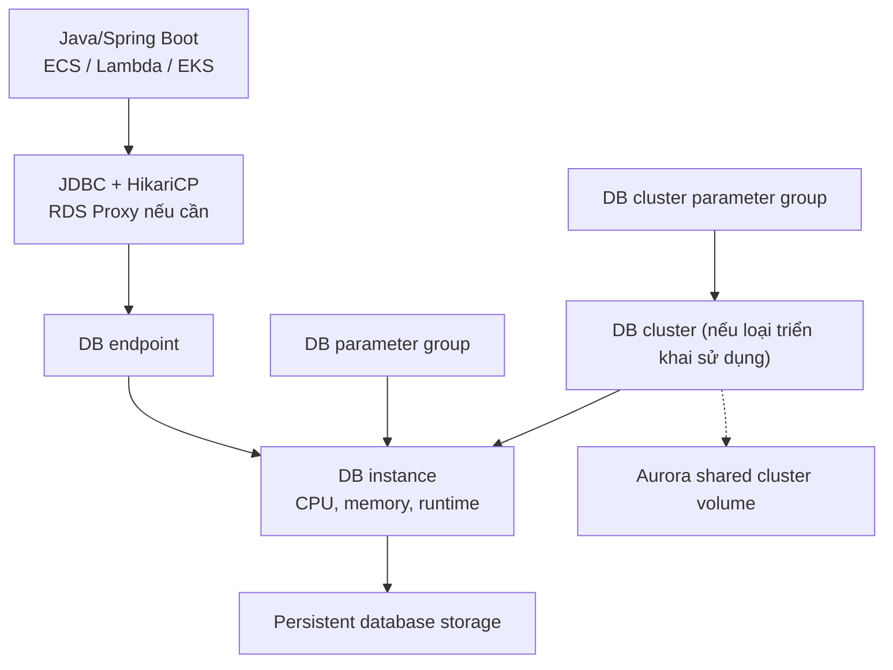
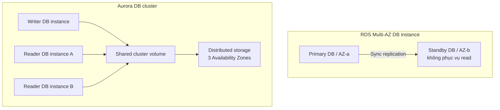
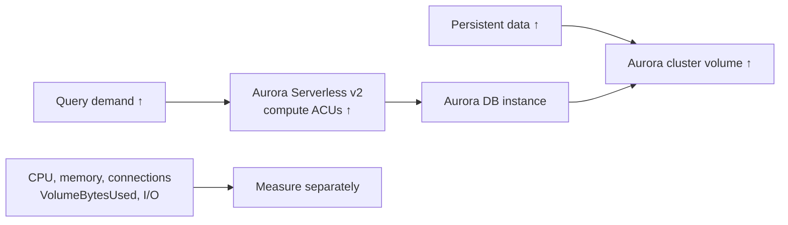
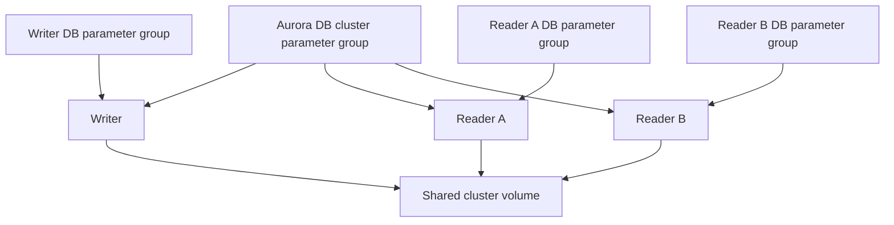
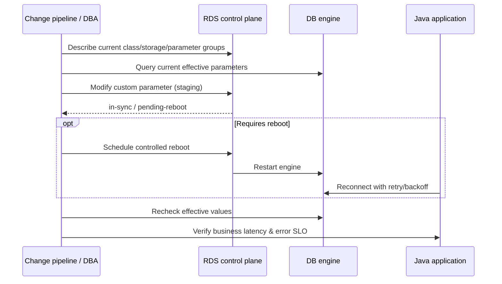

# DB instance, storage và nhóm tham số trong Amazon RDS và Aurora

> **Chương:** Cơ sở dữ liệu RDS và Aurora  
> **Module:** `CLOUD_PROVIDERS_AWS`  
> **Mục tiêu bối cảnh:** Khám phá cách cấu hình database có quản lý trên AWS, từ tính toán, bộ nhớ, lưu trữ và tham số engine đến bảo mật, mở rộng, giám sát, khôi phục và chi phí. Ví dụ sử dụng PostgreSQL/MySQL cho ứng dụng Java/Spring Boot; các tên tài nguyên, số liệu, ARNs và endpoints đều là **giả định**.

## Mục tiêu học tập

Sau bài này, người học có thể:

1. Phân biệt **RDS DB instance**, **DB instance class**, **RDS Multi-AZ DB instance**, **RDS Multi-AZ DB cluster** và **Aurora DB cluster**.
2. Chọn instance class theo CPU, RAM, network/storage bandwidth và query/connection profile; hiểu giới hạn engine, version và Region.
3. So sánh storage **gp2**, **gp3**, **Provisioned IOPS io1/io2 Block Express** và magnetic legacy; phân biệt **GiB**, **IOPS**, **throughput**, **latency**.
4. Giải thích hoạt động, ngưỡng kích hoạt, giới hạn và rủi ro chi phí của **RDS storage autoscaling**.
5. Mô tả **Aurora distributed shared cluster volume**, auto-growth, Aurora Standard vs I/O-Optimized và sự khác nhau giữa compute scaling với storage scaling.
6. Phân biệt **DB parameter group** và **DB cluster parameter group**, đặc biệt trong Aurora; nhận biết default/custom, parameter family, dynamic/static, `ApplyMethod` và `pending-reboot`.
7. Dùng AWS CLI/SQL để kiểm tra storage, parameter groups, pending modifications, giá trị runtime và trạng thái các database instances.
8. Tạo/sửa custom parameter group trên môi trường thực hành một cách an toàn, có kiểm soát downtime, IAM/KMS, backup, monitoring và rollback.
9. Kết nối các quyết định ở tầng DB với JDBC connection pool, RDS Proxy, topology reader/writer và ứng dụng Java.
10. Chẩn đoán các tình huống `storage-full`, high latency, memory pressure và cấu hình parameter chưa có hiệu lực.

## 1. Ba tầng trong một database được AWS quản lý

Một Amazon RDS database có ba lớp thiết kế quan trọng:

- **Compute:** một hay nhiều DB instances chạy engine SQL với CPU, memory, network và storage bandwidth.
- **Persistent data:** các file bảng/index/WAL/redo/transaction logs, được lưu theo mô hình RDS hoặc Aurora.
- **Engine configuration:** bộ tham số chi phối số kết nối, bộ nhớ, query optimizer, logging, timeout, timezone và extensions.

Ngoài ra còn có **topology** (Single-AZ/Multi-AZ/replicas), **network** (VPC/subnet/security group) và **identity** (SQL users, IAM/KMS, Secrets Manager).



Không có một cấu hình duy nhất tên “database size”:

- Thêm CPU/RAM không làm dung lượng lưu dữ liệu tăng.
- Tăng GiB lưu trữ không tự sửa SQL query bị lock hoặc thiếu index.
- Tăng số kết nối tối đa không tự tăng RAM.
- Sửa parameter group không đồng nghĩa thay engine values ngay lập tức.
- Thêm Aurora reader không tạo một bản full storage riêng cho reader đó.

## 2. DB instance là gì?

**DB instance** là tài nguyên compute/database do Amazon RDS quản lý, ví dụ một PostgreSQL server. Bạn chọn **engine**, **engine version**, **DB instance class**, **storage**, network và các tùy chọn HA/backup.

| Thuộc tính RDS | Vai trò | Giá trị minh họa |
|---|---|---|
| `DBInstanceIdentifier` | ID của tài nguyên DB instance ở AWS | `orders-postgres-prod` |
| `Engine`/`EngineVersion` | Loại/phiên bản DBMS | `postgres` / `16.x` |
| `DBInstanceClass` | CPU/RAM/network class | `db.m7g.large` |
| `AllocatedStorage` | Dung lượng provisioned cho RDS instance phù hợp | `200 GiB` |
| `StorageType` | gp3/io1/io2/... | `gp3` |
| `Iops`/`StorageThroughput` | Performance provisioned khi được hỗ trợ | Theo engine/storage |
| `DBParameterGroups` | Engine configuration của instance | `orders-pg16-prod` |
| `DBSubnetGroup` | Các private subnets DB có thể dùng | `orders-private-db-subnets` |
| `VpcSecurityGroups` | Quy tắc network access | SG chỉ cho phép app |
| `Endpoint` | DNS name + port ứng dụng dùng | `...rds.amazonaws.com:5432` |
| `StorageEncrypted`/`KmsKeyId` | Mã hóa dữ liệu khi lưu | KMS key phù hợp |
| `MultiAZ` | HA topology cho RDS instance deployment | `true` |
| `BackupRetentionPeriod` | Retention automated backups | Theo RPO/chính sách |

Một **DB instance identifier** không phải SQL database name và không phải JDBC username. Trong ví dụ:

```text
RDS identifier: orders-postgres-prod
SQL database:   ordersdb
SQL user:       orders_app
Endpoint:       orders-postgres-prod.example.ap-southeast-1.rds.amazonaws.com
Port:           5432
```

Không thể SSH vào DB host và quản trị EBS volume như EC2 thông thường; RDS cung cấp APIs/engine controls được hỗ trợ.

### 2.1 RDS, Aurora và RDS Multi-AZ DB cluster không giống nhau

| Hình thức | Data/compute model | Reader phục vụ đọc? | Parameter configuration |
|---|---|---|---|
| **RDS Single-AZ DB instance** | Một database instance, một AZ | Không có standby | DB parameter group |
| **RDS Multi-AZ DB instance** | Primary + **một standby đồng bộ** ở AZ khác | **Không** — standby chỉ phục vụ failover | DB parameter group |
| **RDS Multi-AZ DB cluster** | Writer + **hai readable readers** ở ba AZ, replication semisynchronous | **Có** | DB cluster parameter group |
| **Aurora DB cluster** | Writer và tùy chọn readers dùng **shared distributed cluster storage** | **Có** | DB cluster parameter group **và** DB parameter groups |

RDS Multi-AZ DB cluster (MySQL/PostgreSQL theo engine/version được hỗ trợ) **không phải Aurora**. Nó dùng một mô hình replication khác Aurora shared storage.

### 2.2 HA không thay thế database backup

Một Multi-AZ deployment bảo vệ nhiều lỗi hạ tầng/AZ, nhưng nếu bạn chạy `DELETE FROM orders` sai, thay đổi có thể được replicate. Vì vậy vẫn phải có automated backups, point-in-time recovery (PITR), snapshots và diễn tập restore.

## 3. Chọn DB instance class

Instance class có dạng:

```text
db.<family><generation>.<size>

db.m7g.large
db.r7g.xlarge
db.t4g.medium
```

Các nhóm phổ biến:

- **General-purpose `db.m*`:** cân bằng CPU/RAM/network cho đa số workloads.
- **Memory-optimized `db.r*`, `db.x*`, `db.z*`:** nhiều RAM cho database cache và memory-intensive queries.
- **Burstable `db.t*`:** workload nhỏ/không đều; phải xem CPU credits.
- **Compute-optimized `db.c*`:** CPU-intensive, phụ thuộc engine/version support.
- **Optimized Reads/instance class có NVMe local storage:** có thể cải thiện temporary data I/O; **local temporary storage không phải persistent DB data volume**.
- **Aurora Serverless v2 `db.serverless`:** compute scale theo ACU trong khoảng min/max; không phải fixed instance class có một số vCPU cố định.

Danh sách class hỗ trợ **thay đổi theo engine, engine version và Region**. Không suy mọi class xuất hiện ở mọi Account/Region.

### 3.1 Quy trình sizing đúng

1. Đo workload: SQL queries/sec, read/write ratio, p95/p99, concurrency, row sizes.
2. Kiểm tra `CPUUtilization`, `FreeableMemory`, `DatabaseConnections`, `ReadLatency`/`WriteLatency` và waits.
3. Xem `EXPLAIN ANALYZE`/slow queries và index effectiveness.
4. Phân biệt compute bound, memory bound, I/O bound, lock contention và network bottleneck.
5. Benchmark một vài instance classes **orderable** với dữ liệu gần production.
6. Tính cả phí Multi-AZ/reader, IOPS/throughput, backups và kết nối.

| Dấu hiệu | Khả năng nguyên nhân | Không nên vội |
|---|---|---|
| CPU cao liên tục, query efficient | Thiếu compute | Tăng storage GiB |
| FreeableMemory thấp, swap/churn | Thiếu RAM hoặc connection/query memory quá cao | Tăng max_connections |
| Latency I/O cao, IOPS/queue depth lớn | Storage saturation hoặc query I/O pattern xấu | Chọn instance chỉ theo vCPU |
| DatabaseConnections tăng theo ECS/Lambda replicas | Pool explosion | Mở unlimited connections |
| CPU credits cạn trên T class | Burstable CPU throttling | Chỉ tăng provisioned IOPS |
| p99 cao nhưng CPU/IO thấp | Locks, query plan, upstream/app contention | Tăng DB class vô hạn |

### 3.2 Connection pool sizing

Giả sử 20 ECS tasks có HikariCP `maximumPoolSize=10`:

```text
Potential connections = 20 × 10 = 200
Additional capacity: reporting + migrations + admin + monitoring
```

Số connections tối đa của một ứng dụng không phải số queries/second. Pool lớn có thể tăng context switching, memory pressure và transaction lock contention. Tối ưu queries và thời gian giữ connection trước khi tăng `max_connections`.

## 4. RDS storage types và các đại lượng phải phân biệt

Với RDS DB instances hỗ trợ storage loại EBS-backed do RDS quản lý, người vận hành chọn storage type, allocated size và performance options trong phạm vi engine/instance class được phép.

| Loại storage | Đặc tính | Khi nào đánh giá |
|---|---|---|
| **General Purpose SSD gp2** | IOPS liên quan size và burst behavior | Workloads cũ; so sánh với gp3 khi tối ưu |
| **General Purpose SSD gp3** | Performance cơ sở, provisioned IOPS/throughput độc lập trong những phạm vi được hỗ trợ | Thường là ứng viên đầu tiên cho nhiều DB workloads |
| **Provisioned IOPS io1** | Provisioned I/O capacity, IOPS/GiB ratios | Workload IO-intensive yêu cầu mức ổn định |
| **io2 Block Express** | Provisioned IOPS có đặc tính durability/latency theo dịch vụ | Database nặng, nhạy latency, đáp ứng hỗ trợ |
| **Magnetic (legacy)** | Thế hệ storage cũ | Không chọn mới; không hỗ trợ storage autoscaling |

**Đừng dùng bảng performance EBS gp3 của EC2 để áp cho RDS gp3.** RDS có minimum allocated storage, baseline IOPS/throughput và provisioned ranges riêng theo database engine, size và kiến trúc striped volumes.

### 4.1 GiB vs IOPS vs throughput vs latency

- **GiB:** sức chứa dữ liệu.
- **IOPS:** số I/O operations/giây.
- **MiB/s:** số MiB đọc/ghi mỗi giây.
- **Latency:** thời gian một operation phải chờ.
- **DiskQueueDepth:** số I/O operations còn chờ.

Công thức tham khảo:

```text
Throughput ≈ IOPS × average I/O size

Example:
8,000 IOPS × 16 KiB / 1,024 KiB/MiB ≈ 125 MiB/s
```

Đây chỉ là phép nhân lý tưởng, không phản ánh cache, engine batching, instance EBS bandwidth hay queueing latency thực tế.

### 4.2 gp3: vì sao thường tránh overprovision storage?

Nhiều cấu hình gp2 muốn có IOPS cao phải cấp storage lớn hơn nhu cầu dữ liệu. Với gp3, bạn có thể chọn IOPS/throughput riêng trong phạm vi cho phép, giúp cân bằng performance/cost.

Nhưng **gp3 không có nghĩa vô hạn IOPS với mọi dung lượng**. Luôn kiểm tra:

- Min/max GiB cho engine.
- Provisioned IOPS và throughput ranges.
- IOPS-to-storage/throughput ratios.
- DB instance EBS bandwidth limit.
- Chi phí provisioned performance riêng nếu có.

### 4.3 Khi nào io1/io2 đáng tiền?

Khi workload có I/O demand ổn định, high IOPS và latency yêu cầu cao mà gp3 không đáp ứng. Chọn dựa trên benchmark và engine wait analysis. Nếu bottleneck là thiếu index hoặc lock contention, đổi sang io2 có thể tốn tiền mà p99 không đổi.

### 4.4 Thay storage performance không đồng nghĩa đổi size

Với RDS gp3 hỗ trợ, bạn có thể thay `Iops`/`StorageThroughput` trong phạm vi mà **không nhất thiết tăng `AllocatedStorage`**. Tuy nhiên một số combinations yêu cầu minimum storage size; API có thể từ chối values ngoài ranges.

Sau storage modification, RDS có thể ở trạng thái **`storage-optimization`**. Database thường vẫn hoạt động, nhưng latency có thể tăng tạm thời; giới hạn sửa storage liên tiếp cũng cần tuân thủ.

## 5. RDS storage autoscaling

RDS storage autoscaling cho DB instance hỗ trợ nhằm **tự tăng allocated storage** khi sắp hết chỗ. Nó **không tự thu nhỏ** theo lượng data bị xóa.

### 5.1 Điều kiện kích hoạt

Theo AWS docs hiện hành, RDS cân nhắc tăng storage khi:

1. `FreeStorageSpace` còn **≤10%** allocated storage.
2. Tình trạng này kéo dài ít nhất **5 phút**.
3. Đã hoàn tất storage optimization của modification trước đó.
4. Chưa vượt số lượng storage modifications tối đa trong 24 giờ (**bốn lần** theo quy tắc hiện hành).

Mức tăng là giá trị lớn nhất của:

- **10 GiB**.
- **10% allocated storage**.
- Mức tăng dự đoán đủ cho nhu cầu **7 giờ** tiếp theo theo tốc độ sử dụng trong khoảng một giờ gần nhất.

### 5.2 Ví dụ số học

```text
AllocatedStorage    = 200 GiB
FreeStorageSpace    = 18 GiB  (9%)
MaxAllocatedStorage = 600 GiB

Nếu giữ <=10% đủ 5 phút và không bị chặn:
base increment = max(10 GiB, 10% × 200 GiB)
               = max(10, 20) = 20 GiB
Actual increment có thể lớn hơn do forecast algorithm.
```

**Không cam kết hệ thống chắc chắn tăng đúng 20 GiB.** Prediction, optimization cooldown, maximum storage threshold và engine constraints cùng ảnh hưởng.

### 5.3 Vì sao vẫn có thể `storage-full`?

- Batch import/transaction logs tăng nhanh hơn storage scaling.
- Vừa thay storage xong, optimization chưa hoàn tất.
- Đã đạt max storage threshold hoặc số lần modifications trong ngày.
- Một lần tăng dự đoán vượt maximum threshold.
- Engine/class có maximum orderable storage thấp hơn mong muốn.
- Workload tạo temporary files quá lớn hoặc logs bất thường.

Bật autoscaling **không thay thế CloudWatch alarm trên FreeStorageSpace và storage growth rate**.

### 5.4 Storage không tự giảm sau khi xóa dữ liệu

Khi RDS allocated 400 GiB, xóa 150 GiB tables vẫn có thể trả phí cho 400 GiB allocated. `ModifyDBInstance` không cho giảm `AllocatedStorage` thông thường. Giảm chi phí đòi:

- Chuyển sang DB mới có allocated storage nhỏ hơn, data migration/cutover.
- Một số quy trình RDS Blue/Green hỗ trợ thay storage theo engine/version.
- Dọn data/logs/index bloat để giảm tốc độ tăng về sau.

**Không xóa production data chỉ vì hy vọng autoscaling sẽ lập tức giảm bill.**

### 5.5 Một số giới hạn hiện hành

- `MaxAllocatedStorage` cần hợp lệ, ít nhất cao hơn current allocated theo yêu cầu dịch vụ; AWS thường khuyến nghị chừa headroom.
- Autoscaling **không** dùng cho magnetic storage.
- Một số legacy class/versions có hạn chế.
- Bật autoscaling không yêu cầu reboot, nhưng sizing/DB class và workload vẫn là trách nhiệm DBA.
- Với một số RDS for Oracle/SQL Server hỗ trợ additional storage volumes, autoscaling được đánh giá **theo từng volume**; đừng áp công thức một-volume duy nhất lên mọi cấu hình enterprise.

## 6. Multi-AZ và data topology ảnh hưởng storage/parameter ra sao?

### 6.1 RDS Multi-AZ DB instance deployment

Có **primary** và một **standby đồng bộ** ở AZ khác. Standby là failover target và **không** phục vụ read-only queries. Ứng dụng kết nối endpoint của DB instance và cần xử lý DNS/reconnection khi failover.

### 6.2 RDS Multi-AZ DB cluster deployment

Đối với MySQL/PostgreSQL theo version hỗ trợ, có **writer + hai reader DB instances ở ba AZ** với replication semisynchronous. Readers có thể phục vụ read traffic.

Các thay đổi class/storage của Multi-AZ DB cluster được quản lý ở **cluster level**. Không tùy ý `ModifyDBInstance` cho từng member như một Aurora reader riêng.

Parameter customization của RDS Multi-AZ DB cluster chủ yếu dùng **DB cluster parameter group**; DB parameter groups của instances được sử dụng ở mặc định theo kiến trúc này.

### 6.3 Aurora DB cluster

Aurora sử dụng **distributed shared cluster volume** cho writer/readers. Reader không cần nhân bản full data volume riêng để đọc cùng cluster data.



### 6.4 Multi-AZ khác read replicas

Multi-AZ chủ yếu nhằm **HA/failover**. Read replicas phục vụ **scale read**, có thể có replication lag. Aurora reader endpoint là cơ chế điều hướng **kết nối** tới readers, không tự hiểu SQL để chuyển mọi query write về writer.

Một ứng dụng dùng reader endpoint cần biết dữ liệu có thể trễ so với writer. Không dùng reader endpoint cho transactions cần read-after-write tuyệt đối mà không có strategy thích hợp.

## 7. Aurora storage: shared cluster volume

Aurora lưu persistent tables, indexes và metadata trong một **cluster volume** được phân tán trên nhiều AZ. AWS mô tả sáu bản copy của các segments trên ba Availability Zones, với các cơ chế phục hồi storage tự động.

### 7.1 Các đặc tính khác RDS DB instance storage

- Aurora **tự tăng** cluster storage khi lượng dữ liệu bền tăng.
- Không có kiểu “mỗi Aurora reader cần một copy 200 GiB storage độc lập”.
- Aurora DB instances có compute/RAM riêng, nhưng cùng truy cập shared volume.
- Temporary files/sorts có thể dùng **local ephemeral storage** trên instance; phải kiểm tra engine/version/class.
- Giới hạn tối đa cluster volume phụ thuộc engine version; AWS docs hiện nói **tới 256 TiB** cho những versions được hỗ trợ, **không** mặc định cho mọi cluster.
- Có phiên bản/tính năng hỗ trợ tự thu hồi storage khi data bị xóa, nhưng không suy DELETE sẽ lập tức giảm storage bill.

### 7.2 Aurora Standard vs Aurora I/O-Optimized

| Chế độ | Cấu trúc giá | Thường cân nhắc |
|---|---|---|
| **Aurora Standard** | Instance + consumed storage + read/write I/O request charges | Workload I/O vừa phải |
| **Aurora I/O-Optimized** | Instance + storage với mức giá khác, **không tính riêng I/O requests** | Workload I/O intensive, cần predictable I/O spend |

AWS nêu ngưỡng hướng dẫn: I/O-Optimized có thể kinh tế hơn khi chi phí I/O chiếm **khoảng 25% trở lên** tổng Aurora spend ở Standard. Đây là **hướng dẫn định lượng để benchmark**, không phải kết luận chắc chắn cho mọi Account/Region.

Khi đổi storage configuration:

- Có quy tắc/cadence chuyển từ Standard sang I/O-Optimized; kiểm tra AWS docs trước mỗi lần.
- Một số non-NVMe-based instances có thể chuyển không downtime, nhưng NVMe-based instances có thể cần restart.
- Không đổi dựa trên IOPS spike vài phút; dùng representative billing window.

### 7.3 Aurora Serverless v2: compute không phải storage

Aurora Serverless v2 tự thay đổi compute capacity theo **ACU**, còn shared cluster volume có auto-growth riêng. Một cluster có thể tăng ACU do queries nặng mà `VolumeBytesUsed` không đổi đáng kể.



**Không thiết kế Aurora Serverless v2 như một RDS DB instance dùng `AllocatedStorage/MaxAllocatedStorage` autoscaling**.

## 8. Parameter groups: bộ cấu hình database engine

Một **DB parameter group** là tập cấu hình cho SQL engine: connections, memory buffers, logging, optimizer, timeouts và những tính năng engine được AWS cho phép.

Metadata mỗi parameter có thể gồm:

- `ParameterName`.
- `ParameterValue`.
- `ApplyType` (static/dynamic).
- `ApplyMethod` (immediate/pending-reboot).
- `IsModifiable`.
- `AllowedValues`.
- `Source` (engine/system/user).
- `MinimumEngineVersion` theo API khi hỗ trợ.

### 8.1 Default vs custom

**Default group** do AWS tạo cho engine family; bạn **không sửa trực tiếp được**. Khi cần tuning:

1. Tìm engine/version và parameter group family.
2. Tạo **custom parameter group**.
3. Đổi những parameters `IsModifiable=true`.
4. Associate group với instance/cluster đúng scope.
5. Xác định cần reboot hay không.
6. Đọc lại effective SQL values và performance.

Không dùng cùng custom group cho các instances có nhu cầu khác nhau nếu việc sửa sau này làm nhiều DB bị ảnh hưởng.

### 8.2 Parameter family

Ví dụ phổ biến:

```text
postgres16             # RDS PostgreSQL 16
mysql8.0               # RDS MySQL 8.0
aurora-postgresql16    # Aurora PostgreSQL 16
aurora-mysql8.0        # Aurora MySQL 8.0
```

Không copy `postgres16` để dùng cho Aurora PostgreSQL rồi kỳ vọng hoạt động. Xác minh family được AWS hỗ trợ bằng `describe-db-engine-versions` theo Region/engine thật.

### 8.3 Một parameter group có thể được chia sẻ

Khi bạn modify `orders-pg16-prod`, **mọi DB instances đang gắn group đó** đều có thể chịu tác động. Vì vậy:

- Đặt tên theo environment và engine major.
- Ghi parameter values vào Git/IaC.
- Liệt kê tất cả DB instances dùng group trước mỗi lần sửa.
- Không chỉnh production group để thử một truy vấn trên staging.
- Có baseline group, backup và quy trình rollback.

## 9. Static, dynamic, immediate và pending reboot

| Khái niệm | Ý nghĩa |
|---|---|
| **Dynamic parameter** | Có thể apply khi đang chạy theo `ApplyMethod=immediate` nếu engine hỗ trợ |
| **Static parameter** | Cần restart/reboot instance/cluster members theo scope |
| `ApplyMethod=immediate` | Áp parameter phù hợp ngay sau update group |
| `ApplyMethod=pending-reboot` | Hoãn hiệu lực tới reboot |
| `ParameterApplyStatus=in-sync` | RDS báo group instance đã đồng bộ |
| `ParameterApplyStatus=pending-reboot` | Có cấu hình chưa được engine nhận, cần reboot |

**Không đoán parameter nào static/dynamic theo tên.** Metadata khác nhau giữa engines/versions; phải xem `ApplyType` và `IsModifiable` thực tế.

### 9.1 Reboot không tự xảy ra chỉ vì status pending-reboot

Khi sửa static parameter, DB có thể báo `pending-reboot`. Theo AWS, **thay đổi static parameter group không tự động reboot tại maintenance window** chỉ vì trạng thái này; cần kế hoạch reboot có chủ đích.

Reboot có thể ngắt database connections, làm rollback in-flight transactions và ảnh hưởng latency. Phải có JDBC reconnect, retry/idempotency và maintenance window.

### 9.2 Associate group mới khác modify group đã associate

- **Modify dynamic parameter trong custom group đã gắn:** có thể áp ngay với `immediate`.
- **Associate một custom parameter group mới:** AWS có thể chỉ áp **cả customized static và dynamic values** sau reboot instance.

Nhiều hệ thống thấy API association thành công nhưng SQL `SHOW` vẫn trả giá trị cũ vì **chưa reboot**.

### 9.3 Dynamic pending-reboot và engine differences

Một số dynamic parameters có thể được deferred với `pending-reboot` qua CLI, nhưng **RDS for SQL Server** có trường hợp không hỗ trợ apply method này. Không dùng một script tuning cho mọi engines.

### 9.4 Ví dụ parameters có thể gặp

| Engine | Parameter | Mục đích / nguy cơ |
|---|---|---|
| PostgreSQL | `max_connections` | Cấp nhiều connections hơn có thể tiêu tốn RAM lớn |
| PostgreSQL | `shared_buffers` | Buffer cache; sai sizing làm giảm RAM cho OS/queries |
| PostgreSQL | `work_mem` | Memory **mỗi sort/hash operation**, không phải tổng RAM DB |
| PostgreSQL | `log_min_duration_statement` | Slow query logs, có thể tăng log bill/PII |
| PostgreSQL | `idle_in_transaction_session_timeout` | Ngắt idle transactions, có thể ảnh hưởng app |
| PostgreSQL | `autovacuum*` | Kiểm soát bloat/maintenance, cần test |
| MySQL | `max_connections` | Connection bound/memory |
| MySQL | `innodb_buffer_pool_size` | Buffer pool sizing |
| MySQL | `slow_query_log` và `long_query_time` | Slow query diagnostics |
| MySQL | `wait_timeout` | Connection lifetime |
| MySQL | `character_set_server` | Charset default, không tự sửa dữ liệu cũ |

Đây là các **ví dụ về ý nghĩa**, không khẳng định mọi parameter đều modifiable hoặc cùng scope ở RDS/Aurora.

## 10. Aurora: hai tầng parameter groups

Aurora sử dụng:

1. **DB cluster parameter group**: thông số cluster-wide, đặc biệt những settings cần nhất quán với shared storage; đồng thời chứa default cho một số instance-level params.
2. **DB parameter group**: thông số áp dụng ở từng Aurora DB instance, ví dụ một số buffer/memory/logging settings có thể khác giữa writer và readers.



### 10.1 Parameter precedence

Theo AWS Aurora docs, một **explicit instance-level override** trong DB parameter group có thể **ghi đè giá trị tương ứng ở DB cluster parameter group** khi parameter hỗ trợ cả hai scopes. Một override được chỉnh về value bằng default vẫn có thể còn được xem là explicit override.

Vì vậy, nếu chỉnh cluster group rồi một reader không đổi:

1. Xem `describe-db-cluster-parameters`.
2. Xem `describe-db-parameters` của reader.
3. Kiểm tra `Source`, `ParameterValue`, `ApplyMethod`.
4. Kiểm tra `DBClusterParameterGroupStatus`/`ParameterApplyStatus`.
5. Đối chiếu effective value từ SQL.
6. Reset instance override đúng parameter nếu phù hợp và đã duyệt.

### 10.2 Static cluster parameter changes

Với Aurora, static cluster parameter change có thể cần reboot **từng DB instance liên quan**, không chỉ writer. Nếu một số readers chưa reboot, cluster có thể chạy với effective values khác dự kiến. Đọc trạng thái member và lên lịch failover/reboot an toàn.

### 10.3 RDS Multi-AZ DB cluster là ngoại lệ quan trọng

Một RDS Multi-AZ DB cluster (không phải Aurora) có một DB cluster parameter group cho các settings áp dụng chung; DB instance groups mặc định theo service architecture. **Không áp sơ đồ tùy biến Aurora per-reader instance group lên RDS Multi-AZ DB cluster**.

## 11. AWS CLI: quan sát DB instances và storage (read-only)

> Các tên DB/Region và ID bên dưới chỉ minh họa. Dùng profile/account được ủy quyền. Những lệnh `describe/get/list` trong hai mục tiếp theo **không thay đổi hạ tầng**.

### 11.1 Xác minh tài khoản

```bash
aws sts get-caller-identity
aws rds describe-db-instances \
  --region ap-southeast-1 \
  --query 'DBInstances[].{DB:DBInstanceIdentifier,Engine:Engine,Class:DBInstanceClass,Status:DBInstanceStatus}' \
  --output table
```

### 11.2 Xem instance, storage, groups và pending changes

```bash
aws rds describe-db-instances \
  --db-instance-identifier orders-postgres-prod \
  --region ap-southeast-1 \
  --query 'DBInstances[].{DB:DBInstanceIdentifier,Engine:Engine,Version:EngineVersion,Class:DBInstanceClass,Storage:StorageType,AllocatedGiB:AllocatedStorage,MaxGiB:MaxAllocatedStorage,IOPS:Iops,Throughput:StorageThroughput,Encrypted:StorageEncrypted,MultiAZ:MultiAZ,Groups:DBParameterGroups,Pending:PendingModifiedValues}' \
  --output json
```

Nếu `AllocatedStorage`/`Iops` không có nghĩa hữu ích với Aurora compute member, xem **cluster/storage metrics** thay vì suy ra shared volume từ instance fields.

### 11.3 Xem DB clusters

```bash
aws rds describe-db-clusters \
  --region ap-southeast-1 \
  --query 'DBClusters[].{Cluster:DBClusterIdentifier,Engine:Engine,Status:Status,Writer:Endpoint,Reader:ReaderEndpoint,ClusterParam:DBClusterParameterGroup,Members:DBClusterMembers}' \
  --output json
```

Có thể là Aurora hoặc RDS Multi-AZ DB cluster. Đọc engine/topology để phân biệt; **không phải mọi DBCluster đều là Aurora**.

### 11.4 Engine versions / orderable instance classes

```bash
aws rds describe-db-engine-versions \
  --engine postgres \
  --region ap-southeast-1 \
  --query 'DBEngineVersions[].{Version:EngineVersion,Family:DBParameterGroupFamily}' \
  --output table

aws rds describe-orderable-db-instance-options \
  --engine postgres \
  --region ap-southeast-1 \
  --query 'OrderableDBInstanceOptions[].{Class:DBInstanceClass,Storage:StorageType,MultiAZ:MultiAZCapable,AutoScale:SupportsStorageAutoscaling}' \
  --output table
```

Bảng có thể dài; lọc theo engine-version và class ở môi trường thật. Khi class/engine không orderable ở Region, API tạo/sửa sẽ lỗi dù tên class có trong một bài hướng dẫn cũ.

## 12. AWS CLI: đọc parameter groups (read-only)

### 12.1 Danh sách groups và families

```bash
aws rds describe-db-parameter-groups \
  --region ap-southeast-1 \
  --query 'DBParameterGroups[].{Name:DBParameterGroupName,Family:DBParameterGroupFamily}' \
  --output table

aws rds describe-db-cluster-parameter-groups \
  --region ap-southeast-1 \
  --query 'DBClusterParameterGroups[].{Name:DBClusterParameterGroupName,Family:DBParameterGroupFamily}' \
  --output table
```

### 12.2 Xem modifiable parameters của một group

```bash
aws rds describe-db-parameters \
  --db-parameter-group-name orders-pg16-prod \
  --region ap-southeast-1 \
  --output json

# Chỉ xem user-modified params:
aws rds describe-db-parameters \
  --db-parameter-group-name orders-pg16-prod \
  --source user \
  --region ap-southeast-1 \
  --output json
```

Xem `ParameterName`, `ApplyType`, `ApplyMethod`, `IsModifiable`, `AllowedValues`, `Source` và family trước khi sửa.

### 12.3 Xem Aurora cluster parameters

```bash
aws rds describe-db-cluster-parameters \
  --db-cluster-parameter-group-name orders-aurora-pg16-cluster \
  --region ap-southeast-1 \
  --output json

aws rds describe-db-parameters \
  --db-parameter-group-name orders-aurora-pg16-instance \
  --region ap-southeast-1 \
  --output json
```

### 12.4 Kiểm tra nhóm đang gắn vào DB

```bash
aws rds describe-db-instances \
  --db-instance-identifier orders-postgres-prod \
  --region ap-southeast-1 \
  --query 'DBInstances[].DBParameterGroups' \
  --output json

aws rds describe-db-clusters \
  --db-cluster-identifier orders-aurora-prod \
  --region ap-southeast-1 \
  --query 'DBClusters[].{Group:DBClusterParameterGroup,Members:DBClusterMembers}' \
  --output json
```

Nếu status `pending-reboot`, một số customized parameters chưa có hiệu lực. **Không** mặc định lệnh IaC deploy thành công đồng nghĩa SQL engine đã dùng values mới.

## 13. SQL: kiểm tra effective values

Để đối chiếu AWS control-plane configuration với **engine đang chạy**, truy cập database qua kênh được phép và chạy SQL read-only.

### 13.1 PostgreSQL

```sql
SELECT name, setting, unit, context, source, pending_restart
FROM pg_settings
WHERE name IN (
  'max_connections',
  'shared_buffers',
  'work_mem',
  'log_min_duration_statement',
  'idle_in_transaction_session_timeout'
)
ORDER BY name;
```

`setting` và `unit` cần đọc cùng nhau; `pending_restart` có thể phản ánh engine chưa restart; `source` là nguồn engine-level configuration.

Kiểm tra connections:

```sql
SELECT state, count(*) AS sessions
FROM pg_stat_activity
GROUP BY state
ORDER BY sessions DESC;
```

Đối với active locks/query latency, cần kết hợp các views của PostgreSQL và Performance Insights/Database Insights. Tránh in SQL literals chứa PII vào log public.

### 13.2 MySQL/Aurora MySQL

```sql
SHOW GLOBAL VARIABLES LIKE 'max_connections';
SHOW GLOBAL VARIABLES LIKE 'innodb_buffer_pool_size';
SHOW GLOBAL VARIABLES LIKE 'slow_query_log';
SHOW GLOBAL STATUS LIKE 'Threads_connected';
SHOW GLOBAL STATUS LIKE 'Threads_running';
```

`Threads_connected` phản ánh số connections, `Threads_running` là số threads đang chạy/not sleeping theo MySQL semantics; không dùng thay thế lẫn nhau.

### 13.3 Session value có thể khác global

Một parameter cho phép `SET` ở session scope có thể ghi đè giá trị global:

```sql
-- PostgreSQL: chỉ thay session hiện tại
SET statement_timeout = '10s';
SHOW statement_timeout;
RESET statement_timeout;
```

Đừng kết luận RDS parameter group sai chỉ từ một connection có session override do JDBC init SQL hoặc tool debug.

## 14. Thao tác thay đổi parameter groups trên môi trường sandbox

> **Cảnh báo:** Các lệnh trong mục này **tạo/sửa/reboot** database configuration. Chỉ chạy sau khi review, có staging instance hợp lệ, backup/PITR, approval và maintenance window. Bài học chỉ trình bày commands, không thực thi chúng.

### 14.1 Tạo custom RDS PostgreSQL parameter group

```bash
aws rds create-db-parameter-group \
  --db-parameter-group-name orders-pg16-staging \
  --db-parameter-group-family postgres16 \
  --description 'PostgreSQL 16 parameter group for staging' \
  --region ap-southeast-1
```

Lệnh này chỉ **tạo group**, chưa gắn vào instance.

### 14.2 Modify một parameter dynamic (sau khi kiểm tra)

```bash
aws rds modify-db-parameter-group \
  --db-parameter-group-name orders-pg16-staging \
  --parameters 'ParameterName=log_min_duration_statement,ParameterValue=1000,ApplyMethod=immediate' \
  --region ap-southeast-1
```

Giá trị 1000 ms là ví dụ để quan sát slow SQL trên staging, **không phải best practice cố định**. Trước khi chạy, xác nhận `IsModifiable=true` và `ApplyType=dynamic` ở engine version thực; logging SQL có thể chứa PII và làm tăng chi phí logs.

### 14.3 Associate custom group với một RDS instance

```bash
aws rds modify-db-instance \
  --db-instance-identifier orders-postgres-staging \
  --db-parameter-group-name orders-pg16-staging \
  --no-apply-immediately \
  --region ap-southeast-1
```

Sau association, cả customized dynamic/static settings trong **group mới** có thể chờ reboot. Kiểm tra `DBParameterGroups[].ParameterApplyStatus` và effective SQL values.

### 14.4 Reboot (có downtime)

```bash
aws rds reboot-db-instance \
  --db-instance-identifier orders-postgres-staging \
  --region ap-southeast-1
```

Reboot có thể drop connections và rollback in-flight transactions. Trước khi chạy, bảo đảm application reconnect/retry và các dependent services đã sẵn sàng.

### 14.5 Aurora custom cluster group

```bash
aws rds create-db-cluster-parameter-group \
  --db-cluster-parameter-group-name orders-aurora-pg16-staging \
  --db-parameter-group-family aurora-postgresql16 \
  --description 'Aurora PostgreSQL 16 cluster parameters for staging' \
  --region ap-southeast-1

aws rds modify-db-cluster \
  --db-cluster-identifier orders-aurora-staging \
  --db-cluster-parameter-group-name orders-aurora-pg16-staging \
  --no-apply-immediately \
  --region ap-southeast-1
```

Không copy tên group `orders-pg16-staging` (RDS `postgres16`) sang Aurora `aurora-postgresql16`. Kiểm tra static changes và reboot status từng member.

### 14.6 Modify storage — khác với parameter group

```bash
aws rds modify-db-instance \
  --db-instance-identifier orders-postgres-staging \
  --storage-type gp3 \
  --allocated-storage 250 \
  --no-apply-immediately \
  --region ap-southeast-1
```

Lệnh chỉ là **hình thức ví dụ**. Kiểm tra current allocated storage phải không vượt 250 GiB, storage type/engine/class constraints, pending changes và cost. Tăng allocated storage không dễ rollback giảm size; không dùng giá trị 250 GiB bừa cho production.

### 14.7 `Apply immediately` không đồng nghĩa zero downtime

Một `ModifyDBInstance --apply-immediately` có thể đưa các **pending changes khác** vào hiệu lực. Nó không hứa tất cả thay đổi không restart. Luôn đọc `PendingModifiedValues` trước khi cho phép apply.

## 15. CloudFormation/IaC: kiểm soát group và storage trong Git

IaC giúp review thay đổi và giảm drift. Đoạn dưới là **fragment**, không phải stack hoàn chỉnh.

### 15.1 RDS PostgreSQL DB instance và custom group

```yaml
Resources:
  OrdersDbParameters:
    Type: AWS::RDS::DBParameterGroup
    Properties:
      Family: postgres16
      Description: Parameter group for orders staging
      Parameters:
        log_min_duration_statement: "1000"

  OrdersDb:
    Type: AWS::RDS::DBInstance
    DeletionPolicy: Snapshot
    UpdateReplacePolicy: Snapshot
    Properties:
      DBInstanceIdentifier: orders-postgres-staging
      Engine: postgres
      DBInstanceClass: db.m7g.large
      AllocatedStorage: "200"
      MaxAllocatedStorage: 600
      StorageType: gp3
      StorageEncrypted: true
      MultiAZ: true
      DBSubnetGroupName: orders-private-db-subnets
      VPCSecurityGroups:
        - sg-0123456789abcdef0
      DBParameterGroupName: !Ref OrdersDbParameters
      MasterUsername: orders_admin
      ManageMasterUserPassword: true
      BackupRetentionPeriod: 7
      DeletionProtection: true
```

Đây không phải template có thể deploy độc lập: DB subnet group/SG đã được giả định tồn tại; engine/class/Region compatibility và quyền quản lý Secrets Manager cũng cần kiểm tra. `ManageMasterUserPassword` để AWS quản lý master secret khi engine hỗ trợ, thay vì hardcode password.

### 15.2 Aurora cluster và instance-level group

```yaml
Resources:
  AuroraClusterParameters:
    Type: AWS::RDS::DBClusterParameterGroup
    Properties:
      Family: aurora-postgresql16
      Description: Aurora PostgreSQL cluster defaults
      Parameters: {}

  AuroraInstanceParameters:
    Type: AWS::RDS::DBParameterGroup
    Properties:
      Family: aurora-postgresql16
      Description: Aurora PostgreSQL instance settings
      Parameters: {}

  OrdersAurora:
    Type: AWS::RDS::DBCluster
    Properties:
      DBClusterIdentifier: orders-aurora-staging
      Engine: aurora-postgresql
      DBClusterParameterGroupName: !Ref AuroraClusterParameters
      StorageEncrypted: true
      DBSubnetGroupName: orders-private-db-subnets
      VpcSecurityGroupIds:
        - sg-0123456789abcdef0
      MasterUsername: orders_admin
      ManageMasterUserPassword: true

  AuroraWriter:
    Type: AWS::RDS::DBInstance
    Properties:
      DBInstanceIdentifier: orders-aurora-staging-writer
      Engine: aurora-postgresql
      DBClusterIdentifier: !Ref OrdersAurora
      DBInstanceClass: db.r7g.large
      DBParameterGroupName: !Ref AuroraInstanceParameters
```

Fragment minh họa **hai group scopes** và thực thể cluster/instance. Cần thêm engine/version, backup retention, encryption key, deletion protection, reader topology, monitoring và regional compatibility trước khi dùng thật.

### 15.3 Vì sao IaC deploy success chưa đủ?

- Engine có thể có `pending-reboot`.
- Storage có thể đang `storage-optimization`.
- DB endpoints có thể bị reconnect khi failover/reboot.
- Data migration/DDL không được rollback bởi CloudFormation config rollback.
- Cluster group change có thể bị instance-level override.
- Class/engine version không support trong một Region dù được khai báo hợp lệ về mặt YAML.

Sau deploy phải **verify actual DB config và app business behavior**.

## 16. Java/Spring Boot: DB tuning phải phối hợp connection pool

Ví dụ Spring Boot với HikariCP:

```yaml
spring:
  datasource:
    url: "jdbc:postgresql://orders-postgres-staging.example.rds.amazonaws.com:5432/ordersdb?sslmode=require"
    username: "DB_USERNAME_FROM_SECURE_CONFIG"
    password: "DB_PASSWORD_FROM_SECRET_PROVIDER"
    hikari:
      maximum-pool-size: 10
      minimum-idle: 2
      connection-timeout: 3000
      idle-timeout: 600000
      max-lifetime: 1800000
```

**Cảnh báo:** Những username/password strings ở đây chỉ là placeholders; trong production lấy từ **Secrets Manager**/cơ chế secret injection, không commit password thật vào config. `sslmode=require` tạo kết nối TLS nhưng nếu cần xác minh chứng thư/máy chủ đầy đủ, phải cấu hình `verify-full`, CA trust store và JDBC driver hợp lệ.

### 16.1 Pool math khi autoscaling

```text
20 ECS tasks × 10 connections = 200 potential app connections
+ admin + migrations + batch jobs + metrics
= total DB connection demand lớn hơn 200
```

Nếu HPA/ECS autoscaling tăng tasks gấp đôi, DB connection demand cũng có thể tăng gấp đôi. Đừng tăng `max_connections` đến mức gây memory pressure mà không kiểm soát application pool.

### 16.2 RDS Proxy có giúp được không?

**RDS Proxy** có thể pool/multiplex backend connections và hỗ trợ reconnect/failover, hữu ích cho Lambda concurrency cao hoặc nhiều microservices connections ngắn. Nhưng không phải mọi SQL session/transaction đều multiplex tốt; session pinning, long transactions và engine limitations cần test.

### 16.3 Read/write endpoint routing

- Với RDS Multi-AZ DB instance: standby **không** được dùng cho đọc.
- Với Aurora: dùng writer/cluster endpoint cho writes, reader endpoint cho eligible reads.
- Không assume reader luôn current ngay sau writer commit nếu application cần read-after-write consistency.
- Tránh cài DNS/IP cố định làm ứng dụng không reconnect sau failover.

### 16.4 Không hardcode database credentials

- Dùng AWS Secrets Manager hoặc IAM database authentication nếu engine/architecture hỗ trợ.
- Giới hạn `secretsmanager:GetSecretValue` cho chính secret cần.
- Giám sát rotation và cập nhật/refresh connection pool đúng lúc.
- Không đưa JDBC URL có password vào logs.
- DB SQL permissions vẫn phải quản lý bằng `GRANT`/roles trong DB engine.

## 17. Quan sát compute, storage và parameter changes

### 17.1 CloudWatch metrics tiêu biểu

| Metric | Ý nghĩa | Dùng để |
|---|---|---|
| `CPUUtilization` | CPU engine/host usage | Compute sizing, hot queries |
| `FreeableMemory` | RAM có thể sử dụng thêm (bao gồm cache reclaimable theo dịch vụ) | RAM pressure |
| `DatabaseConnections` | Số DB connections | Pool capacity |
| `CPUCreditBalance` | Credit còn trên burstable classes | Burstable CPU health |
| `FreeStorageSpace` | Headroom storage ở RDS instance | Storage autoscaling/low-space alarms |
| `ReadIOPS` / `WriteIOPS` | I/O ops/giây | Workload và provisioned IOPS |
| `ReadThroughput` / `WriteThroughput` | Data transfer/storage I/O | Throughput/bandwidth |
| `ReadLatency` / `WriteLatency` | I/O latency | I/O saturation |
| `DiskQueueDepth` | Outstanding disk operations | Bottleneck/troubleshooting |
| `BurstBalance` | Burst credit theo storage type hỗ trợ | gp2/legacy |
| `VolumeBytesUsed` | Aurora cluster data storage usage | Aurora storage spending |
| `AuroraReplicaLag` | Replica lag | Read staleness/health |

Không phải mọi metric có trong mọi engine/storage version. CloudWatch là một phần; dùng **Database Insights/Performance Insights**, Enhanced Monitoring, SQL views và RDS events để có bức tranh đầy đủ.

### 17.2 SQL/engine metrics vs RDS control plane

- `describe-db-instances` nói RDS **mong muốn** config gì và có pending changes không.
- `pg_settings` / `SHOW GLOBAL VARIABLES` nói engine **đang dùng** giá trị gì.
- `CloudWatch metrics` cho thấy **hành vi hiệu năng**.
- `RDS events/CloudTrail` ghi nhận operations/maintenance/config changes phù hợp.
- Application p95/p99 latency và errors cho biết người dùng bị ảnh hưởng thế nào.

Không tuyên bố tuning thành công chỉ vì API trả thành công; phải đo trước/sau và kiểm tra SQL effective values.

### 17.3 Enhanced Monitoring / Database Insights

- **Enhanced Monitoring** đưa thêm OS-level metrics với granularity được cấu hình.
- **Database Insights/Performance Insights** giúp xem DB load, waits và top SQL khi engine/Region/plan hỗ trợ.
- **Slow query logs** có thể tăng log ingestion/cost và chứa sensitive SQL literals; cần retention/filter/access controls.

## 18. Bảo mật, VPC, IAM và backup

### 18.1 Network

Khuyến nghị cho ứng dụng Java backend:

- DB trong private DB subnet group với AZ phù hợp.
- `PubliclyAccessible=false` khi không có yêu cầu public.
- Security group cho inbound đúng app SG và port 5432/3306, không mở `0.0.0.0/0`.
- DNS resolution, route/NACL/SG và TLS được kiểm tra.
- Không đặt RDS trực tiếp sau Internet-facing ALB (ALB là HTTP/HTTPS, không phải SQL proxy).
- Đối với kết nối từ Lambda trong VPC, kiểm tra subnet/SG/DB endpoint và đường AWS APIs cần thiết.

### 18.2 IAM và SQL permissions khác nhau

| Phạm vi | Ví dụ quyền |
|---|---|
| AWS control plane read | `rds:DescribeDBInstances`, `rds:DescribeDBParameters` |
| AWS control plane change | `rds:ModifyDBInstance`, `rds:ModifyDBParameterGroup`, `rds:RebootDBInstance` |
| Secret/KMS | `secretsmanager:GetSecretValue`, `kms:Decrypt` khi cần |
| Database engine | SQL users, `GRANT SELECT/INSERT`, schemas, roles |
| Backup/restore | RDS APIs + IAM KMS key policy, SQL/data validation |

IAM permission để mô tả một DB instance **không cho phép** truy vấn tất cả bảng SQL. Tương tự, SQL admin không tự có quyền gọi AWS APIs.

### 18.3 Backups và khôi phục

- Bật automated backups/PITR theo RPO/retention.
- Tạo manual snapshots khi chuẩn bị thay đổi có rủi ro.
- Tập diễn tập restore vào môi trường tách biệt.
- Multi-AZ không bảo vệ khỏi delete data sai.
- Với engine/version changes, cần có data migration/rollback/cutover kế hoạch riêng.
- Với parameter changes static, giữ baseline group/values và runbook reboot.

### 18.4 Parameter group không phải secret store

Không lưu database password, API token hoặc private key trong parameter group. Đây là **engine configuration** và có thể được nhiều DB operators đọc. Dùng Secrets Manager, KMS và least privilege controls cho dữ liệu bí mật.

## 19. Tình huống thực tế: orders PostgreSQL tăng tải

Hệ thống ban đầu:

```text
RDS PostgreSQL 16
DB instance class = db.m7g.large (ví dụ)
Storage = gp3 / AllocatedStorage 200 GiB
MaxAllocatedStorage = 600 GiB
Multi-AZ DB instance = enabled
DB parameter group = orders-pg16-prod
Application = 10 ECS tasks × Hikari pool size 10
```

Khi traffic tăng, DBA thấy:

```text
CPUUtilization = 35%
DatabaseConnections = 100 → 230
FreeableMemory giảm
ReadLatency thấp, WriteLatency thấp
API p99 tăng
```

**Không phải giải pháp đầu tiên:** tăng gp3 allocated storage hoặc io2. Dấu hiệu gợi ý connection/memory/query transaction pressure.

### 19.1 Kế hoạch xử lý

1. Xem Hikari pool saturation, slow transaction và `pg_stat_activity`.
2. Kiểm tra số ECS replicas, app pool size, idle/in-transaction sessions.
3. Profile top SQL và locks.
4. Giảm pool size hoặc thêm pooling proxy nếu hợp lý.
5. Chỉ đổi class/RAM/`max_connections` sau benchmark.
6. Đặt alarm FreeableMemory/DatabaseConnections và test failover/reconnect.

### 19.2 Khi dữ liệu tăng rất nhanh

Một đợt nhập dữ liệu khiến FreeStorageSpace giảm còn 8% trong 10 phút, nhưng `storage-optimization` từ lần tăng trước chưa xong.

- Autoscaling có thể **không thể chạy tiếp ngay**.
- Kiểm tra RDS events, `MaxAllocatedStorage`, storage operation status.
- Giảm hoặc tạm ngừng imports khi cần.
- Xác định nguyên nhân storage growth (data/WAL/temp/index/bloat).
- Có kế hoạch headroom và bulk import capacity, không chỉ tăng max vô hạn.

### 19.3 Khi cân nhắc Aurora

Aurora PostgreSQL có shared storage, writer/readers, cluster/instance parameter groups. Trước khi migrate:

- Xác minh engine/version/extensions compatibility.
- Test data movement (DMS/dump-restore/CDC tùy case).
- Benchmark query throughput, replica lag, cost Standard vs I/O-Optimized.
- Đo reader/writer routing, connection pools và failover behavior.
- Lưu ý RDS group family `postgres16` **khác** Aurora `aurora-postgresql16`.
- Không coi migrate DB là một thao tác đổi parameter group.



## 20. Troubleshooting các lỗi thường gặp

| Triệu chứng | Nguyên nhân có thể | Nên kiểm tra |
|---|---|---|
| DB CPU cao | Query/plan/compute bound | Top SQL, EXPLAIN, class |
| FreeableMemory thấp | Nhiều connections, buffers, work_mem | SQL sessions, Enhanced Monitoring |
| `storage-full` dù autoscaling bật | Max threshold, optimization, growth burst | FreeStorageSpace, events, MaxAllocatedStorage |
| Không giảm được allocated storage | RDS không hỗ trợ scale-down trực tiếp | New DB/Blue-Green/migration |
| `storage-optimization` sau đổi gp3 | Storage engine đang tối ưu | StorageOperationStatus, latency |
| IOPS tăng nhưng p99 không đổi | Bottleneck CPU/locks/network | DB waits, SQL plan, bandwidth |
| Dynamic parameter không đổi | Group mới chưa reboot/instance override/session override | Apply status, SQL SHOW |
| Static parameter báo `pending-reboot` | Chưa reboot | Change window và reboot |
| Aurora reader không nhận cluster value | Instance-level parameter override | Source/value ở cả hai groups |
| API modify parameter bị từ chối | Family sai, not modifiable, wrong ApplyMethod | Describe parameter metadata |
| DB Multi-AZ standby không phục vụ read | Đây là RDS Multi-AZ DB instance | Kiểu topology |
| DB không start sau tuning | Memory/preload/invalid static config | Engine logs, baseline config |
| Java kết nối lỗi sau failover | Pool dùng stale sockets/DNS | RDS events, JDBC reconnect |
| RDS console OK nhưng SQL AccessDenied | SQL user/grants/Secrets/network | SQL auth, SG, TLS |
| Chi phí Aurora cao | Instance/ACUs/I/O/storage/network | Cost Explorer, VolumeBytesUsed |

### 20.1 Thứ tự điều tra

1. Xác định **Account, Region, Engine, version, deployment type**.
2. Với RDS instance, đọc class, storage type, allocated GiB, IOPS/throughput, pending changes.
3. Với Aurora, đọc cluster storage mode, writer/readers, shared volume metrics.
4. Xem parameter group family, static/dynamic metadata, status.
5. Đối chiếu SQL effective values.
6. Kiểm tra CloudWatch metrics, DB waits và app pool.
7. Tách query problem khỏi storage/compute bottleneck.
8. Chỉ thay đổi sau staging test + rollback plan.
9. Sau thay đổi, đo p95/p99, errors, business correctness và bill.

## 21. Bài tập tự kiểm tra

**Bài 1.** DB có CPU 95%, FreeStorageSpace còn 140 GiB và ReadLatency thấp. Bạn tăng allocated storage ngay không? Vì sao?

**Bài 2.** Phân biệt `db.m7g.large` và `gp3 200 GiB`. Tăng một cái có làm tăng cái kia không?

**Bài 3.** Vì sao gp3 cho phép tránh overprovision storage chỉ để có IOPS ở nhiều workload? Khi nào io2 đáng đánh giá?

**Bài 4.** RDS có AllocatedStorage=500 GiB, FreeStorageSpace=40 GiB duy trì 10 phút, MaxAllocatedStorage=1500 GiB. Theo ngưỡng thì autoscaling có thể bắt đầu chưa? Còn yếu tố chặn nào?

**Bài 5.** RDS đã tăng từ 200 lên 700 GiB, sau đó DELETE nhiều data. Có thể hạ `AllocatedStorage` về 200 bằng một lệnh modify không? Cần kế hoạch gì?

**Bài 6.** Aurora cluster có writer và 3 readers, data 2 TiB. Có phải chi phí storage là bốn bản sao 2 TiB riêng như 4 RDS instances độc lập?

**Bài 7.** Aurora Standard có I/O charges chiếm 32% chi phí. Nên cân nhắc storage mode nào? Có đảm bảo tổng bill sẽ rẻ hơn không?

**Bài 8.** RDS Multi-AZ DB instance có một standby. Bạn có thể gửi toàn bộ read traffic tới standby không? Khác Multi-AZ DB cluster thế nào?

**Bài 9.** Tại sao không gắn parameter group family `postgres16` cho Aurora PostgreSQL 16?

**Bài 10.** Sửa static parameter rồi group báo `pending-reboot`. Có tự reboot vào maintenance window không?

**Bài 11.** Vì sao associate một group mới có thể yêu cầu reboot ngay cả khi bên trong chỉ thay một dynamic parameter?

**Bài 12.** Aurora cluster group đặt parameter X=10 nhưng một reader dùng X=20. Nếu instance group có explicit override, kiểm tra gì?

**Bài 13.** 40 ECS tasks, mỗi task pool 15 connections. Số potential connections là bao nhiêu, và tại sao không nên chỉ tăng `max_connections` lên bằng con số đó?

**Bài 14.** PostgreSQL `work_mem` tăng 128 MiB cho mỗi sort/hash operation. Rủi ro khi có nhiều queries phức tạp song song?

**Bài 15.** `pg_settings.pending_restart=true` và RDS `ParameterApplyStatus=pending-reboot` là cùng một API không? Chúng biểu thị điều gì?

**Bài 16.** Aurora Serverless v2 tự tăng compute ACUs có đồng nghĩa cluster volume size cũng tăng không?

**Bài 17.** IAM role có `rds:DescribeDBInstances` nhưng Java không `SELECT` được bảng SQL. Thiếu điều gì?

**Bài 18.** Thay gp3 IOPS làm RDS `storage-optimization`, latency tăng tạm thời. Hành vi này luôn chứng minh operation thất bại không?

**Bài 19.** Nếu một lệnh `DELETE` nhầm được replicate đa AZ, Multi-AZ/Aurora storage replication có tự phục hồi dữ liệu cũ không? Cần gì?

**Bài 20.** Một static parameter sai khiến DB restart lỗi. Trước và sau thay đổi cần chuẩn bị những gì?

<details>
<summary>Gợi ý đáp án</summary>

1. Không; CPU bottleneck hoặc query vấn đề. Đo SQL/CPU/locks trước khi sizing.
2. `db.m7g.large` là compute class; `gp3 200GiB` là storage. Chúng độc lập ở mức cấu hình.
3. gp3 tách IOPS/throughput theo khả năng hỗ trợ; io2 khi I/O-heavy và benchmark yêu cầu.
4. 40/500=8%, đã ≤10% đủ thời gian; còn optimization, số modifications, prediction, limits.
5. Không giảm trực tiếp; cần migration/new DB/Blue-Green phù hợp và controlled cutover.
6. Không; Aurora dùng shared cluster volume giữa writer/readers.
7. So sánh I/O-Optimized theo instance/storage/I/O prices của Region và workload; không chắc chắn.
8. Không; standby RDS Multi-AZ DB instance không phục vụ read. Multi-AZ DB cluster có readable readers.
9. Parameter group families khác engine; verify bằng `describe-db-engine-versions`.
10. Không tự reboot do pending-reboot; phải sắp lịch reboot.
11. Group association mới có thể chỉ apply customized values sau reboot.
12. Xem instance parameter group `Source`/value, reset override nếu cần, SQL effective, reboot status.
13. 600; còn admin/jobs và memory overhead. Tối ưu pool/RDS Proxy.
14. Memory có thể nhân theo concurrent queries × operations, gây OOM.
15. Không; PostgreSQL view vs RDS control plane status, đều chỉ ra restart có thể cần.
16. Không; compute ACUs và persistent cluster storage growth là hai lớp.
17. SQL user/GRANT, database auth, Secrets/VPC/TLS; IAM RDS API không phải SQL permission.
18. Không; storage modification có thể có optimization phase. Theo dõi metrics/status.
19. Không; dùng backups/PITR/snapshots, data validation và recovery plan.
20. Staging test, backup, baseline group, change window; rollback config/reboot và verify SQL/app health.

</details>

## 22. Checklist production

- [ ] Đã phân biệt RDS DB instance, RDS Multi-AZ DB cluster và Aurora DB cluster.
- [ ] Chọn DB instance class theo benchmark, không chỉ vCPU hoặc giá.
- [ ] Tách compute, persistent storage và engine configuration thành các nhóm quan sát riêng.
- [ ] Chọn gp3/io2 theo I/O workload; kiểm tra engine/version/Region limits.
- [ ] Cấu hình `AllocatedStorage` và `MaxAllocatedStorage` theo growth + budget; hiểu không auto-shrink.
- [ ] Có alarm `FreeStorageSpace` và storage growth, không chỉ bật autoscaling.
- [ ] Nếu dùng Aurora, hiểu shared cluster volume, Standard/I/O-Optimized, ACU compute và limits theo version.
- [ ] Parameter group custom đúng family, default groups không bị cố sửa.
- [ ] Đã xác định instance group vs cluster group; kiểm tra overrides nếu là Aurora.
- [ ] Đã kiểm tra `ApplyType`, `IsModifiable`, `AllowedValues`, `ApplyMethod`.
- [ ] Đã lập kế hoạch reboot cho `pending-reboot` và sửa group association.
- [ ] Đã xác định tất cả DB instances dùng chung group trước khi sửa.
- [ ] Đã kiểm tra `PendingModifiedValues` trước khi áp dụng thay đổi ngay.
- [ ] Đã kiểm tra SQL effective values và performance metrics sau thay đổi.
- [ ] Connection pool sizing dựa trên autoscaling replicas, có headroom.
- [ ] HA/read topology và reader/writer routing phù hợp yêu cầu consistency.
- [ ] Private networking, IAM/KMS, Secrets Manager và JDBC TLS được cấu hình đúng.
- [ ] Automated backup/PITR/snapshot và diễn tập restore được thực hiện.
- [ ] Có alarms cho CPU, memory, DB connections, I/O latency/queue depth và replica lag.
- [ ] IaC configuration có version/diff/approval, có baseline + rollback runbook.
- [ ] Đã tính phí DB compute, HA, provisioned storage/IOPS/throughput, Aurora storage/I/O, backup và data transfer.

## Tài liệu AWS chính thức

- [Amazon RDS — RDS overview](https://docs.aws.amazon.com/AmazonRDS/latest/UserGuide/Welcome.html)
- [Amazon RDS — DB instance classes](https://docs.aws.amazon.com/AmazonRDS/latest/UserGuide/Concepts.DBInstanceClass.Types.html)
- [Amazon RDS — DB instance storage](https://docs.aws.amazon.com/AmazonRDS/latest/UserGuide/CHAP_Storage.html)
- [Amazon RDS — gp3 storage configuration](https://docs.aws.amazon.com/AmazonRDS/latest/UserGuide/USER_PIOPS.gp3.html)
- [Amazon RDS — Storage autoscaling](https://docs.aws.amazon.com/AmazonRDS/latest/UserGuide/USER_PIOPS.Autoscaling.html)
- [Amazon RDS — Parameter groups overview](https://docs.aws.amazon.com/AmazonRDS/latest/UserGuide/parameter-groups-overview.html)
- [Amazon RDS — Creating parameter groups](https://docs.aws.amazon.com/AmazonRDS/latest/UserGuide/USER_WorkingWithParamGroups.Creating.html)
- [Amazon RDS — Associating parameter groups](https://docs.aws.amazon.com/AmazonRDS/latest/UserGuide/USER_WorkingWithParamGroups.Associating.html)
- [Amazon RDS — Modifying parameter groups](https://docs.aws.amazon.com/AmazonRDS/latest/UserGuide/USER_WorkingWithParamGroups.Modifying.html)
- [Amazon RDS — Multi-AZ DB instance deployments](https://docs.aws.amazon.com/AmazonRDS/latest/UserGuide/Concepts.MultiAZSingleStandby.html)
- [Amazon RDS — Multi-AZ DB cluster deployments](https://docs.aws.amazon.com/AmazonRDS/latest/UserGuide/multi-az-db-clusters-concepts.html)
- [Amazon Aurora — Storage architecture](https://docs.aws.amazon.com/AmazonRDS/latest/AuroraUserGuide/Aurora.Overview.StorageReliability.html)
- [Amazon Aurora — Parameter groups](https://docs.aws.amazon.com/AmazonRDS/latest/AuroraUserGuide/USER_WorkingWithParamGroups.html)
- [Amazon Aurora — Cluster and instance parameter groups](https://docs.aws.amazon.com/AmazonRDS/latest/AuroraUserGuide/parameter-groups-overview.html)
- [Amazon RDS — Monitoring and metrics](https://docs.aws.amazon.com/AmazonRDS/latest/UserGuide/MonitoringOverview.html)
- [Amazon RDS — Troubleshooting](https://docs.aws.amazon.com/AmazonRDS/latest/UserGuide/CHAP_Troubleshooting.html)
- [AWS CLI — Amazon RDS](https://docs.aws.amazon.com/cli/latest/reference/rds/index.html)
- [Amazon RDS pricing](https://aws.amazon.com/rds/pricing/)
- [Amazon Aurora pricing](https://aws.amazon.com/rds/aurora/pricing/)

**Điểm cần ghi nhớ:** **DB instance class** quyết định CPU/RAM/bandwidth; **RDS storage** quyết định GiB/IOPS/throughput và chỉ tự **tăng** khi bật autoscaling; **Aurora** dùng shared cluster storage tự mở rộng theo dữ liệu. **Parameter group** quản lý engine settings với những ranh giới **instance vs cluster**, **dynamic vs static**, **associated group vs effective runtime**. Một database an toàn và hiệu quả phải kết hợp tuning đo được, availability topology, backup/PITR, VPC/IAM/KMS, JDBC pooling, observability và rollback có kiểm chứng.

