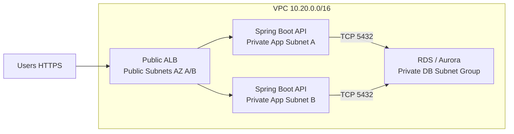
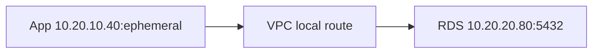
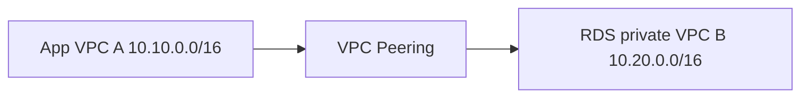
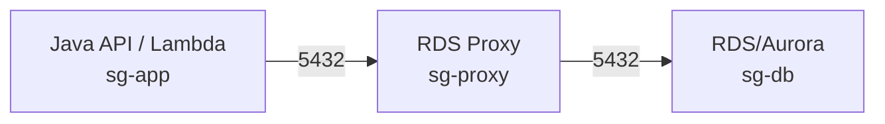

# DB subnet group, Security Group và kết nối riêng tư

Khi một ứng dụng Java chạy trong AWS không kết nối được Amazon RDS hoặc Amazon Aurora, nguyên nhân thường không nằm ở JDBC driver mà ở một trong các lớp **VPC, DB subnet group, route table, Security Group (SG), Network ACL (NACL), DNS, TLS hoặc database authentication**. Ngược lại, việc mở toàn bộ cổng database ra Internet để “sửa” timeout có thể tạo rủi ro bảo mật nghiêm trọng.

Bài này đi từ khái niệm đến thực hành: **đặt RDS/Aurora trong private subnets, chỉ cho ứng dụng cần thiết truy cập đúng DB port, xác minh private network path và bảo vệ kết nối SQL**. Kiến thức thuộc chương **Cơ sở dữ liệu RDS và Aurora** của mô-đun **CLOUD_PROVIDERS_AWS**, liên kết Region/AZ, IAM, VPC, EC2/ECS/EKS/Lambda, cơ sở dữ liệu, giám sát, phục hồi và tối ưu chi phí.

> **Quy tắc nền tảng:** **DB subnet group** quyết định tập subnets để RDS/Aurora triển khai; **Security Group** quyết định nguồn TCP nào được phép; **route/DNS/NACL** hỗ trợ gói tin đến đúng đích; **database authentication và TLS** bảo vệ đăng nhập và dữ liệu. Một lớp không thể thay thế lớp còn lại.

## 1. Mục tiêu học tập

Sau bài học, bạn có thể:

1. Định nghĩa DB subnet group, subnet, Availability Zone và cách RDS/Aurora dùng tập subnets.
2. Giải thích yêu cầu thông thường **ít nhất hai subnets ở hai AZ**; phân biệt điều kiện này với việc đã bật Multi-AZ.
3. Thiết kế public/private application/database subnets và chọn `PubliclyAccessible=false` cho production.
4. Dùng **Security Group reference** để cho Java workloads kết nối DB PostgreSQL/MySQL mà không mở public port.
5. Phân biệt **stateful SG** với **stateless NACL**, đặc biệt port trả lời của TCP.
6. Phân biệt private traffic qua VPC `local` route, cross-VPC peering/TGW, VPN/Direct Connect và RDS API PrivateLink.
7. Chọn đúng RDS instance endpoint hoặc Aurora writer/reader endpoint, giải thích DNS khi failover.
8. Cấu hình EC2, ECS, Lambda, EKS và App Runner kết nối private DB bằng đúng workload SG.
9. Tích hợp JDBC TLS, Secrets Manager, IAM DB authentication hoặc RDS Proxy theo yêu cầu.
10. Chạy các bước kiểm tra read-only ở AWS CLI/Console, DNS, TCP và SQL.
11. Chẩn đoán `Connection timed out`, `password authentication failed`, TLS errors và connection pool exhaustion.
12. Đề xuất kiến trúc có khả năng phục hồi, giám sát, kiểm soát IAM và chi phí.

## 2. Kiến trúc tham chiếu: ứng dụng public, database private



Ví dụ:

| Lớp | Mạng | Giới hạn truy cập |
| --- | --- | --- |
| ALB | Public subnets AZ A/B | HTTPS từ Internet và WAF nếu cần |
| Java API | Private application subnets AZ A/B | HTTP traffic từ ALB SG |
| RDS PostgreSQL | Private DB subnets AZ A/B | TCP **5432 từ Java app SG** |
| Quản trị | VPN/SSM/session quản trị theo quyền | Không mở database trực tiếp cho Internet |
| Secrets | AWS Secrets Manager theo IAM role | Chỉ app role được đọc secret liên quan |

**RDS subnet group đa AZ không tự tạo database standby.** Việc tạo **RDS Multi-AZ** hoặc Aurora replicas là một quyết định HA riêng biệt; mạng chỉ cung cấp subnets/AZ mà service có thể sử dụng.

## 3. DB subnet group là gì?

**DB subnet group** là tập **subnets cùng thuộc một VPC** mà Amazon RDS/Aurora có thể dùng khi đặt network interfaces và DB resources. Với phần lớn RDS DB instance/Aurora deployments, group cần **ít nhất một subnet tại mỗi trong ít nhất hai Availability Zones**; có ngoại lệ dịch vụ như Local Zones.

Ví dụ:

```text
VPC: vpc-0example, CIDR 10.20.0.0/16
DB subnet group: orders-db-subnets
  subnet-db-a: 10.20.20.0/24, ap-southeast-1a
  subnet-db-b: 10.20.21.0/24, ap-southeast-1b
  subnet-db-c: 10.20.22.0/24, ap-southeast-1c (optional)
```

| Tài nguyên | Ý nghĩa |
| --- | --- |
| **VPC** | Không gian network cấp Region |
| **Subnet** | Một dải IP trong một AZ, gắn route table/NACL |
| **DB subnet group** | Danh sách lựa chọn subnet cho database |
| **DB instance** | Compute/database instance được RDS quản lý |
| **Aurora DB cluster** | Nhóm DB instances + storage/roles theo mô hình Aurora |
| **Security Group** | Firewall stateful của network interfaces |
| **DB endpoint** | DNS hostname/port client dùng để kết nối |

Tạo DB subnet group **không tự tạo subnet mới, không tạo DB instance và không mở firewall**.

### 3.1. Vì sao phải chọn ít nhất hai AZ?

Nếu primary DB cần được thay thế hoặc triển khai Multi-AZ, RDS cần có subnet/địa chỉ trong AZ thích hợp. Một group chỉ có nhiều subnets nhưng tất cả ở một AZ **không đáp ứng** điều kiện chung đa AZ. Đồng thời, **hai subnets không đồng nghĩa có hai database instances**: Single-AZ RDS vẫn có thể dùng DB subnet group đa AZ.

### 3.2. Subnet IP capacity

RDS/Aurora cần IP cho ENIs và các hoạt động tạo/recovery/failover/maintenance. Kiểm tra:

- `AvailableIpAddressCount` trên từng DB subnet.
- Dung lượng IP dự phòng khi cluster có thêm reader, proxy hoặc cần thay compute.
- Subnets không quá nhỏ và không bị workloads khác chiếm hết.
- Engine/instance type có khả dụng ở AZ đã chọn.
- Nếu dùng IPv4+IPv6 dual-stack, từng subnet trong group phải có IPv6 CIDR theo điều kiện dịch vụ.

AWS dành một số địa chỉ IPv4 trong mỗi subnet; **`/28` không có đủ 16 IP sử dụng tự do**. Đừng lập sizing chỉ theo số địa chỉ toán học.

### 3.3. Không trộn public/private một cách tùy tiện

AWS phân biệt subnet public/private theo route/network. Với một **DB instance/cluster được thiết lập để publicly accessible**, subnets trong DB subnet group phải đáp ứng điều kiện public nhất quán; trộn public/private có thể khiến writer sau failover nằm ở subnet không thể truy cập từ bên ngoài.

Với mục tiêu bảo mật bài này, chọn **toàn private DB subnets** và **Public accessibility = No**.

## 4. Public subnet, private subnet và PubliclyAccessible

### 4.1. Public subnet

Trong IPv4 VPC, subnet thường được gọi là **public** khi route table có đường mặc định `0.0.0.0/0 → Internet Gateway`. Một EC2/RDS muốn nhận traffic trực tiếp từ Internet còn cần địa chỉ public và rules cho phép.

### 4.2. Private subnet

**Private subnet** không có đường public IPv4 trực tiếp qua IGW cho tài nguyên bên trong. Nó vẫn có:

- `local` route đến VPC CIDR.
- Route qua NAT Gateway cho outbound Internet nếu cần.
- Peering/TGW/VPN routes đến private networks khác nếu được thiết kế.
- VPC endpoints để truy cập một số AWS APIs qua private path.

**Điểm dễ nhầm:** app trong private subnet **không cần NAT để kết nối RDS private cùng VPC**. Luồng Java app → RDS dùng VPC `local` route.

### 4.3. PubliclyAccessible có ý nghĩa gì?

Thông số RDS `PubliclyAccessible` xác định DB instance có public-facing addressing/endpoint theo cấu hình hay không. Khuyến nghị:

```text
DB subnet group: private subnets AZ A/B
RDS PubliclyAccessible: false
DB SG inbound: only app SG on DB port
Route from app to DB: VPC local
```

Đặt `PubliclyAccessible=false` **không cấm private IP connections**. EC2/ECS/Lambda trong VPC, hay hệ thống có đường VPN/private routing, vẫn kết nối được nếu SG/NACL và DB auth phù hợp.

**Không đặt `PubliclyAccessible=true` và mở `0.0.0.0/0` chỉ vì laptop không truy cập được DB.** Với private DB, việc laptop không có private route là hành vi bảo mật mong muốn.

## 5. Route table và local routing

Một route table quyết định packet sẽ đi đâu khi tới CIDR đích. Trong cùng VPC:

```text
App private subnet: 10.20.10.0/24
DB private subnet:  10.20.20.0/24
VPC CIDR:           10.20.0.0/16

Route:
  Destination 10.20.0.0/16  ->  local
```



Không cần Internet Gateway, NAT Gateway, VPN hoặc VPC Peering chỉ để đi qua hai subnets của **cùng VPC**.

**Route đúng không có nghĩa truy cập được:** vẫn phải kiểm tra SG, NACL, VPC DNS, database listener, TLS và credentials.

### 5.1. Main route table và explicit associations

Nếu một subnet không có route table association tường minh, subnet có thể sử dụng **main route table** của VPC. Không kết luận “subnet không có route” chỉ vì lệnh tìm explicit association không trả kết quả.

### 5.2. NAT Gateway không phải SQL proxy

NAT cho phép private resources chủ động kết nối Internet IPv4. NAT không phải database protocol proxy, không cấp phép DB user và không thay SG. Một Java API cần đọc Secrets Manager từ private subnet có thể cần VPC endpoint/NAT cho **AWS API outbound**, nhưng JDBC app → DB vẫn đi **local route**.

## 6. Security Group: cho đúng nguồn kết nối đúng port

**Security Group (SG)** là firewall **stateful** gắn với ENI/resource. RDS/Aurora SG inbound phải chỉ cho các workloads cần kết nối.

### 6.1. Hai SG tách biệt

```text
sg-orders-app: gắn vào Java workloads
sg-orders-db:  gắn vào PostgreSQL RDS/Aurora

sg-orders-db INBOUND:
  TCP 5432   Source = sg-orders-app

sg-orders-app OUTBOUND:
  TCP 5432   Destination = sg-orders-db

No database inbound from 0.0.0.0/0
```

SG reference giúp cho phép **mọi ENIs được gắn đúng SG app** trong phạm vi AWS hỗ trợ, ngay cả khi EC2/ECS tasks thay IP vì Auto Scaling. Không cần duy trì thủ công danh sách private IP của từng app instance.

### 6.2. Vì sao tách SG của app và DB?

- Dễ kiểm toán ứng dụng nào được vào database.
- Khi app thay replicas/IP, reference vẫn giữ nguyên.
- DB SG không vô tình mở port cho mọi resource thuộc cùng VPC.
- Có thể áp SG riêng cho migration job hoặc RDS Proxy.
- Thay đổi rule DB không ảnh hưởng các inbound HTTP rules của app.

**Không tham chiếu SG của ALB** vào DB chỉ vì ALB nằm phía trước Java API. SQL TCP được tạo bởi **ứng dụng**, không phải bởi ALB.

### 6.3. Bảng rule phù hợp

| Rule DB ingress | Đánh giá |
| --- | --- |
| TCP `5432` từ `0.0.0.0/0` | **Tránh**, quá rộng |
| TCP `5432` từ toàn VPC `10.20.0.0/16` | Hẹp hơn Internet nhưng vẫn nhiều nguồn không cần |
| TCP `5432` từ `sg-orders-app` | **Ưu tiên** trong phạm vi SG reference hỗ trợ |
| TCP `3306` từ app SG nhưng DB là PostgreSQL 5432 | **Sai port** |
| TCP `5432` từ developer laptop public IP | Chỉ dùng ngoại lệ được duyệt; ưu tiên VPN/SSM |

SG chỉ có **allow rules**, không có deny rules truyền thống. Nhiều SG gắn cùng DB sẽ có **quyền được cộng lại**, không phải giao của các rules. Một SG cho phép toàn VPC có thể vô hiệu mục tiêu “chỉ app SG” của SG còn lại.

### 6.4. Port theo DB engine

| Engine | Port mặc định thường dùng |
| --- | --- |
| RDS PostgreSQL / Aurora PostgreSQL | **5432 TCP** |
| RDS MySQL / Aurora MySQL | **3306 TCP** |
| RDS MariaDB | **3306 TCP** |
| RDS SQL Server | **1433 TCP** |
| RDS Oracle | **1521 TCP** |
| RDS Db2 | **50000 TCP** theo cấu hình |

Các port có thể khác mặc định; luôn đọc `Endpoint.Port` trong RDS Console/API.

## 7. Security Group khác NACL

| Tiêu chí | Security Group | Network ACL |
| --- | --- | --- |
| Gắn với | ENI/resource | Subnet |
| Stateful | **Có** | **Không** |
| Loại rules | Allow | Allow/Deny theo thứ tự |
| SG reference | Có theo điều kiện | Không |
| Response traffic | Tự cho phép trên connection được thiết lập | Phải có allow chiều ngược |
| Vai trò phổ biến | Phân quyền workload cụ thể | Guardrails ở biên subnet |

Xét kết nối:

```text
Java API 10.20.10.45:50123  ->  RDS 10.20.20.80:5432
Java API 10.20.10.45:50123  <-  RDS 10.20.20.80:5432
```

SG **stateful** chỉ cần outbound app tới port 5432 và inbound DB từ app SG. NACL **stateless** ở hai subnets còn phải cho phép **return traffic tới ephemeral client port** theo ranges/phương thức đã thiết kế.

Một custom NACL chặn ephemeral ports có thể gây `Connection timed out` dù app/DB SG đúng. Đừng mở bừa mọi port chỉ để xử lý lỗi; xác định source-port ranges của workload OS và CIDR cụ thể.

## 8. DNS và endpoint: không dùng IP cố định

RDS/Aurora cấp **DNS endpoint**. Khi failover/recovery, network IP có thể thay, nên ứng dụng phải dùng hostname.

```text
RDS PostgreSQL instance endpoint:
orders-db.abcdefghijk.ap-southeast-1.rds.amazonaws.com:5432

Aurora writer endpoint:
orders-cluster.cluster-abcdefghijk.ap-southeast-1.rds.amazonaws.com:5432

Aurora reader endpoint:
orders-cluster.cluster-ro-abcdefghijk.ap-southeast-1.rds.amazonaws.com:5432
```

Đây là **ví dụ**, không phải tên có thể dùng thật.

### 8.1. RDS DB instance endpoint

RDS DB instance có endpoint hostname/port. Khi instance Multi-AZ failover, endpoint cho phép client tìm primary mới theo DNS. **Connection TCP cũ vẫn có thể bị đứt**; phía ứng dụng phải retry/reconnect.

### 8.2. Aurora writer và reader endpoints

| Endpoint | Chức năng |
| --- | --- |
| **Cluster / writer** | Điều hướng tới primary writer; dùng cho writes và reads yêu cầu writer |
| **Reader** | Phân phối **connections mới** tới Aurora Replicas khi có; chủ yếu dùng SELECT |
| **Instance** | Nhắm tới một DB instance cố định, không tự theo writer role |
| **Custom** | Nhóm DB instances theo cấu hình riêng |
| **RDS Proxy endpoint** | Kết nối vào proxy và pool DB connections |

**Reader endpoint cân bằng connections, không cân bằng từng SQL query.** Nếu Aurora cluster chỉ có writer và không có read replica, reader endpoint **có thể đi vào writer**, nên không thể coi endpoint này là proof rằng database luôn chỉ đọc.

### 8.3. Cập nhật DNS sau failover

- Không lưu IP vào config file hoặc `/etc/hosts`.
- JVM DNS cache/OS resolver không nên giữ IP cũ mãi.
- Pool cần loại bỏ stale connections.
- Retry có timeout, exponential backoff+jitter.
- Với writes, kiểm soát idempotency vì khi connection đứt không phải lúc nào client cũng biết transaction đã commit chưa.
- Kiểm tra read replica lag nếu ứng dụng đọc từ reader.

## 9. Kết nối EC2 và RDS trong cùng VPC

Giả sử EC2 `sg-orders-app` và RDS `sg-orders-db` ở cùng VPC.

1. RDS `available`, đúng endpoint và port.
2. App và DB subnets thuộc cùng VPC; local route khả dụng.
3. DB SG inbound TCP `5432` source app SG.
4. App SG outbound TCP `5432` destination DB SG (hoặc rule egress bao phủ).
5. NACL không chặn đường đi/trả về.
6. VPC DNS phân giải endpoint đúng.
7. Client TLS trust CA/certificate phù hợp.
8. DB user/password hoặc IAM DB auth hợp lệ.
9. DB SQL privileges đủ cho nghiệp vụ.
10. Connection pool phù hợp DB capacity.

### 9.1. Console tự động kết nối EC2/RDS

RDS Console có tính năng **Connect to an EC2 compute resource** khi EC2 và RDS cùng VPC trong trường hợp được hỗ trợ. Nó có thể tự tạo/tái sử dụng:

- `rds-ec2-*` SG với inbound từ EC2 SG.
- `ec2-rds-*` SG với outbound tới DB SG.
- DB subnet group private theo tùy chọn tạo database.
- `Public accessibility = No`.

**Review SG, network và IAM sau khi Console tự tạo.** Không phải mọi VPC/EC2/DB đều phù hợp điều kiện tự động; nếu dùng Terraform/CloudFormation, quản trị SG bằng IaC có thể dễ audit hơn.

## 10. Kết nối từ Lambda, ECS, EKS và App Runner

| Source | Điểm cần nhớ |
| --- | --- |
| **EC2** | SG gắn EC2 ENI; instance role lấy Secrets/IAM auth |
| **ECS Fargate** | Task ENI trong private VPC subnets, task SG là nguồn DB |
| **ECS EC2** | SG thực tế tùy task networking mode (ví dụ `awsvpc`) |
| **Lambda** | Phải cấu hình **VPC subnets + SG** để trực tiếp TCP tới RDS private |
| **EKS** | SG nguồn tùy VPC CNI/node SG hoặc Security Groups for Pods |
| **App Runner** | **VPC connector cho outbound** tới RDS private, connector SG được DB cho phép |
| **On-premises** | VPN/Direct Connect + routes/firewall/DNS |

### 10.1. Lambda với RDS private

Một Lambda mặc định không có đường TCP trực tiếp vào subnet DB riêng của VPC bạn. Cần cấu hình Lambda **VPC attachment** với private subnets và security group. Lambda execution role cũng cần quyền setup network interfaces theo cơ chế dịch vụ.

**Không cần NAT chỉ để Lambda đã gắn VPC gọi RDS private cùng VPC**. Nhưng Lambda muốn gọi public AWS services/Internet từ private subnet có thể cần NAT/VPC endpoints.

Lambda concurrency tăng đột ngột có thể mở rất nhiều DB connections; **RDS Proxy** có thể giúp kiểm soát connection pressure.

### 10.2. EKS và ECS source SG

Trong ECS Fargate/awsvpc mode, DB SG nên reference **task SG**. Với EKS, DB SG source có thể là SG gắn với Pod ENI nếu dùng **Security Groups for Pods**, hoặc SG của ENI/nodes thực sự phát traffic theo VPC CNI. **Không mặc định gắn DB rule vào SG của EKS control plane.**

### 10.3. App Runner VPC connector

App Runner cần **outbound VPC connector** đến RDS private, với SG cho connector được phép ở DB SG. VPC connector **không thay đổi inbound public/private của App Runner service**. Nếu app còn cần public Internet sau khi bật VPC egress, phải thiết kế NAT hoặc endpoints.

## 11. Cross-VPC và hybrid connectivity

### 11.1. VPC Peering



Điều kiện:

- CIDRs không chồng lấn và peering đã active.
- Route table **phía app** có destination tới VPC B qua peering.
- Route table **phía DB** có return route tới VPC A.
- SG/NACL cho phép source IP hoặc SG reference trong **phạm vi AWS hỗ trợ**.
- DNS resolution/peering DNS options nếu app phân giải endpoint qua VPCs.

Peering **không transitive**: A ↔ B và B ↔ C không đồng nghĩa A ↔ C.

### 11.2. Transit Gateway

Với nhiều VPC, Transit Gateway cho phép quản lý routing tập trung. Cần **TGW attachments, TGW route tables, VPC subnet routes, SG/NACL và DNS** đúng hai chiều. SG references qua TGW có điều kiện hỗ trợ và cấu hình; nếu không dùng được, xem xét CIDR hạn chế.

### 11.3. VPN và Direct Connect

On-premises có thể truy cập RDS **private** qua Site-to-Site VPN hoặc Direct Connect với:

- Private routing hai chiều.
- DNS forwarding/Route 53 Resolver phù hợp.
- On-prem firewall outbound DB port và return.
- DB SG nguồn CIDR/SG phù hợp với kiến trúc.
- TLS, DB user và audit.

Đừng đổi `PubliclyAccessible=true` chỉ vì máy laptop/office chưa thiết lập private network.

### 11.4. VPC endpoint cho RDS API **không phải** SQL endpoint

`com.amazonaws.REGION.rds` interface VPC endpoint được dùng để gọi **RDS control-plane API** như `DescribeDBInstances` mà không cần Internet/NAT. Nó **không** chuyển một kết nối `jdbc:postgresql://...:5432` tới database.

| Yêu cầu | Cách kết nối đúng |
| --- | --- |
| `aws rds describe-db-instances` từ private subnet | RDS API interface endpoint hoặc egress phù hợp |
| Java JDBC trong cùng VPC | VPC local route + SG/NACL + DB endpoint |
| Java JDBC từ VPC khác | Peering/TGW/VPN và route/DNS/SG |
| SQL từ laptop | VPN/SSM tunnel/bastion kiểm soát |
| SQL qua HTTP API | Chỉ với **RDS Data API** trên engine/Region được hỗ trợ; không phải generic JDBC/PrivateLink |

## 12. Authentication và TLS khác network access

Một successful TCP connection chứng minh đường mạng cơ bản hoạt động; không chứng minh user được đăng nhập hay SQL permission đúng.

| Lớp | Quyết định | Ví dụ |
| --- | --- | --- |
| SG/NACL/route | Ai kết nối host:port được? | `sg-orders-app` → DB:5432 |
| TLS | Client có nối đúng server đáng tin và mã hóa không? | RDS CA, `verify-full` |
| DB authentication | User được login không? | Password, IAM DB auth |
| SQL authorization | User có quyền đọc/ghi bảng nào? | PostgreSQL GRANT/RLS |

### 12.1. Secrets Manager

- Tạo **database user riêng** cho ứng dụng, không dùng master user cho mọi service.
- Lưu password trong **Secrets Manager** hoặc hệ thống bảo vệ secrets tương đương.
- IAM workload role chỉ được `secretsmanager:GetSecretValue` cho secret cần thiết (và `kms:Decrypt` nếu cần theo key policy).
- Không đưa password vào image, Git, ConfigMap công khai hoặc logs.
- Lập kế hoạch rotation và refresh credentials trong pool.

**Lấy secret thành công không đồng nghĩa mở được DB TCP**: network path vẫn phải đúng.

### 12.2. IAM database authentication

RDS/Aurora cho một số engine/version (đặc biệt MySQL/PostgreSQL, và MariaDB theo dịch vụ) có thể dùng **IAM DB authentication**:

1. Bật IAM DB auth ở DB resource.
2. Cấu hình DB user và policy/role trong database (PostgreSQL `rds_iam`).
3. IAM workload role được `rds-db:connect` vào resource ARN **DB user** đúng.
4. Tạo SigV4 auth token tương ứng **host/port/user**, dùng thay password lúc thiết lập connection.
5. Kết nối bằng TLS, kiểm tra trust CA/hostname.

Auth token IAM DB có hiệu lực **15 phút để bắt đầu connection**. Nó không bắt một session SQL đang mở phải disconnect chỉ vì token của lần mở kết nối đã hết 15 phút.

**Đừng nhầm `rds-db:connect` với `rds:DescribeDBInstances`**: một quyền cho database login, một quyền cho AWS control plane. IAM DB auth không tự cấp SQL `SELECT` hay quyền truy cập network.

### 12.3. TLS và RDS CA

RDS/Aurora hỗ trợ TLS cho DB connections. **Mã hóa at rest bằng KMS không thay TLS in transit**.

Khi dùng PostgreSQL Java driver:

- Xác minh hostname và certificate chain bằng RDS CA bundle.
- Dùng DNS endpoint AWS cung cấp, không dùng IP cố định/custom alias không phù hợp certificate.
- Theo dõi và cập nhật CA bundle khi RDS certificate rotation.
- `sslmode=verify-full` giúp xác minh CA + tên server. Chỉ `sslmode=require` không bảo đảm cùng mức hostname validation theo từng driver.
- Không tắt SSL verification để che lỗi DNS/certificate.

## 13. Spring Boot JDBC ví dụ private PostgreSQL

Giả sử app nằm trong private app subnet, DB endpoint `orders-db...rds.amazonaws.com` và SGs đã cấu hình. Với Spring Boot 3/JDBC PostgreSQL:

```yaml
spring:
  datasource:
    url: "jdbc:postgresql://${DB_HOST}:5432/${DB_NAME:orders}?sslmode=verify-full&sslrootcert=/etc/ssl/certs/rds-global-bundle.pem"
    username: "${DB_USER}"
    password: "${DB_PASSWORD}"
    hikari:
      maximum-pool-size: 8
      minimum-idle: 1
      connection-timeout: 10000
      validation-timeout: 3000
      max-lifetime: 1800000
```

**Đây là một mẫu có placeholders**, không chứa tài khoản hoặc DB endpoint thật. Trong production:

- Nạp `DB_HOST/DB_USER/DB_PASSWORD` qua secret injection/Secrets Manager và IAM.
- Cài RDS CA bundle ở đường dẫn được khai báo.
- Bảo đảm DNS hostname RDS và TLS hostname khớp.
- Đặt `maximum-pool-size` theo **số replicas × connections/replica** và DB capacity.
- Giám sát `DatabaseConnections`, DB CPU, wait events/locks và application pool wait time.
- Pool lifetime/DNS refresh/retry được thiết kế cho failover; không tự bỏ connection errors.

Ví dụ 20 Java API replicas, mỗi replica có max pool 8, có thể tạo **160 SQL connections** chưa tính jobs, migrations và admin tools. Tăng max pool không tự làm DB nhanh hơn.

### 13.1. Java JDBC kết nối thử (chỉ minh họa)

```java
package example.database;

import java.sql.Connection;
import java.sql.DriverManager;
import java.sql.ResultSet;
import java.sql.Statement;

public final class PostgresConnectionCheck {
    public static void main(String[] args) throws Exception {
        String host = required("DB_HOST");
        String db = System.getenv().getOrDefault("DB_NAME", "orders");
        String user = required("DB_USER");
        String pass = required("DB_PASSWORD");

        String url = "jdbc:postgresql://" + host + ":5432/" + db
            + "?sslmode=verify-full"
            + "&sslrootcert=/etc/ssl/certs/rds-global-bundle.pem";

        try (Connection conn = DriverManager.getConnection(url, user, pass);
             Statement statement = conn.createStatement();
             ResultSet rows = statement.executeQuery("SELECT current_database()")) {
            if (rows.next()) {
                System.out.println("Database connected");
            }
        }
    }

    private static String required(String key) {
        String value = System.getenv(key);
        if (value == null || value.isBlank()) {
            throw new IllegalArgumentException("Missing " + key);
        }
        return value;
    }
}
```

Cần JDBC PostgreSQL driver trong classpath. Không dùng snippet như chương trình hoàn chỉnh nếu thiếu dependency, network, CA bundle và credentials. **Không in password/connection string có secret trong logs**.

## 14. RDS Proxy: giảm bùng nổ connections

### 14.1. Mô hình



SG rules có thể thiết kế:

```text
sg-proxy INBOUND:  TCP 5432 from sg-app
sg-proxy OUTBOUND: TCP 5432 to sg-db
sg-db INBOUND:     TCP 5432 from sg-proxy
sg-app OUTBOUND:   TCP 5432 to sg-proxy
```

RDS Proxy có thể **pool/reuse DB connections**, hỗ trợ ứng dụng kết nối nhanh hơn khi failover và giảm connection storms do Lambda/Java autoscaling. Nhưng không chữa mọi loại slow SQL hoặc DB saturation.

### 14.2. Auth của Proxy

Một thiết kế phổ biến: client auth qua IAM hoặc DB credentials theo mode, proxy sử dụng **Secrets Manager** để xác thực với DB. Trong các engine/mode được hỗ trợ, **end-to-end IAM authentication** cho phép proxy cũng kết nối DB bằng IAM mà không cần secret chứa DB password.

Dù dùng proxy, vẫn phải kiểm tra:

- VPC/subnets và **app → proxy → DB SG rules**.
- IAM/Secrets Manager policies và TLS.
- SQL database roles/privileges.
- **Session pinning** có thể hạn chế khả năng tái sử dụng connections.
- Chi phí proxy capacity và khả năng DB vẫn bị overload.

## 15. Kiểm tra DNS, TCP và SQL từ đúng nguồn

Chạy kiểm tra **từ compute nguồn thật** hoặc session quản trị đã được ủy quyền trong private network, không chỉ từ laptop bên ngoài VPC.

### 15.1. DNS lookup

```bash
nslookup orders-db.abcdefghijk.ap-southeast-1.rds.amazonaws.com
```

Đích cần là hostname chính thức được RDS Console/`DescribeDBInstances` cung cấp. Đừng hard-code một IP từ câu trả lời DNS.

### 15.2. TCP probe

Linux:

```bash
nc -vz -w 5 orders-db.abcdefghijk.ap-southeast-1.rds.amazonaws.com 5432
```

Windows PowerShell:

```powershell
Test-NetConnection -ComputerName orders-db.abcdefghijk.ap-southeast-1.rds.amazonaws.com -Port 5432
```

**TCP probe thành công chưa chứng minh user/password, TLS hay SQL permissions đúng.**

### 15.3. PostgreSQL TLS/auth probe

```bash
psql "host=orders-db.abcdefghijk.ap-southeast-1.rds.amazonaws.com port=5432 dbname=orders user=orders_app sslmode=verify-full sslrootcert=/etc/ssl/certs/rds-global-bundle.pem" \
  -c "SELECT current_database(), current_user;"
```

Chỉ thực hiện nếu được cấp DB user least privilege; tránh đặt password trên command line/shell history. Đây là **read-only query** và cần môi trường có `psql`, private network, CA bundle.

## 16. AWS CLI: kiểm tra resource mà không tạo chi phí

Dùng AWS CLI v2, IAM Identity Center/assumed role và Region đúng. Các lệnh sau chỉ đọc:

### 16.1. Identity, subnets và SG

```bash
aws sts get-caller-identity --profile training

aws ec2 describe-subnets \
  --filters Name=vpc-id,Values=vpc-0example \
  --query "Subnets[].{Id:SubnetId,AZ:AvailabilityZone,CIDR:CidrBlock,FreeIPs:AvailableIpAddressCount}" \
  --region ap-southeast-1 --profile training

aws ec2 describe-security-groups \
  --group-ids sg-0appexample sg-0dbexample \
  --region ap-southeast-1 --profile training
```

### 16.2. RDS subnet group, database và cluster

```bash
aws rds describe-db-subnet-groups \
  --db-subnet-group-name orders-db-subnets \
  --region ap-southeast-1 --profile training

aws rds describe-db-instances \
  --db-instance-identifier orders-db \
  --region ap-southeast-1 --profile training

aws rds describe-db-clusters \
  --db-cluster-identifier orders-cluster \
  --region ap-southeast-1 --profile training

aws rds describe-db-proxies \
  --region ap-southeast-1 --profile training
```

`describe-db-clusters` dùng cho **Aurora hoặc các loại DB cluster được hỗ trợ**, không phải mọi DB instance Single-AZ. Các IDs chỉ là placeholders.

### 16.3. Route tables và DNS

```bash
aws ec2 describe-vpcs \
  --vpc-ids vpc-0example \
  --region ap-southeast-1 --profile training

aws ec2 describe-vpc-attribute \
  --vpc-id vpc-0example \
  --attribute enableDnsSupport \
  --region ap-southeast-1 --profile training

aws ec2 describe-route-tables \
  --filters Name=vpc-id,Values=vpc-0example \
  --region ap-southeast-1 --profile training
```

Nhớ kiểm tra **main route table** nếu subnet không có route table explicit association.

### 16.4. Fields cần rà

| Field | Hỏi điều gì? |
| --- | --- |
| `DBSubnetGroup.VpcId` | DB nằm trong VPC nào |
| `Subnets[].SubnetIdentifier` | DB subnet group chứa subnets gì |
| `SubnetAvailabilityZone.Name` | Subnets phân bổ AZ ra sao |
| `VpcSecurityGroups[].VpcSecurityGroupId` | SG nào gắn thật vào DB |
| `PubliclyAccessible` | DB instance có public IP/endpoint theo cấu hình không |
| `Endpoint.Address / Endpoint.Port` | Host/port JDBC |
| `DBClusterMembers` | Ai writer, ai reader trong DB cluster |
| `Endpoint / ReaderEndpoint` | Aurora cluster endpoints |
| `IAMDatabaseAuthenticationEnabled` | IAM DB auth có bật không |
| `StorageEncrypted` | Mã hóa lưu trữ có bật không |
| `AvailableIpAddressCount` | Subnet còn IP cho recovery/failover không |

## 17. AWS CLI: ví dụ thao tác tạo (sandbox, có tác động)

> **Chi phí và quyền:** Các lệnh sau thay đổi AWS resources. Chỉ thực hiện khi đã được cấp sandbox/approval, đúng account/Region/owner và có phương án cleanup. Không tự tạo hoặc sửa production resources để hoàn thành bài học.

### 17.1. Tạo DB subnet group

Giả sử hai private subnets đã tồn tại trong cùng VPC ở hai AZ:

```bash
aws rds create-db-subnet-group \
  --db-subnet-group-name orders-db-subnets \
  --db-subnet-group-description "Orders private RDS subnets" \
  --subnet-ids subnet-0aaaaexample subnet-0bbbbexample \
  --region ap-southeast-1 --profile training
```

Lệnh **chỉ tạo DB subnet group**, chưa tạo database instance. Kiểm tra AZ/subnets/private routes và IP availability trước khi chạy.

### 17.2. Tạo DB Security Group

```bash
aws ec2 create-security-group \
  --group-name orders-db-sg-training \
  --description "DB inbound only from Java application SG" \
  --vpc-id vpc-0example \
  --region ap-southeast-1 --profile training
```

Lấy `GroupId` được trả về, sau đó cho phép app SG nguồn:

```bash
aws ec2 authorize-security-group-ingress \
  --group-id sg-0dbexample \
  --protocol tcp \
  --port 5432 \
  --source-group sg-0appexample \
  --region ap-southeast-1 --profile training
```

Nếu app SG đã hạn chế egress, cần thêm outbound TCP 5432 tới DB SG. Không mặc định SG mới có những rules production chính xác; phải kiểm tra lại sau mỗi thay đổi.

### 17.3. Khi tạo database

Trong RDS Console/IaC, chọn:

```text
Engine: PostgreSQL / Aurora PostgreSQL
VPC: vpc-0example
DB subnet group: orders-db-subnets
Security Group: sg-0dbexample
Public accessibility: No
Port: 5432
Multi-AZ / reader replicas: chọn theo HA và ngân sách
Encryption: theo KMS/security policy
Authentication: Secrets Manager hoặc IAM DB auth phù hợp
Backups / deletion protection: theo môi trường
Maintenance / monitoring: theo quy trình vận hành
```

**Không đưa một lệnh `create-db-instance` tự động vào production nếu chưa xác minh** instance class, storage/IOPS, engine version, backups, limits, IAM và chi phí.

## 18. AWS Console: quy trình cấu hình private-by-default

1. Mở VPC Console, chọn VPC và kiểm tra **hai hoặc ba private DB subnets** ở các AZ khác nhau.
2. Xem route table `local`, default routes, NACL, số IPv4/IPv6 trống.
3. Mở RDS Console → **Subnet groups**, tạo `orders-db-subnets` từ những private DB subnets đó.
4. Tạo SG riêng cho Java app và DB.
5. Cấu hình **DB inbound TCP 5432 từ app SG**; app outbound tới DB.
6. Chọn **Create database** với DB subnet group, SG và **Public access = No**.
7. Bật Multi-AZ/Aurora architecture theo availability requirements riêng, không dựa vào count subnet.
8. Chọn encryption, credentials, backup retention và IAM/monitoring.
9. Sau khi database `Available`, lấy **endpoint DNS + port**.
10. Test DNS, TCP và SQL từ app compute/SSM session; xác minh TLS.
11. Bật CloudWatch alerts/RDS Events và kiểm tra IAM least privilege.
12. Document resource IDs, kiến trúc, owner, chi phí và cách rollback/cleanup.

Nếu RDS Console có **Connect to an EC2 compute resource**, AWS có thể tự cấu hình cặp SG `rds-ec2-*`/`ec2-rds-*` trong cùng VPC. Cần rà rules và quyền `ec2:*` liên quan; nếu IaC quản lý SG, tránh tạo SG trùng khó kiểm toán.

## 19. Lỗi thường gặp và cách phân lớp

| Hiện tượng | Lớp lỗi thường gặp | Kiểm tra |
| --- | --- | --- |
| `UnknownHostException` | DNS/VPC resolver/hostname | Endpoint, VPC DNS, private DNS |
| `Connection timed out` | SG/route/NACL/network | VPC/subnets/source SG/port/two-way route |
| `Connection refused` | Sai port hoặc DB service chưa sẵn sàng | DB status, endpoint/port |
| DB `available` nhưng JDBC timeout | Network khác DB engine health | SG/NACL/route từ compute nguồn |
| `password authentication failed` | Database user/password | Secrets Manager, rotation, DB permissions |
| `no pg_hba.conf entry` | PostgreSQL auth/policy/TLS mode | Engine config, SSL, account |
| `PKIX path building failed` | Java thiếu trusted CA | RDS CA bundle/truststore |
| `certificate hostname mismatch` | Dùng IP/custom DNS alias | Endpoint DNS AWS |
| SQL `permission denied` | DB GRANT/roles | DB user privileges, schema permissions |
| `Too many connections` | Pool/scale pressure | `DatabaseConnections`, Hikari, proxy |
| Lỗi sau failover | Stale connections/DNS/IP | Pool refresh, TTL, retries |
| Lambda có IAM role nhưng timeout | Lambda không vào VPC/SG sai | Lambda VPC config, DB SG |
| Cross-VPC timeout | Route return thiếu, SG reference không hỗ trợ | Peering/TGW/VPN, DNS/NACL |
| CLI `DescribeDBInstances` chạy, JDBC timeout | Control-plane path khác SQL data-plane | RDS API endpoint vs DB TCP |
| IAM DB auth rejected | Token hết 15 phút, wrong host/user/permission | `rds-db:connect`, token, TLS |
| RDS Proxy connect nhưng SQL chậm | DB saturated hoặc session pinning | Proxy metrics, DB waits |

### 19.1. Thứ tự khắc phục

1. Xác nhận **AWS account, Region, DB ARN/ID**.
2. Xem **database status, endpoint DNS, port**.
3. Xem **VPC, DB subnet group, AZ, IP capacity**.
4. Kiểm tra **app VPC/private network route** tới DB.
5. Kiểm tra **DB SG inbound từ source SG** và app SG outbound.
6. Xem **NACL cả hai chiều**, đặc biệt ephemeral return.
7. Kiểm tra **DNS từ chính compute nguồn**.
8. Test TCP, sau đó TLS certificate verification.
9. Kiểm tra DB auth và SQL privileges.
10. Kiểm tra pool/connections/DB waits/failover.
11. Xem alerts/cost và lập issue có owner.

**Không đổi cùng lúc DB public access, SG allow-all và tắt TLS**: việc đó vừa mất khả năng tìm nguyên nhân vừa tạo rủi ro.

## 20. Monitoring và kiểm toán bảo mật

| Công cụ | Thông tin cần tìm |
| --- | --- |
| **RDS CloudWatch metrics** | `DatabaseConnections`, CPU, FreeableMemory, disk/IO latency |
| **RDS Events** | Failover, maintenance, reboot, instance/cluster state |
| **DB engine logs** | Auth errors, slow query, locks theo cấu hình |
| **Enhanced Monitoring / Database Insights** | OS/DB performance theo tính năng/tier |
| **VPC Flow Logs** | ACCEPT/REJECT cho ENIs/subnets |
| **VPC Reachability Analyzer** | Khả năng đi qua network path theo resources hỗ trợ |
| **CloudTrail** | Ai tạo/sửa SG, subnet group, DB public accessibility |
| **Secrets Manager** | Secret usage, rotation, access policies |
| **Application logs** | JDBC exceptions, pool exhaustion, retry/failover events |
| **Cost Explorer/Budgets** | RDS/Aurora, Proxy, storage/IO, NAT/endpoints/logs |

`ACCEPT` trong VPC Flow Logs không chứng minh SQL login thành công; `REJECT` có thể hỗ trợ xác định NACL/SG nhưng cần kiểm tra vị trí thu flow logs và traffic direction.

### 20.1. Các cảnh báo nên có

- DB SG mở inbound 3306/5432 từ `0.0.0.0/0` hoặc `::/0` ngoài quy trình.
- `PubliclyAccessible` đổi thành true ngoài approval.
- Subnet IP available giảm mạnh.
- DatabaseConnections gần giới hạn hoặc kết nối tăng đột ngột.
- RDS failover/maintenance và ứng dụng báo connection failures kéo dài.
- DB CPU/latency tăng, storage/IO pressure.
- Secret rotation errors, IAM DB auth failures.
- Chi phí RDS/Proxy/NAT/log tăng bất thường.

Dùng IAM least privilege, IaC, AWS Config/Security Hub theo tổ chức để phát hiện **security drift**.

## 21. Multi-AZ, backup và disaster recovery

### 21.1. Khác biệt quan trọng

| Cơ chế | Mục đích |
| --- | --- |
| **DB subnet group ≥2 AZ** | Cho DB các lựa chọn subnet/network placement |
| **RDS Multi-AZ** | HA/failover trong Region theo chế độ |
| **Aurora Replicas** | Read scaling và failover candidates theo topology |
| **DB backup/PITR/snapshot** | Khôi phục dữ liệu bị xóa/hỏng/sai |
| **Cross-Region replica/global DB** | DR khi Region có sự cố theo tính năng |
| **RDS Proxy** | Pooling và ứng dụng phục hồi connections |

**Multi-AZ không thay thế backup.** Một lệnh SQL xóa nhầm dữ liệu đã commit có thể được phản ánh sang standby/replica. Cần backup, PITR, restore testing, RPO/RTO và điều kiện data retention.

### 21.2. Khi writer failover

- DNS endpoint hướng tới writer mới, nhưng old TCP sockets bị đứt.
- JVM DNS caching/pool reuse có thể trỏ IP cũ.
- Ứng dụng retry/backoff và tạo connections mới.
- Với write transactions, cần xử lý khả năng **commit đã xảy ra nhưng response bị mất**.
- Connection timeout và SQL transaction timeout phải phù hợp SLO.
- Monitoring phải bao gồm **readiness của Java API** và backend DB, không chỉ status `available`.

## 22. Chi phí và capacity planning

| Thành phần | Hạng mục chi phí |
| --- | --- |
| RDS/Aurora DB compute | Instance-hours / Serverless capacity theo chế độ |
| DB storage/IOPS/IO | Storage, I/O, backups/snapshots |
| Multi-AZ/read replicas | Additional compute/storage/transfer theo loại |
| RDS Proxy | Proxy capacity/service pricing |
| NAT Gateway | Khi cần outbound Internet; **không bắt buộc cho SQL cùng VPC** |
| VPC interface endpoints | Endpoint-hours và xử lý data cho AWS API |
| TGW/VPN/Direct Connect | Attachments, transfer và kết nối |
| CloudWatch/VPC Flow Logs | Logs/metrics retention |
| Secrets Manager/KMS | Secret storage/API và encryption key usage |

**DB subnet group và Security Group tự thân không phải nguồn phí chính như DB instance**, nhưng chọn architecture private và nhiều AZ liên quan compute/transfer/proxy/network charges.

### 22.1. Tính connection capacity

Giả sử 12 replicas, mỗi Java replica `Hikari maximumPoolSize=15`:

\[
N_{\text{connections}} \lesssim 12 \times 15 = 180
\]

Cộng thêm cron jobs, migrations và monitoring. Nếu DB không chịu được mức này, giảm pool/tối ưu transactions, xem RDS Proxy hoặc điều chỉnh DB class trước khi chỉ tăng `max_connections`.

### 22.2. Bài toán NAT/endpoint

Nếu ứng dụng chỉ cần RDS private trong cùng VPC, **không cần NAT vì SQL traffic**. Nhưng khi service cũng gọi Secrets Manager, STS, ECR, CloudWatch hoặc third-party APIs, cần thiết kế NAT/VPC endpoints và chi phí riêng cho từng dependency.

## 23. Bài thực hành: Orders API private RDS

### 23.1. Dữ liệu giả lập

```text
VPC: vpc-0example, 10.20.0.0/16

Public Subnets: AZ A 10.20.0.0/24; AZ B 10.20.1.0/24
Private App:    AZ A 10.20.10.0/24; AZ B 10.20.11.0/24
Private DB:     AZ A 10.20.20.0/24; AZ B 10.20.21.0/24

ALB SG: sg-alb
App SG: sg-orders-app
DB SG:  sg-orders-db
DB Engine: PostgreSQL / Port 5432
PubliclyAccessible: false
```

### 23.2. Bài A — DB subnet group

1. Chọn subnets nào cho `orders-db-subnets`?
2. Vì sao không chỉ chọn subnet ở AZ A?
3. Nếu chọn hai subnets mà DB deployment vẫn Single-AZ, database có standby chưa?
4. Kiểm tra IP dự phòng thế nào?
5. Khi mở rộng Aurora sang AZ C, cần xem lại những điều gì?

**Định hướng:** hai private DB subnets ở hai AZ; AZ/instance capacity, route/NACL, IP availability; bật Multi-AZ riêng theo yêu cầu.

### 23.3. Bài B — Security Group

Hoàn thiện:

```text
ALB SG:
  inbound HTTPS 443 from users/approved sources
App SG:
  inbound app port from sg-alb
  outbound TCP 5432 to sg-orders-db
DB SG:
  inbound TCP 5432 from sg-orders-app
```

Giải thích vì sao DB không cần inbound từ ALB SG hoặc `0.0.0.0/0`; vì sao NACL vẫn có thể chặn dù SG đúng.

### 23.4. Bài C — Cross-VPC lỗi timeout

App ở VPC A, DB ở VPC B, DB SG inbound source app SG, AWS CLI `DescribeDBInstances` chạy thành công nhưng JDBC timeout.

Hãy tìm:

- Route hai chiều qua peering/TGW/VPN có chưa?
- SG reference có được phép trên loại kết nối giữa VPCs đó không?
- DNS endpoint resolve đúng từ app VPC chưa?
- DB SG, app SG, NACL, port đúng chưa?
- Vì sao RDS control-plane API thành công **không chứng minh** SQL data-plane hoạt động?

### 23.5. Bài D — Aurora endpoint

Cluster có writer AZ A, readers AZ B/C. Java service có `writePool` và `readPool`:

- Chọn endpoint phù hợp cho mỗi pool.
- Giải thích reader endpoint cân bằng connections chứ không phải mỗi query.
- Khi AZ A failover, writer endpoint và pool xử lý thế nào?
- Nếu không có reader replica, reader endpoint có thể hướng tới đâu?
- Nếu replica lag, dashboard có thể nhìn thấy dữ liệu cũ như thế nào?

### 23.6. Bài E — RDS Proxy + IAM

30 Java replicas × 20 connections = **600 connections** lý thuyết.

1. Khi nào proxy giúp giảm DB connection pressure?
2. Thiết kế SG app → proxy → DB thế nào?
3. Phân biệt Secrets Manager permission và `rds-db:connect`.
4. Vì sao IAM token 15 phút không tự disconnect session sau 15 phút?
5. Dữ liệu nào cho thấy proxy không cải thiện hiệu năng do pinning/DB saturation?

### 23.7. Bài F — Read-only inventory

Chỉ thực hiện nếu đã có AWS sandbox. Dùng lệnh mục 16; không tạo DB mới. Ghi:

```text
Account / Region: ...
RDS/Aurora ID (redacted): ...
Engine and port: ...
DBSubnetGroup / VPC: ...
Subnets / AZs / available IPs: ...
Private route tables / NACL: ...
PubliclyAccessible: ...
DB SG / allowed source SGs / ports: ...
Application compute / SG: ...
Aurora writer/reader endpoint or RDS instance endpoint: ...
DNS/TCP test from app environment: ...
TLS CA verification: ...
Authentication / SQL privileges: ...
RDS Proxy: ...
Multi-AZ, backups, RPO/RTO: ...
Metrics/alerts: ...
Cost estimate and owner: ...
```

**Tiêu chí hoàn thành:** người học phân biệt DB subnet group/SG/public accessibility, thiết kế đúng private route, biết lựa chọn endpoint/SG source/port và chẩn đoán từng lớp mà không mở database ra Internet.

## 24. Câu hỏi tự kiểm tra

1. DB subnet group có tự tạo subnets hoặc Security Group không?
2. Vì sao group thông thường cần subnets thuộc ít nhất hai AZ?
3. Hai AZ trong group có nghĩa đã bật Multi-AZ không?
4. Vì sao IP trống trong private DB subnets quan trọng khi failover/maintenance?
5. Thế nào là public subnet trong một IPv4 VPC?
6. `PubliclyAccessible=false` có chặn Java API cùng VPC kết nối không?
7. Vì sao một EC2 trong private app subnet không cần NAT để gọi DB cùng VPC?
8. SG inbound DB nên dùng nguồn nào: app SG hay ALB SG?
9. SG là stateful hay stateless? NACL thì sao?
10. Vì sao custom NACL chặn ephemeral return ports gây timeout?
11. SG có hỗ trợ explicit deny như NACL không?
12. Trong cùng VPC, route nào thường được dùng giữa hai subnets?
13. Tại sao không hard-code IP database vào JDBC URL?
14. Aurora writer endpoint và reader endpoint có chức năng khác nhau ra sao?
15. Reader endpoint cân bằng connections hay SQL statements?
16. Reader endpoint có thể trỏ writer khi cluster không có replica không?
17. VPC Peering có routing transitive không?
18. Cross-VPC cần route chiều về hay không?
19. `com.amazonaws.REGION.rds` VPC endpoint dùng cho AWS API hay JDBC TCP?
20. Lambda phải cấu hình gì để kết nối RDS private?
21. Tại sao EKS node SG không phải lúc nào cũng là source SG của Pod?
22. App Runner VPC connector kiểm soát inbound hay outbound?
23. Kết nối thành công TCP có nghĩa đăng nhập SQL thành công không?
24. Vì sao IAM DB authentication token hết hạn sau 15 phút không tự làm session đóng?
25. `rds-db:connect` khác `rds:DescribeDBInstances` thế nào?
26. Vì sao TLS cần certificate/hostname verification chứ không chỉ encrypted traffic?
27. Với 10 replicas × 15 pool connections, có thể có bao nhiêu DB connections?
28. RDS Proxy có thay database permissions hoặc SG không?
29. Multi-AZ có thể thay backup/PITR không?
30. Khi JDBC timeout, bạn kiểm tra thứ tự VPC/SG/NACL/DNS/TCP/TLS/auth thế nào?

## 25. Tài liệu AWS chính thức

1. [Amazon RDS — Working with DB instances in a VPC](https://docs.aws.amazon.com/AmazonRDS/latest/UserGuide/USER_VPC.WorkingWithRDSInstanceinaVPC.html).
2. [Amazon RDS — Scenarios for accessing a DB instance](https://docs.aws.amazon.com/AmazonRDS/latest/UserGuide/USER_VPC.Scenarios.html).
3. [Amazon RDS — Creating a DB instance](https://docs.aws.amazon.com/AmazonRDS/latest/UserGuide/USER_CreateDBInstance.html).
4. [Amazon RDS — DB subnet group API requirements](https://docs.aws.amazon.com/AmazonRDS/latest/APIReference/API_CreateDBSubnetGroup.html).
5. [Amazon RDS — Automatically connecting EC2 and RDS](https://docs.aws.amazon.com/AmazonRDS/latest/UserGuide/ec2-rds-connect.html).
6. [Amazon RDS — Security Groups](https://docs.aws.amazon.com/AmazonRDS/latest/gettingstartedguide/security-groups.html).
7. [Amazon RDS — VPC interface endpoints for RDS API](https://docs.aws.amazon.com/AmazonRDS/latest/UserGuide/vpc-interface-endpoints.html).
8. [Amazon Aurora — DB cluster VPC configuration](https://docs.aws.amazon.com/AmazonRDS/latest/AuroraUserGuide/USER_VPC.WorkingWithRDSInstanceinaVPC.html).
9. [Amazon Aurora — Endpoint overview](https://docs.aws.amazon.com/AmazonRDS/latest/AuroraUserGuide/Aurora.Overview.Endpoints.html).
10. [Amazon Aurora — Writer endpoint](https://docs.aws.amazon.com/AmazonRDS/latest/AuroraUserGuide/Aurora.Endpoints.Cluster.html).
11. [Amazon Aurora — Reader endpoint](https://docs.aws.amazon.com/AmazonRDS/latest/AuroraUserGuide/Aurora.Endpoints.Reader.html).
12. [Amazon RDS — Database authentication](https://docs.aws.amazon.com/AmazonRDS/latest/UserGuide/database-authentication.html).
13. [Amazon RDS — IAM database authentication](https://docs.aws.amazon.com/AmazonRDS/latest/UserGuide/UsingWithRDS.IAMDBAuth.html).
14. [Amazon RDS — IAM DB auth token connection](https://docs.aws.amazon.com/AmazonRDS/latest/UserGuide/UsingWithRDS.IAMDBAuth.Connecting.html).
15. [Amazon RDS — RDS Proxy](https://docs.aws.amazon.com/AmazonRDS/latest/UserGuide/rds-proxy.howitworks.html).
16. [Amazon RDS — RDS Proxy IAM authentication](https://docs.aws.amazon.com/AmazonRDS/latest/UserGuide/rds-proxy-iam-setup.html).
17. [Amazon RDS — Troubleshooting connections](https://docs.aws.amazon.com/AmazonRDS/latest/UserGuide/CHAP_Troubleshooting.html).
18. [Amazon VPC — Security Groups](https://docs.aws.amazon.com/vpc/latest/userguide/vpc-security-groups.html).
19. [Amazon VPC — Route Tables](https://docs.aws.amazon.com/vpc/latest/userguide/VPC_Route_Tables.html).
20. [AWS CLI RDS reference](https://docs.aws.amazon.com/cli/latest/reference/rds/).
21. [AWS CLI EC2 reference](https://docs.aws.amazon.com/cli/latest/reference/ec2/).
22. [Amazon RDS pricing](https://aws.amazon.com/rds/pricing/).
23. [Amazon Aurora pricing](https://aws.amazon.com/rds/aurora/pricing/).

> **Ghi nhớ:** **DB subnet group** xác định các subnets/AZ mà RDS/Aurora có thể dùng; **Security Group** cho phép đúng nguồn app trên đúng cổng DB; **route/NACL/DNS** giúp packet thực sự đến đúng nơi; **TLS và database authentication** bảo vệ phiên SQL. Với production, ưu tiên **private DB subnets đa AZ, `PubliclyAccessible=false`, SG theo workload, DB endpoint DNS, TLS xác minh CA, secrets/role tối thiểu và backup/monitoring/DR rõ ràng**.
